# Frontend QA report: educator interface small UI polish

## Methodology

Screenshots were collected into `screenshots/` beside this report, and every image referenced here exists in that folder. The run covered desktop (1920x1080), mobile (375x812) and tablet (768x1024) passes against the Test plan in `3. frontend_qa.md`. The smoke gate passed, so no step was skipped because of an abort.

Results by test (from the scratch records):

| Test | Title | Viewport | Result | Screenshot |
|---|---|---|---|---|
| 1 | Overview and Content tabs | desktop | pass | 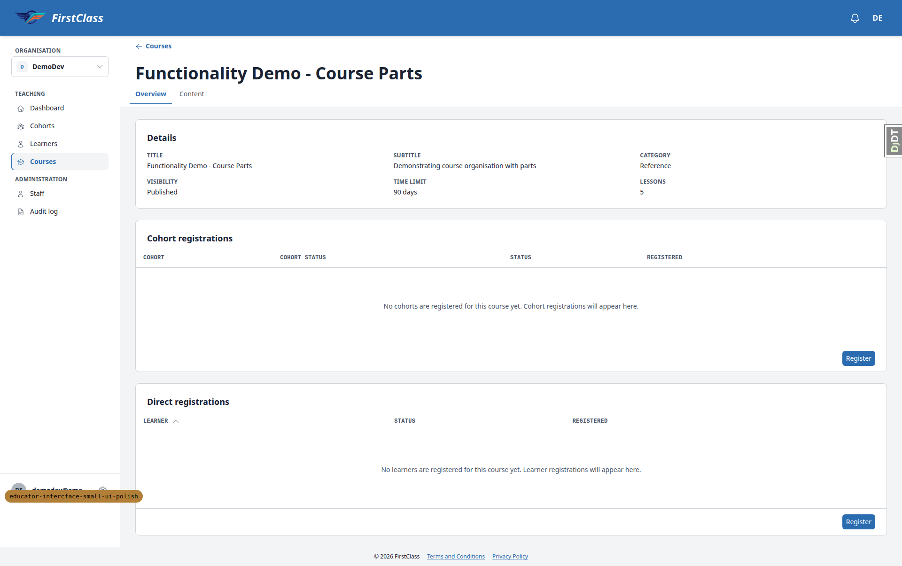 |
| 1 | Overview and Content tabs (layout) | mobile | pass | 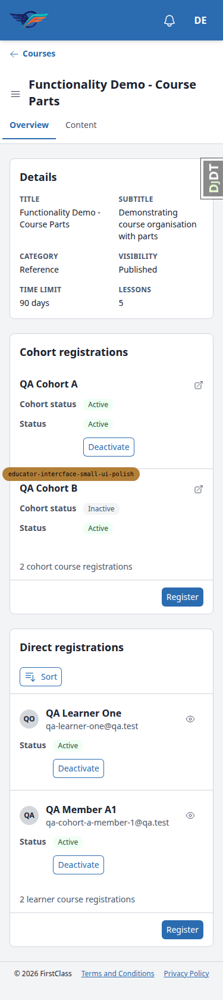 |
| 1/3/4 | Tabs and registration panels at 768 | tablet | pass |  |
| 2 | Outline groups start collapsed | desktop | pass | 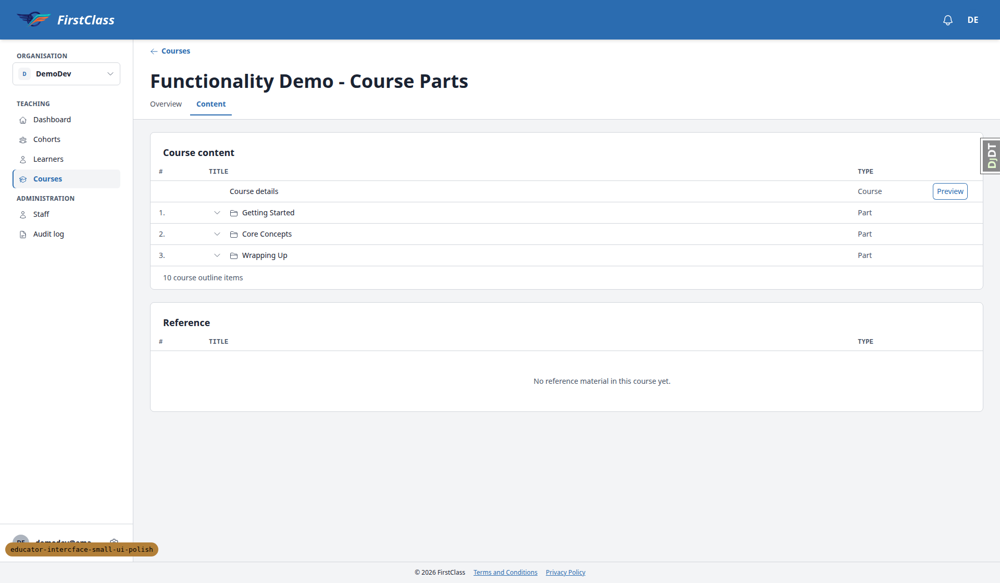 |
| 2 | Outline groups start collapsed | mobile | pass | 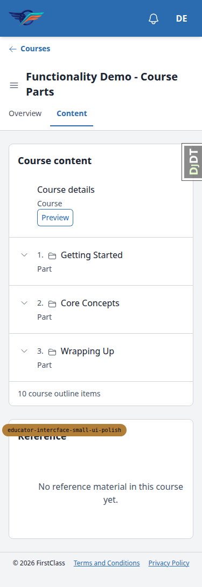 |
| 3 | Register and deactivate a cohort | desktop | pass | 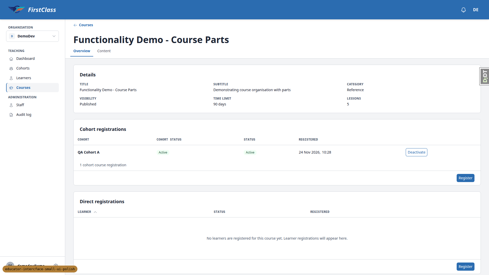 |
| 3-dialog | Register cohort dialog | desktop | pass | 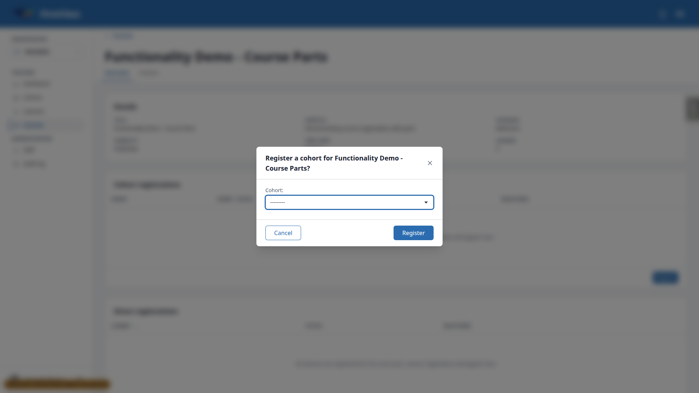 |
| 3-confirm | Deactivate confirmation from course page | desktop | pass | 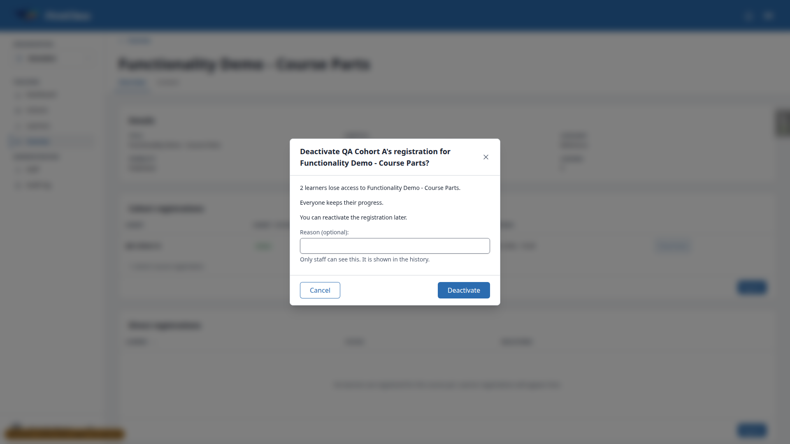 |
| 3-dialog | Register cohort dialog footer | mobile | pass | 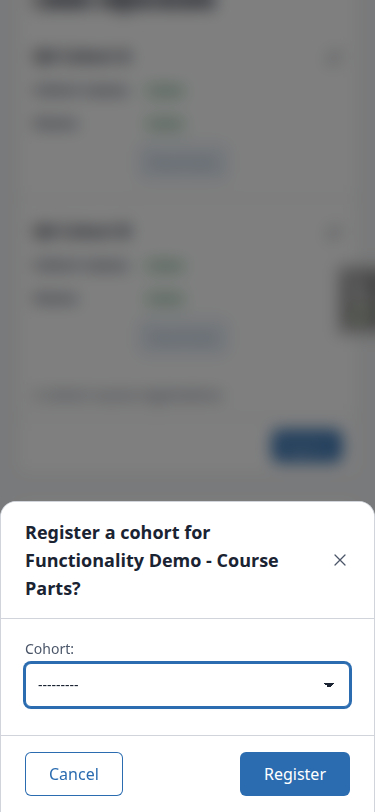 |
| 3/4-cards | Registration card row buttons start at the title's left edge | mobile | FAIL (B1) |  |
| 4 | Register, deactivate and reactivate a learner | desktop | pass | 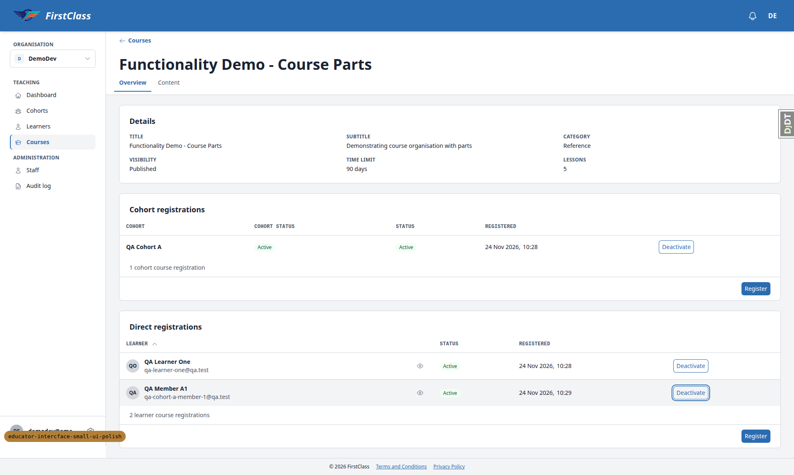 |
| 4-confirm | Learner Deactivate dialog names the cohort keeping access | desktop | pass | 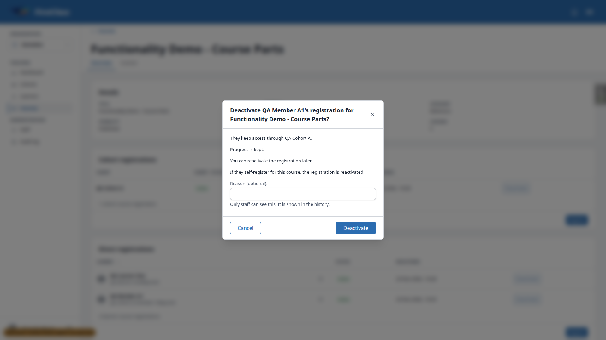 |
| 5.1 | Stale tab, deactivated cohort registration | desktop | pass | no screenshot |
| 5.2 | Inactive cohort refusal | desktop | pass | 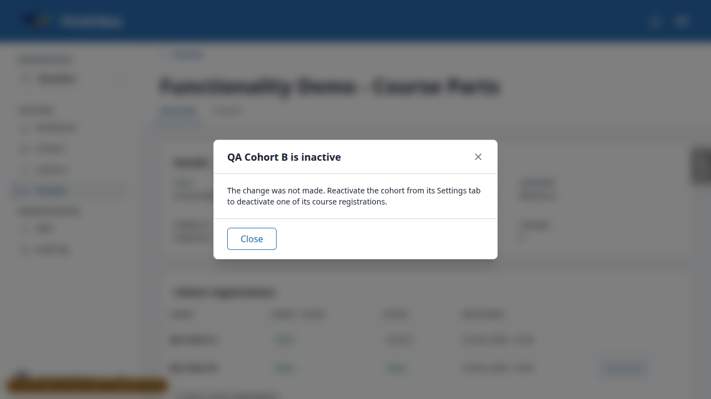 |
| 5.3 | Course not available to the organisation | desktop | pass | 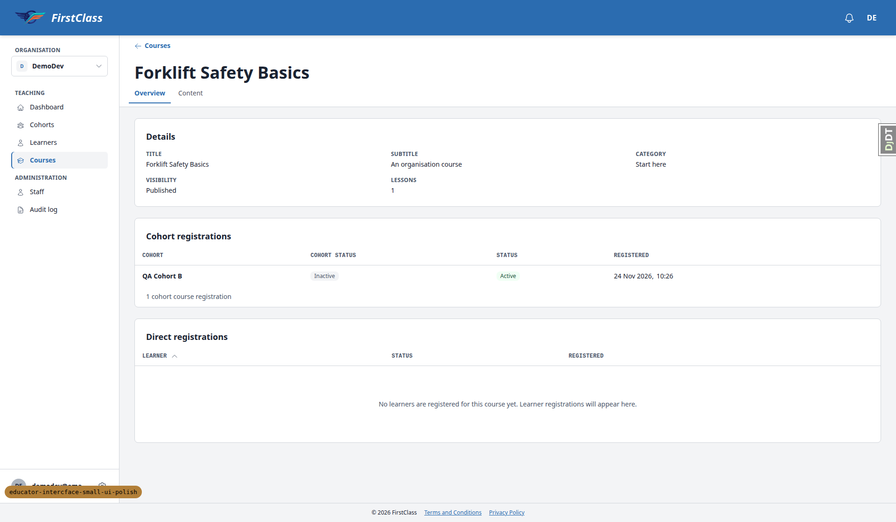 |
| 5.4 | Hand-edited action URL | desktop | pass | no screenshot |
| 6 | Cohort admin sees only own cohort's rows | desktop | pass |  |
| 7 | Previous and Next in the preview | desktop | pass |  |
| 7 | Previous and Next in the preview | mobile | pass | 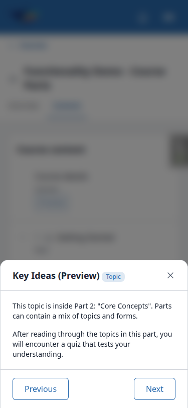 |
| 7 | Previous and Next in the preview | tablet | pass | 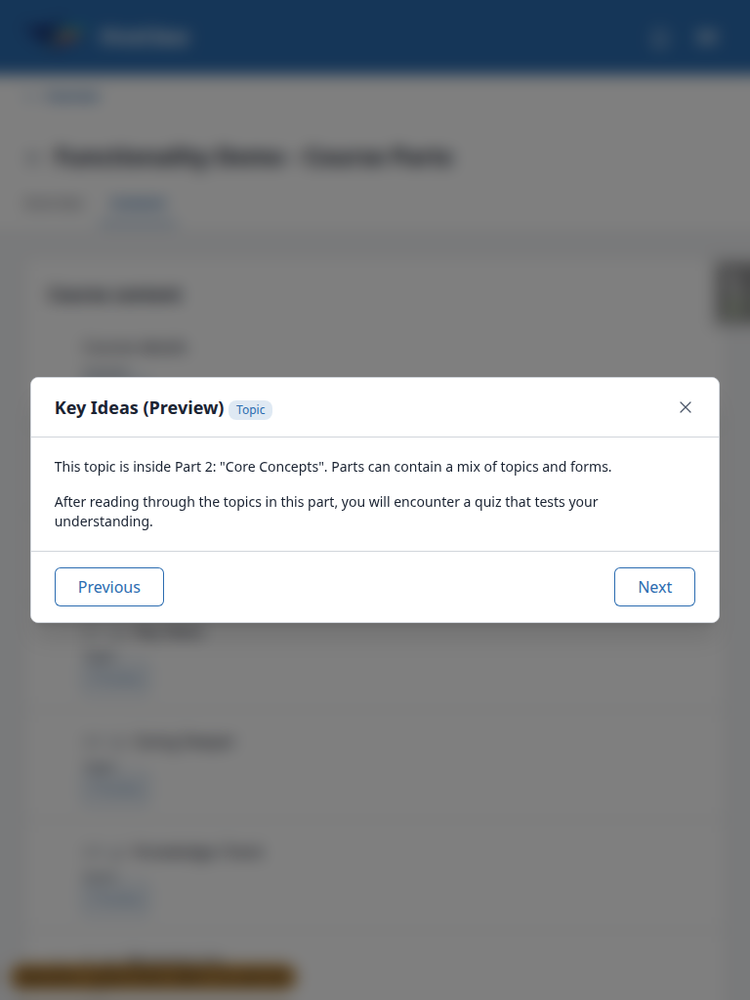 |
| 8 | Quiz facts | desktop | pass | 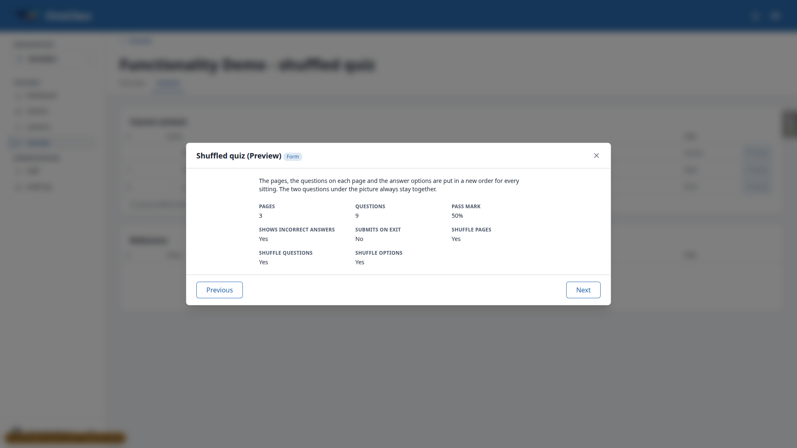 |
| 8.4 | Multi-page survey shows count chips, no facts list | tablet | pass | 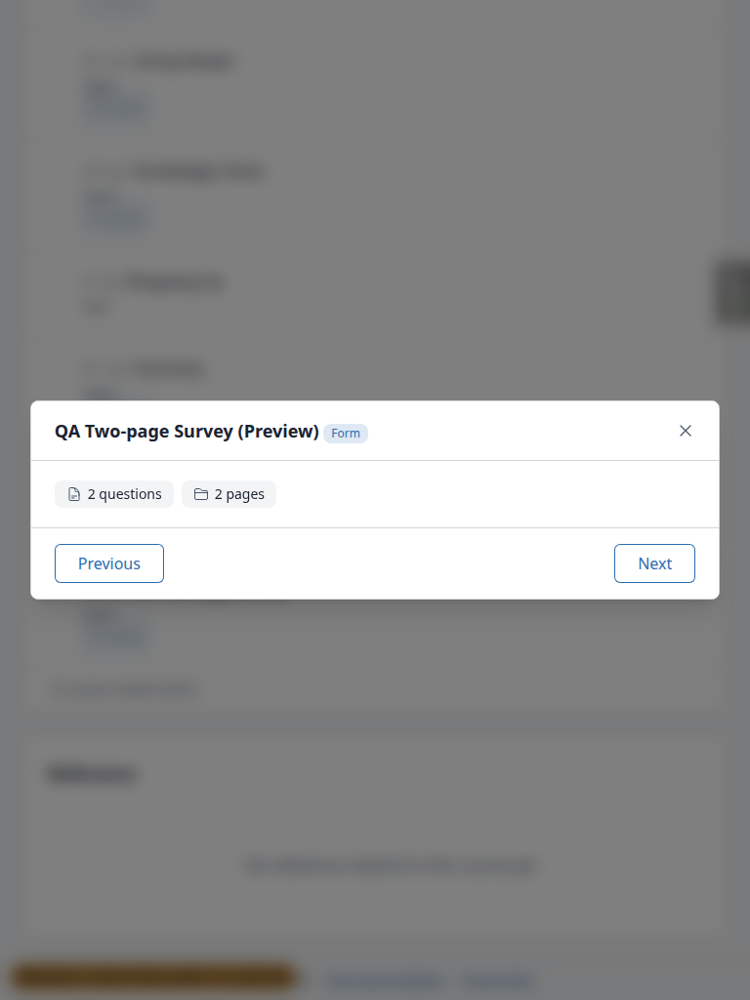 |
| 9 | Button labels centred, First Class theme | desktop | pass | 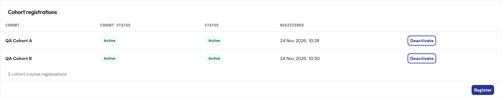 |
| 9 | Button labels centred, First Class theme | mobile | pass | 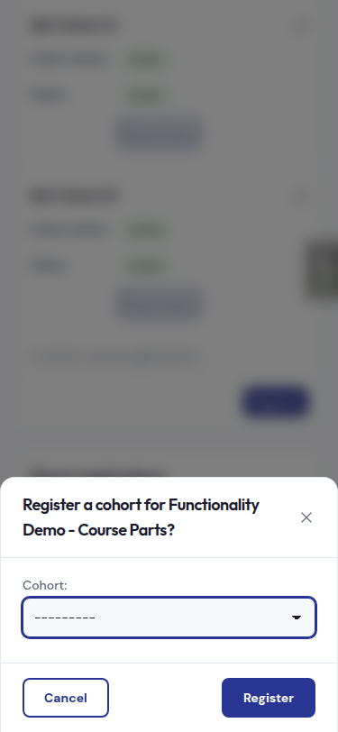 |

Notes on the key passes:

- Test 1: Overview and Content tabs present. Overview shows Details, Cohort registrations and Direct registrations with no outline. Content click goes to `/__tabs/content` with Course content then Reference. A direct reload keeps Content current. The cohort page's tabs are unchanged.
- Test 2: parts start with `aria-expanded=false`, Core Concepts opens and closes, the Shuffled quiz's multi-page row starts collapsed, and the Reference Material parts start collapsed.
- Test 3: dialog lists active unregistered cohorts and not QA Cohort Inactive. The row appears in place, the Deactivate dialog matches the cohort page's, and re-registering gives one active row. A double-click gives one row. Cohort Courses tab and History behave as before.
- Test 4: the row appears in place, Deactivate and Reactivate work, and the dialog says "They keep access through QA Cohort A." for a cohort member. The learner page's Registrations card still works.
- Test 5: stale actions answer 404 "This is no longer available" or 422 "QA Cohort B is inactive. The change was not made." Nothing changed, no 500. Footer Register buttons are absent for a course not available to the organisation. A hand-edited registration UUID gives 404.
- Test 6: a cohort admin sees only QA Cohort A, Register says "Every cohort you can register already has this course.", Direct registrations shows only QA Member A1, and the learner picker lists only QA Member A2.
- Test 7: Previous disabled at the start, Next disabled at the end, buttons keep their x positions, focus lands on the new title, Tab stays inside the dialog. Esc, header X and backdrop close with no prompt. Multi-page forms step through Page 1 of 3, 2 of 3, 3 of 3. The Reference panel never reaches Course content. On mobile Previous and Next are 44px tall.
- Test 8: quiz facts shown on the one-page and multi-page quiz own rows, absent on page previews and surveys. A quiz with no pass mark reads "None set". A multi-page survey keeps its count chips.
- Test 9: with FLS_THEME=first_class, cap-height centre of each label measured 0px from its button centre. Heights are consistent per size. Mobile dialog footer buttons are 44px and row buttons stay 32px.

## Diff scoping

Class: FULL. Changed files that triggered it (about 50) include:

- Skill docs: `claude_plugins/fls-dev/skills/alpine-js/SKILL.md`, `educator-interface/SKILL.md`, `panel-framework/SKILL.md`
- Educator panels, forms and templates: `freedom_ls/educator_interface/forms.py`, `panels/cohort/actions.py`, `panels/common/course_page.py`, `panels/common/registration_actions.py`, `panels/course/{actions,content_preview,data_table_panels,data_tables,instance_view}.py`, `panels/learner/actions.py`, the two registration action data-table cell templates, `modal/content_preview.html`, `modal/course_details_preview.html`, `partials/preview_stepping_footer.html`
- Panel framework: `alpine-components.js`, `tables.py`, `cotton/data-table.html`, `cotton/modal-footer.html`, `_data_table_region_base.html`, `reference/_examples.html`
- Test files, test helpers and the DM Sans SemiBold test font and its licence

Nothing was skipped. Desktop, mobile and tablet passes all ran.

## Smoke gate

Outcome: pass. Pages loaded: `/` and `/educator/organisations/demodev/courses/531adc02-f240-4c7b-87f7-956a804c1e22`. No failure URL or reason.

## Design check

No design states exist for this spec, so no design check ran: no design states tested. Test 7 explicitly states "Design reference: none" and was judged against its expectation list.

## Bug B1: Card row buttons sit in the value column instead of at the card title's left edge

Manifestations:

- `3/4-cards`, mobile

Screenshots:

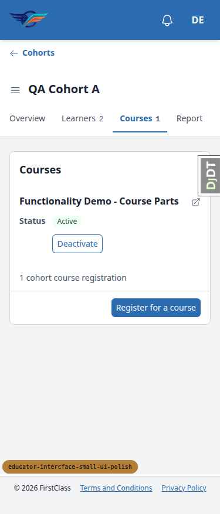

Expected: per the panel-framework visual checklist, a list row's or card's entry buttons sit in a footer under the entry's title and detail, starting at the title's left edge (x=33 at 375px).

Actual: on narrow widths, the course page's Cohort registrations card (Deactivate at x=140) and Direct registrations card (Deactivate at x=89), and the cohort page's Courses tab card, render the Deactivate button indented under the field values (the value column), not at the title's left edge. The pattern is pre-existing on the cohort Courses tab, and the new course-page cards reuse the same card actions cell. No horizontal scroll and the row buttons stay small (32px).

## Layout probe

| Test id | Viewport | URL | Screenshot | Result |
|---|---|---|---|---|
| 1 | desktop | `/educator/organisations/demodev/courses/531adc02-f240-4c7b-87f7-956a804c1e22` |  | clean |
| 2 | desktop | `/educator/organisations/demodev/courses/531adc02-f240-4c7b-87f7-956a804c1e22/__tabs/content` |  | clean |
| 1 | mobile | `/educator/organisations/demodev/courses/531adc02-f240-4c7b-87f7-956a804c1e22` |  | clean |
| 1 | tablet | `/educator/organisations/demodev/courses/531adc02-f240-4c7b-87f7-956a804c1e22` |  | clean |

## Data changes

| What changed | Made by | Files written |
|---|---|---|
| QA Cohort A (2 members), QA Cohort B (registered for Forklift Safety Basics, a course not available to demodev), QA Cohort Inactive, QA Learner One, QA Cohort Admin (cohort_admin on QA Cohort A); Question pool quiz pass mark set to None. Rebuild: `uv run python manage.py qa_create_educator_small_polish_scenario` | `sdd:qa-data-helper` | `freedom_ls/qa_helpers/management/commands/qa_create_educator_small_polish_scenario.py` |
| QA Two-page Survey (CATEGORY_VALUE_SUM, 2 pages) appended to Course Parts' Wrapping Up part; scenario command re-run (QA Cohort B active again) | `sdd:qa-data-helper` | `freedom_ls/qa_helpers/management/commands/qa_create_educator_small_polish_scenario.py` |

## Bug status

| Bug | Title | Status |
|---|---|---|
| B1 | Card row buttons sit in the value column instead of at the card title's left edge | **UNRESOLVED** (reason: the one fix attempt, 3a19e5fee, moved header-less columns into a card footer but the footer rendered no buttons at 375px, so every card lost its Deactivate; reverted in 964c0d9bc) |

## General notes

- Tests 5.1 and 5.4 have no screenshot: the result is a 404 dialog or response, recorded in text.
- The two console errors on the page used for Test 5.4 are the deliberate 404 fetches of the hand-edited URLs, not defects.
- B1 is pre-existing on the cohort page's Courses tab; the new course-page cards inherit it from the shared card actions cell. Whether it is in scope for this spec is a triage decision.
- Test 9 steps 1 and 4 (build with `FLS_THEME=first_class`, then restore the default theme build) are not separately recorded in the scratch file. The cleanup is not evidenced here.
- The scratch file records the mobile layout probe for test 1 as clean even though B1 was found on the same screenshot. B1 is a visual-checklist finding, not a layout flag.
- The QA scenario command `qa_create_educator_small_polish_scenario.py` and the `screenshots/` folder are currently untracked in git.

status: ok · reason: 1 bug — 0 fixed, 1 unresolved; report rendered, screenshots verified
