# Frontend QA report: educator interface small UI polish

Result: all tests (1 to 9) passed at desktop, mobile and tablet. No bugs found.

## Methodology

Screenshots were collected into `screenshots/` beside this report, and every image referenced below exists there. The run followed `3. frontend_qa.md`: the QA scenario management command was run directly at the start of the run to seed data, then Tests 1 to 9 ran at desktop (1920x1080), with mobile (375x812) and tablet (768x1024) passes for the visual tests. Test 6 ran as QA Cohort Admin in a separate browser context, so the admin session was untouched. Test 9 rebuilt Tailwind with `FLS_THEME=first_class`, then restored the default theme afterwards.

## Diff scoping

Class: FULL. Changed files that triggered it: educator_interface templates, panel_framework templates, panel_framework `alpine-components.js`, plus Python, tests, docs and spec files (65 paths). Nothing was skipped: desktop, mobile and tablet all ran.

## Smoke gate

Pass. Pages loaded: `/` and `/educator/organisations/demodev/courses/531adc02-f240-4c7b-87f7-956a804c1e22`.

## Test results

| Test | Viewport | Result | Screenshot | Notes |
|---|---|---|---|---|
| 1 Overview and Content tabs | desktop | pass | 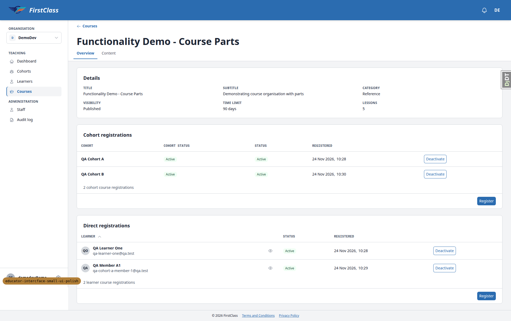 | Overview is selected by default with Details, Cohort registrations and Direct registrations, and no outline. The Content tab URL ends `/__tabs/content`. A direct reload keeps Content selected. The cohort page tabs are unchanged. |
| 2 Outline groups collapsed | desktop | pass | none | Course Parts parts start `aria-expanded=false`. Core Concepts opens and closes. Reference Material parts start collapsed. The nested multi-page form "QA Two-page Survey" stays collapsed when Wrapping Up opens. The non-outline child-row check is N/A: `/panel-framework/reference/` is not routed (404). |
| 3 Register and deactivate a cohort | desktop | pass | 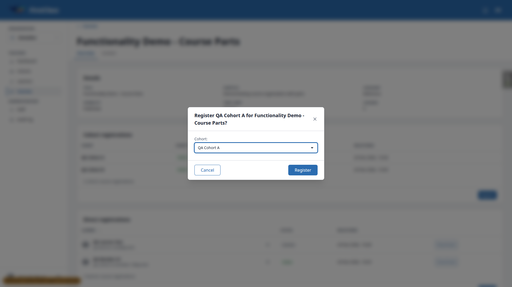 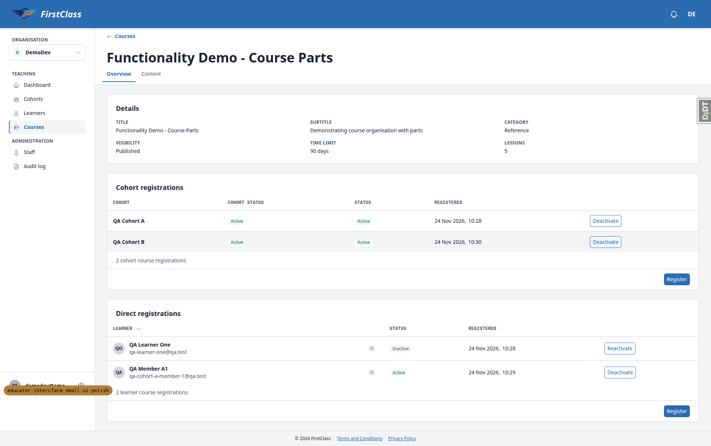 | The picker lists QA Cohort A and B, never Inactive. Register swaps the panel in place. The Deactivate confirmation shows. Re-registering reactivates the same single row. The cohort page Courses and History tabs are correct. A double-click on Register gave one row. |
| 4 Register, deactivate and reactivate a learner | desktop | pass | none | The learner picker is single-select. Registering QA Learner One swaps the panel in place. The dialog says "They keep access through QA Cohort A." for QA Member A1. Reactivate works. The learner page Registrations card still works. See the observation in General notes. |
| 5 Refusals and stale pages | desktop | pass | 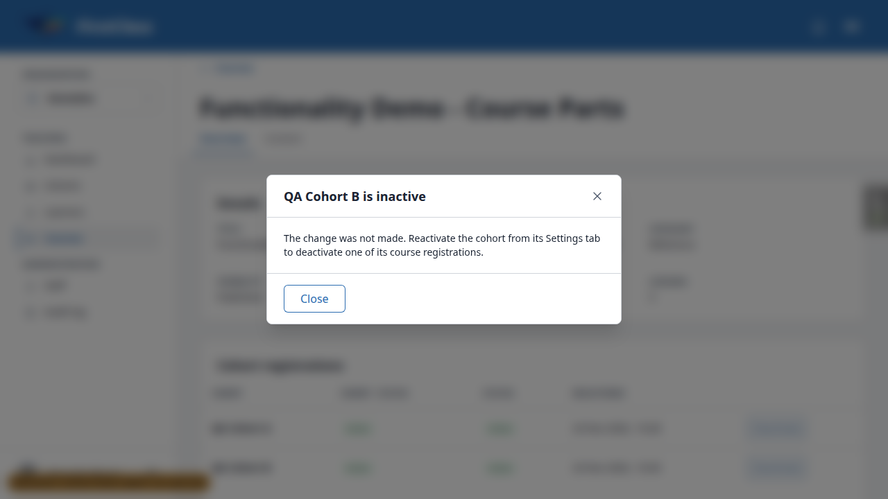 | A stale Deactivate shows "This is no longer available" (404, in the dialog). QA Cohort B inactive: the row has no actions and a stale confirm returns 422. A course listed only via a cohort registration has no footer Register. A hand-edited `registration=` UUID returns 404. No 500s in the server log. |
| 6 Cohort admin sees only own rows | desktop | pass | 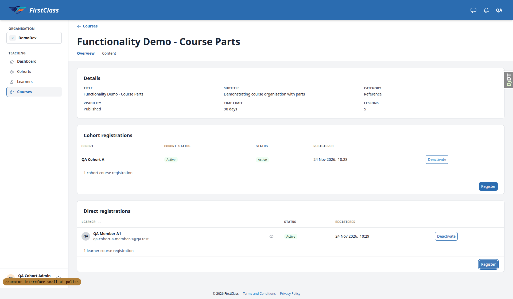 | Only QA Cohort A and QA Member A1 are shown, with Deactivate. The cohort Register says "Every cohort you can register already has this course." The learner Register lists only QA Member A2. |
| 7 Previous and Next in the preview | desktop | pass | 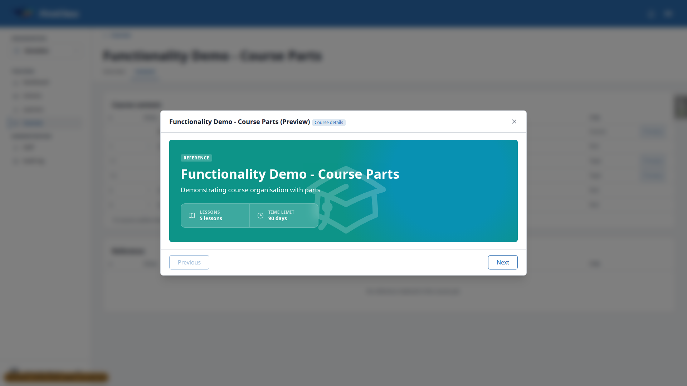 | Footer has Previous (left, disabled) and Next (right), with no Close. Stepping crosses the part boundary and reaches the multi-page form pages, where Next is disabled. Focus lands on the title. Esc, X and backdrop each close with no discard prompt. The Reference panel never steps into Course content. |
| 8 Quiz facts | desktop | pass | 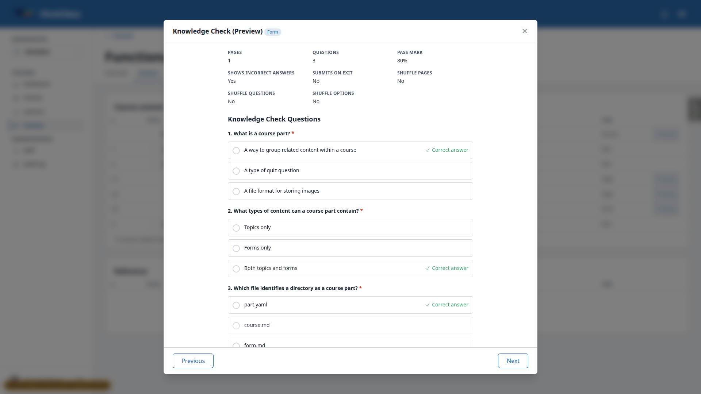  | Knowledge Check shows the facts list. Multi-page quiz own rows show the same list and no count chips. Page previews show no list. A quiz with no pass mark reads "None set". Surveys show no list, and a multi-page survey shows count chips. |
| 1, 3, 4 | mobile | pass | 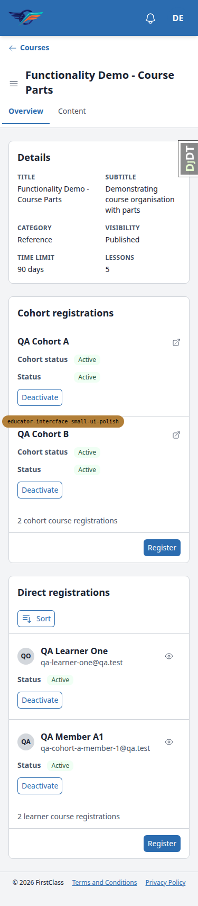 | No horizontal scroll (scrollWidth 375). Row and footer buttons are 32px with the documented 44px hit area. Register dialog controls are 44px. |
| 2 | mobile | pass | none | Card list parts start collapsed and open on tap. |
| 7 | mobile | pass | 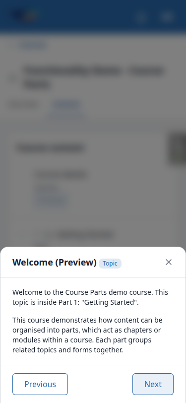 | Bottom sheet. Previous (112x44) and Next (83x44) sit side by side. |
| 8 | mobile | pass | 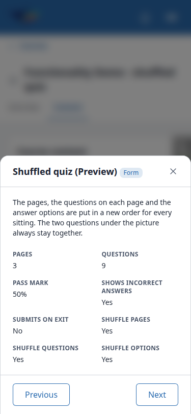 | Facts reflow to two columns. |
| 1, 3, 4 | tablet | pass | 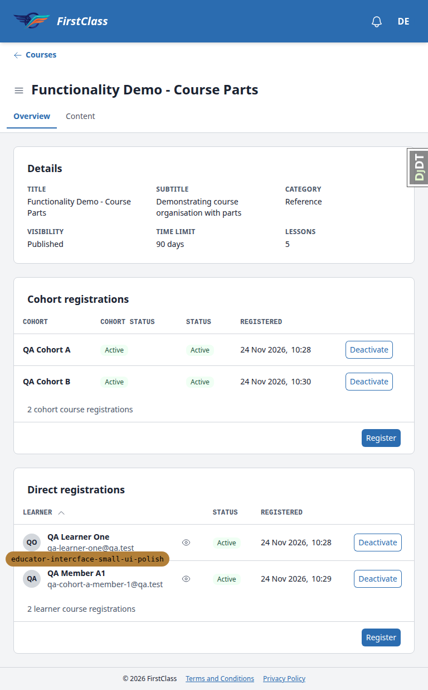 | Hamburger nav. Tables keep their columns. |
| 2, 7, 8 | tablet | pass | 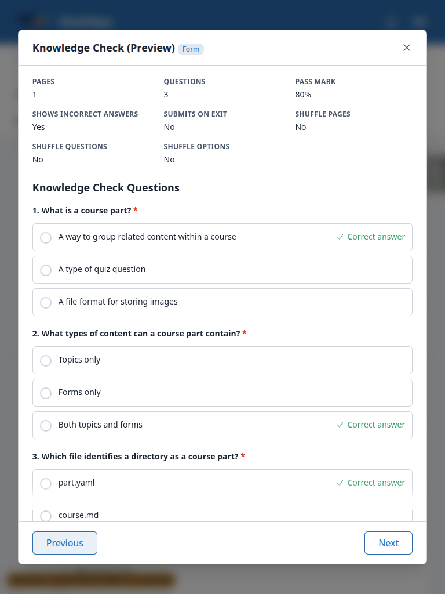 | Centred dialog with the facts in three columns. |
| 9 First Class centring | desktop | pass | 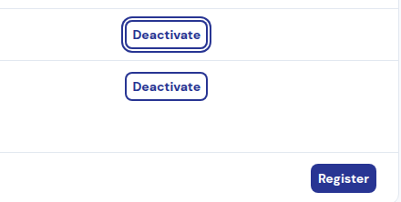 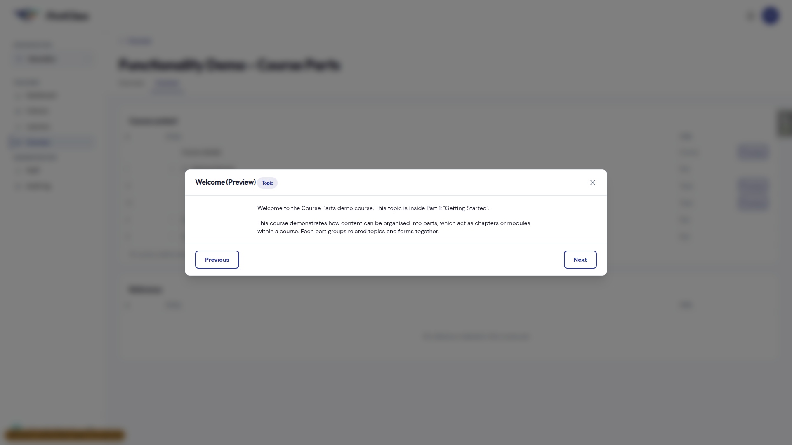 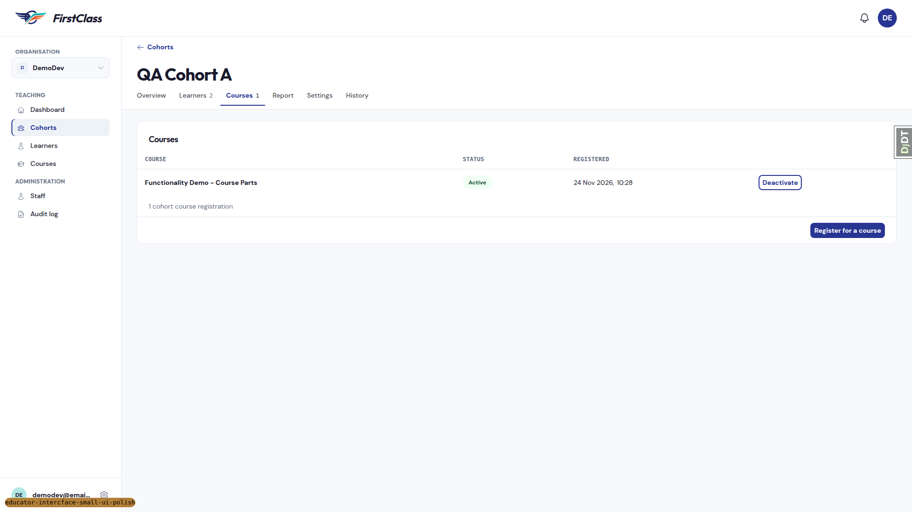 | The label-to-button centre offset is 0.00px for every checked button. Icon-only buttons centre their icons. |
| 9 First Class | mobile | pass | 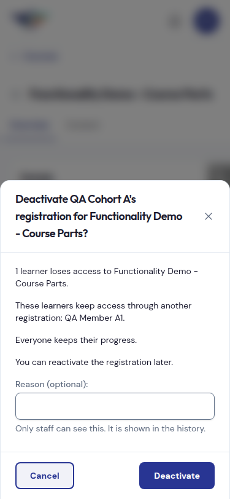 | Row and footer buttons are 32px. Dialog buttons are 44px with centred labels. Cleanup restored the default theme, with no changed tracked build file. |

## Design check

No design states tested.

## Layout probe

| Test id | Viewport | URL | Screenshot | Result |
|---|---|---|---|---|
| 1 | desktop | /educator/organisations/demodev/courses/531adc02-f240-4c7b-87f7-956a804c1e22 | [shot](screenshots/page-2026-11-24T15-12-11-800Z.png) | clean |
| 3 | desktop | /educator/organisations/demodev/courses/531adc02-f240-4c7b-87f7-956a804c1e22/__tabs/overview | [shot](screenshots/page-2026-11-24T15-14-50-116Z.png) | clean |
| 1 | mobile | /educator/organisations/demodev/courses/531adc02-f240-4c7b-87f7-956a804c1e22 | [shot](screenshots/page-2026-11-24T15-20-26-262Z.png) | clean |
| 1 | tablet | /educator/organisations/demodev/courses/531adc02-f240-4c7b-87f7-956a804c1e22 | [shot](screenshots/page-2026-11-24T15-21-22-685Z.png) | clean |

## Data changes

| What changed | Made by | Files |
|---|---|---|
| Seeded or confirmed QA cohorts A, B and Inactive, QA Learner One, QA Cohort Admin, the Forklift registration for Cohort B, a no-pass-mark quiz, and QA Two-page Survey in Wrapping Up | `qa_create_educator_small_polish_scenario` management command, run directly at the start of the run (not via the data helper) | none |
| The `sdd:qa-data-helper` was asked to delete three leftover Course Parts registrations from an earlier run (Cohort A, Cohort B, QA Learner One direct), plus three empty CourseProgress rows blocking them. The permission system refused the delete, so nothing changed. The run worked around it by deactivating those rows through the educator UI. | `sdd:qa-data-helper` (refused); educator UI (workaround) | none |
| QA Cohort B deactivated then reactivated from its Settings tab. Course Parts registrations for QA Cohort A, QA Cohort B and QA Learner One cycled through deactivate and reactivate, and left active. | educator UI (the feature under test) | none |

## Bug status

No bugs recorded. None.

## General notes

- Observation (not a failure): the learner Register picker lists learners in a non-alphabetical order (QA Member A2 after demodev_s9, QA Learner One after demodev_s10). The spec sets no order, so no action is attached.
- Test 2's non-outline child-row check is N/A: `/panel-framework/reference/` is not routed (404).
- The leftover registrations from an earlier run could not be deleted, because the permission system refused the data helper's delete. They were deactivated through the UI instead, so the earlier run's rows still exist in the database as inactive.
- Screenshot compression ran and found nothing over the size limit.
- No 500s in either server log. No console or horizontal-scroll problems at any viewport.

status: ok · reason: report rendered, 0 bugs documented
