# Frontend QA report: educator-interface-10-reporting-dashboards

The run executed the plan in `3. frontend_qa.md` across desktop, mobile and tablet viewports. There are 34 test records: 31 pass and 3 fail. Three bugs are documented (B1, B2, B3). B1 is a layout bug on the Report tab on narrow screens, B2 is a data inconsistency on the learner Courses tab, and B3 is a cosmetic bug (stray list bullets). The smoke gate passed. Every referenced screenshot exists in `screenshots/`.

## Methodology

Playwright MCP was driven by hand against a dev server on port 8339, logged in as the plan's users. The dev DB was migrated and seeded with `create_demo_data` plus the commands in the plan's section 0. Screenshots were collected into `screenshots/` beside this report, and every referenced image exists there. Test steps that changed data were reverted. These were deactivating a cohort or learner, renaming, and setting `REPORTS_MAX_LEARNERS=6` temporarily in `settings_dev.py`. See General notes for data the run left in the dev DB.

## Diff scoping

Class: FULL. It was triggered by template changes, for example:

- `freedom_ls/educator_interface/templates/educator_interface/panels/dashboard.html`
- `freedom_ls/educator_interface/templates/educator_interface/panels/dashboard_region.html`
- `freedom_ls/educator_interface/templates/educator_interface/panels/learner_courses.html`
- `freedom_ls/educator_interface/templates/educator_interface/panels/cohort_report_downloads.html`
- `freedom_ls/panel_framework/templates/cotton/panel-attention-row.html`
- `freedom_ls/panel_framework/templates/cotton/panel-stat-tile.html`

Desktop, mobile and tablet viewports all ran. Nothing was skipped.

## Smoke gate

Status: pass. Pages checked:

- http://127.0.0.1:8339/
- http://127.0.0.1:8339/educator/organisations/demodev/dashboard

There was no failure URL and no failure reason.

## Design check

No design states tested.

## Results table

| Test | Viewport | Status | Note | Screenshot |
|---|---|---|---|---|
| 1.1-1.6 | desktop | pass | Org admin dashboard: tiles render, lazy figures fill without reload, attention list capped at 12 of 54 | 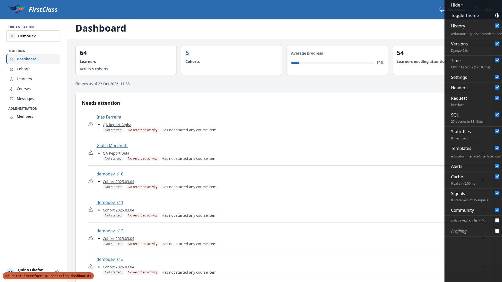 |
| 1.7-1.8 | desktop | pass | Name link opens the learner page; quick view drawer opens and Escape closes it | 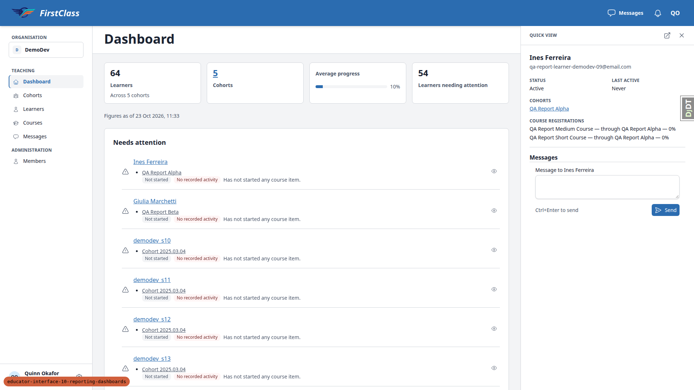 |
| 1.9-1.10 | desktop | pass | Cohort progress rows ordered correctly, em-dash cohorts last; links work | 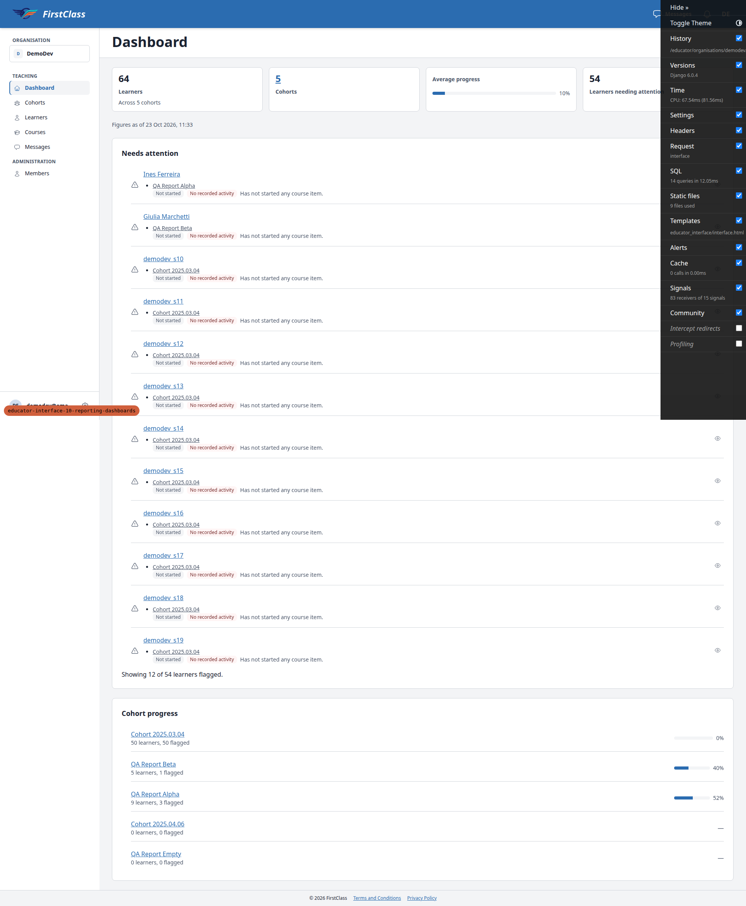 |
| 2.1-2.3 | desktop | pass | Cohort viewer sees only QA Report Alpha; Beta URL returns 404 | 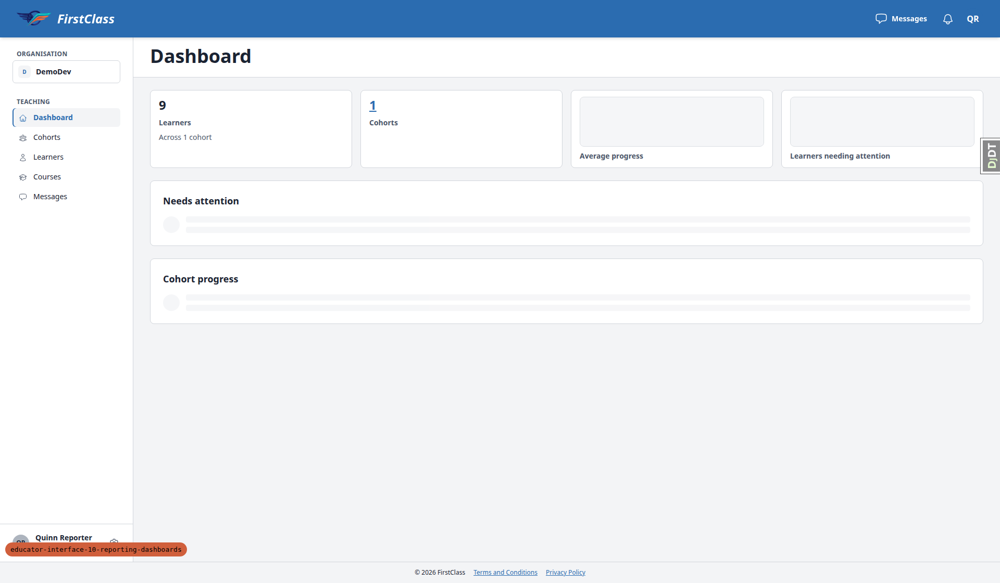 |
| 3.1-3.2 | desktop | pass | New empty org shows "You have no cohorts yet" | 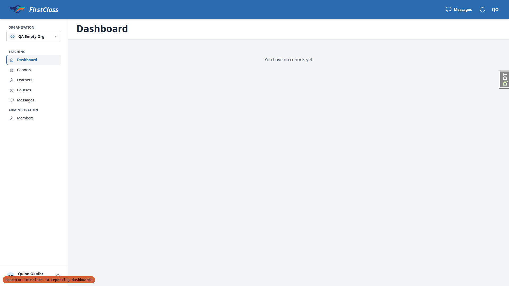 |
| 3.3 | desktop | pass | Alpha deactivated: viewer sees "No cohorts are assigned to you"; reactivated |  |
| 5.1-5.4 | desktop | pass | Overview attention card loads lazily; rename re-fetches the panel; tab order correct | 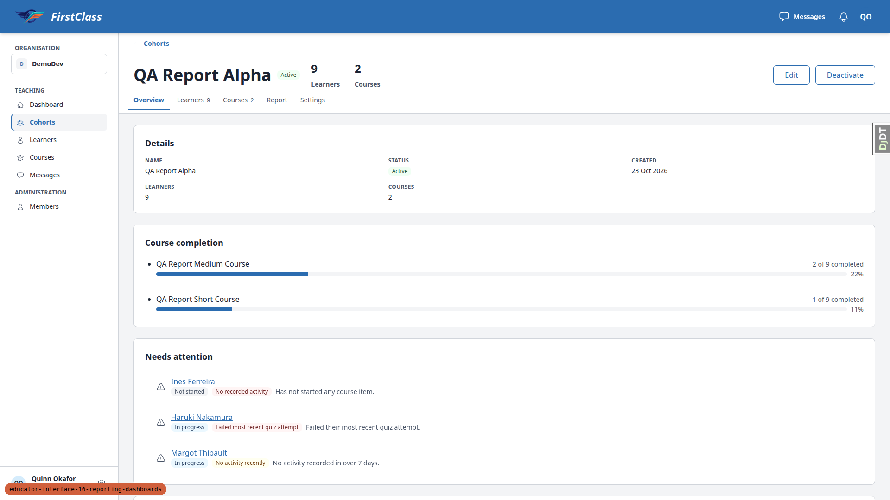 |
| 6.1-6.2 | desktop | pass | Report tab: Downloads panel first, then the cohort report panel | none |
| 6.3 | desktop | pass | Generate swaps to Download PDF; in-flight state not shown in dev (see General notes) | none |
| 6.4 | desktop | pass | PDF filename and at-a-glance figures match the screen | none |
| 6.5 | desktop | pass | Concurrent Generate clicks produce one new report row | none |
| 6.6 | desktop | pass | Admin report list shows 3 ready reports; Download returns a PDF | 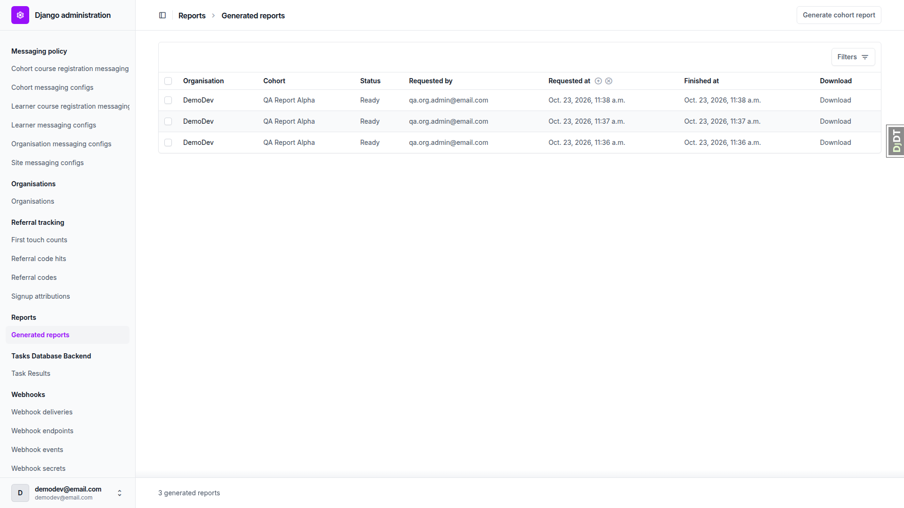 |
| 7.1-7.2 | desktop | pass | Failed row shows error and "Try again"; retry produces a fresh PDF | 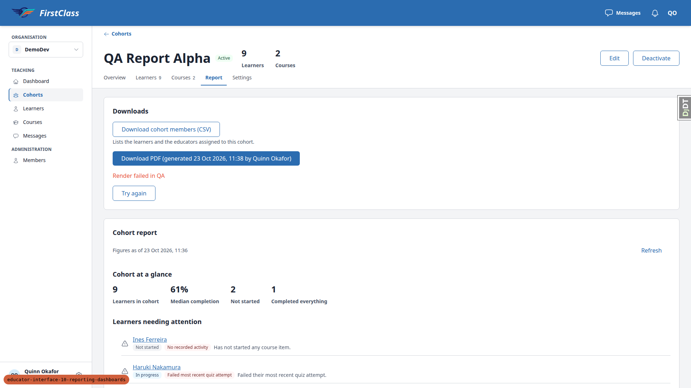 |
| 7.3 | desktop | pass | Stalled state with "Check again"; fresh pending row polls every 3s; failure stops polling | 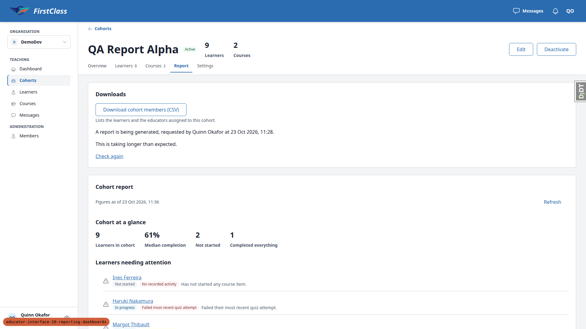 |
| 7.6 | desktop | pass | Cross-cohort and failed report ids return 404 | none |
| 9.1-9.2 | desktop | pass | CSV filename, BOM, columns and ordering correct; accents intact | none |
| 9.3 | desktop | pass | Formula-injection name exported with a leading apostrophe | none |
| 9.4, 8.6 | desktop | pass | Deactivated learner dropped from CSV and Report tab | none |
| 8.1-8.3 | desktop | pass | Report body sections, summary tables and quiz confusions render | 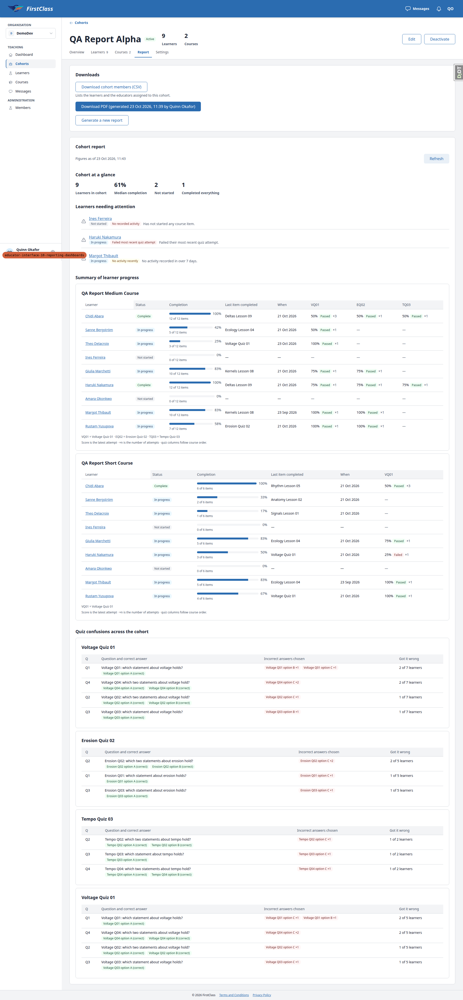 |
| 8.4 | desktop | pass | PDF at-a-glance numbers match on-screen figures | none |
| 8.5 | desktop | pass | Reload keeps cached figures; Refresh updates them | none |
| 8.6 (re-run) | desktop | pass | Warm cache: deactivated learner disappears without Refresh (reactivation caveat in General notes) | none |
| 10.1-10.2 | desktop | fail | Courses tab cards render, but completed items and last completed contradict "3 of 6" (B2); stray bullets (B3) | 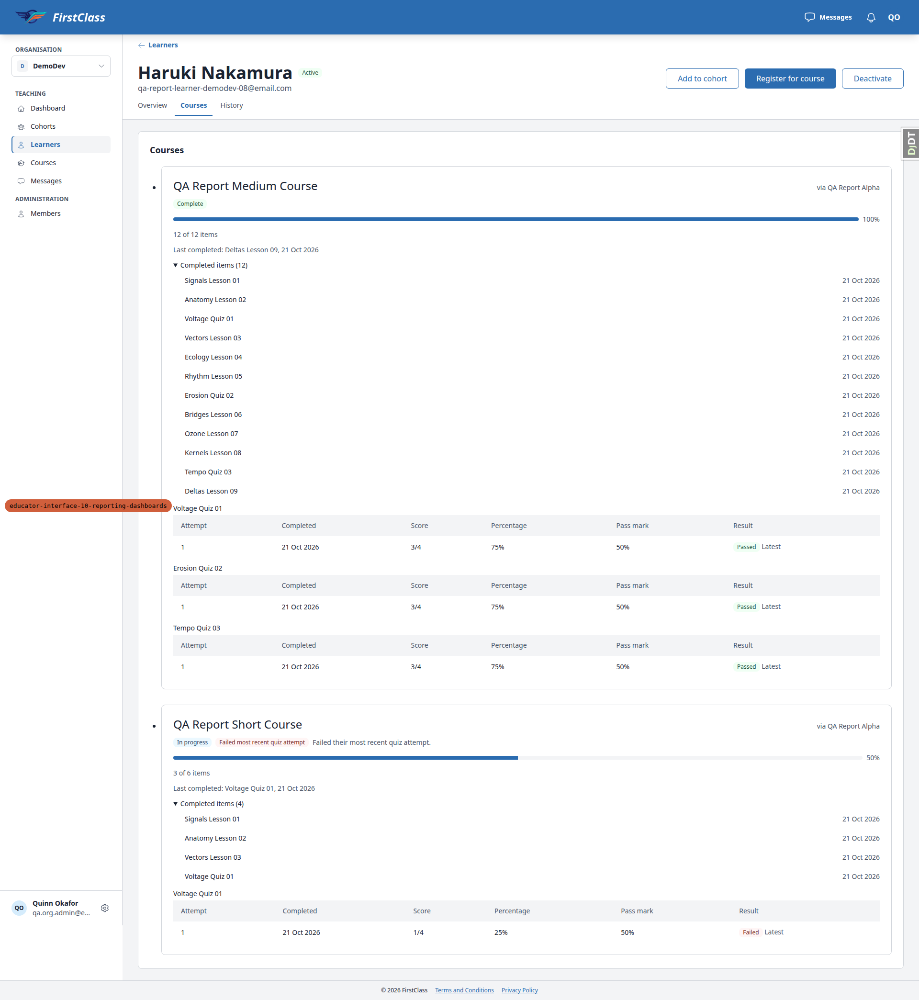 |
| 10.3 | desktop | pass | Individual registration shown as a separate card next to the Alpha card | none |
| 10.4 | desktop | pass | Cohort viewer does not see the Beta registration | none |
| 10.5 | desktop | pass | Learner with no registrations shows "Not registered on any courses yet" | none |
| 7.4 | desktop | pass | Cohort viewer can generate a PDF; no Settings tab | none |
| 7.5 | desktop | pass | Learner opening the PDF URL gets 404 | none |
| 9.5-9.6 | desktop | pass | Viewer downloads CSV; learner gets 404 | none |
| 12.1 (viewer) | desktop | pass | Settings tab 404 for the cohort viewer | none |
| 4.1-4.4 | desktop | pass | With REPORTS_MAX_LEARNERS=6, over-limit cohorts excluded with notices (message wording in General notes) | 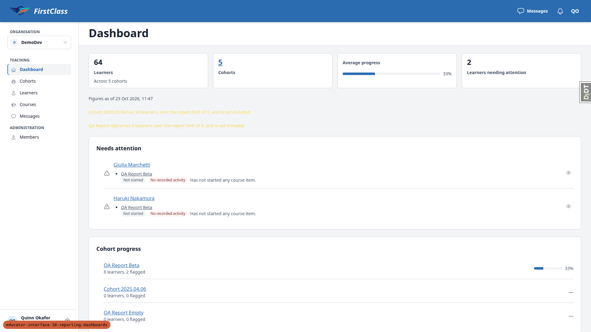 |
| 12.1 | desktop | pass | Org admin sees all Alpha tabs render | none |
| 12.2 | desktop | pass | Admin generate form works and redirects with a message | none |
| 12.3 | desktop | pass | Learners list quick view opens the drawer | none |
| 12.4 | desktop | pass | JS off: "Load the figures" links work (full-page quirk in General notes) | 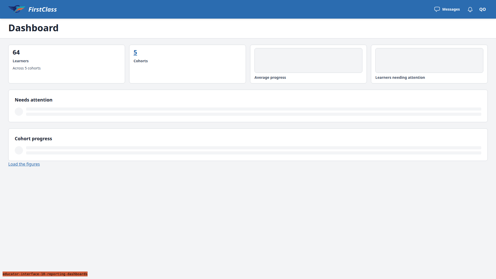 |
| 11.2 | mobile | pass | 375px dashboard: tappable rows, 44px quick view button, no horizontal scroll; stray bullets (B3) | 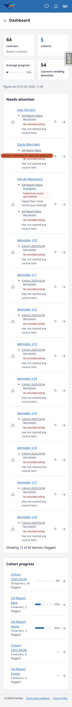 |
| 11.3 | mobile | fail | Report tab scrolls sideways, scrollWidth 910 (B1) | 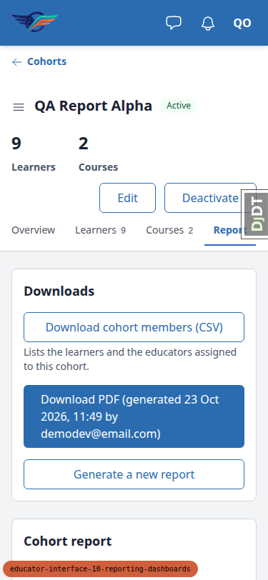 |
| 11.4 | mobile | pass | Courses tab stacks; attempts tables scroll inside wrapper; stray bullets (B3) | 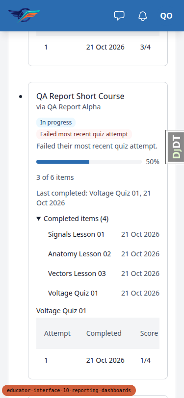 |
| 11.5 | tablet | pass | 768px dashboard: no overflow; Courses tab fine; pulse placeholders captured in 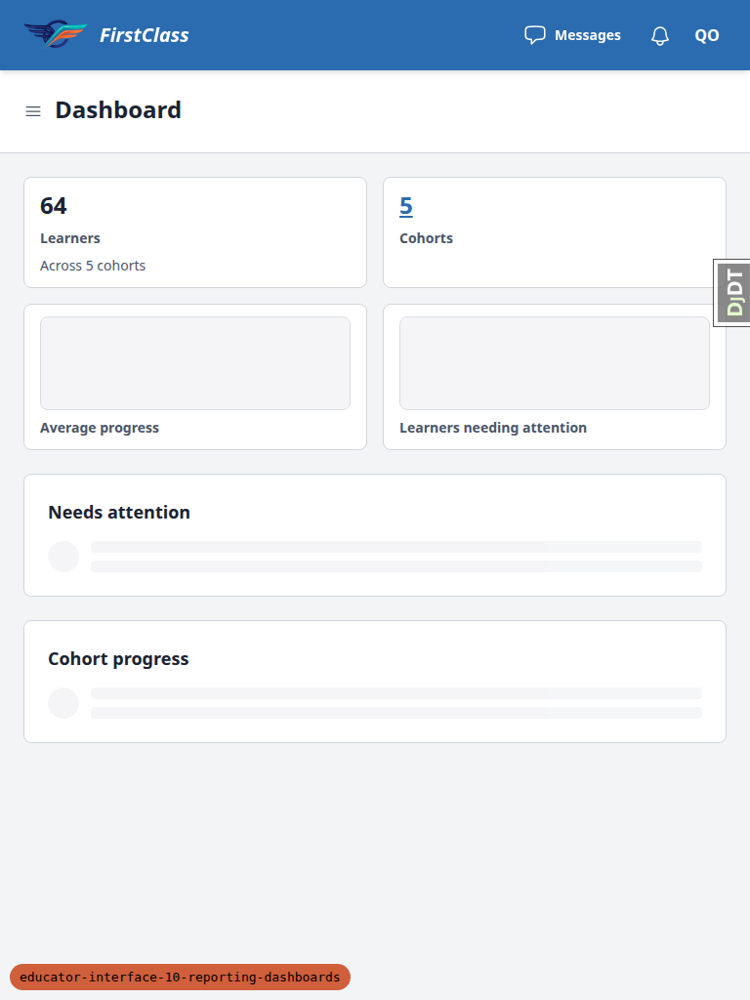 | 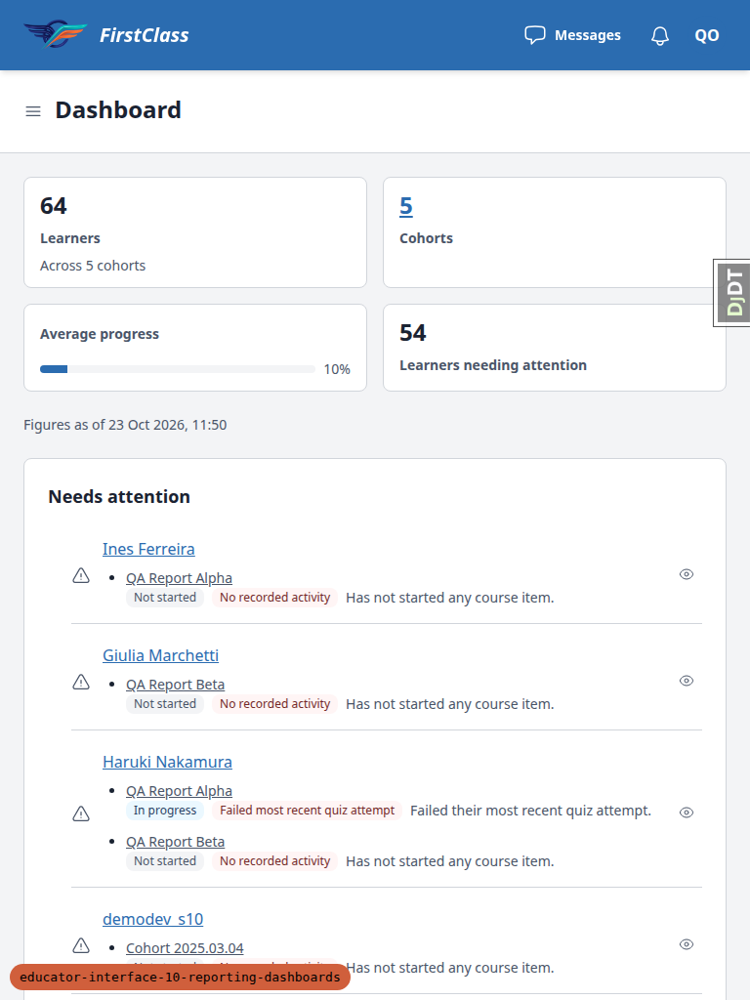 |
| 11.5 (report tab) | tablet | fail | Report tab scrollWidth 934 (B1) | 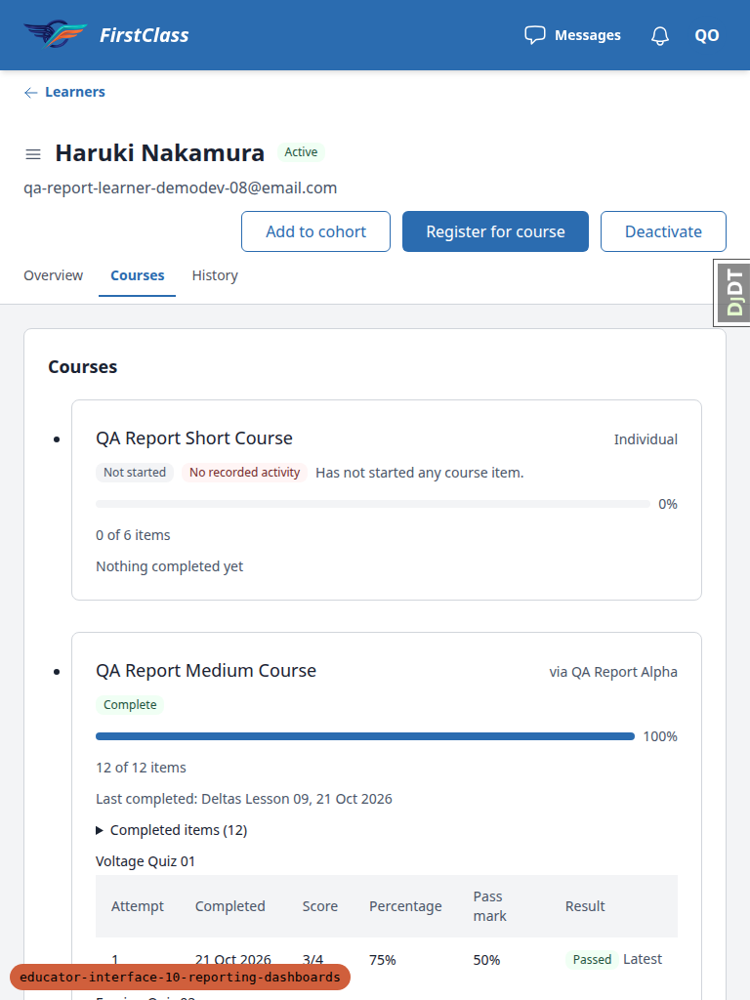 |

## B1: Report tab scrolls sideways on phone and tablet: sr-only quiz-cell text escapes the table's scroll wrapper

Manifestations: 11.3 (mobile), 11.5 report tab (tablet).

Expected: summary tables scroll inside their card, and the page itself does not scroll sideways (scrollWidth equals the viewport width).

Actual: page scrollWidth is 910 at 375 wide and 934 at 768 wide. The "Not attempted" sr-only spans in quiz cells are `position:absolute`. Their nearest positioned ancestor is `.side-panel-grid`, outside the `overflow-x-auto` wrapper, so they are not clipped. Making the wrapper `relative` brings scrollWidth back to 375.

## B2: Learner Courses card counts a failed quiz as completed in "Completed items" and "Last completed", contradicting "N of M items"

Manifestations: 10.1-10.2 (desktop).

Expected: the completed-items list, its count and "Last completed" agree with the "N of M items" figure. That figure counts a quiz only when its latest attempt passed (`attempt_completes_form`).

Actual: Haruki Nakamura, QA Report Short Course shows "3 of 6 items", but "Completed items (4)" includes the failed Voltage Quiz 01, and "Last completed: Voltage Quiz 01". In `freedom_ls/reports/gather.py`, `_completed_items` and `_latest_completion` use `completed_attempts_by_learner_form` (any finished sitting), while `_completion_counts` uses `completed_form_ids_by_learner` (latest sitting passed). The report summary table's "Last item completed" column shows the same inconsistency.

## B3: Stray list bullets beside learner course cards and dashboard attention-row cohort lists

Manifestations: 10.1-10.2 (desktop), 11.2 (mobile), 11.4 (mobile).

Expected: card lists and the cohort list under each attention row render without list markers, like the rest of the interface, which cancels the theme's default bullets with `list-none ml-0`.

Actual: a bullet sits beside each course card on the learner Courses tab (`learner_courses.html:5`, `<ul class='flex flex-col gap-4'>`) and beside each cohort name under a dashboard attention row (`dashboard_region.html:71`, `<ul class='mt-1 space-y-1'>`). Neither has `list-none`.

## Bug status

| Bug | Title | Status |
|---|---|---|
| B1 | Report tab scrolls sideways on phone and tablet | **FIXED** (commit: 7838eef4). `relative` added to the table scroll wrappers in the report body and learner Courses templates. Re-verified: scrollWidth equals the viewport at 375 and 768 on the Report tab and the learner Courses tab. |
| B2 | Failed quiz counted as completed in Courses card lists | **FIXED** (commit: e301e9fd). `_completed_items` and `_latest_completion` now use the same rule as the "N of M" count. Re-verified: Haruki's Short Course card shows "3 of 6 items", "Completed items (3)", "Last completed: Vectors Lesson 03", and the failed attempt is still in the attempts table. The Report row matches after Refresh, and the dashboard and at-a-glance figures are unchanged. |
| B3 | Stray list bullets beside course cards and attention-row cohort lists | **FIXED** (commit: 4e99b04d). `list-none ml-0` added to the course-card, completed-items and attention-row cohort lists. Re-verified: no `li` with a visible marker on the learner Courses tab or the dashboard. |

## General notes

Plan inaccuracies:

- The org admin `qa.org.admin` has password `testpass123`, not the email as the plan says.
- Learner emails are `qa-report-learner-demodev-NN` and `qa-report-beta-demodev-NN`, not `qa-report-learner-NN`.
- The "A report is being generated" state never shows in dev. `TASKS` uses `ImmediateBackend` (`config/settings_base.py`), so the POST blocks while the PDF renders and the response is already the ready state. The in-flight UI was covered by the stalled and pending-row checks in 7.3.

Observations that are not bugs:

- Two identical "Voltage Quiz 01" confusion cards appear on the Report tab with no course label. The seed data gives both the medium and short courses a quiz of that title.
- The over-limit message on the cohort Overview and Report body is the raw exception text, naming `REPORTS_MAX_LEARNERS`: "Cohort 'QA Report Alpha' has 9 learners, exceeding the configured limit of 6 (REPORTS_MAX_LEARNERS)." The dashboard uses educator-facing wording instead.
- With JS off, the dashboard's "Load the figures" link opens a full page (with nav) rather than a bare fragment. The Report tab body link does open a bare fragment.
- A learner reactivated after a gather stays missing from the report until Refresh or cache expiry, if the gather ran while the learner was inactive.
- A learner in two cohorts on the same course shows separate progress per registration, because progress is keyed per registration. Haruki shows "Not started / No recorded activity" in Beta for the medium course he completed via Alpha.

Data the run created stays in the dev DB:

- the QA Empty Org organisation
- Haruki's individual short-course registration and his Beta membership
- extra generated reports
- Theo's quiz attempt

status: ok · reason: 3 bugs — 3 fixed, 0 unresolved; report rendered, screenshots verified
