# QA report: reporting and dashboards (educator interface spec 10)

- Run date: 2026-10-23
- Base URL: http://127.0.0.1:8822/
- Logins used:
  - org admin: qa.org.admin@email.com
  - cohort viewer: qa.report.viewer@email.com
  - site admin: demodev@email.com
  - learner: qa-report-learner-demodev-02@email.com

## Methodology

The test plan was walked manually with Playwright MCP at 1920x1080 (desktop), 375x812 (mobile) and 768x1024 (tablet). Screenshots were collected into `<spec-dir>/screenshots/` and every image referenced in this report exists beside it. Compression ran and found nothing over 1MB.

Some checks were made differently from a plain page walk. HTTP status checks (the 404 checks), CSV contents and the JavaScript-disabled rendering were done with request-level fetches in the same logged-in browser session and with a JavaScript-disabled browser context, as the notes below describe.

## Diff scoping

Class: FULL (templates and HTML changed). Desktop, mobile and tablet all ran. Nothing was skipped.

Changed areas:
- `educator_interface`: reporting module, dashboard and cohort panel templates, learner badges partial, template tags, views and URLs.
- `panel_framework`: attention-row and stat-tile cotton components, plus the reference examples.
- `reports` app.
- `learner_progress` queries.
- Product docs, app structure docs and tests.

## Smoke gate

Status: pass. Pages checked:
- http://127.0.0.1:8822/
- http://127.0.0.1:8822/educator/ (redirects to /educator/organisations/demodev/dashboard)

## Results by scenario

### Scenario 1: dashboard for an organisation admin

No separate record for step 1.1.

| Test | Viewport | Result | Notes |
|---|---|---|---|
| 1.2 | desktop | pass | Org admin lands on /educator/organisations/demodev/dashboard. Four tiles: Learners 67 'Across 6 cohorts', Cohorts 6 (linked), Average progress 9% with bar, Learners needing attention 4. Lazy tiles filled without reload. Note: qa.org.admin's seeded password is testpass123 (qa_create_single_org_educator), not the email as the plan states. |
| 1.3 | desktop | pass | Learners 67 includes the 14 seeded plus pre-existing DemoDev learners (Cohort 2025.03.04 has 50). Cohorts 6 includes Empty. Cohorts tile links to the cohorts list, which lists all QA Report cohorts. |
| 1.4 | desktop | pass | Average progress 9% bar. Needing attention = 4 distinct learners (Haruki Nakamura is flagged in both Alpha and Beta from residue of the earlier QA run and counted once). No Unregistered learner counted. |
| 1.5 | desktop | pass | 'Figures as of 23 Oct 2026, 17:27' shown under the tiles. |
| 1.6 | desktop | pass | Needs attention lists 4 rows, lowest completion first (two Not started, then In progress). Name link has no icon; cohort lines to the right at desktop with cohort link, course titles, status badge, flag badge and the reason sentence visible inline. No Unregistered learner. |
| 1.7 | desktop | pass | Clicking Ines Ferreira opens her learner page. |
| 1.8 | desktop | pass | Quick view icon opens the drawer with name, Status Active, Last active, Cohorts, Course registrations. Close returns to the dashboard without navigation. |
| 1.9 | desktop | pass | Cohort progress: 6 rows, lowest mean first (0%, 0%, 33%, 52%), em dash plus 'No progress to show' for the two empty cohorts, which sort last. Learner and flagged counts shown. |

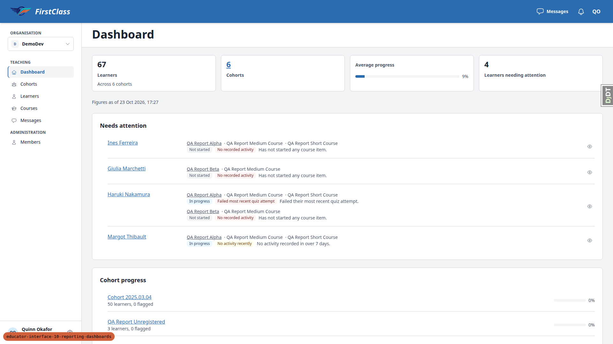

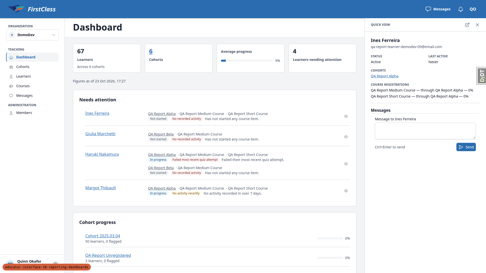

### Scenario 2: dashboard for a cohort viewer

No separate record for step 2.1.

| Test | Viewport | Result | Notes |
|---|---|---|---|
| 2.2 | desktop | pass | Cohort viewer dashboard: Learners 9 'Across 1 cohort', Cohorts 1, Average progress 52%, Learners needing attention 3. Attention list (Ines, Haruki, Margot) and cohort progress mention only QA Report Alpha; Haruki's Beta line is not shown; no other cohort appears. |
| 2.3 | desktop | pass | Sidebar Cohorts lists only QA Report Alpha. Beta's cohort URL returns 404 for the viewer. |

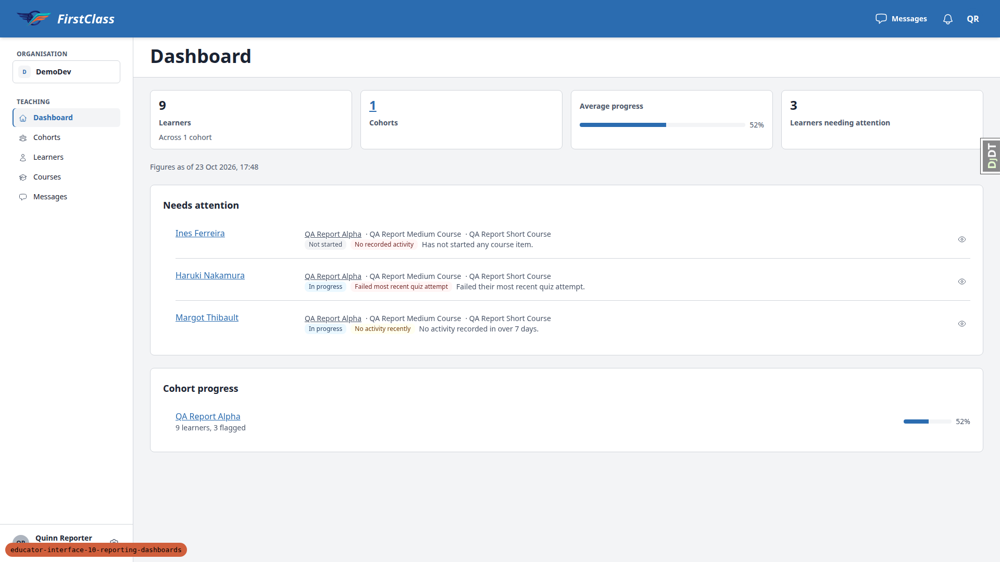

### Scenario 3: dashboard empty states

| Test | Viewport | Result | Notes |
|---|---|---|---|
| 3.2 | desktop | pass | The 'QA Empty Org' organisation (created by the earlier run, qa.org.admin holds its admin role) dashboard shows only 'You have no cohorts yet': no tiles, no lists. The org appears in the sidebar switcher. |
| 3.1 | desktop | pass | An empty organisation with qa.org.admin as organisation admin already existed from the earlier QA run (qa-empty-org), so it was reused rather than created again. |
| 3.3 | desktop | pass | With QA Report Alpha deactivated, the cohort viewer's dashboard shows only 'No cohorts are assigned to you' (no tiles). Alpha reactivated afterwards. |

### Scenario 4: the over-limit notice

No separate record for step 4.1.

| Test | Viewport | Result | Notes |
|---|---|---|---|
| 4.2 | desktop | pass | Second server on port 8894 with REPORTS_MAX_LEARNERS=6 (temporary settings module, removed afterwards). Dashboard notice lists 'QA Report Alpha has 9 learners, over the report limit of 6, and is not included' (and the same for the pre-existing 50-learner Cohort 2025.03.04). Learners still 67 and Cohorts still 6; the attention list and cohort progress rows exclude Alpha and still include Beta; needing attention drops to 2. |
| 4.3 | desktop | pass | Alpha Overview's Needs attention card and the Report tab body both show "Cohort 'QA Report Alpha' has 9 learners, exceeding the configured limit of 6 (REPORTS_MAX_LEARNERS)." instead of a list; the Downloads panel still offers the PDF controls. Note the cohort-page wording differs from the dashboard notice and names the setting. |
| 4.4 | desktop | pass | Second server stopped and the temporary settings module deleted; the main server on 8822 never had the override. |

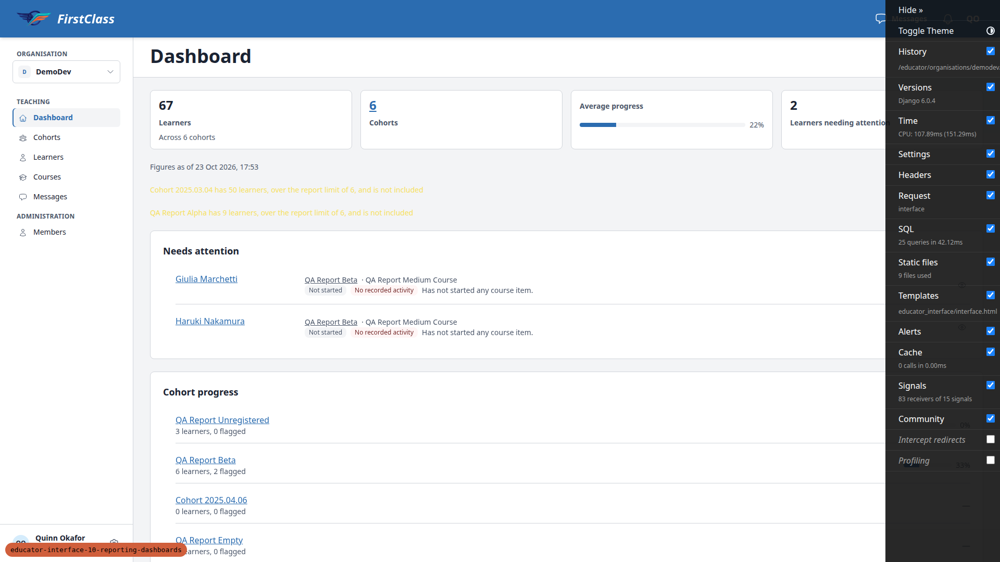

### Scenario 5: cohort Overview "Needs attention" card

No separate record for step 5.1.

| Test | Viewport | Result | Notes |
|---|---|---|---|
| 5.2 | desktop | pass | Alpha Overview: Needs attention card lazy-loads (attention panel then ?loaded=1 request) and lists Ines Ferreira (Not started), Haruki Nakamura (Failed most recent quiz attempt), Margot Thibault (No activity recently), lowest completion first, names linked. No 'Nothing needs attention yet' text. |
| 5.3 | desktop | pass | Empty cohort and Unregistered cohort (3 learners, no registrations) both show 'Nobody needs attention right now'. On Alpha at desktop each row's badges sit to the right of the name. |
| 5.4 | desktop | pass | Edit > rename to 'QA Report Alpha (renamed)' > Save: page header updates, the attention panel re-fetches (network shows __panels/attention then ?loaded=1) and lists the same three learners. Renamed back. |

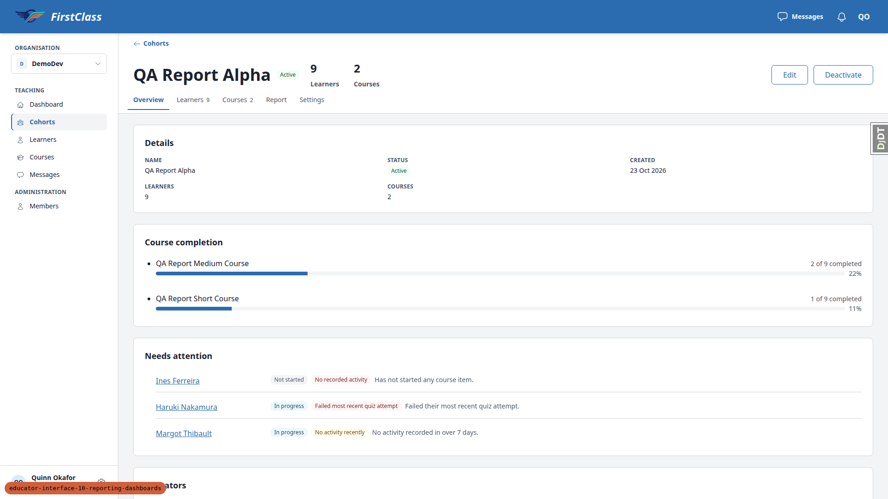

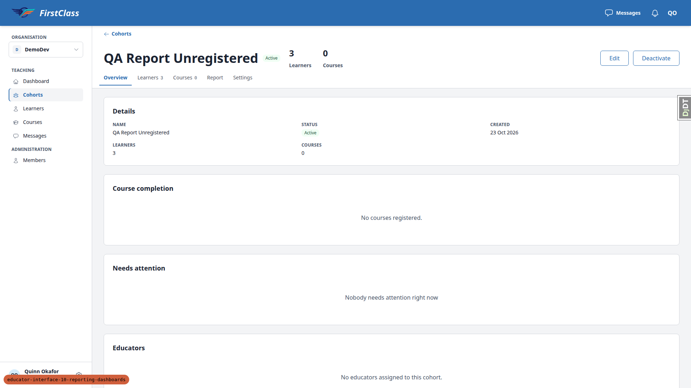

### Scenario 6: Report tab, Downloads panel, generate and download the PDF

| Test | Viewport | Result | Notes |
|---|---|---|---|
| 6.1 | desktop | pass | Cohort tabs in order Overview, Learners, Courses, Report, Settings. |
| 6.2 | desktop | pass | Report tab: Downloads panel first, then Cohort report panel. No CSV link in Downloads. Because reports from the earlier QA run already exist, the panel opened in the ready state (Download PDF + Generate a new report) rather than the bare 'Generate PDF report' state. |
| 6.3 | desktop | pass | Clicking Generate a new report POSTs to __actions/generate_report (200) and the panel swaps, with no further click, to 'Download PDF (generated 23 Oct 2026, 17:36 by Quinn Okafor)' plus Generate a new report. In dev the task finished inside the POST, so the intermediate 'being generated' panel was not observable; the button carries hx-disabled-elt and a hidden 'Generating…' spinner span toggled by htmx-request, so it greys out and ignores a second click during the request. |
| 6.4 | desktop | pass | Download PDF saved demodev-qa-report-alpha-progress-report.pdf. Its at-a-glance page reads Learners in cohort 9, Median completion 61%, Not started 2, Completed everything 1; cohort size '9 learners'. |
| 6.5 | desktop | pass | The 'being generated' window is not reachable in dev (the task completes inside the POST), so a concurrent second click could not be made. The submit button is disabled for the request via hx-disabled-elt; no error on repeated generation. |
| 6.6 | desktop | pass | Admin list /admin/freedom_ls_reports/generatedreport/ shows 12 Alpha rows (ready ones with a Download link, the failed one without). Opening a Download link returns 200 application/pdf. |

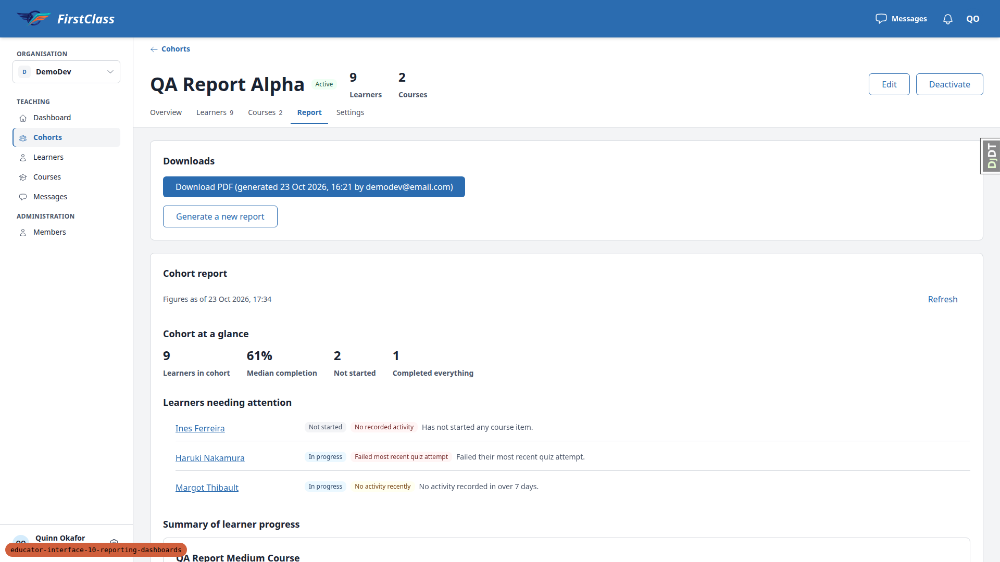

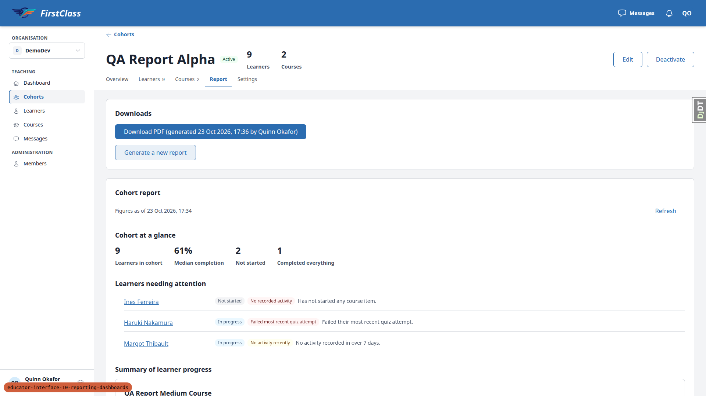

### Scenario 7: failed, stalled, and permission-gated downloads

| Test | Viewport | Result | Notes |
|---|---|---|---|
| 7.1 | desktop | pass | Cloned Alpha's newest report as a failed row (error 'Render failed in QA') with the plan's shell command. |
| 7.2 | desktop | pass | Report tab in the failed state keeps the ready 'Download PDF (generated 17:36)' link, shows the alert 'Render failed in QA' and the button reads 'Try again'. Clicking it generated a new report and the panel ended on 'Download PDF (generated 23 Oct 2026, 17:43 by Quinn Okafor)' with Generate a new report. |
| 7.3 | desktop | pass | With a pending row requested 11 minutes ago the panel reads 'A report is being generated, requested by Quinn Okafor at 23 Oct 2026, 17:32.', 'This is taking longer than expected.' and a 'Check again' link. Over 8+ seconds the network log shows no polling requests. Check again re-renders the same state. Pending row deleted afterwards. |
| 7.6 | desktop | pass | As org admin: Alpha's ready report downloads (200, application/pdf, attachment demodev-qa-report-alpha-progress-report.pdf). Beta's report id under Alpha's cohort URL: 404. Alpha's report id under Beta's cohort URL: 404. The failed report's id: 404. |
| 7.4 | desktop | pass | Cohort viewer sees the Downloads panel with PDF controls; Generate a new report shows the disabled 'Generating…' button with spinner, then ends on 'Download PDF (generated 23 Oct 2026, 17:49 by Quinn Reporter)'. The viewer's cohort page has no Settings tab. |
| 7.5 | desktop | pass | Logged in as learner Theo Delacroix, Alpha's Download PDF URL returns 404, not the file. |

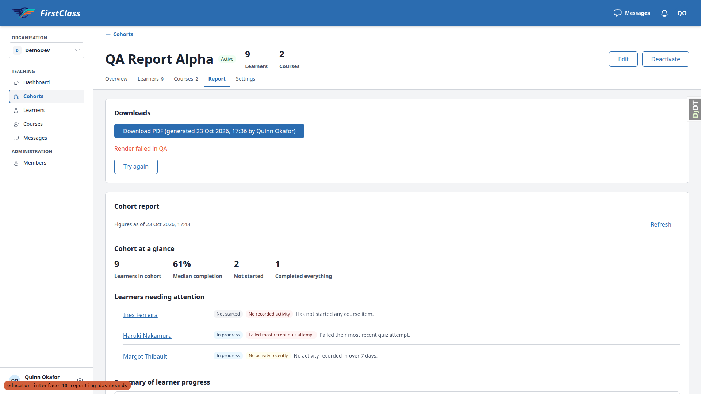

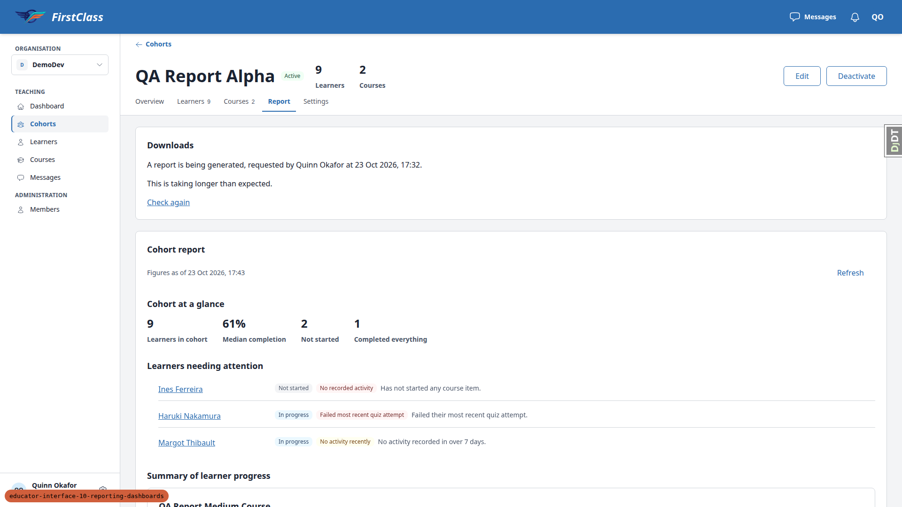

### Scenario 8: Report tab body

No separate record for step 8.1.

| Test | Viewport | Result | Notes |
|---|---|---|---|
| 8.2 | desktop | pass | Body lazy-loads (__panels/body?loaded=1). 'Figures as of 23 Oct 2026, 17:34' with Refresh; Cohort at a glance 9 / 61% / 2 / 1; Learners needing attention lists the three flagged; Summary per course: Learner link, status badge, completion bar with 'N of M items', Last item completed, When, quiz columns VQ01/EQ02/TQ03 with legend; cells show percent + Passed/Failed + ×n or an em dash. Quiz confusions per quiz with question number, text, correct options as green chips, wrong options as red chips with ×count, 'N of M learners'. |
| 8.3 | desktop | pass | No per-learner wrong answers anywhere; confusion tables show aggregate counts only. |
| 8.4 | desktop | pass | PDF at-a-glance figures 9 / 61% / 2 / 1 match the on-screen Cohort at a glance figures. |
| 8.6 | desktop | pass | After deactivating Ines Ferreira's learner record and reloading the Report tab without Refresh: 'Figures as of 23 Oct 2026, 17:43' unchanged, Ines absent from the attention list and both course tables, Learners in cohort 8 (was 9), Not started 1 (was 2). Learner reactivated afterwards. |
| 8.5a | desktop | pass | As learner Theo Delacroix (learner-02), clicking Next on 'Vectors Lesson 03' in the medium course raised the course to 33% complete (4 of 12). Back as the org admin, a plain reload of the Report tab within five minutes kept 'Figures as of 23 Oct 2026, 17:49' and Theo at 25%, 3 of 12 items. |
| 8.5 | desktop | pass | Clicking Refresh on the Report tab moved 'Figures as of' from 17:49 to 17:51 and Theo Delacroix's row to 33%, 4 of 12 items, last item 'Vectors Lesson 03'. |

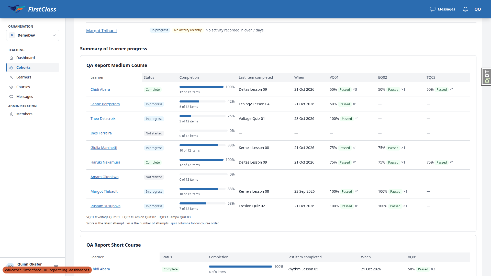

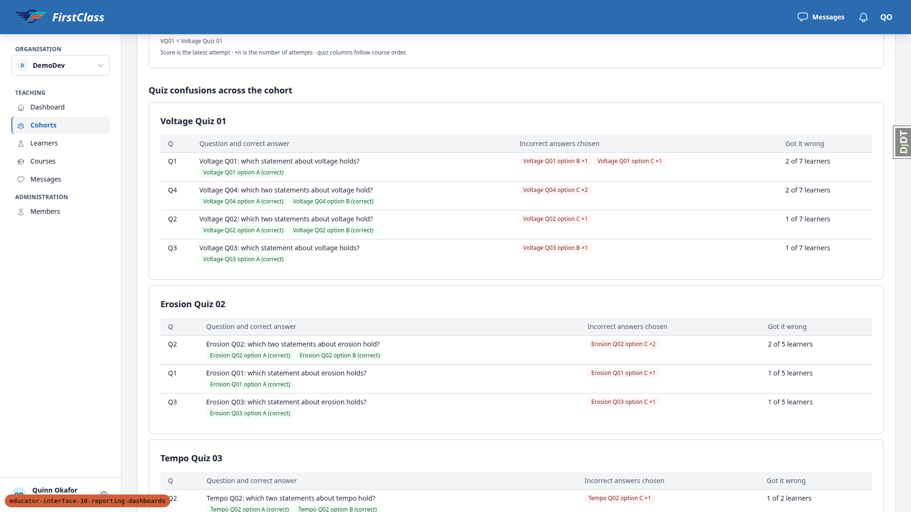

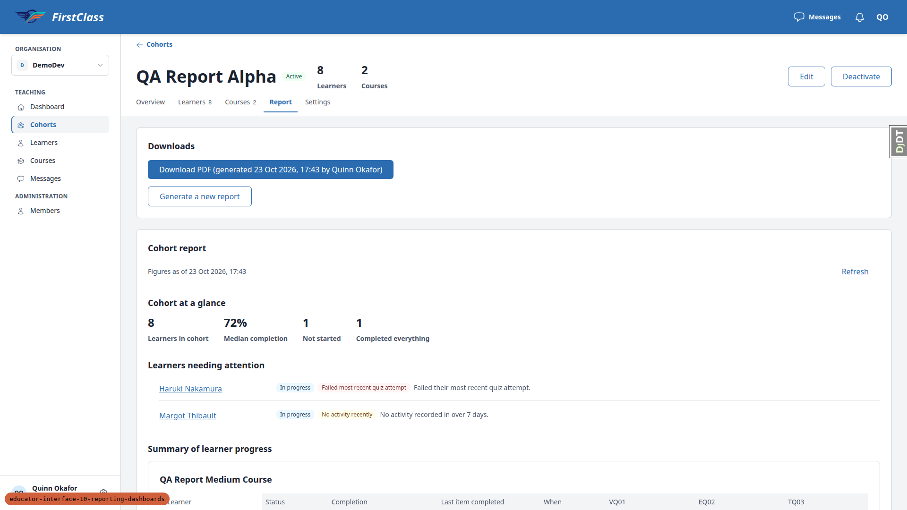

### Scenario 9: learners CSV export

| Test | Viewport | Result | Notes |
|---|---|---|---|
| 9.1 | desktop | pass | Alpha Learners tab toolbar: Search, Status filter, Add filter, Export CSV link, sort label. |
| 9.2 | desktop | pass | Downloaded learners-qa-report-alpha-2026-10-23.csv. Starts with a UTF-8 BOM; columns Name, Email, Status, Cohorts, Courses, Last active; nine rows, all Status Active, both course titles under Courses, Last active a date or empty; 'Sanne Bergström' renders correctly. No educators, no Beta-only learners. Haruki Nakamura's Cohorts cell reads 'QA Report Beta, QA Report Alpha' since he belongs to both (residue from the earlier run). |
| 9.3 | desktop | pass | Searching 'Margot' filters the table to one row and the Export CSV href picks up learners-q=Margot; the download holds only Margot Thibault's row. |
| 9.5 | desktop | pass | Organisation Learners list Export CSV downloads learners-2026-10-23.csv with 67 data rows (matches the Learners tile), Alpha, Beta and Unregistered learners included, no educator rows, multi-cohort learners' cohorts joined by commas. |
| 9.4 | desktop | pass | With Theo's first name set to =HYPERLINK("http://evil","x"), the Alpha export's Name cell is "'=HYPERLINK(""http://evil"",""x"") Delacroix": a leading apostrophe inside a quoted field, so it stays text. Name restored. The export also omitted the then-deactivated Ines (8 rows). |
| 9.6 | desktop | pass | Cohort viewer's export from Alpha's Learners tab works (200, learners-qa-report-alpha-2026-10-23.csv) with the nine Alpha learners and no Beta-only learner. |
| 9.7 | desktop | pass | As the learner, both the cohort Learners export URL and the organisation Learners export URL return 404. |

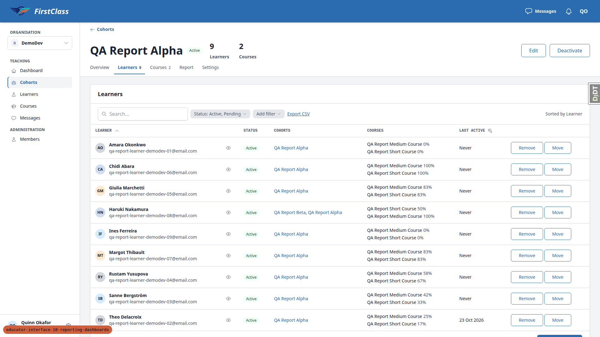

### Scenario 10: learner drill-down

| Test | Viewport | Result | Notes |
|---|---|---|---|
| 10.1 | desktop | pass | Haruki Nakamura (flagged 'Failed most recent quiz attempt') opened from Learners; Courses tab loads lazily. |
| 10.2 | desktop | pass | One card per registration: title, 'via QA Report Alpha' / 'via QA Report Beta' / 'Individual', status badge, at-risk badge with reason, progress bar with 'N of M items', 'Last completed: Deltas Lesson 09, 21 Oct 2026' or 'Nothing completed yet', collapsed 'Completed items (N)' that expands on click, and per attempted quiz a table with Attempt, Completed, Score, Percentage, Pass mark, Result (Passed/Failed badge plus 'Latest'). |
| 10.3 | desktop | pass | An individual registration for qa-report-short-course already exists for this learner from the earlier QA run: it renders as its own card labelled 'Individual', 'Not started', separate from the Alpha card for the same course. |
| 10.4 | desktop | pass | As the cohort viewer, Haruki's Courses tab shows the Individual short-course card and the two Alpha cards only; his Beta registration (a cohort the viewer cannot see) is not shown and 'QA Report Beta' appears nowhere on the page. |

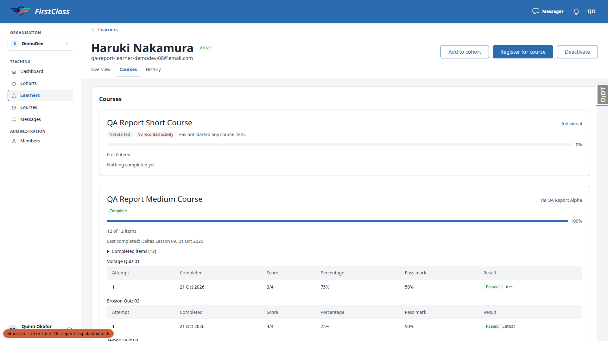

### Scenario 11: phone width

No separate record for step 11.1 other than the navigation check (11.1-nav). Step 11.5 and the tablet-width checks ran at 768x1024.

| Test | Viewport | Result | Notes |
|---|---|---|---|
| 11.6 | desktop | pass | At 1920 wide each attention row has the name on the left, its cohort lines (cohort, courses, badges, reason) in a column to the right and the quick view icon at the row's end; four rows fit in about 400px. Alpha's Overview Needs attention card puts badges to the right of each name (page-2026-10-23T17-30-26-427Z.png). |
| 11.2 | mobile | pass | 375x812 dashboard: tiles two per row (164px each at x=16 and x=196); attention rows stack name, cohort line, courses, badges and reason, with the quick view icon (44x44) and an arrow at the right. Tapping blank row space opens the learner page (Ines Ferreira) and, in Cohort progress, the cohort page (Cohort 2025.03.04); the quick view icon opens the full-width drawer without navigating. documentElement.scrollWidth equals clientWidth (375): no horizontal scrollbar. Tile screenshot: page-2026-10-23T17-54-15-589Z.png. |
| 11.3 | mobile | pass | Alpha Report tab at 375 wide: Download PDF and Generate a new report both span the panel width (309px); summary tables (961px and 708px wide) scroll inside an overflow-x:auto wrapper (275px) with a sticky Learner column (position sticky, left 0); page scrollWidth 375, no page-level sideways scroll. Downloads screenshot: page-2026-10-23T17-55-25-932Z.png. |
| 11.4 | mobile | pass | Learner Courses tab at 375 wide: the four cards stack at full width (309px); attempts tables (568px) scroll inside their overflow-x:auto wrapper; page scrollWidth 375. |
| 11.5 | tablet | pass | 768x1024 dashboard: page scrollWidth 768 (no overflow); tiles two per row (352px each); the sidebar is hidden behind the 'Open navigation panel' button; attention rows still stack the cohort lines under the name (name and cohort link share left 73px, cohort 31px lower). |
| 11.1-nav | mobile | pass | At 375 wide the sidebar is hidden; the 'Open navigation panel' button opens the Sections drawer (343px wide) with Dashboard, Cohorts, Learners, Courses, Messages, Members; Escape closes it. |
| 11.5-nav | tablet | pass | At 768 wide the tablet gets the mobile navigation: sidebar hidden, 'Open navigation panel' opens the drawer (736px wide) and Escape closes it. The screenshot also catches the pulsing skeleton placeholders for the two lazy tiles and both lists before they fill. |
| 11.3 | tablet | pass | Alpha Report tab at 768 wide: summary tables (961px/708px) scroll inside their 620px overflow-x:auto wrapper; page scrollWidth 768, no page-level sideways scroll. |
| 11.4 | tablet | pass | Learner Courses tab at 768 wide: cards stack at full width (670px); the attempts table (620px) fits its wrapper without scrolling; page scrollWidth 768. |

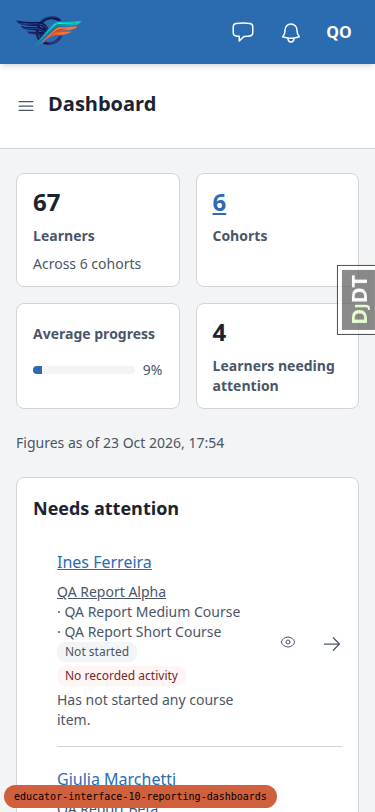

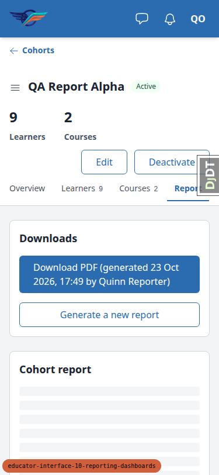

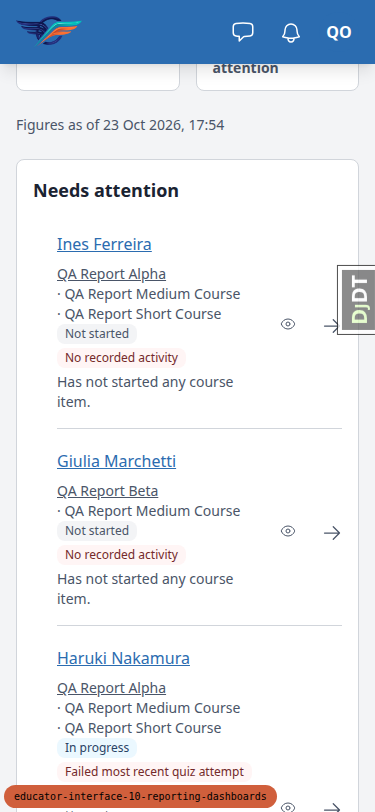

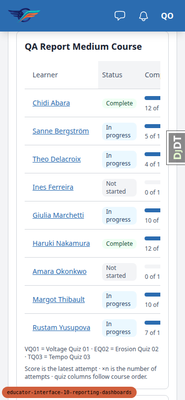

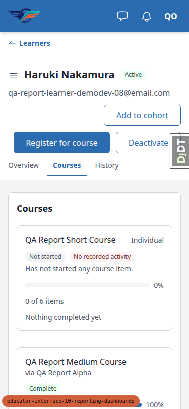

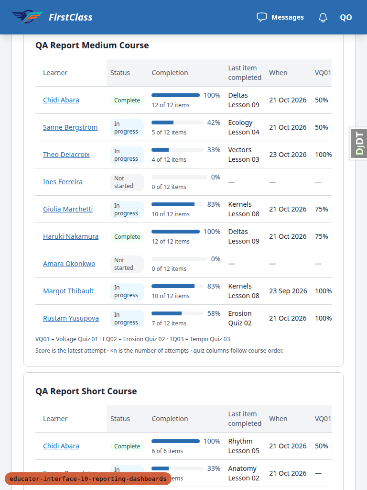

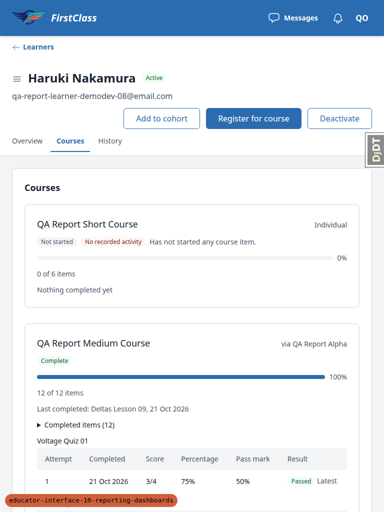

### Scenario 12: nothing else broke

| Test | Viewport | Result | Notes |
|---|---|---|---|
| 12.3 | desktop | pass | Quick view from the organisation Learners list opens and lists course registrations with a percentage ('QA Report Medium Course — through QA Report Alpha — 100%'). |
| 12.1 | desktop | pass | As org admin, Alpha's Overview, Learners, Courses and Settings tabs all render (Settings heading present, Courses lists both courses). Cohort-viewer 404 on Settings checked in the viewer session. |
| 12.4 | desktop | pass | With a JavaScript-disabled context: dashboard shows a visible 'Load the figures' link to /dashboard?loaded=1, which renders the tiles, Needs attention and Cohort progress as a plain page (200); the Report tab shows a 'Load the figures' link to __panels/body?loaded=1. The learner Courses panel is not lazy and renders its cards inline without JavaScript, so it has no link. |
| 12.2 | desktop | pass | Admin 'Generate cohort report' form lists the cohorts; selecting QA Report Alpha and clicking Generate redirects to the list with the message 'Generating a progress report for QA Report Alpha.' |
| 12.1b | desktop | pass | Alpha's Settings tab returns 404 for the cohort viewer while Overview returns 200. |

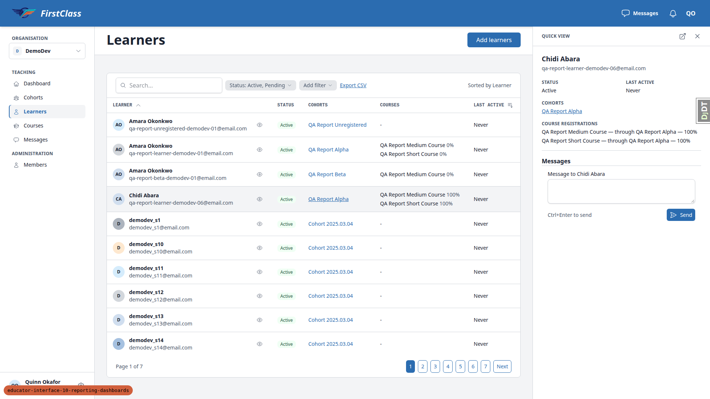

## Design check

no design states tested

## General notes

- The plan's login line for qa.org.admin@email.com is wrong: the seeder `qa_create_single_org_educator` sets the password `testpass123`, not the email. The plan's learner emails also omit the `-demodev-` segment the seeder adds (`qa-report-learner-demodev-NN@email.com`).
- Residue from the earlier QA run was present and reused rather than reset: the QA Empty Org organisation (3.1), Haruki Nakamura's Beta membership and individual short-course registration (10.3), and existing generated reports, so the bare "Generate PDF report" first state of the Downloads panel (6.2) was not seen; the ready/failed/stalled states were.
- In dev the PDF task runs inside the POST, so the "A report is being generated…" intermediate panel and a true concurrent second click (6.5) could not be observed; the "Generating…" disabled button state was observed once (7.4) and the stalled "being generated / taking longer than expected" state via a seeded pending row (7.3).
- Two different quizzes in two courses share the title "Voltage Quiz 01", so "Quiz confusions across the cohort" shows two tables with identical headings and nothing says which course each belongs to. Worth a copy decision if real courses reuse quiz titles.
- The over-limit wording differs between the dashboard notice ("QA Report Alpha has 9 learners, over the report limit of 6, and is not included") and the cohort page/report body ("Cohort 'QA Report Alpha' has 9 learners, exceeding the configured limit of 6 (REPORTS_MAX_LEARNERS)."), and the latter exposes the setting name to educators. The dashboard notice is rendered in a pale amber that is low-contrast on white.
- "Last active" in the CSV is the login-based figure (empty for seeded learners who never logged in, a date for the one who did), not last progress.
- Scenario 4 was run on a second dev server (port 8894) with a temporary settings module setting REPORTS_MAX_LEARNERS=6; the module was deleted and the server stopped afterwards.
- The debug toolbar handle (DJDT) appears in screenshots; it is the dev toolbar, not product UI.

## Bug status

No bugs found this run.

status: ok · reason: report rendered, 0 bugs documented, 62 test records (54 desktop, 4 mobile, 4 tablet), all pass
