# Frontend QA report: educator-interface-11-audit-log

## Methodology

Playwright MCP drove a live dev server for this branch on a freshly wiped and seeded dev DB (`create_demo_data --yes`, then `qa_create_learner_administration_scenario`). The branch was rebased onto main first; upstream had changed only spec docs. Screenshots were collected into `screenshots/` beside this report, and every referenced image exists there. Viewports: desktop 1920x1080, mobile 375x812, tablet 768x1024.

## Diff scoping

Class: FULL. Changed front-end files (30 of 277 changed files) include the audit cell templates (`audit_details.html`, `audit_what.html`, `audit_when.html`, `audit_who.html`), the data-table cells (`deactivate_registration.html`, `member.html`, `member_actions.html`, `member_roles.html`, `unregister.html`) and the modal templates (`add_member.html`, `change_cohorts.html`, the deactivate confirmation modals), all under `freedom_ls/educator_interface/templates/educator_interface/`. Everything ran; nothing was skipped.

## Smoke gate

Pass. Pages checked: `/`, `/educator/organisations/northside/audit-log`, `/educator/organisations/northside/learners`.

## Results

| Test | Viewport | Status | Note |
|---|---|---|---|
| 1 | desktop | pass | Learner History tab, empty state, reason dialog, deactivate/reactivate rows |
| 2 | desktop | pass | 501 chars rejected with 422; 500 chars accepted and wraps cleanly |
| 3 | desktop | pass | Stale second tab got 422, exactly one row written; own row has no deactivate controls |
| 4 | desktop | pass | Cohort membership, move, remove, registration and bulk-add rows correct on learner and cohort History |
| 5 | desktop | pass | Cohort create/rename/deactivate/reactivate/delete logged; no-change save writes nothing |
| 6 | desktop | pass | Rename, resend setup email and nameless learner logged; resend throttle writes no row |
| 7 | desktop | pass | Member role and membership actions logged with correct cohort scoping |
| 8 | desktop | pass | Org audit log columns, Who/What/When filters, empty state, pagination (25 + 16), tampered params |
| 9 | desktop | pass | Role gating (404s, no sidebar entry) and org scoping between Northside and Southside |
| 10 | desktop | pass | Markup in names and reasons renders as literal text |
| 11.1 | mobile | pass | Ada History as cards, no horizontal scroll |
| 11.2 | mobile | pass | Org log cards, filter sheet, nav drawer |
| 11.3 | tablet | pass | Tables render at 718px, no horizontal scroll, dialog centred |
| 12 | desktop | pass | Django admin audit log is read-only |
| 13 | desktop | pass | Regression pages load; dirty-cancel guard; no reason field on other dialogs |

### §1 Learner History and reason dialogs

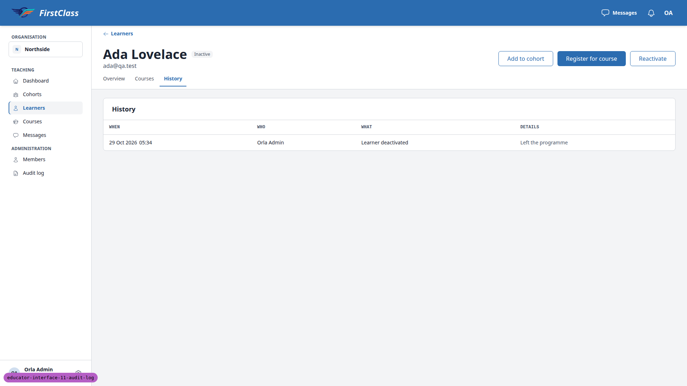

History tab present; empty state text exact (checked on Pat Pick). The Deactivate dialog has "Reason (optional)" with help text and maxlength=500. The row shows Learner deactivated / Orla Admin / "Left the programme". The Reactivate dialog has no reason; the reactivated row is newest first with empty Details. The direct `__tabs/history` URL shows the same rows.

### §2 Reason length limit

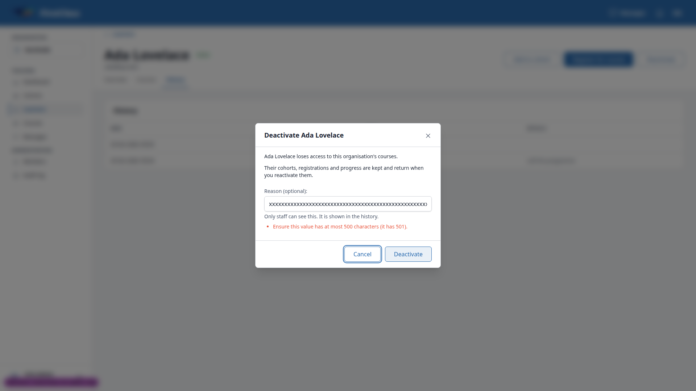
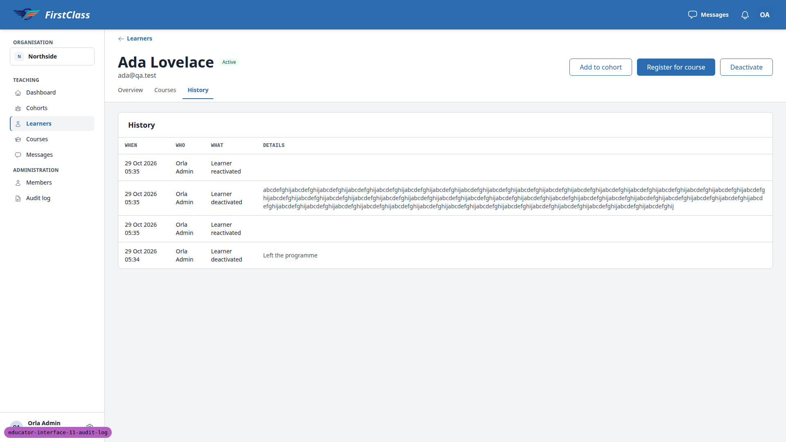

501 chars (via JS) returned 422; the dialog stayed open with "Ensure this value has at most 500 characters (it has 501)." and Ada stayed Active. 500 chars succeeded and the full text shows in History, wrapping cleanly. Ada was reactivated.

### §3 Stale tab and self-protection

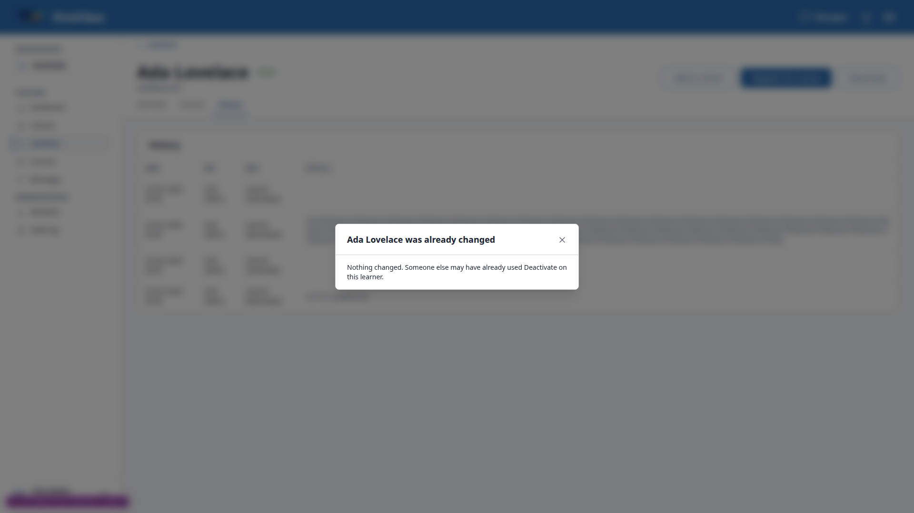

The second-tab deactivate wrote one row. The stale tab got 422 "Ada Lovelace was already changed / Nothing changed...". History went from 4 to 5 rows (one Learner deactivated). The own row on Members shows no Deactivate role/Deactivate controls ("You can't ...").

### §4 Cohort membership and registration rows

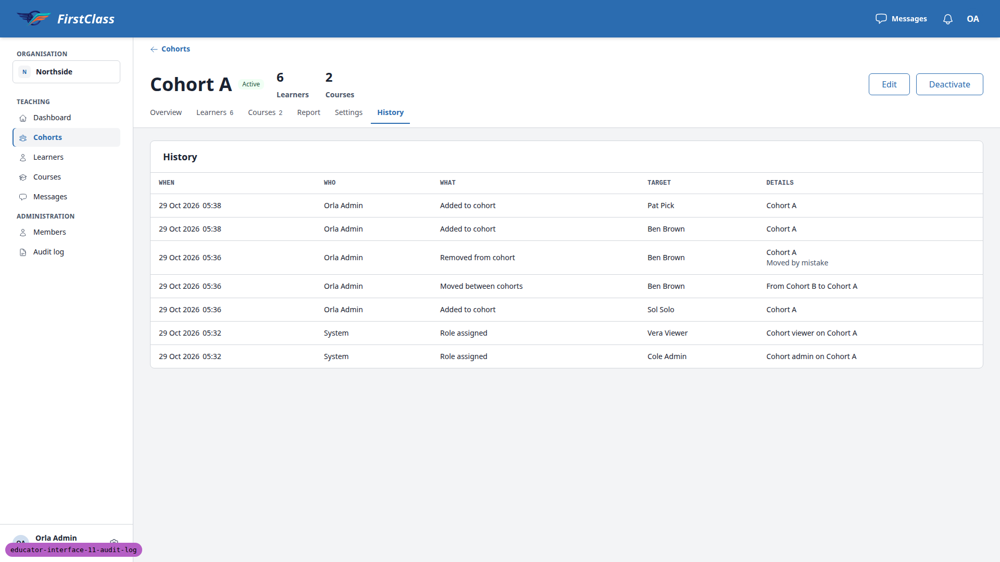

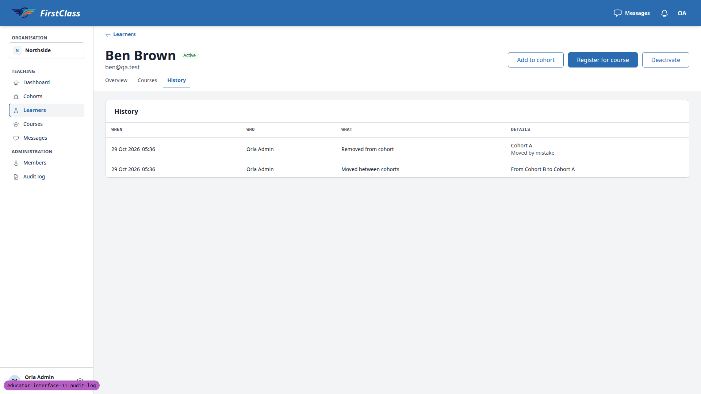
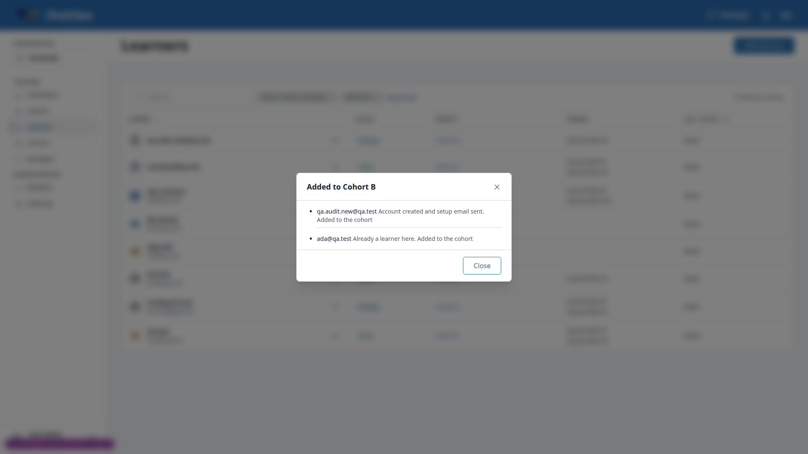

- 4.1: Sol "Added to cohort" / Cohort A on the learner and Cohort A History. Cohort History has a Target column naming Sol Solo (the B3 decision). Ada's deactivations are absent from the cohort.
- 4.3-4.4: "Moved between cohorts", "From Cohort B to Cohort A", on Ben and both cohorts.
- 4.5: The Remove dialog has a reason (maxlength 500). Details show "Cohort A" with the reason on its own line.
- 4.6: Registration deactivated (reason), reactivated, and "Registered for course" Course Hid.
- 4.7: Cohort C registered, deactivated ("Wrong cohort"), reactivated.
- 4.8: One "Learner added" row plus "Added to cohort" for Ada on Cohort B; Ada has no "Learner added" row.
- 4.9: "Added to cohort" for Ben and Pat, no summary row.

### §5 Cohort lifecycle

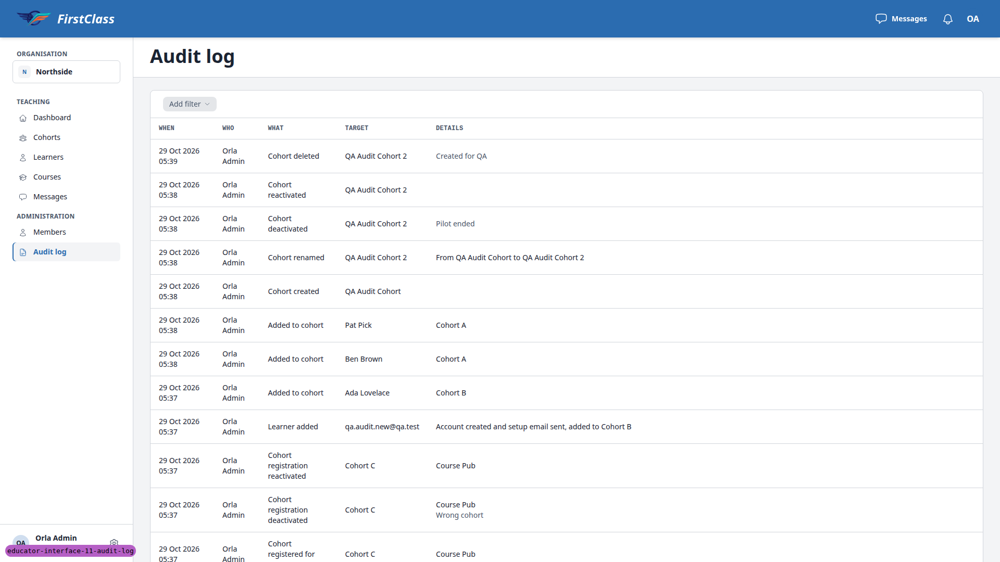

Cohort created and renamed (From QA Audit Cohort to QA Audit Cohort 2). A no-change save wrote nothing. The deactivate dialog has a reason (Pilot ended) and the page shows Inactive; reactivate has no reason field. The Delete dialog has a reason and lands on the cohorts list, and the cohort is gone. The org log shows "Cohort deleted" with Target "QA Audit Cohort 2" and "Created for QA", and "Cohort created" with Target "QA Audit Cohort". Cohort A Settings shows "can't be deleted while it has 7 learners..." and no Delete.

### §6 Learner administration

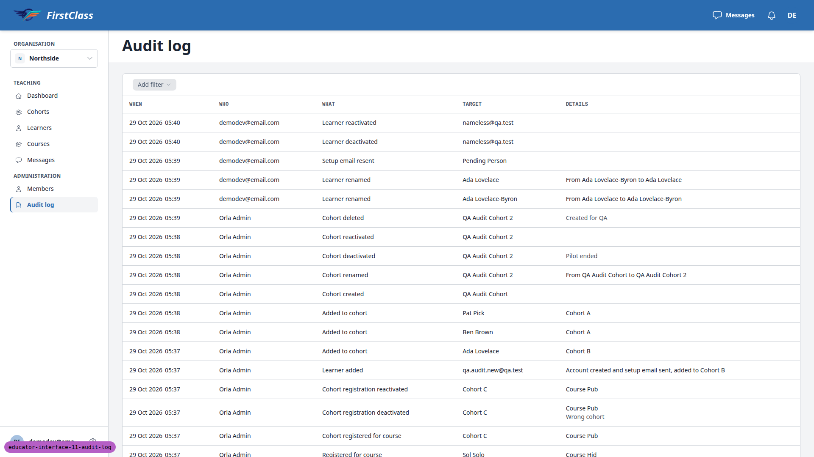

As demodev: Edit name gave Learner renamed "From Ada Lovelace to Ada Lovelace-Byron" and back; a no-change save wrote nothing. Who shows `demodev@email.com`. "Resend setup email" logged "Setup email resent"; a second resend said "Setup email sent recently... Try again in 15 minutes" with no new row. Nameless learner deactivate/reactivate rows appear on History; the org log Target reads nameless@qa.test.

### §7 Member administration

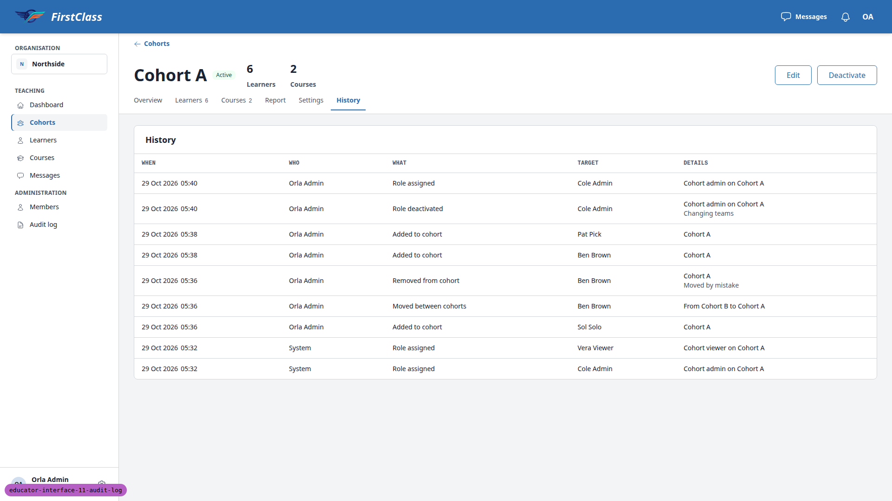

Deactivate role (reason "Changing teams") wrote two Role deactivated rows (Cohort admin on Cohort A and Cohort B). Add member (lookup, role, Cohort A, summary confirm) wrote one Role assigned for Cohort A. Change cohorts: adding B wrote Role assigned B with no deactivation; removing B wrote Role deactivated B. Member Deactivate (On leave) wrote Member deactivated; Reactivate (no reason field) wrote Member reactivated. Cohort A History shows Cohort A role rows only, none for Cohort B.

### §8 Organisation audit log

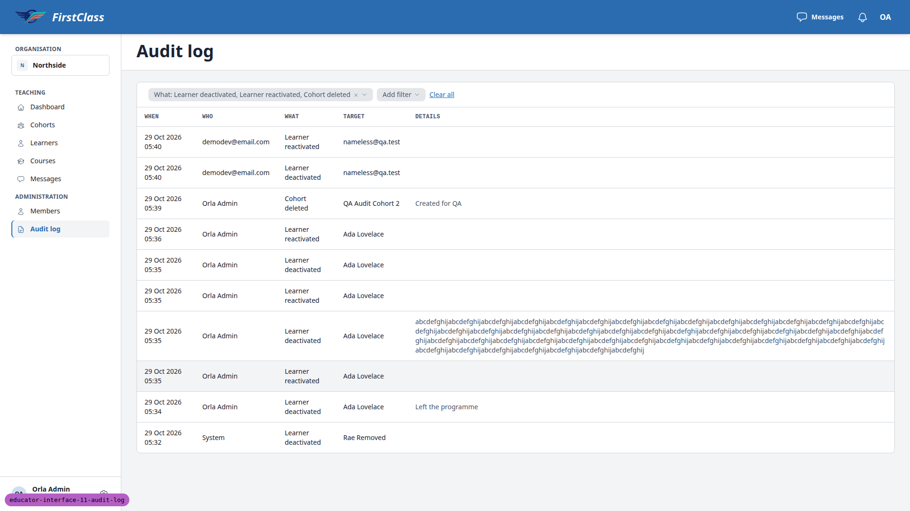
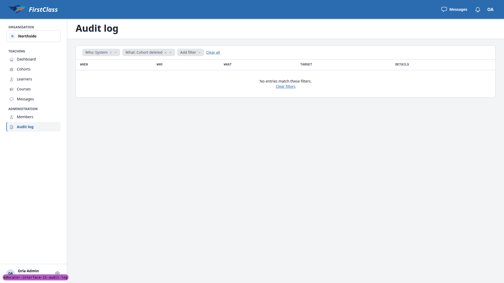

Sidebar Administration lists Members then Audit log. Columns: When/Who/What/Target/Details, newest first; no search, no sort links, no checkboxes, no Export. Who options: System, demodev@email.com, Orla Admin. Who=Orla shows only Orla rows; Who=System shows seed role grants and the Rae Removed deactivation only. What multi-select Learner deactivated + reactivated gave 9 rows, plus Cohort deleted gave 10. When presets Today/7d/30d/90d/12m each keep all rows; the chip shows one preset. System + Cohort deleted gives "No entries match these filters." and Clear filters returns to the unfiltered URL. Pagination (§8.7): 41 rows, 25 on page 1 and 16 on page 2, no repeats, continuing in time order. Tampered `?audit_log-who=not-a-pk&audit_log-when=yesterday` returned 200, unfiltered, no chips.

### §9 Permissions and organisation scoping

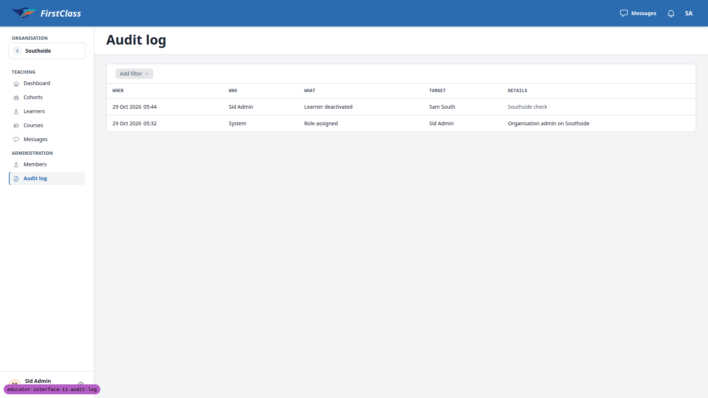

Cole (cohort admin) and Vera (viewer): Ada tabs are Overview/Courses only; Ada and Cohort A `__tabs/history` return 404; the sidebar has no Administration/Audit log; `/audit-log` is 404. Sid: the Southside log shows only its seed role grant, and the Northside log is 404. Deactivating Sam South (Southside check) shows in the Southside log and not in Orla's Northside log. demodev via the org switcher: the Southside log shows the Sam South deactivation by Sid Admin; the Northside log has no Southside rows.

### §10 Markup escaping

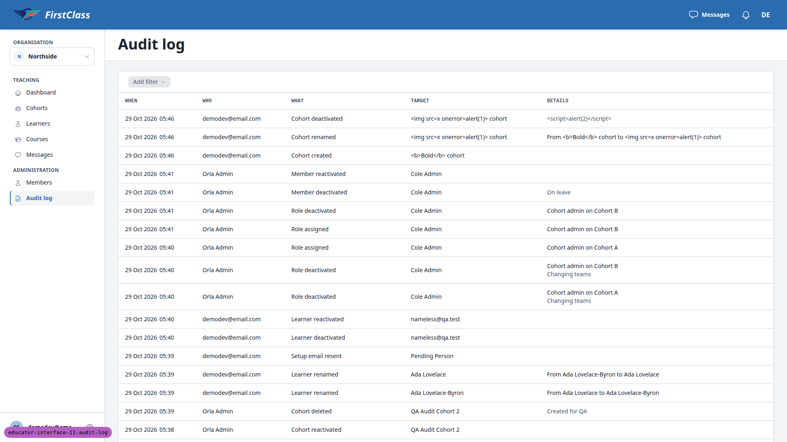
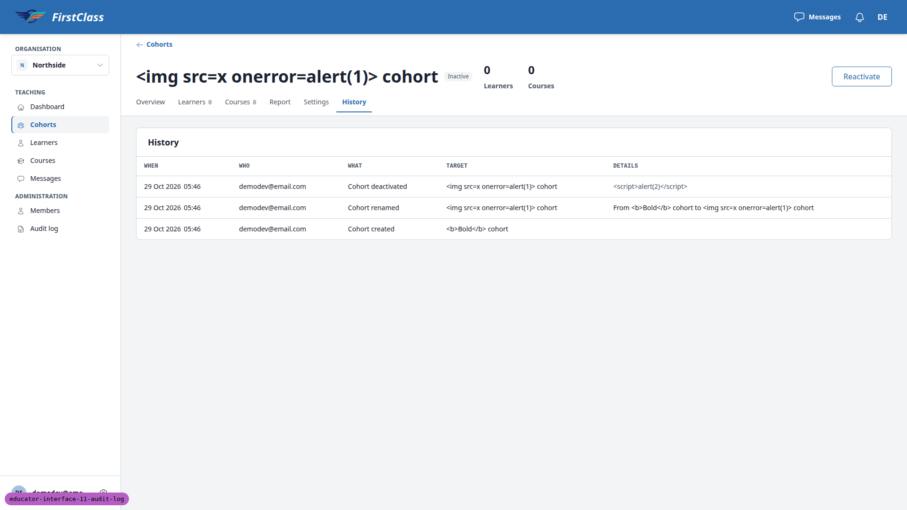

Cohort `<b>Bold</b> cohort` was renamed to ` cohort` and deactivated with reason ``. The org log and cohort History show literal text in Target/Details; no `<b>`, `` or `<script>` elements in tbody and no dialog fired. The cohort was then deleted with an empty reason (the Cohort deleted row was seen in admin).

### §11.1 Mobile: learner History

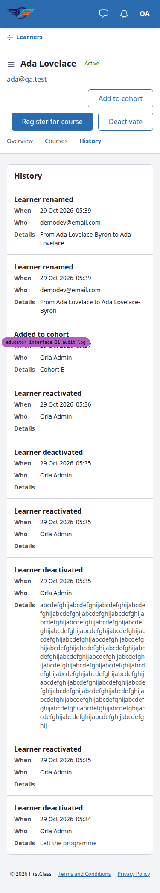

Ada History at 375x812: no table; cards with the What label first then labelled When/Who/Details lines. scrollWidth 375 = clientWidth. The 500-char reason wraps inside the card. Cards with no details still show an empty "Details" label.

### §11.2 Mobile: organisation log

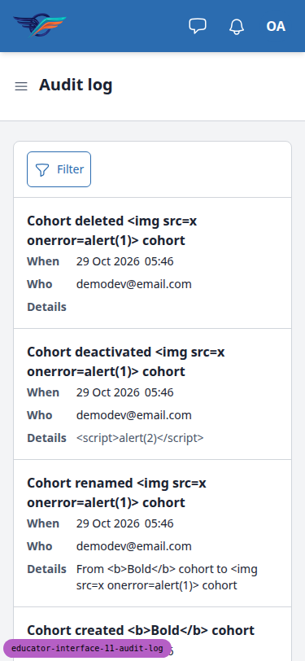

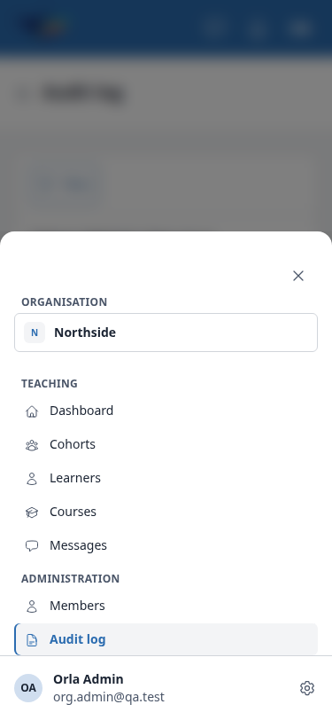

Cards have a first line "What Target" (e.g. "Cohort deleted  cohort", markup literal) and no horizontal scroll. The Filter button opens the "Filter & sort" sheet: Who and When are selects, What is a checkbox list; Who=System + Show results narrows to the 5 System rows as on desktop. The nav drawer ("Open navigation panel") lists all sections including Audit log, with links 343x36.

### §11.3 Tablet

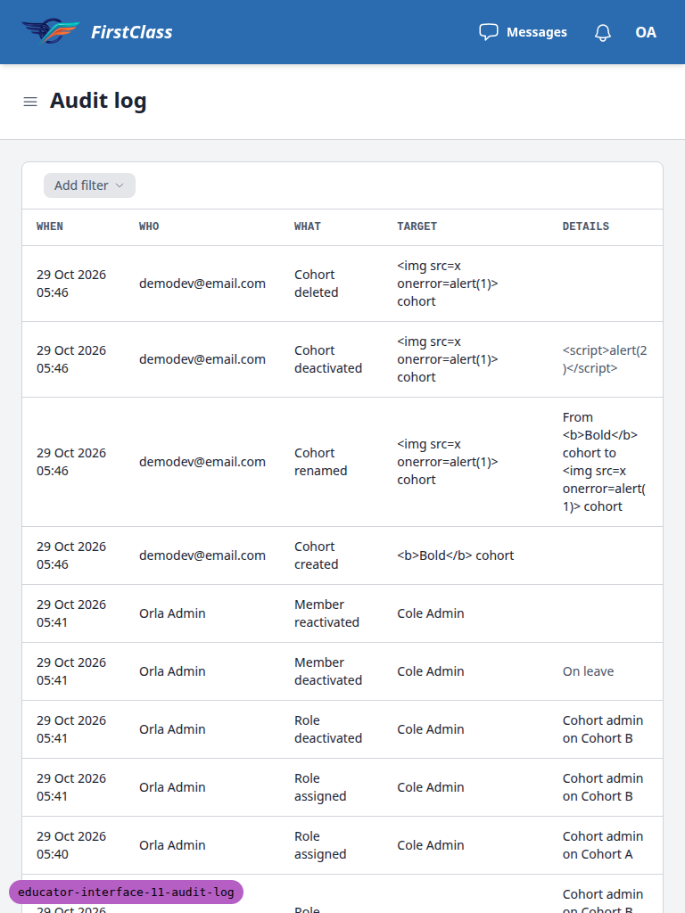
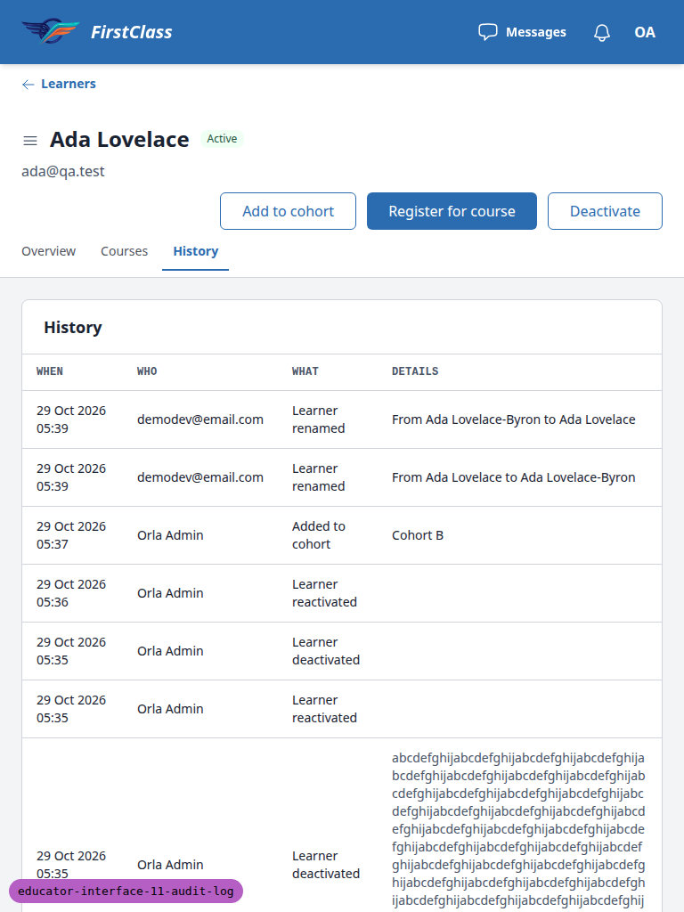
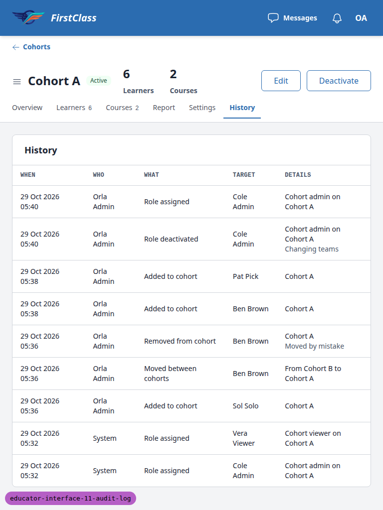
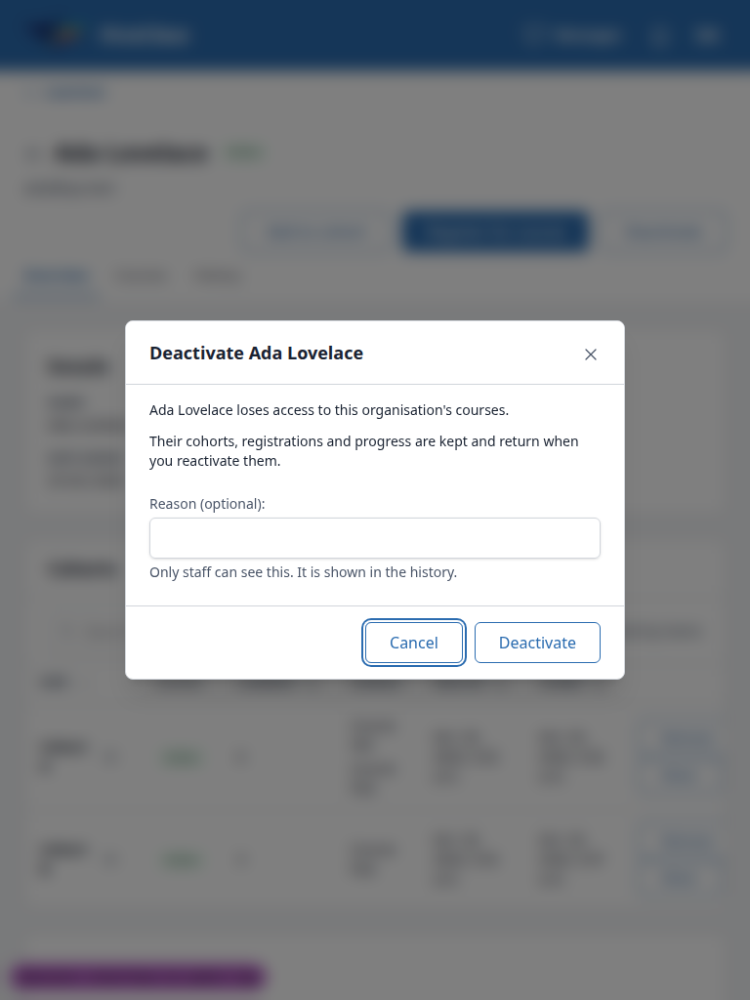

At 768x1024 the org log, Ada History and Cohort A History all render as a 718px table with no horizontal scroll (scrollWidth 768); the sidebar collapses to the hamburger drawer. Details is the narrowest column, so long details wrap to several lines but stay readable. The Deactivate dialog with reason renders at 512px, centred.

### §12 Django admin

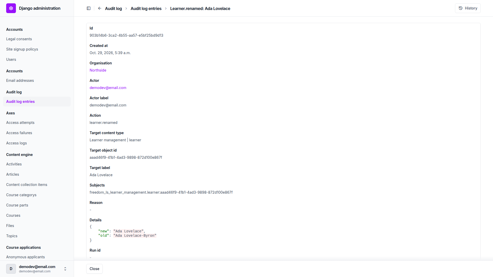

The admin index lists Audit log > Audit log entries. The changelist has no Add button; columns Created at, Actor label, Action, Target label, Organisation; filters by action and organisation; a search box; `q=Lovelace` returns Ada's rows. The entry detail has no editable inputs, no Save, no Delete. `/add/` returns 403.

### §13 Regression and dirty-cancel

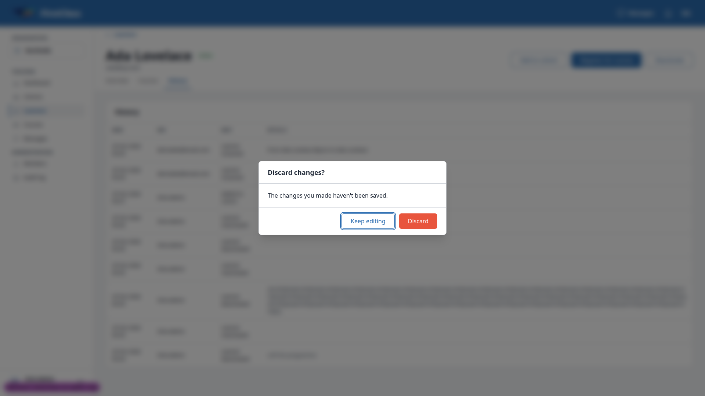

As Orla: learners/cohorts/members lists, Ada Overview and Courses all return 200 with content and no console errors. On the Deactivate dialog, Cancel with an empty reason closes at once; Cancel after typing a reason shows the existing "Discard changes?" guard, and Discard closes it. No History row was written either way (9 -> 9). No Reason field on the Reactivate member, Move, Change cohorts or Add to cohort dialogs.

## Design check

No design states tested.

## Bugs

No bugs found.

## Bug status

No bugs recorded this run.

## General notes

- The plan's §4.2 wording ("Sol Solo is not shown as a column here") is stale. Cohort History now has a Target column naming the learner/member (the B3 decision), and the plan's own intro says so.
- The superuser has no name, so Who shows `demodev@email.com`.
- Mobile History/log cards show an empty "Details" label when a row has no details.
- On mobile org-log cards, the What label and the Target sit on one bold line with no separator, so for a cohort named with markup they read as one run of text.
- The mobile filter sheet is titled "Filter & sort", but the audit log has no sort (shared component wording).
- Cancel on a reason dialog after typing triggers the existing "Discard changes?" guard. That is expected, and no row is written.
- The learner "Register for course" and cohort "Register" dialogs list "Course Other", which belongs to Southside's Cohort S. Course scoping is outside this branch's scope.
- Django admin pages log many report-only CSP "Evaluating a string as JavaScript" info messages. These are unrelated to this branch.
- The Southside empty-state copy ("Nothing has been recorded for this organisation yet.") was not seen, because the seed writes a role-grant row for Sid.
- §8.7 pagination was exercised: 41 rows, 25 on page 1 and 16 on page 2.

status: ok · reason: report rendered, 0 bugs documented
