# QA report: educator-interface-11-audit-log

This is a re-run of the frontend QA plan after the earlier run's three bugs were fixed: B1 (long-reason wrapping), B2 (admin plural) and B3 (cohort History Target column). It was driven with Playwright MCP at 1920x1080 (desktop), 375x812 (mobile) and 768x1024 (tablet) against a dev server on port 8031, as the personas named in the plan's §0.

## Methodology

- Screenshots were collected into `spec_dd/2. in progress/educator-interface-11-audit-log/screenshots/`, and every image referenced in this report exists beside it.
- Records were appended to a scratch file as each test finished.
- The run's base URL prefix was `/educator/organisations/<slug>/`. The plan's `/educator/<slug>/` is shorthand for it.
- The seed command is idempotent but does not undo the cohort memberships, registrations or the deactivation of Sam South left by the earlier run. Several steps therefore used a different cohort, course or email than the plan names. Each test row's notes say which.

## Diff scoping

Class: **FULL**. Nothing was skipped.

Changed files that triggered it:

- Templates under `freedom_ls/educator_interface/templates/educator_interface/`: `panels/learner_history.html`, `partials/audit_log_card.html`, `data-table-cells/audit_*.html`, `modal/*_confirmation.html`, `partials/reason_field.html`.
- The new `freedom_ls/audit_log/` app.
- Supporting code: `educator_interface/views.py`, `filters.py`, `forms.py`, `actions.py`, `learner_management/learner_actions.py`, `learner_management/role_assignment.py`, `organisations/utils.py`, `role_based_permissions/utils.py`.

Everything ran: desktop, mobile and tablet.

## Smoke gate

Pass. Pages checked:

- http://127.0.0.1:8031/
- http://127.0.0.1:8031/educator/organisations/northside/audit-log

## Results

| Test | Viewport | Status | Screenshot | Notes |
|---|---|---|---|---|
| 1.1-1.6 | desktop | pass | 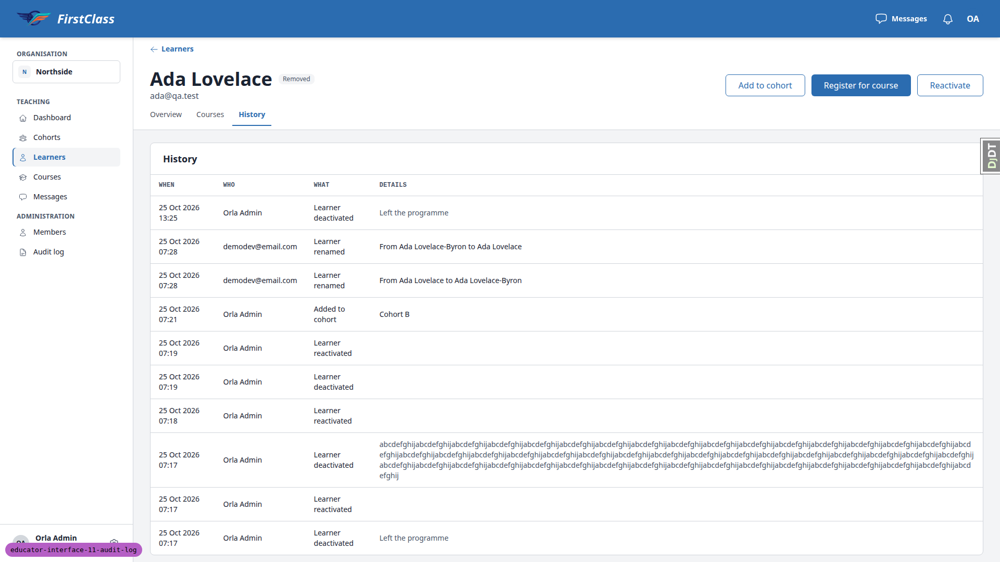 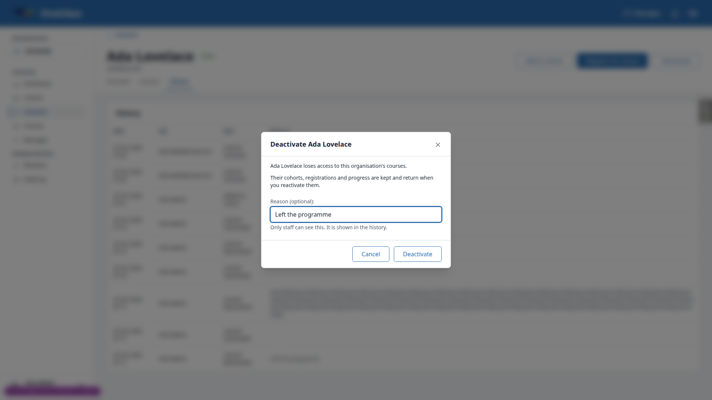 | Tab strip Overview/Courses/History. Deactivate dialog has 'Reason (optional)' with the help text (dialog: page-2026-10-25T13-25-28-246Z.png). Deactivated row with 'Left the programme' then Reactivated row newest first; Reactivate dialog has no reason field; direct `__tabs/history` URL shows the same rows. Earlier-run rows present, as the plan allows. Badge for a deactivated learner reads 'Removed' (pre-existing wording), not 'Inactive'. |
| 2.1-2.4 | desktop | pass | 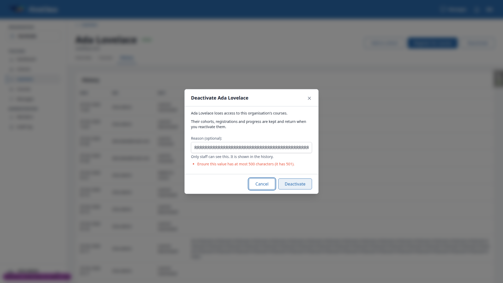 | 501 chars (set via JS; the input also carries maxlength=500) returned 422 and re-rendered the dialog with 'Ensure this value has at most 500 characters (it has 501).' Ada stayed Active. 500 chars accepted and stored in full; History table 1598/1598px, no overflow. Ada reactivated. |
| 3.1-3.4 | desktop | pass | 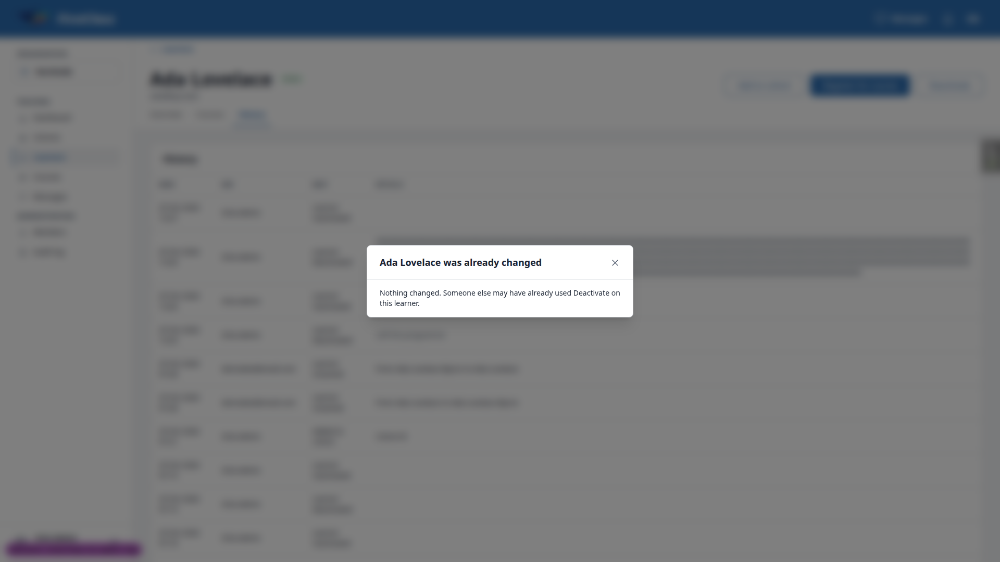 | Second tab deactivated Ada; stale first tab's Deactivate answered 'Ada Lovelace was already changed / Nothing changed. Someone else may have already used Deactivate on this learner.' Row count went 13 -> 14: exactly one Learner deactivated row. Ada reactivated. |
| 3.5 | desktop | pass | — | Members page: Orla's own row shows a 'You' badge and a lock note 'You can't change your own roles', no Remove or Suspend control. |
| 4.1-4.2 | desktop | pass | 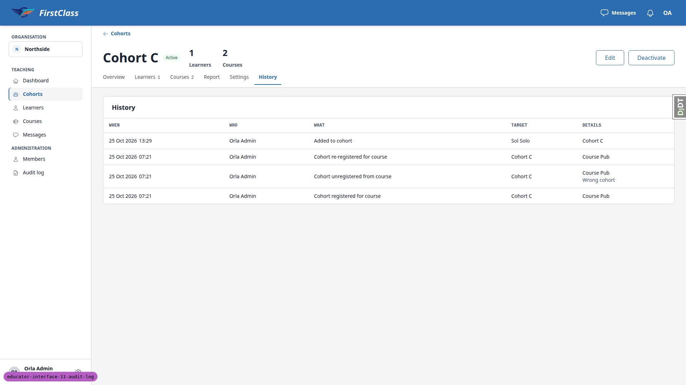 | Sol was already in Cohort A from the earlier run, so Add to cohort used Cohort C (no reason field on that dialog). Sol's History: 'Added to cohort / Cohort C'. Cohort C's History shows the same row with Target 'Sol Solo' (the cohort History now has a Target column, per the B3 decision from the earlier run). Cohort A's History holds no Learner deactivated/reactivated rows. |
| 4.3-4.4 | desktop | pass | — | Ben was in A and B, so Move went Cohort B -> Cohort C. 'Moved between cohorts / From Cohort B to Cohort C' on Ben's History and on both Cohort B and Cohort C History. Note: the Move dialog's select re-renders the dialog over HTMX on change; a click issued during the swap is lost, a human clicking after the swap is fine. |
| 4.5 | desktop | pass | 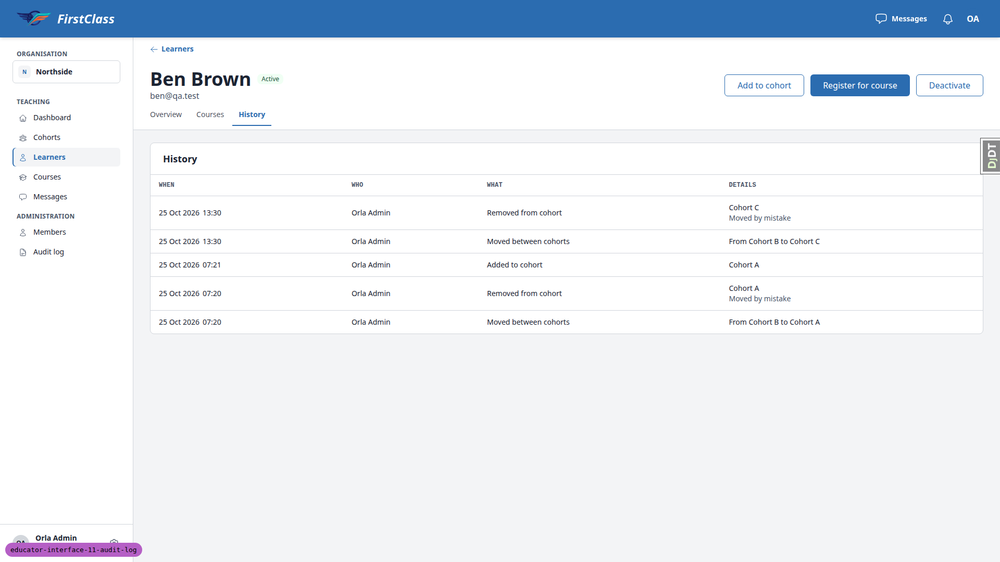 | Remove from cohort dialog has the Reason field. Row 'Removed from cohort' Details 'Cohort C' with 'Moved by mistake' as a block span on its own line. |
| 4.6 | desktop | pass | 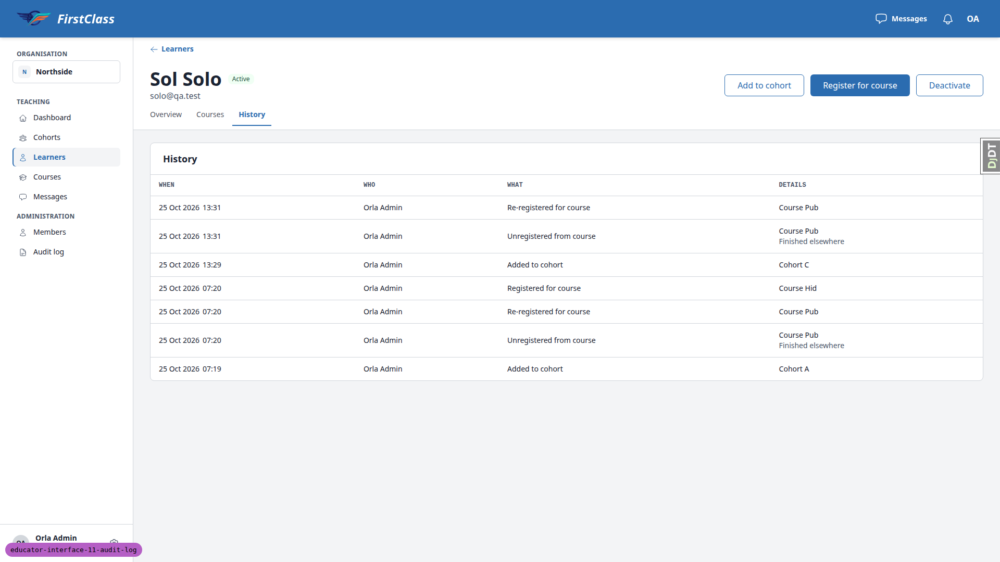 | Unregister (learner page) has the Reason field. Rows: 'Unregistered from course / Course Pub + Finished elsewhere', 'Re-registered for course / Course Pub', and 'Registered for course / Course Other' (Sol already held Course Hid individually from the earlier run, so Course Other was the never-held course). |
| 4.7 | desktop | pass | — | Cohort Courses tab Unregister has the Reason field. Cohort C History: 'Cohort unregistered from course / Course Pub + Wrong cohort', 'Cohort re-registered for course / Course Pub', 'Cohort registered for course / Course Other'. |
| 4.8 | desktop | pass | 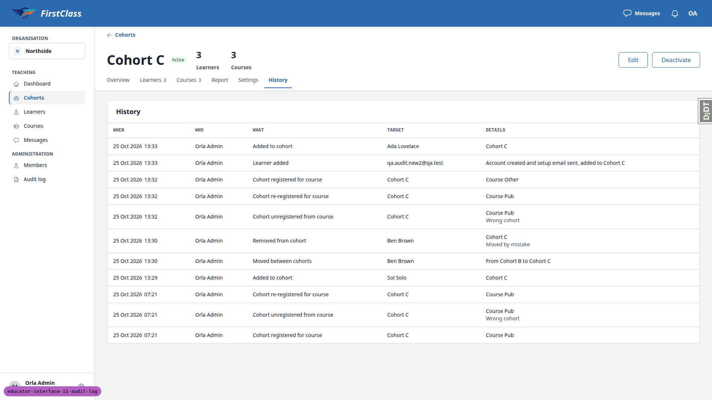 | Pasted qa.audit.new2@qa.test + ada@qa.test into Cohort C (new@ already existed and Ada was already in B from the earlier run). Results list: one 'Account created and setup email sent', one 'Already a learner here'. Cohort C History: 'Learner added / qa.audit.new2@qa.test / Account created and setup email sent, added to Cohort C' and 'Added to cohort / Ada Lovelace / Cohort C'. Ada's History has the Added to cohort row and no Learner added row. |
| 4.9 | desktop | pass | 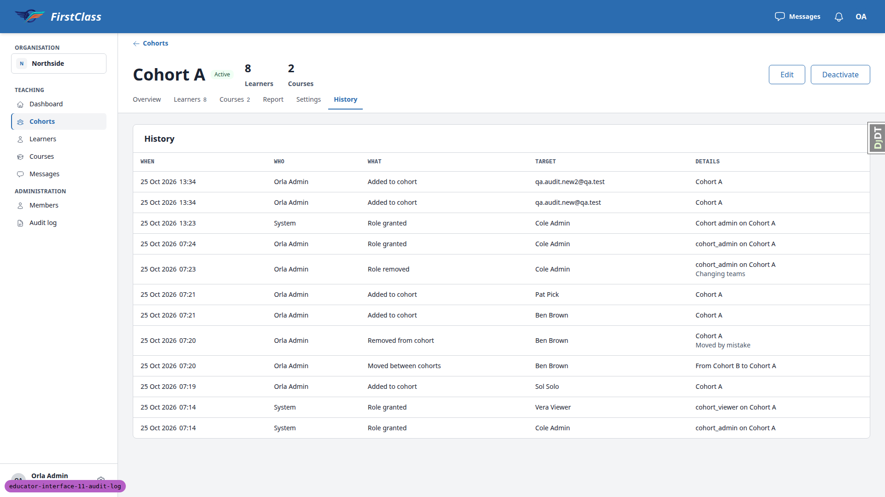 | Org admin gets the paste dialog preset to Cohort A. Pasted the two qa.audit learners (Ben and Pat were already in A). Two 'Added to cohort' rows, each naming its learner in Target, no summary row. |
| 5.1-5.5 | desktop | pass | 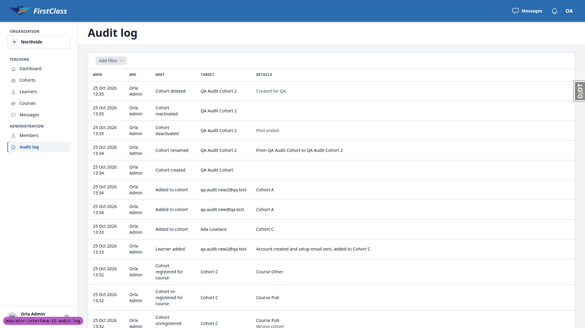  | Cohort created, renamed (From QA Audit Cohort to QA Audit Cohort 2), no-change save wrote nothing, deactivated with 'Pilot ended' (page re-rendered Inactive), reactivated, deleted with 'Created for QA' from the Settings tab (Delete dialog has the Reason field). Landed on the cohorts list; the org log holds all five rows with Target 'QA Audit Cohort 2' except the Cohort created row, whose Target keeps the name at the time, 'QA Audit Cohort'. Cohort History: page-2026-10-25T13-35-48-347Z.png |
| 5.6 | desktop | pass | — | Cohort A Settings offers Deactivate only, with the note 'Cohort A can't be deleted while it has 9 learners and 2 course registrations'. |
| 6.2 | desktop | pass | — | Resend setup email on Pending Person wrote 'Setup email resent'. The immediate second attempt answered 'Setup email sent recently / Try again in 15 minutes' and the History row count stayed at 2. |
| 6.3 | desktop | pass | — | Nameless learner deactivated and reactivated; rows on their History tab; the org log Target reads 'nameless@qa.test'. |
| 7.1-7.2 | desktop | pass | 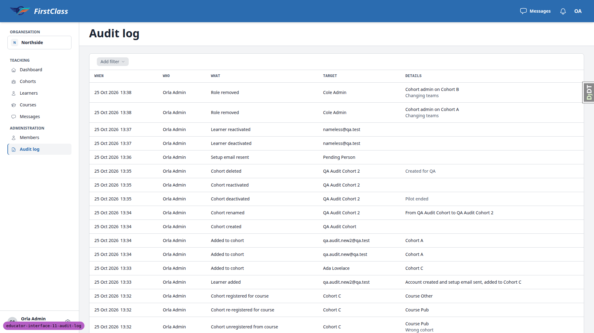 | Remove role dialog has the Reason field. Two 'Role removed' rows, Target Cole Admin, Details 'Cohort admin on Cohort A' and 'Cohort admin on Cohort B', each with 'Changing teams'. |
| 7.3-7.4 | desktop | pass | — | Add member (look up -> role -> cohorts -> confirm) wrote one 'Role granted / Cohort admin on Cohort A' by Orla Admin. Change cohorts adding B wrote one 'Role granted / Cohort admin on Cohort B' and no Role removed; removing B wrote 'Role removed / Cohort admin on Cohort B'. Change cohorts dialog has no Reason field. Note: the multi-step dialogs re-render over HTMX after each choice; a click issued during the swap is lost, and the final confirm step is a second screen. |
| 7.5 | desktop | pass | 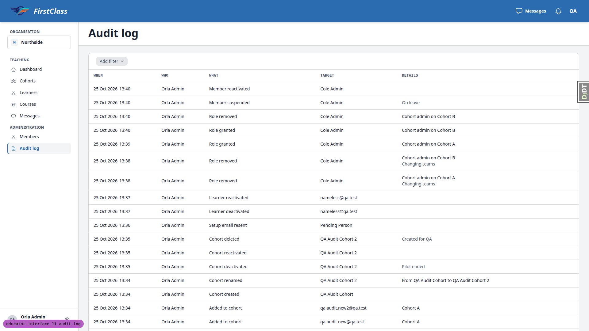 | Suspend dialog has the Reason field: 'Member suspended / Cole Admin / On leave' then 'Member reactivated'. Reactivate member dialog has no Reason field. |
| 7.6 | desktop | pass | — | Cohort A History shows the Role granted and Role removed rows for Cohort A; none of the Cohort B role rows and none of the Member suspended/reactivated rows. |
| 8.1-8.2 | desktop | pass | 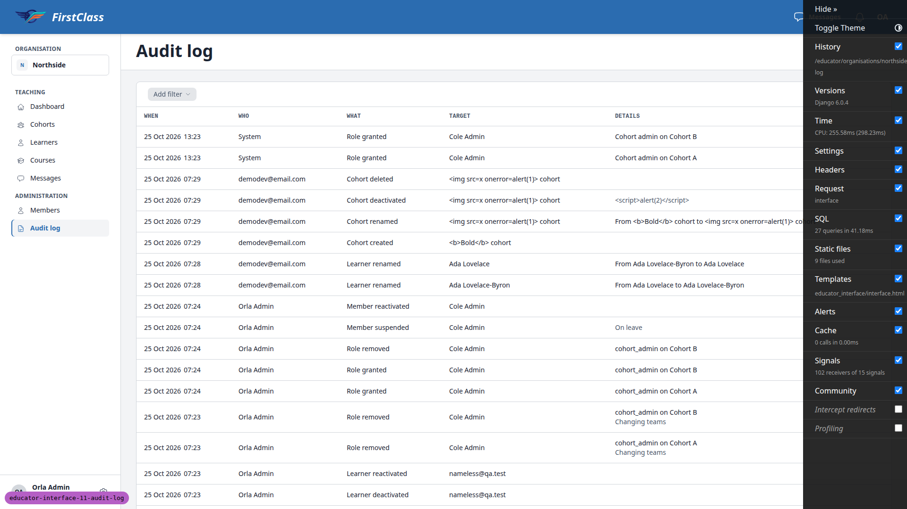 | Sidebar Administration group: Members then Audit log. Columns When/Who/What/Target/Details, newest first (datetime attributes descending). No search box, no sortable header links, no row checkboxes (the 25 checkboxes in main are the What filter's options inside the filter form), no Export. 25 rows per page, 'Page 1 of 4'. |
| 8.3 | desktop | pass | 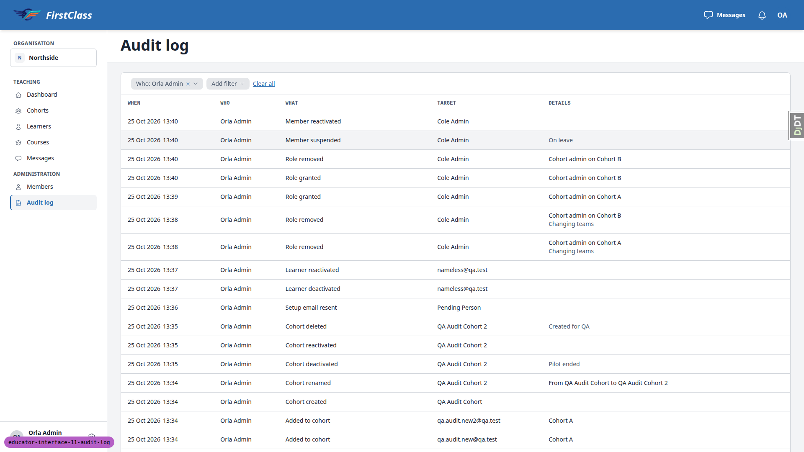 | Who filter offers System, demodev@email.com, Orla Admin. Orla Admin: every row's Who is Orla Admin (3 pages). System: 7 rows, all Who=System (the seed command's role grants plus its Learner deactivated row for Rae Removed), none of Orla's. |
| 8.4 | desktop | pass | 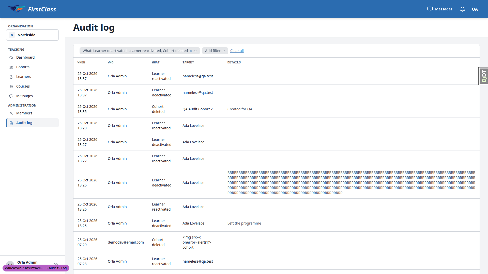 | What = Learner deactivated (9 rows) then + Learner reactivated via the chip's dropdown (17 rows, only those two labels); + Cohort deleted adds the three deleted-cohort rows including 'QA Audit Cohort 2'. Chip reads 'What: Learner deactivated, Learner reactivated, Cohort deleted'. |
| 8.5 | desktop | pass | — | Today, Last 7/30/90 days, Last 12 months each keep all rows (Page 1 of 4, 25 rows, same first row). Chip shows one preset at a time. |
| 8.6 | desktop | pass |  | The plan's combination Who=System + What=Learner deactivated is not empty here because the seed writes a System 'Learner deactivated' row for Rae Removed, so used Who=System + What=Cohort deleted: empty state 'No entries match these filters.' with a Clear filters link (and a Clear all link in the filter bar). Clear filters returned all rows and the URL carries no query string. |
| 8.7 | desktop | pass | — | Log holds 4 pages. Page 1 ends 13:31:36, page 2 starts 13:30:56 and is strictly descending; no row repeated between pages. |
| 8.8 | desktop | pass | — | `?audit_log-who=not-a-pk&audit_log-when=yesterday` renders the unfiltered list (25 rows, Page 1 of 4), no chips, no error. |
| 9.1 | desktop | pass | — | Cole (cohort admin): Ada's page shows Overview and Courses only; direct `__tabs/history` is 404. Cohort A shows Overview/Learners/Courses/Report, no History; its `__tabs/history` is 404. Sidebar has no Administration group at all; /audit-log is 404. |
| 9.2 | desktop | pass | — | Vera (cohort viewer): the same four checks, all as expected (no History tabs, both History URLs and the org log 404, no Audit log in the sidebar). |
| 9.3 | desktop | pass | 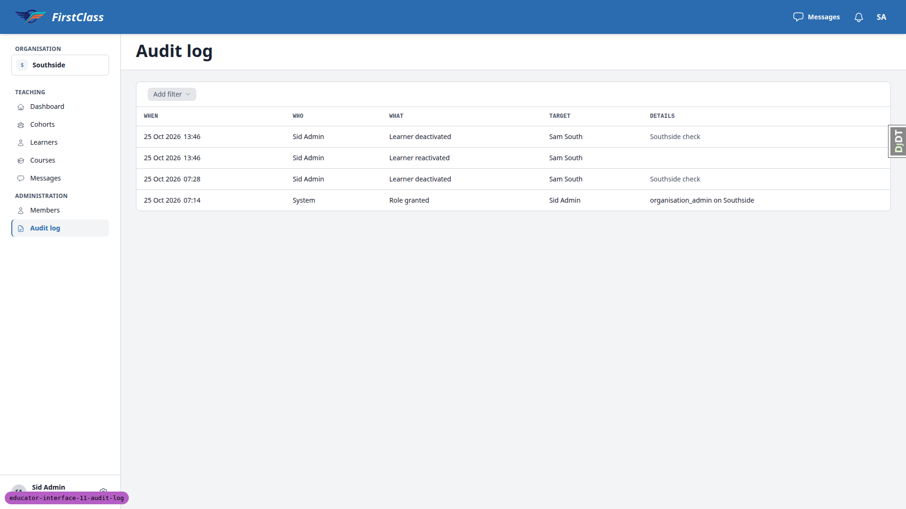 | Sid: Southside log opens with only Southside rows (none of the Northside names); Northside log is 404. Sam South was left deactivated by the earlier run (hidden behind the learners list's default Active/Pending status filter), so reactivated then deactivated with 'Southside check': both rows appear in Southside's log. Northside's log (checked as the superuser, page 1 covers that time) holds no Sam South or Sid Admin row. |
| 9.4 | desktop | pass |  | demodev: the sidebar's Switch organisation menu lists DemoDev, Northside, Southside. Northside's Audit log shows only Northside rows; Southside's shows only its four rows including Sam South's deactivation by Sid Admin. |
| 6.1 | desktop | pass | — | Orla has no Edit name action (needs the user-change capability), so run as demodev: 'Learner renamed / From Ada Lovelace to Ada Lovelace-Byron', then 'From Ada Lovelace-Byron to Ada Lovelace'; a save with no change wrote no row. |
| 10.1-10.3 | desktop | pass | 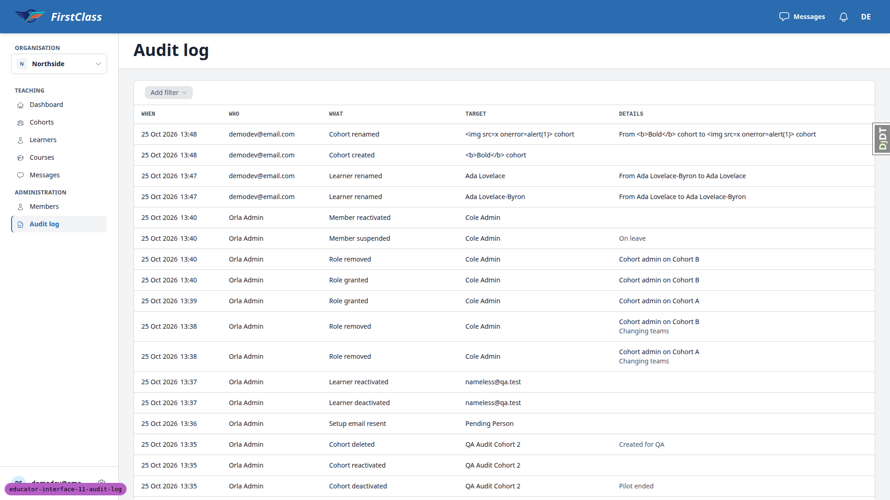 | As demodev: cohort '`<b>Bold</b>` cohort' renamed to '`` cohort'. Org log and cohort History show the literal text in Target and Details (innerHTML is entity-escaped), no `<b>`/`` elements, no dialog. Deactivated with reason '``': literal text, no script element. Cohort deleted afterwards with an empty reason; no longer listed. |
| 12.1-12.3 | desktop | pass |  | Admin index lists 'Audit log' > 'Audit log entries'. Changelist titled 'Select audit log entry to view', no Add link/button, columns Created at / Actor label / Action / Target label / Organisation, filters By action and By organisation, search box; q=Lovelace returns only Ada's rows. Change page: 13 read-only fields, no editable inputs, no Save or Delete; /add/ returns 403. |
| 13.1 | desktop | pass | — | As Orla: learners, cohorts, members, and Ada's Overview and Courses tabs render as before with zero console errors on each. Northside's log holds no Sam South row. |
| 13.2 | desktop | pass | — | Deactivate dialog with a typed reason, Cancel: the dialog closes (open=false, display none), no `__actions` POST was sent, Ada stays Active and the History row count stayed at 18. |
| 13.3 | desktop | pass | — | Reactivate member, Move, Change cohorts and Add to cohort dialogs were each opened during §4 and §7: none has a Reason field. |
| 11.1 | mobile | pass | 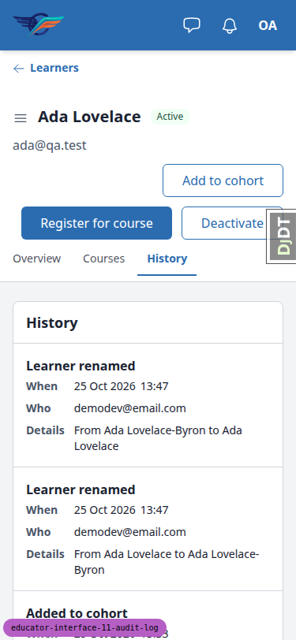 | 375x812: Ada's History renders as cards (table hidden): first line is the What label, then labelled When / Who / Details lines; long details wrap; page scrollWidth 375 = viewport, no horizontal scroll. 18 cards. |
| 11.2 | mobile | pass | 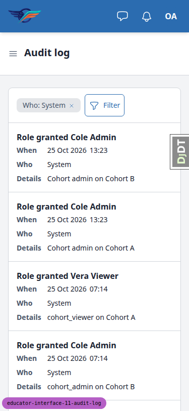  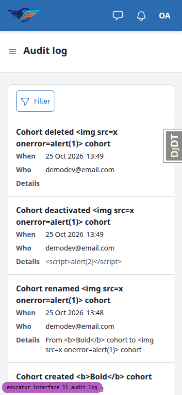 | 375x812 org log: a Filter button opens a 'Filter & sort' bottom sheet (page-2026-10-25T13-53-37-955Z.png) with Who and When as selects and What as checkbox chips, plus Reset / Cancel / Show results. Cards' first line reads the What label and Target (e.g. 'Cohort deleted `` cohort'), markup still literal. Who = System + Show results narrows to the 7 System cards and shows a 'Who: System' chip with a remove control; no horizontal scroll. Unfiltered cards: page-2026-10-25T13-53-06-134Z.png |
| 11.3 | tablet | pass | 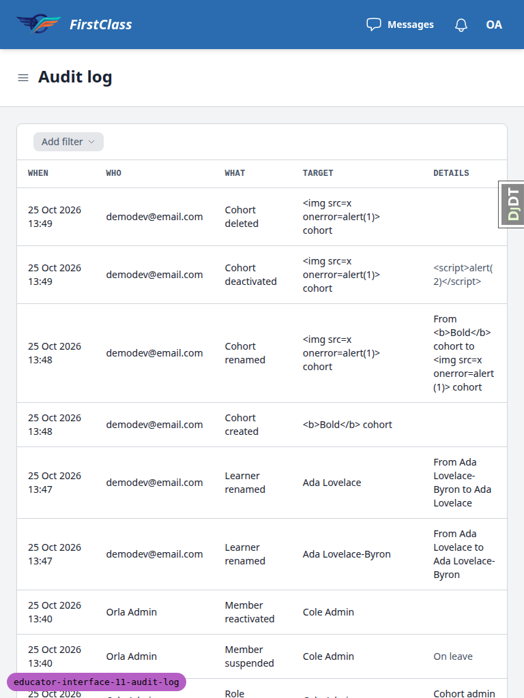 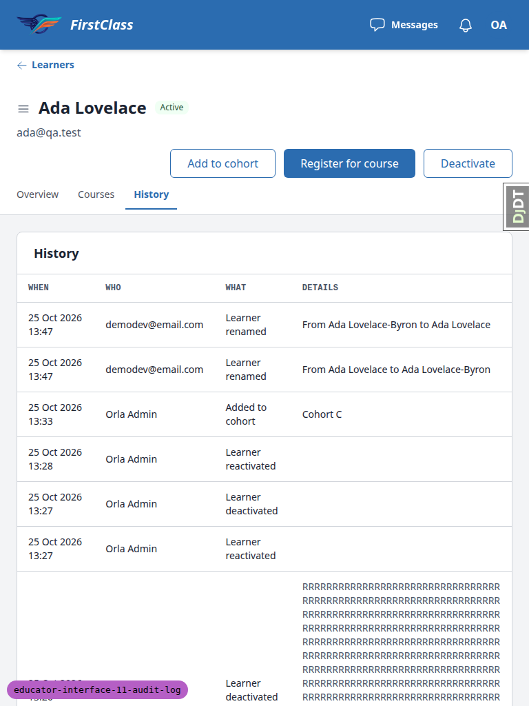 | 768x1024: hamburger navigation; org log table fits 718/718px with the date and time on separate lines in the When cell and long Target/Details wrapping; the desktop 'Add filter' bar is shown. Ada's History (page-2026-10-25T13-53-53-382Z.png) and Cohort A's History also fit 718/718; document scrollWidth 768 = viewport on all three. |

## Design check

no design states tested

## Bugs

No bugs found this run.

## Bug status

No bugs this run; nothing to resolve.

## General notes

- Not tested as their own rows:
  - §2.5 is covered by the per-dialog checks in §4, §5 and §7 rather than as its own row.
  - The plan's §8.6 combination (Who=System + What=Learner deactivated) was swapped for Who=System + What=Cohort deleted, because the seed writes a System 'Learner deactivated' row.
- Difficulties:
  - Django Debug Toolbar intercepted header-button clicks until it was hidden.
  - Several dialogs (Move, Add member, Change cohorts) re-render over HTMX after a choice, so an automated click during the swap is lost, and a final confirm screen exists. No human impact.
- Tangential observations, no action:
  - A deactivated learner's badge reads "Removed" where the plan says "Inactive" (pre-existing wording).
  - The "Cohort created" row keeps the cohort name at the time rather than the current name.
  - Older rows from the previous run show raw role keys like "cohort_admin on Cohort B" where new rows show "Cohort admin on Cohort B", because labels are stored at write time.
  - The learner-page Deactivate input carries maxlength=500, so the 422 path needs a crafted request.
  - Sol's "Register for course" picker offered "Course Other", a course not registered on any Northside cohort.

status: ok
reason: report rendered, 0 bugs documented, 39 test records all pass
