# Frontend QA report: educator-interface-11-audit-log

## Methodology

Manual Playwright MCP run against a dev server on port 8049, logged in as the plan's personas (org.admin, cohort.admin, cohort.viewer, south.admin, demodev). Screenshots were collected into `screenshots/` beside this report, and every referenced image exists there. The dev DB was empty at the start, so I ran `create_demo_data --yes` and then the plan's seed command.

## Diff scoping

Class: **FULL**. It was triggered by these changed template files:

- `freedom_ls/educator_interface/templates/educator_interface/data-table-cells/audit_details.html`
- `freedom_ls/educator_interface/templates/educator_interface/data-table-cells/audit_what.html`
- `freedom_ls/educator_interface/templates/educator_interface/data-table-cells/audit_when.html`
- `freedom_ls/educator_interface/templates/educator_interface/data-table-cells/audit_who.html`
- `freedom_ls/educator_interface/templates/educator_interface/modal/deactivate_confirmation.html`
- `freedom_ls/educator_interface/templates/educator_interface/modal/deactivate_learner_confirmation.html`
- `freedom_ls/educator_interface/templates/educator_interface/modal/delete_cohort_confirmation.html`
- `freedom_ls/educator_interface/templates/educator_interface/modal/remove_from_cohort_confirmation.html`
- `freedom_ls/educator_interface/templates/educator_interface/modal/remove_role_confirmation.html`
- `freedom_ls/educator_interface/templates/educator_interface/modal/suspend_member_confirmation.html`
- `freedom_ls/educator_interface/templates/educator_interface/modal/unregister_confirmation.html`
- `freedom_ls/educator_interface/templates/educator_interface/modal/unregister_from_course_confirmation.html`
- `freedom_ls/educator_interface/templates/educator_interface/panels/learner_history.html`
- `freedom_ls/educator_interface/templates/educator_interface/partials/audit_history_empty.html`
- `freedom_ls/educator_interface/templates/educator_interface/partials/audit_log_card.html`
- `freedom_ls/educator_interface/templates/educator_interface/partials/audit_log_empty.html`
- `freedom_ls/educator_interface/templates/educator_interface/partials/reason_field.html`

Desktop, mobile and tablet viewports all ran. Nothing was skipped.

## Smoke gate

Outcome: **pass**. Pages checked:

- http://127.0.0.1:8049/
- http://127.0.0.1:8049/educator/organisations/northside/audit-log

## Results table

| Test | Viewport | Status | Screenshot | Note |
|---|---|---|---|---|
| 0.1 | desktop | pass |  | Branch badge correct. Plan URLs omit `organisations/`. |
| 1.1-1.6 | desktop | pass |  | History tab, empty state, reason field and deactivate/reactivate rows OK. Dialog:  |
| 2.1-2.4 | desktop | pass | 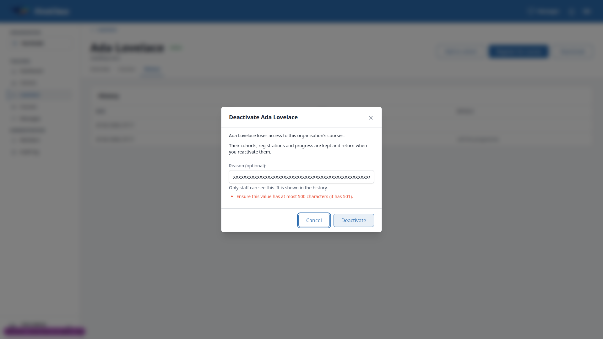 | 501 chars returned 422 with the error shown; 500 chars stored in full. |
| 2.3-layout | desktop | fail | 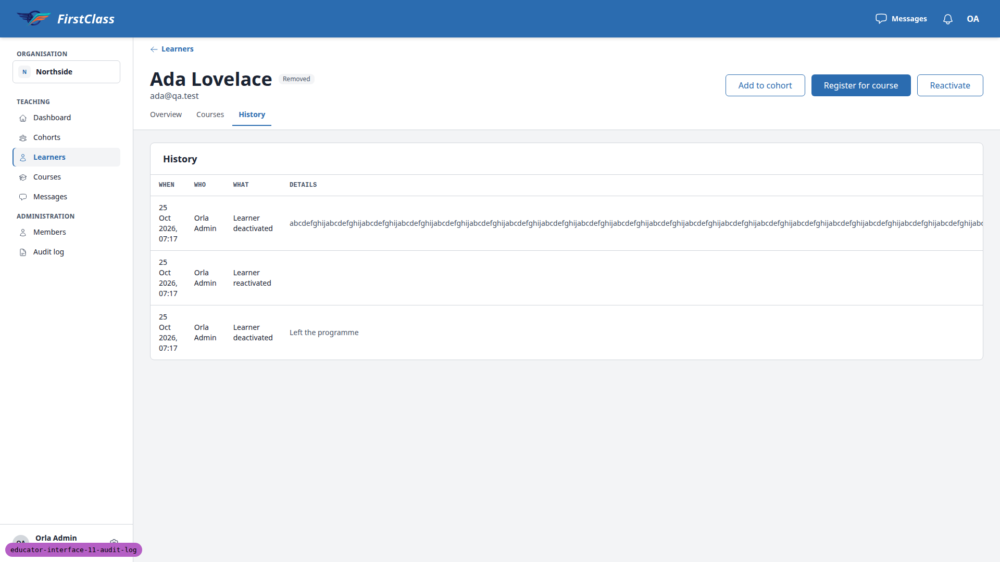 | 500-char unbroken reason stretches the table to 3733px (see B1). |
| 3.1-3.4 | desktop | pass | 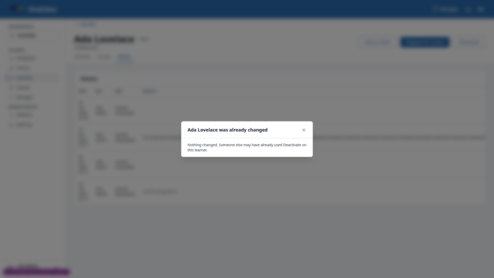 | Stale-tab confirm answered "already changed"; one deactivated row. |
| 3.5 | desktop | pass | — | No self-change controls on own Members row. |
| 4.1-4.2 | desktop | pass | 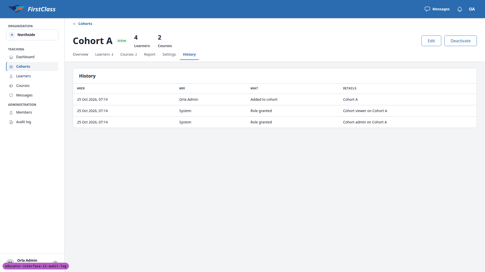 | Added to cohort on learner and cohort History; no reason field. |
| 4.3-4.5 | desktop | pass | — | Move and remove-with-reason rows correct on learner and both cohorts. |
| 4.6 | desktop | pass | 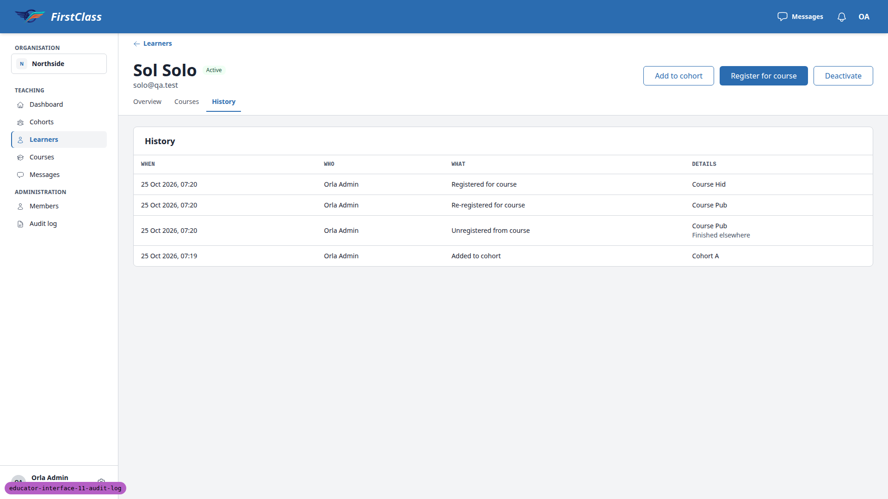 | Unregister, re-register and register rows recorded. |
| 4.7 | desktop | pass | — | Cohort registration, unregister (with reason) and re-register on History. |
| 4.8 | desktop | pass | — | Learner added and Added to cohort rows correct. |
| 4.9 | desktop | pass | 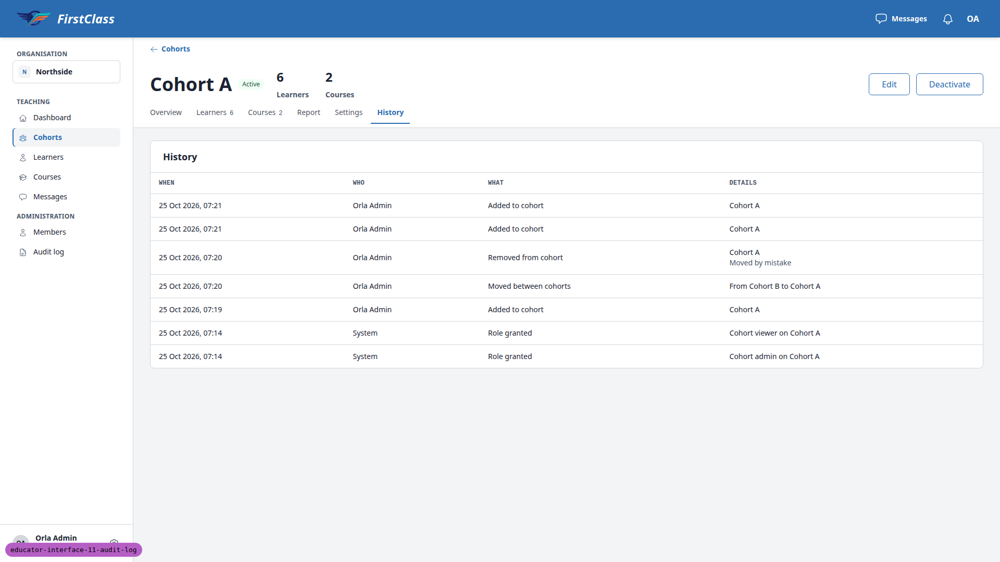 | Two Added to cohort rows, no summary row; passes as written. |
| 4.9-usability | desktop | fail |  | Cohort History does not say who each row is about (see B3). |
| 5.1-5.6 | desktop | pass | 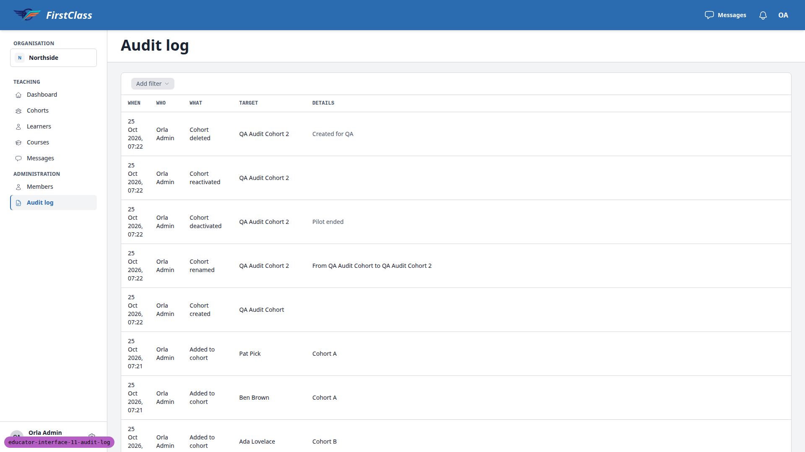 | Cohort lifecycle rows correct; no-change save writes nothing. |
| 6.1 | desktop | skip | — | Org admin has no Edit name action (needs change_user); re-run below as demodev. |
| 6.2 | desktop | pass | — | Setup email resent row; second attempt rate-limited, no second row. |
| 6.3 | desktop | pass | — | Nameless learner deactivate/reactivate shown; Target reads the email. |
| 7.1-7.6 | desktop | pass | — | Role removed/granted and member suspend/reactivate rows correct. |
| 8.1-8.2 | desktop | pass |  | Sidebar, columns and newest-first order correct; no search, sort, checkboxes or Export. |
| 8.3-8.4 | desktop | pass | — | Who and What filters behave correctly. |
| 8.5 | desktop | pass | — | All When presets keep all rows. |
| 8.6 | desktop | pass |  | System + Cohort deleted gives empty state; Clear filters restores all rows. |
| 8.7 | desktop | pass | — | 39 rows over 25 + 14 pages, no repeats. |
| 8.8 | desktop | pass | — | Bad filter params give HTTP 200, unfiltered list. |
| 6.1 | desktop | pass | — | Re-run as demodev: two Learner renamed rows; no-change save wrote none. |
| 9.1-9.2 | desktop | pass | — | Cohort viewer/admin see no History, Settings or Audit log; History URLs 404. |
| 9.3 | desktop | pass | — | Southside log isolated from Northside; Northside log 404 for Sid. |
| 9.4 | desktop | pass | — | demodev sees correct per-organisation logs (navigated by URL). |
| 10.1-10.3 | desktop | pass | 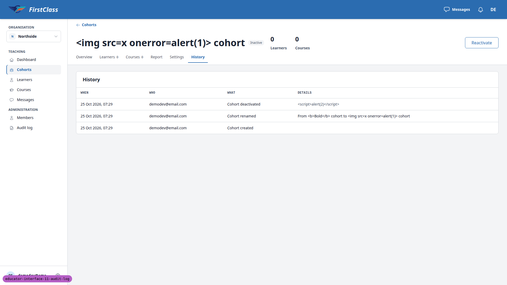 | HTML/script input rendered as literal text; no dialogs fired. |
| 12.1-12.3 | desktop | pass | 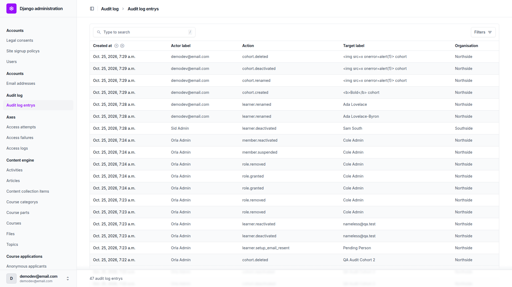 | Read-only admin: no add, edit or delete; /add/ 403; search works. |
| 12.1-plural | desktop | fail |  | Admin says "Audit log entrys" (see B2). |
| 13.1-13.3 | desktop | pass | — | Pages 200 with no console errors; Cancel writes nothing. |
| 11.1 | mobile | pass | 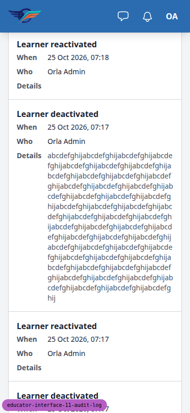 | History renders as cards; long reason wraps; no horizontal scroll. |
| 11.2 | mobile | pass | 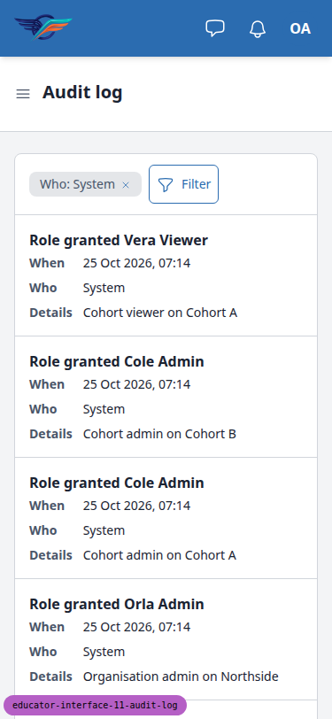 | Filter sheet and cards work. Sheet:  |
| 11-dialog | mobile | pass | 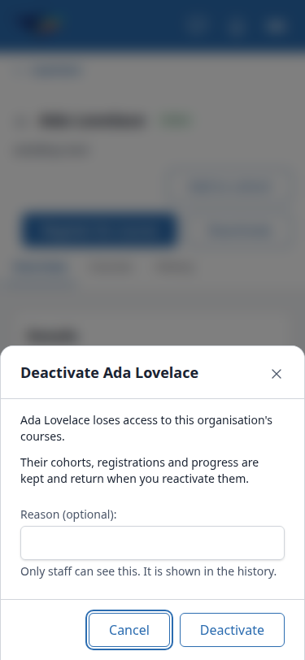 | Deactivate dialog is a bottom sheet; Reason input fits in 375px. |
| 11.3 | tablet | pass | 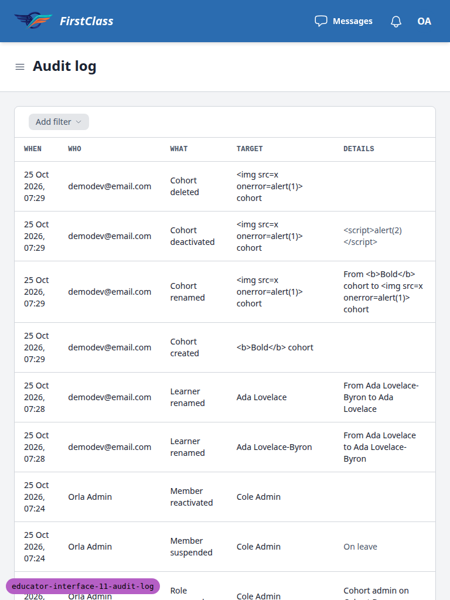 | Org log table fits 718/718; Cohort A History fits. |
| 11.3-ada-history | tablet | fail | 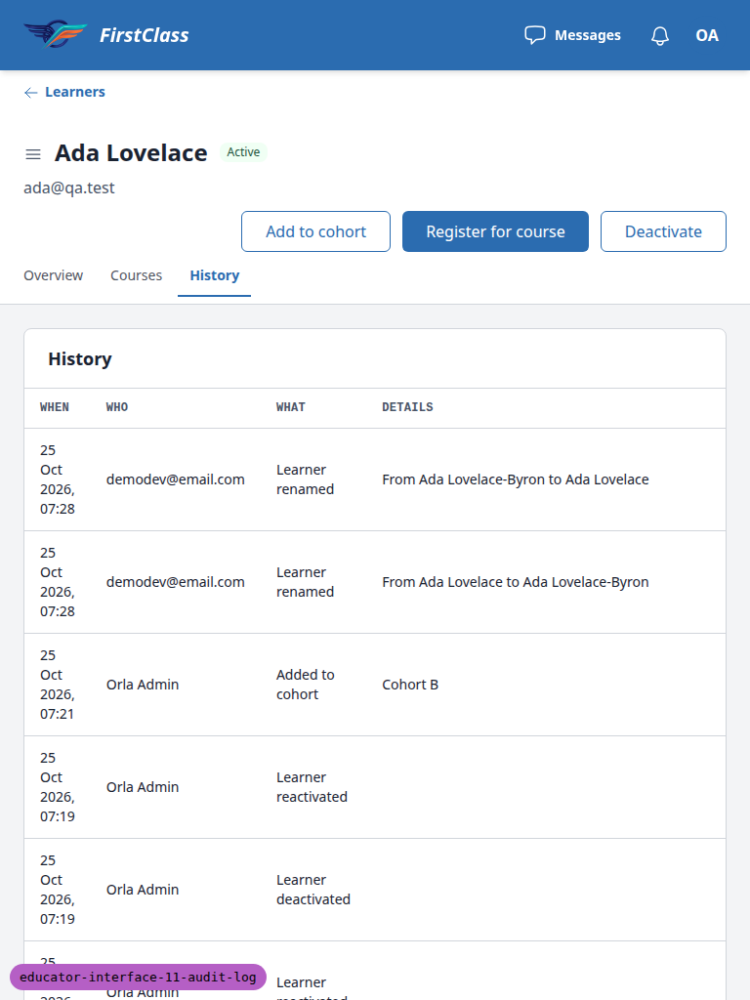 | Long reason stretches the table to 3832px (see B1). |

## Design check

No design states tested.

## B1: Long unbroken reason stretches the History table instead of wrapping

Manifestations:

- 2.3-layout (desktop)
- 11.3-ada-history (tablet)

**Expected:** A reason up to the 500-character limit wraps inside the Details cell, as it already does in the mobile card, and the other columns keep their width.

**Actual:** A 500-character reason with no spaces makes the history table 3733px wide at desktop (1598px wrapper) and 3832px at tablet (718px wrapper). When/Who/What are squeezed to a word per line on every row, and the reason is pushed off to the right behind a horizontal scroll. The Details cell markup (`audit_details.html`, reason span `block text-muted`) has no word-break rule.

## B2: Django admin calls the model 'Audit log entrys'

Manifestations:

- 12.1-plural (desktop)

**Expected:** Admin index, sidebar, breadcrumb and changelist count read "Audit log entries".

**Actual:** They read "Audit log entrys" and "47 audit log entrys". `AuditLogEntry.Meta` has no `verbose_name_plural`.

## B3: Cohort History rows don't say which learner or member they are about

Manifestations:

- 4.9-usability (desktop)

**Expected:** An educator reading a cohort's History can tell who was added, removed, moved or granted a role.

**Actual:** The cohort History has When/Who/What/Details only (the spec puts Target on the organisation log alone). Adding Ben and Pat produced two identical "Added to cohort / Cohort A" rows. "Role granted / Cohort viewer on Cohort A" does not name Vera. Details repeats the cohort's own name. Spec and build agree, so this is a product decision.

## Bug status

| Bug | Status |
|---|---|
| B1 | **FIXED** (commit: f792ddfa) — Long unbroken reason stretches the History table instead of wrapping. Re-verified: learner History table 1598/1598px at desktop and 718/718px at tablet; org log page 2 and Cohort A History also fit. 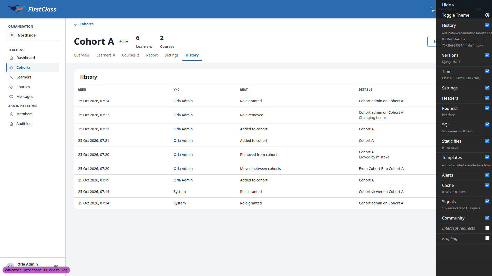 |
| B2 | **FIXED** (commit: 871d4e7b) — Django admin calls the model 'Audit log entrys'. Re-verified: index, sidebar and changelist read "Audit log entries" / "47 audit log entries"; /add/ still 403. 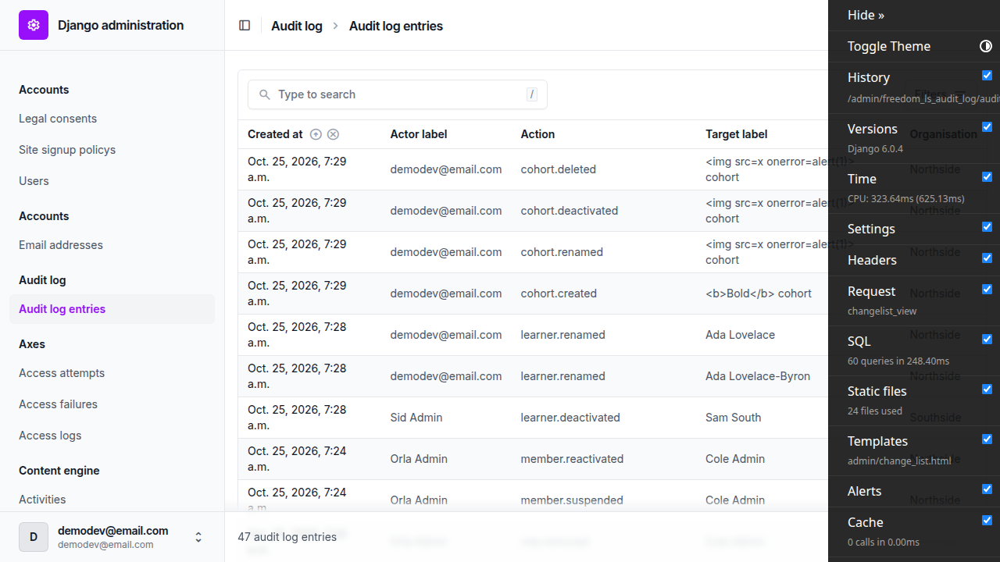 |
| B3 | **UNRESOLVED** — Cohort History rows don't say which learner or member they are about (reason: the spec deliberately gives only the organisation log a Target column; whether the cohort History should name the learner or member is a product decision) |

Full run after the fixes: the B2 fixer ran the full tier after both fix commits were in (its migration selected the full tier): 9538 passed, 1 warning.

## General notes

- The test plan's URLs omit `organisations/`. The real paths are `/educator/organisations/northside/...`.
- "Edit name" is site-admin only (it needs `change_user`), so §6.1 ran as demodev.
- The plan's §8.6 combo (System + Learner deactivated) isn't empty, because the seed writes a System "Learner deactivated" row for Rae Removed. I used System + Cohort deleted instead.
- The 501-character test needed the input's `maxlength=500` removed, because a browser cannot type 501.
- The header badge reads "Removed", not "Inactive" (pre-existing wording).
- The admin Action column shows codes (e.g. `learner.renamed`), not labels.
- The Register dialog offers Southside's "Course Other" to a Northside learner. This predates this branch.
- The Cohort created row keeps the cohort name at write time ("QA Audit Cohort"); later rows show "QA Audit Cohort 2".
- The bulk paste adds write one row per learner, with no summary row in the org log.
- The Django debug toolbar covered header buttons at 1920px and was hidden with injected CSS for the run.

status: ok · reason: 3 bugs — 2 fixed, 1 unresolved; report rendered, screenshots verified
