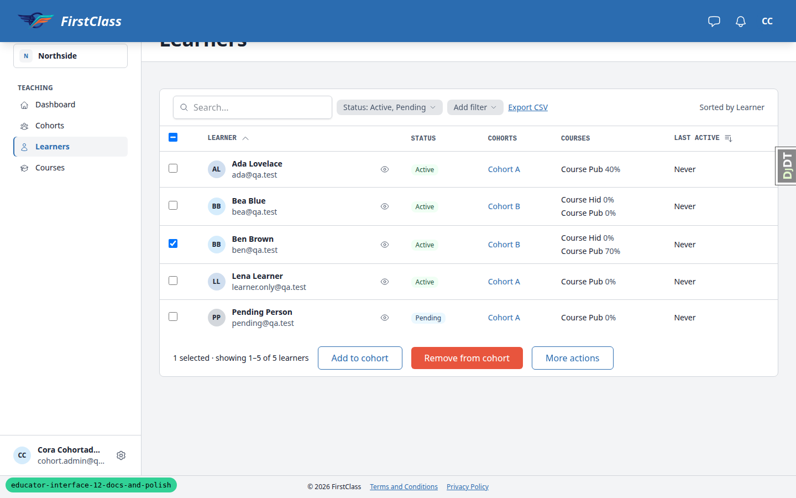
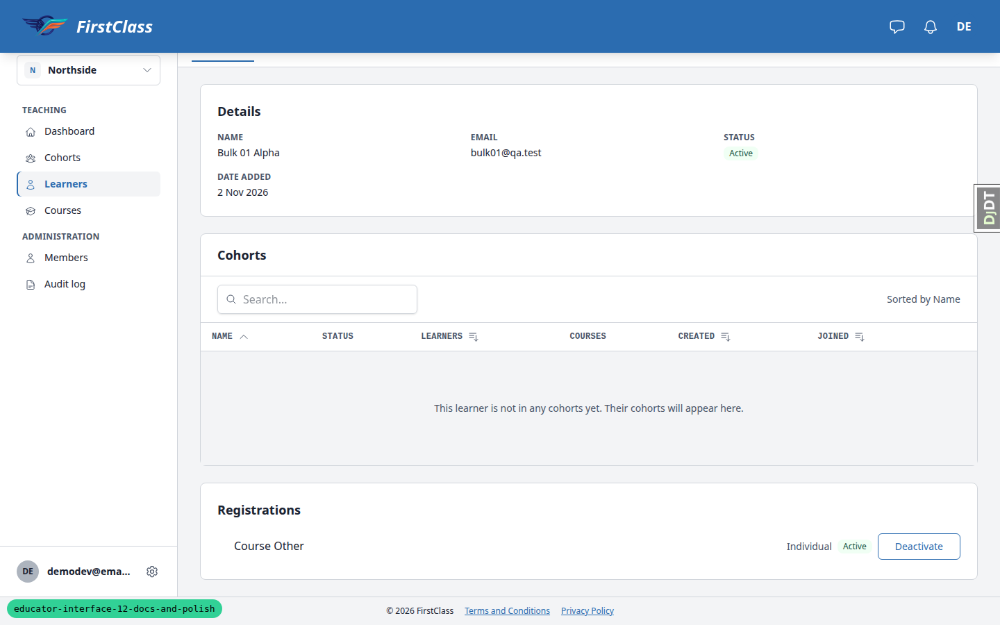
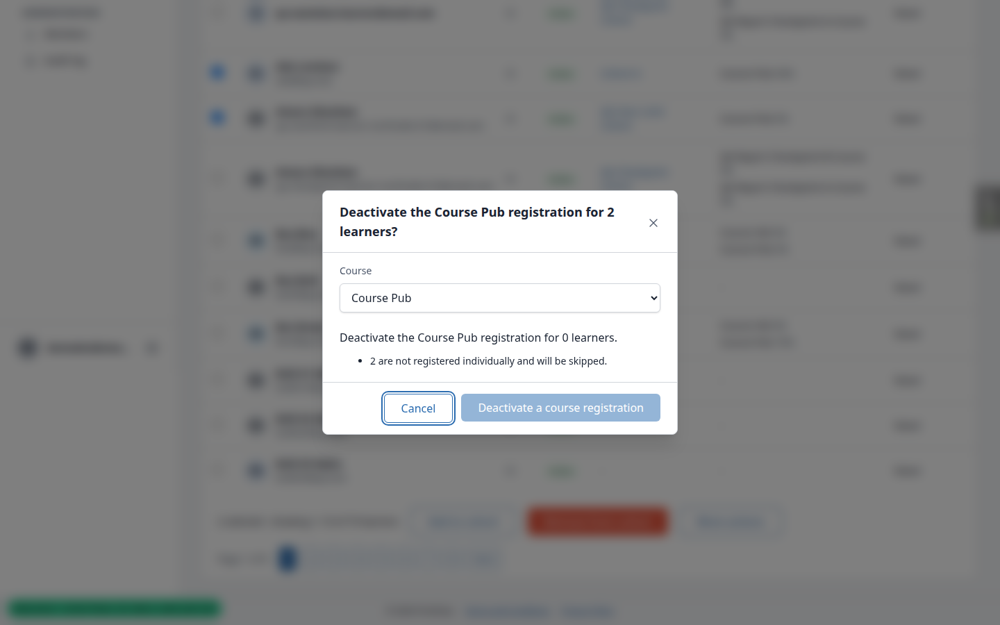
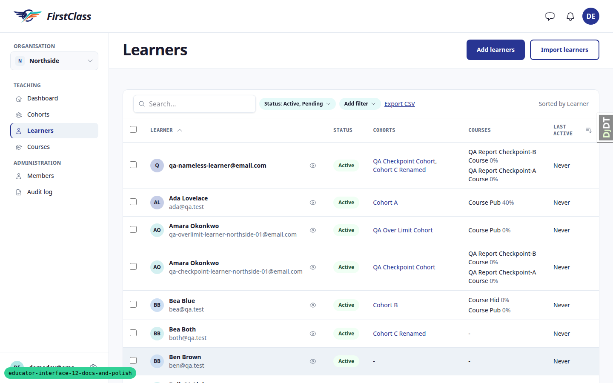
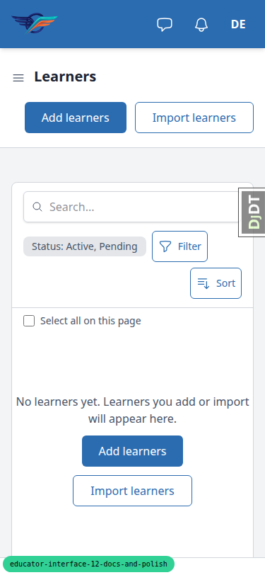
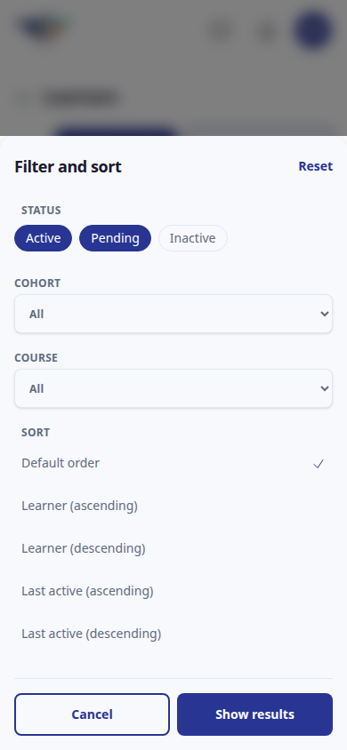
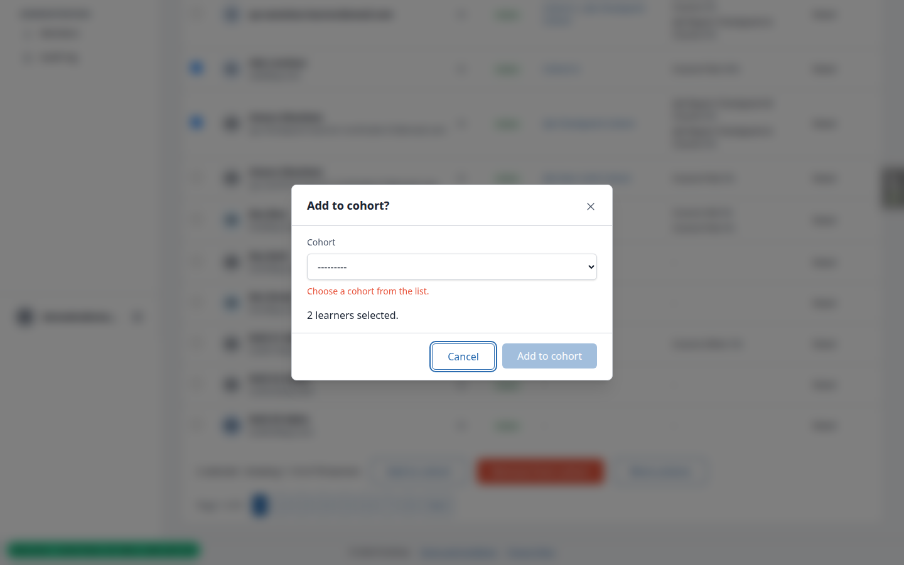

# Frontend QA report: Educator interface docs and polish

Spec: `1. spec.md`. Plan: `2. plan.md`. Test plan: `3. frontend_qa.md`.

## Methodology

- Driven by hand with the Playwright MCP, against a dev server on port 8652 started with `config.settings_local`
  (git-excluded; `REPORTS_MAX_LEARNERS=5`, `BULK_BACKGROUND_THRESHOLD=50`).
- Viewports: 1440x900 (desktop), 390x844 (phone), 375x812 (phone, for tests 9.5 and 9.9), 768x1024 (tablet, learners and cohorts tables).
- Two theme passes:
  - Pass 1 ran on the `default` theme (the dev environment has no `FLS_THEME` set). Default primary `#2B6CB0` = `rgb(43,108,176)` was confirmed. The header shows the site name/logo FirstClass in both themes, so the header is not a theme indicator.
  - Pass 2 ran on `first_class` (primary `#283593`) as a lighter sweep: Test 1, the contrast sweep (Test 12), the import page (9.7) and the phone filter sheet.
- Screenshots were collected into `screenshots/` beside this report. Every image referenced below exists in that directory.
- Data came from the five `qa_create_*` commands in the plan plus an uncommitted `qa_create_educator_polish_scenario` command (see Data changes).

## Diff scoping

- Class: **FULL**. Skipped: nothing.
- Everything ran: desktop, mobile and tablet.
- Changed files by area:
  - Docs and plugin resources: `README.md`, `docs/how tos/theme-fls.md`, a product screenshot, `claude_plugins/fls-dev` testing and glossary docs.
  - Base templates and theme: header bar and user menu, cotton button, comms bell and messages button, `first_class` theme CSS, `tailwind.components.css`, the theme contrast invariant test.
  - `educator_interface`: `actions.py`, `forms.py`, `reporting.py`, `views.py`, about 20 modal confirmation templates, panels (lazy region, cohort educators, needs-attention, report body, dashboard, learner courses), empty-state partials, import preview and result partials, member cell, learner quick view, and the matching unit, invariant and Playwright tests.
  - `panel_framework`: `actions.py`, `bulk_actions.py`, `tables.py`, `views.py`, Alpine components JS, data-table and cell templates, search field, stat tile, status badge, tab nav, bulk confirmation partials, quick-view host, table empty and selection-bar partials, table sheet, and tests.
  - `reports`: `indexes.py`, `report_data.py`.
  - `qa_helpers`: two management commands for modal and progress targets.

## Smoke gate

Status: **pass**. Pages checked: `/` and `/educator/organisations/demodev/dashboard`. No failure URL or reason.

## Design check

No design states were tested. The plan's mockup comparison (Test 1) is notes-only, not a pixel reference. Notes from Test 1 at desktop: the dashboard mockup puts the tile label above the number and places Needs attention and Cohort progress side by side; the build stacks them full width and puts labels under the number. Learners table density is close to the mockup.

## Per-test results

| Test | Viewport | Status | Note | Screenshot |
|---|---|---|---|---|
| 1 | desktop (default) | pass | 7 sections load, headings, rows, 0 console errors, no horizontal scroll. Mockup differences noted above. | [shot](screenshots/page-2026-11-02T19-13-44-911Z.png) |
| 1 | mobile (default) | pass | All 7 sections load, scrollWidth 390 everywhere, learners render as cards. | [shot](screenshots/page-2026-11-02T19-42-50-584Z.png) |
| 1 | desktop (first_class) | pass | All sections and both cohort reports load, 0 errors, no sideways scroll. | [shot](screenshots/page-qa-fc-learners.png) |
| 1 | mobile (first_class) | pass | Dashboard, learners, cohorts, members, audit-log scrollWidth 390. | [shot](screenshots/page-qa-fc-mobile-learners.png) |
| 2.1 | desktop | pass | Deactivate a course registration on learners: primary confirm, Cancel focused, "Deactivating…", result dialog, table refreshed. | [shot](screenshots/page-2026-11-02T19-18-20-485Z.png) |
| 2.1-count | desktop | fail | Title says 2 learners, body says 0 learners (see B4). | [shot](screenshots/page-2026-11-02T19-15-04-556Z.png) |
| 2.2 | desktop | pass | Cohorts list: sentence "… for 2 cohorts.", result "2 cohorts changed." | [shot](screenshots/page-2026-11-02T19-19-07-314Z.png) |
| 2.3 | desktop | pass | `unregister_from_course` and `unregister`: GET 404, HTMX POST with CSRF 404. | none |
| 2.4 | desktop | pass | "Register for a course" on cohort Courses tab, learner page header and bulk menu. No learners row menu exists. | none |
| 3 | desktop | pass | All dialogs checked for title, body, footer order, button style, Cancel focus, in-flight labels. History shows the Reason. | [shot](screenshots/page-2026-11-02T19-21-28-846Z.png) |
| 3-stale | desktop | pass | Stale Deactivate dialog opens, submit returns 422 "was already changed". Header behind is not refreshed. | none |
| 3-trigger-style | desktop | fail | Row "Remove" trigger is `btn-secondary` (B3). | none |
| 3-focus | desktop | fail | Focus lost to BODY after several confirms (B2). | [shot](screenshots/page-2026-11-02T19-26-06-323Z.png) |
| 3-count | desktop | fail | Bulk Reactivate and Resend titles contradict their sentences (B4). | none |
| 4.1 | desktop | pass | Eastside as admin: members and audit-log first-use states centred, Add member present. cohort_viewer half impossible. | [shot](screenshots/page-2026-11-02T19-27-26-315Z.png) |
| 4.2 | desktop | pass | No-match search shows "No <things> match these filters." plus Clear filters; learners lands on Active+Pending. | none |
| 4.2-default-empty | mobile | fail | First-use empty state shown while 78 inactive learners exist (B9). | [shot](screenshots/page-qa-9-5-after.png) |
| 4.3 | desktop | pass | Dashboard and cohort Overview empty cards centred with full stops. | [shot](screenshots/page-2026-11-02T19-27-26-315Z.png) |
| 5 | desktop | pass | Success, muted and info tones correct; every badge has text. | none |
| 6 | desktop | pass | Nameless learner shows email in list, quick view, page heading, title, checkbox name, report, History. | none |
| 7 | desktop | pass | Chip has no remove control; Clear all returns to Active+Pending. | none |
| 7 | mobile | pass | Sheet Reset drops learners-status params, keeps search. | [shot](screenshots/page-qa-mobile-filter-sheet.png) |
| 8.1 | desktop | skip | Learners list has no row menu. | none |
| 8.2 | desktop | pass | Stale quick-view trigger shows "This is no longer available". | [shot](screenshots/page-qa-8-2-unavailable.png) |
| 8.3 | desktop | fail | Bulk Register and Add to cohort return 500 on a fully inaccessible selection (B1). | [shot](screenshots/page-qa-8-3-bulk.png) |
| 8.4 | desktop | pass | Deleted cohort's Learners tab sort: 404 and unavailable dialog, no reload. | none |
| 8.5 | desktop | pass | Both enumeration requests 404 with identical 1202-byte bodies. | none |
| 9.1 | desktop | pass | Header Reactivate stays on `/__tabs/courses`, badge Active. | none |
| 9.2 | desktop | pass | Stale notices name their own action. | none |
| 9.3 | desktop | pass | Educator email shown as stored. | none |
| 9.4 | tablet | pass | All columns shown; learners table scrolls inside a focusable region. | [shot](screenshots/page-qa-tablet-learners.png) |
| 9.5 | mobile (375) | skip | Dev runs tasks synchronously; running bar state not observable. | [shot](screenshots/page-qa-9-5-running.png) |
| 9.6 | desktop | pass | No zero lines in all-existing preview or mixed result. | none |
| 9.7 | desktop (default) | pass | File input bordered with styled button. Plan URL 404s. | [shot](screenshots/page-2026-11-02T19-36-06-580Z.png) |
| 9.7 | desktop (first_class) | pass | File input bordered with styled button. | [shot](screenshots/page-qa-fc-import.png) |
| 9.8 | desktop | pass | No UUID in either error; Move wording differs (B11). | [shot](screenshots/page-qa-9-8-add.png) |
| 9.9 | mobile (375) | pass | Add member, Change cohorts and Move buttons visible without scrolling. | [shot](screenshots/page-qa-9-9-add-member.png) |
| 9.10 | desktop | pass | Identical sentence, 8.23:1, no `REPORTS_MAX_LEARNERS` in HTML. | [shot](screenshots/page-qa-9-10-report.png) |
| 9.11 | desktop | pass | "Checkpoint (QA Report Checkpoint-A Course)" and "-B". Unique-title case not in data. | none |
| 9.12 | mobile | pass | "Filter and sort" on learners, "Filter" on audit log, no box borders. | [shot](screenshots/page-2026-11-02T19-43-18-458Z.png) |
| 9.13 | desktop | pass | Switcher popover directly under trigger; tab title updates on rename. | [shot](screenshots/page-qa-9-13-switcher.png) |
| 10.1 | desktop | pass | Enter opens quick view with focus on its heading; Escape returns focus. | none |
| 10.1 | mobile | pass | Modal dialog with backdrop, Tab stays inside, Escape returns focus. | [shot](screenshots/page-qa-mobile-quickview.png) |
| 10.2 | desktop | pass | Learner header Deactivate by keyboard works; Escape returns focus. | none |
| 10.3 | desktop | pass | Learner Deactivate confirm lands on header block (other paths lose focus, see B2). | none |
| 10.4 | desktop | pass | Spot-checked only (sort, Add filter, select all). Phone sheet, pagination, Generate/Download, sticky-header obscuring not walked. | none |
| 11 | desktop | fail | B5, B6, B7. | none |
| 12 | desktop (default) | fail | Text passes; input boundary 1.47:1 (B8). | none |
| 12 | desktop (first_class) | fail | Text passes; input boundary 1.23:1 (B8). | [shot](screenshots/page-qa-fc-learners.png) |
| 12-touch | mobile (first_class) | fail | Filter sheet Reset is 36px (B10). | [shot](screenshots/page-qa-fc-mobile-sheet.png) |
| 13 | desktop / mobile | pass | All 12 doc screenshots saved with the plan's names (see General notes). | [shot](screenshots/educator_dashboard.png) |

## Bugs

### B1: Bulk actions with a form return 500 when the whole selection has become inaccessible

- Manifestations: test 8.3, desktop.
- Screenshots:

  
  

- Expected: the "This is no longer available" dialog (or another handled message) when the ticked rows are no longer visible to the user.
- Actual: POST `/learners/__actions/register_for_course` and `/add_to_cohort` return 500. `KeyError: 'course'` (`educator_interface/actions.py:2779`) and `KeyError: 'cohort'` (`actions.py:2585`) in `confirmation_title`, reached from `panel_framework/views.py` `_handle_bulk_action` -> `error_response('Nothing selected')` -> `_BulkConfirmation.context()`. The user sees nothing at all.

### B2: Focus is lost to `<body>` after several confirmations

- Manifestations: test 3-focus, desktop.
- Screenshots:

  

- Expected: after a confirm, focus returns to the row's trigger, or to the table heading when the row was replaced; never `<body>`.
- Actual: `document.activeElement` is BODY after registration Reactivate on the learner Overview Registrations card; Remove on a cohort's Learners tab row (row removed); and cohort header Edit > Save. Learner header Deactivate/Reactivate correctly lands on the header block.

### B3: Row "Remove" (remove from cohort) trigger uses secondary instead of error style

- Manifestations: test 3-trigger-style, desktop.
- Screenshots: none.
- Expected: spec Decisions: triggers in row menus and the selection bar use error for deleting actions (remove from cohort).
- Actual: the per-row "Remove" button on a cohort's Learners tab (and the learner page Cohorts card) is `btn-secondary`. The bulk bar "Remove from cohort" is correctly `btn-error`.

### B4: Bulk dialog title count contradicts the sentence count

- Manifestations: tests 2.1-count and 3-count, desktop.
- Screenshots:

  

- Expected: title and sentence agree; the plan says the title gives "the number that will change".
- Actual: the title counts the selection ("Deactivate the Course Pub registration for 2 learners?", "Reactivate 2 learners?", "Resend the setup email to 2 learners?") while the sentence counts the rows that will change ("… for 0 learners.", "Reactivate 0 learners.", "… to 0 learners."). The confirm button is disabled in the 2.1 case.

### B5: Cohort Report tab tables are unnamed and not in a focusable region

- Manifestations: test 11, desktop.
- Screenshots: none.
- Expected: every table has a caption or `aria-labelledby`; wide tables sit in a focusable, named region.
- Actual: the 4 tables on `/cohorts/<pk>/__tabs/report` have no caption/`aria-labelledby` and no `tabindex=0` region.

### B6: Bulk result message is not announced to screen readers

- Manifestations: test 11, desktop.
- Screenshots: none.
- Expected: after a bulk result, the polite live region contains the message.
- Actual: `toast-region-polite` stays empty. The result dialog has `aria-labelledby` (the action name) but no `aria-describedby`, and focus goes to Close, so "2 learners changed." is never announced.

### B7: Members table and region are named "Users"

- Manifestations: test 11, desktop.
- Screenshots: none.
- Expected: table caption and region name match the page: "Members".
- Actual: the members table caption and region aria name are "Users".

### B8: Text-input boundary fails WCAG 1.4.11 non-text contrast in both themes

- Manifestations: test 12, desktop (both themes).
- Screenshots:

  

- Expected: input borders reach 3:1 against the card, or the miss is recorded in `deliberately_left.md`.
- Actual: the search/text input border is 1.47:1 (default) and 1.23:1 (first_class) on white. Not recorded in `deliberately_left.md`.

### B9: Learners list shows the first-use empty state when the default filter hides every learner

- Manifestations: test 4.2-default-empty, mobile.
- Screenshots:

  

- Expected: a no-match message that points to Clear filters or the Inactive status when learners exist but are all inactive.
- Actual: "No learners yet. Learners you add or import will appear here." with Add/Import buttons, while 78 inactive learners exist.

### B10: Phone filter sheet Reset control is 36px tall

- Manifestations: test 12-touch, mobile (first_class, 390).
- Screenshots:

  

- Expected: touch targets below md are at least 44px tall (spec rule).
- Actual: Reset is 36px; Cancel and Show results are 48px. This is a spec-rule miss, not a WCAG AA failure (2.5.8 is 24px).

### B11: Move dialog's stale-destination error wording differs from Add to cohort

- Manifestations: test 9.8, desktop.
- Screenshots:

  

- Expected: the plan says "Choose a cohort from the list." for both Add to cohort and Move.
- Actual: Move re-renders with "Choose a cohort to move them to." No UUID appears, so the defect the plan targets is fixed; only the wording differs.

## Layout probe

| Test | Viewport | URL | Screenshot | Result |
|---|---|---|---|---|
| 1 | desktop | `/educator/organisations/northside/dashboard` | [shot](screenshots/page-2026-11-02T19-13-44-911Z.png) | clean. Probe flagged overflow x=256..1538; the ink is an sr-only "No progress to show" span (visually clipped), a probe false positive. |
| 1 | desktop | `/educator/organisations/northside/learners` | [shot](screenshots/page-2026-11-02T19-14-20-233Z.png) | clean |
| 1 | mobile | `/educator/organisations/northside/learners` | [shot](screenshots/page-2026-11-02T19-42-50-584Z.png) | clean. Probe flagged ink to x=447 inside the horizontally scrollable table region; the page itself does not scroll. |
| 9.4 | tablet | `/educator/organisations/northside/learners` | [shot](screenshots/page-qa-tablet-learners.png) | clean. Probe overflow x=0..988 is the intentional inner table scroll. |

## Data changes

| Via | What |
|---|---|
| sdd:qa-data-helper | Ran `qa_create_educator_interface_seed`, `qa_create_cohort_administration_scenario`, `qa_create_learner_administration_scenario`, `qa_create_bulk_operations_scenario`, `qa_create_member_administration_scenario`. |
| sdd:qa-data-helper | Added (uncommitted) `freedom_ls/qa_helpers/management/commands/qa_create_educator_polish_scenario.py` and ran it: demodev organisation_admin of Northside and Southside; Cohort Old (inactive), Cohort Empty, QA Over Limit Cohort, QA Checkpoint Cohort with two Checkpoint quizzes; nameless learner, inactive-account member Otto Off, cohort viewer, nameless educator; Eastside with no members/audit. |
| sdd:qa-data-helper | Created git-excluded `config/settings_local.py` with `REPORTS_MAX_LEARNERS=5` and `BULK_BACKGROUND_THRESHOLD=50`; dev server restarted with `DJANGO_SETTINGS_MODULE=config.settings_local`. |
| QA run through the UI | Registered/deactivated Course Other for Bulk 01/02 and Cohort C/Stale; deactivated Bulk 03 and Bulk 04; reactivated Bulk 01 Course Other registration; added nameless learner to Cohort C. |
| QA run through the UI | Removed Lena Learner from Cohort A and Ben Brown from Cohort B; deleted Cohort Empty. |
| QA run through the UI | Created and deleted cohorts QA Temp 1 and QA Temp 2; imported qa.import.new1@qa.test; renamed Cohort C to "Cohort C Renamed"; Cohort Old reactivated then deactivated. |
| QA run through the UI | Bulk-deactivated 78 Northside learners then bulk-reactivated 81 (Rae Removed, Bulk 03, Bulk 04 now active again). |

## Bug status

| Bug | Title | Status |
|---|---|---|
- **FIXED** (commit: 2a97cde06, then ca6d659f4) — B1: Bulk actions with a form return 500 when the whole selection has become inaccessible. First fix answered 422 "Nothing selected"; the decision below settled on the 404 dialog, which the second commit implements. Re-verified: register_for_course and add_to_cohort on a selection from another organisation answer 404 with "This is no longer available", body identical to a never-existing id; an empty selection still answers 422 "Nothing selected".
- **FIXED** (commit: 5e520bdae) — B2: Focus is lost to `<body>` after several confirmations. The earlier fix (9b3bc4d41, reverted) kept one shared flag that overlapping swaps overwrote; the learner Overview refetches three regions per confirm. Focus is now tracked per request and recovered in `htmx:afterSwap`. Three browser tests (cohort Learners row Remove, Registrations card Reactivate, cohort rename) failed on five of five runs before the fix and passed on five of five after.
- **FIXED** (commit: 1faeffb7e) — B3: Row "Remove" trigger uses secondary instead of error style. Re-verified on the cohort Learners tab and the learner page Cohorts card.
- **FIXED** (commit: 3afc1cf1f) — B4: Bulk dialog title count contradicts the sentence count. Decision: the title counts the rows that will change, as the sentence does; "Reactivate 0 learners?" with the confirm disabled when nothing will change.
- **FIXED** (commit: de69f5cd7) — B5: Cohort Report tab tables are unnamed and not in a focusable region. Each summary and confusion table has an sr-only caption (course title, "(continued)" for a split table, or the quiz heading) and scrolls in a `role="region" tabindex="0"` wrapper named by it.
- **FIXED** (commit: 80c7cfa43) — B6: Bulk result message is not announced to screen readers. A polite `role="status"` region inside the dialog host (`#app-modal-status`) receives the headline out of band, since the page's live regions are inert under a modal dialog; Close is also `aria-describedby` the headline. Re-verify: after a bulk result, `#app-modal-status` holds the headline (the Playwright learners flow asserts it); `#toast-region-polite` stays empty by design.
- **FIXED** (commit: 185f8fa36) — B7: Members table and region are named "Users". `DataTable.noun` overrides the model name; the members table says "Members".
- **FIXED** (commit: 7c0cdf96f) — B8: Text-input boundary fails WCAG 1.4.11 in both themes. New `--color-border-input` token (`#6B7280` default, `#64748B` first_class) edges text fields, selects and textareas product-wide; a theme invariant test holds it at 3:1 or better against white, surface and surface-2.
- **FIXED** (commit: a6af21faf) — B9: Learners list shows the first-use empty state when the default filter hides every learner. An empty page under untouched default filters, with rows in scope, now shows "No learners match these filters." and a "Show all learners" link that selects every status. Clearing still returns to Active + Pending.
- **FIXED** (commit: f7f6a5ab0) — B10: Phone filter sheet Reset control is 36px tall. Reset and the status chips in the sheet are 44px; the touch-target test opens the sheet and measures links too.
- **FIXED** (commit: 4481d4067) — B11: Move dialog's stale-destination error wording differs from Add to cohort. Both read "Choose a cohort from the list." through the one `choice_error` helper.
- **DECIDED** — B1-decision: a bulk action whose whole selection has left the user's scope answers 404 with the "This is no longer available" dialog, as the spec's Decisions and the QA plan's Test 8.3 say; the code changed (ca6d659f4) and the plan stands.

## General notes

- The plan says "learner row menu", but the learners list has no row menu. Single-learner actions live on the learner page header and on the cohort Learners tab rows. Test 8.1 was therefore skipped and 2.4, 3 and 10.2 were run on those surfaces.
- The More-actions menu closes when Playwright's programmatic scroll-into-view-and-click fires. It is not reproducible with a real wheel scroll followed by a click, so it was not filed.
- The plan URL `/learners/import` returns 404. The real URL is `/learners/import/`, with a trailing slash, unlike every other educator URL.
- The "Add filter" `
` does not close on Escape (native `
` behaviour).
- Copy nit: "1 of 1 learners" in the Quiz confusions card.
- Stale-tab Deactivate: the dialog opens normally (the client has stale state) and only the submit reports "already changed". The plan reads as if the dialog itself should say so.
- Test 9.5 is not observable in dev because tasks run synchronously; the "Deactivate is running…" bar was never visible, so its height and hidden actions are unverified.
- Test 4.1: the cohort_viewer half is impossible, because that role cannot see members or the audit log (pages 404).
- Test 13 doc screenshots were saved with the plan's names (`educator_dashboard`, `educator_learners_list`, `educator_learner_page`, `educator_learner_quick_view`, `educator_cohort_overview`, `educator_courses`, `educator_members`, `educator_history`, `educator_audit_log`, `educator_cohort_report`, `educator_confirm_with_reason`, `educator_learners_mobile`) and moved from `qa-screenshots/` into `screenshots/`. History is Cohort C Renamed's History tab; the report is QA Checkpoint Cohort; the confirm shot is Ada Lovelace's Deactivate with Reason filled, then cancelled.
- The dev badge and the debug toolbar were hidden for the doc screenshots.
- On tablet the learners table (877px in a 718px region) has no visual scroll cue, and the Learner column takes about 430px.

status: ok · reason: 11 bugs — 11 fixed (B2 on its second fix, after the first was reverted on re-verification), B1-decision decided; report rendered, screenshots verified
