# Frontend QA report: educator-interface-12-docs-and-polish

The run recorded 66 test records: 50 pass, 14 fail, 2 skip. 14 bugs (B1 to B14) are documented below, all unresolved. The two skips are 4.1 (could not run as written) and 9.5 (running bar not observable). Every failed test maps to a bug.

## Methodology

- Playwright MCP, driven by hand.
- Viewports: desktop 1440x900, phone 390x844 (375x812 for 9.5 and 9.9), tablet 768x1024.
- Main pass in the default theme. Second pass in first_class: CSS rebuilt, server restarted with `FLS_THEME` and `DJANGO_SETTINGS_MODULE=config.settings_local`, so `REPORTS_MAX_LEARNERS=5` and `BULK_BACKGROUND_THRESHOLD=50` applied.
- Main org: northside.
- Screenshots were collected into `screenshots/` beside this report. Every referenced image exists there.
- URLs are `/educator/organisations/<org>/…`, not `/educator/<org>/` as the plan says.
- Product-doc screenshots for Test 13 were saved under the names the plan asks for: educator_dashboard.png, educator_learners_list.png, educator_learner_page.png, educator_learner_quick_view.png, educator_cohort_overview.png, educator_courses.png, educator_members.png, educator_history.png, educator_audit_log.png, educator_cohort_report.png, educator_confirm_with_reason.png, educator_learners_mobile.png.
- educator_cohort_overview.png shows the demodev org's 'Educator QA Cohort Alpha'.

## Diff scoping

Class: FULL. Templates, static, CSS and JS changed (356 files in total), which triggers Rule 1. Nothing was skipped.

## Smoke gate

Pass. Pages checked: `/` and `/educator/organisations/demodev/learners`. No failure URL.

## Results by test

| Test | Viewport | Status | Notes | Screenshot |
|---|---|---|---|---|
| 1 (mobile pages) | phone | pass | Dashboard, learners, cohorts, courses, audit log and report show heading and rows, no sideways scroll. Members fails (1.members-mobile). | 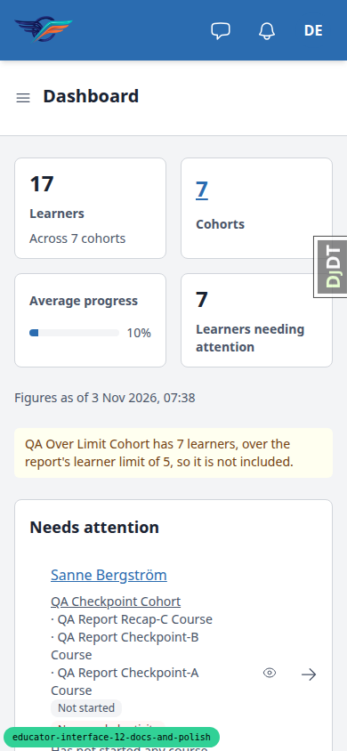 |
| 1.members-mobile | phone | fail | Members scrolls sideways (scrollWidth 398). Long email in an unconstrained truncate span. See B7. | 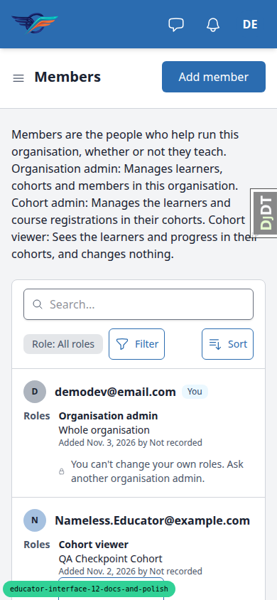 |
| 1.learner-cards-mobile | phone | fail | Card checkbox centred on the tall card; ~50px empty band above the first card. See B9. | 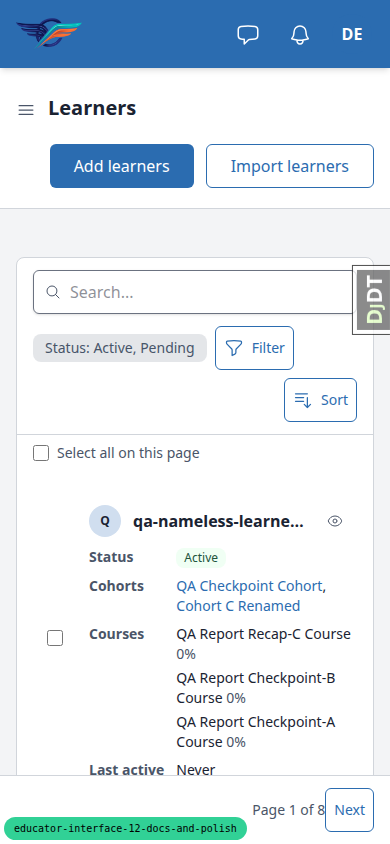 |
| 1.dashboard | desktop | pass | Tiles 17/9/10%/7, Needs attention matches, no console errors. Overflow flag was sr-only text (false positive). | 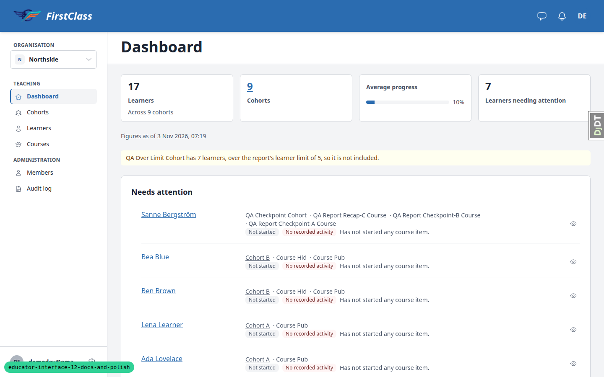 |
| 1.learners | desktop | pass | Heading and rows render, no console errors, no sideways scroll. | 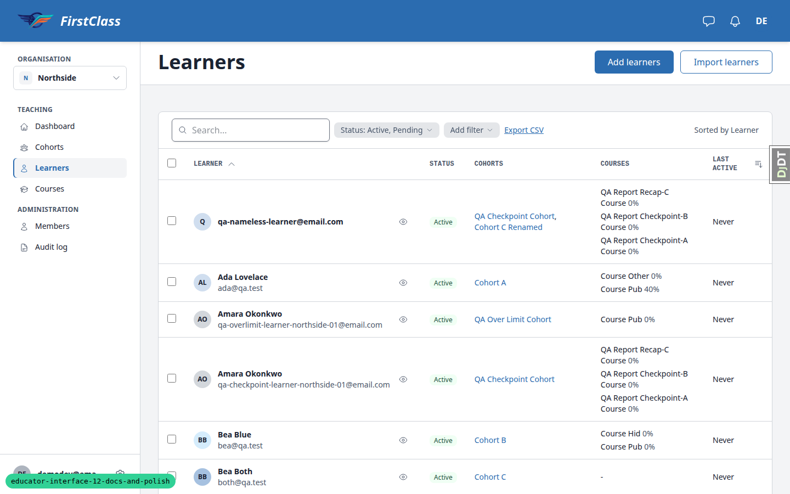 |
| 1.list-gap | desktop | fail | Learners/Cohorts table starts at y≈203, Courses/Audit log at y≈177. See B6. |  |
| 1.card-lists | desktop | fail | Panel lists inherit global ul indent and bullet. See B5. | 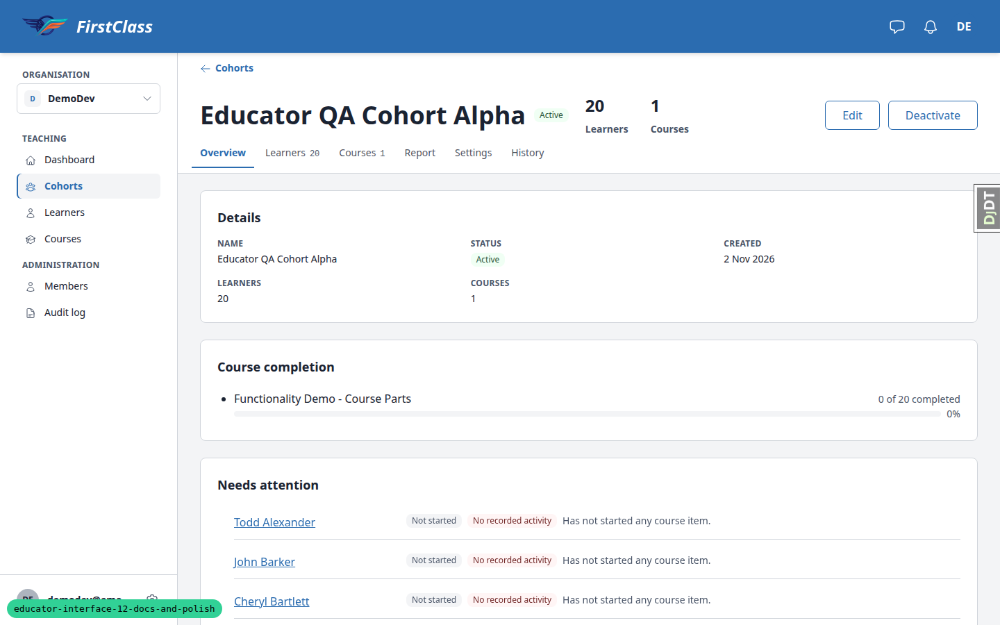 |
| 1.date-format | desktop | fail | Two date formats in one interface. See B14. | 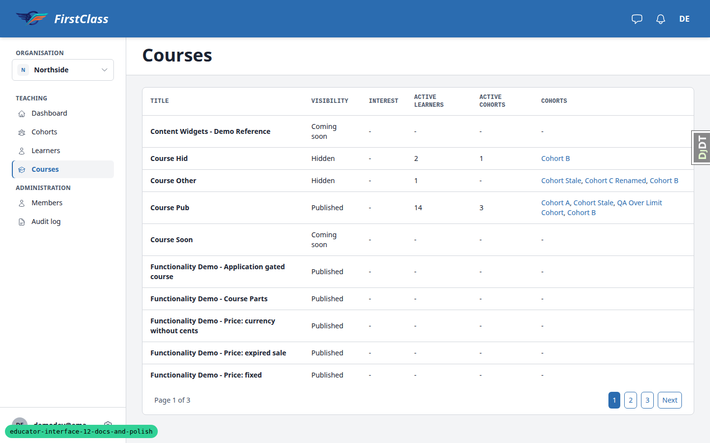 |
| 2.1 | desktop | pass | Bulk deactivate course registration for 2 learners: dialog, in-flight state, result and refresh all correct. | 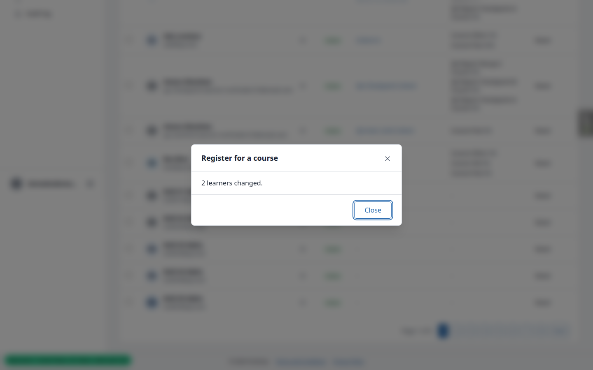 |
| 2.2 | desktop | pass | Cohort bulk Register and Deactivate registration: correct titles, in-flight, result, refresh. | none |
| 2.3 | desktop | pass | GET and HX POST to the unregister action URLs both 404. | none |
| 3.reactivate-learner | desktop | pass | Body explains access returns and progress is kept; Cancel focused; 'Reactivating…' disabled in flight. | none |
| 3.learner-header-tab | desktop | fail | Header Deactivate/Reactivate on the learner History tab jumps to Overview and drops the URL tab. See B1. | none |
| 3.move | desktop | pass | Destination focused, Move disabled until a destination is chosen. | none |
| 3.remove | desktop | pass | Body lists consequences; Remove is btn-error; 'Removing…'; table refreshes (20 to 19). | none |
| 3.bulk-register | desktop | pass | 'Register 2 learners for Course Other?'; confirm disabled until a course is chosen; result dialog, live region. |  |
| 3.cohort-delete | desktop | pass | 'Delete Cohort Empty?', btn-error, 'Deleting…', lands on the Cohorts list. | none |
| 3.resend | desktop | pass | Dialog and 'Sending…' correct; History shows 'Setup email resent'. | none |
| 3.registration | desktop | pass | Learner Overview Registrations card: Deactivate and Reactivate dialogs correct; focus on the Registrations H2. | none |
| 3.members | desktop | pass | Deactivate role, Deactivate member and Reactivate member dialogs correct, Cancel focused. | 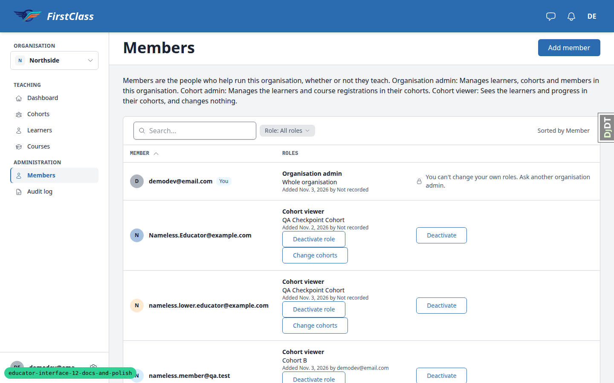 |
| 3.bulk-deactivate | phone | pass | 'Deactivate 78 learners?', confirm primary, Cancel focused. | none |
| 4.1 | desktop | skip | Cannot run as written: cohort_viewer has no Members/Audit log access (404). Admin quietside audit log shows its empty state. | none |
| 4.2 | desktop | pass | No-match states centred with 'Clear filters' on learners, cohorts, members, cohort Learners tab, audit log. | none |
| 4.3 | desktop | pass | Empty cohort Overview and dashboard empty states centred with full stops. | none |
| 5 | desktop | pass | Badges: Active chip-success 8.45:1, Inactive chip-muted 6.84:1, Pending chip-info; all have text. | none |
| 6 | desktop | pass | Nameless learner shows email everywhere (list, quick view, page, report). | 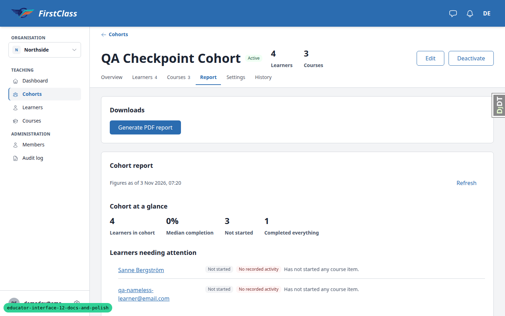 |
| 7 | phone | pass | Filter sheet Reset returns to Active + Pending; desktop Clear all works. | 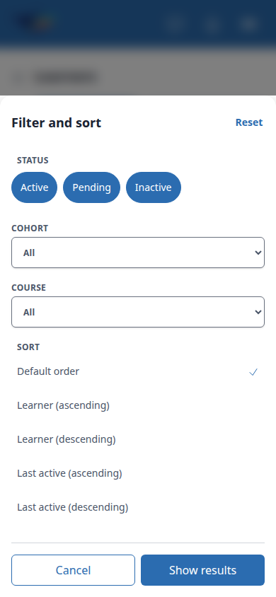 |
| 8.1 | desktop | pass | Exercised as tick deleted learner + Add to cohort: unavailable dialog. | none |
| 8.2 | desktop | pass | Deleted learner's Quick view shows 'This is no longer available'; Escape returns focus. | none |
| 8.3 | desktop | pass | Deleted cohort ticked in cohorts list: unavailable dialog, focus returns. | none |
| 8.4 | desktop | pass | Stale tab sort header shows the unavailable dialog, no reload. | 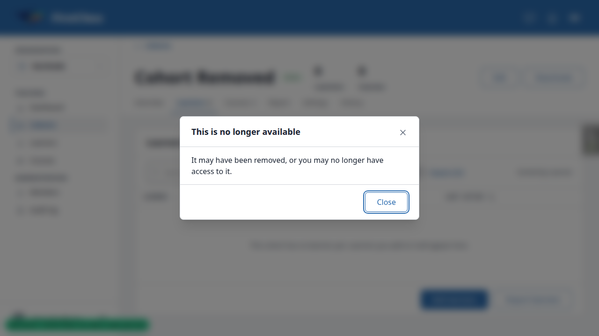 |
| 8.5 | desktop | pass | Other-org and zero uuid quick-view both 404 with identical bodies (1202 bytes). | none |
| 9.1 | desktop | pass | Cohort header Reactivate/Deactivate on Courses tab keeps the tab and URL. | none |
| 9.2 | desktop | pass | Inactive cohort stale-tab submits give the 422 'Cohort B is inactive…' notices. | none |
| 9.3 | desktop | pass | Educators card shows 'nameless.lower.educator@example.com' and 'Nameless.Educator@example.com' as stored. | none |
| 9.4 | tablet | pass | Learners table scrolls inside a focusable region; ArrowRight scrolls 120px; no page sideways scroll. | 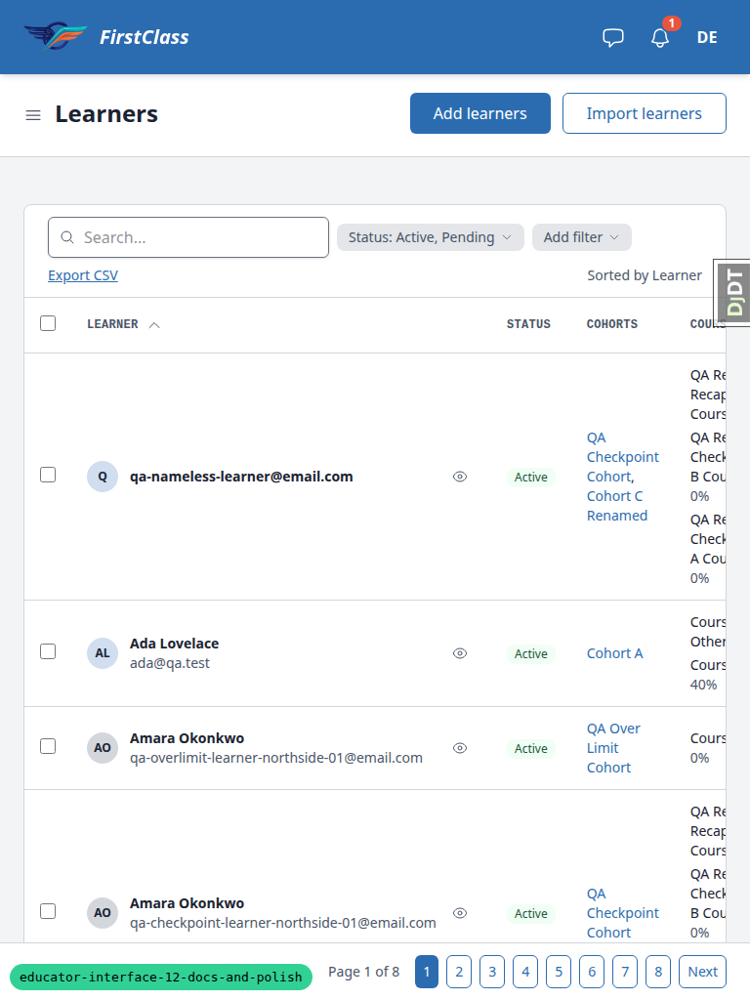 |
| 9.5 | phone (375) | skip | Bulk deactivate of 78 finished before a running state could be sampled; running bar not observed. | 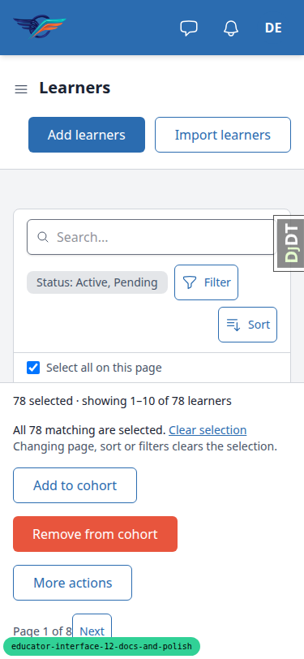 |
| 9.6 | desktop | pass | Two existing members: 'Already a member: 2', no '0 new accounts…' line. Result step unreachable. | none |
| 9.7 | desktop | pass | first_class import file input is bordered like other inputs. | 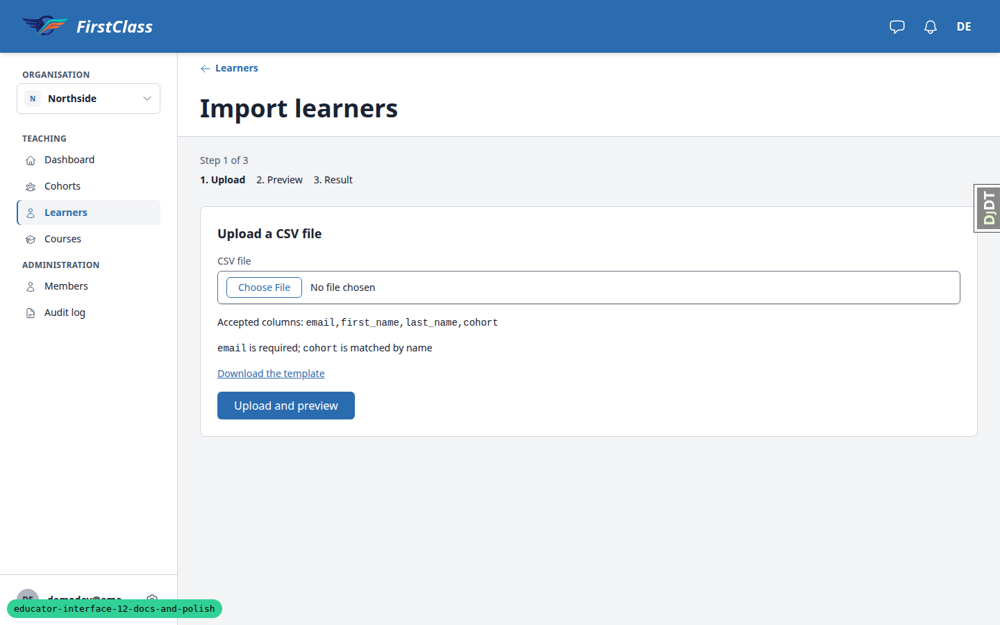 |
| 9.8 | desktop | pass | Deleted target cohort gives 'Choose a cohort from the list.', no UUID. Move variant not repeated. | none |
| 9.9 | phone (375) | pass | Add member, Change cohorts and Move dialogs show Cancel and confirm without scrolling. | 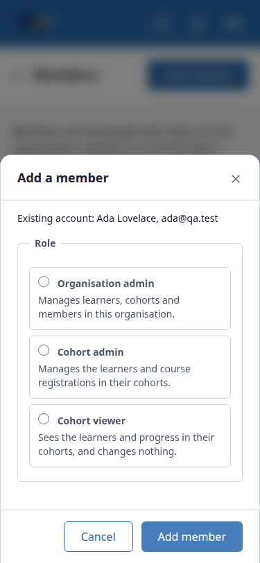 |
| 9.10-dashboard | desktop | pass | Over-limit sentence in a tinted box, ≈8.6:1; setting name not in the HTML. |  |
| 9.10-report | desktop | pass | Same sentence and box on the Report tab. | 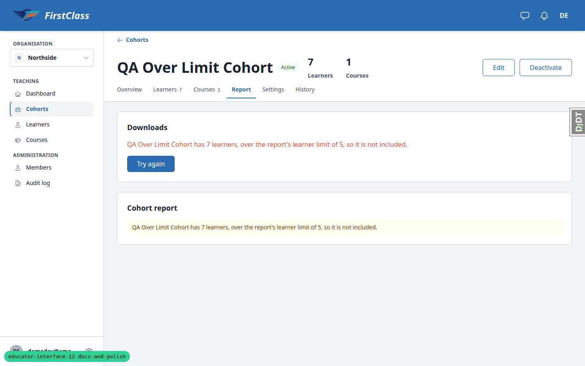 |
| 9.10-generate | desktop | fail | Over-limit cohort offers Generate; result is a red alert with 'Try again'; focus drops to body; red 3.62:1. See B2, B3. |  |
| 9.11 | desktop | pass | Quiz titles disambiguated with course name; unique quiz headed alone. |  |
| 9.12 | phone | pass | Audit sheet titled 'Filter', learners sheet 'Filter and sort'; no group box borders. | 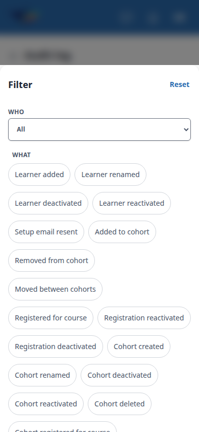 |
| 9.12-legend | phone | fail | Legend keeps 8px padding so group labels sit at x=24 vs 16. See B8. |  |
| 9.13a | desktop | pass | Org switcher opens under trigger; Eastside selection navigates and relabels. | 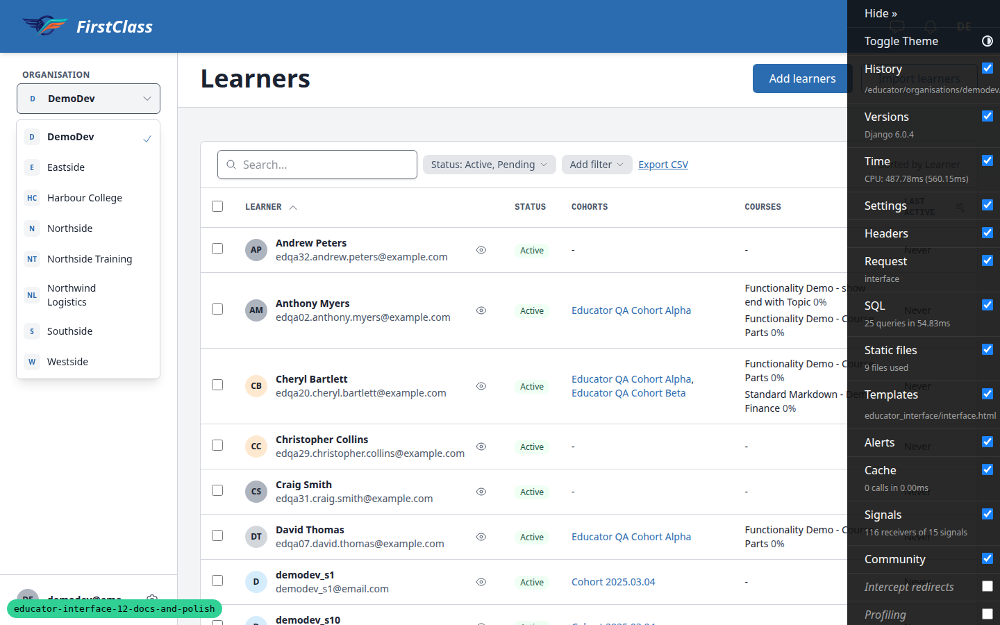 |
| 10.1 | desktop | pass | Quick view opens by Enter, focus on heading; Escape returns focus. | none |
| 10.1 | phone | pass | Quick view is a modal dialog, scrim 50%, focus stays inside, Escape returns focus. | 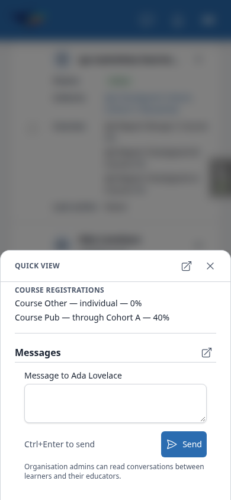 |
| 10.2 | desktop | pass | Deactivate dialog: Cancel focused, Tab cycle, Escape returns focus. | none |
| 10.3 | desktop | pass | Keyboard confirm with Reason: badge flips, focus on page header region, History entry present. | 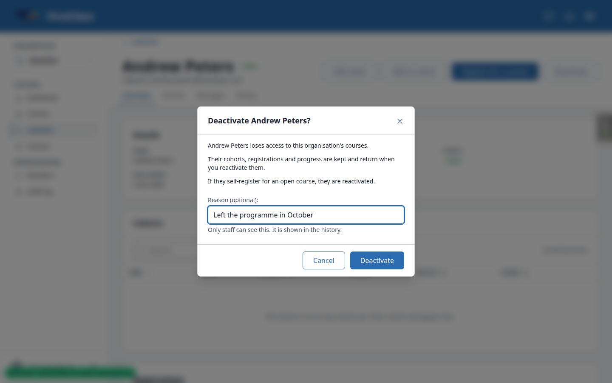 |
| 10.4 | desktop | pass | Sort, pagination, Add filter, org switcher and tile link work by keyboard; focus rings visible. | none |
| 10.4-report | desktop | fail | After Generate PDF report by keyboard, focus drops to body. See B2. | 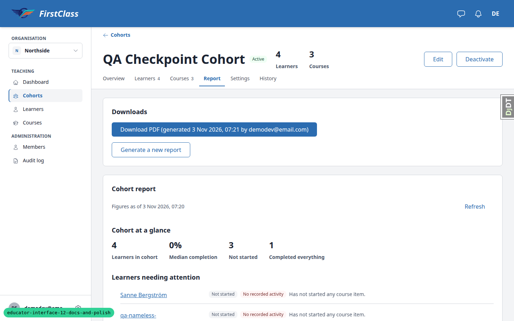 |
| 11 | desktop | pass | Table caption, scope, aria-sort, region name, checkbox names, dialog names, live region all good. | none |
| 11.row-buttons | desktop | fail | Row buttons named just 'Remove' and 'Move'. See B11. | none |
| 11.tile-link | desktop | fail | Cohorts tile link name is only '7'. See B12. |  |
| 11.icon-names | desktop | fail | Icon semantic names leak into accessible names. See B10. | none |
| 12 | desktop | pass | Contrast sweep in both themes: nothing below 4.5:1 except text-error. Touch targets fine at 390. | none |
| 12.error-text | desktop | fail | text-error 3.62:1 (default), 4.13:1 (first_class). See B3, B4. | 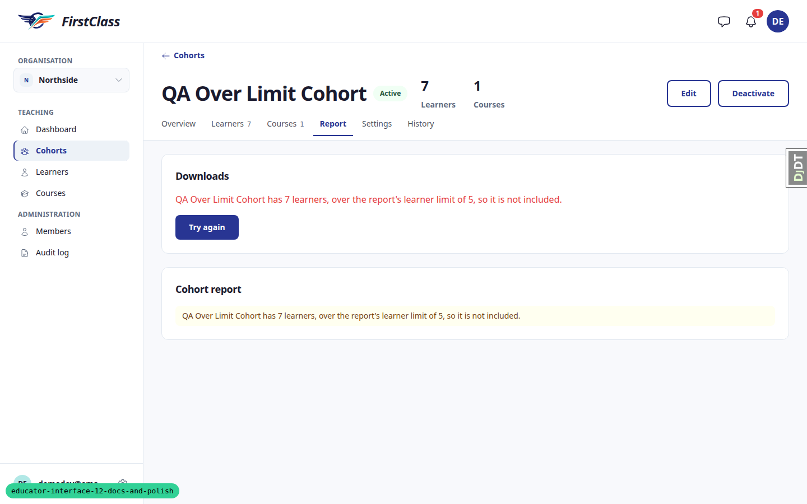 |
| 13.quick-view | desktop | pass | Quick view for Ada Lovelace renders fully. | 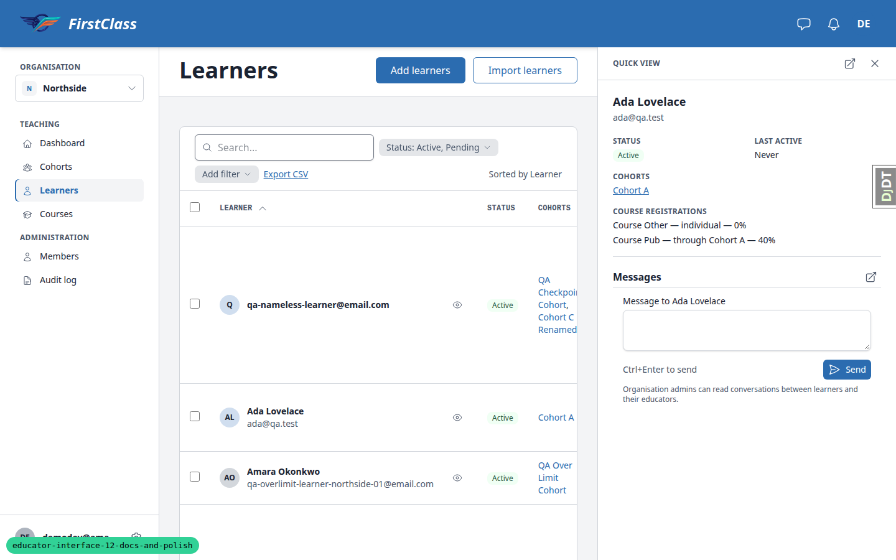 |
| 13.courses | desktop | pass | 10 rows, pagination, no console errors. |  |
| 13.history | desktop | pass | Cohort A History tab, 25 rows. | 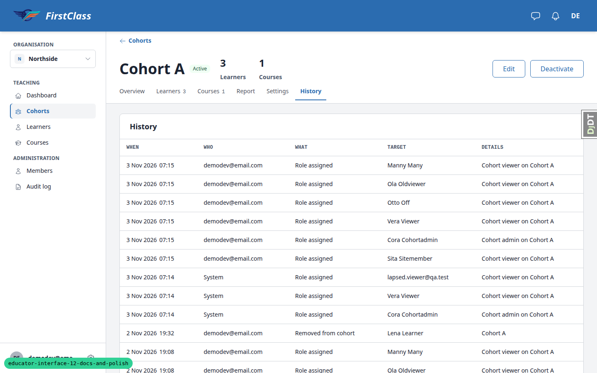 |
| 13.audit-log | desktop | pass | 25 rows, Add filter (Who/What/When). | 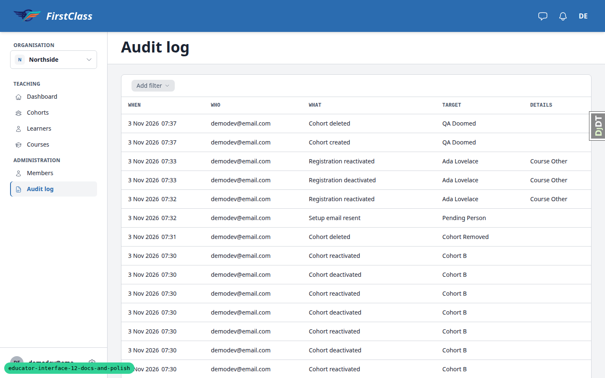 |
| copy.create-cohort | desktop | fail | 'Create Cohort' is Title Case. See B13. | none |
| theme.first_class | desktop | pass | Second theme pass: learners, dashboard, members, import, over-limit report all render, contrast ok. | 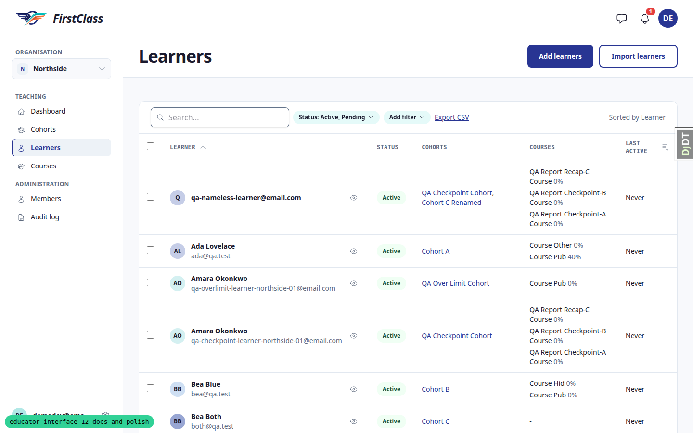 |

## Design check

No design states tested.

### B1: Learner page header Deactivate/Reactivate jumps back to the Overview tab

- Manifestations: 3.learner-header-tab (desktop).
- Screenshots: none.
- Expected: Confirming the header Deactivate or Reactivate on a learner's History (or Courses/Messages) tab keeps that tab and its `/__tabs/<tab>` URL, as the cohort page now does (9.1).
- Actual: The page is replaced with the Overview tab and the URL loses `/__tabs/history`.

### B2: Report Generate drops keyboard focus to body

- Manifestations: 10.4-report (desktop), 9.10-generate (desktop).
- Screenshots:

- Expected: After pressing Generate PDF report by keyboard, focus lands inside the swapped Downloads card (heading, new Download link or the error), never on body.
- Actual: When the Downloads card swaps (success or error), `document.activeElement` is body.

### B3: Over-limit cohort offers Generate PDF, then shows a permanent red error with 'Try again'

- Manifestations: 9.10-generate (desktop), 12.error-text (desktop).
- Screenshots:

- Expected: A cohort over the learner limit either does not offer Generate, or explains it can't be generated without a retry that can never work.
- Actual: Generate is offered. Pressing it shows the over-limit sentence in red with a 'Try again' button, and that failed state persists for every later visitor of the Report tab.

### B4: Error text colour fails 4.5:1 contrast in both themes

- Manifestations: 12.error-text (desktop).
- Screenshots:

- Expected: text-error on white reaches 4.5:1 (WCAG 1.4.3).
- Actual: default rgb(232,85,61) = 3.62:1; first_class rgb(229,62,62) = 4.13:1.

### B5: Panel lists pick up the global ul indent and bullet

- Manifestations: 1.card-lists (desktop).
- Screenshots:

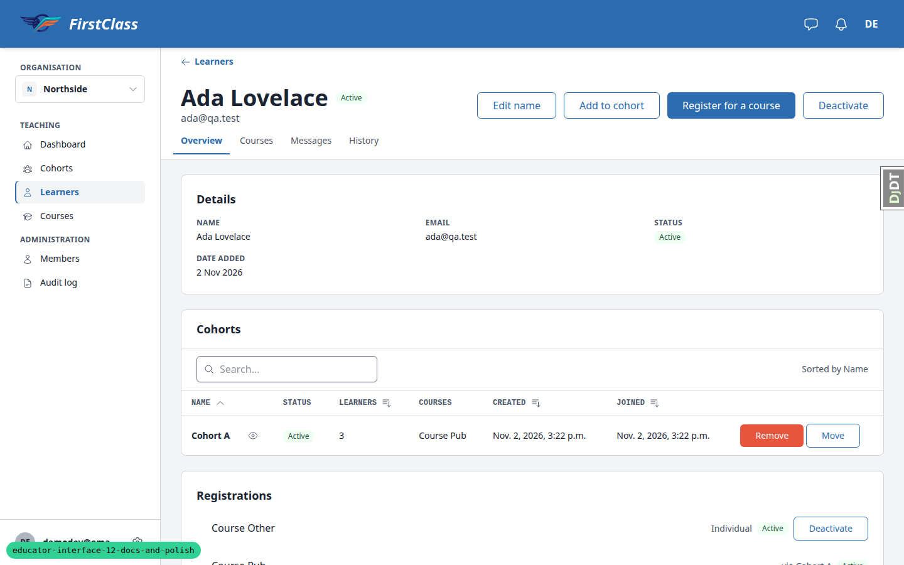

- Expected: Lists in panels (Registrations, Course completion, Needs attention, Cohort progress) line up with their card heading and show no bullet, like the other panel lists that use list-none ml-0.
- Actual: They inherit `ul { list-disc list-outside ml-6 }` from tailwind.components.css: 24px indent, and Course completion shows a disc bullet.

### B6: Learners and Cohorts tables start 24px lower than the other list pages

- Manifestations: 1.list-gap (desktop).
- Screenshots:

- Expected: The table card sits the same distance under the page header on Learners, Cohorts, Courses and Audit log.
- Actual: An empty zero-height `
` is the first child of the space-y-6 canvas, so Learners/Cohorts' section starts at y≈203 vs 177.

### B7: Members page scrolls sideways on a phone when an email is long

- Manifestations: 1.members-mobile (phone).
- Screenshots:

- Expected: No sideways scroll at 390 (scrollWidth <= innerWidth); long emails truncate inside the card.
- Actual: scrollWidth 398. The name line's span.truncate has no width constraint (parent span lacks min-w-0/block width), so nameless.lower.educator@example.com runs past the viewport.

### B8: Filter sheet group labels indented 8px (legend padding)

- Manifestations: 9.12-legend (phone).
- Screenshots:

- Expected: STATUS/SORT/WHAT labels align with COHORT/COURSE/WHO and the chips at x=16.
- Actual: The legend keeps 8px inline padding, so legend labels start at x=24.

### B9: Phone learner card checkbox sits mid-card

- Manifestations: 1.learner-cards-mobile (phone).
- Screenshots:

- Expected: The selection checkbox sits beside the learner's name at the top of the card.
- Actual: It is vertically centred on the whole card, beside 'Courses', plus a ~50px empty band above the first card's content.

### B10: Decorative icon names leak into accessible names

- Manifestations: 11.icon-names (desktop).
- Screenshots: none.
- Expected: Icons inside labelled links/buttons are hidden from assistive tech, so names read 'Dashboard', 'Pending'.
- Actual: Icons render role=img with aria-label set to the semantic name: sidebar links read 'home Dashboard', 'user Learners'; filter options 'check Pending'; quick-view links contain img 'quick_view'.

### B11: Row Remove/Move buttons don't name the learner

- Manifestations: 11.row-buttons (desktop).
- Screenshots: none.
- Expected: Each row action's accessible name identifies its row (e.g. 'Remove Anthony Myers from Cohort Alpha').
- Actual: Ten buttons all named 'Remove' and ten 'Move' on a cohort's Learners tab (and 'Deactivate' on cohort Courses rows beside the header Deactivate).

### B12: Dashboard Cohorts tile link is named only by its number

- Manifestations: 11.tile-link (desktop).
- Screenshots:

- Expected: The tile link's name includes what it counts ('7 cohorts').
- Actual: Link name is '7'; the word 'Cohorts' is outside the link.

### B13: 'Create Cohort' is Title Case

- Manifestations: copy.create-cohort (desktop).
- Screenshots: none.
- Expected: Sentence case like every other action: 'Create cohort'.
- Actual: Cohorts header button and dialog title read 'Create Cohort'.

### B14: Two date formats in the educator interface

- Manifestations: 1.date-format (desktop).
- Screenshots:

- Expected: One date/time format across tables and cards.
- Actual: Cohorts list and learner Cohorts table use 'Nov. 2, 2026, 3:22 p.m.'; History, Audit log, Details and 'Figures as of' use '3 Nov 2026 07:37'.

## Layout probe

| Test | Viewport | URL | Screenshot | Result |
|---|---|---|---|---|
| 1.cohort-overview | desktop | /educator/organisations/demodev/cohorts/<alpha> |  | clean |
| 1.dashboard | desktop | /educator/organisations/northside/dashboard |  | clean |
| 1.report | desktop | /educator/organisations/northside/cohorts/<checkpoint>/__tabs/report |  | clean |
| 1.members | desktop | /educator/organisations/northside/members |  | clean |
| 1.learners | desktop | /educator/organisations/northside/learners |  | clean |
| 13.learner-page | desktop | /educator/organisations/northside/learners/<ada> |  | clean |
| 13.courses | desktop | /educator/organisations/northside/courses |  | clean |
| 13.history | desktop | /educator/organisations/northside/cohorts/<A>/__tabs/history |  | clean |
| 13.audit-log | desktop | /educator/organisations/northside/audit-log |  | clean |
| 1.dashboard | phone | /educator/organisations/northside/dashboard |  | clean |
| 1.members | phone | /educator/organisations/northside/members |  | overflow: document is 398px wide in a 390px viewport |
| 9.4-learners | tablet | /educator/organisations/northside/learners |  | clean |
| 9.4-cohorts | tablet | /educator/organisations/northside/cohorts | 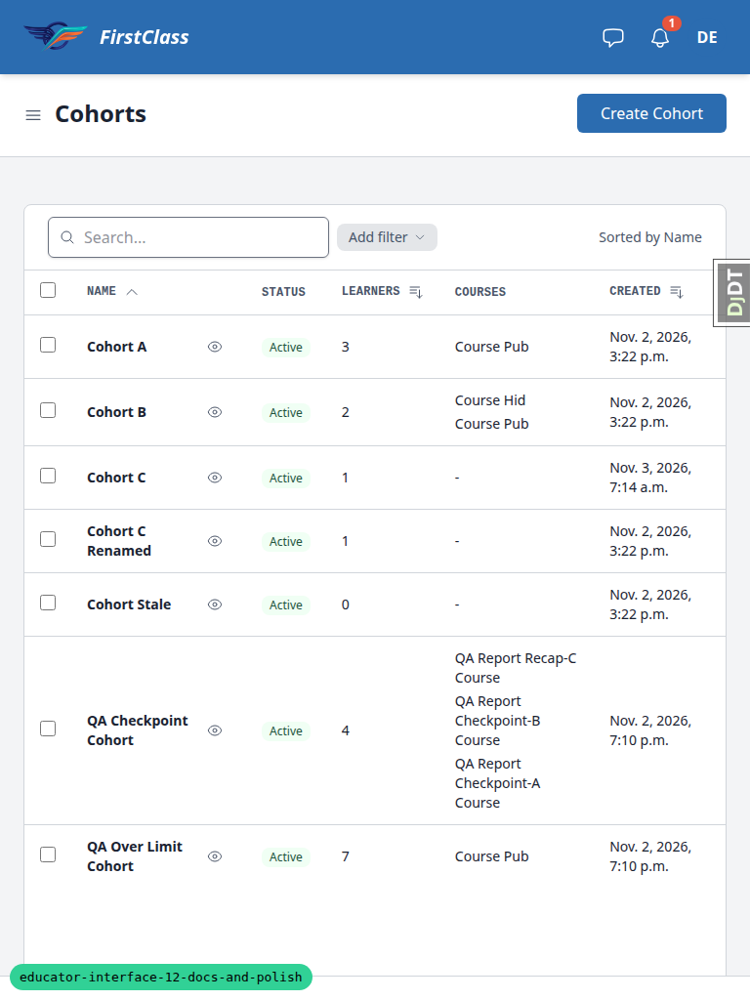 | clean |

## Data changes

| Via | What |
|---|---|
| sdd:qa-data-helper | Ran the five plan seed commands plus qa_create_educator_polish_scenario (which the helper extended, uncommitted, with a nameless lower-case educator, a uniquely titled quiz and a third org 'quietside'). Main org: northside; second: southside. |
| dev server restart | Restarted runserver on the same port with DJANGO_SETTINGS_MODULE=config.settings_local (untracked) so REPORTS_MAX_LEARNERS=5 and BULK_BACKGROUND_THRESHOLD=50 apply. |
| sdd:qa-data-helper | Deleted Learner a6816e30-961c-4b56-8d12-82d156b290bd (Bulk 05 Alpha, northside); its user account (pk 96) left in place. |
| browser (bulk actions in the app under test) | Bulk deactivated then reactivated all northside learners; Rae Removed deactivated again to restore the inactive learner. Cohorts Cohort Empty, Cohort Removed and a created 'QA Doomed' deleted through the UI as part of Tests 3, 8 and 9.8. |

## Bug status

| Bug | Status |
|---|---|
| B1 | **FIXED** (commit: 5283564d6) — Learner page header Deactivate/Reactivate jumps back to the Overview tab |
| B2 | **FIXED** (commit: 873f3f794) — Report Generate drops keyboard focus to body |
| B3 | **FIXED** (commit: 332ac5ec0) — Over-limit cohort offers Generate PDF, then shows a permanent red error with 'Try again' |
| B4 | **FIXED** (commit: bafd7818b) — Error text colour fails 4.5:1 contrast in both themes |
| B5 | **FIXED** (commit: 595ce8b27) — Panel lists pick up the global ul indent and bullet |
| B6 | **FIXED** (commit: 2f783b9f3) — Learners and Cohorts tables start 24px lower than the other list pages |
| B7 | **FIXED** (commit: 9914e0c49) — Members page scrolls sideways on a phone when an email is long |
| B8 | **FIXED** (commit: 5e93e2c1b) — Filter sheet group labels indented 8px (legend padding) |
| B9 | **FIXED** (commit: bd1733fc9) — Phone learner card checkbox sits mid-card |
| B10 | **FIXED** (commit: ec02e28ee) — Decorative icon names leak into accessible names |
| B11 | **FIXED** (commit: 3fa5d7030) — Row Remove/Move buttons don't name the learner |
| B12 | **FIXED** (commit: ead6e81d2) — Dashboard Cohorts tile link is named only by its number |
| B13 | **FIXED** (commit: 8153915fe) — 'Create Cohort' is Title Case |
| B14 | **FIXED** (commit: 2f122de65) — Two date formats in the educator interface |
| — | **FIXED** (commit: see git log) — the stale app map: the QA helper's audit_log import is committed with the regenerated `docs/app_structure.md` and import contracts |

## General notes

Observations (UX or product items with no defect attached):

- 2.1: The course select's empty choice reads '---------' (Move uses 'Choose a cohort'). Choosing a course they only hold through a cohort gives 'for 0 learners?' with the confirm disabled and no sentence saying why.
- 9.2: The single-cohort register dialog is titled 'Register Cohort B for a course' with no question mark, while bulk dialogs are questions. The notice points at the Settings tab although Reactivate also sits in the page header.
- 3.resend: After the dialog closes, nothing on screen or in a live region confirms the email went; focus returns to the trigger.
- 3.members: Rows read 'Added Nov. 3, 2026 by Not recorded'. The intro runs all three role definitions into one sentence-run paragraph.
- 5: On a hovered or focused members row, the muted chip's grey background matches the row hover colour, so the chip loses its outline.
- 9.6: 'Counts can change if someone else adds these learners before you confirm.' still shows when there is nothing to confirm.
- 9.5: With 78 selected and idle, the selection bar is about 330px tall at 375 (three full-width stacked buttons plus pager), about 40% of the screen.
- 3.bulk-deactivate: The bulk body only says it affects N learners and runs in the background. It does not say what stops, what is kept or how to undo, unlike the single-learner dialog.
- 9.4: The Learner column is wide (unwrapped email), so Cohorts and Courses wrap a word per line.
- 13.quick-view: With the panel open the table narrows so the Cohorts column wraps a word per line (rows about 250px tall), and Courses and Last active move into the table's horizontal scroll.

Run limits and scope:

- 4.1 could not run as written: cohort_viewer has no members or audit-log access.
- 9.5: the running bar was not observable because the dev setup finishes bulk jobs immediately.
- 9.8: the Move variant was not repeated.
- 9.6: the result step is unreachable with all-existing rows.
- The courses list, cohort Courses tab, learner Courses tab and History tabs have no search or filter, so 4.2's no-match state does not apply there.
- The mockup comparison (Test 1) was not done in detail.
- The data helper extended `freedom_ls/qa_helpers/management/commands/qa_create_educator_polish_scenario.py` (uncommitted).

status: ok · reason: 14 bugs — 3 fixed (B1, B2, B7, each re-verified in the browser), 11 unresolved; full run 11543 passed, 1 failed (stale app map from an uncommitted QA-helper edit); report rendered, screenshots verified
