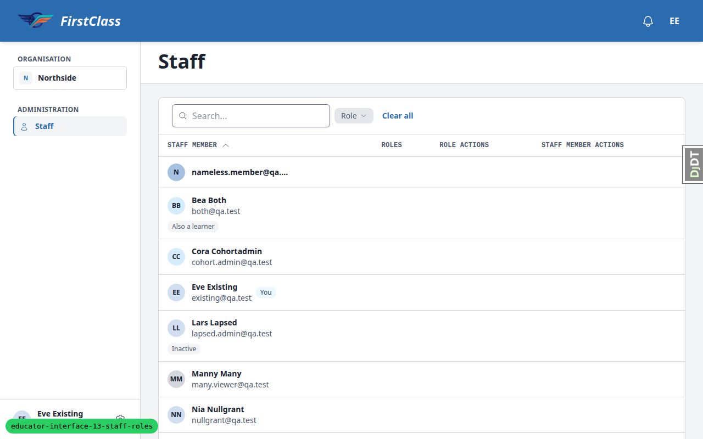
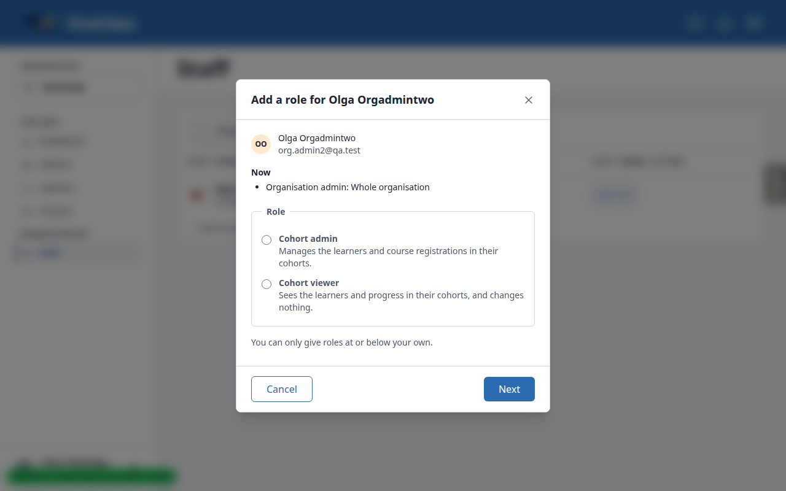
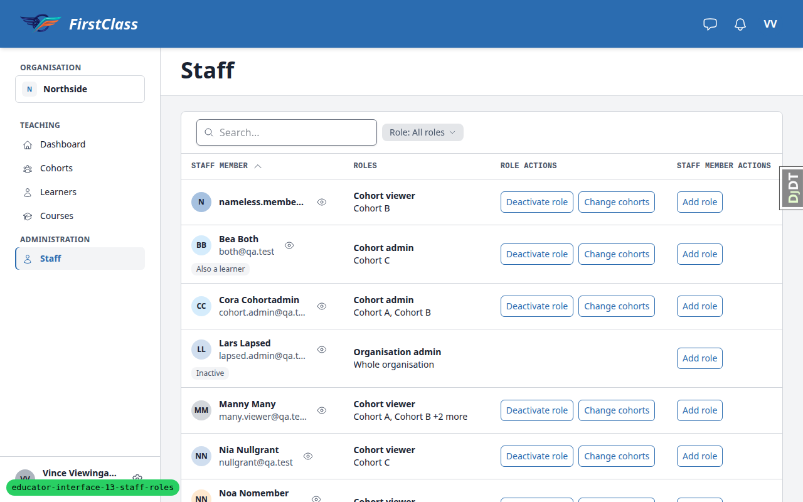
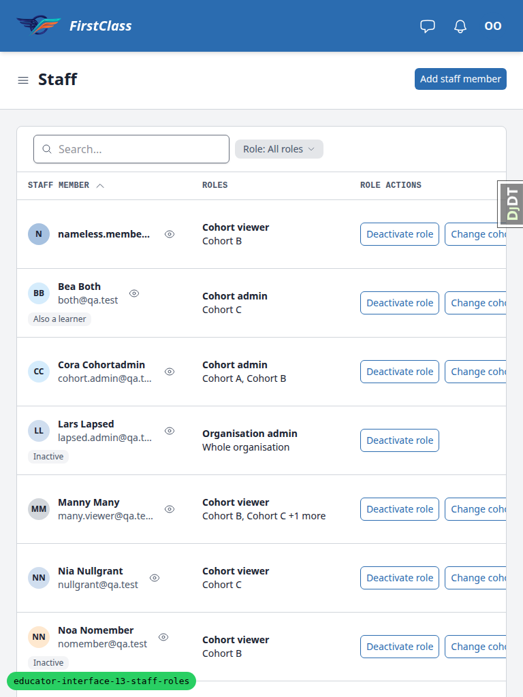
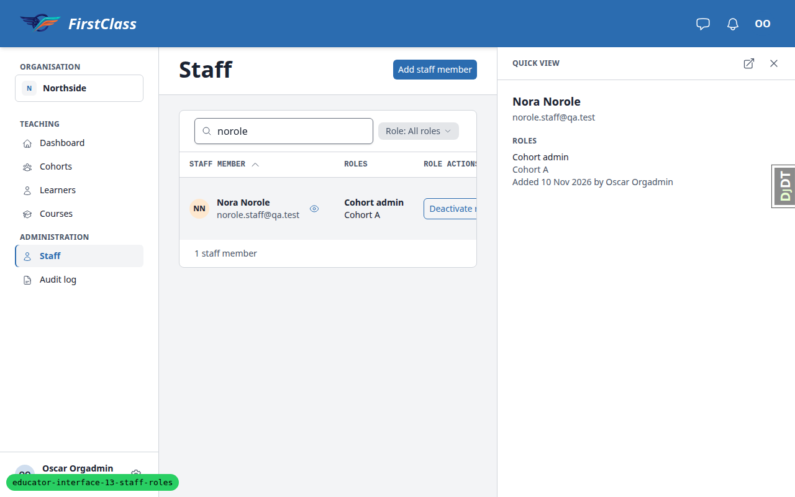
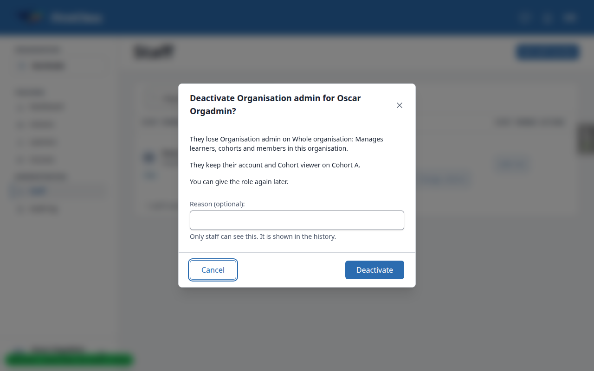
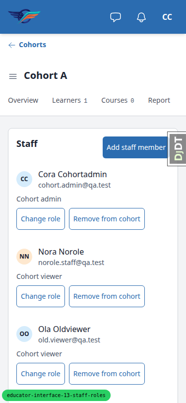

# Frontend QA report: educator-interface-13-staff-roles

## Methodology

Playwright MCP driven by hand at 1280×800 desktop (the plan's desktop size), 375×812 mobile and 768×1024 tablet. Screenshots are collected into `screenshots/` beside this report, and every referenced image exists there. The plan's URLs are stale (see the 0.urls record): the real paths are `/educator/organisations/<slug>/…` (for example `/educator/organisations/northside/staff`), and the Dashboard is `/educator/organisations/northside/dashboard`. Tests ran against the real paths.

## Diff scoping

- Class: **FULL**.
- Triggering front-end files:
  - `freedom_ls/base/templates/cotton/quick-view-trigger.html`
  - `freedom_ls/educator_interface/static/educator_interface/js/alpine-components.js`
  - `freedom_ls/educator_interface/templates/educator_interface/data-table-cells/staff_member.html`
  - `freedom_ls/educator_interface/templates/educator_interface/data-table-cells/staff_member_actions.html`
  - `freedom_ls/educator_interface/templates/educator_interface/data-table-cells/staff_role_actions.html`
- Skipped: nothing (206 files changed; front-end paths present).

## Smoke gate

Pass. Pages checked: `/`, `/educator/organisations/northside/staff`, `/educator/organisations/northside/`.

## Design check

| Test | Viewport | This run | Design | Result |
|---|---|---|---|---|
| 11-design | desktop | [page-2026-11-10T11-53-09-347Z.png](screenshots/page-2026-11-10T11-53-09-347Z.png) | [fb-search-results-1280.png](screenshots/fb-search-results-1280.png) | pass |
| 11-design | desktop | [page-2026-11-10T12-03-55-817Z.png](screenshots/page-2026-11-10T12-03-55-817Z.png) | [fb-cohort-settings-oscar.png](screenshots/fb-cohort-settings-oscar.png) | pass |
| 11-design | desktop | [page-2026-11-10T11-59-39-178Z.png](screenshots/page-2026-11-10T11-59-39-178Z.png) | [fb-learner-settings.png](screenshots/fb-learner-settings.png) | pass |
| 11-design | tablet | [page-2026-11-10T12-11-51-025Z.png](screenshots/page-2026-11-10T12-11-51-025Z.png) | [fb-cohort-settings-cora-768.png](screenshots/fb-cohort-settings-cora-768.png) | pass |
| 11-design | mobile | [page-2026-11-10T12-10-03-143Z.png](screenshots/page-2026-11-10T12-10-03-143Z.png) | [fb-staff-table-375.png](screenshots/fb-staff-table-375.png) | pass |

## B1: Names-only staff viewer sees an empty Role filter and Clear all on Staff

Manifestations: 1.4 (desktop).

- Expected: a holder of organisation_staff_viewer alone (Eve) sees no Role filter in the Staff toolbar (Rhea, a roles viewer, has it).
- Actual: Eve's toolbar shows a 'Role' filter chip that opens empty and a 'Clear all' link, even on a fresh login with no filter in the URL. The list itself is unaffected.

## B2: Add role dialog shows a names-only viewer every person's roles

Manifestations: 8.1-leak (desktop).

- Expected: R20: a names-only viewer (Vince: cohort admin on A + organisation_staff_viewer) sees each person and nothing else; roles are hidden.
- Actual: the Add role dialog's 'Now' list shows the person's roles to Vince: Olga 'Organisation admin: Whole organisation', Manny 'Cohort viewer: Cohort A, Cohort B +2 more' (cohorts outside his scope), Nora 'Cohort admin: Cohort A'.

## B3: Deactivate role and Change cohorts offered on roles outside a cohort admin's cohorts

Manifestations: 8.2 (desktop).

- Expected: for Vince (cohort admin on A + roles viewer) only role items that include Cohort A carry Deactivate role and Change cohorts.
- Actual: items on Cohort B/C only (Bea, Nia, nameless.member, Noa) also carry both buttons. Deactivate role on Bea's Cohort C item answers 'This is no longer available'; Change cohorts opens offering to add Cohort A.

## B4: Staff table runs past its card at 768 and when the quick view is open

Manifestations: 10.1 (tablet), 4.1 (desktop, quick view open).

- Expected: test 10.1: at 768 each staff member shows person, roles, role actions and staff member actions without overflow. Panel-framework rule: a table stays inside the viewport at every width, every button included.
- Actual: at 768 the table's scroll wrapper is 978px in a 718px card. 'Change cohorts' is cut mid-word and Add role / Deactivate staff member are off screen behind a sideways scroll. At 1280 with the quick view open the same happens (Role actions cut, last column hidden).

## B5: Role step repeats the email for an account with no name

Manifestations: 3.3-nameless (desktop). No screenshot.

- Expected: 'Existing account: <name>, <email>', or just the email when there is no name.
- Actual: 'Existing account: nameless.member@qa.test, nameless.member@qa.test' (also seen for existing2@qa.test).

## B6: Deactivate role dialog reads 'on Whole organisation'

Manifestations: 5.2-copy (desktop).

- Expected: 'They lose Organisation admin on the whole organisation: …'
- Actual: 'They lose Organisation admin on Whole organisation: …'. The scope label is pasted mid-sentence with a capital W and no article. It also reads 'They' when the viewer is deactivating their own role.

## B7: Cohort admins have no History tab, but the QA plan and plan expect one

Manifestations: 6.4 (desktop). No screenshot.

- Expected: QA plan 6.4 and plan.md: Cora opens Cohort A's History tab and sees 'Role deactivated' above 'Role assigned'.
- Actual: Cora's tab strip has no History tab and `__tabs/history` 404s (it needs the audit-log capability; the flow test's docstring says this is deliberate). The entries themselves are correct when viewed as Oscar.

## B8: Cohort viewer's forged Change role POST answers 404, plan expects 403

Manifestations: 7.4b (desktop). No screenshot.

- Expected: QA plan 7.4: as Vera (cohort viewer), POST change_role on Cohort A answers 403.
- Actual: 404. The Settings tab is hidden from her so the route 404s before the role check. The request is refused either way.

## B9: Mobile tab strip opens scrolled away from the active tab (pre-existing)

Manifestations: 10.3-tabs (mobile).

- Expected: on an instance page at 375 the selected tab is visible in the strip.
- Actual: Cohort A's strip scrolls (436/355px) but opens at scrollLeft 0, so the active Settings tab (x 359–440) is off screen. The tab strip is not changed on this branch.

## Layout probe

| Test | Viewport | URL | Screenshot | Result |
|---|---|---|---|---|
| 1.1 | desktop | /educator/organisations/northside/staff | [link](screenshots/page-2026-11-10T11-49-08-113Z.png) | clean |
| 1.3 | desktop | /educator/organisations/northside/staff | [link](screenshots/page-2026-11-10T11-50-03-314Z.png) | clean |
| 2.3 | desktop | /educator/organisations/northside/staff | [link](screenshots/page-2026-11-10T11-51-55-229Z.png) | clean |
| 3.4 | desktop | /educator/organisations/northside/staff | [link](screenshots/page-2026-11-10T11-53-09-347Z.png) | clean |
| 3.8 | desktop | /educator/organisations/northside/cohorts/<A>/__tabs/settings | [link](screenshots/page-2026-11-10T11-54-30-925Z.png) | clean |
| 4.1 | desktop | /educator/organisations/northside/staff (quick view open) | [link](screenshots/page-2026-11-10T11-55-32-965Z.png) | clean |
| 4.6 | desktop | /educator/organisations/northside/staff | [link](screenshots/page-2026-11-10T11-56-13-462Z.png) | clean |
| 11.5 | desktop | /educator/organisations/northside/learners/<lena>/__tabs/settings | [link](screenshots/page-2026-11-10T11-59-39-178Z.png) | clean |
| 11.6 | desktop | /educator/organisations/northside/learners/<lena>/__tabs/messages | [link](screenshots/page-2026-11-10T11-59-55-889Z.png) | clean |
| 6.1 | desktop | /educator/organisations/northside/cohorts/<A>/__tabs/settings | [link](screenshots/page-2026-11-10T12-01-00-250Z.png) | clean |
| 6.10 | desktop | /educator/organisations/northside/cohorts/<A>/__tabs/settings | [link](screenshots/page-2026-11-10T12-03-55-817Z.png) | clean |
| 10.1 | mobile | /educator/organisations/northside/staff | [link](screenshots/page-2026-11-10T12-10-03-143Z.png) | clean |
| 10.2 | mobile | /educator/organisations/northside/staff (dialog) | [link](screenshots/page-2026-11-10T12-10-39-004Z.png) | clean |
| 10.3 | mobile | /educator/organisations/northside/cohorts/<A>/__tabs/settings | [link](screenshots/page-2026-11-10T12-10-59-404Z.png) | clean |
| 10.3 | tablet | /educator/organisations/northside/cohorts/<A>/__tabs/settings | [link](screenshots/page-2026-11-10T12-11-51-025Z.png) | clean |
| 10.1 | tablet | /educator/organisations/northside/staff | [link](screenshots/page-2026-11-10T12-12-11-585Z.png) | clean |
| 10.2 | tablet | /educator/organisations/northside/staff (dialog) | [link](screenshots/page-2026-11-10T12-12-37-877Z.png) | clean |

The layout probe recorded no flags. The overflow in B4 and the tab strip in B9 were found by the test steps and are documented above.

## Data changes

| # | Via | Change |
|---|---|---|
| 1 | sdd:qa-data-helper | Ran qa_create_staff_administration_scenario; deleted 11 leftover role grants and 3 staff rows from earlier QA runs, reactivated Olga's staff row (the seed does not restore these despite its docstring) |
| 2 | sdd:qa-data-helper | Created Cohort W (Westside, pk 1a4124f9) with sole cohort admin Wanda Westcohort (w.cohortadmin@qa.test, pk 110) |
| 3 | sdd:qa-data-helper | Deleted leftover account existing2@qa.test (user pk 107 + its EmailAddress) so Test 2 step 1 can take the no-account path |
| 4 | sdd:qa-data-helper | Re-ran the seed and removed this run's grants/staff rows (Eve, Nora, Cora, Oscar, demodev, existing2 incl. account) before Test 6 |
| 5 | sdd:qa-data-helper | Re-ran the seed and reset (Vera back to cohort_viewer on A, Manny's cohort_admin on A removed / cohort_viewer on A restored) before Tests 6.9, 7.4b, 8.2–11 |

## Bug status

- **UNRESOLVED**: B1, names-only staff viewer sees an empty Role filter and Clear all on Staff (reason: the fix in d3cab4f16 hid the chip, but re-verification showed "Add filter" still offering Role to Eve, so it was reverted in 4679fbd42)
- **UNRESOLVED**: B2, Add role dialog shows a names-only viewer every person's roles (reason: data exposure under R20, so it is security-adjacent and needs a human)
- **UNRESOLVED**: B3, Deactivate role and Change cohorts offered on roles outside a cohort admin's cohorts (reason: permission gating, security-adjacent; also needs a decision on whether Change cohorts may extend another cohort's role to the admin's own cohort)
- **UNRESOLVED**: B4, Staff table runs past its card at 768 and when the quick view is open (reason: UX decision: cards at 768, a narrower table, or wrapping columns. The QA plan says cards at 768, but the panel framework switches to tables at md)
- **FIXED** (commit: d9094b1f4): B5, role step repeats the email for an account with no name
- **FIXED** (commit: ef7be54cc): B6, Deactivate role dialog reads 'on Whole organisation'
- **UNRESOLVED**: B7, cohort admins have no History tab, but the QA plan and plan expect one (reason: the code and flow test deliberately withhold the audit-log capability; the spec documents disagree, so this is a product decision)
- **UNRESOLVED**: B8, a cohort viewer's forged Change role POST answers 404 where the plan expects 403 (reason: a security-adjacent status-code choice that the spec's forged-POST rules don't settle)
- **UNRESOLVED**: B9, mobile tab strip opens scrolled away from the active tab, pre-existing (reason: fix budget exhausted this run)

## Test results

| Test | Viewport | Result | Note |
|---|---|---|---|
| 0.urls | desktop | pass | Plan URLs stale; real paths under /educator/organisations/<slug>/…; bare org root is an empty 200 shell for Rhea |
| 1.1 | desktop | pass | Rhea sees roles, no buttons, no Add staff member; You badge; Role filter present |
| 1.2 | desktop | pass | Sidebar lists Staff alone; other pages 404 |
| 1.3 | desktop | pass | Confirm step scope text and Eve's row actions correct |
| 1.4 | desktop | fail | Names-only viewer still sees Role filter chip and Clear all (B1) |
| 1.5 | desktop | pass | add_staff_member fragment 403 for Eve |
| 1.6 | desktop | pass | Cora: Staff 404; Dashboard shows 2 cohorts |
| 2.1 | desktop | pass | No-account path, No roles yet, confirm and row correct |
| 2.2 | desktop | pass | Audit log records Staff member added |
| 2.3 | desktop | pass | 422 already on the staff; dialog layout correct |
| 2.4 | desktop | pass | 422 inactive staff member message |
| 2.5 | desktop | pass | Cora offered Cohort admin and Cohort viewer only |
| 2.6 | desktop | pass | No 'only staff member here' notice for Oscar |
| 3.1-3.2 | desktop | pass | Min-2-chars hint, 8 options with cap line, ARIA correct |
| 3.3 | desktop | pass | Keyboard navigation and Enter to role step |
| 3.3-nameless | desktop | fail | Email repeated for nameless account (B5) |
| 3.4 | desktop | pass | Exactly 8 options plus cap line; narrows with 'vee tw' |
| 3.5-3.7 | desktop | pass | No-match hint, Escape behaviour, new email reaches No account yet |
| 3.8 | desktop | pass | Cora's scoped search help and no-match text |
| 3.9/10.2 | mobile | pass | Bottom sheet, footer pinned, no sideways scroll |
| 4.1 | desktop | pass | Add role on Nora and quick view correct |
| 4.2 | desktop | pass | Cohort viewer disabled when already held |
| 4.3 | desktop | pass | Two role items each with own buttons |
| 4.4 | desktop | pass | 422 already holds this role |
| 4.5 | desktop | pass | Quick view shows no 'by' for a role without a grantor |
| 4.6 | desktop | pass | Four columns; inactive Lars actions correct |
| 5.1 | desktop | pass | Own row actions work, no own-role note |
| 5.2 | desktop | pass | Deactivate own role; access drops as expected |
| 5.2-copy | desktop | fail | 'on Whole organisation' copy (B6) |
| 5.3 | desktop | pass | Last org admin refusal 422 |
| 5.4 | desktop | pass | Olga re-adds Oscar |
| 5.5 | desktop | pass | Superuser add and deactivate role |
| 5.6 | desktop | pass | Vince's own row correct |
| 5-mobile | mobile | pass | Oscar's card and dialog fit |
| 6.1-6.2 | desktop | pass | Cora's cohort Settings staff panel matches design |
| 6.3 | desktop | pass | Change role flow correct |
| 6.4 | desktop | fail | Cohort admin has no History tab (B7) |
| 6.5 | desktop | pass | 422 already holds Cohort admin |
| 6.6 | desktop | pass | Remove from cohort flow correct; table truncates with +N more |
| 6.7 | desktop | pass | Stale remove shows 'This is no longer available' |
| 6.8 | desktop | pass | Org-admin rows link to Staff for Vince |
| 6.9 | desktop | pass | Cohort viewer has no Settings tab |
| 6.10 | desktop | pass | Oscar's Settings panels match design |
| 7.1 | desktop | pass | Non-pickable emails refused with scoped message |
| 7.2 | desktop | pass | Admin user search returns 0 results |
| 7.3 | desktop | pass | Manny added as Cohort admin |
| 7.4a | desktop | pass | Forged add 422; forged remove on other cohort 404 |
| 7.4b | desktop | fail | Forged change_role as cohort viewer answers 404, not 403 (B8) |
| 7.5 | desktop | pass | Wanda has no Add staff member button |
| 7/10.3 | mobile | pass | Cora's Settings stacks, buttons >= 44px, dialogs fit |
| 8.1 | desktop | pass | Vince sees names only; Add role scoped to Cohort A |
| 8.1-leak | desktop | fail | Add role dialog 'Now' list leaks roles (B2) |
| 8.2 | desktop | fail | Buttons shown on roles outside Cohort A (B3) |
| 8.3 | desktop | pass | Add role as Vince correct |
| 8.4 | desktop | pass | Deactivate role keeps out-of-scope roles |
| 8.5 | desktop | pass | Change cohorts offers Cohort A only |
| 9.1 | desktop | pass | Deactivate and reactivate staff member |
| 9.2 | desktop | pass | Own row has no Deactivate staff member |
| 9.3 | desktop | pass | Audit log entries correct, no duplicate add |
| 10.1 | mobile | pass | Staff cards, scrollWidth 375, buttons >= 44px |
| 10.1 | tablet | fail | Staff table overflows its card at 768 (B4) |
| 10.2 | tablet | pass | Add staff member dialog fits at 768 |
| 10.3 | tablet | pass | Three aligned columns, dialogs fit |
| 10.3-tabs | mobile | fail | Active tab off screen (B9, pre-existing) |
| 11.1 | desktop | pass | Dialog header/footer rules and alignment correct |
| 11.2 | desktop | pass | Radios and search results have no per-choice borders |
| 11.3 | desktop | pass | Four columns, per-role buttons, inside the card |
| 11.4 | desktop | pass | Oscar's cohort Settings panels and rows |
| 11.5 | desktop | pass | Learner Settings matches design |
| 11.6 | desktop | pass | Learner Messages matches design |

## General notes

- The seed command does not undo earlier QA runs' grants and staff rows despite its docstring, so the data helper had to reset them by hand each time.
- The bare organisation root renders an empty shell (200) for a Staff-only viewer like Rhea.
- The plan's expected search example in 3.2 is loose: Eve Existing doesn't contain 'er'.
- The table truncates long cohort lists with '+N more' where the plan expected all cohorts named.
- Delete is replaced by a 'can't be deleted while it has 1 learner' sentence on Cohort A, because it has a learner.
- The Escape key with no results open opens the discard prompt.

status: ok · reason: 9 bugs, 2 fixed, 7 unresolved; report rendered, screenshots verified
