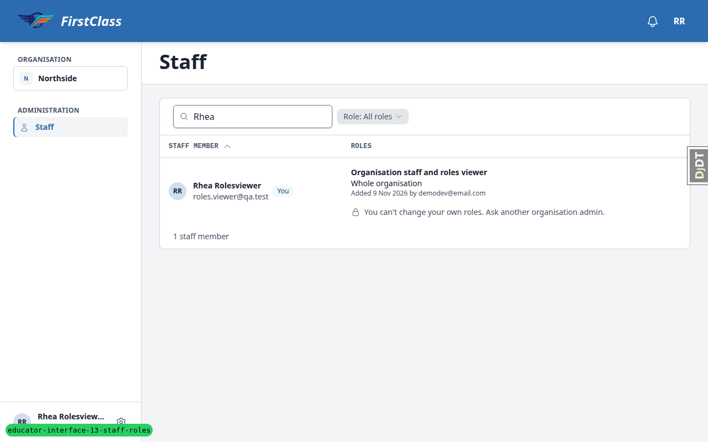
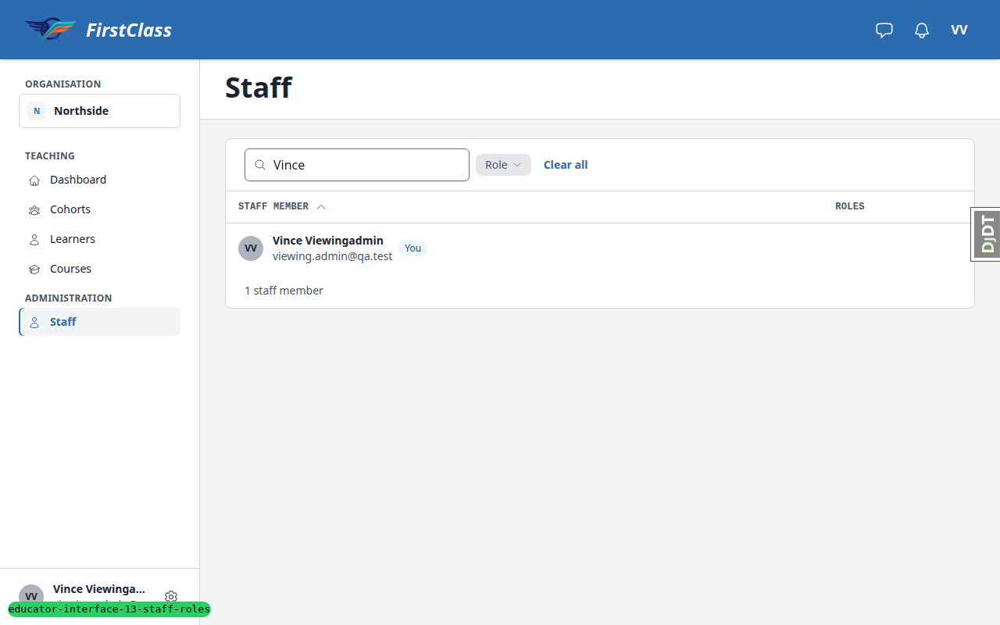
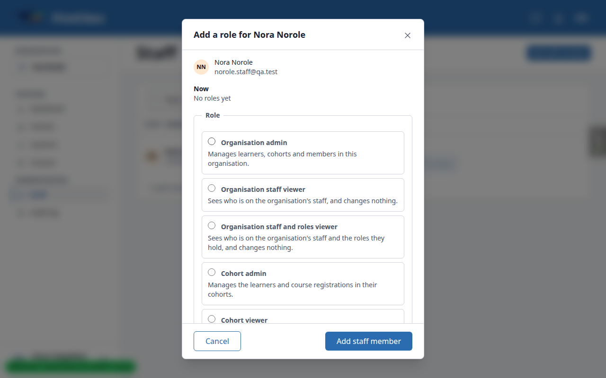
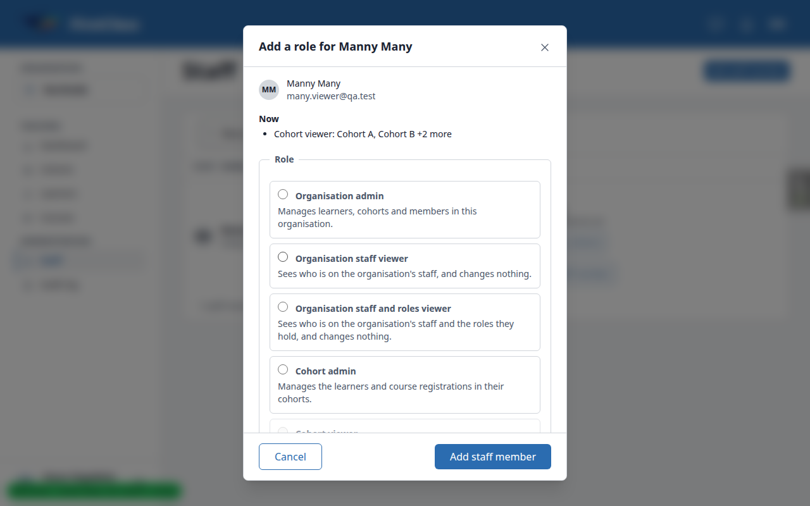
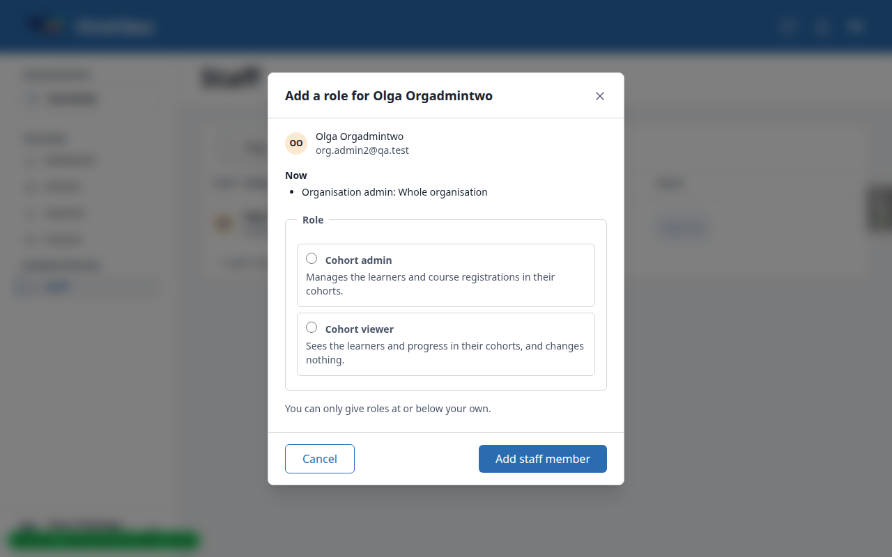
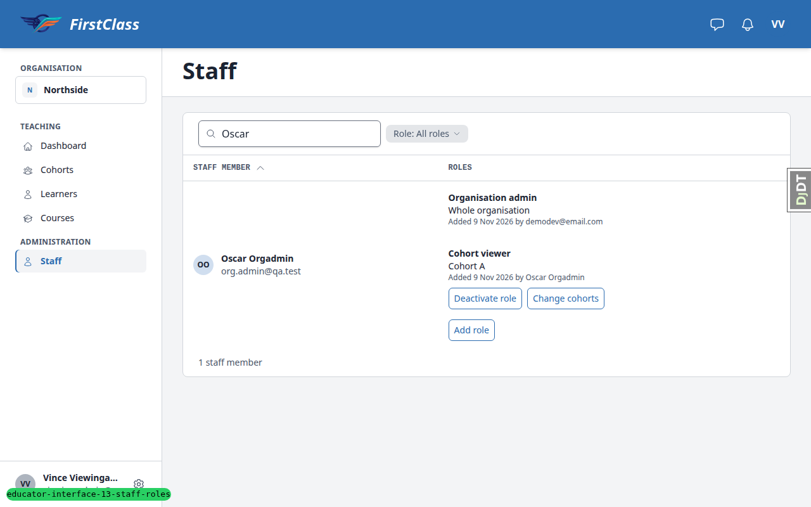
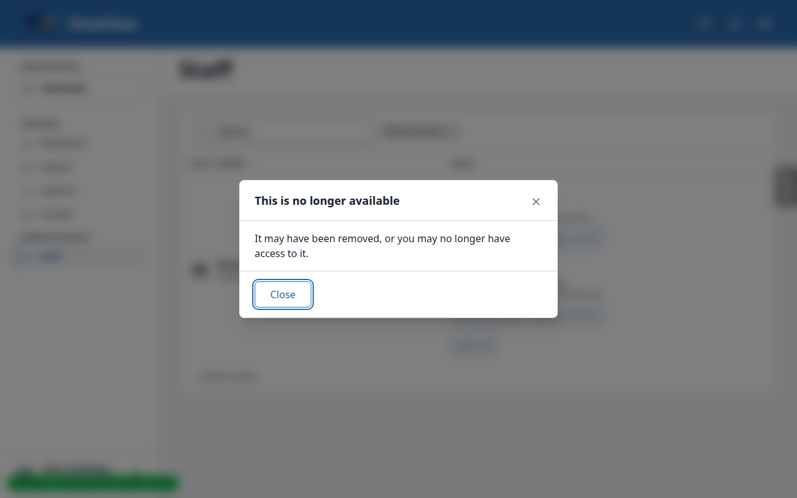
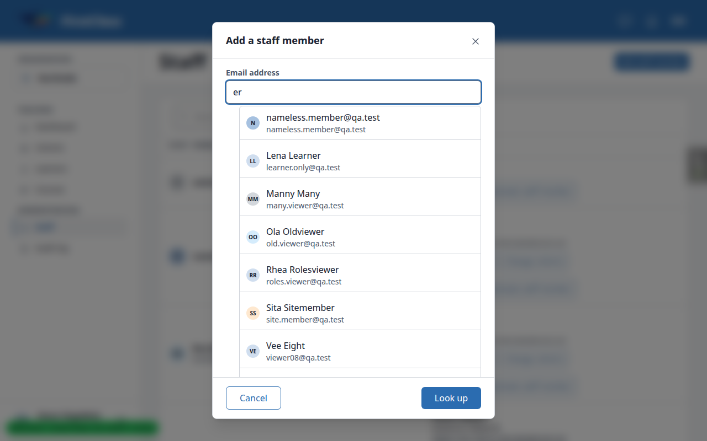
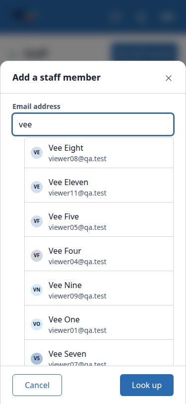

# Frontend QA report: educator-interface-13-staff-roles

## Methodology

Playwright MCP, driven by hand, at 1280×800 (desktop), 375×812 (mobile) and 768×1024 (tablet). Screenshots were collected into `screenshots/` beside this report. Every image referenced below exists there. The folder also holds a few stray Playwright page snapshots (`.yml`) and console logs that no section references.

## Diff scoping

Class: **FULL**. Trigger: the diff changes templates and static files under `freedom_ls/educator_interface` (`staff_roles.html`, `add_staff_member.html`, `change_role.html`, `remove_staff_from_cohort_confirmation.html`, `cohort_settings.html`, `alpine-components.js`), plus Python across accounts, audit_log, comms, educator_interface, learner_management, qa_helpers and role_based_permissions. Nothing was skipped: everything ran at desktop, mobile and tablet.

## Smoke gate

Outcome: **pass**. Pages loaded (as roles.viewer, both 200):
- `/educator/organisations/northside/`
- `/educator/organisations/northside/staff`

## Design check

No design states tested.

## Results

| Test | Viewport | Status | Note |
|---|---|---|---|
| setup | desktop | pass | Plan URLs omit `/organisations/`; table query params are prefixed (`staff-q`, `staff-page`). Not a product bug. |
| 1.1 | desktop | fail | Rhea sees the own-row note "You can't change your own roles..."; the plan says no note but spec R8 implies it (B1). |
| 1.2 | desktop | pass | Sidebar lists Staff only; other sections 404 for Rhea. |
| 1.3 | desktop | pass | Oscar adds existing@qa.test as Organisation staff viewer; row correct. |
| 1.4 | desktop | pass | Eve sees names only; no Role filter; filter param narrows nothing. |
| 1.5 | desktop | pass | add_staff_member search as Eve returns 403. |
| 1.6 | desktop | pass | Cora: Staff 404; Dashboard 200 with Cohort A and B. |
| 2.1 | desktop | pass | New-account role step and "No roles yet" option correct. |
| 2.2 | desktop | pass | Audit log shows "Staff member added". |
| 2.3 | desktop | pass | "already on the staff here" in-dialog. |
| 2.4 | desktop | pass | Inactive staff member directed to Reactivate. |
| 2.5 | desktop | pass | Cora's role step offers cohort_admin and cohort_viewer only. |
| 2.6 | desktop | pass | No "only staff member" notice for Oscar. |
| 6.1 | desktop | pass | Cora's Settings shows the Staff section only. |
| 6.2 | desktop | pass | Row actions and whole-organisation rows correct; Lars absent. |
| 3.1 | desktop | pass | Under 2 characters shows the hint; aria-expanded=false. |
| 3.2 | desktop | pass | 8 options, combobox ARIA correct, no links in results. |
| 3.3 | desktop | pass | Arrow keys and Enter select an option. |
| 3.4 | desktop | pass | Cap of 8 with note; narrowing works. |
| 3.5 | desktop | pass | No-match message; Escape collapses the list; new email reaches the role step. |
| 3.6 | desktop | pass | Live status text correct. |
| 3.7 | desktop | pass | Learners pickable; inactive staff excluded. |
| 3.8 | desktop | pass | Cora's search is limited to staff she can add. |
| 4.1 | desktop | fail | Add role dialog's primary button reads "Add staff member" (B2). |
| 4.2 | desktop | pass | Held role disabled with reason (same button label as 4.1, B2). |
| 4.3 | desktop | pass | Two role items shown for Cora. |
| 4.4 | desktop | pass | Duplicate grant returns 422 with message. |
| 4.5 | desktop | pass | Nia Nullgrant shows "Added" with no "by". |
| 4.6 | desktop | pass | Row action order correct. |
| 5.1 | desktop | pass | Oscar's own row: Add role, Deactivate role, no note. |
| 5.2 | desktop | pass | Deactivating own admin works; audit entry present. |
| 5.3 | desktop | pass | Last-admin lock message shown. |
| 5.4 | desktop | pass | Olga re-adds Oscar as admin. |
| 5.5 | desktop | pass | Superuser adds self; row stays with "No roles yet" after deactivation. |
| 5.6 | desktop | fail | Vince's own row lacks the own-roles note (B1). |
| 6.3 | desktop | pass | Change role confirm and refresh correct. |
| 6.4 | desktop | fail | Cora has no History tab; `__tabs/history` is 404 (B5). |
| 6.5 | desktop | pass | Choosing the held role shows an in-dialog message. |
| 6.6 | desktop | pass | Remove dialog and list update correct. |
| 6.7 | desktop | pass | Stale dialog shows "no longer available". |
| 6.8 | desktop | pass | Whole-organisation link opens Staff. |
| 6.9 | desktop | pass | Cohort viewer (Ola): no Settings tab; `__tabs/settings` 404. |
| 6.10 | desktop | pass | Oscar sees the name field, state paragraph, footer actions and per-row buttons. |
| 7.1 | desktop | pass | Non-visible emails answer with the standard message. |
| 7.2 | desktop | pass | No User row created by lookups. |
| 7.3 | desktop | pass | many.viewer@qa.test granted Cohort admin on A. |
| 7.4 | desktop | pass | Forged POSTs rejected (422/404); cohort viewer gets 404 rather than the plan's 403. |
| 8.1 | desktop | fail | Names-only viewer sees roles in the Add role dialog's "Now" list (B3). |
| 8.2 | desktop | fail | Deactivate role / Change cohorts shown on items outside the viewer's cohorts (B4). |
| 8.3 | desktop | pass | Add role on Nora behaves correctly. |
| 8.4 | desktop | pass | Out-of-scope role stays after Deactivate; confirmed on Ola. |
| 8.5 | desktop | pass | Change cohorts offers Cohort A only; Cohort Old read-only. |
| 7.5 | desktop | pass | Lone cohort admin sees no Add staff member button. |
| 9.1 | desktop | pass | Staff member deactivate/reactivate works. |
| 9.2 | desktop | pass | Olga deactivated; no self Deactivate staff member for Oscar. |
| 9.3 | desktop | pass | Audit log entries correct. |
| 3.2-align | desktop | fail | Results listbox about 24px right of the input's left edge (B6). |
| 10.1 | mobile | pass | No overflow; row buttons at least 44px. |
| 10.1 | tablet | pass | No overflow; row buttons 34px, which follows the phone-only 44px rule. |
| 10.2 | mobile | pass | Dialog fits as a bottom sheet; footer within 812. |
| 10.2 | tablet | pass | Footer buttons in view on all steps. |
| 10.3 | mobile | pass | Cora's Settings and dialogs fit; tab strip scrolls so Settings is off-screen. |
| 10.3 | tablet | pass | Rows and dialogs fit; no overflow. |

## Bugs

### B1: When the "You can't change your own roles" note shows is unsettled

Manifestations: 1.1 (desktop), 5.6 (desktop).

- Expected: the QA plan says no note for Rhea (roles viewer with no controls at all) and the note for Vince (cohort admin with a names-only viewer role).
- Actual: Rhea sees the note; Vince does not, because the note lives inside the roles cell that a names-only viewer never sees. Spec R8 says the note shows to "people without" own-row controls, which includes Rhea. The plan and spec disagree.

### B2: Add role dialog's primary button reads "Add staff member"

Manifestations: 4.1 (desktop), 4.2 (desktop).

- Expected: the dialog titled "Add a role for <name>" (opened from the row's Add role button, for someone already on the staff) submits with a button naming its action, "Add role", on the role step and the confirmation step.
- Actual: both steps' primary button reads "Add staff member".

### B3: A names-only staff viewer sees people's roles in the Add role dialog

Manifestations: 8.1 (desktop).

- Expected: a holder of organisation_staff_viewer without organisation_staff_roles_viewer never learns who holds which role (spec: names only).
- Actual: as a cohort admin with the names-only viewer role, Add role on any row shows a "Now" list of all the person's roles, e.g. Olga "Organisation admin: Whole organisation", Vee One "Cohort viewer: Cohort C".

### B4: Deactivate role and Change cohorts offered on role items held only on cohorts the viewer cannot give

Manifestations: 8.2 (desktop).

- Expected: for a cohort admin with a roles-viewer role, per-role buttons appear only on items that include a cohort they can give (QA plan 8.2).
- Actual: Manny's "Cohort viewer: Cohort B, Cohort C, Cohort Old" and Ola's "Cohort viewer: Cohort Old" carry both buttons for Vince (cohort admin on A only). Deactivate role then opens "This is no longer available".

### B5: A cohort admin cannot see the cohort's History tab

Manifestations: 6.4 (desktop). No screenshot was taken.

- Expected: QA plan 6.4: after Change role, Cora opens the cohort's History tab and sees "Role assigned" above "Role deactivated" with herself as actor.
- Actual: no History tab for a cohort admin; `__tabs/history` is 404 (cohort_admin holds no view_auditlogentry).

### B6: Staff search results list is indented from the email input

Manifestations: 3.2-align (desktop), 3.2-align (mobile).

- Expected: the results listbox shares the email input's left edge (and width), as a combobox dropdown does.
- Actual: the listbox's left edge sits about 24px right of the input's (input at x=409, list at x=433 in a 512px dialog), narrower than the field.

## Layout probe

| Test | Viewport | URL | Screenshot | Result |
|---|---|---|---|---|
| 1.1 | desktop | /educator/organisations/northside/staff | [t1-1-rhea-own-row.png](screenshots/t1-1-rhea-own-row.png) | clean |
| 1.4 | desktop | /educator/organisations/northside/staff | [t1-4-eve-names-only.png](screenshots/t1-4-eve-names-only.png) | clean |
| 6.1 | desktop | /educator/organisations/northside/cohorts/<A>/__tabs/settings | [t6-1-cora-settings.png](screenshots/t6-1-cora-settings.png) | clean |
| 10.1 | mobile | /educator/organisations/northside/staff | [t10-mobile-staff.png](screenshots/t10-mobile-staff.png) | clean |
| 10.1 | tablet | /educator/organisations/northside/staff | [t10-tablet-staff.png](screenshots/t10-tablet-staff.png) | clean |
| 10.3 | mobile | /educator/organisations/northside/cohorts/<A>/__tabs/settings | [t10-mobile-cora-settings.png](screenshots/t10-mobile-cora-settings.png) | clean |
| 10.3 | tablet | /educator/organisations/northside/cohorts/<A>/__tabs/settings | [t10-tablet-cora-settings.png](screenshots/t10-tablet-cora-settings.png) | clean |

## Data changes

| Via | What |
|---|---|
| sdd:qa-data-helper | Empty dev DB: ran `create_demo_data --yes` (DemoDev site, demodev@email.com superuser, demo learners), then `qa_create_staff_administration_scenario`. |
| test plan seed (qa_create_staff_administration_scenario) | Re-seeded before Test 6 to restore the starting state. |
| sdd:qa-data-helper | Westside: created active "Cohort W" with lone.admin@qa.test (Lou Lone) as its only cohort admin. |

## Bug status

| Bug | Title | Status |
|---|---|---|
| B1 | When the own-roles note shows is unsettled | **UNRESOLVED** (reason: product decision — the QA plan and spec R8 disagree on who sees the note) |
| B2 | Add role dialog's primary button reads "Add staff member" | **FIXED** (commit: b3129af1a) |
| B3 | Names-only staff viewer sees people's roles in the Add role dialog | **UNRESOLVED** (reason: data exposure; security-adjacent, needs a human to decide what the Add role dialog may show a names-only viewer) |
| B4 | Deactivate role and Change cohorts offered on out-of-reach role items | **UNRESOLVED** (reason: permission-gated controls; security-adjacent) |
| B5 | Cohort admin cannot see the cohort's History tab | **UNRESOLVED** (reason: would grant cohort admins audit-log access, a permission and product decision) |
| B6 | Staff search results list indented from the email input | **FIXED** (commit: 5bff5477b) |

## General notes

- The QA plan's URLs omit `/organisations/`; the real paths are `/educator/organisations/<slug>/...`. The table query params are prefixed (`staff-q`, `staff-page`).
- The staff action is named `remove_staff_from_cohort`, and Change role's radio is `new_role`.
- The seed persona Sita is a site admin, so a plain cohort viewer (Ola) was used for 6.9.
- The seed re-run restores grants but does not remove grants added in earlier tests, so later tests saw residue: Nora as Cohort admin on A, Cora and Oscar as Cohort viewer.
- Escape with no list open falls through to the dialog's unsaved-changes guard (Keep editing / Discard).
- A nameless user's search chip shows the email twice (the name falls back to the email).
- Tablet row buttons are 34px, which follows the phone-only 44px rule.
- On a 375px phone the cohort tab strip scrolls, so Settings sits off-screen.

status: ok · reason: 6 bugs — 2 fixed, 4 unresolved; report rendered, screenshots verified
