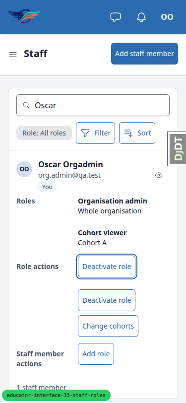
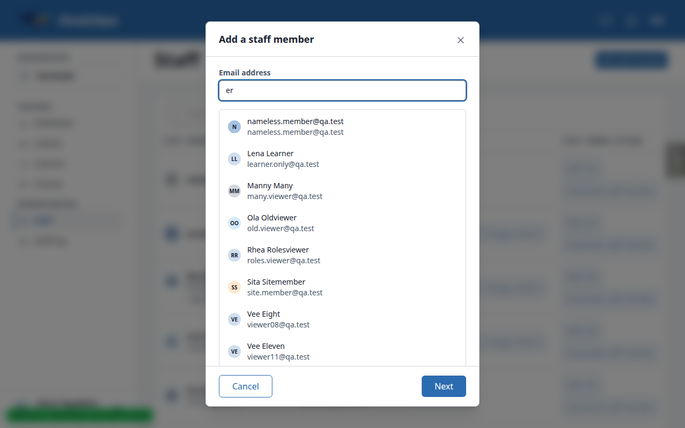
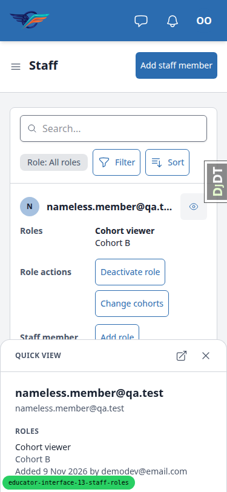
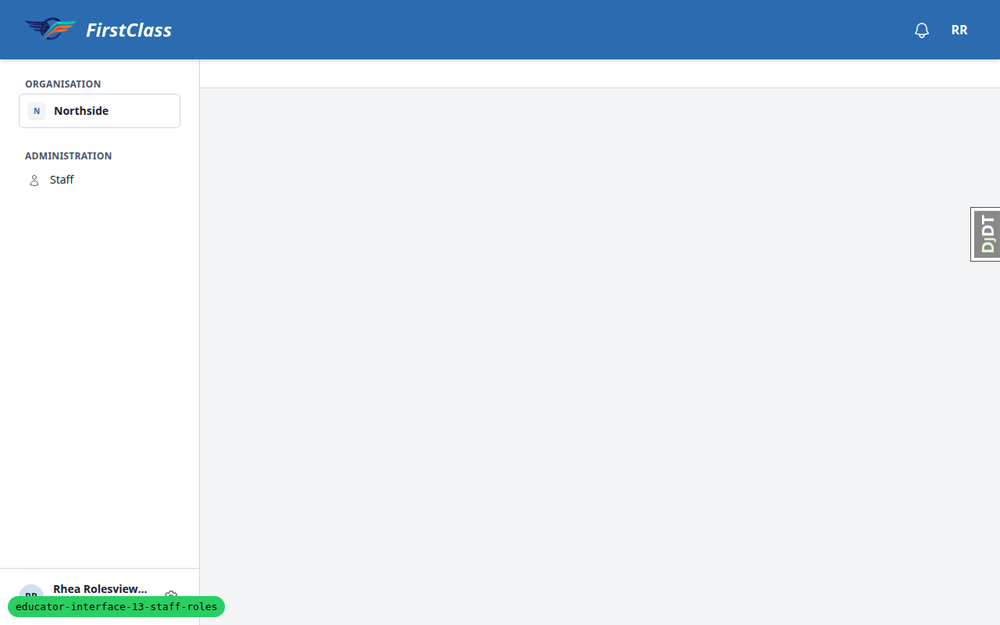
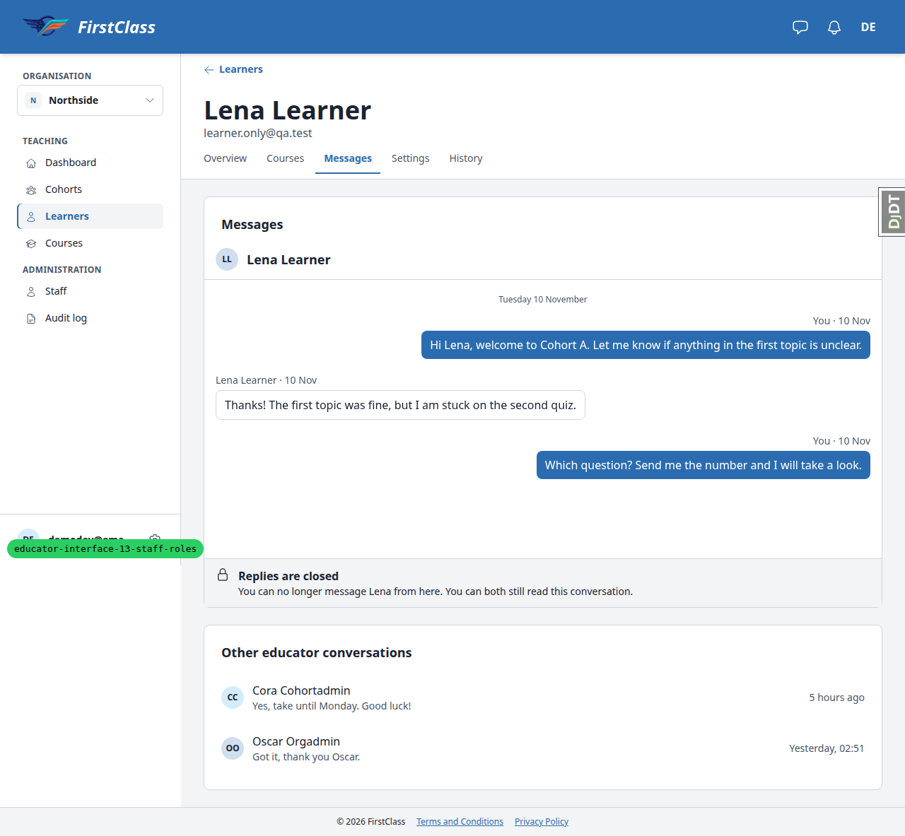

# QA report: staff roles per cohort

- Desktop: 62 pass, 6 fail. Mobile: 7 pass, 3 fail. Tablet: 5 pass, 0 fail.
- Smoke gate passed; the layout probe flagged nothing.
- 8 bugs documented (B1 to B8).

## Methodology

Tests were driven by hand through the Playwright MCP browser at desktop (1280x800, per the test plan), mobile (375x812) and tablet (768x1024). Screenshots were collected into `screenshots/` beside this report. Every image referenced here exists there.

- Pre-step rebase: the branch was rebased onto origin/main first (16 new commits, all sdd plugin and spec files, no app code). One conflict in the generated roadmap diagram `up-next.svg` was resolved by regenerating it. The targeted tier passed (3209 passed) and pre-commit was clean. The branch was force-pushed with lease. The rebase helper's front-end smoke pass was not run separately, because main changed no rendered file and this full QA run covers the same pages at all three viewports.
- Viewport choice: desktop is 1280x800, as the test plan's Setup specifies (the Staff table/cards threshold is defined at that width), not 1920x1080.
- Capture check: passed. A default-named screenshot landed in `qa-screenshots/` with no image bytes in the response. The Django debug toolbar was collapsed for every shot through its own `djdt.show` setting.
- Layout probe: the configured header selector `#interface-main > div:first-of-type` reports "missing" on educator pages. This is not a flag.

## Diff scoping

Class: FULL. Trigger: 216 files changed vs main, 65 of them front-end, for example `freedom_ls/educator_interface/templates/educator_interface/data-table-cells/staff_member.html`, `freedom_ls/educator_interface/static/educator_interface/js/alpine-components.js` and `freedom_ls/base/templates/cotton/quick-view-trigger.html`.

Skipped: nothing. Everything ran.

## Smoke gate

Outcome: pass. Pages loaded: `/` and `/educator/organisations/northside/staff`. No failure URL or reason.

## Results

### Desktop (1280x800)

| Test | Status | Screenshot | Notes |
|---|---|---|---|
| 1.1 | pass | [shot](screenshots/page-2026-11-12T07-35-06-060Z.png) | Rhea: Staff loads, roles listed (Oscar/Olga Organisation admin + Whole organisation, Cora Cohort admin Cohort A, Cohort B, Nora No roles yet), no buttons in any row, no Add staff member, own row has You badge under name/email at the name's left edge (349px both), no own-roles note, Role: All roles filter present. |
| 1.2 | pass | [shot](screenshots/page-2026-11-12T07-35-10-963Z.png) | Rhea's sidebar lists Staff alone; dashboard, learners, cohorts, courses, audit-log each 404. /educator/ redirects her to Staff. |
| 1.2-bare-root | fail | [shot](screenshots/page-2026-11-12T07-35-10-963Z.png) | Open point from the plan: /educator/organisations/northside/ (and without the trailing slash) still answers 200 with an empty main area, for Rhea and for Oscar alike. /educator/ redirects to the first visible section (Staff for Rhea, Dashboard for Oscar) but the organisation's own bare root does not. See B4. |
| 1.3 | pass | [shot](screenshots/page-2026-11-12T07-35-47-488Z.png) | Oscar adds Eve as Organisation staff viewer: confirm shows the description and 'Scope: Whole organisation.' only, primary button Confirm. Eve's row: Organisation staff viewer / Whole organisation; Deactivate role, no Change cohorts; Add role above Deactivate staff member. |
| 1.4 | pass | [shot](screenshots/page-2026-11-12T07-36-11-439Z.png) | Eve: Staff lists names, Roles empty in every row, no buttons, no Role chip, no Add filter, no Clear all. ?staff-role=organisation_admin leaves the list unchanged (29 staff) with no chip. Dashboard 404. |
| 1.5 | pass | - | Eve opening staff/__actions/add_staff_member?q=cor: 403 page; with HX-Request a 403 denied fragment. No list. |
| 1.6 | pass | - | Cora: Staff is a 404; Dashboard loads (2 cohorts). |
| 2.1 | pass | [shot](screenshots/page-2026-11-12T07-36-31-984Z.png) | existing2@qa.test: role step shows 'No account yet' with name fields, first radio 'No roles yet' with its hint, plain radios (one Role fieldset, no box per choice, matches fb-role-step.png), cohort checkboxes hidden. No-role confirmation reads 'Add <email> to the staff' / 'They'll appear in Staff with no roles.' with Confirm. Row appears with 'No roles yet' and Add role above Deactivate staff member. |
| 2.2 | pass | - | Audit log top entry: 'Staff member added', subject existing2@qa.test, actor Oscar Orgadmin. |
| 2.3 | pass | [shot](screenshots/page-2026-11-12T07-37-17-275Z.png) | Nora with No roles yet: 422, 'This change wasn't made' / 'Nora Norole is already on the staff here.', Close only. Header and footer rules span the dialog (385-895 of 384-896); Close left edge 409 = message text left edge 409. |
| 2.4 | pass | - | Lars: 422 'Lars Lapsed is an inactive staff member here. Use Reactivate staff member instead.' |
| 2.6 | pass | - | No 'You're the only staff member here' notice for Oscar. |
| 3.1 | pass | - | 'e' shows the 2-character prompt, nothing listed. |
| 3.2 | pass | [shot](screenshots/page-2026-11-12T07-37-57-340Z.png) | 'er' lists 8 chips (avatar, name, email) plus the cap line; Eve not among them. listbox/option/combobox roles, aria-autocomplete=list, aria-controls=staff-search-listbox, aria-expanded=true, no <a>, options 56px tall, no borders between options. Vera Viewer is not in the first 8 because the list is capped alphabetically; the cap line says so. |
| 3.2-nameless-chip | fail | [shot](screenshots/page-2026-11-12T07-37-57-340Z.png) | The search result for the account with no name (nameless.member@qa.test) shows the email twice: once in the name line and again in the email line. The role step and the Staff table show it once. See B3. |
| 3.3 | pass | - | ArrowDown x2, ArrowUp: first option highlighted, aria-activedescendant=staff-option-88. Enter: email field holds the address and the role step opens. Nameless account line: 'Existing account: nameless.member@qa.test' (email once). |
| 3.4 | pass | - | 'vee': exactly 8 options and 'Showing the first 8. Keep typing to narrow.'; 'vee tw': Vee Twelve and Vee Two. |
| 3.5 | pass | [shot](screenshots/page-2026-11-12T07-38-24-122Z.png) | 'zzz': "No one matches 'zzz'." + 'Type their full email to add someone else.' Escape with results open collapses the list (aria-expanded=false), dialog stays; second Escape raises the discard prompt. brand.new@qa.test + Next reaches the role step for a new account. |
| 3.6 | pass | - | role=status region reads '8 people found' / '2 people found' after a search and 'No results' after zzz. |
| 3.7 | pass | - | 'len' lists Lena Learner; 'lar' lists nobody (Lars absent). |
| 11.1-discard | pass | [shot](screenshots/page-2026-11-12T07-38-24-122Z.png) | Discard prompt: header without a close control, body, footer; Keep editing left, Discard right. |
| 2.5 | pass | - | Cora on Cohort A Settings, Add staff member for Vince: role step offers Cohort admin and Cohort viewer only, no 'No roles yet'. |
| 3.8 | pass | [shot](screenshots/page-2026-11-12T07-40-31-822Z.png) | Cora: help text 'Searching staff you can add' directly under the field; 'vee' lists nothing; 'vin' lists Vince; 'len' shows "No one matches 'len'." under the help text with no empty box and no 'Type their full email' sentence. |
| 7.1 | pass | [shot](screenshots/page-2026-11-12T07-40-47-578Z.png) | Cora: learner.only, nobody, viewer01 and away each answer 422 'No staff member you can add has this email. Ask an organisation admin to add them.' The answer replaces the dialog body (This change wasn't made, Close only) rather than showing on the email step. |
| 4.1 | pass | [shot](screenshots/page-2026-11-12T07-41-34-530Z.png) | Add role on Nora: title 'Add a role for Nora Norole', chip not input, Now 'No roles yet'; confirm 'Scope: Cohort A.'; row reads Cohort admin / Cohort A with no Added line. Quick view: name, email, Roles: Cohort admin, Cohort A, 'Added 12 Nov 2026 by Oscar Orgadmin', date is <time datetime=2026-11-12>. With the quick view open the list is cards, buttons whole, no sideways scroll (1280=1280). Closing brings back the four-column table. |
| 4.2 | pass | [shot](screenshots/page-2026-11-12T07-41-48-947Z.png) | Manny Add role: Cohort viewer greyed out with 'Already held on every cohort you can give'; the other four roles available. |
| 4.3 | pass | [shot](screenshots/page-2026-11-12T07-42-23-741Z.png) | Cora gains Cohort viewer on A and C: Roles cell shows two items (Cohort admin: Cohort A, Cohort B; Cohort viewer: Cohort A, Cohort C), each with its own Deactivate role / Change cohorts on its line. |
| 4.4 | pass | - | Repeat Cohort viewer on Cohort C for Cora: 422 'Cora Cohortadmin already holds this role on these cohorts.' |
| 4.5 | pass | - | Nia Nullgrant quick view: 'Added 9 Nov 2026' with no 'by' clause. |
| 4.6 | pass | [shot](screenshots/page-2026-11-12T07-42-23-741Z.png) | Four columns; per-role buttons on the role's line; Add role above Deactivate/Reactivate staff member. Lars: Add role + Reactivate staff member, Inactive badge under name and email at the name's left edge (349). Bea's 'Also a learner' the same. |
| 5.1 | pass | - | Oscar's own row: You badge, Add role, Deactivate role on Organisation admin, no own-roles note. Add role -> Cohort viewer on Cohort A: row gains 'Cohort viewer: Cohort A'. |
| 5.2 | pass | [shot](screenshots/page-2026-11-12T07-42-54-591Z.png) | Deactivate role on own Organisation admin: dialog says the role is lost on the whole organisation and the account and Cohort viewer on Cohort A are kept. After confirming, Staff is a 404 for Oscar, Dashboard and Cohorts show Cohort A alone, and Olga's Audit log shows 'Role deactivated' with Oscar as actor and subject. |
| 5.2-self-copy | fail | [shot](screenshots/page-2026-11-12T07-42-54-591Z.png) | When the viewer deactivates their own role the dialog speaks of them in the third person ('They lose…', 'They keep their account…') and ends 'You can give the role again later.' For someone removing their own Organisation admin that last sentence is untrue: once confirmed they can no longer give any role. See B5. |
| 5.3 | pass | [shot](screenshots/page-2026-11-12T07-43-17-713Z.png) | Olga as the only organisation admin: 422 'Olga Orgadmintwo is this organisation's only organisation admin. Add another organisation admin first.' Nothing changes. |
| 5.4 | pass | - | Olga re-adds org.admin@qa.test as Organisation admin through Add staff member; Oscar's row shows Organisation admin again. |
| 5.5 | pass | - | Superuser has no row at first; Add staff member on their own address with Cohort viewer on Cohort B makes the row appear with Add role and Deactivate role; the role deactivates again. |
| 5.5-superuser-copy | fail | - | Deactivate role for the superuser's only role says 'Their site-level access is unaffected; this only takes them off this organisation's staff list.' After confirming, the superuser is still on the staff list, with 'No roles yet'. The sentence and the result disagree. See B6. |
| 5.6 | pass | - | Vince's own row: You badge and Add role, no own-roles note, empty Roles cell (names-only viewer). |
| 11.5 | pass | [shot](screenshots/page-2026-11-12T07-44-37-172Z.png) | Lena's Settings tab as superuser: Name panel with First name, Last name and Save on one row; Account panel with Deactivate in its footer. Saving 'Lenax' keeps the page and the header reads 'Lenax Learner'; restored to Lena through the same form. |
| 11.6 | pass | [shot](screenshots/page-2026-11-12T07-44-51-118Z.png) | Lena's Messages tab: a Messages panel then an 'Other educator conversations' panel; neither heading has a rule or is uppercase; same heading style as the Courses tab (H2 18px 600). Both panels were empty for Lena at this point, so the spacing between conversations is checked separately once conversations exist. |
| 6.1 | pass | [shot](screenshots/page-2026-11-12T07-46-36-850Z.png) | Cora on Cohort A Settings: tab strip shows Settings; the Staff panel alone with Add staff member in its header; no Name or Status panel, no Deactivate/Delete, no 'Settings' heading. |
| 6.2 | pass | [shot](screenshots/page-2026-11-12T07-46-36-850Z.png) | Rows: Cora, Manny, Ola, Olga, Oscar, Sita, Vera, Vince; Lars absent. Three columns (role column left edge 825 on every row), no line between rows. Cohort-role rows carry Change role then Remove from cohort; Oscar and Olga read 'Organisation admin' with an empty third column. |
| 6.3 | pass | [shot](screenshots/page-2026-11-12T07-46-48-869Z.png) | Change role on Vera: title 'Change Vera Viewer's role on Cohort A?', Cancel focused, Cohort viewer selected. Confirm text 'Vera Viewer will become Cohort admin on Cohort A only.' List refreshes with Vera as Cohort admin. |
| 6.4 | pass | [shot](screenshots/page-2026-11-12T07-47-11-675Z.png) | Cora's History tab on Cohort A: newest two entries 'Role deactivated Cohort viewer on Cohort A' above 'Role assigned Cohort admin on Cohort A', Cora as actor; sort headers and Add filter present. Cohort C history 404, audit-log 404 and absent from her sidebar, Lena's page has no History tab and its history URL is 404. |
| 6.5 | pass | - | Change role to the role already held: 422 'Vera Viewer already holds Cohort admin on Cohort A.' |
| 6.6 | pass | [shot](screenshots/page-2026-11-12T07-47-42-705Z.png) | Remove from cohort on Manny: standard (primary, not red) confirm, 'Manny Many will lose Cohort viewer on Cohort A. Their other roles are unchanged.', reason field, button 'Remove from cohort' / 'Removing from cohort…'. Manny leaves the list. On Staff his item reads 'Cohort B, Cohort C +1 more'. |
| 6.6-quick-view-inactive | fail | - | Manny's staff quick view lists 'Cohort B, Cohort C, Cohort Old' with no '(inactive)' after Cohort Old. The QA plan expects 'Cohort Old (inactive)', and the Staff table marks the same cohort '(inactive)' on Ola's row. See B2. |
| 6.7 | pass | - | Stale dialog: Vera removed in a second tab, then confirmed in the first: 404 fragment 'This is no longer available'. |
| 6.8 | pass | - | Vince on Cohort A Settings: organisation-admin rows read 'Organisation admin' with no note, link or button. |
| 6.9 | pass | - | Vera as cohort viewer (role given back through Add role on Staff): tab strip Overview, Learners, Courses, Report only; settings and history URLs each 404. |
| 6.10 | pass | [shot](screenshots/page-2026-11-12T07-48-26-550Z.png) | Oscar on Cohort A Settings: Name, Staff, Status panels in order, no rule under any header; Status says Cohort A can't be deleted while it has 1 learner, Deactivate in footer. Cohort B (no learners) shows Deactivate and Delete. |
| 7.2 | pass | - | Admin user search for nobody@qa.test: 0 results; no account was created. |
| 7.3 | pass | - | Cora adds Manny (on her Cohort B) to Cohort A as Cohort admin: role step opens, confirm shows Now 'Cohort viewer: Cohort B' and After adding 'Cohort admin: Cohort A'; Manny's row reads Cohort admin. |
| 7.4 | pass | - | Forged POSTs: Cora add_staff_member for learner.only -> 422 with the same message, Lena gains no role; Cora remove_staff_from_cohort on Cohort C -> 404; Vera change_role on Cohort A -> 404, Vince still Cohort admin. |
| 7.5 | pass | [shot](screenshots/page-2026-11-12T07-49-35-142Z.png) | Wanda, the only cohort admin of Westside's Cohort W with no pickable staff: Settings tab shows the Staff panel with no Add staff member button. |
| 11.6-thread | fail | [shot](screenshots/page-2026-11-12T07-52-33-751Z.png) | Lena's Messages tab with a real conversation: the 'Other educator conversations' panel is fine (rows separated by space, no rule, no uppercase sub-heading). The Messages panel is not: under the 'Messages' heading the thread draws its own header (avatar + 'Lena Learner', repeating the page header) with a full-width rule under it; the thread's content starts at x=305 while the panel heading and the other panel's content start at x=313; and the grey 'Replies are closed' bar is square against the card's rounded bottom corners. The reference fb-learner-messages.png shows only the empty state, so this state had not been looked at. See B8. |
| 8.1 | pass | [shot](screenshots/page-2026-11-12T07-53-15-281Z.png) | Vince (names-only viewer): every row shows the name, no role items, Add role only; no Role filter. Add role on Nora: Cohort admin/Cohort viewer, Cohort A the only cohort, Now 'No roles yet'. Manny: Now 'Cohort viewer: Cohort A'. Oscar and Bea: Now 'No roles yet'. Manny confirm: Now and After name Cohort A alone. |
| 8.2 | pass | - | After Oscar gives Vince the roles viewer: Roles cells and Role filter show. Cora, Manny, Ola, Sita, Vera (roles including Cohort A) carry Deactivate role and Change cohorts; Bea, Nia, Noa, nameless and the Vee viewers have an empty Role actions cell; Oscar's/Olga's Organisation admin has no button; every active row has Add role. Vince's own Cohort admin buttons sit on the Cohort admin line. change_cohorts and deactivate_role for Bea opened directly: each 404. |
| 8.3 | pass | - | Add role on Nora as Vince: Cohort admin / Cohort viewer, Cohort A only; Cohort viewer on Cohort A given. |
| 8.4 | pass | [shot](screenshots/page-2026-11-12T07-53-54-744Z.png) | Deactivate role on Manny's Cohort viewer: 'They lose Cohort viewer on Cohort A…' and 'Cohort viewer on Cohort B, Cohort C and Cohort Old is outside the cohorts you can give, so it stays.' After confirming the item reads 'Cohort B, Cohort C +1 more' with no buttons. |
| 8.5 | pass | [shot](screenshots/page-2026-11-12T07-54-04-124Z.png) | Change cohorts on Ola: only Cohort A offered; 'Kept as they are: Cohort Old (inactive)' read-only. |
| 9.1 | pass | - | Deactivate staff member on Nora: dialog and confirm work, row shows Inactive with Add role and Reactivate staff member; Reactivate restores her ('These roles take effect again: Cohort viewer on Cohort A'). |
| 9.2 | pass | - | Deactivate staff member on Olga succeeds while Oscar is the other admin; Oscar's own row has no Deactivate staff member button. Olga reactivated afterwards. |
| 9.3 | pass | - | Audit log lists 'Staff member deactivated' and 'Staff member reactivated' for Nora (and Olga), Oscar as actor, no duplicate 'Staff member added'. |
| 11.1 | pass | [shot](screenshots/page-2026-11-12T07-35-47-488Z.png) | Email step, Add role role step, confirm, 'This change wasn't made' and the discard prompt are each header, body, footer; header and footer rules run the dialog's width; left footer button on the body text's left edge (409), right button under the close control; no other rule. |
| 11.2 | pass | [shot](screenshots/page-2026-11-12T07-41-48-947Z.png) | Add role radios have no box per choice (one Role fieldset, as in fb-role-step.png); search results have no line between people; an empty search shows only its message. |
| 11.3 | pass | [shot](screenshots/page-2026-11-12T07-42-23-741Z.png) | Staff table at 1280: four columns, nothing clipped at the right, per-role buttons on the role's line, labels on one line, badges under name and email. Long names and emails in the Staff member column end in an ellipsis, as in the reference screenshot. |
| 11.4 | pass | [shot](screenshots/page-2026-11-12T07-48-26-550Z.png) | Cohort A Settings as Oscar: Name, Staff, Status panels, no 'Settings' heading, no rule under panel headings; staff rows in three columns; organisation admin row has an empty third column. |

### Mobile (375x812)

| Test | Status | Screenshot | Notes |
|---|---|---|---|
| 10.1 | pass | [shot](screenshots/page-2026-11-12T07-55-18-647Z.png) | Staff at 375 is cards: person with badges under name/email, Roles, Role actions, Staff member actions. All 43 visible buttons are at least 44px tall and inside the viewport; no sideways scroll (375=375). Toolbar: Role chip, Filter, Sort. |
| 3.9 | pass | [shot](screenshots/page-2026-11-12T07-55-30-931Z.png) | Add staff member at 375 with 'vee': sheet 0-375 wide, 8 results and the cap line scroll inside it, footer Cancel/Next pinned at the bottom (44px), no horizontal scroll. |
| 10.2 | pass | [shot](screenshots/page-2026-11-12T07-55-43-113Z.png) | Email step with eight results, role step with 'No roles yet' selected and the no-role confirmation each fit 375x812 with the footer buttons in view. |
| 5.1 | pass | [shot](screenshots/page-2026-11-12T07-56-27-163Z.png) | Oscar's own card: You badge, Add role, Deactivate role; Add role and Deactivate role dialogs fit as sheets with 44px footer buttons. |
| 5.2-stale-page | fail | [shot](screenshots/page-2026-11-12T07-56-34-682Z.png) | After Oscar confirms Deactivate role on his own Organisation admin, the dialog closes and the Staff page stays on screen unchanged: his card still lists Organisation admin with Deactivate role, Change cohorts, Add role and the Add staff member button. The list's refresh request fails with a 404 in the console and nothing tells him. Every control now on screen leads to a 404 or denied answer; only a manual reload shows he has lost the page. Same behaviour at desktop (URL and title stayed on Staff after the confirm). See B1. |
| 10.1-two-role-card | fail | [shot](screenshots/page-2026-11-12T07-56-34-682Z.png) | On a card for someone with two roles (Oscar: Organisation admin + Cohort viewer) the two roles are listed under Roles and then both sets of buttons under one 'Role actions' label: 'Deactivate role', then 'Deactivate role' and 'Change cohorts'. Nothing on the card says which Deactivate role belongs to which role, and the buttons have no aria-label naming the role. In the 1280 table each button sits on its role's line; on cards (375, 768, and 1280 beside the quick view) that link is lost. See B7. |
| 10.3 | pass | [shot](screenshots/page-2026-11-12T07-57-07-779Z.png) | Cohort A Settings as Cora at 375: Staff rows stack person, role, two buttons; all buttons 44px and inside the viewport; no sideways scroll. Tab strip opens with the active Settings tab whole and in view (278-359). Change role and Remove from cohort dialogs fit. As Oscar, …/__tabs/history opens with History in view (284-359); tapping Overview leaves Overview active and in view. |
| 7.1 | pass | [shot](screenshots/page-2026-11-12T07-57-26-989Z.png) | Cora at 375: learner.only@qa.test answers the same 'No staff member you can add has this email…' in a sheet that fits, Close 44px. |
| 4.1-quick-view | pass | [shot](screenshots/page-2026-11-12T07-57-51-934Z.png) | Staff quick view at 375 is a bottom sheet with rounded top corners and a close control; no sideways scroll. |
| 4.1-nameless-quick-view | fail | [shot](screenshots/page-2026-11-12T07-57-51-934Z.png) | The quick view for the account with no name shows the email twice: as the heading and again as the line under it. Same cause as the search result chip. See B3. |

### Tablet (768x1024)

| Test | Status | Screenshot | Notes |
|---|---|---|---|
| 10.1 | pass | [shot](screenshots/page-2026-11-12T07-58-24-310Z.png) | Staff at 768 is cards, not a sideways-scrolling table; person with badges under name/email, roles, role actions, staff member actions; every button whole and inside the card; no sideways scroll (768=768). Mobile-style nav (hamburger). Matches fix-staff-cards-768.png, including the ellipsis on long names. |
| 10.2 | pass | - | At 768 the email step with eight results (dialog 128-640 x 115-909), the role step and the no-role confirmation each fit the viewport with footer buttons in view. |
| 3.9 | pass | - | Search dialog with eight results and the cap line fits at 768 without horizontal scroll. |
| 5.1 | pass | - | Oscar's own card at 768: Add role and Deactivate role present, no Deactivate staff member. |
| 10.3 | pass | [shot](screenshots/page-2026-11-12T07-58-56-656Z.png) | Cohort A Settings as Cora at 768: person, role (left edge 321 on every row) and buttons in three columns, both buttons fit on every row; Change role and Remove from cohort dialogs fit; no sideways scroll; whole tab strip visible. |

## Design check

| Test | Viewport | This run | Design | Result |
|---|---|---|---|---|
| 11.3-design | desktop | [shot](screenshots/page-2026-11-12T07-42-23-741Z.png) | [fb-staff-table-badges-aligned-1280.png](screenshots/fb-staff-table-badges-aligned-1280.png) | pass |
| 6.2-design | desktop | [shot](screenshots/page-2026-11-12T07-48-26-550Z.png) | [fb-cohort-settings-oscar-after.png](screenshots/fb-cohort-settings-oscar-after.png) | pass |
| 10.1-design | tablet | [shot](screenshots/page-2026-11-12T07-58-24-310Z.png) | [fix-staff-cards-768.png](screenshots/fix-staff-cards-768.png) | pass |
| 10.1-design | desktop | [shot](screenshots/page-2026-11-12T07-41-34-530Z.png) | [fix-staff-cards-quick-view-1280.png](screenshots/fix-staff-cards-quick-view-1280.png) | pass |

## Bugs

### B1: Staff page stays on screen, stale, after you deactivate your own Organisation admin role

Manifestations: 5.2-stale-page (mobile), 5.2 (desktop).

**Expected:** Once the viewer removes the role that lets them see Staff, they are taken to a page they can still see (or told plainly), not left on a Staff page whose every control is dead.

**Actual:** The dialog closes and the Staff page stays as it was, still listing the viewer as Organisation admin with every button. The list refresh fails with a 404 in the console. Only a manual reload shows the page is gone.

### B2: Staff quick view leaves '(inactive)' off an inactive cohort's name

Manifestations: 6.6-quick-view-inactive (desktop). No screenshot.

**Expected:** Manny's quick view names 'Cohort B, Cohort C, Cohort Old (inactive)', as the QA plan says and as the Staff table and Change cohorts dialog already mark it.

**Actual:** The quick view reads 'Cohort B, Cohort C, Cohort Old'.

### B3: An account with no name shows its email twice in the staff search results and the staff quick view

Manifestations: 3.2-nameless-chip (desktop), 4.1-nameless-quick-view (mobile).

**Expected:** The email shows once, as it does on the Add staff member role step and in the Staff table.

**Actual:** The search result chip shows nameless.member@qa.test as the name line and again as the email line; the quick view shows it as the heading and again underneath.

### B4: The organisation's bare URL renders an empty page

Manifestations: 1.2-bare-root (desktop).

**Expected:** /educator/organisations/<slug>/ sends the visitor to the first section they can see, as /educator/ already does (Staff for a viewer, Dashboard for an admin).

**Actual:** 200 with the shell and an empty main area, for Rhea and for Oscar.

### B5: Deactivate role speaks of 'They' and promises 'You can give the role again later' when the viewer is removing their own role

Manifestations: 5.2-self-copy (desktop).

**Expected:** Wording that fits someone acting on themselves, and no promise they cannot keep: after removing their own Organisation admin they cannot give any role.

**Actual:** 'They lose Organisation admin…', 'They keep their account…', 'You can give the role again later.'

### B6: Deactivate role for a site admin says it 'takes them off this organisation's staff list', but they stay on it with 'No roles yet'

Manifestations: 5.5-superuser-copy (desktop). No screenshot.

**Expected:** The sentence and the result agree.

**Actual:** After confirming, the superuser's row is still on Staff, reading 'No roles yet' with Add role.

### B7: On a Staff card, someone with two roles gets two unlabelled sets of role buttons

Manifestations: 10.1-two-role-card (mobile).

**Expected:** Each role's Deactivate role / Change cohorts can be told apart: beside its role, or named for it (visibly and to a screen reader).

**Actual:** Roles are listed first, then every button under one 'Role actions' label; two identical 'Deactivate role' buttons with no aria-label. Applies wherever the list is cards: 375, 768 and 1280 beside the quick view.

### B8: Learner Messages panel with a real conversation: second header with a rule, content off the panel's left edge, square bar on a rounded card

Manifestations: 11.6-thread (desktop).

**Expected:** Inside the Messages panel the thread follows the panel rules: no second header repeating the learner's name, no rule under a heading, content on the panel's padding (x=313), the closed-replies bar inside the card's rounded corners.

**Actual:** The thread draws its own header (avatar + 'Lena Learner') with a full-width rule, its content starts at x=305, and the grey 'Replies are closed' bar is square against the card's rounded bottom.

## Layout probe

| Test | Viewport | URL | Screenshot | Result |
|---|---|---|---|---|
| smoke | desktop | /educator/organisations/northside/staff | [shot](screenshots/page-2026-11-12T07-34-03-952Z.png) | clean |
| 1.1 | desktop | /educator/organisations/northside/staff | [shot](screenshots/page-2026-11-12T07-35-06-060Z.png) | clean |
| 1.4 | desktop | /educator/organisations/northside/staff | [shot](screenshots/page-2026-11-12T07-36-11-439Z.png) | clean |
| 4.1 | desktop | /educator/organisations/northside/staff?staff-q=Norole (quick view open) | [shot](screenshots/page-2026-11-12T07-41-34-530Z.png) | clean |
| 4.6 | desktop | /educator/organisations/northside/staff | [shot](screenshots/page-2026-11-12T07-42-23-741Z.png) | clean |
| 11.5 | desktop | /educator/organisations/northside/learners/<Lena>/__tabs/settings | [shot](screenshots/page-2026-11-12T07-44-37-172Z.png) | clean |
| 11.6 | desktop | /educator/organisations/northside/learners/<Lena>/__tabs/messages | [shot](screenshots/page-2026-11-12T07-44-51-118Z.png) | clean |
| 6.1 | desktop | /educator/organisations/northside/cohorts/<A>/__tabs/settings | [shot](screenshots/page-2026-11-12T07-46-36-850Z.png) | clean |
| 6.4 | desktop | /educator/organisations/northside/cohorts/<A>/__tabs/history | [shot](screenshots/page-2026-11-12T07-47-11-675Z.png) | clean |
| 6.10 | desktop | /educator/organisations/northside/cohorts/<A>/__tabs/settings | [shot](screenshots/page-2026-11-12T07-48-26-550Z.png) | clean |
| 7.5 | desktop | /educator/organisations/westside/cohorts/<W>/__tabs/settings | [shot](screenshots/page-2026-11-12T07-49-35-142Z.png) | clean |
| 11.6-thread | desktop | /educator/organisations/northside/learners/<Lena>/__tabs/messages | [shot](screenshots/page-2026-11-12T07-52-33-751Z.png) | clean |
| 10.1 | mobile | /educator/organisations/northside/staff | [shot](screenshots/page-2026-11-12T07-55-18-647Z.png) | clean |
| 10.3 | mobile | /educator/organisations/northside/cohorts/<A>/__tabs/settings | [shot](screenshots/page-2026-11-12T07-57-07-779Z.png) | clean |
| 10.3-history | mobile | /educator/organisations/northside/cohorts/<A>/__tabs/history | [shot](screenshots/page-2026-11-12T07-57-37-784Z.png) | clean |
| 10.1 | tablet | /educator/organisations/northside/staff | [shot](screenshots/page-2026-11-12T07-58-24-310Z.png) | clean |
| 10.3 | tablet | /educator/organisations/northside/cohorts/<A>/__tabs/settings | [shot](screenshots/page-2026-11-12T07-58-56-656Z.png) | clean |

## Data changes

| What changed | Via |
|---|---|
| Before the run: deleted leftover grants from earlier QA runs (Eve organisation_staff_viewer + her Northside staff row, Vince organisation_staff_roles_viewer, Nora cohort_viewer on Cohort A), reactivated Olga's staff row, deleted the earlier Cohort W admin w.cohortadmin@qa.test, ran qa_create_staff_administration_scenario, created w.admin@qa.test (Wanda Wadmin) as the only cohort admin of Westside Cohort W. | sdd:qa-data-helper |
| Before Test 6: deleted the grants and rows Tests 1-5 created (Eve's organisation_staff_viewer and staff row, the existing2@qa.test account, Nora's cohort_admin on A, Cora's cohort_viewer on A and C, Oscar's cohort_viewer on A, the superuser's Northside staff row and inactive cohort_viewer on B) and re-ran qa_create_staff_administration_scenario. | sdd:qa-data-helper |
| Before Test 8: deleted Vera's inactive cohort_admin and Manny's cohort_admin on Cohort A, re-ran qa_create_staff_administration_scenario (Manny's and Vera's cohort_viewer on A restored), and created three conversations for Lena (with demodev, Cora and Oscar) so the learner Messages tab has rows. | sdd:qa-data-helper |

## Bug status

- **UNRESOLVED** — Staff page stays on screen, stale, after you deactivate your own Organisation admin role (reason: the fix, commit 34b2bf5c9, was reverted in fcf574181. It put the redirect in a helper all seven staff actions share, so a cohort admin who cannot see Staff was sent to the Dashboard after every Change role or Remove from cohort on a cohort's Settings tab. The full run caught it in test_cohort_settings_staff_flow. The redirect must apply only when the actor could see Staff before the change, or only to requests made from the Staff section; fix budget exhausted this run)
- **FIXED** (commit: e55694d23) — Staff quick view leaves '(inactive)' off an inactive cohort's name
- **FIXED** (commit: f6c3c9609) — An account with no name shows its email twice in the staff search results and the staff quick view
- **UNRESOLVED** — The organisation's bare URL renders an empty page (reason: fix budget exhausted this run)
- **UNRESOLVED** — Deactivate role speaks of 'They' and promises 'You can give the role again later' when the viewer is removing their own role (reason: the wording for acting on yourself is a copy decision)
- **UNRESOLVED** — Deactivate role for a site admin says it 'takes them off this organisation's staff list', but they stay on it with 'No roles yet' (reason: needs a decision: reword the sentence, or remove a site admin's staff row when their last role goes)
- **UNRESOLVED** — On a Staff card, someone with two roles gets two unlabelled sets of role buttons (reason: needs a design decision on how a card ties each role to its buttons)
- **UNRESOLVED** — Learner Messages panel with a real conversation: second header with a rule, content off the panel's left edge, square bar on a rounded card (reason: needs a design decision on how the conversation thread sits inside the panel)

- **UNRESOLVED** — full run after the fixes left tests failing (reason: freedom_ls/educator_interface/tests/playwright/test_cohort_report_layout.py::test_generating_a_report_by_keyboard_keeps_focus_inside_the_downloads_card failed in the full run and again in a 4-worker run, and passes when run alone; this branch does not touch that test or the reports app. The second full-run failure, test_cohort_settings_staff_flow.py::test_a_cohort_admin_changes_then_removes_a_viewer_and_reads_it_in_history, passes again after the revert above)

The two remaining fixes were re-driven in the browser after their commits: Manny's and Ola's quick views read 'Cohort Old (inactive)'; the nameless account shows its email once in the search results (option still 44px tall) and in the quick view, and named accounts and the learner quick view are unchanged.

## General notes

- Not re-run at the smaller viewports: Test 7's forged requests (viewport-independent) and Test 5 steps 3-6 (same dialogs as desktop).
- Copy observation with no action filed: when a complete new email is typed in the Add staff dialog, the results area still reads "No one matches '<email>'. Type their full email to add someone else."
- Design note: long names and emails in the Staff member column/cards end in an ellipsis at 1280 and 768 although the card has free space. This matches the reference screenshots.
- The Django admin (unfold) pages log about 49 report-only Content Security Policy infos per load ('unsafe-eval' in unfold's alpine.js). Unrelated to this branch.
- The data helper also edited two files under `.claude/agent-memory/sdd-qa-data-helper/` (its own notes). They are left uncommitted.

status: ok · reason: 8 bugs — 2 fixed, 6 unresolved (one fix reverted); full run 13098 passed, 2 failed, 1 of them cleared by the revert; report rendered, screenshots verified
