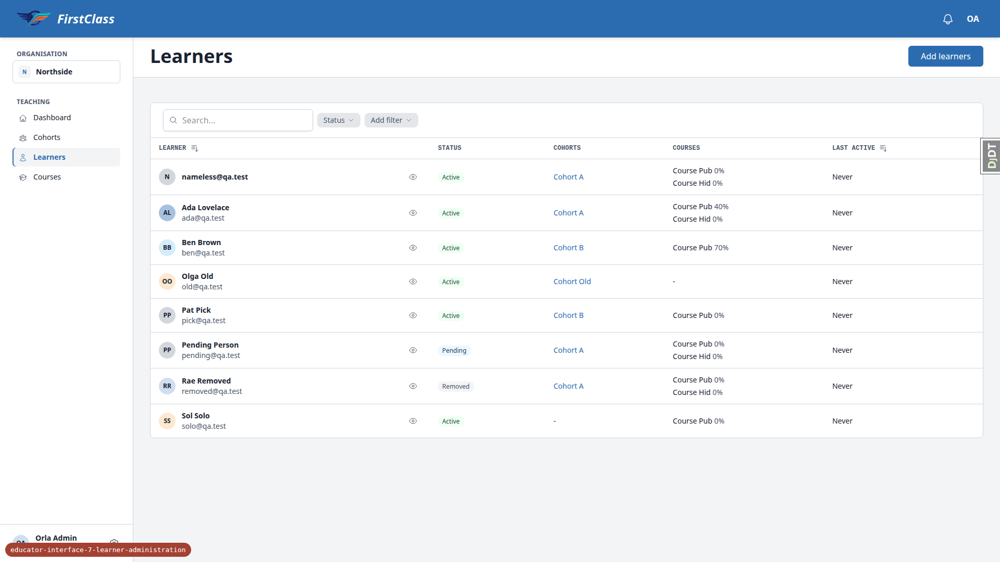
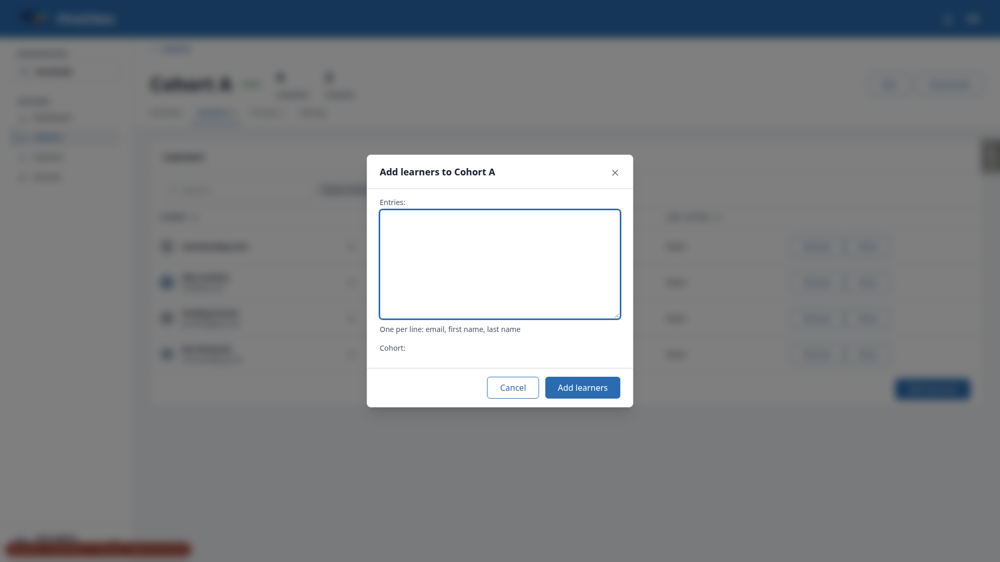
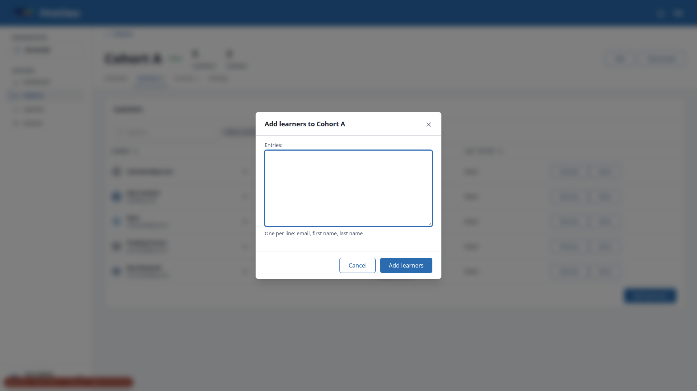

# Frontend QA report: educator-interface-7-learner-administration

## Methodology

- Playwright MCP, driven by hand at 1920x1080 (desktop), 375x812 (mobile) and 768x1024 (tablet).
- Dev DB wiped and re-seeded with `create_demo_data`, `content_save` and `qa_create_learner_administration_scenario`.
- Test plan: `3. frontend_qa.md` in this spec directory.
- Screenshots were collected into `screenshots/` beside this report. Every image referenced below exists there.
- Compression ran and found nothing over 1MB.

## Diff scoping

Class: **FULL**. Front-end templates changed (32 front-end files of 161 changed files), so every test ran. Nothing was skipped.

## Smoke gate

**pass**. Pages checked:

- http://127.0.0.1:8390/
- http://127.0.0.1:8390/educator/organisations/northside/learners

No failure URL or reason.

## Results table

| Test | Viewport | Status | Note | Screenshot |
|---|---|---|---|---|
| 1.1 | desktop | pass | Columns, chips, statuses and progress correct; Course Hid shows 0% (seed data, see general notes) | [s1-1-list.png](screenshots/s1-1-list.png) |
| 1.2 | desktop | pass | Learner header sorts asc/desc; Last active sort has no error | |
| 1.3 | desktop | fail | Removed filter works, but removing the Status chip goes to `?learners-status=` and shows everyone including Rae Removed (B1) | [s1-3-removed.png](screenshots/s1-3-removed.png) |
| 1.4 | desktop | pass | Cohort filter correct incl. Cohort Old (inactive); Clear all shows all 8 incl. Rae (same cause as B1) | [s1-4-cohortA.png](screenshots/s1-4-cohortA.png) |
| 1.5 | desktop | pass | Course filter results as expected | |
| 1.6 | desktop | pass | Search 'name' leaves only nameless@qa.test | |
| 1.7 | desktop | pass | Quick view Status reads Pending / Removed | [s1-7-quickview-pending.png](screenshots/s1-7-quickview-pending.png) |
| 1.8 | desktop | pass | Nameless learner link opens page; back works | |
| 2.1 | desktop | pass | Dialog has entries textarea with hint and Cohort select (A, B, C) | [s2-1-dialog.png](screenshots/s2-1-dialog.png) |
| 2.2 | desktop | pass | Five result rows as expected, duplicate collapsed | [s2-2-results.png](screenshots/s2-2-results.png) |
| 2.3 | desktop | pass | List refreshed behind the dialog | |
| 2.4 | desktop | pass | One setup email with correct subject, greeting, link, expiry; link host is the Site domain (see general notes) | |
| 2.5 | desktop | pass | 51 lines and empty entry both give 422 with dialog open | [s2-5-limit.png](screenshots/s2-5-limit.png) |
| 2.6 | desktop | fail | Flow passes; dialog renders a bare 'Cohort:' label for the hidden cohort input (B2) | [s2-6-cohort-dialog.png](screenshots/s2-6-cohort-dialog.png) |
| 2.7 | desktop | pass | Inactive cohort answers 'Cohort A is inactive'; no learner created | [s2-7-inactive.png](screenshots/s2-7-inactive.png) |
| 2.8 | desktop | pass | Setup link opens set-password page; user signed in afterwards; list shows Active | [s2-8-after.png](screenshots/s2-8-after.png) |
| 2.9 | desktop | pass | Exercised on pending@qa.test (see general notes); second resend 422 'Try again in 15 minutes' | [s2-9-resend-second.png](screenshots/s2-9-resend-second.png) |
| 2.10 | desktop | pass | Cohort admin picker offers Pat Pick only; viewer-scoped lists correct | [s2-10-picker.png](screenshots/s2-10-picker.png) |
| 3.1 | desktop | pass | Ada's overview header, actions, tabs, cards correct | [s3-1-ada-overview.png](screenshots/s3-1-ada-overview.png) |
| 3.2 | desktop | pass | Courses tab progress and Last active correct | [s3-2-courses.png](screenshots/s3-2-courses.png) |
| 3.3 | desktop | pass | History empty state shown | |
| 3.4 | desktop | pass | Pending badge and Resend offered | |
| 3.5 | desktop | pass | Cohort Old row Inactive, no Remove/Move | [s3-5-olga.png](screenshots/s3-5-olga.png) |
| 3.6 | desktop | pass | Edit name updates heading, title and Details; changed back | [s3-6-edit-name.png](screenshots/s3-6-edit-name.png) |
| 4.1 | desktop | pass | Deactivate dialog wording correct | [s4-1-deactivate-dialog.png](screenshots/s4-1-deactivate-dialog.png) |
| 4.2 | desktop | pass | Removed badge, Reactivate button, cards unchanged | [s4-2-removed.png](screenshots/s4-2-removed.png) |
| 4.3 | desktop | pass | Ben hidden by default, visible with Removed ticked | |
| 4.4 | desktop | pass | Stale Deactivate answers 'was already changed' | [s4-4-stale.png](screenshots/s4-4-stale.png) |
| 4.5 | desktop | pass | Reactivate dialog and result correct | [s4-5-reactivate.png](screenshots/s4-5-reactivate.png) |
| 4.6 | desktop | pass | Default-org dialog adds self-registration sentence | [s4-6-default-org.png](screenshots/s4-6-default-org.png) |
| 4.7 | desktop | pass | Cohort admin has no Deactivate | |
| 5.1 | desktop | pass | Add to cohort offers A, B, C; Cohort C added with registration | [s5-1-sol-cohortC.png](screenshots/s5-1-sol-cohortC.png) |
| 5.2 | desktop | pass | Cohort C no longer offered | |
| 5.3 | desktop | pass | Remove dialog and result correct | |
| 5.4 | desktop | pass | Remove dialog names only courses actually lost | [s5-4-remove-hid-only.png](screenshots/s5-4-remove-hid-only.png) |
| 5.5 | desktop | pass | Cohort-side remove matches; count 5 to 4 | [s5-5-cohort-remove.png](screenshots/s5-5-cohort-remove.png) |
| 5.6 | desktop | pass | Re-add via tab paste works; count back to 5 | |
| 5.7 | desktop | pass | Inactive cohort hides actions; stale Remove refused | [s5-7-stale-inactive.png](screenshots/s5-7-stale-inactive.png) |
| 5.8 | desktop | pass | Cohort admin's Cohorts card hides ungranted cohorts (see general notes) | [s5-8-cohort-admin-rows.png](screenshots/s5-8-cohort-admin-rows.png) |
| 6.1 | desktop | pass | Destinations B and C; Move disabled until chosen | [s6-1-move-dialog.png](screenshots/s6-1-move-dialog.png) |
| 6.2 | desktop | pass | Preview shows lost access and continued progress | [s6-2-move-preview.png](screenshots/s6-2-move-preview.png) |
| 6.3 | desktop | pass | Cohorts and Courses tab correct after move | [s6-3-courses-after-move.png](screenshots/s6-3-courses-after-move.png) |
| 6.4 | desktop | pass | Ben B to A preview 70% continues; one row | [s6-4-preview.png](screenshots/s6-4-preview.png) |
| 6.5 | desktop | pass | Ben A to B preview 70% continues | [s6-5-preview.png](screenshots/s6-5-preview.png) |
| 6.6 | desktop | pass | Stale move refused with 'no longer in Cohort A' | [s6-6-stale-move.png](screenshots/s6-6-stale-move.png) |
| 6.7 | desktop | pass | Cohort-side move preview and row removal correct | [s6-7-cohort-side-move.png](screenshots/s6-7-cohort-side-move.png) |
| 6.8 | desktop | pass | Cohort admin destinations: Cohort B only | [s6-8-cohort-admin-move.png](screenshots/s6-8-cohort-admin-move.png) |
| 6.9 | desktop | pass | Removed/added events share one move_id (admin ordering, see general notes) | [s6-9-webhook-events.png](screenshots/s6-9-webhook-events.png) |
| 7.1 | desktop | pass | Register select and new Individual registration correct | [s7-1-registered.png](screenshots/s7-1-registered.png) |
| 7.2 | desktop | pass | Unregister wording and Inactive/Re-register row | [s7-2-unregistered.png](screenshots/s7-2-unregistered.png) |
| 7.3 | desktop | pass | 'They keep access through Cohort A'; Re-register works | [s7-3-unregister-cohort-grants.png](screenshots/s7-3-unregister-cohort-grants.png) |
| 7.4 | desktop | pass | Held course not offered; offered again after unregister | |
| 7.5 | desktop | pass | Default-org unregister adds self-registration sentence | [s7-5-default-unregister.png](screenshots/s7-5-default-unregister.png) |
| 7.6 | desktop | pass | course.registered / course.unregistered events present | |
| 8.1 | desktop | pass | Cohort viewer sees no action buttons anywhere | [s8-1-viewer-tab.png](screenshots/s8-1-viewer-tab.png) |
| 8.2 | desktop | pass | Cohort admin POSTs to org-admin actions all 403 (URL drift, see general notes) | |
| 8.3 | desktop | pass | Cross-organisation requests 404 / 422; nothing created | |
| 8.4 | desktop | pass | Foreign cohort param ignored, list unfiltered | [s8-4-foreign-cohort-param.png](screenshots/s8-4-foreign-cohort-param.png) |
| 9.1-9.3 | desktop | pass | Repeat actions are no-ops; WebhookEvent count unchanged | [s9-2-repeat.png](screenshots/s9-2-repeat.png) |
| 10.1 | mobile | pass | No overflow, card rows, 44x44 quick view; filter sheet Reset shares B1's cause | [s10-mobile-list.png](screenshots/s10-mobile-list.png) |
| 10.2 | mobile | pass | Header wraps, tabs reachable, Move preview readable | [s10-mobile-ada.png](screenshots/s10-mobile-ada.png) |
| 10.3 | mobile | pass | Dialog fits; long results list scrolls, Close reachable | [s10-mobile-add-results-long.png](screenshots/s10-mobile-add-results-long.png) |
| 10.1 | tablet | pass | Table layout, no page overflow | [s10-tablet-list.png](screenshots/s10-tablet-list.png) |
| 10.2 | tablet | pass | Cohorts table action column clipped ~29px inside its scroller (cosmetic, see general notes) | [s10-tablet-ada.png](screenshots/s10-tablet-ada.png) |
| 10.3 | tablet | pass | Dialog 512px centred, fields fit | [s10-tablet-add-dialog.png](screenshots/s10-tablet-add-dialog.png) |
| 10.1-10.3 | desktop | pass | No overflow at 1920x1080; Move preview and dialog fit | [s1-1-list.png](screenshots/s1-1-list.png) |

## Design check

No design states tested.

## B1: Removing the Status chip (or Clear all / the mobile sheet's Reset) shows every learner, including Removed, instead of the Active+Pending default

**Manifestations**

- 1.3 (desktop)
- 1.4 (desktop)
- 10.1 (mobile)

**Expected**: Test plan 1.3: removing the Status chip returns the list to Active and Pending (the default), not to everyone.

**Actual**: The chip's remove link, Clear all, and the filter sheet's Reset all navigate to `?learners-status=` (an empty value). The filter treats the parameter as present-but-empty, applies no status narrowing, and Rae Removed appears. The spec says TableFilter's default applies "when the query parameter is absent", so the code follows the spec's letter while the test plan expects the default back. The spec, plan and code disagree on what an empty status means.

## B2: Cohort-scoped Add learners dialog renders a bare 'Cohort:' label for its hidden cohort input

**Manifestations**

- 2.6 (desktop)

**Expected**: On a cohort's Learners tab the dialog has no cohort select and no cohort field label (the cohort is fixed by the title).

**Actual**: The dialog shows the 'Entries:' textarea and then a lone 'Cohort:' label with no control beneath it. Already filed as an open todo item from the previous QA run.

## Bug status

- **UNRESOLVED** — Status chip removal / Clear all / Reset shows Removed learners instead of the default (reason: product decision — the spec applies the status default only when the parameter is absent, the test plan expects removing the chip to restore Active+Pending; someone must decide what an empty status selection means)
- **FIXED** (commit: a9f64247) — Bare 'Cohort:' label in cohort-scoped Add learners dialog. Re-verified: the cohort-scoped dialog shows no Cohort label and keeps its hidden cohort input ; the org-wide Add learners, Add to cohort, Register for course and cohort Edit dialogs still render their labelled fields.

## General notes

Observations from the run that are not bugs:

- **0% Course Hid rows**: the seed's membership signal creates 0% progress rows, so Course Hid shows "0%" rather than no percentage (1.1, 3.2). This is data, not a defect.
- **Setup email link host**: the link uses the Site domain 127.0.0.1:8000. The plan assumed the Site domain equals the run port. For 2.8 the host was rewritten to the run port.
- **Noor's resend (2.9)**: refused because her creation email in 2.6 starts the 15-minute cooldown. 2.9 was exercised on pending@qa.test instead.
- **Cohort admin's Cohorts card (5.8)**: it hides cohorts they hold no grant on, instead of showing them without actions as the plan expects. No over-granting either way.
- **Webhook events admin (6.9)**: ordered by UUID, not created_at, so the newest events are not at the top. The admin is not changed on this branch.
- **Course Other in Register select (7.1)**: Course Other (hidden, Southside-only) is offered in Northside's Register select because courses are site-wide. Not treated as a leak.
- **Tablet Cohorts table (10.2)**: the table is 747px in a 718px overflow-x:auto container, so the Remove/Move column is clipped by about 29px until scrolled sideways. Reachable; cosmetic.
- **Plan URL drift in section 8**: the move action lives under `__tabs/overview/__panels/...` (the plan's path without `__tabs/overview` is 404), and the register action is `register_for_course` (the plan says `register`).
- **Plan 2.10 leftover state**: the plan leaves Ben in Cohort A from 2.6, so he was removed manually to keep later sections on the seeded memberships.
- **Rae Removed**: reactivated in section 2, so no removed learner existed for the mobile Removed-filter check in 10.1.

status: ok
reason: 2 bugs — 1 fixed, 1 unresolved; report rendered, screenshots verified
