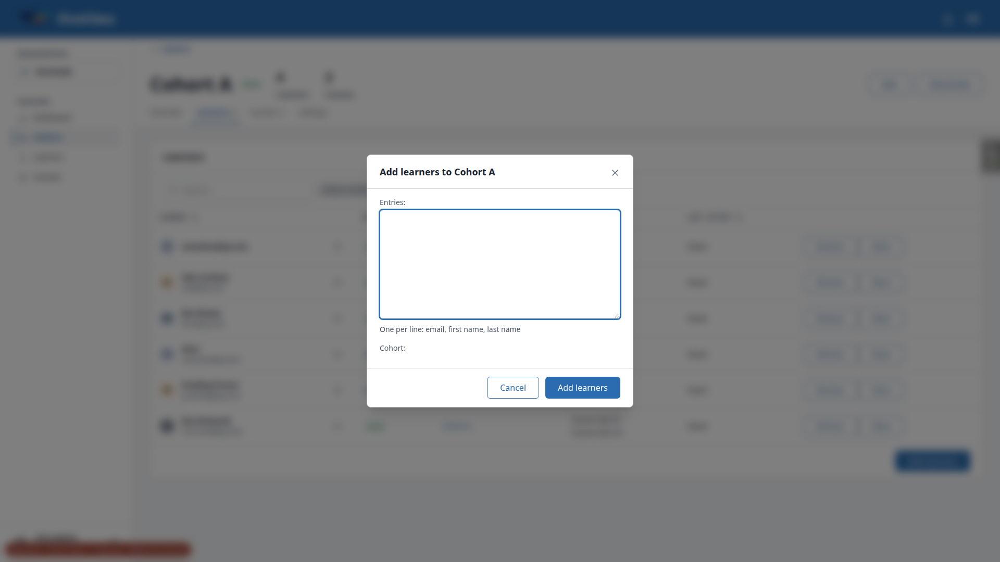
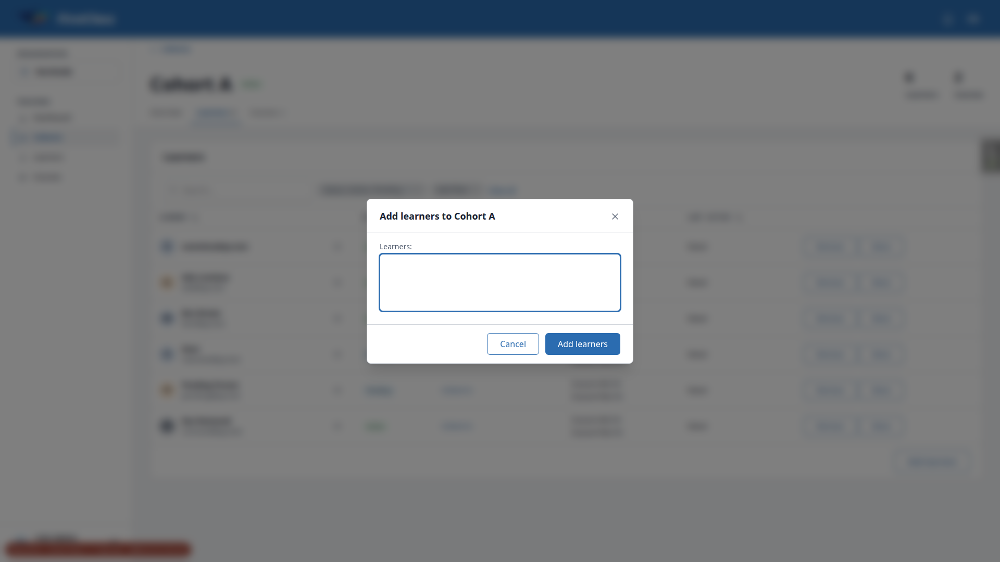

# Frontend QA report: learner administration

The run covered the whole plan at three viewports. Desktop (1920x1080) has 61 tests: 56 pass, 5 fail, 0 skip. The earlier 2.9 skip was superseded by a pass. Mobile (375x812) has 5 tests: 5 pass, 0 fail, 0 skip. Tablet (768x1024) has 3 tests: 3 pass, 0 fail, 0 skip. The failures group into 5 distinct bugs (B1 to B5). B1 is a stale count on the cohort Learners tab. B2 is a stray label. B3 and B4 are Move dialog problems. B5 is a disagreement between the spec and the plan about the cohort admin's picker.

## Methodology

- Playwright MCP, driven by hand at 1920x1080 (desktop), 375x812 (mobile) and 768x1024 (tablet).
- Logged in as the plan's personas (org.admin, cohort.admin, cohort.viewer, and the demodev superuser), each in a separate browser context.
- Mailpit and the database were used to check emails and webhook events.
- Screenshots were collected into `screenshots/` beside this report. Every image referenced here exists there.
- This run followed a rebase onto main. One test-file conflict was resolved by keeping both tests, and the full test tier passed with 7927 tests.
- The run also covered the post-rebase front-end check, so that check did not run separately.

## Diff scoping

Class: **FULL**. 29 front-end files triggered it:

- `freedom_ls/accounts/templates/account/email/account_setup_message.html`
- `freedom_ls/accounts/templates/account/email/account_setup_message.txt`
- `freedom_ls/accounts/templates/account/email/account_setup_subject.txt`
- `freedom_ls/educator_interface/templates/educator_interface/data-table-cells/cohort_member_actions.html`
- `freedom_ls/educator_interface/templates/educator_interface/data-table-cells/learner.html`
- `freedom_ls/educator_interface/templates/educator_interface/data-table-cells/learner_courses.html`
- `freedom_ls/educator_interface/templates/educator_interface/data-table-cells/learner_last_active.html`
- `freedom_ls/educator_interface/templates/educator_interface/data-table-cells/learner_status.html`
- `freedom_ls/educator_interface/templates/educator_interface/data-table-cells/membership_actions.html`
- `freedom_ls/educator_interface/templates/educator_interface/modal/account_already_set_up.html`
- `freedom_ls/educator_interface/templates/educator_interface/modal/add_learners_results.html`
- `freedom_ls/educator_interface/templates/educator_interface/modal/deactivate_learner_confirmation.html`
- `freedom_ls/educator_interface/templates/educator_interface/modal/learner_already_in_state.html`
- `freedom_ls/educator_interface/templates/educator_interface/modal/move_confirmation.html`
- `freedom_ls/educator_interface/templates/educator_interface/modal/reactivate_learner_confirmation.html`
- `freedom_ls/educator_interface/templates/educator_interface/modal/remove_from_cohort_confirmation.html`
- `freedom_ls/educator_interface/templates/educator_interface/modal/reregister_confirmation.html`
- `freedom_ls/educator_interface/templates/educator_interface/modal/resend_setup_email_confirmation.html`
- `freedom_ls/educator_interface/templates/educator_interface/modal/setup_email_recently_sent.html`
- `freedom_ls/educator_interface/templates/educator_interface/modal/unregister_from_course_confirmation.html`
- `freedom_ls/educator_interface/templates/educator_interface/panels/learner_courses.html`
- `freedom_ls/educator_interface/templates/educator_interface/panels/learner_details.html`
- `freedom_ls/educator_interface/templates/educator_interface/panels/learner_history.html`
- `freedom_ls/educator_interface/templates/educator_interface/panels/learner_registrations.html`
- `freedom_ls/educator_interface/templates/educator_interface/quick_views/learner.html`
- `freedom_ls/panel_framework/static/panel_framework/js/alpine-components.js`
- `freedom_ls/panel_framework/templates/cotton/panel-page-header.html`
- `freedom_ls/panel_framework/templates/panel_framework/views/_instance_view_base.html`

Nothing was skipped. Desktop, mobile and tablet all ran. This also covers the pre-step front-end check after the rebase onto main.

## Smoke gate

Outcome: **pass**. Pages loaded:

- `http://127.0.0.1:8502/`
- `http://127.0.0.1:8502/educator/organisations/northside/learners`
- `http://127.0.0.1:8502/accounts/signup/` (changed upstream; it redirects a signed-in user home)

## Results

### Desktop (1920x1080)

| Test | Status | Note |
|---|---|---|
| 1.1 | pass | Columns, chips and statuses correct. Course Hid reads 0%, not blank, because registration auto-creates a 0% progress record. |
| 1.2 | pass | First name sorts asc and desc; Last active sorts without error. |
| 1.3 | pass | Removed filter shows Rae with a Removed badge; removing the chip restores the default. |
| 1.4 | pass | Cohort filter includes 'Cohort Old (inactive)'; results correct; Clear all works. |
| 1.5 | pass | Course filter results correct. It lists every site course. |
| 1.6 | pass | Search 'name' leaves only nameless@qa.test. |
| 1.7 | pass | Quick view status reads Pending and Removed as expected. |
| 1.8 | pass | Nameless learner's heading is the email; Back returns to the list. |
| 2.1 | pass | Dialog has the textarea hint and a Cohort select (A, B, C, not Old). |
| 2.2 | pass | Five result rows with the expected wording; duplicate collapsed. |
| 2.3 | pass | List refreshed behind the dialog. |
| 2.4 | pass | One setup email with the expected content. Link host is the Site record's domain 127.0.0.1:8000. |
| 2.5 | pass | 51 lines gives a 422 and the dialog stays open; empty submit blocked by the browser. |
| 2.6 | FAIL | Results correct, but the Learners tab count and header stat stay stale (B1). Dialog shows a bare 'Cohort:' label (B2). |
| 2.7 | pass | Inactive cohort gives 422 and nothing is created. |
| 2.8 | pass | Setup link opens the set-password form; Nia is signed in and Active. |
| 2.9 | pass | Re-run after the guard expired. Resend returned 204 and a second email arrived; an immediate repeat gave 422. Supersedes the earlier skip. |
| 2.10 | FAIL | Picker offers nobody and shows an empty multi-select (B5). Tab count stale after the add (B1). |
| 3.1 | pass | Header, actions, tabs and cards correct. Date formats differ between Details and the Cohorts card. |
| 3.2 | pass | Courses tab shows progress bars. |
| 3.3 | pass | History empty state shown. |
| 3.4 | pass | Pending badge and Resend setup email offered. |
| 3.5 | pass | Inactive cohort row has no Remove or Move. |
| 3.6 | pass | Edit name saved and restored. The page has no name breadcrumb, only a 'Learners' back link. |
| 4.1 | pass | Deactivate dialog wording correct. |
| 4.2 | pass | Badge Removed; Reactivate offered; other cards unchanged. |
| 4.3 | pass | Ben hidden by default and shown with Removed ticked; Cohort B count 2 to 1. |
| 4.4 | pass | Stale tab gets a 422 refusal. Its header still reads Active afterwards. |
| 4.5 | pass | Reactivate restores access and the Active badge. |
| 4.6 | pass | Default-org dialog adds the self-register line. |
| 4.7 | pass | Cohort admin has no Deactivate. |
| 5.1 | pass | Add to cohort offers A, B, C; Cohort C added with its registration. |
| 5.2 | pass | Cohort C no longer offered. |
| 5.3 | pass | Remove from Cohort C names the lost course; row and registration gone. |
| 5.4 | pass | Remove dialog names only courses actually lost. |
| 5.5 | FAIL | Remove works, but the Learners tab count stays at 7; reload shows 5 (B1). |
| 5.6 | pass | Re-add through the tab dialog works. |
| 5.7 | pass | Inactive cohort offers only Reactivate; stale Remove gives 422. |
| 5.8 | pass | Cohort admin sees Remove and Move on Cohort A. Cohort C is hidden, not shown without actions. |
| 6.1 | pass | Move offers B and C only and is disabled until a destination is chosen. |
| 6.2 | pass | Preview shows lost access and 40% continuing; confirmed. |
| 6.3 | pass | Cohorts card and Courses tab updated. |
| 6.4 | pass | Ben B to A keeps 70%. |
| 6.5 | pass | Ben A to B keeps 70%. |
| 6.6 | FAIL | Stale Move form offers the source cohort and gives the wrong reason (B3, B4). |
| 6.7 | pass | Move from a cohort tab works. |
| 6.8 | pass | Cohort admin's Move offers Cohort B only. |
| 6.9 | pass | Each move fired member_removed then member_added with the same move_id. |
| 6.x-move-422-inactive | FAIL | Exploratory: the 422 re-render lists inactive Cohort Old (B4). |
| 7.1 | pass | Register picker offers Course Hid, not held or upcoming courses. It lists every site course. |
| 7.2 | pass | Unregister shows Inactive with Re-register. |
| 7.3 | pass | Individual registration, unregister and re-register behave correctly. |
| 7.4 | pass | Picker offers Course Pub only when not actively registered. |
| 7.5 | pass | Default-org re-register dialog wording correct. |
| 7.6 | pass | Registration events fired in the expected order. |
| 8.1 | pass | Cohort viewer sees no action buttons. |
| 8.2 | pass | Cohort admin POSTs return 403. The plan's move URL lacks `/__tabs/overview`. |
| 8.3 | pass | Other organisation's resources return 404. The register action is `register_for_course`. |
| 8.4 | pass | Foreign `?learners-cohort=` leaves the default list. |
| 9.1-9.3 | pass | No new webhook events; 'Already in the cohort' shown. Results title still reads 'Added to Cohort A'. |
| 10 | pass | No overflow on the list or Ada's page at 1920. |

### Mobile (375x812)

| Test | Status | Note |
|---|---|---|
| 10.1 | pass | No overflow; card rows; filter sheet works. The status chip's remove 'x' is 12x20px. |
| 10.2 | pass | Header wraps cleanly; Move dialog is a bottom sheet. |
| 10.2-move | pass | Move dialog with preview readable at 375px. |
| 10.3 | pass | Add learners fits the sheet; long results scroll inside the dialog. |
| 10-nav | pass | Hamburger navigation sheet opens; cohort Learners tab has no overflow. |

### Tablet (768x1024)

| Test | Status | Note |
|---|---|---|
| 10.1 | pass | Table layout with hamburger navigation; no overflow. |
| 10.2 | pass | Ada's page has no overflow; Move dialog centred at 512px. |
| 10.3 | pass | Add learners dialog 512px wide; no JS errors in the console across the run. |

## Design check

No design states tested.

## B1 — Cohort Learners tab count and header Learners stat do not update after a membership change made from the tab

Manifestations: 2.6 (desktop), 2.10 (desktop), 5.5 (desktop).

**Expected:** After adding (paste dialog or picker) or removing learners on a cohort's Learners tab, the tab count and the header Learners stat show the new number of active members. Plan 2.6 says "the tab count rose by two"; plan 5.5 says "the count drops".

**Actual:** The table rows refresh, but the 'Learners N' tab label and the header stat keep the old number. They showed 4 after adding two, 6 after a picker add, and 7 after removing two. Only a full reload shows the right count.

## B2 — Cohort-scoped Add learners dialog shows a bare 'Cohort:' label for a hidden input

Manifestations: 2.6 (desktop).

**Expected:** Opened from a cohort's Learners tab, the dialog names the cohort in its title and shows no cohort field.

**Actual:** Below the textarea hint the dialog renders a 'Cohort:' label with nothing after it. The field is `<input type=hidden name=cohort>`, but its label is still rendered.

## B3 — Stale Move dialog renders a form (offering the source cohort as a destination) instead of saying the learner is no longer in the source cohort

Manifestations: 6.6 (desktop). No screenshot.

**Expected:** Opening Move from a stale row (the learner is no longer in that cohort) answers with a reason in the dialog, as Remove and the other stale actions do. Plan 6.6 says "she is no longer in Cohort A". Nothing changes.

**Actual:** `GET .../__panels/cohorts/__actions/move?cohort=<A>` for a learner now in B renders 'Move Ada Lovelace from Cohort A'. Its destinations are Cohort A (the source) and Cohort C. A POST with destination=B answers 422 'Choose a cohort to move them to.', which is the wrong reason. A POST with destination=C answers 422 'The learner is not a member of the source cohort.' No data changed.

## B4 — Move dialog's 422 re-render offers inactive cohorts (and the source cohort) as destinations

Manifestations: 6.x-move-422-inactive (desktop), 6.6 (desktop). No screenshot.

**Expected:** When the Move form is re-rendered after a validation error, the destination select offers the same cohorts as the first render: same organisation, active, not the source, and not already a member. Spec Decision 13 says no membership picker offers an inactive cohort.

**Actual:** A POST to move with cohort=Cohort B and an empty destination returns a 422 whose select lists Cohort A, Cohort C and the inactive Cohort Old. The initial GET correctly lists only Cohort A and Cohort C. Submitting Cohort Old is refused server-side ('Cohort Old is inactive').

## B5 — Cohort admin's Add learners picker offers nobody and shows an empty multi-select (plan expects org learners outside their cohorts)

Manifestations: 2.10 (desktop).

**Expected:** Plan 2.10 expects the picker to offer existing Northside learners who are not yet members, including Sol Solo, who is in no cohort.

**Actual:** Spec R5 limits a cohort admin's picker to learners they can already see (members of their cohorts), so Sol is not offered. With every visible learner already in Cohort A, the dialog shows an empty multi-select with no message. Options are labelled 'pick@qa.test - Northside' (the model string), not the learner's name. The spec and the plan disagree.

## Bug status

- B1: **FIXED** (commit: 299a5c29) — Cohort Learners tab count and header stat do not update after a membership change. Re-verified: Cohort B's tab and header read 2 → 1 → 2 across a remove and an add, no reload.
- B2: **UNRESOLVED** — Bare 'Cohort:' label for a hidden input in the cohort-scoped Add learners dialog (reason: fix budget exhausted this run)
- B3: **FIXED** (commit: 63412e83) — Stale Move dialog renders a form instead of a reason. Re-verified: a stale GET or POST answers "Ada Lovelace is no longer in Cohort B. Nothing changed."; a fresh Move still offers Cohort B and Cohort C.
- B4: **FIXED** (commit: 0e0b486f) — Move 422 re-render offers inactive cohorts and the source cohort. Re-verified: the 422 re-render offers only Cohort B and Cohort C, the same as the GET.
- B5: **FIXED** (commits: 9532cef7, d4b375cf) — Spec R5 kept (decided). An empty picker now shows the spec R6 sentence and a Close button with no submit (all four pickers), and the learner picker's options read as the learner's display name. Covered by tests; not re-verified in a browser.

## General notes

### Plan corrections found by the run

- **2.9:** Creating an account sets the 15-minute resend guard. A resend straight after creation is refused by design (spec R2), so the plan's order cannot succeed. The success path was verified after the guard expired.
- **8.2:** The move URL lacks `/__tabs/overview`.
- **8.3:** The register URL should be `register_for_course`.
- **1.1:** 'Course Hid with no percentage' reads 0%, because registration auto-creates a 0% progress record.
- **2.4:** The link host is the Site record's domain, 127.0.0.1:8000.
- **Starting states:** §2.6 put Ben in Cohort A, so the run removed him again before §6. The run also removed Ada from Cohort C after 5.8. Both restore the plan's starting states.
- **Extra learner:** A learner pick@qa.test was added to Cohort B to exercise the cohort admin's picker.

### Tangential observations

- 5.8 hides cohorts outside a cohort admin's grants instead of showing them without actions.
- The Course filter and the Register picker list every site course.
- Details shows '12 Oct 2026' while the Cohorts card shows 'Oct. 12, 2026, 5:36 p.m.'.
- The Add learners results title reads 'Added to Cohort A' when nothing was added.
- The set-password page is headed 'Change Password'.
- allauth sends a 'Password Reset' email after the setup link is used.
- Each learner cell inlines a `<style>` block.
- The webhook events admin orders by UUID, and its Created at column did not sort.
- The stale tab in 4.4 keeps showing 'Active' after the refusal.
- The status chip's remove 'x' is 12x20px on mobile.
- The dev-only debug toolbar handle overlaps the header buttons on narrow screens.

status: ok · reason: 5 bugs — 3 fixed, 2 unresolved; report rendered, screenshots verified
