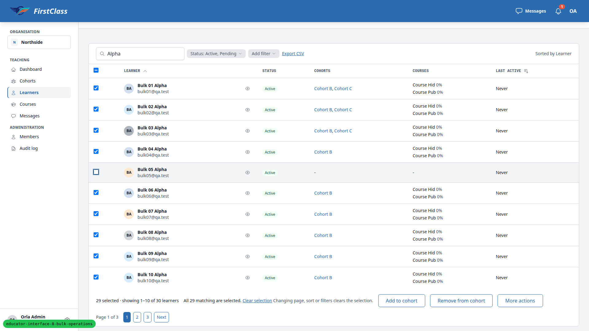
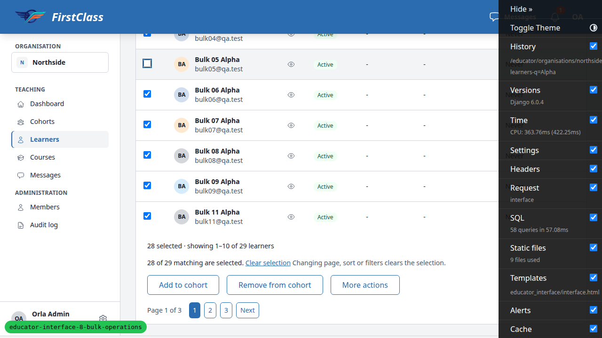

# Frontend QA Report: educator-interface-8-bulk-operations

## Methodology

QA ran against a local dev server on port 8017 via Playwright MCP at three viewports: desktop 1920x1080, mobile 375x812 and tablet 768x1024. Screenshots are collected into `screenshots/` beside this report, and every referenced image exists there.

The pre-step rebase onto main ran first: 61 commits were replayed with no conflicts, and the full test tier passed (10740 passed). The rebase's front-end check was covered by this QA pass rather than run separately.

## Diff scoping

Class: **FULL**. Triggered by template and static changes (28 template/static files changed; the record lists 8):

- `freedom_ls/base/static/base/js/alpine-components.js`
- `freedom_ls/educator_interface/templates/educator_interface/_shell.html`
- `freedom_ls/educator_interface/templates/educator_interface/interface.html`
- `freedom_ls/educator_interface/templates/educator_interface/learner_import_denied.html`
- `freedom_ls/educator_interface/templates/educator_interface/learner_import_preview.html`
- `freedom_ls/educator_interface/templates/educator_interface/learner_import_result.html`
- `freedom_ls/educator_interface/templates/educator_interface/learner_import_upload.html`
- `freedom_ls/educator_interface/templates/educator_interface/partials/import_learners_link.html`

Skipped: nothing.

## Smoke gate

Status: **pass**. Pages checked: `/` and `/educator/organisations/northside/learners`. No failure URL or reason.

## Design check

No design states tested.

## Bugs

### B1: Select-all-matching bar says 'All N matching are selected.' after rows are unticked

Manifestations:
- Test 6.6, desktop

Screenshot:

**Expected:** Once a row is unticked in select-all-matching mode, the bar no longer claims every matching row is selected (e.g. '29 of 30 matching are selected.').

**Actual:** Search 'Alpha' (30 matching), select all 30 matching, untick bulk05: the bar reads 'All 29 matching are selected.' (`table_selection_bar.html` renders 'All <count> matching are selected.' with the live count).

## Bug status

| Bug | Status |
|---|---|
| B1 | **FIXED** (commit: 69120e42a) — Select-all-matching bar says 'All N matching are selected.' after rows are unticked. Re-verified in the browser: "All 29 matching are selected." becomes "28 of 29 matching are selected." after one untick  |

## Results

| Test | Viewport | Status | Screenshot | Notes |
|---|---|---|---|---|
| 1.1 | desktop | pass | [img](screenshots/page-2026-10-30T19-32-50-887Z.png) | Import learners is a link; stepper Upload aria-current=step, Step 1 of 3; code line, required sentence, template link; sidebar and back link to Learners present |
| 1.2 | desktop | pass | | learner-import-template.csv, BOM present, four headers, two example rows |
| 1.3 | desktop | pass | | Fresh dialog shows no cap; 51 lines -> 422 with 'Add up to 50 at a time; larger lists are imported from a file.' and 'Import a file instead' link to import page |
| 1.4 | desktop | pass | | Cohort C Learners tab link ends ?cohort=<C pk>; Cohort Old tab has none |
| 2 | desktop | pass | [img](screenshots/page-2026-10-30T19-33-57-492Z.png) | All six bad files refused with 422, focused role=alert summary and the plan's sentences; blankhead names 'unnamed column 2'. No-file submit blocked by required; with noValidate -> 422 'This field is required.' |
| 3.1 | desktop | pass | [img](screenshots/page-2026-10-30T19-34-18-023Z.png) | good.csv preview: chip 'good.csv · 30 rows', counts 26/1/1/2 as links, columns and line numbers from 2, reasons correct, three notes, error CSV learner-import-errors-2026-10-30.csv with 2 rows, button 'Add 28 learners' plus '2 rows with errors will not be added.' |
| 3.2 | desktop | pass | | ?label=error shows 2 rows, persists on reload, Back restores 30 |
| 3.3-3.6 | desktop | pass | | dup: new/Same email as line 2./Email is empty., button 'Add 1 learner' (singular). nocohort: both rows error with the expected sentence, no button, 'Nothing can be added: every row has an error or is already a member.' (also shows '0 new accounts will get a setup email.'). semi: two new accounts. trail: one new account in Cohort C. |
| 4.1 | desktop | pass | [img](screenshots/page-2026-10-30T19-34-55-658Z.png) | Result step 3 of 3; 'Added 28 learners. 2 rows were not added.'; counts 26/1/1/2; '26 setup emails were sent.'; Mailpit 26, none to ada/removed; error rows inline, CSV link, Back to learners, Import another file, re-upload safety note |
| 4.2-4.3 | desktop | pass | | Preview URL redirects to result; import01 Pending; Rae Active; Ada in Cohort C, still 'Ada Lovelace'; Cohort C filter 27 (10+10+7) |
| 4.4-4.5 | desktop | pass | | Re-upload: Already a member 28, Error 2, no button, 'Nothing can be added...'; Mailpit 0. dup.csv confirmed: 'Added 1 learner. 2 rows were not added.', error CSV holds the two |
| 5 | desktop | pass | | Cohort A import page says 'Every learner in the file is added to Cohort A. The cohort column is ignored.'; preview shows cohortimp in Cohort A (not C), Ben 'Added to the cohort'; result links 'Back to the cohort's learners' (full page) showing both |
| 6.1-6.2 | desktop | pass | [img](screenshots/page-2026-10-30T19-37-25-940Z.png) | Checkbox column and 'Select all on this page'; empty role=status present before ticking; '2 selected · showing 1–9 of 9 learners'; Add to cohort, Remove from cohort, More actions (Deactivate, Reactivate, Register for a course, Unregister from a course, Resend setup email) |
| 6.3-6.5 | desktop | pass | | Picker above sentence, confirm disabled until chosen, focus on Cancel; 'Add 2 learners to Cohort C.' -> '2 learners changed.', table refreshed; skips 'Add 1 learner... 2 are already in the cohort and will be skipped.' -> '1 learner changed. 2 were already in the cohort.'; zero case disabled; remove sentence with skip and 'They lose access to: Course Pub.' |
| 6.6 | desktop | **fail** | [img](screenshots/page-2026-10-30T19-38-43-450Z.png) | Counts and run correct (29 changed; Cohort B 31, bulk05 absent), but after unticking bulk05 in select-all-matching mode the bar reads 'All 29 matching are selected.' while 30 rows match: the sentence claims every matching row is selected when one is excluded (B1) |
| 6.7-6.8 | desktop | pass | | Sort and page change clear the selection and hide the buttons; 'Remove 31 learners from Cohort B.' -> '31 learners changed.', Cohort B empty |
| 6.9 | desktop | pass | | Deactivate btn-error, 'Deactivate 2 learners.' + 'They lose access to this organisation's courses.'; both leave table; Inactive filter shows both; reactivate works; mixed 'Reactivate 1 learner. 1 is already active and will be skipped.' cancelled (bulk10 stays inactive) |
| 6.10 | desktop | pass | | 'Register 2 learners for Course Pub.' -> 2 changed; solo 'Register 0 learners for Course Pub. 1 is already registered individually and will be skipped.' with confirm disabled; unregister 2 and 1 confirmed, Courses cells cleared |
| 6.11 | desktop | pass | | After restart: 'Resend the setup email to 2 learners. 1 account is already set up and will be skipped.' -> Mailpit 2; repeat -> '0 learners changed.', '2 setup emails were sent recently.', Mailpit still 2. (Repeat confirmation still announces 'Resend ... to 2 learners' since the recent-send skip is only known at run time.) |
| 6.12 | desktop | pass | [img](screenshots/page-2026-10-30T19-41-02-202Z.png) | Same-count stale run: '1 learner changed. 1 was already inactive.' Select-all stale: 422 'The selection changed since you opened this.' with 'Deactivate 28 learners.'; restored bulk41 and bulk55 (Beta matched 29 at the start because bulk41 was inactive from the first half) |
| 6.13 | desktop | pass | | JS off: full-page Deactivate confirmation with same sentence, result page with 'Back to learners' keeping ?learners-q=bulk3; Add to cohort page with picker, 'Show what changes', disabled Add to cohort -> enabled with 'Add 2 learners to Cohort C.' -> full page result |
| 9.2 | desktop | pass | | JS off, Back + resubmit -> 422 'Add 0 learners to Cohort C. 2 are already in the cohort and will be skipped.'; single membership |
| 6.14.1-6.14.2 | desktop | pass | [img](screenshots/page-2026-10-30T19-42-47-067Z.png) | 'This will affect 30 learners.' + background sentence; modal closes, URL unchanged, bar 'Deactivate is running…', More actions spinner and disabled, Add/Remove disabled, all checkboxes and Clear selection disabled; persists across page 2 and sort; quick view still opens |
| 6.14.2 | mobile | pass | [img](screenshots/page-2026-10-30T19-42-58-554Z.png) | Fixed bottom bar fits 'Deactivate is running…' and disabled More actions with spinner; scrollWidth 375, no overflow |
| 6.14.2 | tablet | pass | [img](screenshots/page-2026-10-30T19-43-04-353Z.png) | Bar fits at 768, scrollWidth 768 |
| 6.14.3 | desktop | pass | [img](screenshots/page-2026-10-30T19-43-24-352Z.png) | After worker, modal '30 learners changed.' opened at once, table refreshed (30 gone); closed: spinner hidden, controls enabled, nothing selected; new 'Deactivate finished: 30 learners changed.' notification already read, badge unchanged; clicking opens learners list. (Panel header '2 unread' counts older notifications left by previous QA passes.) |
| 6.14.4-6.14.5 | desktop | pass | | Open Add learners modal not replaced; result opened 1.6s after closing it. On Dashboard: no modal; bell '1 new' after 31s; entry unread, opens learners list; 30 listed under Inactive |
| 6.14.6-6.14.7 | desktop | pass | | JS off: 'This will affect 6 learners.' then flash 'Reactivate is running in the background. You'll get a notification when it finishes.'; after worker 6 Active, bell 1 new. Status URL .../learners/__runs/f5c4ad40-bc1b-4c80-8de7-63efbfe0b5a6 recorded |
| 7.1-7.6 | desktop | pass | | Bar: Register for a course, Unregister from a course, More actions (Deactivate, Reactivate). 'Register 2 cohorts for Course Hid. 1 is an inactive cohort and will be skipped.' -> A and C gain Course Hid; repeat 'Register 0 cohorts... 2 are already registered... 1 is an inactive cohort' disabled; 'Unregister 2 cohorts from Course Hid.' btn-error, confirmed; 'Unregister 1 cohort from Course Hid. 1 is not registered and will be skipped.' cancelled; Cohort C deactivate/reactivate from list and from its page both work |
| 9.1 | desktop | pass | | Two tabs confirmed together: same result URL, 'Added 2 learners.'; semi1/semi2 once each; one setup email each |
| 10.1 | mobile | pass | [img](screenshots/page-2026-10-30T19-47-59-758Z.png) | Upload error summary, preview and result: scrollWidth 375; preview rows render as cards (email, line, label, reason, name, cohort); stepper fits on one line |
| 10.1-error | mobile | pass | [img](screenshots/page-m-upload-error.png) | badhead error summary wraps legibly |
| 10.2-10.3 | mobile | pass | [img](screenshots/page-2026-10-30T19-48-15-960Z.png) | Selection bar fixed to bottom (593-812), Select all above the cards, More actions menu flips above trigger with 5 items 36px tall; confirm bottom sheet and result modal within viewport; no overflow; bulk42/43 reactivated |
| 10.2-confirm | mobile | pass | [img](screenshots/page-m-confirm.png) | Deactivate confirmation bottom sheet fits 375x812 |
| 10.1-10.3 | tablet | pass | [img](screenshots/page-t-preview.png) | Import upload error, preview (table at md) and result: scrollWidth 768; learners list bar fixed at bottom (921-1024), menu 5 items, confirm and result modals 128-640 wide, within viewport; reactivated afterwards |
| 8.1 | desktop | pass | [img](screenshots/page-cohortadmin-cohorts.png) | cohort.admin: checkbox column; More actions holds only Register/Unregister; no Import learners link on list or Cohort A tab; only Cohort A/B learners; picker Cohort A, Cohort B; 'Add 2 learners to Cohort B.' -> '2 learners changed.'; import URL 403 'You can't import learners here... Ask an organisation admin of Northside.'; cohorts list Register/Unregister only, no More actions |
| 8.2-8.5 | desktop | pass | | cohort.viewer: no selection checkboxes/bar (only Status filter checkboxes), import 403. south.admin: preview/result/errors.csv/run status URLs 404 under northside and southside. Superuser: §4 result 404, import page 200. Anonymous: redirected to login with next |
| 7-viewports | mobile | pass | [img](screenshots/page-cohorts-375.png) | Cohorts list with 2 ticked: scrollWidth 375, bar buttons stacked within width |
| 7-viewports | tablet | pass | [img](screenshots/page-cohorts-768.png) | Cohorts list with 2 ticked: scrollWidth 768, bar buttons in a row |

## General notes

- nocohort.csv preview shows "0 new accounts will get a setup email." next to "Nothing can be added"; harmless but redundant.
- A repeat Resend setup email confirmation still says "Resend the setup email to 2 learners." when both will be skipped as sent recently; the skip only surfaces in the result.
- Per-row skip details in result modals read "<Name>: <reason>" (e.g. "Bulk 01 Alpha: already in the cohort"), while the count lines are full sentences.
- The notification panel header counted "2 unread" from notifications left by earlier QA passes; the scenario reset does not clear notifications.
- §6.12 deactivated bulk40 from a second learners-list tab rather than the learner's page (same service).
- Beta matched 29, not 30, at the start of the §6.12 select-all half because bulk41 was still inactive from the first half; the stale check still behaved as specified.
- More actions menu items are 36px tall on mobile (meets WCAG 2.2 AA 24px target minimum, under the 44px guideline).
- The dev-only branch badge overlaps pagination at narrow widths; dev-only.

status: ok · reason: 1 bug — 1 fixed, 0 unresolved; report rendered, screenshots verified
