# Frontend QA report: educator-interface-8-bulk-operations

All tests passed. 0 bugs were found.

## Methodology

- Playwright MCP run against a dev server on port 8484, driven by a depth-0 agent at 1920x1080 (desktop), 375x812 (mobile) and 768x1024 (tablet).
- Data was reset with `qa_create_bulk_operations_scenario --site-name DemoDev`.
- Screenshots were collected into `screenshots/` beside this report, and every image referenced here exists. Compression ran and found nothing over 1MB.
- Background-run tests (§6.14) used a scratch settings module, `config/settings_qa_background.py` (deleted afterwards), and `db_worker --batch`.
- Mailpit was checked through its API.

## Diff scoping

Class: FULL (templates and static files changed; 220 files in the diff, including `alpine-components.js` in `base` and `panel_framework`, and the educator_interface and panel_framework templates). Skipped: nothing.

## Smoke gate

Status: pass. Pages checked: `/` and `/educator/organisations/northside/learners`. No failure.

## Results

### Desktop (1920x1080)

| Test | Status | Notes | Screenshot |
|---|---|---|---|
| 1.1 | pass | Import learners is a link; stepper Upload/Preview/Result with Upload `aria-current=step` and "Step 1 of 3"; file input, code line, "email is required; cohort is matched by name", template link, sidebar and Learners back link present |  |
| 1.2 | pass | `learner-import-template.csv`, BOM present, 4 headers and 2 example rows | |
| 1.3 | pass | 51 lines gives 422 with "Add up to 50 at a time; larger lists are imported from a file." and an "Import a file instead" link | |
| 1.4 | pass | Cohort C tab link ends `?cohort=<C pk>`; Cohort Old tab has no Import learners link | |
| 2.excel | pass | 422, focused `role=alert` summary: "This looks like an Excel file. Save it as CSV UTF-8 and upload that." | |
| 2.latin1 | pass | 422: "Save the file as CSV UTF-8 and upload it again." | |
| 2.badhead | pass | 422: "Unknown column(s): e-mail, name. Missing required column(s): email. Accepted columns: ..." | |
| 2.empty | pass | 422: "This file has no rows to import." | |
| 2.big | pass | 422: "2,431 rows; the limit is 2,000." | |
| 2.blankhead | pass | 422: "Unknown column(s): unnamed column 2. Accepted columns: ..." | 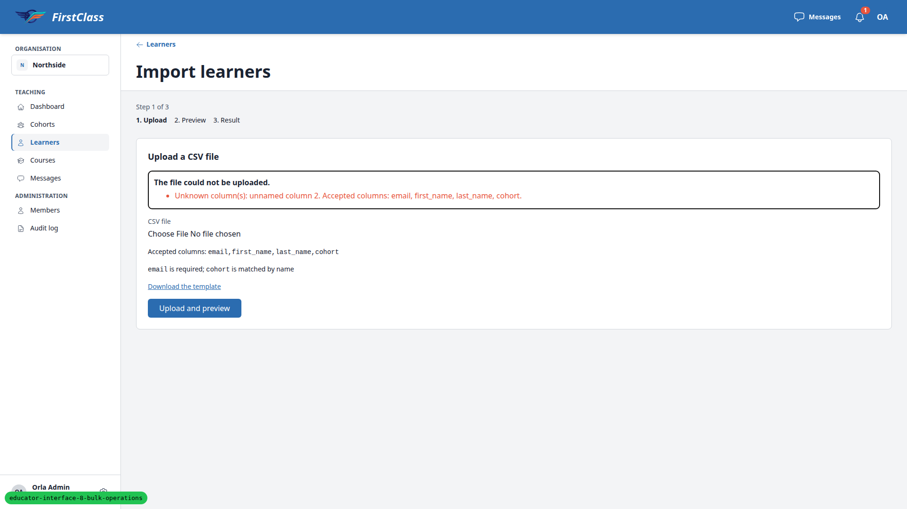 |
| 2.nofile | pass | `required` attribute blocks submit; with `noValidate` a 422 "This field is required."; LearnerImport count 0 after all rejections | |
| 3.1 | pass | Preview step 2; chip "good.csv · 30 rows" and "Upload a different file"; counts 26/1/1/2 as links; columns as listed, lines from 2; reasons match; three notes present; error CSV `learner-import-errors-2026-11-01.csv` with reason header and 2 rows; "Add 28 learners" and "2 rows with errors will not be added." |  |
| 3.2 | pass | `?label=error` shows 2 rows, persists on reload, Back returns the full 30-row table | |
| 3.3 | pass | dup: new account, "Same email as line 2.", "Email is empty."; button reads "Add 1 learner" (singular) | |
| 3.4 | pass | Both rows error with the "No active cohort called ..." sentence; no confirm button; "Nothing can be added: every row has an error or is already a member." | |
| 3.5 | pass | `semi.csv`: 2 new accounts | |
| 3.6 | pass | `trail.csv`: 1 new account in Cohort C | |
| 4.1 | pass | Result step 3; "Added 28 learners. 2 rows were not added."; counts 26/1/1/2; "26 setup emails were sent."; Mailpit 26, none to ada or removed; error rows and CSV link; Back to learners, Import another file, "Uploading the whole file again is safe" note | 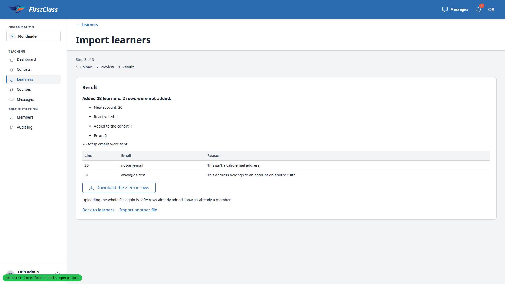 |
| 4.2 | pass | Back to the preview URL redirects to the result | |
| 4.3 | pass | import01 Pending in Cohort C; Cohort C has 27 members; Rae Removed Active; Ada's name still Ada Lovelace | |
| 4.4 | pass | Re-upload: "Already a member: 28", 2 errors, no Add button, "Nothing can be added..."; Mailpit 0 | |
| 4.5 | pass | `dup.csv` confirmed: "Added 1 learner. 2 rows were not added."; error CSV holds exactly the two rows | |
| 5.1-5.2 | pass | Upload page names Cohort A and says the cohort column is ignored; cohortimp is a new account in Cohort A, Ben added; result links to Cohort A Learners tab showing both | |
| 6.1 | pass | Checkbox column and "Select all on this page"; `role=status` region exists before ticking; bar buttons hidden; pagination visible | |
| 6.2 | pass | "2 selected · showing 1–10 of 95 learners"; Add to cohort, Remove from cohort, More actions with Deactivate, Reactivate, Register for a course, Unregister from a course, Resend setup email | 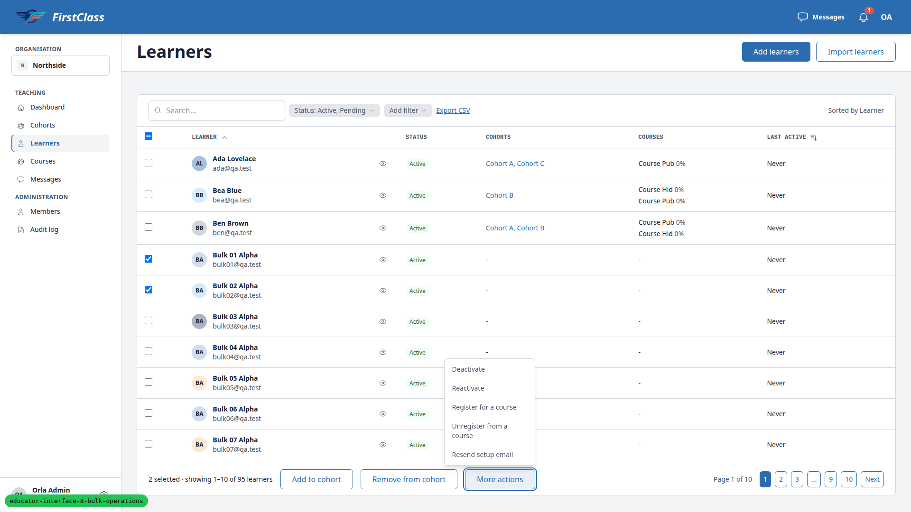 |
| 6.3 | pass | Picker above sentence; Confirm disabled until chosen; focus on Cancel; "Add 2 learners to Cohort C."; result "2 learners changed."; rows refreshed to Cohort C | 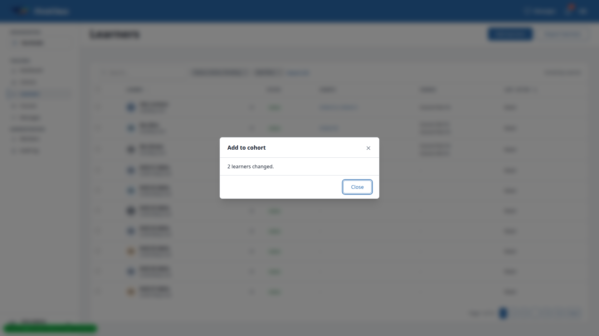 |
| 6.4 | pass | "Add 1 learner to Cohort C. 2 are already in the cohort and will be skipped." then "1 learner changed. 2 were already in the cohort." with per-row reasons; bulk01 alone: "Add 0 learners... 1 is already in the cohort and will be skipped." and Confirm disabled | |
| 6.5 | pass | "Remove 1 learner from Cohort A. 1 is not a member and will be skipped. They lose access to: Course Pub." Cancelled | |
| 6.6 | pass | "All 10 on this page are selected." and "Select all 30 matching"; then "All 30 matching are selected.", Clear selection, "Changing page, sort or filters clears the selection."; untick bulk05 gives 29; "Add 29 learners to Cohort B." then "29 learners changed."; Cohort B filter 31, bulk05 absent | |
| 6.7 | pass | Sort and page change each clear the selection; bar buttons hidden | |
| 6.8 | pass | Select all 31 matching; "Remove 31 learners from Cohort B." (and "They lose access to: Course Hid and Course Pub."), then "31 learners changed."; Cohort B empty | |
| 6.9 | pass | Deactivate confirm button `btn-error`; "Deactivate 2 learners." "They lose access to this organisation's courses."; "2 learners changed.", both leave the table; Inactive filter shows both; Reactivate both; mixed: "Reactivate 1 learner. 1 is already active and will be skipped." Cancelled, bulk10 stays inactive | 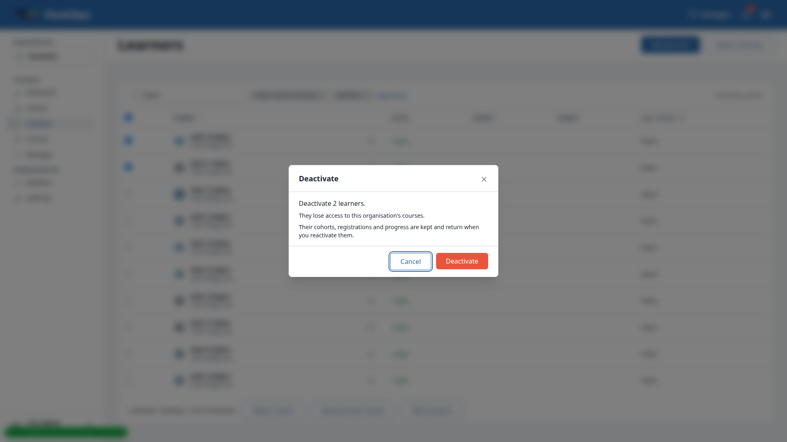 |
| 6.10 | pass | "Register 2 learners for Course Pub." gives 2 changed; solo: "Register 0 learners for Course Pub. 1 is already registered individually and will be skipped." Confirm disabled; Unregister 2 and Unregister 1 (`btn-error`) confirmed; Courses cells no longer list Course Pub | |
| 6.11 | pass | After server restart: "Resend the setup email to 2 learners. 1 account is already set up and will be skipped."; Mailpit 2 (pending, cohortimp); repeat: "0 learners changed." "2 setup emails were sent recently."; Mailpit still 2 | |
| 6.12 | pass | Keys mode: bulk40 deactivated in tab 2 gives "1 learner changed. 1 was already inactive." with "Bulk 40 Beta: already inactive". Select-all mode: count change gives 422 "The selection changed since you opened this." and the new count "Deactivate 28 learners."; then reactivated so all 30 Beta active | 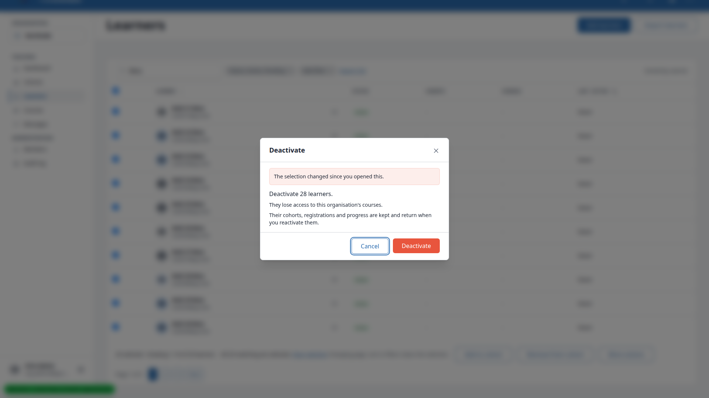 |
| 6.13 | pass | JS off: Deactivate gives full-page confirmation "Deactivate 2 learners." then full-page "2 learners changed." with "Back to learners" keeping `?learners-q=bulk3`; reactivated. Add to cohort: picker, "Show what changes", disabled Add to cohort; after Cohort C and Show what changes: "Add 2 learners to Cohort C." and enabled; confirm gives "2 learners changed." | |
| 6.14.1 | pass | "This will affect 30 learners." and "It runs in the background. You'll get a notification when it finishes." | |
| 6.14.2 | pass | Modal closes, URL unchanged; "Deactivate is running…"; More actions spinner; bar buttons disabled via disabled fieldset; row and header checkboxes and Clear selection disabled; survives page 2 and sort; quick view opens | 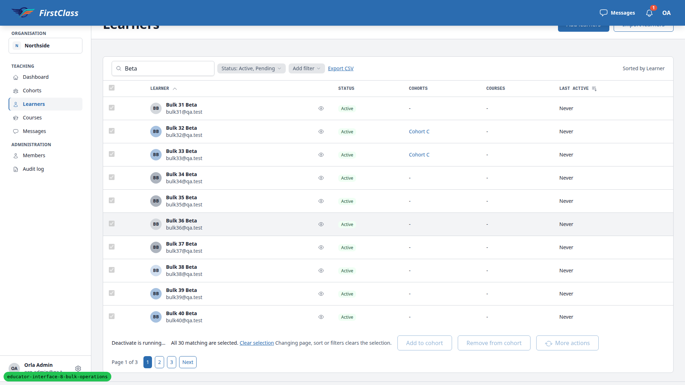 |
| 6.14.3 | pass | After db_worker: modal opened promptly with "30 learners changed.", table refreshed empty; spinner gone, controls enabled, no row selected; bell unread unchanged (1); newest entry "Deactivate finished: 30 learners changed." read; opens the learners list | 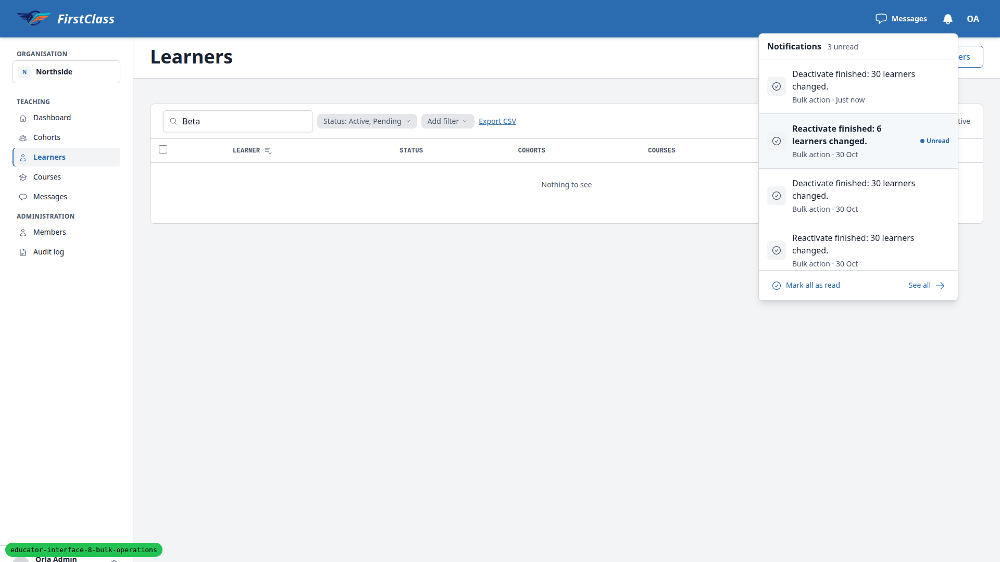 |
| 6.14.4 | pass | Open Add learners modal was not replaced when the run finished; after Cancel the result modal opened within about 1s with "30 learners changed." | |
| 6.14.5 | pass | On Dashboard: no modal; bell went from none to 1 new after about 31s; entry "Deactivate finished: 30 learners changed." opens learners list; 30 listed under Inactive | |
| 6.14.6 | pass | JS off: 6 rows Reactivate gives "This will affect 6 learners... runs in the background"; back on list with flash "Reactivate is running in the background. You'll get a notification when it finishes."; after worker the 6 are Active and the bell has 1 unread | 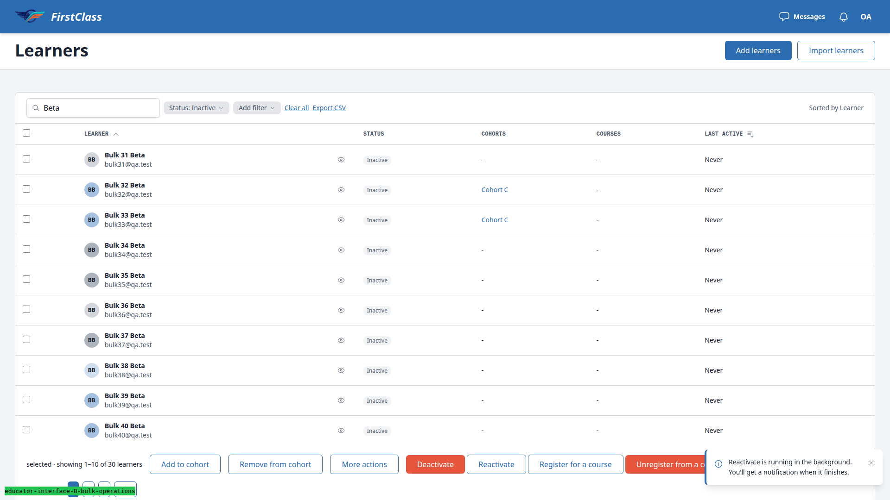 |
| 6.14.7 | pass | Status URL of a finished run `.../northside/learners/__runs/08592a5d-2c04-4f5c-8c42-ed7ef9438053` returns 200 for the requester | |
| 7.1 | pass | `?cohorts-inactive=1` shows Cohort Old; bar has Register for a course and Unregister from a course buttons; More actions holds Deactivate, Reactivate | 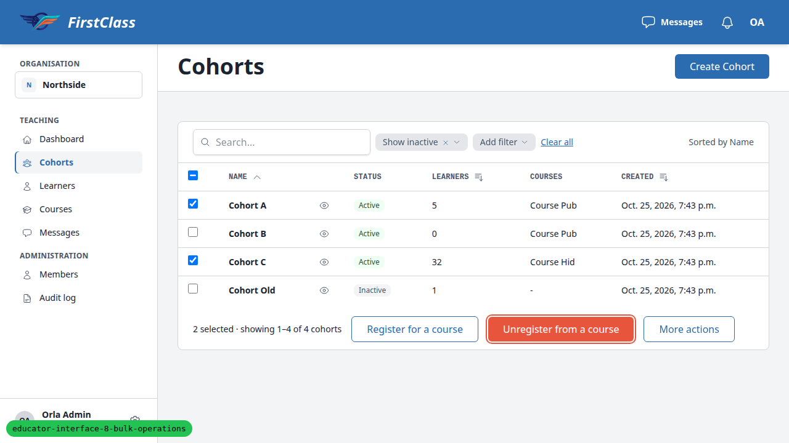 |
| 7.2 | pass | "Register 2 cohorts for Course Hid. 1 is an inactive cohort and will be skipped." then "2 cohorts changed. 1 was an inactive cohort."; A and C list Course Hid | |
| 7.3 | pass | "Register 0 cohorts for Course Hid. 2 are already registered and will be skipped. 1 is an inactive cohort and will be skipped." Confirm disabled | |
| 7.4 | pass | A+B: "Unregister 2 cohorts from Course Hid." `btn-error`, 2 changed; A+C: "Unregister 1 cohort from Course Hid. 1 is not registered and will be skipped." Cancelled | |
| 7.5 | pass | Bulk Deactivate Cohort C shows Inactive in list; Reactivate shows Active | |
| 7.6 | pass | Cohort C page: single Deactivate gives Inactive; Reactivate gives Active | |
| 8.1 | pass | cohort.admin: checkbox column; More actions holds Register/Unregister only; no Import link on list or Cohort A tab; only Cohort A/B learners (5, no bulk); picker offers A and B; "Add 2 learners to Cohort B." gives 2 changed; import URL 403 "Ask an organisation admin of Northside."; cohorts list Register/Unregister only, no More actions | 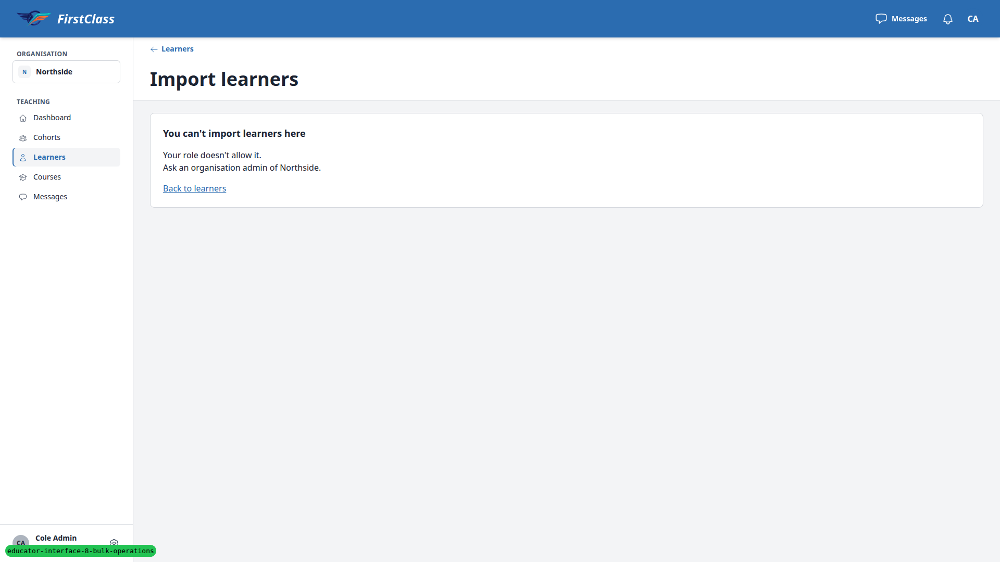 |
| 8.2 | pass | cohort.viewer: no checkbox column, no selection bar; import URL 403 | |
| 8.3 | pass | south.admin: preview, result, errors.csv and run status URLs all 404 under northside and southside | |
| 8.4 | pass | Superuser: §4 result URL 404; import page 200 | |
| 8.5 | pass | Anonymous: import page redirects to login with `next` | |
| 9.1 | pass | `semi.csv` confirmed in two tabs simultaneously: both land on the same result "Added 2 learners."; semi1/semi2 listed once each; Mailpit one setup email each | |
| 9.2 | pass | JS off: confirm gives 2 changed; Back and resubmit gives 422 "Add 0 learners to Cohort C. 2 are already in the cohort and will be skipped." |  |

### Mobile (375x812)

| Test | Status | Notes | Screenshot |
|---|---|---|---|
| 6.14.2 (viewports) | pass | Fixed bar fits "Deactivate is running…" and disabled More actions with spinner; scrollWidth equals viewport. Stacked bar takes about 280px (a third of the screen). Also checked at 768x1024 | 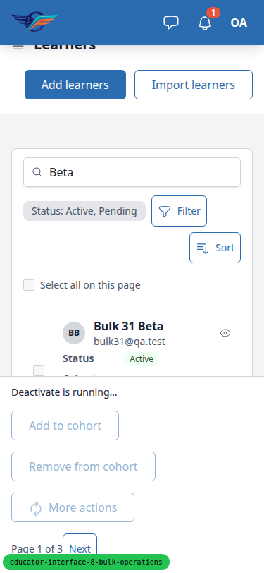 |
| 10.1 | pass | Upload, error, preview and result pages: scrollWidth 375; table hidden, preview rows as cards showing email, line, label, reason; stepper on one line; error summary inside viewport | 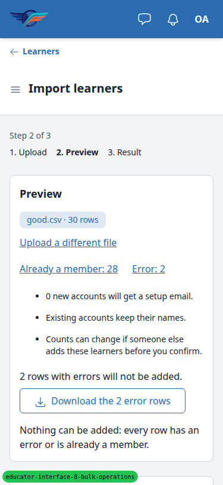 |
| 10.2 | pass | Two ticked: bar fixed to bottom (593-812); Select all on this page above the card list; More actions opens above trigger, all 5 items in view (36px tall, 56px for the wrapped item, below the 44px touch guideline); confirmation modal fits viewport | 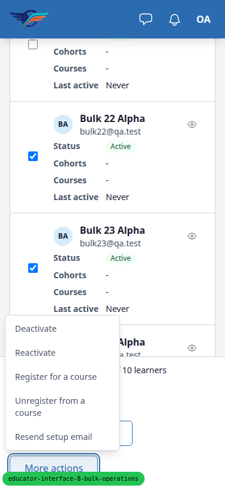 |
| 10.3 | pass | Inline Deactivate 2 gives result modal "2 learners changed." that fits viewport; reactivated after | 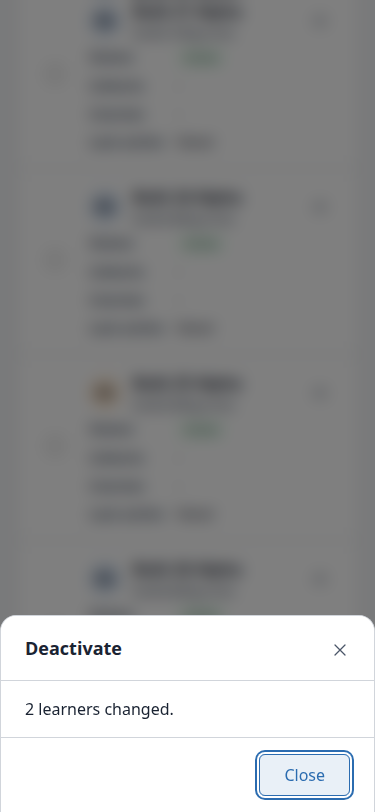 |

### Tablet (768x1024)

| Test | Status | Notes | Screenshot |
|---|---|---|---|
| 6.14.2 (viewports) | pass | Fixed bar fits "Deactivate is running…" and disabled More actions with spinner; no horizontal overflow (recorded with the mobile row) | 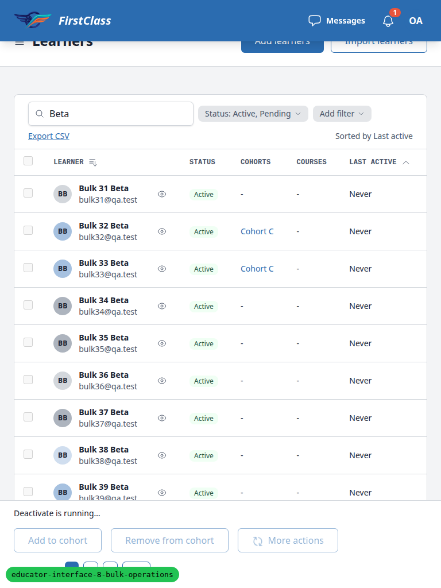 |
| 10.1 | pass | Upload, error, preview, result: scrollWidth 768; at md the preview shows the table and it fits | 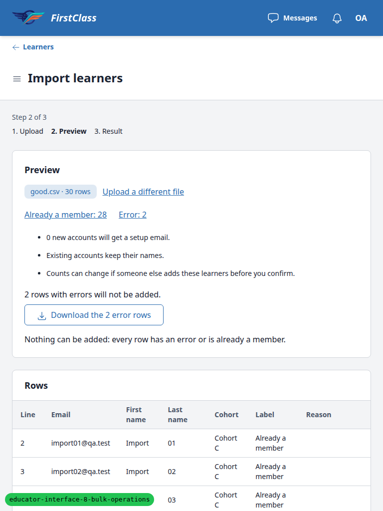 |
| 10.2 | pass | Bar fixed to bottom (921-1024) with table padded so no row is covered; More actions items all in view; confirmation modal centred and fits | 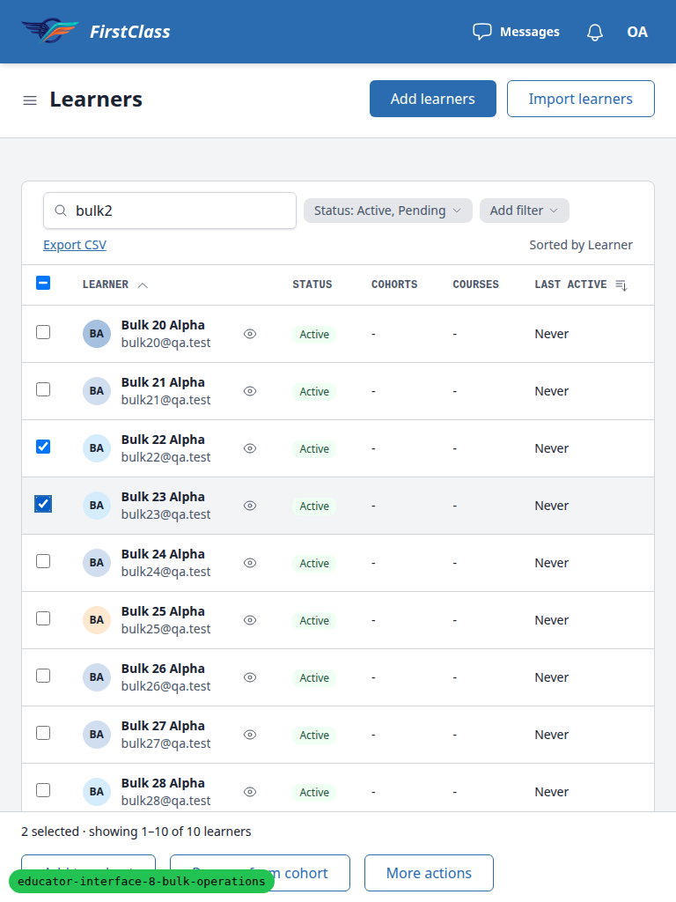 |
| 10.3 | pass | Inline Deactivate 2 gives result modal that fits; reactivated after |  |

## Design check

No design states tested.

## Bugs

No bugs were found.

## Bug status

No bugs.

## General notes

Observations only; no action attached.

- The plan's §6.12 select-all step counted 29 Beta learners, not 30, because the plan's own earlier keys-mode step leaves bulk41 inactive; the 422 and new count behaved as specified.
- §6.11's repeat run: the confirmation still read "Resend the setup email to 2 learners." although both had just been emailed; the cooldown is reported only in the result ("0 learners changed. 2 setup emails were sent recently.").
- §3.4 (all-error import) also shows "0 new accounts will get a setup email."; harmless but redundant beside "Nothing can be added".
- With JavaScript off, the bulk confirmation and result pages render in the plain site shell, without the educator sidebar.
- At 375px the fixed selection bar stacks its buttons and takes about 220–280px (a quarter to a third of the viewport). The "More actions" menu items are 36px tall, under the 44px touch-target guideline, but usable.
- The 'More actions' menu order (Deactivate, Reactivate, Register, Unregister, Resend) differs from the plan's listing; the plan does not assert order.
- The "Remove from cohort" confirm button uses the secondary style, while Deactivate and Unregister use the destructive style; the plan asserts neither for remove.
- §6.14.7: the run status URL came from the database rather than the network panel.
- A dev-server restart cleared the session (sessions live in the in-process cache), so the tester logged in again; this is expected in dev.
- The Django debug toolbar opens by default and blocks clicks; the tester hid it with CSS.
- The dev-only branch badge overlaps the first selection-bar button at narrow widths.

status: ok · reason: report rendered, 0 bugs documented
