# Frontend QA report: educator-interface-8-bulk-operations

## Methodology

All tests were run by hand with the Playwright MCP at three viewports: 1920x1080 (desktop), 375x812 (mobile) and 768x1024 (tablet). Screenshots were collected into `screenshots/` beside this report, and every image referenced here exists in that directory.

- The branch was rebased onto main first. The full test tier passed afterwards (9549 passed).
- Dev data came from the `qa_create_bulk_operations_scenario` management command. The data helper fixed the command's reset twice during this run. First, CourseProgress rows were blocking deletes of stale users. Second, solo's Course Pub registration had been left inactive by an earlier run.
- Section 6.14 (background runs) ran on the scratch settings file `config/settings_qa_background.py`, which was deleted afterwards.
- Mailpit is shared, so it was cleared per recipient (`to:qa.test`) rather than wholesale.

## Diff scoping

Class: FULL. 226 files changed, including `freedom_ls/base/static/base/js/alpine-components.js`, `freedom_ls/panel_framework/static/panel_framework/js/alpine-components.js`, `freedom_ls/panel_framework/templates/cotton/data-table-card.html`, and the educator_interface templates (`_shell.html`, `interface.html`, the `learner_import_*` pages, `modal/bulk_run_stopped.html`, and the `import_learners_link`, `import_stepper`, `learner_import_result_body` and `run_status` partials). Nothing was skipped.

## Smoke gate

Pass. Pages checked:

- http://127.0.0.1:8969/
- http://127.0.0.1:8969/educator/organisations/northside/learners
- http://127.0.0.1:8969/educator/organisations/northside/learners/import/

## Design check

no design states tested

## Results

| Test | Viewport | Result | Note | Screenshot |
|---|---|---|---|---|
| 1.1 | desktop | pass | Import learners link beside Add learners; stepper, file input, template link present. No breadcrumbs on educator pages. |  |
| 1.2 | desktop | pass | Template downloads with UTF-8 BOM, four headers, two example rows. | |
| 1.3 | desktop | pass | 50-line cap stated only when a 51-line paste is refused (422), with an 'Import a file instead' link. | 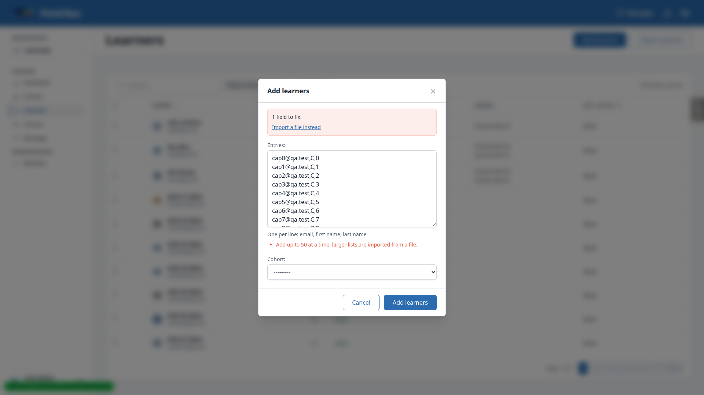 |
| 1.4 | desktop | pass | Cohort C Learners tab links Import learners with the cohort; Cohort Old has none. | |
| 2 | desktop | pass | Bad uploads (xlsx, latin1, bad header, empty, big) each refused with 422 and a focused alert; nothing stored; no-file submit gives 422, no traceback. | 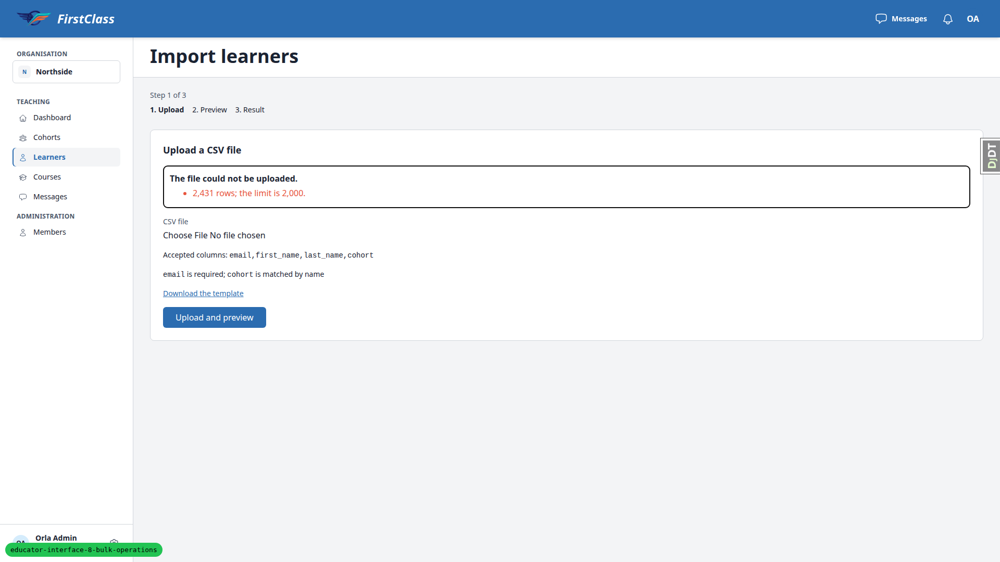 |
| 3.1 | desktop | pass | Preview counts, columns, reasons, notes and errors CSV all as specified; 'Add 28 learners'. | 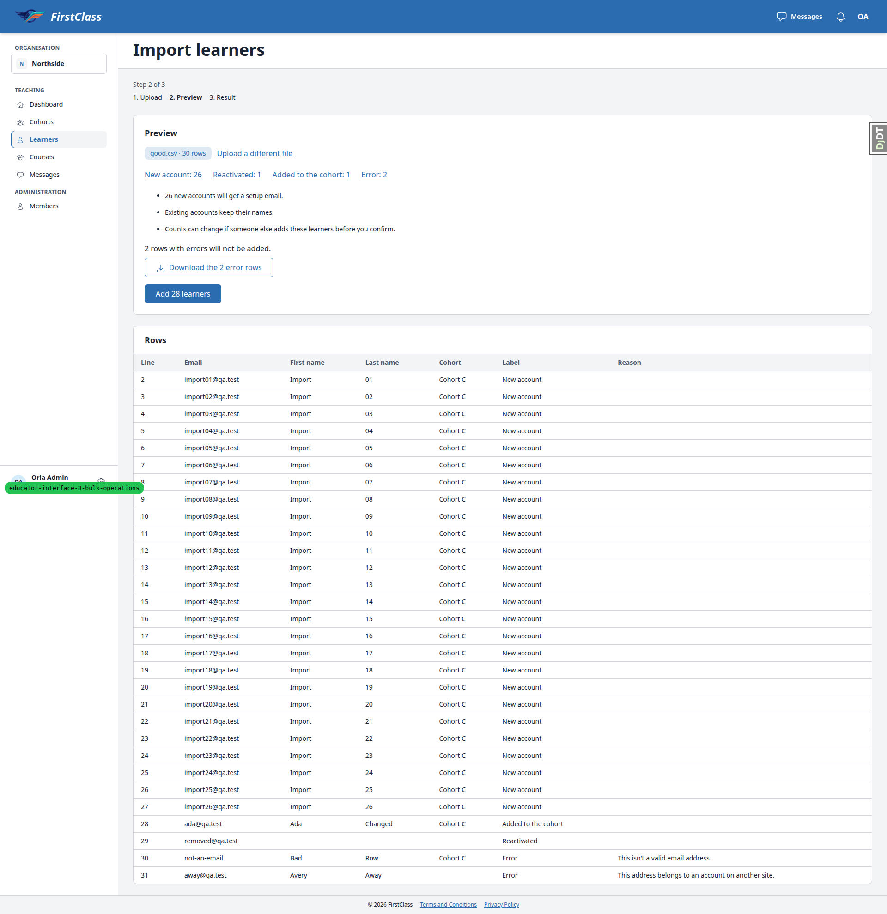 |
| 3.2 | desktop | pass | Error filter shows 2 rows; reload keeps it; Back restores 30. | |
| 3.3 | desktop | pass | Duplicate and blank email rows flagged; button reads 'Add 1 learner'. | |
| 3.4 | desktop | pass | Missing cohorts error as specified; no confirm button. Minor: notes still say '0 new accounts will get a setup email.' | |
| 3.5 | desktop | pass | Semicolon delimiter read; 'Add 2 learners'. | |
| 4.1 | desktop | pass | Result page correct; 26 setup emails in Mailpit. |  |
| 4.2 | desktop | pass | Revisiting the preview URL redirects to the result. | |
| 4.3 | desktop | pass | Pending/Active states and cohort memberships correct; Cohort C has 27 members. | |
| 4.4 | desktop | pass | Re-upload shows all already members, no Add button, no mail. | |
| 4.5 | desktop | pass | dup.csv confirmed: 1 added, 1 email, error CSV has the two rows. | |
| 5 | desktop | pass | Cohort-scoped import adds to Cohort A and ignores the cohort column. |  |
| 6.1 | desktop | pass | Checkbox column and select-all present; bulk buttons hidden with nothing selected. Page size 10, not 25. | |
| 6.2 | desktop | pass | Status region reads '2 selected · showing 1–10 of 95 learners'; Add/Remove buttons and More actions menu appear. | |
| 6.3 | desktop | fail | Flow works but the sentence reads '2 learners will be added to Cohort C.' where the spec says 'Add 2 learners to Cohort C.' (B1). | 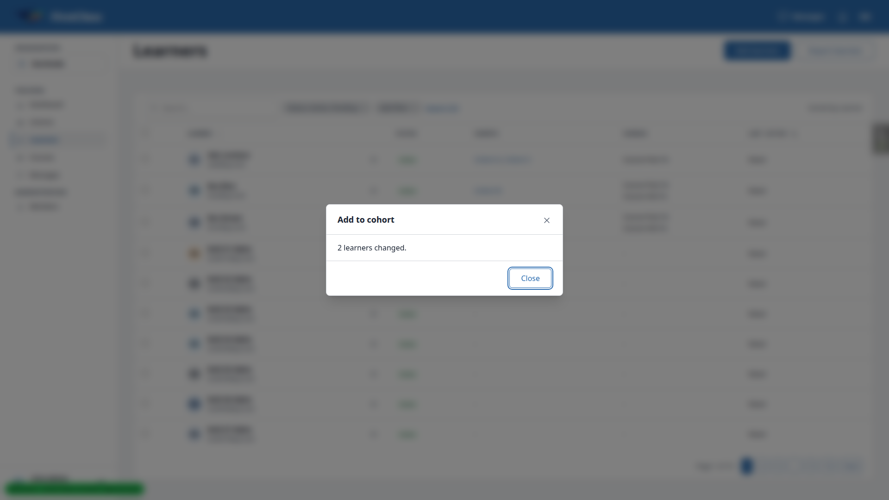 |
| 6.4 | desktop | fail | Skip logic correct; same passive wording mismatch (B1). | |
| 6.5 | desktop | fail | Counts and consequence line right; same passive wording mismatch (B1). | |
| 6.6 | desktop | pass | Select all matching works; 29 learners changed. Confirm takes >2s at 29 rows and Close is ignored while 'Saving...'. | |
| 6.7 | desktop | pass | Sorting after select-all-matching clears the selection. | |
| 6.8 | desktop | pass | 31 learners removed from Cohort B with consequence line. | |
| 6.9 | desktop | pass | Deactivate and Reactivate correct, including the mixed case. Plan expected 'Reactivate 1 learner.' (B1 wording family). | |
| 6.10 | desktop | fail | Register/Unregister work, but skipped unregisters read '2 are no individual registration and will be skipped.' (B2). Ran in parts. | |
| 6.11 | desktop | pass | Resend setup email: sent, skipped as recently sent, or already set up, as specified. Ran per learner. | |
| 6.12 | desktop | fail | Keys-mode stale selection returns 200 and skips the learner, not 422 (B4). All-matching mode does 422. | 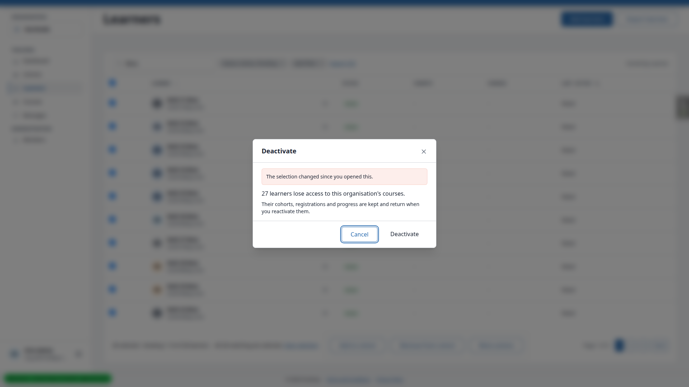 |
| 6.13 | desktop | pass | JS-off Deactivate: full-page confirmation and result; Back to learners keeps the filter. |  |
| 6.14.1 | desktop | pass | Over-threshold confirm says it runs in the background. | |
| 6.14.2 | desktop | pass | Running bar, disabled controls, survives paging and sorting. Bar is lost after leaving via a learner link and pressing Back. | 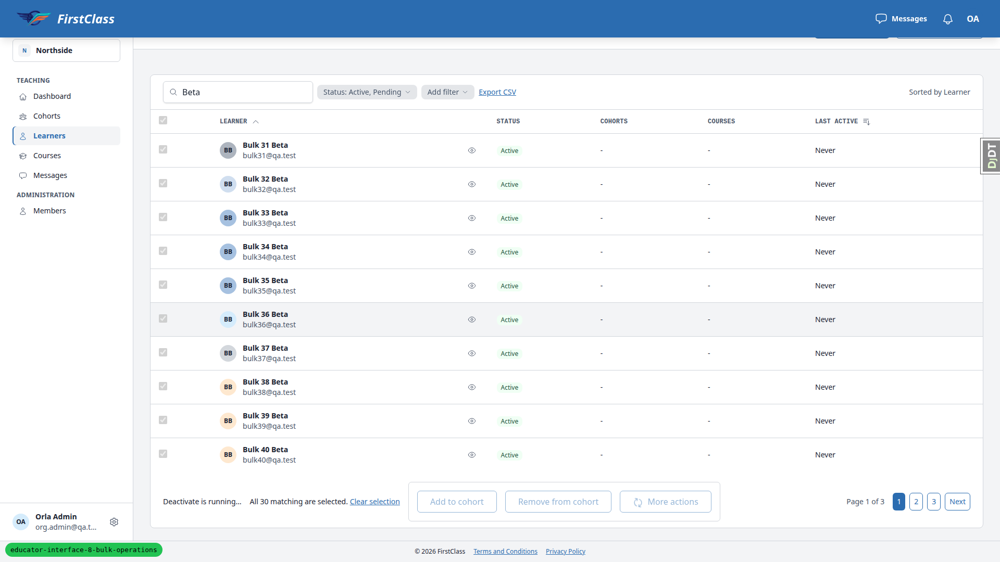 |
| 6.14.2 | mobile | fail | Bar fits, but the bulk buttons sit in a bordered, padded fieldset box (B3). | 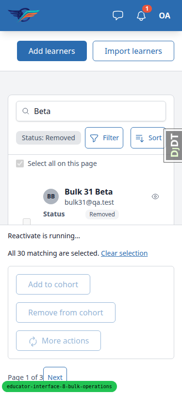 |
| 6.14.3 | desktop | pass | Result modal appears, table refreshes, bell entry already read. | 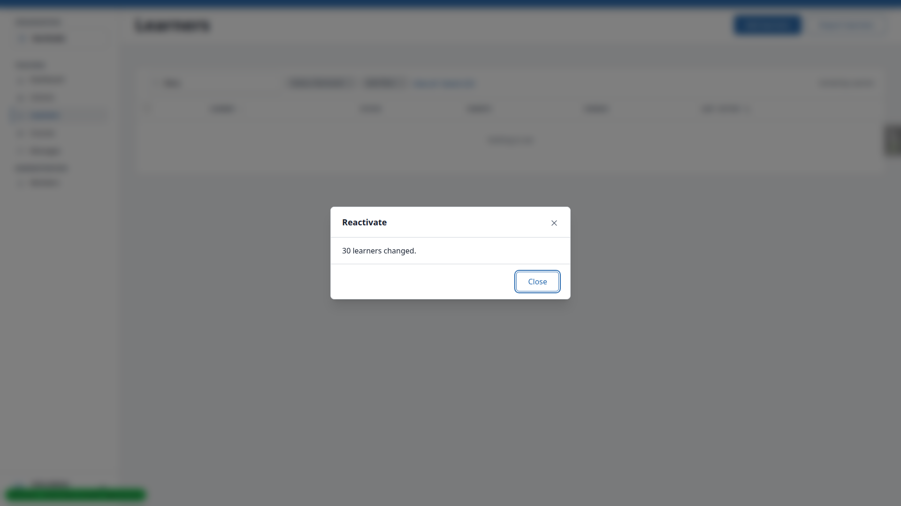 |
| 6.14.4 | desktop | pass | Add learners modal not replaced; result modal opens after Cancel. | |
| 6.14.5 | desktop | pass | No modal on Dashboard; bell shows 1 new after ~30s. | |
| 6.14.6 | desktop | pass | JS-off background run works end to end. Cosmetic no-JS bar warts, see General notes. | 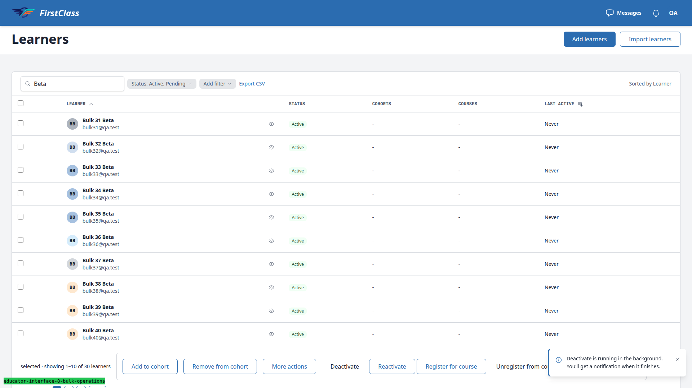 |
| 6.14.7 | desktop | pass | Run status URL answers 200 to the requester. | |
| 7.1 | desktop | pass | Cohort Old needs the inactive filter; bulk buttons and More actions present. | |
| 7.2 | desktop | pass | Register cohorts works; passive wording (B1) and '1 an inactive cohort' result line (B2). | |
| 7.3 | desktop | pass | Repeat registration shows 0 changes and a disabled Confirm. | |
| 7.4 | desktop | pass | Unregister A + B changes 2; Cohort B is seeded with Course Hid, so plan expectation was stale. | |
| 7.5 | desktop | pass | Cohort Deactivate and Reactivate correct. | |
| 7.6 | desktop | pass | Single-cohort Deactivate/Reactivate from the cohort page works. | 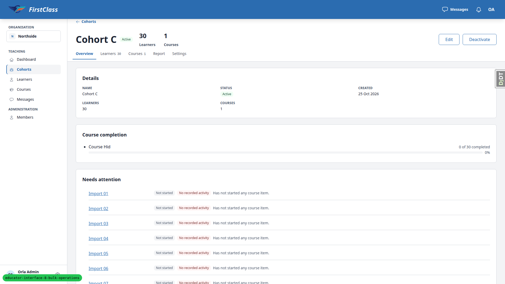 |
| 8.1 | desktop | pass | cohort.admin sees checkboxes, limited More actions, no import link; import URL 403. Ben had left Cohort B earlier, so plan expectation was stale. | 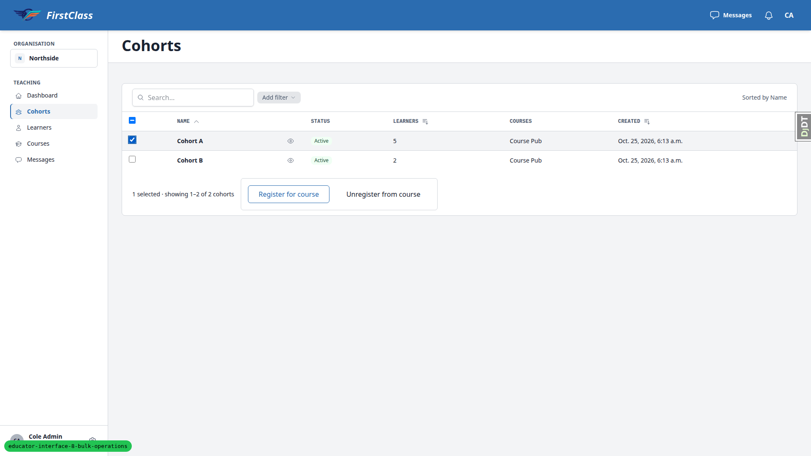 |
| 8.2 | desktop | pass | cohort.viewer has no checkboxes or bar; import URL 403. | |
| 8.3 | desktop | pass | Other organisation's admin gets 404 on preview, result, errors CSV and run status. | |
| 8.4 | desktop | pass | Superuser: another site's result 404; import page 200. | |
| 8.5 | desktop | pass | Anonymous import URL redirects to login. | |
| 9.1 | desktop | pass | Two-tab confirm creates one User and Learner per address, no second email. semi.csv had never been confirmed earlier. | |
| 9.2 | desktop | pass | Replayed confirm POST changes 0 learners. | |
| 6.13-picker | desktop | fail | JS-off picker actions cannot be confirmed (B5). |  |
| 10.1 | mobile | pass | No overflow on upload, error, preview, result; preview becomes cards below md. | 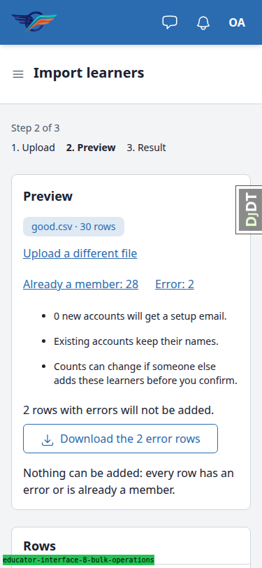 |
| 10.2 | mobile | fail | Fieldset box makes the fixed bar cover the bottom 313px of 812px (B3). | 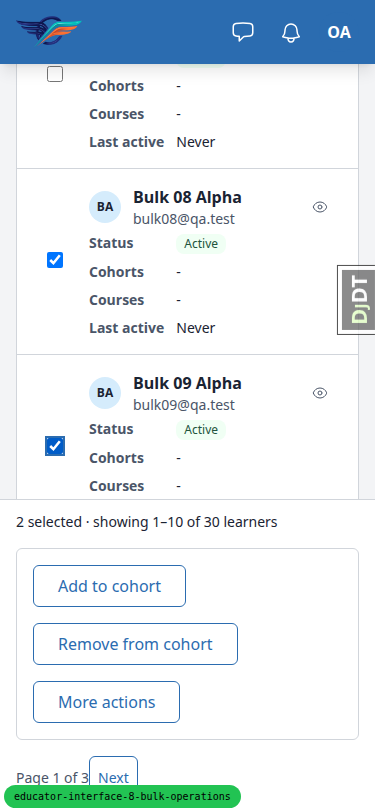 |
| 10.3 | mobile | pass | Inline Deactivate result modal fits. | 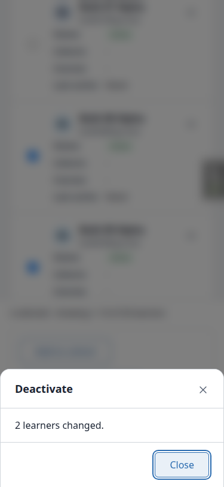 |
| 10.1 | tablet | pass | No overflow; table (not cards) shown at md as specified. |  |
| 10.2 | tablet | pass | Static selection bar by design (md:static); modals fit. Same fieldset box as B3. | 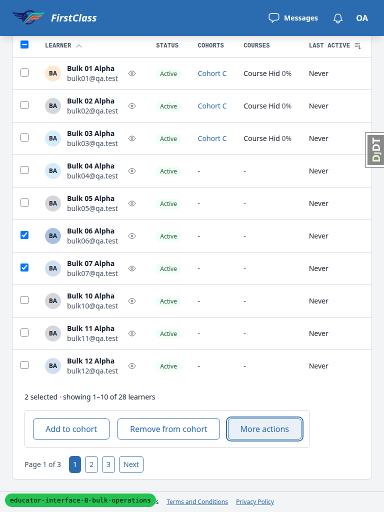 |
| 10.3 | tablet | pass | Inline Deactivate result modal fits. | 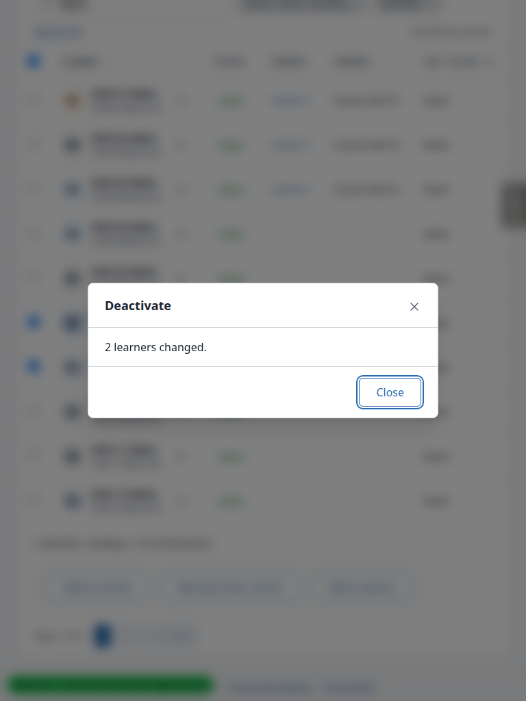 |

Other screenshots taken: mobile [upload](screenshots/page-2026-10-25T11-30-mobile-upload.png), [error](screenshots/page-2026-10-25T11-30-mobile-error.png), [result](screenshots/page-2026-10-25T11-30-mobile-result.png), [menu](screenshots/page-2026-10-25T11-32-mobile-menu.png), [confirm](screenshots/page-2026-10-25T11-32-mobile-confirm.png); tablet [upload](screenshots/page-2026-10-25T11-30-tablet-upload.png), [error](screenshots/page-2026-10-25T11-30-tablet-error.png), [result](screenshots/page-2026-10-25T11-30-tablet-result.png), [selected](screenshots/page-2026-10-25T11-32-tablet-selected.png), [menu](screenshots/page-2026-10-25T11-32-tablet-menu.png), [confirm](screenshots/page-2026-10-25T11-32-tablet-confirm.png); and the [notification bell](screenshots/page-2026-10-25T11-17-00-000Z-bell.png).

## Bugs

### B1: Bulk confirmations use passive wording instead of the spec's 'Add N learners to X.'

Manifestations: 6.3 (desktop), 6.4 (desktop), 6.5 (desktop).

Expected: Spec R1.3 example and the QA plan: 'Add 2 learners to Cohort C.', 'Remove 1 learner from Cohort A.', 'Register 2 learners for Course Pub.', 'Resend the setup email to 2 learners.', 'Reactivate 1 learner.'

Actual: Every bulk sentence in `educator_interface/actions.py` is passive: '2 learners will be added to Cohort C.', '1 learner will be removed from Cohort A.', '2 learners will be registered for Course Pub.', '1 learner will be sent a setup email.' Deactivate and reactivate reuse the single action's consequence sentence. Spec R1.3 also says 'using the single action's wording', which the code may be following.

### B2: Skip reasons that don't read after 'is/are' give ungrammatical lines

Manifestations: 6.10 (desktop), 7.2 (desktop). No screenshot.

Expected: ConfirmationWording's contract is that each skip reason is a predicate that follows 'is'/'are' and also reads alone in the result line, for example '2 are not registered individually and will be skipped.' and '2 not registered individually'.

Actual: UnregisterLearnerFromCourse's unchanged_reason 'no individual registration' renders '2 are no individual registration and will be skipped.' The cohort reason 'an inactive cohort' renders the result line '1 an inactive cohort'.

### B3: Selection bar's fieldset picks up the global fieldset border and padding

Manifestations: 6.14.2 (mobile), 10.2 (mobile). The same box also shows on desktop and tablet.

Expected: The fieldset in `panel_framework/partials/table_selection_bar.html` only exists to disable the bulk buttons during a background run. The buttons should sit in the bar unboxed, as before that change.

Actual: `tailwind.components.css` styles every fieldset with `border border-border rounded-md p-4`, so the bulk buttons sit in a bordered, padded box on every viewport. On mobile the fixed bottom bar grows to about 313px of an 812px viewport.

### B4: Stale keys-mode selection is not refused with 'The selection changed'

Manifestations: 6.12 (desktop).

Expected: QA plan 6.12: ticking bulk40 and bulk41, deactivating bulk40 elsewhere, then confirming re-renders at 422 with 'The selection changed since you opened this.'

Actual: Confirm answers 200 and skips bulk40 as 'already inactive' (1 changed). Spec R1.4 only returns 422 when the resolved count differs, and a keys selection resolves without the table filter, so the count is unchanged. The 422 does fire in all-matching mode. The plan and spec disagree on the keys-mode case.

### B5: Picker bulk actions cannot be confirmed with JavaScript off

Manifestations: 6.13-picker (desktop).

Expected: Spec R1.4: with JS off, the first POST renders a confirm page the user can confirm.

Actual: For Add to cohort (and the other picker actions) the JS-off confirm page renders the picker select outside the confirm form, with the confirm button disabled. Only the htmx `refresh=1` re-render enables it, so the action cannot be completed without JS.

## Bug status

- **UNRESOLVED** — B1 Passive confirmation wording (reason: the spec's example "Add 12 learners to …" and its own "using the single action's wording" pull different ways, and the plan follows the example; choosing the wording is a product decision)
- **FIXED** (commit: 75338f9d4) — B2 Ungrammatical skip reasons. Re-verified: "2 are not registered individually and will be skipped." and the cohort result line "1 inactive" ([after fix](screenshots/page-2026-10-25T11-45-00-000Z-b2-fixed.png))
- **FIXED** (commit: a9f2b4394) — B3 Selection bar fieldset border and padding. Re-verified: the fieldset computes to 0 border and 0 padding at 375 and 1920; the cohorts list bar checked too ([mobile after fix](screenshots/page-2026-10-25T11-55-00-000Z-b3-fixed-mobile.png))
- **UNRESOLVED** — B4 Stale keys-mode selection not refused (reason: the QA plan expects a 422 that spec R1.4 never promises for a keys selection whose count is unchanged; someone has to decide which document is right)
- **UNRESOLVED** — B5 Picker actions cannot be confirmed without JS (reason: the spec describes the picker refresh only over htmx; whether picker actions must work with JS off is a product decision)

## General notes

- Table page size is 10, not the 25 the plan assumed, so counts were adapted.
- Several plan steps needed rows that no single search could put on one 10-row page, so they ran in parts (6.10, 6.11).
- Data drift made some plan expectations stale. In 7.4 Cohort B is seeded with Course Hid. In 8.1 Ben had left Cohort B. In 9.1 semi.csv had never been confirmed earlier. Behaviour was correct in each case.
- The running bar is lost after leaving the table via a learner link and pressing Back. The store stops when the table leaves the page, and the plan does not cover this.
- A 29-row inline confirm takes more than 2s, and Close is ignored while it shows 'Saving...'.
- The nocohort and all-member previews still say '0 new accounts will get a setup email.'
- The Remove from cohort confirm button is not destructive-styled, while Unregister is.
- No-JS bar cosmetics: the count is missing before ' selected', the More actions trigger is inert beside the noscript buttons, destructive buttons render as plain text, and the notifications bell shows 'Couldn't load your notifications.'
- Mobile menu items are 36px tall, below the 44px touch-target guideline.
- The Django debug toolbar opens expanded by default and had to be hidden.
- At 768 the selection bar is static beside the pagination (md:static by design), so it is not 'fixed to the bottom' as the plan words it for that width.
- Educator pages carry no breadcrumbs anywhere, so none were expected on the import page.

status: ok
reason: 5 bugs — 2 fixed, 3 unresolved; report rendered, screenshots verified
