# Frontend QA report: bulk operations

59 test records were run across three viewports. Desktop (1920x1080): 50 pass, 1 fail. Mobile (375x812): 4 pass, 0 fail. Tablet (768x1024): 4 pass, 0 fail. The single failure (6.13, JavaScript-off bulk action) is documented as one bug, B1. It is a mismatch between the implementation and the spec and QA plan wording, not a broken flow. Minor observations are in the General notes.

## Methodology

- Playwright MCP, driven by hand at 1920x1080, 375x812 and 768x1024.
- Dev server on port 8528, on branch `educator-interface-8-bulk-operations`.
- Data from `qa_create_bulk_operations_scenario --site-name DemoDev`.
- Screenshots were collected into `screenshots/` beside this report. Every image referenced here exists there.
- The server was restarted before §6.11. For §6.14 it ran on `config.settings_qa_background` (since deleted), with `db_worker --batch` run by hand.
- The branch was rebased onto main first. Main only added spec docs, so no tests needed re-running.

## Diff scoping

Class: FULL (templates and static files changed). Nothing was skipped.

Changed files include:

- `freedom_ls/base/static/base/js/alpine-components.js`
- `freedom_ls/educator_interface/templates/educator_interface/_shell.html`
- `freedom_ls/educator_interface/templates/educator_interface/learner_import_preview.html`
- `freedom_ls/educator_interface/templates/educator_interface/partials/run_status.html`
- `freedom_ls/panel_framework/static/panel_framework/js/alpine-components.js`
- `freedom_ls/panel_framework/templates/cotton/data-table.html`
- `freedom_ls/panel_framework/templates/panel_framework/partials/bulk_confirmation.html`
- `freedom_ls/panel_framework/templates/panel_framework/partials/table_selection_bar.html`
- `freedom_ls/panel_framework/templates/panel_framework/views/_bulk_confirmation_base.html`

## Smoke gate

Pass. Pages checked: `/` and `/educator/organisations/northside/learners`.

## Design check

no design states tested

## Results

### §1 Entry points and template

| Test | Viewport | Status | Note | Screenshot |
|---|---|---|---|---|
| 1.1 | desktop | pass | Import learners is a link. The upload page has the stepper (Upload is the current step), Step 1 of 3, file input, accepted columns, template link, sidebar, org switcher and a back link (no breadcrumb nav element). | 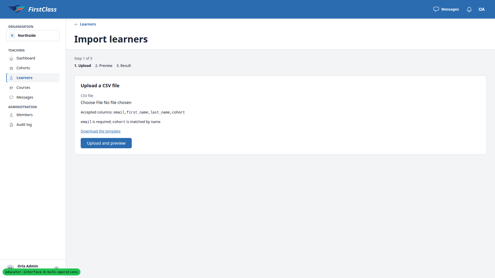 |
| 1.2 | desktop | pass | Template CSV starts with a UTF-8 BOM, has four headers and two example rows. | |
| 1.3 | desktop | pass | 51 lines gives a 422 re-render with the 50-line limit message and an "Import a file instead" link. | 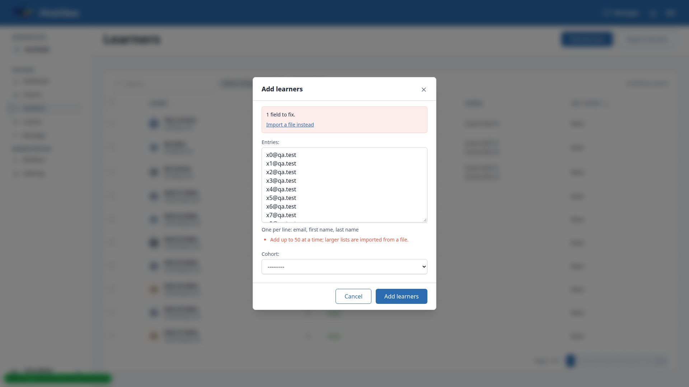 |
| 1.4 | desktop | pass | Cohort C Learners tab link ends `?cohort=<pk>`. The Cohort Old tab has no Import link. | |

### §2 Upload rejections

| Test | Viewport | Status | Note | Screenshot |
|---|---|---|---|---|
| 2.1 | desktop | pass | All six bad files give a 422 with a focused alert summary (Excel, Latin-1, badhead, empty, big, blankhead). No LearnerImport rows stored. | 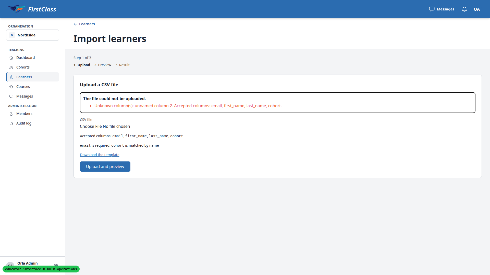 |
| 2.2 | desktop | pass | No file: the browser required check blocks the POST. With noValidate, a 422 shows "This field is required." | |

### §3 Preview

| Test | Viewport | Status | Note | Screenshot |
|---|---|---|---|---|
| 3.1 | desktop | pass | good.csv preview shows 30 rows, the label counts (26 / 1 / 1 / 2), correct columns and reasons, three notes, the error CSV, "Add 28 learners" and the error-rows message. | 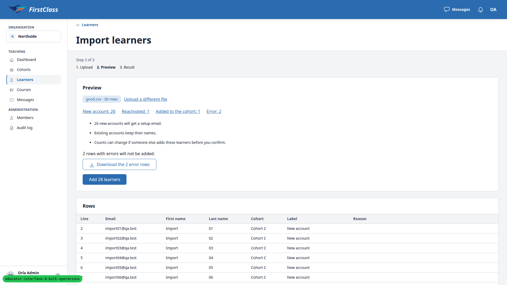 |
| 3.2 | desktop | pass | The Error count link filters to 2 rows, survives reload, and Back restores 30 rows. | |
| 3.3 | desktop | pass | dup.csv: duplicate and blank rows flagged; the button reads "Add 1 learner". | |
| 3.4 | desktop | pass | nocohort.csv: both rows error, no confirm button, "Nothing can be added" message. See General notes (c). | |
| 3.5 | desktop | pass | semi.csv gives two new accounts. | |
| 3.6 | desktop | pass | trail.csv gives one new account in Cohort C; the trailing empty column is ignored. | |

### §4 Commit and result

| Test | Viewport | Status | Note | Screenshot |
|---|---|---|---|---|
| 4.1 | desktop | pass | Result is step 3 of 3 with the headline, counts, 26 setup emails sent (Mailpit confirms), error rows, error CSV and links. | |
| 4.2 | desktop | pass | The preview URL redirects to the result after commit. | |
| 4.3 | desktop | pass | import01 is Pending; the Cohort C filter lists 27; Rae is Active; Ada's page is unchanged. | |
| 4.4 | desktop | pass | Re-upload: Already a member 28, Error 2, no button, no email sent. | |
| 4.5 | desktop | pass | dup.csv confirm: "Added 1 learner. 2 rows were not added."; the error CSV holds the two rows. | |

### §5 Import from a cohort

| Test | Viewport | Status | Note | Screenshot |
|---|---|---|---|---|
| 5.1 | desktop | pass | Cohort A import: cohort column ignored, both learners listed, result links back to the Cohort A Learners tab. Headline reads "0 rows were not added." (General notes (c)). | 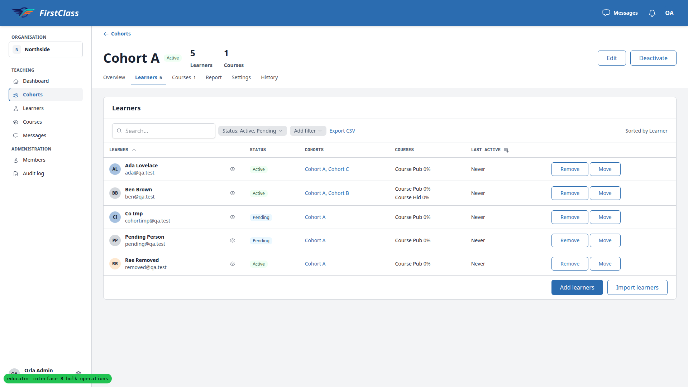 |

### §6 Bulk actions on the learners list

| Test | Viewport | Status | Note | Screenshot |
|---|---|---|---|---|
| 6.1 | desktop | pass | Checkbox column and header checkbox present. With nothing selected the bar buttons are hidden. | |
| 6.2 | desktop | pass | The status region is empty before ticking, then reads "2 selected · showing 1–9 of 9 learners". Bar buttons and More actions menu are correct. | 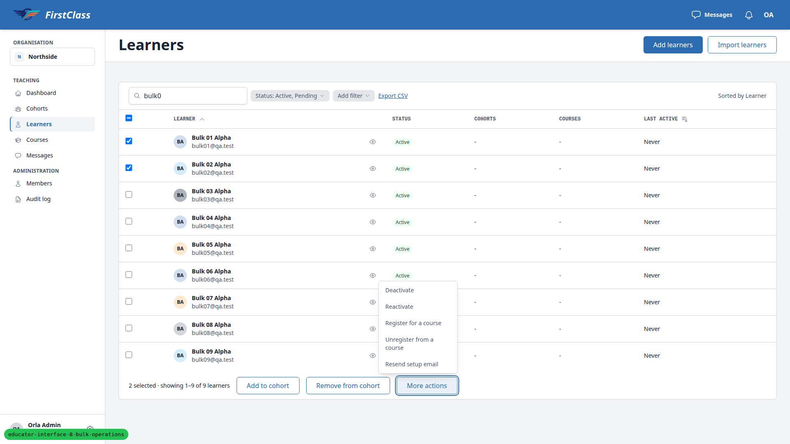 |
| 6.3 | desktop | pass | Picker above the sentence, confirm disabled until chosen, focus on Cancel. Result "2 learners changed." and the table refreshed. | 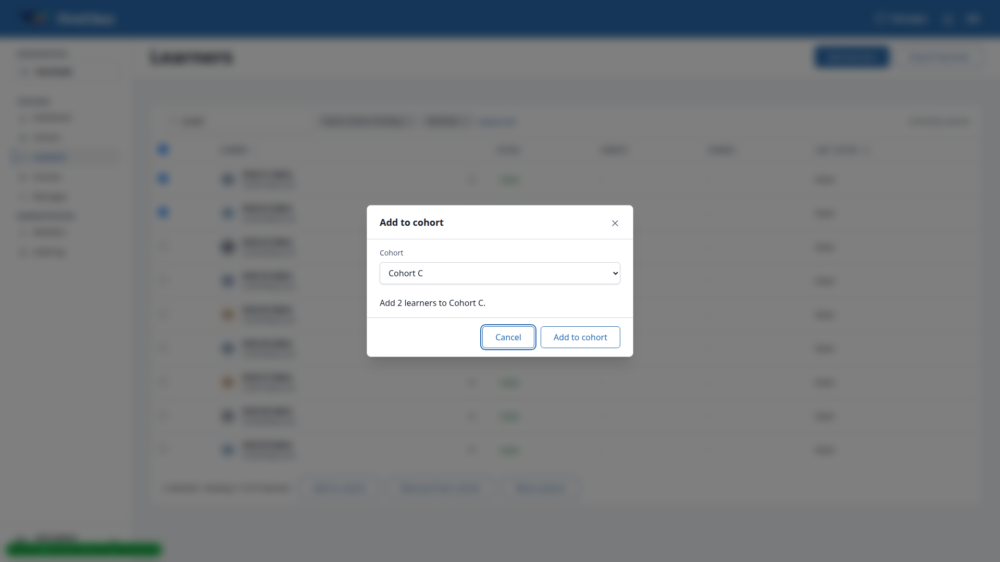 |
| 6.4 | desktop | pass | Skips for already-in-cohort learners are stated in the confirmation and the result, with per-row reasons. | |
| 6.5 | desktop | pass | Remove confirmation names the access lost and the skip. Cancelled. | |
| 6.6 | desktop | pass | Select all matching (30), untick one (29), "29 learners changed."; Cohort B then has 31 members. | 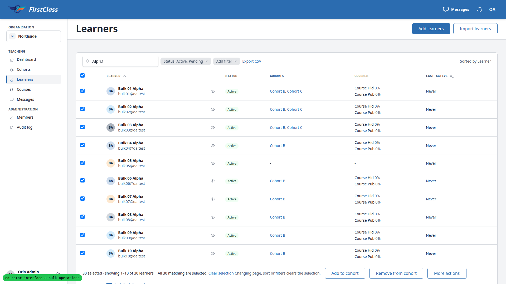 |
| 6.7 | desktop | pass | Sort and page 2 each clear the selection and hide the bar buttons. | |
| 6.8 | desktop | pass | Remove 31 learners from Cohort B; Cohort B is empty afterwards. | |
| 6.9 | desktop | pass | Deactivate (btn-error), Inactive filter, reactivate, and the mixed skip all behave as specified. | |
| 6.10 | desktop | pass | Register and unregister, including the individually-registered skip with confirm disabled. | |
| 6.11 | desktop | pass | Resend setup email: skip of already-set-up accounts; repeat sends nothing (Mailpit still 2). See General notes (c). | |
| 6.12 | desktop | pass | Keys mode reports "already inactive"; all-matching mode returns a 422 "The selection changed since you opened this." | |
| 6.13 | desktop | **fail** | JS off: the confirmation page is correct, but confirm returns a redirect with a toast, not a full-page result with a back link. See B1. | 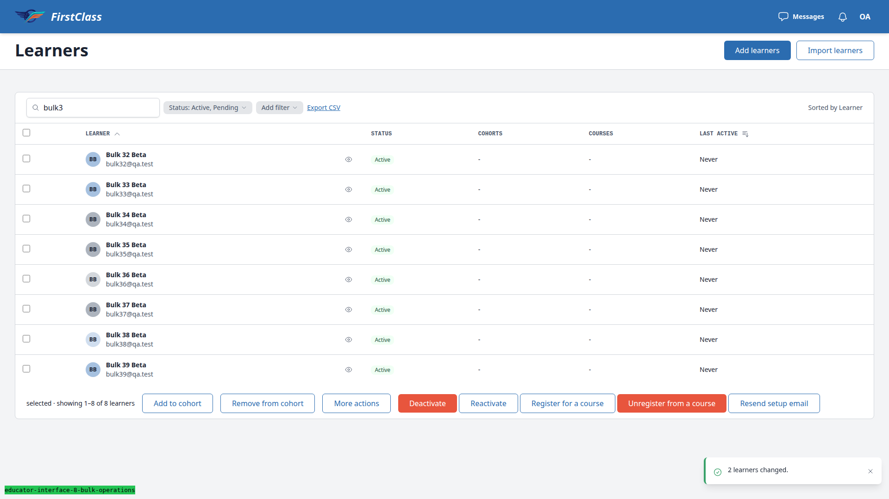 |
| 6.14.1 | desktop | pass | Background confirmation text is correct. | |
| 6.14.2 | desktop | pass | Modal closes, bar shows "Deactivate is running…", controls are disabled, running state persists over sort and page 2. | 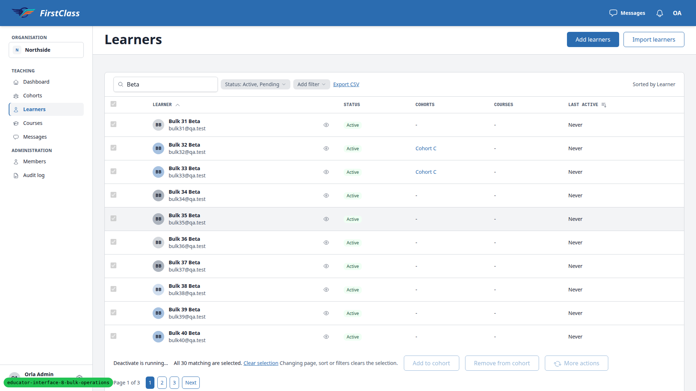 |
| 6.14.2 | mobile | pass | Fixed bar fits "Reactivate is running…" with the spinner; no horizontal overflow; bar about 335px tall. | 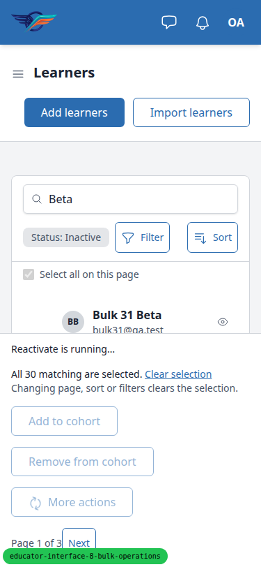 |
| 6.14.2 | tablet | pass | Fixed bar fits; no horizontal overflow. | 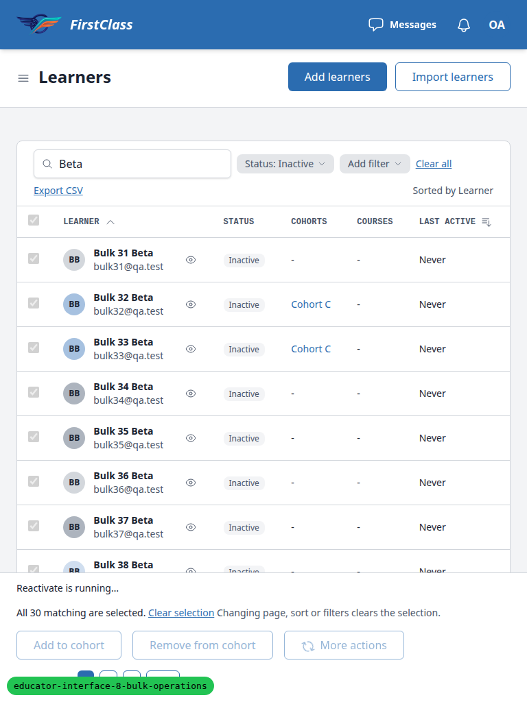 |
| 6.14.3 | desktop | pass | Result modal opened within 2s ("30 learners changed."), table refreshed, bar cleared after Close. | 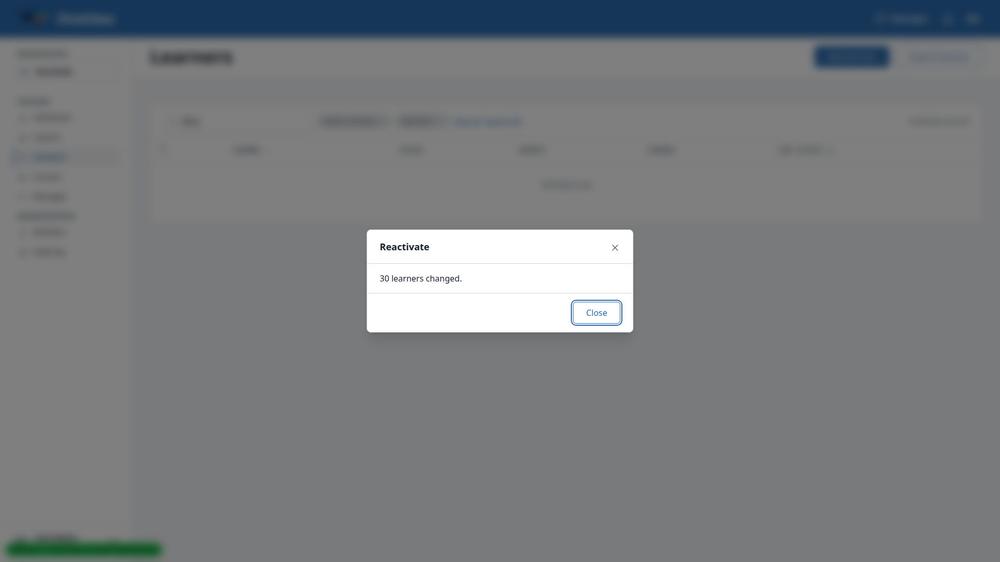 |
| 6.14.4 | desktop | pass | Run finished with another modal open: that modal was not replaced; the result modal opened after Cancel (about 1.3s). | |
| 6.14.5 | desktop | pass | Left for the Dashboard: no modal; bell went from 1 new to 2 new within about 30s; the entry opens the learners list. | |
| 6.14.6 | desktop | pass | JS off: redirect with the "running in the background" flash; after the worker, 6 Active and bell "1 new". | |
| 6.14.7 | desktop | pass | Status URL from the `bulkRunStarted` trigger: `/educator/organisations/northside/learners/__runs/8e1af9ed-201f-4c72-b76c-f74266575aca`. | |

### §7 Bulk actions on the cohorts list

| Test | Viewport | Status | Note | Screenshot |
|---|---|---|---|---|
| 7.1 | desktop | pass | Register and Unregister are buttons; More actions holds Deactivate and Reactivate. | |
| 7.2 | desktop | pass | "Register 2 cohorts for Course Hid. 1 is inactive and will be skipped." Wording differs from the plan (General notes (a)). | |
| 7.3 | desktop | pass | "Register 0 cohorts ... 2 are already registered ... 1 is inactive ..." with confirm disabled. | |
| 7.4 | desktop | pass | Unregister confirmation uses btn-error; result and skip behave as specified. | |
| 7.5 | desktop | pass | Cohort C bulk deactivate then reactivate. | |
| 7.6 | desktop | pass | Cohort C page single Deactivate and Reactivate. | |

### §8 Permissions and enumeration

| Test | Viewport | Status | Note | Screenshot |
|---|---|---|---|---|
| 8.1 | desktop | pass | cohort.admin sees only own cohorts' learners, Register/Unregister only, no Import link; import URL gives 403. | 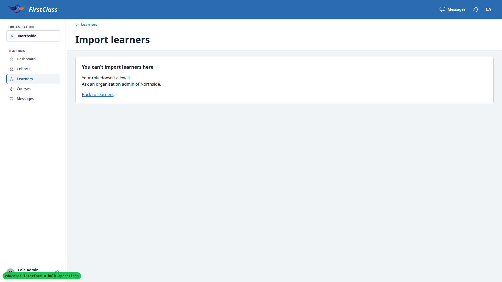 |
| 8.2 | desktop | pass | cohort.viewer: no checkboxes or selection bar; import URL 403. | |
| 8.3 | desktop | pass | south.admin: preview, result, errors.csv and run status URLs give 404. | |
| 8.4 | desktop | pass | Superuser: import result, preview and run status give 404; import page 200. | |
| 8.5 | desktop | pass | Anonymous: redirected to login. | |

### §9 Repeat submissions

| Test | Viewport | Status | Note | Screenshot |
|---|---|---|---|---|
| 9.1 | desktop | pass | Same preview confirmed in two tabs: both land on the same result; each learner listed once; one email each. | |
| 9.2 | desktop | pass | JS off: Back returns the cached confirmation; resubmitting gives a 422 with all skipped; no second membership. | 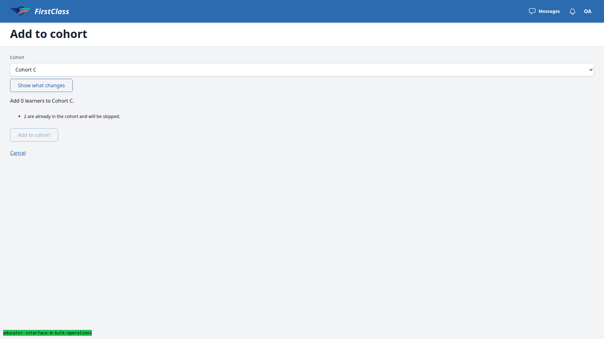 |

### §10 Viewports

| Test | Viewport | Status | Note | Screenshot |
|---|---|---|---|---|
| 10.1 | mobile | pass | Upload, preview and result pages: no overflow; preview is cards below md. |  |
| 10.1 | tablet | pass | No overflow; preview is a table at md and up. | 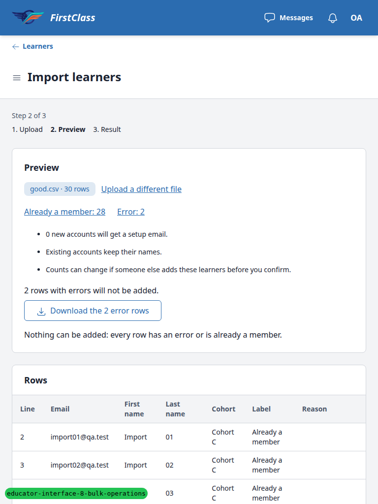 |
| 10.2 | mobile | pass | Bar fixed to the bottom (219px); menu items in viewport; confirmation modal fits. | 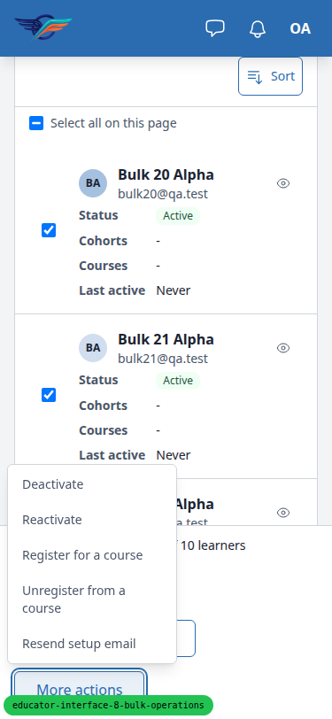 |
| 10.2 | tablet | pass | Bar fixed (103px); modal 512px wide and centred. | 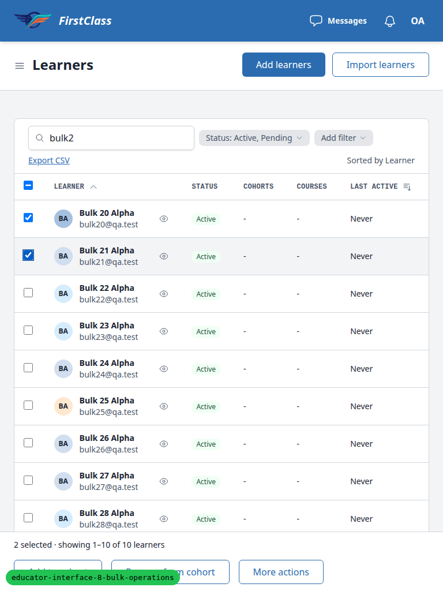 |
| 10.3 | mobile | pass | Inline Deactivate result modal fits. | 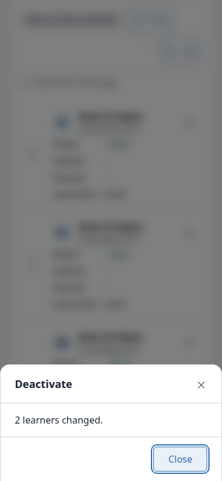 |
| 10.3 | tablet | pass | Result modal fits. | 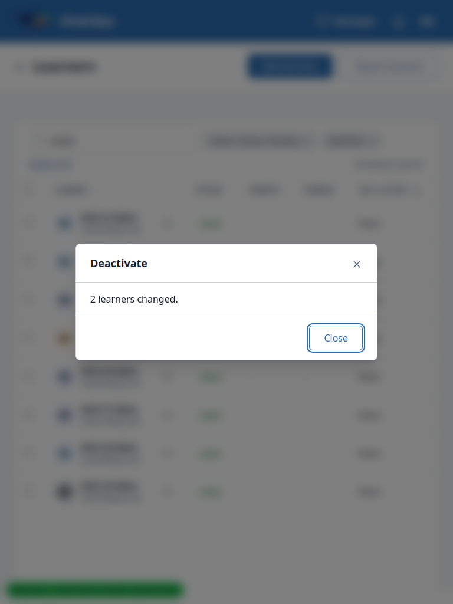 |

## Bugs

### B1: JavaScript-off bulk action answers with a redirect and toast, not the result page the spec and QA plan describe

- Manifestations: 6.13 (desktop).
- Screenshot: 
- Expected: Spec R1.4 ("A confirmed POST that runs inline returns the result summary ... as a page with JS off") and QA plan 6.13: a full-page result summary with a link back to the learners list that keeps the filter.
- Actual: a 303 back to the filtered learners list with a toast "2 learners changed." Commit 10dc8f328 changed this on purpose so Back and refresh cannot re-run the action. The spec and QA plan were not updated.

## Bug status

| Bug | Status |
|---|---|
| B1 | **UNRESOLVED** — JavaScript-off bulk action answers with a redirect and toast, not the result page the spec and QA plan describe (reason: product decision; spec R1.4 and QA plan 6.13 say a full result page, commit 10dc8f328 deliberately switched to redirect + flash to stop Back/refresh re-running the action) |

## General notes

(a) The QA plan wording is stale in §7.2 and §7.3. The cohort skip now reads "1 is inactive". Commit 04226ff65 changed it deliberately from "an inactive cohort". The plan should be updated.

(b) §6.14 was run with Reactivate and Deactivate in a different order from the plan.
- The first run lost its on-table state after the tester navigated to a learner page. That is spec-intended behaviour, so it served as the "left the table" case.
- Then: Reactivate 30 on-table, Deactivate with a modal open, JS-off Reactivate 6, then Reactivate 24 from the Dashboard.
- All Beta learners end active.

(c) Minor observations:
- The nocohort and already-member previews still say "0 new accounts will get a setup email."
- The import result headline says "0 rows were not added." when nothing failed.
- With JS off, the selection bar status reads " selected · showing …" with no count.
- The resend confirmation on an immediate repeat still predicts "Resend … to 2 learners". The recent-send skip is only known at run time.
- At 375px the running-state fixed bar is about 335px tall (about 40% of the viewport).
- The bell shows "N new" while the panel header counts all unread. The scenario reset does not clear earlier runs' notifications.
- The upload page's file input is unstyled ("Choose File No file chosen").

(d) The screenshots folder also holds a few files that another process wrote to the shared qa-screenshots directory: the 10:32 timestamped files, `selection-bar.png`, `menu.yml`, console logs and `.yml` snapshots. This report does not reference them.

status: ok · reason: 1 bug — 0 fixed, 1 unresolved (product decision); report rendered, screenshots verified
