# Frontend QA report: educator-interface-8-bulk-operations

Date: 2026-10-30

## Methodology

- Server: `uv run python manage.py runserver 8601`; the branch badge `educator-interface-8-bulk-operations` was confirmed.
- Main pass logged in as `org.admin@qa.test`. The §8 personas (cohort.admin, cohort.viewer, south.admin, demodev superuser, anonymous) ran in separate browser contexts. JS-off tests (§6.13, §6.14.6, §9.2) ran in contexts with JavaScript disabled.
- Data: `qa_create_bulk_operations_scenario --site-name DemoDev` was run before the pass. Mailpit at localhost:8025 was cleared and checked via its API.
- §6.14 ran on a scratch settings module `config/settings_qa_background.py` (BULK_BACKGROUND_THRESHOLD=5, database task backend) with `db_worker --batch` runs. The module was deleted afterwards and the server restarted on normal settings.
- The pre-step rebase replayed 56 commits onto main cleanly (main had gained only new spec idea files). The rebase's front-end check was folded into this full QA pass rather than run separately, because upstream brought no front-end change and this pass visits every URL the plan names at all three viewports.
- Tooling: snapshots were saved to files by the Playwright MCP server; screenshots were taken without custom filenames or via page.screenshot into the same output directory; the Django debug toolbar was hidden once to stop it intercepting clicks. The console only logged the expected 422 responses.
- Screenshots were collected into `<spec-dir>/screenshots/` and every referenced image exists beside the report.

## Diff scoping

Class: **FULL**.

Changed template/static files that triggered it:

- freedom_ls/base/static/base/js/alpine-components.js
- freedom_ls/educator_interface/templates/educator_interface/_shell.html
- freedom_ls/educator_interface/templates/educator_interface/interface.html
- freedom_ls/educator_interface/templates/educator_interface/learner_import_denied.html
- freedom_ls/educator_interface/templates/educator_interface/learner_import_preview.html
- freedom_ls/educator_interface/templates/educator_interface/learner_import_result.html
- freedom_ls/educator_interface/templates/educator_interface/learner_import_upload.html
- freedom_ls/educator_interface/templates/educator_interface/partials/import_learners_link.html
- freedom_ls/educator_interface/templates/educator_interface/partials/import_stepper.html
- freedom_ls/educator_interface/templates/educator_interface/partials/learner_import_result_body.html
- freedom_ls/educator_interface/templates/educator_interface/partials/run_status.html
- freedom_ls/educator_interface/templates/educator_interface/standalone_page.html
- freedom_ls/panel_framework/static/panel_framework/js/alpine-components.js
- freedom_ls/panel_framework/templates/cotton/data-table-card.html
- freedom_ls/panel_framework/templates/cotton/data-table.html
- freedom_ls/panel_framework/templates/panel_framework/modal/form.html
- freedom_ls/panel_framework/templates/panel_framework/partials/breadcrumbs.html
- freedom_ls/panel_framework/templates/panel_framework/partials/bulk_confirmation.html
- freedom_ls/panel_framework/templates/panel_framework/partials/bulk_confirmation_form.html
- freedom_ls/panel_framework/templates/panel_framework/partials/bulk_confirmation_message.html
- freedom_ls/panel_framework/templates/panel_framework/partials/bulk_picker.html
- freedom_ls/panel_framework/templates/panel_framework/partials/bulk_result.html
- freedom_ls/panel_framework/templates/panel_framework/partials/bulk_result_body.html
- freedom_ls/panel_framework/templates/panel_framework/partials/bulk_run_stopped.html
- freedom_ls/panel_framework/templates/panel_framework/partials/bulk_selection_inputs.html
- freedom_ls/panel_framework/templates/panel_framework/partials/table_selection_bar.html
- freedom_ls/panel_framework/templates/panel_framework/views/_bulk_confirmation_base.html
- freedom_ls/panel_framework/templates/panel_framework/views/bulk_result.html

Skipped: nothing. Everything ran: desktop, mobile and tablet.

## Smoke gate

Outcome: **pass**. Pages loaded:

- http://127.0.0.1:8601/
- http://127.0.0.1:8601/educator/organisations/northside/learners

## Results by section

### §1 Entry points

| Test | Viewport | Status | Notes | Screenshot |
|---|---|---|---|---|
| 6.1 (list baseline) | desktop | pass | Learners list: checkbox column, header "Select all on this page", Import learners link beside Add learners, pagination visible, no selection bar buttons. | 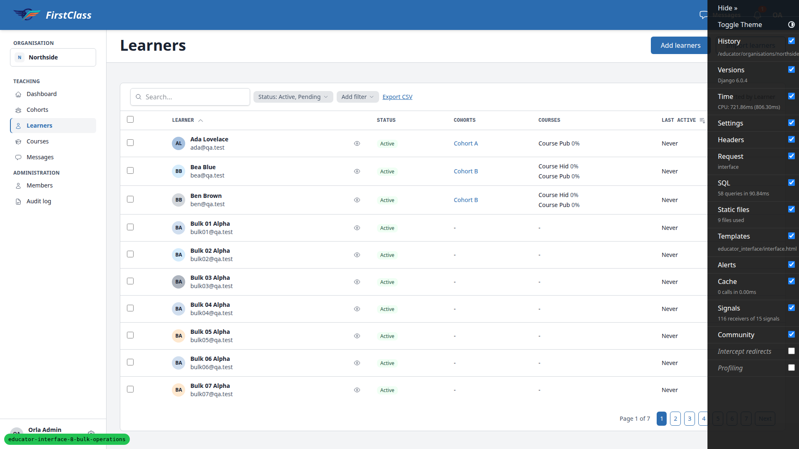 |
| 1.1 | desktop | fail (B1) | Import page: stepper `<ol>` Upload/Preview/Result with aria-current=step on "1. Upload", "Step 1 of 3", required file input, code line, "email is required; cohort is matched by name", template link, sidebar + organisation block present. No breadcrumbs on the import page (already an open Decide item in todo.md). | 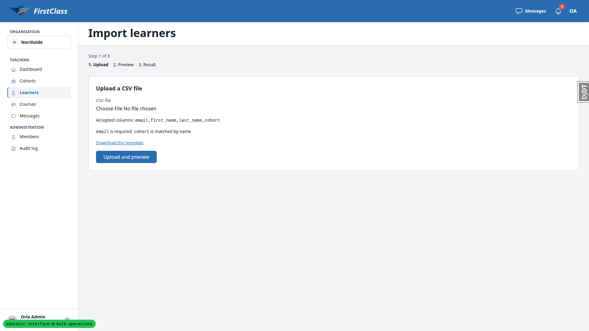 |
| 1.2 | desktop | pass | template.csv: Content-Disposition learner-import-template.csv, starts with EF BB BF BOM, 4 headers, 2 example rows. | — |
| 1.3 | desktop | pass | Add learners with 51 lines: POST 422, dialog re-renders with "Add up to 50 at a time; larger lists are imported from a file." and an "Import a file instead" link to the import page; alert summary has focus. |  |
| 1.4 | desktop | pass | Cohort C Learners tab has "Import learners" ending ?cohort=<Cohort C pk>; Cohort Old tab has no Import learners link. | — |

### §2 Upload rejections

| Test | Viewport | Status | Notes | Screenshot |
|---|---|---|---|---|
| 2.excel | desktop | pass | 422; alert focused; "This looks like an Excel file. Save it as CSV UTF-8 and upload that."; stays on step 1. | — |
| 2.latin1 | desktop | pass | 422; "Save the file as CSV UTF-8 and upload it again." | — |
| 2.badhead | desktop | pass | 422; "Unknown column(s): e-mail, name. Missing required column(s): email. Accepted columns: email, first_name, last_name, cohort." | — |
| 2.empty | desktop | pass | 422; "This file has no rows to import." | — |
| 2.big | desktop | pass | 422; "2,431 rows; the limit is 2,000." | — |
| 2.blankhead | desktop | pass | 422; "Unknown column(s): unnamed column 2. Accepted columns: ..." | — |
| 2.nofile | desktop | pass | required attribute blocks submit (form invalid); with noValidate the POST is a 422 with "This field is required." in the alert, no server error. Console only logs the 422 responses. |  |

### §3 Preview

| Test | Viewport | Status | Notes | Screenshot |
|---|---|---|---|---|
| 3.1 | desktop | pass | Preview at /import/<uuid>/, step 2 of 3; chip "good.csv · 30 rows" + "Upload a different file"; count links New account 26, Reactivated 1, Added to the cohort 1, Error 2; table columns Line/Email/First name/Last name/Cohort/Label/Reason, lines start at 2, labels as text; reasons as specified; three notes; errors.csv has header+2 rows named learner-import-errors-2026-10-30.csv; button "Add 28 learners"; "2 rows with errors will not be added." | 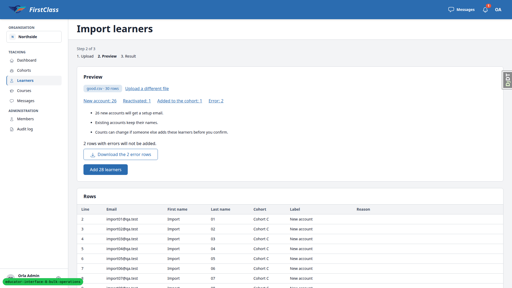 |
| 3.2 | desktop | pass | Error count link -> ?label=error with 2 rows; reload keeps filter; Back returns 30 rows. | — |
| 3.3 | desktop | pass | dup.csv: dup@qa.test New account, DUP@qa.test Error "Same email as line 2.", blank row Error "Email is empty."; button reads "Add 1 learner" (singular). | — |
| 3.4 | desktop | pass | nocohort.csv: both rows Error "No active cohort called 'Cohort Zed'/'Cohort Old' that you can add learners to."; no confirm button; "Nothing can be added: every row has an error or is already a member." | — |
| 3.5 | desktop | pass | semi.csv: 2 new accounts, "Add 2 learners". | — |
| 3.6 | desktop | pass | trail.csv: 1 new account in Cohort C, "Add 1 learner"; trailing empty column not rejected. | — |

### §4 Commit and result

| Test | Viewport | Status | Notes | Screenshot |
|---|---|---|---|---|
| 4.1 | desktop | pass | Result at /import/<uuid>/result/, step 3 of 3; "Added 28 learners. 2 rows were not added."; counts New account 26, Reactivated 1, Added to the cohort 1, Error 2; "26 setup emails were sent." and Mailpit held 26 "[FirstClass] Set your password" messages to import01..26, none to ada/removed; two error rows inline with reasons; errors.csv link; "Back to learners", "Import another file"; safe-to-reupload sentence. |  |
| 4.2 | desktop | pass | Preview URL redirects to the result page after commit. | — |
| 4.3 | desktop | pass | import01 reads Pending in Cohort C; Cohort filter -> Cohort C lists 27 (3 pages, 7 on the last); Rae Removed is Active; Ada's page heading "Ada Lovelace" with Cohort A and Cohort C. | — |
| 4.4 | desktop | pass | good.csv again: "Already a member: 28", "Error: 2", no confirm button, "Nothing can be added: every row has an error or is already a member."; Mailpit received nothing from it. | — |
| 4.5 | desktop | pass | dup.csv confirm: "Added 1 learner. 2 rows were not added.", "1 setup email was sent."; errors.csv holds exactly DUP@qa.test and the blank-email row. | — |

### §5 Import from a cohort

| Test | Viewport | Status | Notes | Screenshot |
|---|---|---|---|---|
| 5.1 | desktop | pass | Import from Cohort A: upload page says "Every learner in the file is added to Cohort A. The cohort column is ignored." | — |
| 5.2 | desktop | pass | Preview: cohortimp New account with cohort "Cohort A" (not C); ben "Added to the cohort". Result "Added 2 learners." links "Back to the cohort's learners" -> Cohort A Learners tab, which lists Co Imp (Pending) and Ben Brown. Mailpit: dup@qa.test and cohortimp@qa.test only. | — |

### §6 Bulk actions on the learners list

| Test | Viewport | Status | Notes | Screenshot |
|---|---|---|---|---|
| 6.2 | desktop | pass | role=status region exists (empty) before ticking; after ticking bulk01+bulk02 it reads "2 selected · showing 1–10 of 95 learners"; Add to cohort, Remove from cohort buttons; More actions menu: Deactivate, Reactivate, Register for course, Unregister from course, Resend setup email. Menu says "Register for course" not "Register for a course" (already an open Decide item). | 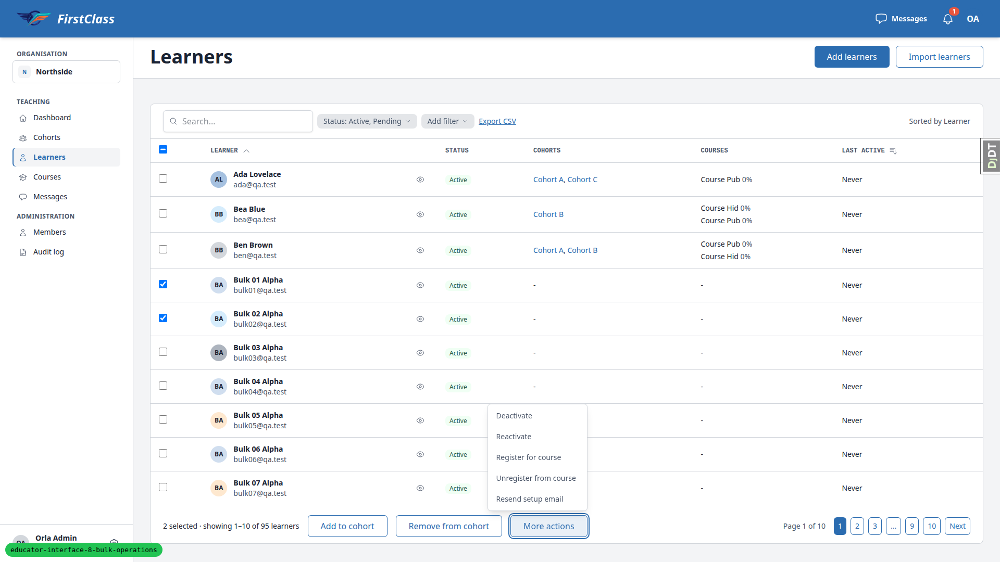 |
| 6.3 | desktop | pass | Add to cohort modal: cohort select above the sentence, confirm ("Add to cohort") disabled until a cohort is chosen, initial focus on Cancel. Cohort C -> "Add 2 learners to Cohort C." with no skip line. Confirm -> "2 learners changed."; table behind shows Cohort C for both rows; Close clears selection. | 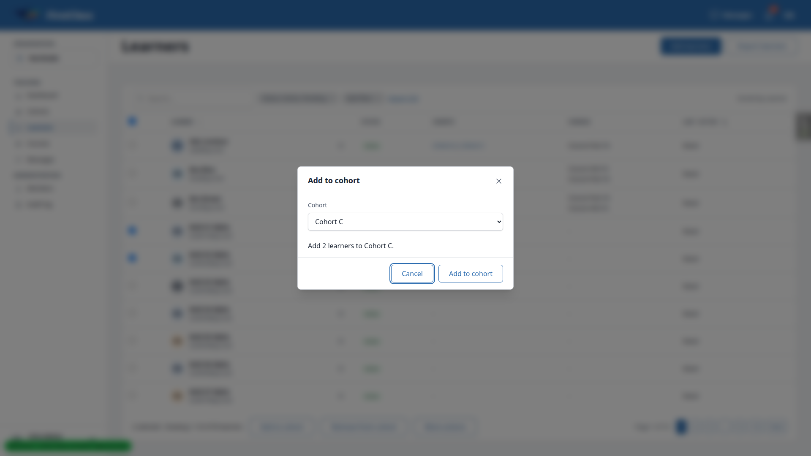 |
| 6.4 | desktop | pass | bulk01-03 -> "Add 1 learner to Cohort C. 2 are already in the cohort and will be skipped." Result "1 learner changed. 2 already in the cohort" with the two names listed (plan words it "2 were already in the cohort."; wording is the open Decide item). bulk01 alone -> "Add 0 learners to Cohort C. 1 is already in the cohort and will be skipped." with confirm disabled. | 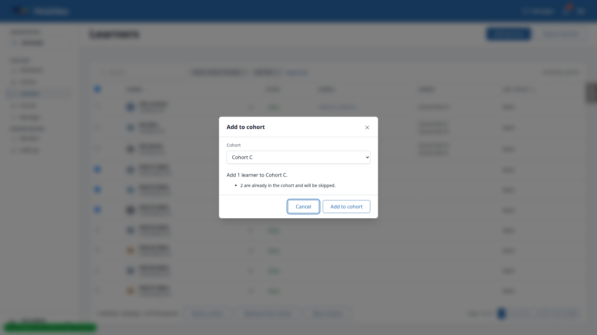 |
| 6.5 | desktop | pass | Ada+bulk01, Remove from cohort -> Cohort A: "Remove 1 learner from Cohort A. 1 is not a member and will be skipped. They lose access to: Course Pub." Cancelled; Ada still in Cohort A. | 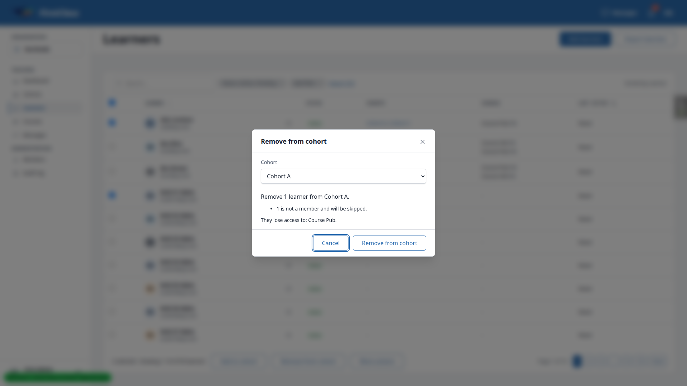 |
| 6.6 | desktop | pass | Search Alpha = 30 rows / 3 pages. Header checkbox -> bar "10 selected · showing 1–10 of 30 learners" + "Select all 30 matching" + note "Changing page, sort or filters clears the selection." Click -> "30 selected · showing 1–10 of 30 learners" + "Clear selection". Untick bulk05 -> "29 selected". Form posts mode=all_matching with excluded=bulk05. Add to Cohort B: "Add 29 learners to Cohort B." -> "29 learners changed." Cohort B filter = 31 (4 pages, 1 on the last); bulk05 absent. Bar wording is "N selected · showing…" rather than the plan's "All 10 on this page are selected." | 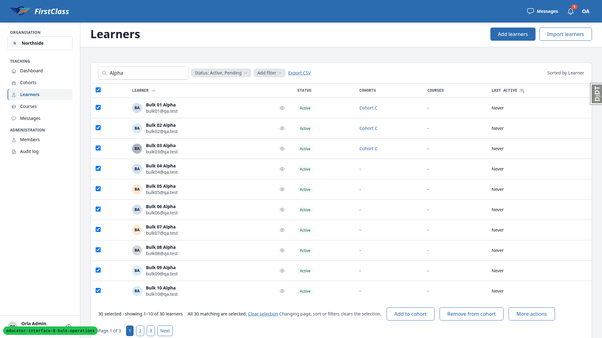 |
| 6.7 | desktop | pass | Select all matching then sort by Last active: selection cleared, bar buttons hidden, 0 boxes checked. Same after going to page 2. | — |
| 6.8 | desktop | pass | Cohort B filter, select all 31 matching, Remove from cohort -> B: "Remove 31 learners from Cohort B. They lose access to: Course Hid and Course Pub." -> "31 learners changed." Cohort B now empty. | 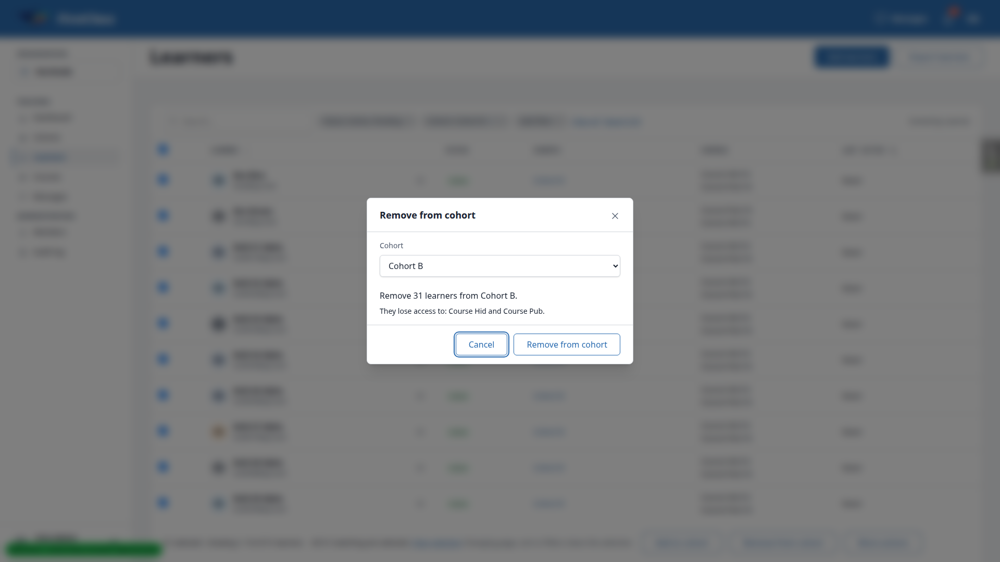 |
| 6.9 | desktop | pass | Deactivate button is btn-error; "Deactivate 2 learners. They lose access to this organisation's courses. Their cohorts, registrations and progress are kept…" -> "2 learners changed.", both leave the default list; Status: Inactive shows both Inactive; Reactivate -> both Active. bulk10 deactivated again; Status Active+Inactive, Reactivate both -> "Reactivate 1 learner. 1 is already active and will be skipped." Cancelled, bulk10 stays inactive. | 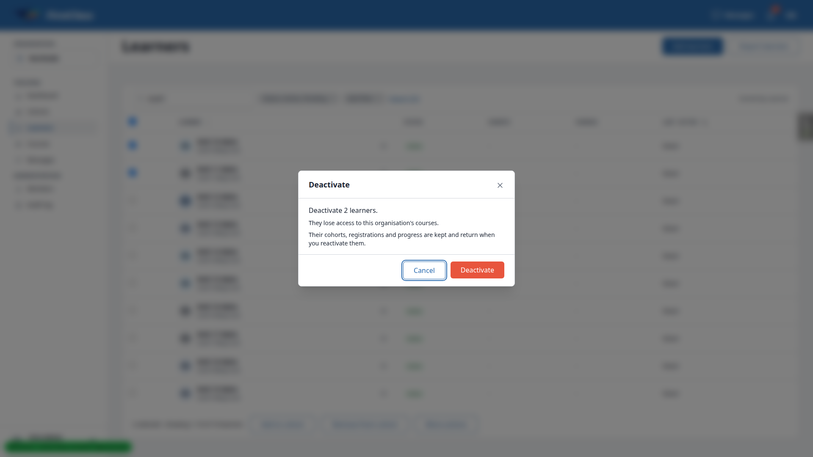 |
| 6.10 | desktop | pass | bulk20+21 Register for course -> Course Pub: "Register 2 learners for Course Pub." -> "2 learners changed.", Courses cells show Course Pub. solo: "Register 0 learners for Course Pub. 1 is already registered individually and will be skipped." confirm disabled. Unregister solo ("Unregister 1 learner from Course Pub.") and bulk20+21 ("Unregister 2 learners from Course Pub."): Courses cells cleared. | 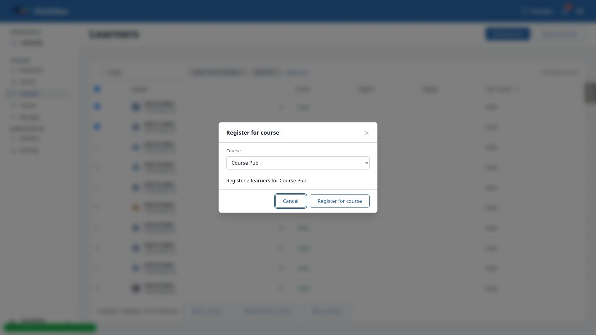 |
| 6.11 | desktop | pass | Server restarted first. Cohort A filter, pending+cohortimp+ada, Resend setup email: "Resend the setup email to 2 learners. 1 account is already set up and will be skipped." -> "2 learners changed. 1 account already set up (Ada Lovelace)"; Mailpit held 2 (pending, cohortimp). Repeat at once: "0 learners changed. 1 account already set up, 2 emailed recently"; Mailpit still 2. | 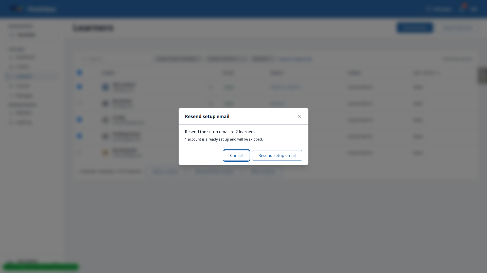 |
| 6.12 | desktop | pass | Keys mode: bulk40 deactivated from its learner page in a second tab, confirm in the first tab -> 200, "1 learner changed. 1 already inactive — Bulk 40 Beta: already inactive". Count mode: select all 29 matching Beta (bulk41 still inactive at that point), bulk31 deactivated in tab 2, confirm -> 422 "The selection changed since you opened this." with "Deactivate 28 learners." Cancelled; Status Inactive -> reactivated bulk31 + bulk41; all 30 Beta active (3 pages of 10). | 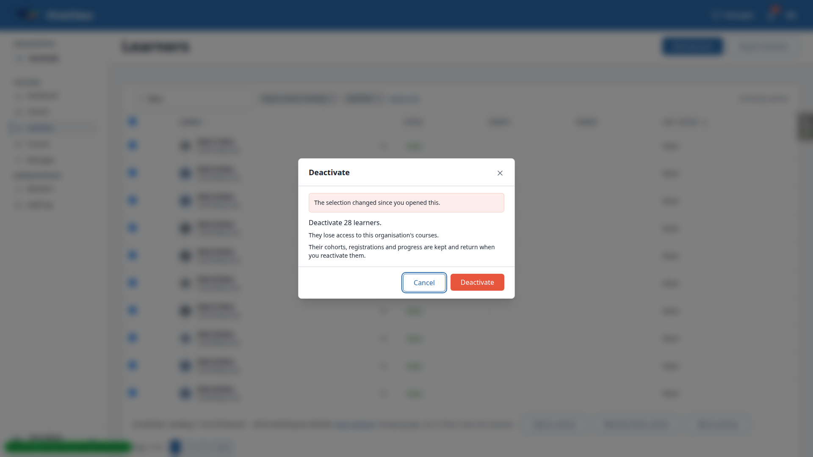 |
| 6.13 | desktop (JS off) | pass | JS-off context: bulk buttons are plain submit buttons with formaction. Deactivate bulk06+07 -> full-page confirmation with the same sentence; confirm -> full-page "2 learners changed." with "Back to learners" link keeping ?learners-q=bulk0. Reactivated the same way. Add to cohort -> page with Cohort picker, "Show what changes", disabled Add to cohort; Cohort C + Show what changes -> "Add 2 learners to Cohort C." and enabled; click -> full-page "2 learners changed." | 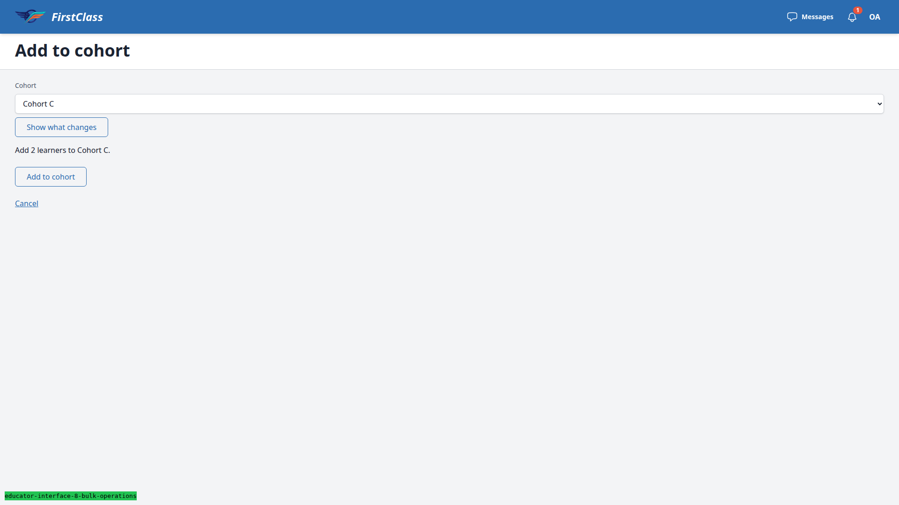 |

#### §6.14 Background run

Run on `config.settings_qa_background` (threshold 5, database tasks) with `db_worker --batch`.

| Test | Viewport | Status | Notes | Screenshot |
|---|---|---|---|---|
| 6.14.1 | desktop | pass | Select all 30 matching Beta, Deactivate -> "This will affect 30 learners. It runs in the background. You'll get a notification when it finishes." (also seen for Reactivate 30 and the no-JS Reactivate 6). | 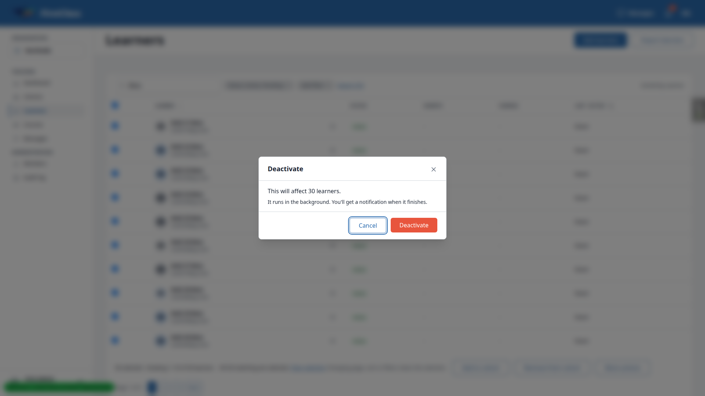 |
| 6.14.2 | desktop | pass | Confirm -> 204, modal closes, URL unchanged, bar "Deactivate is running…". More actions shows a spinner; Add to cohort, Remove from cohort and More actions sit in a disabled fieldset (:disabled true, opacity .5; clicking opens nothing); every row checkbox, the header checkbox and Clear selection disabled. Page 2 and a sort swap the table and keep the running bar and disabled boxes. Quick view still opens. 375x812: bar fixed to the bottom, no horizontal overflow. 768x1024: no overflow, but the bar sits under the table (the open Decide item about md fixed positioning). | 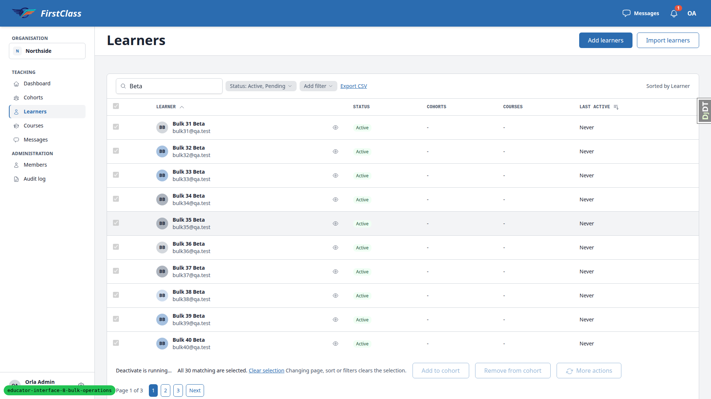 |
| 6.14.2 | mobile | pass | In-progress bar at 375x812: fixed to the bottom, "Deactivate is running…" plus three stacked disabled buttons with the More actions spinner; scrollWidth 375 = innerWidth. | 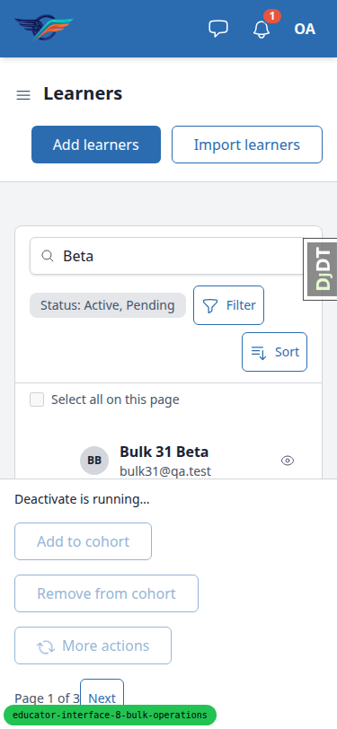 |
| 6.14.2 | tablet | pass | In-progress bar at 768x1024: no horizontal overflow; bar is below the table rather than fixed (already filed as a Decide item). | 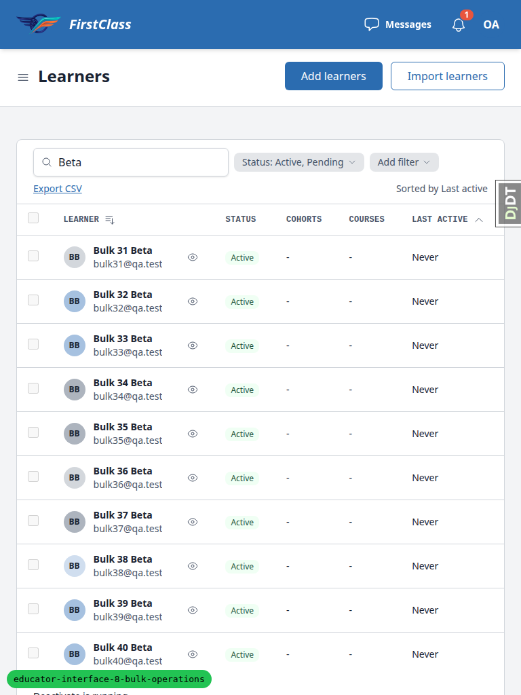 |
| 6.14.3 | desktop | pass | Worker run: modal "30 learners changed." opened within ~2s and the table behind refreshed to "Nothing to see". After Close: no running bar, nothing selected. Bell still "1 unread" (unchanged). Newest entry "Deactivate finished: 30 learners changed. Bulk action · Just now" without the Unread marker; clicking it opens the learners list. | 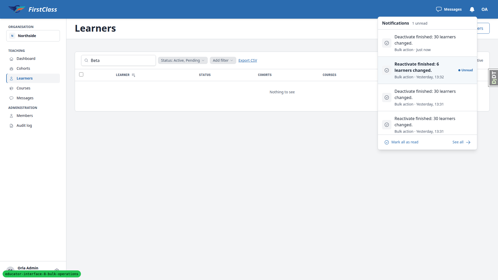 |
| 6.14.4 | desktop | pass | Reactivate 30 queued, Add learners modal left open, worker run: the modal stayed (bar still "Reactivate is running…"). Closing it: result "Reactivate 30 learners changed." opened after 0.8s; the Inactive-filtered table refreshed to empty. | 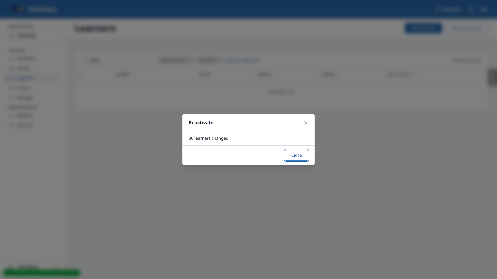 |
| 6.14.5 | desktop | pass | Deactivate 30 queued, went to the Dashboard, worker run: no modal on the Dashboard; the bell badge showed one more unread within 45s (badge 1 after opening the panel had cleared the earlier one). Panel entry "Deactivate finished: 30 learners changed." marked Unread; clicking opens the learners list; Status Inactive lists all 30 Beta (3 pages). | 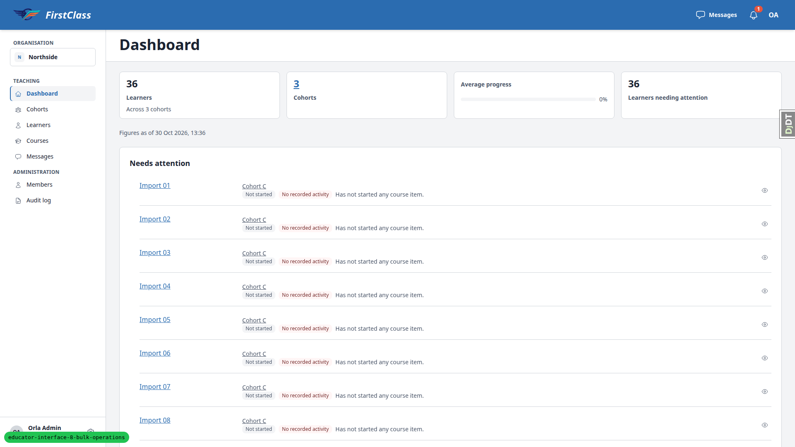 |
| 6.14.6 | desktop (JS off) | pass | JS off: Beta + Inactive, 6 ticked, Reactivate -> full-page "This will affect 6 learners…" confirm -> back on the filtered learners list with flash "Reactivate is running in the background. You'll get a notification when it finishes." Worker run: bell badge on the JS page went "none new" -> "1 new" after 19s; JS-off reload shows bulk31-36 Active and the bell "1 new". | 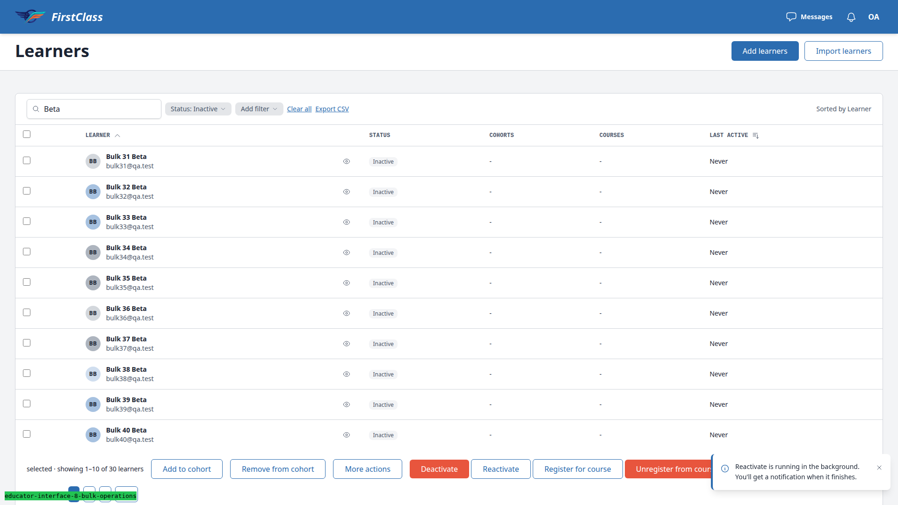 |
| 6.14.7 | desktop | pass | Run status URL captured from the network panel: /educator/organisations/northside/learners/__runs/86daf2d0-564b-42ac-a8ac-5f51dc9d3d7b (204 while queued, 200 once finished). | — |

### §7 Cohorts list

| Test | Viewport | Status | Notes | Screenshot |
|---|---|---|---|---|
| 7.1 | desktop | pass | ?cohorts-inactive=1 lists Cohort Old. Ticking A, C, Old shows Register for course / Unregister from course buttons and More actions with Deactivate, Reactivate. | — |
| 7.2 | desktop | pass | Register -> Course Hid: "Register 2 cohorts for Course Hid. 1 is inactive and will be skipped." -> "2 cohorts changed. 1 inactive (Cohort Old)"; Cohort A and C rows gain Course Hid. Plan words the skip "1 is an inactive cohort" (open wording Decide item). | 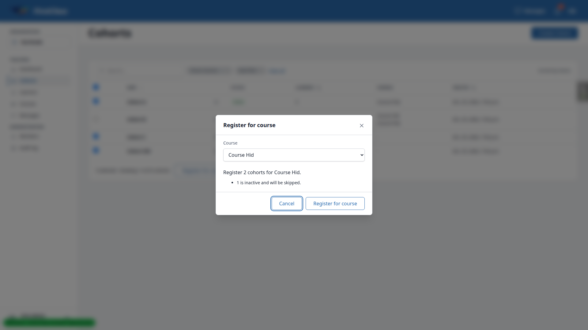 |
| 7.3 | desktop | pass | Same three, Register -> Course Hid: "Register 0 cohorts for Course Hid. 2 are already registered and will be skipped. 1 is inactive and will be skipped." Confirm disabled. | — |
| 7.4 | desktop | pass | Unregister from Course Hid confirm button is btn-error (destructive). QA-script slip: Cancel keeps the selection, so A, B, C, Old were selected -> "Unregister 3 cohorts from Course Hid. 1 is inactive and will be skipped." plus the access-loss line; confirmed, 3 changed. Then A+C: "Unregister 0 cohorts from Course Hid. 2 are not registered and will be skipped." Cancelled. | — |
| 7.5 | desktop | pass | Deactivate (A and C still selected from the cancelled modal): "Deactivate 2 cohorts." with the access explanation -> both Inactive in the list; Reactivate C -> Active. Cohort A reactivated from its page afterwards. | — |
| 7.6 | desktop | pass | Cohort C page: single Deactivate modal (with optional reason) -> Inactive; Reactivate -> Active. Same on Cohort A. | — |

### §8 Permissions and enumeration

| Test | Viewport | Status | Notes | Screenshot |
|---|---|---|---|---|
| 8.1 | desktop | pass | cohort.admin: checkbox column present; More actions holds Register for course and Unregister from course only; no Import learners link on the list or Cohort A's tab; list shows only Cohort A/B members (5 rows, no bulk learners). Ada+Ben Add to cohort: picker offers Cohort A and B only; "Add 2 learners to Cohort B." -> "2 learners changed." Import URL: 403 page "You can't import learners here. Your role doesn't allow it. Ask an organisation admin of Northside." Cohorts list bar: Register/Unregister only. | 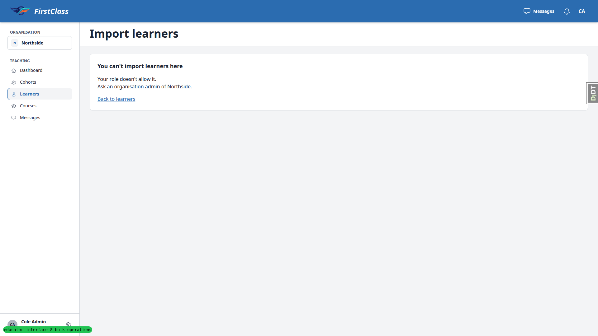 |
| 8.2 | desktop | pass | cohort.viewer: no checkboxes, no selection bar or bulk buttons; import URL is 403. | 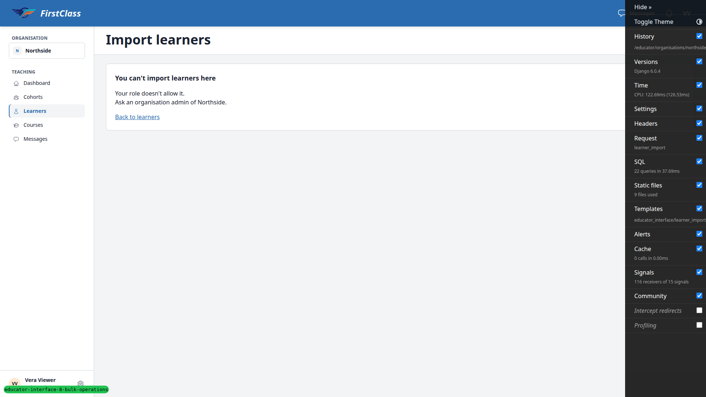 |
| 8.3 | desktop | pass | south.admin: §4 preview, result, errors.csv and the §6.14.7 run status URL all 404 under northside; the same four under southside also 404. | — |
| 8.4 | desktop | pass | demodev superuser: §4 result URL 404; the import page opens (200, heading Import learners). | — |
| 8.5 | desktop | pass | Anonymous import URL redirects to /accounts/login/?next=…/learners/import/. | — |

### §9 Repeat submissions

| Test | Viewport | Status | Notes | Screenshot |
|---|---|---|---|---|
| 9.1 | desktop | pass | semi.csv preview confirmed in two tabs at once: both POSTs 303 to the same result page "Added 2 learners. 0 rows were not added." / "2 setup emails were sent."; learners list shows semi1 and semi2 once each; Mailpit holds exactly one email per address. | — |
| 9.2 | desktop (JS off) | pass | JS off: bulk50+51 Add to cohort C via Show what changes, confirmed ("2 learners changed."); Back returned the cached confirmation page; resubmitting gave 422 "Add 0 learners to Cohort C. 2 are already in the cohort and will be skipped."; each learner is in Cohort C once. | — |

### §10 Viewports (including mobile nav)

| Test | Viewport | Status | Notes | Screenshot |
|---|---|---|---|---|
| 10.1 | mobile | pass | 375x812: upload page, 422 summary, preview and result all have scrollWidth 375 (no horizontal overflow). Stepper items sit on one 28px line. The table is hidden and the preview renders as cards: "import01@qa.test · Line 2 · Label Already a member · Name · Cohort". Error summary 309px wide and readable (screenshots 13-55-01/02/04 too). | 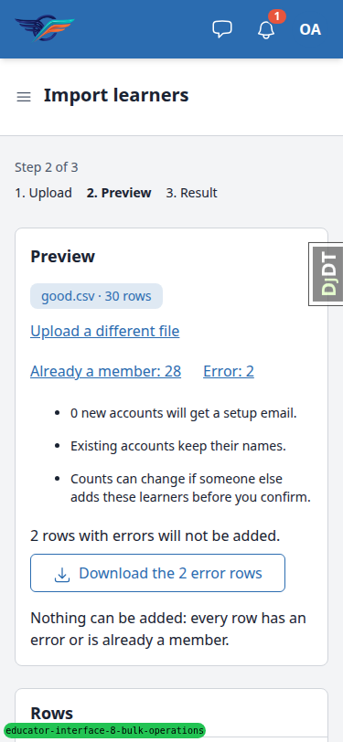 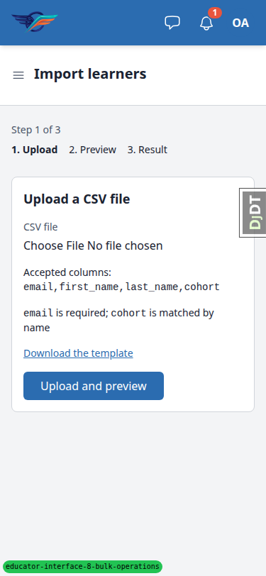 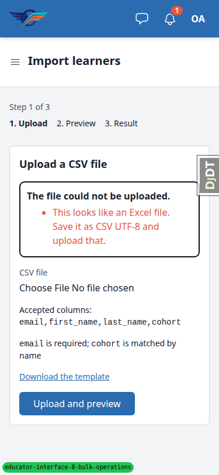 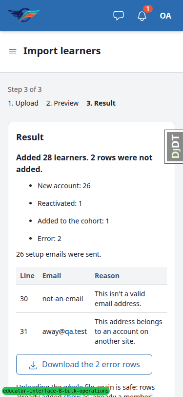 |
| 10.2 | mobile | pass | Learners list as cards; "Select all on this page" control above the card list; with two rows ticked the bar is position:fixed at the bottom (y 593–812) with stacked 42px buttons; More actions opens with five 36px-tall items all in view (13-55-06); Deactivate confirmation modal is a bottom sheet that fits (13-55-07); result modal fits (13-55-08). Reactivated afterwards. | 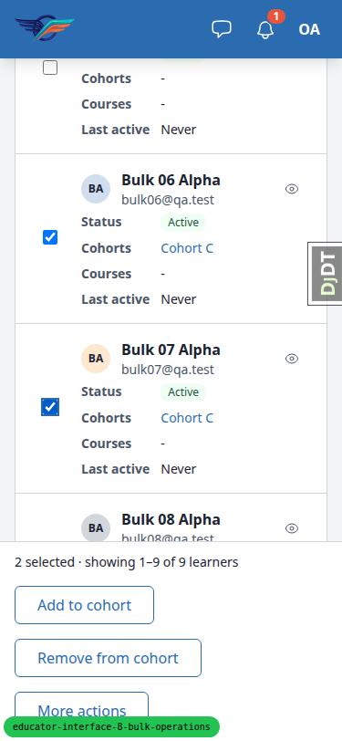 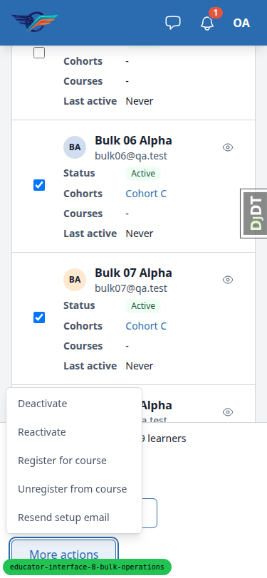 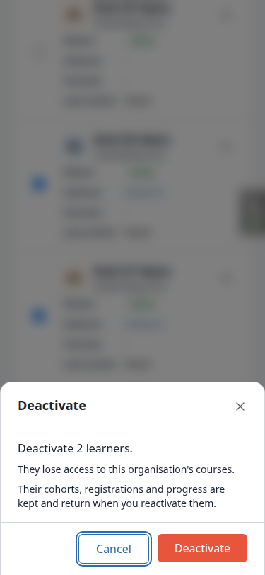 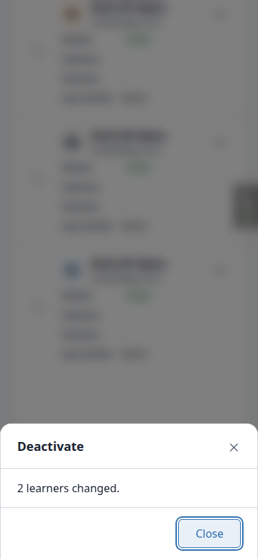 |
| 10.3 | mobile | pass | Inline Deactivate result modal "2 learners changed." fits the 375x812 viewport. |  |
| nav | mobile | pass | "Open navigation panel" opens the Navigation bottom sheet with Dashboard, Cohorts, Learners, Courses, Messages, Members, Audit log; no overflow. | 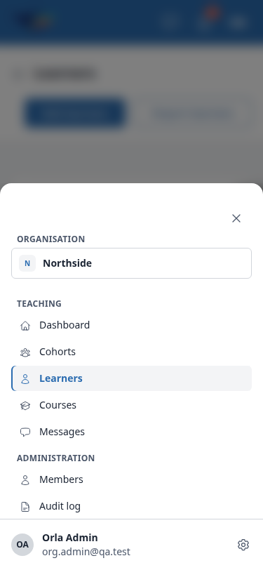 |
| 10.1 | tablet | pass | 768x1024: upload, 422 summary, preview and result have no horizontal overflow (screenshots 13-56-01/02/04). Preview shows the table at md. | 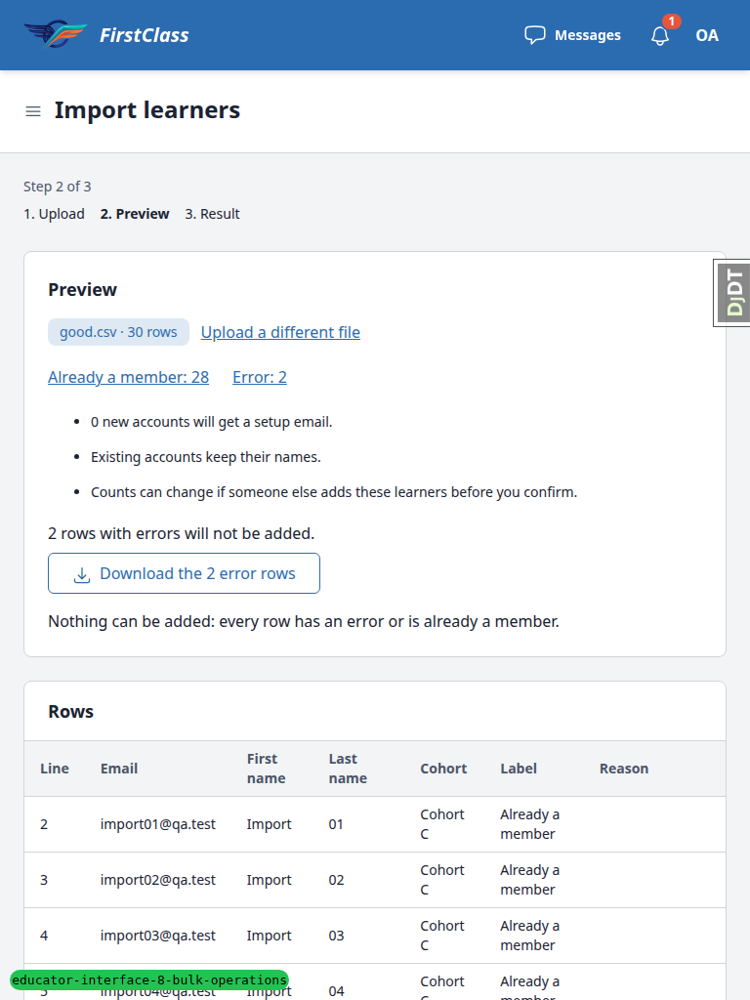 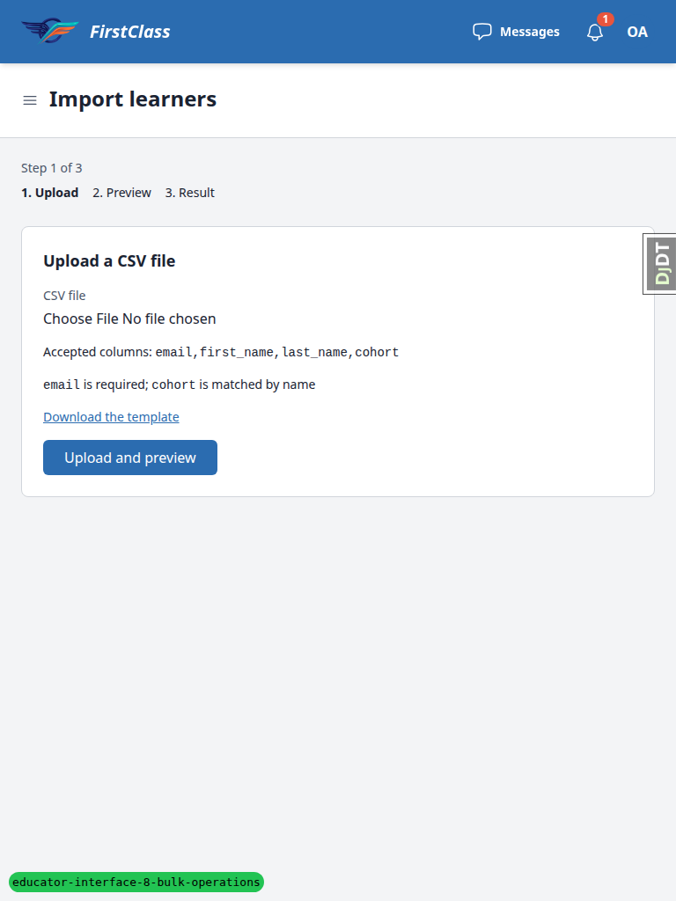 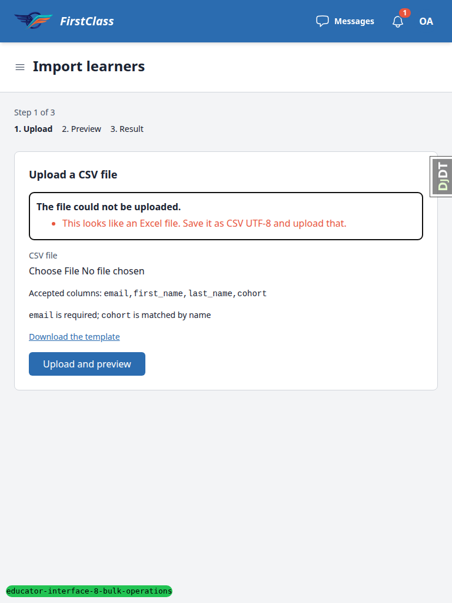 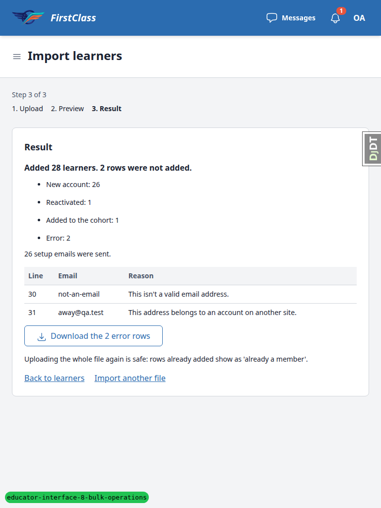 |
| 10.2 | tablet | pass | Sidebar collapses to "Open navigation panel"; table layout; "Select all on this page" in the header above the rows. With two rows ticked the bar renders position:static under the table (y 939–1041 in a 1024 viewport), the already-filed md fixed-bar Decide item. More actions opens (after scrolling the bar into view) with all items visible (13-56-06); confirmation (13-56-07) and result (13-56-08) modals are 512px wide and fit. | 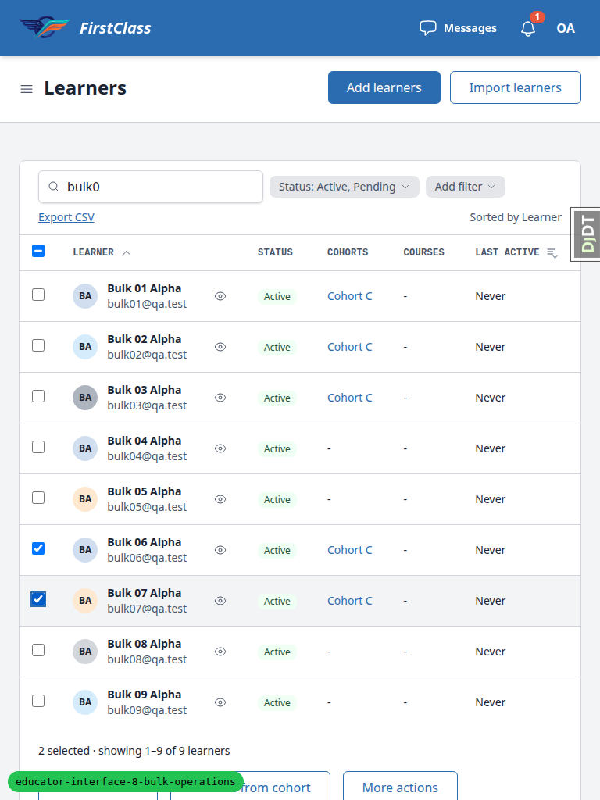 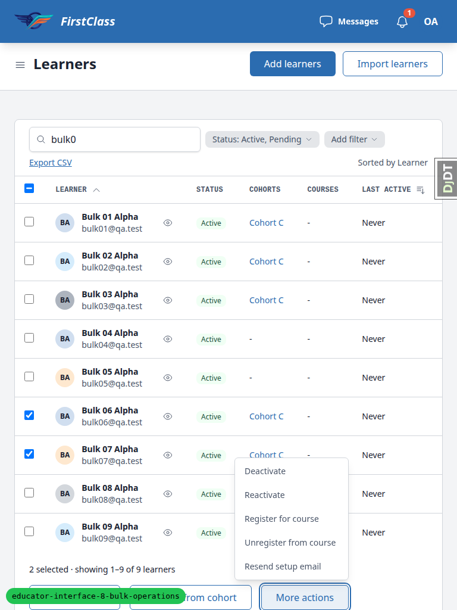 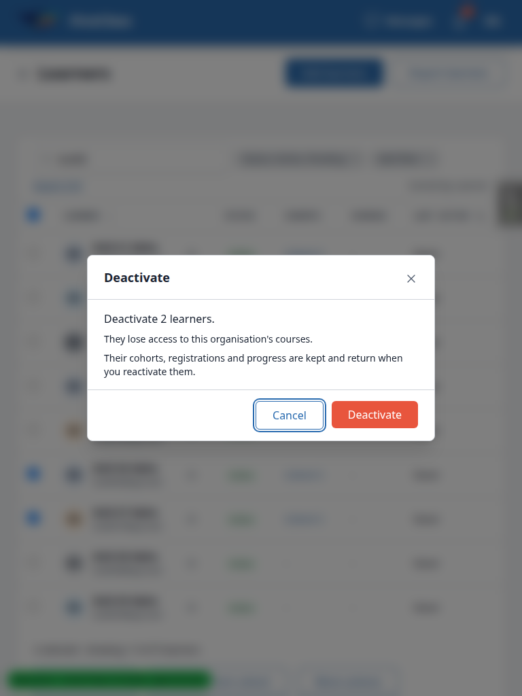 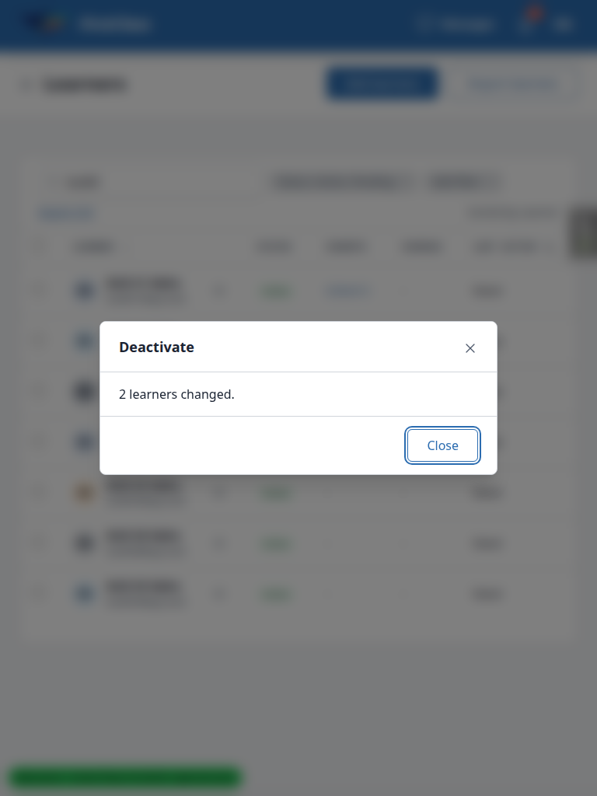 |
| 10.3 | tablet | pass | Inline Deactivate result modal fits at 768x1024. Reactivated afterwards. |  |

## Design check

No design states tested.

## B1: Import pages have no breadcrumb or back link to Learners

**Manifestations:** test 1.1, desktop.

**Expected:** QA plan §1.1: the import page shows the sidebar, breadcrumbs and organisation switcher like any educator page.

**Actual:** The sidebar and organisation block are present, but the upload, preview and result pages carry no breadcrumb trail or back link above the heading (only the result page's "Back to learners" link at the bottom). The spec does not require breadcrumbs, and todo.md already holds an unticked Decide item for this.

## Bug status

| Bug | Status |
|---|---|
| B1 | **UNRESOLVED** — Import pages have no breadcrumb or back link to Learners (reason: red lane, product decision — the QA plan expects breadcrumbs and the spec does not require them; the open Decide item in todo.md already carries this, so no fixer ran and no duplicate todo was filed) |

## General notes

These observations carry no action.

- (a) Several wording differences between the plan and the build are already open "Decide" items in todo.md and were not re-filed: menu labels "Register for course"/"Unregister from course" vs the plan's "Register for a course"; skip/result wording such as "2 already in the cohort", "1 is inactive", "emailed recently"; the selection bar being static rather than fixed at 768px; and B1's missing breadcrumbs.
- (b) At 1920px with "All 30 matching are selected" plus the note, the selection bar's buttons push the pagination onto a second line (see ); cosmetic.
- (c) More actions menu items are 36px tall on mobile, slightly under the 44px touch-target guideline; all were tappable.
- (d) A cancelled bulk modal keeps the row selection, which is expected, but caused one QA-script slip in §7.4/7.5 (Cohort A was deactivated along with C and then reactivated from its page); the recorded sentences were correct for what was selected.
- (e) The "Added 2 learners. 0 rows were not added." headline on a clean import reads slightly oddly.
- (f) The §6.14 bell test: opening the notification panel appears to clear the badge of items already seen, so the badge went 0→1 rather than 1→2; the live update arrived after 19 s in the controlled re-measure.
- (g) Nothing was skipped; no data-helper spawn was needed.

status: ok · reason: 1 bug — 0 fixed, 1 unresolved (red lane, awaiting the existing breadcrumb Decide item); 65 passing test records across desktop/mobile/tablet; report rendered, screenshots verified
