# Frontend QA report: educator-interface-8-bulk-operations

## Methodology

The tests were run by hand with Playwright MCP at 1920x1080 (desktop), 375x812 (mobile) and 768x1024 (tablet), against a dev server on port 8255. Screenshots are collected in `screenshots/` beside this report. Every image referenced here exists in that folder. Data was seeded by `qa_create_bulk_operations_scenario`.

Section 6.14 ran on a scratch settings module, `config/settings_qa_background.py`, with BULK_BACKGROUND_THRESHOLD=5, database tasks and `db_worker --batch`. The module was deleted afterwards.

Mailpit is shared, so it was cleared per recipient (`to:qa.test`) rather than wholesale.

The rebase step found that the branch already contained origin/main.

## Diff scoping

Class: FULL. It was triggered by template, static and JS changes, for example:

- the educator_interface templates
- the panel_framework templates
- `freedom_ls/base/static/base/js/alpine-components.js`
- `freedom_ls/panel_framework/static/panel_framework/js/alpine-components.js`

Nothing was skipped. All three viewports ran.

## Smoke gate

Pass. Pages checked:

- http://127.0.0.1:8255/
- http://127.0.0.1:8255/educator/organisations/northside/learners
- http://127.0.0.1:8255/educator/organisations/northside/learners/import/

## Design check

No design states tested.

## Results

| Test | Viewport | Result | Note | Screenshot |
|---|---|---|---|---|
| 1.1 | desktop | pass | Import learners is a link beside Add learners. Stepper shows 1. Upload / 2. Preview / 3. Result, with aria-current=step and "Step 1 of 3". File input, accepted columns, required/matched sentence and template link present. Educator pages have no breadcrumbs (same as other educator pages). | 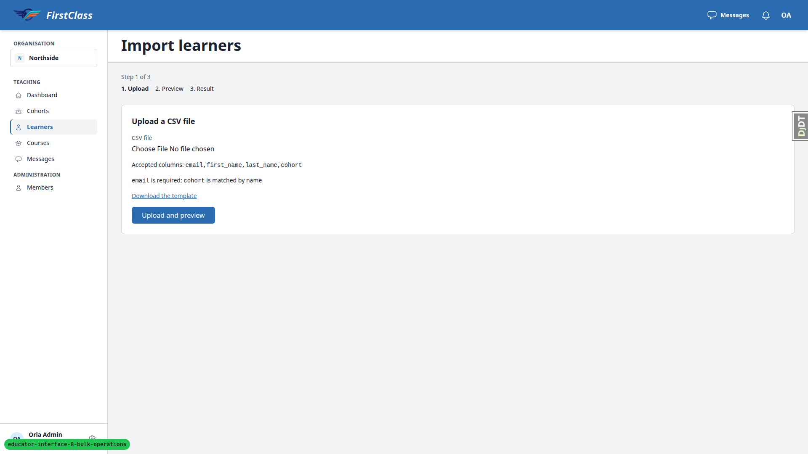 |
| 1.2 | desktop | pass | Template downloads as learner-import-template.csv with UTF-8 BOM, four headers and two example rows. | |
| 1.3 | desktop | pass | The Add learners dialog's initial help does not mention the cap. A 51-line paste is refused at 422 with "Add up to 50 at a time; larger lists are imported from a file." and an "Import a file instead" link. | |
| 1.4 | desktop | pass | Cohort C Learners tab has Import learners linking `?cohort=<Cohort C pk>`. Cohort Old has none. | |
| 2 | desktop | pass | xlsx, latin1, badhead, empty and big (2,431 rows; limit 2,000) each give 422 with a focused role=alert summary and stay on the upload step. No-file submit (required attr removed) gives 422 "This field is required.", no traceback. |  |
| 3.1 | desktop | pass | Preview at `/import/<uuid>/`, step 2 current. Chip "good.csv · 30 rows". Count links New account 26, Reactivated 1, Added to the cohort 1, Error 2. Reasons exact, three notes, error CSV has 2 rows. "Add 28 learners" and "2 rows with errors will not be added." No stray bullets between count links. |  |
| 3.2 | desktop | pass | Error link adds `?label=error` (2 rows). Reload keeps it. Back returns 30 rows. | |
| 3.3 | desktop | pass | dup.csv: dup is a new account, DUP gets "Same email as line 2.", blank gets "Email is empty."; button reads "Add 1 learner". | |
| 3.4 | desktop | pass | nocohort.csv: both rows error with the exact cohort sentence (Cohort Old inactive not matched). No confirm button; "Nothing can be added: every row has an error or is already a member." Minor: notes still say "0 new accounts will get a setup email." | |
| 3.5 | desktop | pass | semi.csv semicolon delimiter read: 2 new accounts, "Add 2 learners". | |
| 4.1 | desktop | pass | Result at `/result/`, step 3 current. "Added 28 learners. 2 rows were not added." Counts 26/1/1/2 in preview order. "26 setup emails were sent."; Mailpit holds 26, none to ada or removed. Error rows inline plus CSV link, Back to learners, Import another file. | 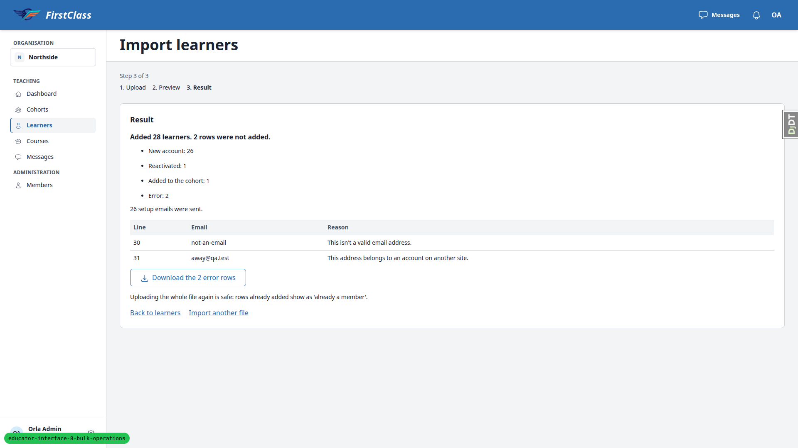 |
| 4.2 | desktop | pass | Preview URL redirects to the result page. | |
| 4.3 | desktop | pass | import01 Pending in Cohort C. Rae Removed Active. Cohort C filter lists 27. Ada still "Ada Lovelace". | |
| 4.4 | desktop | pass | Re-upload of good.csv: Already a member 28, Error 2, no Add button, "Nothing can be added...". No mail sent. | |
| 4.5 | desktop | pass | dup.csv confirmed: "Added 1 learner. 2 rows were not added.", 1 email (dup@), error CSV has exactly the two rows. | |
| 5 | desktop | pass | Cohort A import page says every learner goes to Cohort A and the cohort column is ignored. cohortimp is a new account in Cohort A, Ben added to the cohort. Result links to the Cohort A Learners tab showing both. |  |
| 6.1 | desktop | pass | Checkbox column and "Select all on this page" header checkbox present. With nothing selected the bulk buttons are hidden and pagination shows. Page size is 10, not 25 (plan stale). | |
| 6.2 | desktop | pass | role=status region exists (empty) before ticking. After ticking bulk01/02 it reads "2 selected · showing 1–10 of 95 learners". Add to cohort, Remove from cohort and More actions (Deactivate, Reactivate, Register for course, Unregister from course, Resend setup email). | 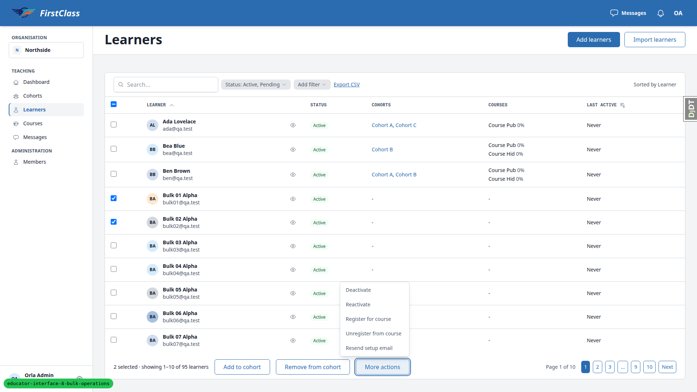 |
| 6.3 | desktop | pass | Picker above the sentence, Confirm disabled until a cohort is chosen, initial focus on Cancel. Choosing Cohort C re-renders "Add 2 learners to Cohort C."; confirm gives "2 learners changed." and rows show Cohort C. Selection cleared on close. | 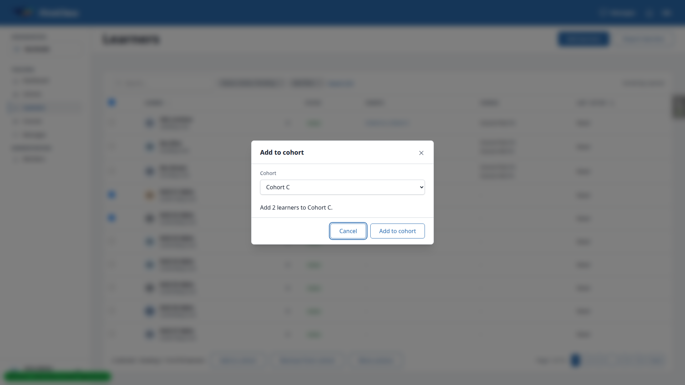 |
| 6.4 | desktop | pass | Three ticked: "Add 1 learner to Cohort C. 2 are already in the cohort and will be skipped."; result "1 learner changed. 2 already in the cohort" with per-learner reasons (plan wrote "were already"). bulk01 alone: "Add 0 learners to Cohort C. 1 is already in the cohort..." and Confirm disabled. | |
| 6.5 | desktop | pass | "Remove 1 learner from Cohort A. 1 is not a member and will be skipped. They lose access to: Course Pub." Cancelled. | |
| 6.6 | desktop | pass | Search Alpha (30, 10 per page): header tick shows "All 10 on this page are selected. Select all 30 matching", then "All 30 matching are selected. Clear selection". Untick bulk05 gives 29; "Add 29 learners to Cohort B."; "29 learners changed." in about 1.3s. Cohort B filter lists 31, bulk05 absent, Ben and Bea present. | |
| 6.7 | desktop | pass | Sorting by Last active after select-all-matching clears the selection and hides the bar buttons. | |
| 6.8 | desktop | pass | "Remove 31 learners from Cohort B. They lose access to: Course Hid and Course Pub."; "31 learners changed."; Cohort B now empty. | |
| 6.9 | desktop | pass | Deactivate button uses the btn-destructive class (see B1). "Deactivate 2 learners. They lose access to this organisation's courses. Their cohorts, registrations and progress are kept..." Removed filter shows both Removed; Reactivate 2 works. Mixed case: "Reactivate 1 learner. 1 is already active and will be skipped." and result "1 learner changed. 1 already active". | |
| 6.10 | desktop | pass | Search swaps clear the selection, so bulk20/21 and solo were registered in two parts: "Register 2 learners for Course Pub." gives 2 changed; solo alone gives "Register 0 learners for Course Pub. 1 is already registered individually and will be skipped." with Confirm disabled. Via the Course Pub filter, all three on one page: "Unregister 3 learners from Course Pub." (destructive style) gives 3 changed; they leave the filter. | |
| 6.11 | desktop | pass | Resend guard is 15 minutes (SETUP_EMAIL_RESEND_SECONDS=900) and import01 was emailed in §4 about 8 minutes earlier, so the plan's two-sent case cannot happen in plan order. pending+ada: "Resend the setup email to 1 learner. 1 account is already set up and will be skipped." gives 1 sent (Mailpit 1, to pending). Repeat at once: "0 learners changed. 1 account already set up, 1 emailed recently"; Mailpit still 1. import01 alone: skipped "emailed recently". The confirmation does not predict the "emailed recently" skip; only the result reports it. | |
| 6.12 | desktop | pass | Keys mode (updated plan): bulk40+41 Deactivate opened, bulk40 deactivated in tab 2, confirm answers 200 "1 learner changed. 1 already inactive — Bulk 40 Beta: already inactive". All-matching mode: Beta select all (30), bulk31 deactivated in tab 2, confirm re-renders at 422 "The selection changed since you opened this. Deactivate 29 learners." Data restored afterwards. | 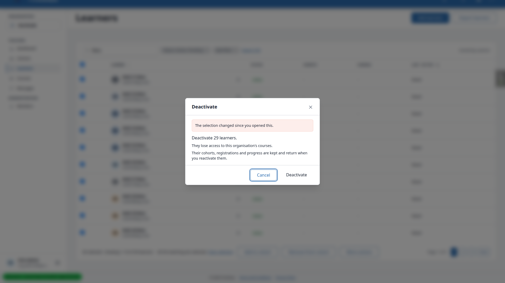 |
| 6.13 | desktop | pass | JS off: Deactivate gives a full-page confirmation with the same sentence, then a full-page result "2 learners changed." with Back to learners keeping the filter (learners-q=Bulk+5). Reactivated afterwards. Picker: Add to cohort page shows the Cohort picker, "Show what changes" and a disabled Add to cohort. Choosing Cohort C and Show what changes renders "Add 2 learners to Cohort C." with Add to cohort enabled; submit gives full-page "2 learners changed." Cosmetic: with JS off the More actions trigger shows as well as the noscript buttons. | 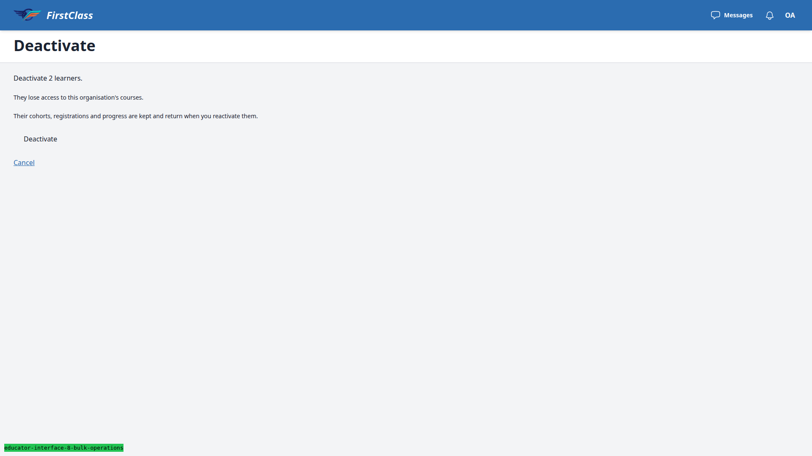 |
| 6.13-picker | desktop | pass | No-JS picker page before choosing: picker, Show what changes, disabled Add to cohort, Cancel. After: result page. |   |
| 6.14.1 | desktop | pass | Over-threshold Deactivate (30 Beta) confirmation: "This will affect 30 learners. It runs in the background. You'll get a notification when it finishes." Bell showed no unread badge beforehand. | |
| 6.14.2 | desktop | pass | Modal closes, URL unchanged; bar reads "Deactivate is running…". More actions shows a spinner and is disabled, as are Add to cohort and Remove from cohort (via disabled fieldset). All row checkboxes, the header checkbox and Clear selection are disabled. State survives page 2 and sort; quick view still opens. | 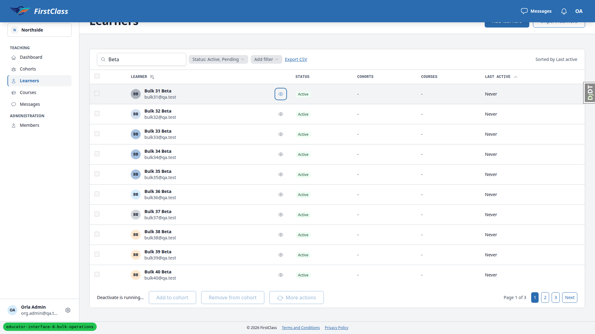 |
| 6.14.2 | mobile | pass | Fixed bottom bar fits "Deactivate is running…" and the disabled buttons with spinner. No horizontal overflow (scrollWidth 375). The bar is 279px of the 812px viewport because the three buttons stack. | 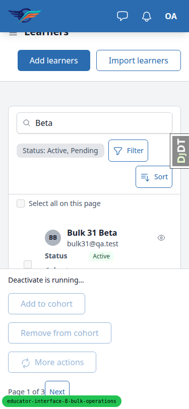 |
| 6.14.2 | tablet | pass | Static bar at md; running label and disabled buttons with spinner on one row. No horizontal overflow. | 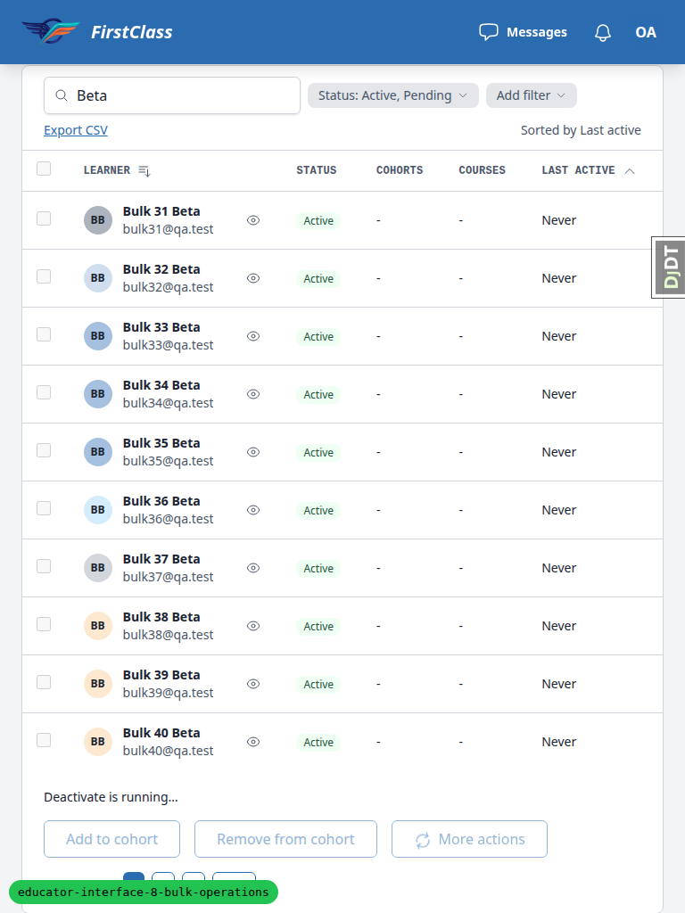 |
| 6.14.3 | desktop | pass | After db_worker the modal opened at once with "30 learners changed." and the table refreshed to empty (removed hidden by default status). On close: no running label, no spinner, checkboxes enabled, nothing selected. Bell unread unchanged; newest entry "Deactivate finished: 30 learners changed." already read; clicking it opens the learners list. Panel header says "1 unread" because of an older entry from an earlier run. | 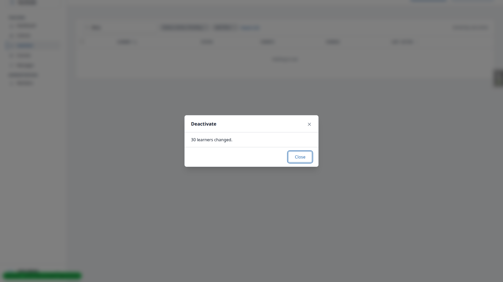 |
| 6.14.4 | desktop | pass | Reactivate 30 in background with the Add learners modal open: worker finished, Add learners modal not replaced (checked after 4s). After Cancel the result modal "30 learners changed." opened in about 1.3s. | |
| 6.14.5 | desktop | pass | Deactivate 30 started, then went to Dashboard; worker run; no modal on Dashboard. Bell went to "1 new" after about 32s; entry "Deactivate finished: 30 learners changed." opens the learners list. Removed + Beta lists 30 (3 pages). | 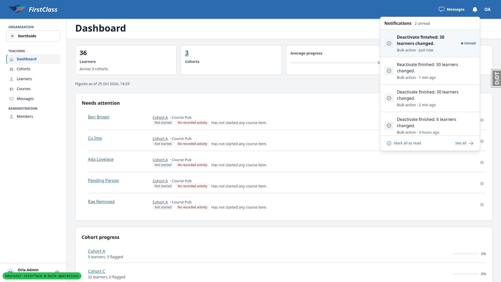 |
| 6.14.6 | desktop | pass | JS off: 6 removed Beta rows, Reactivate: confirmation "This will affect 6 learners. It runs in the background..."; confirm returns to the learners list with flash "Reactivate is running in the background. You'll get a notification when it finishes." After worker and reload bulk31–36 are Active and the bell shows 1 new. | 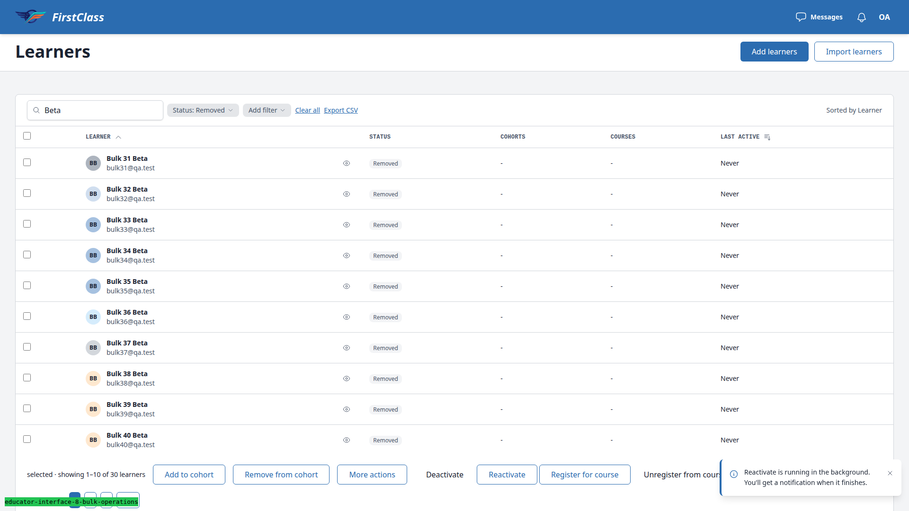 |
| 6.14.7 | desktop | pass | Status URL `/northside/bulk-runs/48a25c27-a7dc-40a2-b302-b4101877f3e5/status/` answers 200 to the requester (taken from the DB rather than the network panel). | |
| bg-import | desktop | pass | Extra check with threshold 5: a 6-row import preview says "This import runs in the background. The result page will show progress."; result page shows "Added 0 of 6 rows 0%" polling every 2s. After db_worker it shows "Added 6 learners. 0 rows were not added." and "6 setup emails were sent."; polling stops. | |
| 7.1 | desktop | pass | Cohort Old needs the "inactive" filter. With A, C, Old ticked: Register for course and Unregister from course buttons; More actions holds Deactivate and Reactivate. | |
| 7.2 | desktop | pass | "Register 2 cohorts for Course Hid. 1 is inactive and will be skipped." gives "2 cohorts changed. 1 inactive — Cohort Old: inactive"; Cohort A and C Courses columns now list Course Hid (the column lists course names, not counts). | |
| 7.3 | desktop | pass | "Register 0 cohorts for Course Hid. 2 are already registered and will be skipped. 1 is inactive and will be skipped." with Confirm disabled. | |
| 7.4 | desktop | pass | Cancel in 7.3 kept A, C and Old selected, so ticking B made the selection A, B, C, Old: "Unregister 3 cohorts from Course Hid. 1 is inactive and will be skipped." plus the access consequence line, destructive style; "3 cohorts changed. 1 inactive". The plan's "1 is not registered" case could not occur because Cohort B is seeded with Course Hid (stale plan expectation). | |
| 7.5 | desktop | pass | Bulk Deactivate Cohort C: "Deactivate 1 cohort." plus consequences gives Inactive in list; Reactivate 1 cohort gives Active. | |
| 7.6 | desktop | pass | Cohort C page single Deactivate works (Inactive, button becomes Reactivate) and Reactivate restores Active. Its confirmation says "stop giving access to its 0 courses" for a cohort with no registrations (template not changed on this branch). | 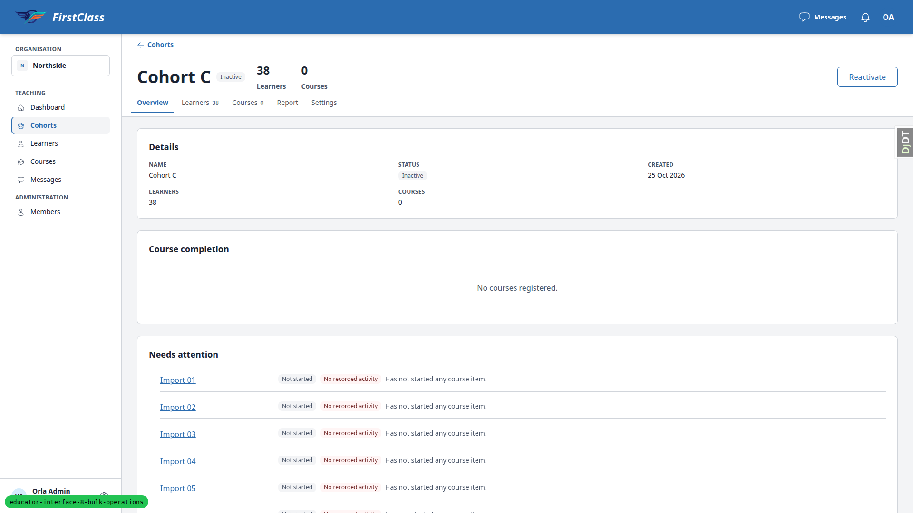 |
| 8.1 | desktop | pass | cohort.admin sees only Cohort A/B learners with a checkbox column; bar Add to cohort, Remove from cohort, More actions = Register/Unregister only; no Import learners link on list or Cohort A tab; import URL 403 "You can't import learners here. Your role doesn't allow it. Ask an organisation admin of Northside." Picker offers Cohort A and B only. Ben had left Cohort B in 6.8, so Ada+Ben to Cohort B reads "Add 2 learners to Cohort B." and 2 changed (plan expectation stale). Cohorts list shows Register/Unregister only. Forged POSTs: deactivate/reactivate/resend_setup_email 403; add_to_cohort with Cohort C 422 "Select a valid choice"; a learner key outside their cohorts gives 422 "Nothing selected". | 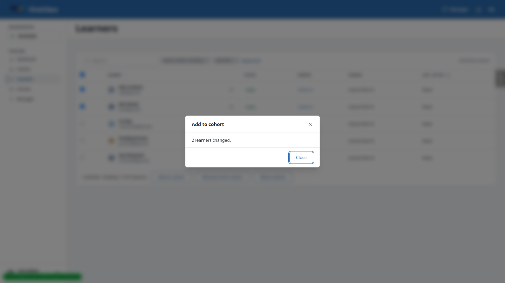 |
| 8.2 | desktop | pass | cohort.viewer: no checkbox column, no header checkbox, no selection bar or status region; import URL 403. | |
| 8.3 | desktop | pass | south.admin: §4 import preview, result, errors.csv and the run status URL all 404 under northside and under southside. | |
| 8.4 | desktop | pass | Superuser (not the requester): import result, preview and run status 404; import page 200. | |
| 8.5 | desktop | pass | Anonymous import URL redirects to `/accounts/login/?next=...` | |
| 9.1 | desktop | pass | semi.csv had never been confirmed earlier, so the fresh preview shows New account 2. Same preview URL in two tabs, confirmed simultaneously: both POSTs 303 to the same result page "Added 2 learners."; learners list shows semi1 and semi2 once; Mailpit holds exactly 2 emails. | |
| 9.2 | desktop | pass | JS off: bulk50+51 Add to Cohort C confirmed (2 changed). Back to the cached confirm page and resubmit gives 422 "Add 0 learners to Cohort C. 2 are already in the cohort and will be skipped."; no second membership. | |
| 10.1 | mobile | pass | Upload, error (badhead), preview and result pages: no horizontal overflow (scrollWidth 375); stepper fits one line; preview table hidden below md and rows render as cards with line, email, label, reason (plus name and cohort); error summary readable. | 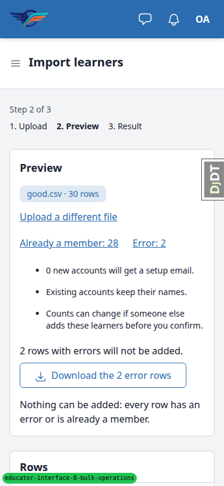 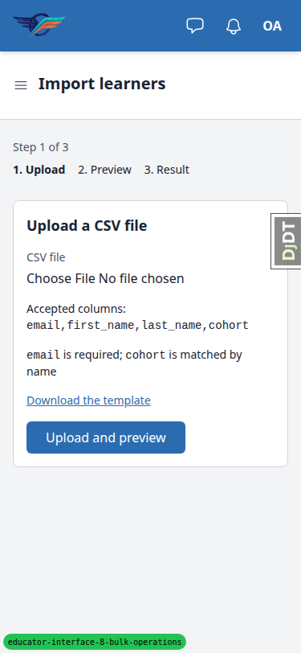 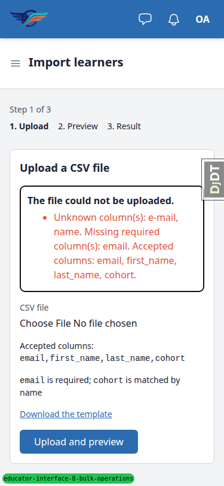 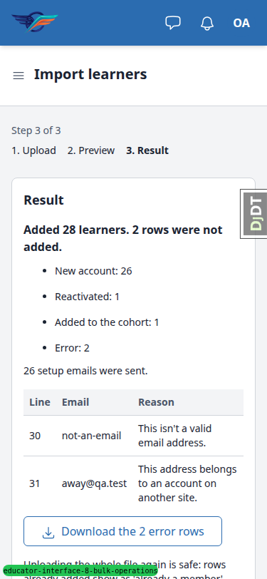 |
| 10.2 | mobile | fail | Selection bar fixed to the bottom (219px of 812), "Select all on this page" above the card list, More actions items 36px and tappable, confirmation modal fits (bottom sheet). The destructive confirm button "Deactivate" renders as plain text: class `btn btn-destructive` has no CSS rule (see B1). | 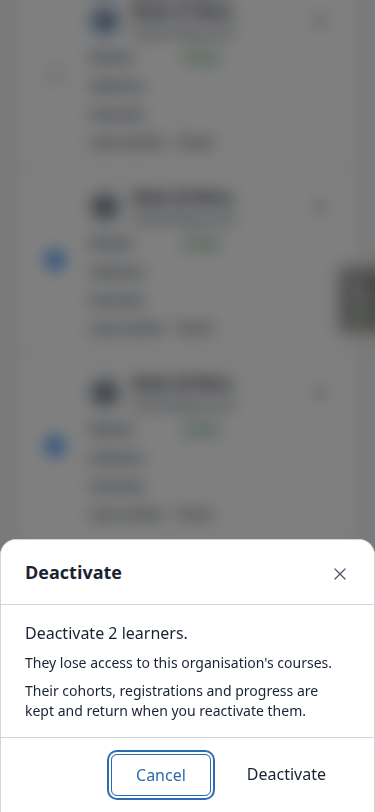 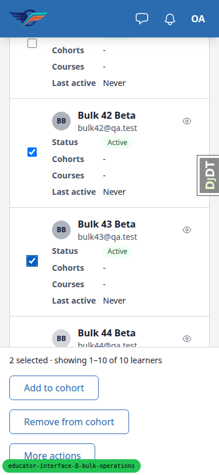 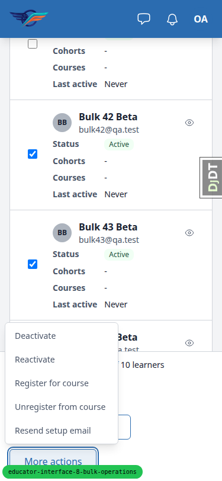 |
| 10.3 | mobile | pass | Inline Deactivate result modal "2 learners changed." fits the viewport (bottom sheet 615–812). | 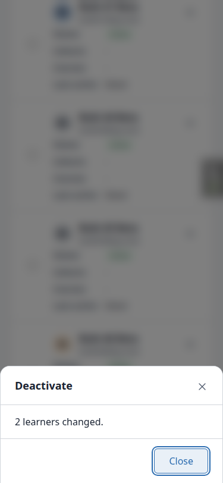 |
| 10.1 | tablet | pass | Upload, error, preview, result: no horizontal overflow (768). Preview shows the table at md as the plan specifies (cards only below md). |  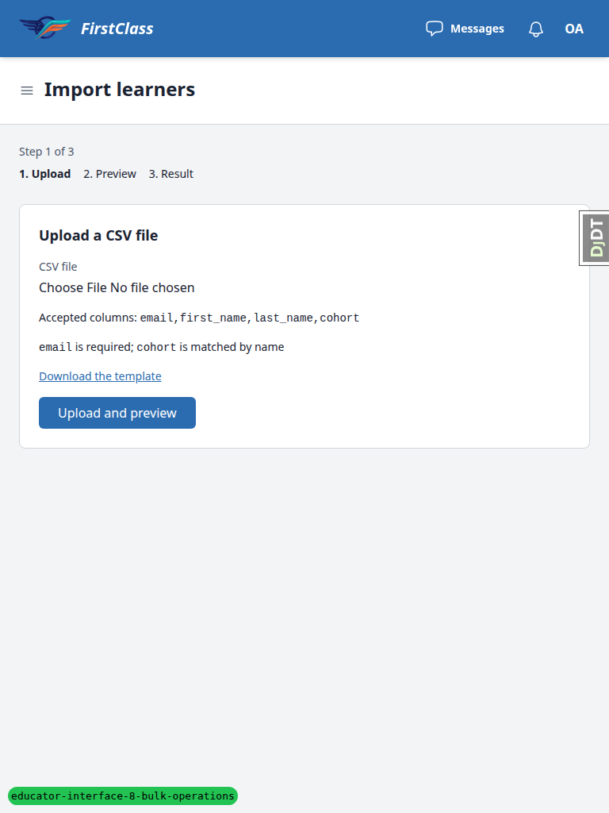 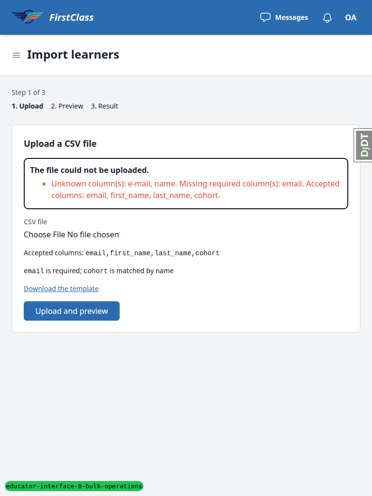 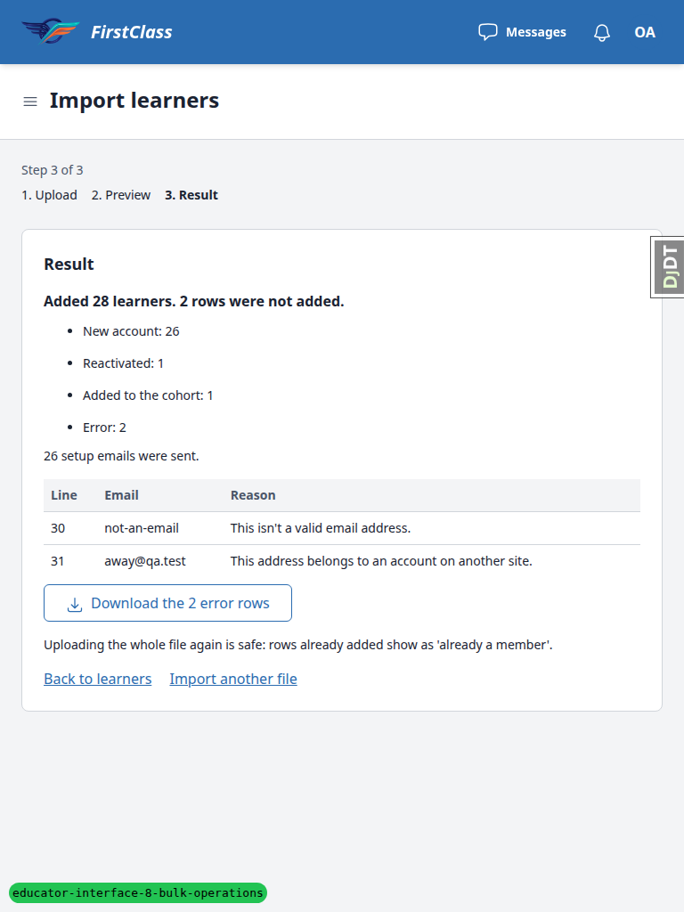 |
| 10.2 | tablet | fail | Selection bar static at md (by design, md:static) below the table; More actions items 36px and inside the viewport; confirmation modal centred and fits. Same unstyled `btn btn-destructive` Deactivate button as on mobile (see B1). | 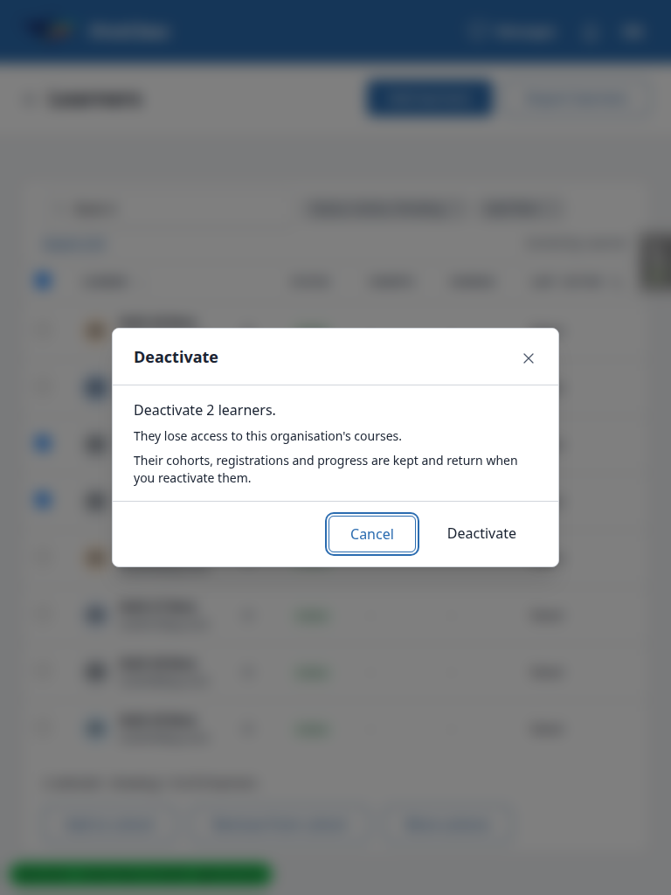 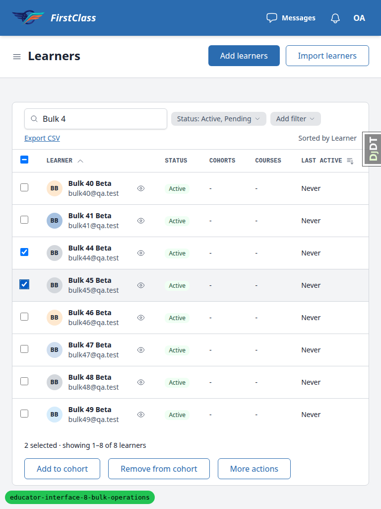 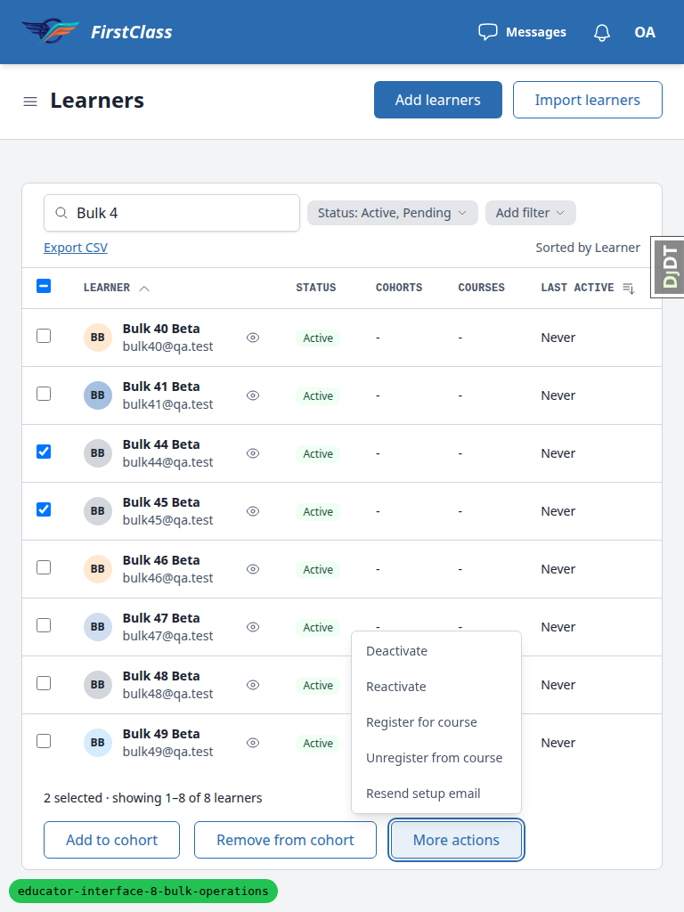 |
| 10.3 | tablet | pass | Inline Deactivate result modal fits (centred 128–640 x 413–611). | 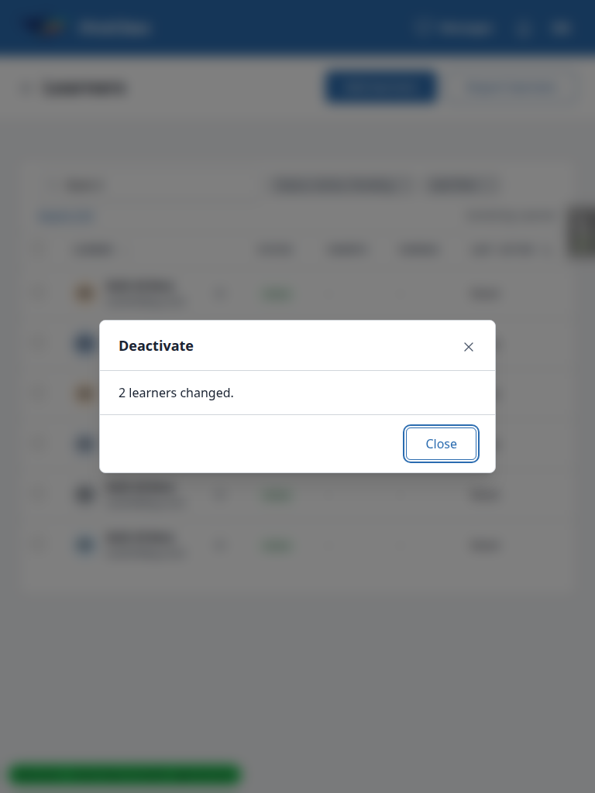 |
| 7.1-style | desktop | fail | Cohorts list bar "Unregister from course" and every destructive confirm button (Deactivate, Unregister) carry class `btn btn-destructive`, which has no CSS rule: transparent background, no border, so they render as plain text. The design system's destructive button is variant `error` (`.btn-error` in tailwind.components.css). | 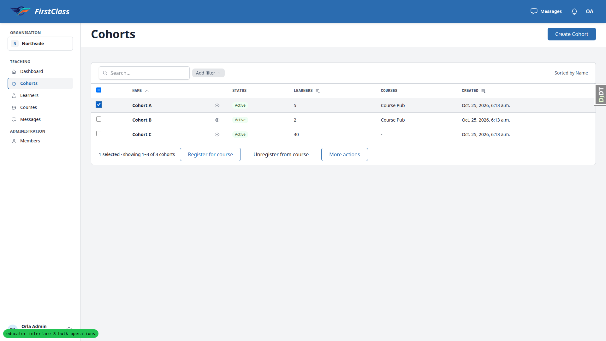 |

## Bugs

### B1: Destructive bulk-action buttons are unstyled (variant 'destructive' has no CSS)

Manifestations:

- 7.1-style, desktop
- 10.2, mobile
- 10.2, tablet

Screenshots:

Expected: The QA plan (6.9, 6.10, 7.4) expects the destructive style for Deactivate and Unregister. The c-button component renders `btn-{variant}`, and the design system's destructive style is variant `error` (`.btn-error`).

Actual: `DeactivateLearnersBulkAction` and three other bulk actions in `educator_interface/actions.py` (lines ~2472, 2609, 2858, 2920) set `variant = 'destructive'`. That renders class `btn btn-destructive`, which tailwind.components.css does not define. The confirm button and the cohorts-list bar button show as unstyled text (transparent background, no border) at every viewport.

## Bug status

- **FIXED** (commit: 18860c407) — B1 Destructive bulk-action buttons are unstyled (variant 'destructive' has no CSS). The four destructive bulk actions now use variant "error". Re-verified in the browser: the cohorts-list "Unregister from course" bar button, the cohort Unregister confirm button and the learner Deactivate confirm button all render `btn btn-error` with a red background and white text. Secondary buttons are unchanged. 

## General notes

(a) Plan expectations that are stale, or that the run could not meet in plan order:

- Page size is 10, not 25.
- 6.10 had to run in parts because a search swap clears the selection.
- 6.11's two-sent case is impossible in plan order: the 15-minute resend guard (SETUP_EMAIL_RESEND_SECONDS=900) still covers import01 from §4.
- 7.4's "not registered" case cannot occur because Cohort B is seeded with Course Hid.
- 8.1's Ada/Ben case changed because Ben left Cohort B in 6.8.
- 9.1's semi.csv was never confirmed earlier, so the rows were new.

(b) Minor wording differences from the plan:

- The resend confirmation does not predict the "emailed recently" skip; only the result reports it.
- Result skip lines read "2 already in the cohort" where the plan wrote "2 were already in the cohort".
- Menu labels are "Register for course" / "Unregister from course" where the plan says "for a course".
- The import notes say "0 new accounts will get a setup email." when there are none.

(c) Tangential and not changed on this branch: the single-cohort Deactivate confirmation (`educator_interface/modal/deactivate_confirmation.html`) says "stop giving access to its 0 courses" for a cohort with no registrations.

(d) With JS off, the "More actions" trigger renders alongside the noscript buttons.

(e) The notifications panel header reads "1 unread" from an older entry left by an earlier QA run, while the bell reads "none new".

(f) The open todo item "Re-run QA steps 6.12 and 6.13 (picker, JS off)" was covered: both pass against the updated plan.

(g) The mobile fixed selection bar is 219–279px tall at 375 wide because its buttons stack.

status: ok · reason: 1 bug — 1 fixed, 0 unresolved; report rendered, screenshots verified
