# QA report: member administration

Date: 2026-10-22 · Branch: `educator-interface-9-educator-administration` · Server: `http://127.0.0.1:8116/`

## Methodology

Screenshots were collected into `screenshots/` beside this report. Every referenced image exists there. Tests were driven interactively with Playwright MCP against a dev server on port 8116. The viewports ran in this order: 1920×1080 (desktop), then 375×812 (mobile), then 768×1024 (tablet). The dev data was reset to the plan's §0 state by the data helper before the run. The run completed and nothing aborted.

## Diff scoping

Class: FULL. The diff touched files under `templates/` and `static/`, and `.html` and `.js` files, so the full pass applies. Nothing was skipped. The desktop, mobile and tablet passes all ran.

## Smoke gate

Outcome: pass. Pages loaded:

- `http://127.0.0.1:8116/`
- `http://127.0.0.1:8116/educator/organisations/northside/members`

## Results

Total 96 tests, 96 passes, 0 failures, 0 skips. Desktop: 89 run, 89 pass, 0 fail, 0 skip. Mobile: 4 run, 4 pass, 0 fail, 0 skip. Tablet: 3 run, 3 pass, 0 fail, 0 skip.

### §1 Who can open the section

| Test | Viewport | Result | Notes | Screenshot |
|---|---|---|---|---|
| 1.1 | desktop | pass | As Oscar the sidebar shows Teaching (Dashboard, Cohorts, Learners, Courses) and Administration (Members); Members page heading is Members, title names Northside. | 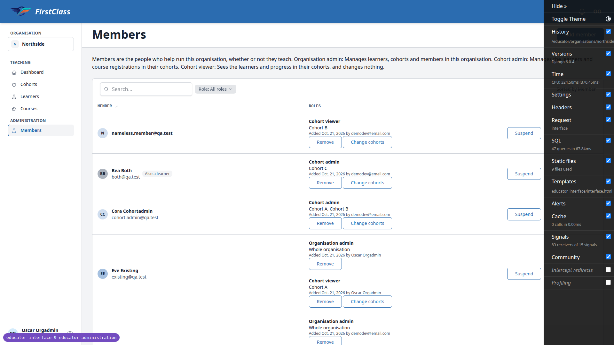 |
| 1.2 | desktop | pass | cohort.admin: sidebar has only the Teaching group, no Administration/Members; /members 404; /members/__actions/add_member 404; Cohort A overview has no Educators panel and no Add member. | |
| 1.3 | desktop | pass | cohort.viewer: same three checks give the same answers (404, 404, no Educators panel). | 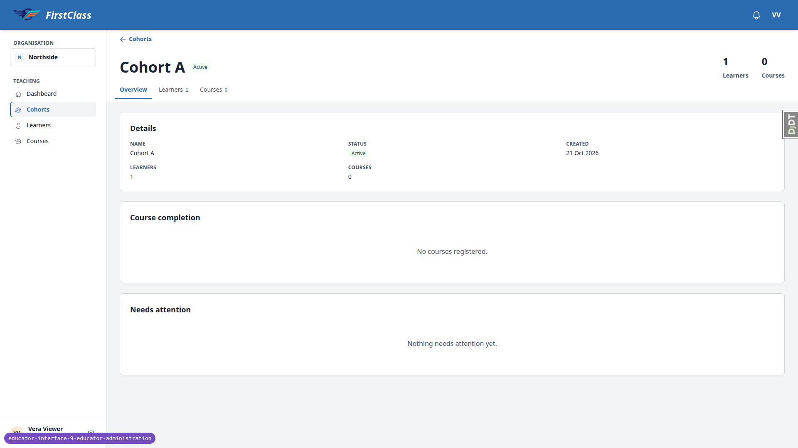 |
| 1.4 | desktop | pass | site.admin: Members opens (200) for Northside, Southside, Westside and Eastside; searching her own email in each gives No members match, so Sandra is listed nowhere. | |
| 1.5 | desktop | pass | demodev@email.com: Members opens for every organisation; demodev is listed in none (only appears in Added-by lines). | |
| 1.6 | desktop | pass | south.admin: Northside members 404; Southside lists exactly Sam South with the You marker and the lock text, no row buttons; the only-member callout shows. | |

### §2 The list

| Test | Viewport | Result | Notes | Screenshot |
|---|---|---|---|---|
| 2.1 | desktop | pass | Help paragraph present with the three role descriptions word for word. |  |
| 2.2 | desktop | pass | Columns Member, Roles, unlabelled actions; chip reads Role: All roles; pager with pages 1-3; rows sorted by first name ascending (nameless member first as it has no name). | |
| 2.3 | desktop | pass | Oscar: You marker (info chip), Organisation admin / Whole organisation / Added by line, lock text, no buttons. | |
| 2.4 | desktop | pass | Lars: Suspended marker; Remove + Reactivate; no Suspend. | |
| 2.5 | desktop | pass | Noa (no member row): Suspended marker; Remove, Change cohorts, Reactivate. | |
| 2.6 | desktop | pass | Otto: Account turned off marker; only Remove. | |
| 2.7 | desktop | pass | Bea: Also a learner uses chip-muted (neutral); Cohort admin on Cohort C; Change cohorts, Remove, Suspend. | |
| 2.8 | desktop | pass | Ola scope: Cohort A, Cohort Old (inactive). | |
| 2.9 | desktop | pass | Manny scope: Cohort A, Cohort B +2 more; title attribute lists all four. | |
| 2.10 | desktop | pass | nameless member shows the email as the name with no second line. | |
| 2.11 | desktop | pass | Nia added-by line reads Not recorded. | |
| 2.12 | desktop | pass | Sita listed once with Cohort viewer on Cohort A; no Site admin entry; no Suspend/Reactivate. | |
| 2.13 | desktop | pass | Lena and Sandra: No members match. Eve Existing absent (the search Eve only matches Vee Eleven / Vee Seven by substring). | |
| 2.14 | desktop | pass | Role chip is a single-choice list (All roles / Organisation admin / Cohort admin / Cohort viewer). Cohort admin: Bea, Cora. Organisation admin: Lars, Olga, Oscar. Cohort viewer: nameless, Manny, Nia, Noa, Ola, Otto, Sita, the twelve Vee viewers, Vera. All roles returns the full 25-member list. Mobile single select checked in the mobile pass. | |
| 2.15 | desktop | pass | Search zzz shows No members match. with Clear filters; clicking it returns the full list and the search box is empty (earlier bug B2 fixed). | |
| 2.16 | desktop | pass | Member header shows ascending by default; first click goes to -first_name (Vera first), second click back to ascending (earlier bug B3 fixed). | |
| 2.17 | desktop | pass | west.admin: one row (Wes, You) and the only-member callout. Added existing@qa.test as Organisation admin: list refreshed in place with Eve, callout stayed until reload, then gone. Removed Eve again (no last-admin warning, Wes remains). | 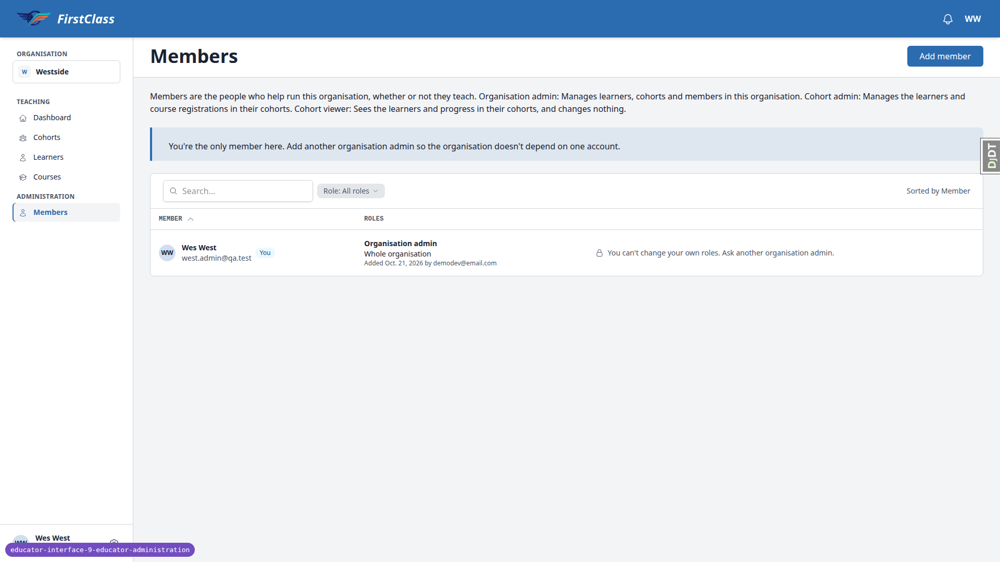 |
| 2.18 | desktop | pass | site.admin on Eastside: No members in this organisation yet. with an Add member button inside the empty state. | 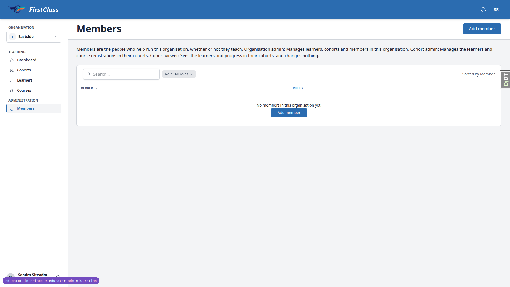 |

### §3 Add member, existing account

| Test | Viewport | Result | Notes | Screenshot |
|---|---|---|---|---|
| 3.1 | desktop | pass | Dialog title Add a member, one email field + Look up. Empty submit is blocked by the field itself (required: Please fill out this field.), dialog stays open. | |
| 3.2 | desktop | pass | Padded, upper-cased address resolves to Existing account: Eve Existing, existing@qa.test; Cancel leaves no Eve row. | |
| 3.3 | desktop | pass | Three radio cards with the exact descriptions, none preselected, no rank line, no no-cohorts line. | |
| 3.4 | desktop | pass | Org admin hides the checklist; Cohort admin shows Cohort A/B/C only, search box, 0 selected count and the not-the-same-as-org-admin note; search B filters to Cohort B; ticking A and C reads 2 selected. | 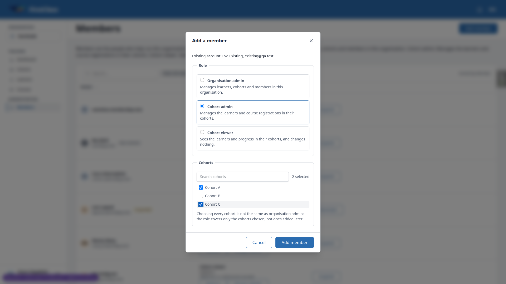 |
| 3.5 | desktop | pass | No cohort ticked: Choose at least one cohort. with the dialog open. | |
| 3.6 | desktop | pass | Confirmation: Add Eve Existing as Cohort admin, scope Cohort A and Cohort C, description restated, no account-created text, no Now/After block. It does add the spec-mandated no-active-membership sentence. Cancel leaves Eve absent. |  |
| 3.7 | desktop | pass | Confirm closes the dialog, list refreshes in place; Eve row: Cohort admin, Cohort A, Cohort C, Added Oct. 22, 2026 by Oscar Orgadmin. | |
| 3.8 | desktop | pass | Same role/cohorts again: This change was not made / already holds this role on these cohorts, in the dialog. A+B: confirmation says Cohort A stays as it is, scope Cohort B, Now/After block; after confirm scope is Cohort A, Cohort B +1 more (title lists C). | |
| 3.9 | desktop | pass | Org admin for Eve: Now (Cohort admin on three) vs After (plus Organisation admin). Row gains a second entry. | |
| 3.10 | desktop | pass | Lars: confirmation says the role takes effect only once reactivated; row gains Cohort viewer on Cohort A and keeps Suspended. | |
| 3.11 | desktop | pass | Noa: confirmation says adding creates an active membership and existing roles take effect; Suspended gone, Suspend offered. | |
| 3.12 | desktop | pass | Sandra: confirmation says she already has access to every organisation and the role lists her as a member; row appears with Cohort viewer on Cohort A, no Suspend/Reactivate. | |
| 3.13 | desktop | pass | Otto: on confirm, This person account is turned off, so they cannot be given a role. Row unchanged. | |
| 3.14 | desktop | pass | Self: You cannot change your own roles. Ask another organisation admin. | |
| 3.15 | desktop | pass | away@qa.test: This address belongs to an account on another site. Use a different address. No name, no role step. | |
| 3.16 | desktop | pass | Hidden cohorts input changed to Cohort S pk: the dialog answers Select a valid choice ... is not one of the available choices / Choose at least one cohort. Lena gains no role. | |
| 3.17 | desktop | pass | Lena added normally: row appears with Also a learner. | |
| 3.18 | desktop | pass | Westside Add member for existing@qa.test offers only Organisation admin and says This organisation has no active cohorts yet. | 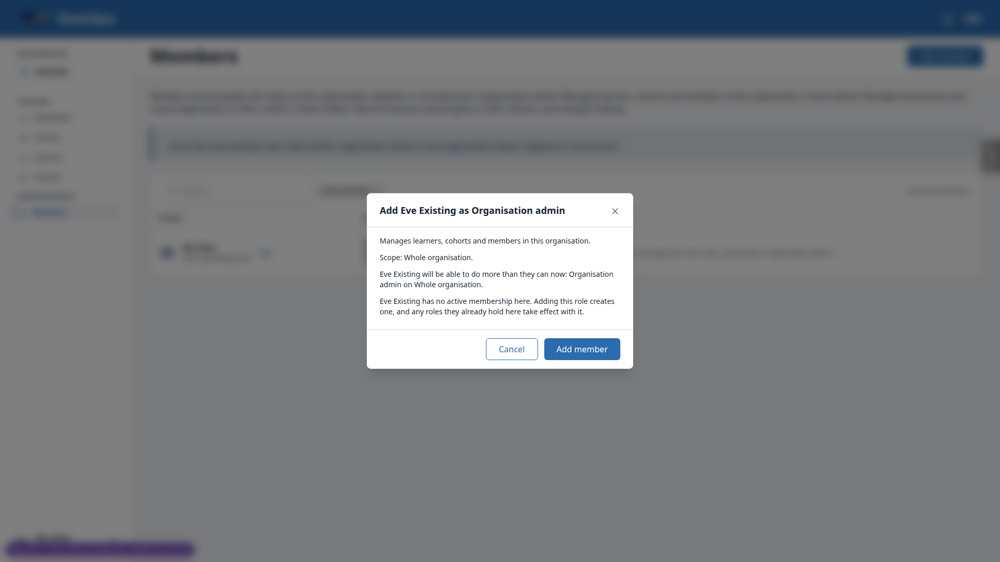 |

### §4 Add member, new account

| Test | Viewport | Result | Notes | Screenshot |
|---|---|---|---|---|
| 4.1 | desktop | pass | new.member@qa.test lookup: No account yet. One will be created and a setup email sent. plus optional First/Last name fields. | |
| 4.2 | desktop | pass | Confirmation says an account will be created and a setup email sent. After Cancel, Mailpit has 0 messages and no Nina row. | |
| 4.3 | desktop | pass | Confirm: Nina Newmember row with Cohort viewer on Cohort B. Mailpit has exactly one message to new.member@qa.test, subject [FirstClass] Set your password, naming Northside. The link host is the Site domain 127.0.0.1:8000 (account_setup.py builds it from user.site.domain on commit, no request in scope), not this server port 8116; that is the configured dev Site domain, not a defect. | |
| 4.4 | desktop | pass | In a fresh browser context the set-password link (port swapped to 8116) opened the set-password form; after submitting twice Nina was logged in; /educator/ opened Northside and the Cohorts list showed Cohort B only. | |
| 4.5 | desktop | pass | Looking up new.member@qa.test again reads Existing account: Nina Newmember, new.member@qa.test. | |

### §5 Remove a role

| Test | Viewport | Result | Notes | Screenshot |
|---|---|---|---|---|
| 5.1 | desktop | pass | Title Remove Eve Existing from Cohort admin; loses Cohort admin on Cohort A, Cohort B and Cohort C with the description; keeps account and Organisation admin; no learner access named. Cancel changes nothing. | |
| 5.2 | desktop | pass | Confirm closes the dialog; Eve row shows only Organisation admin. | |
| 5.3 | desktop | pass | Bea Remove: keeps sentence names her learner access in this organisation. Cancelled. |  |
| 5.4 | desktop | pass | Removing Olga: no last-admin warning; after confirm Olga is off the list; in a second context Olga gets 404 on Northside members and on /educator/ (Northside was her only organisation). | |
| 5.5 | desktop | pass | Olga added back. Plain GET of remove_role?user=72 renders the confirmation as a bare unstyled htmx fragment (no layout, no htmx loaded, so its Remove button cannot submit by itself). POSTing the form directly, with and without HX-Request, answers 422 You cannot change your own roles. Ask another organisation admin. Oscar unchanged. | 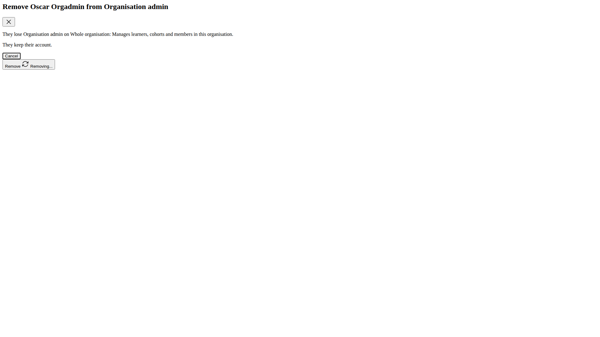 |
| 5.6 | desktop | pass | site.admin on Southside: Remove Sam dialog warns Sam South is the only organisation admin and nobody can administer it until you add one. Confirm: list shows No members in this organisation yet. Sam added back. | |
| 5.7 | desktop | pass | south.admin removing own role (POST, no button exists): 422 You cannot change your own roles. Row unchanged. | |
| 5.8 | desktop | pass | Sita Remove dialog: site-level access is unaffected, only takes them off the member list, keeps account; no loses sentence. Confirm drops Sita; site.member still opens Northside members (200). Sita added back as Cohort viewer on Cohort A. | |
| 5.9 | desktop | pass | Stale tab: after tab 2 removed Vera, confirming tab 1 dialog answers This is no longer available / It may have been removed, or you may no longer have access to it. Vera added back. | |

### §6 Change cohorts

| Test | Viewport | Result | Notes | Screenshot |
|---|---|---|---|---|
| 6.1 | desktop | pass | Change cohorts for Manny Many: A, B, C ticked, search box, 3 selected, Kept as they are: Cohort Old (inactive) with no checkbox. | 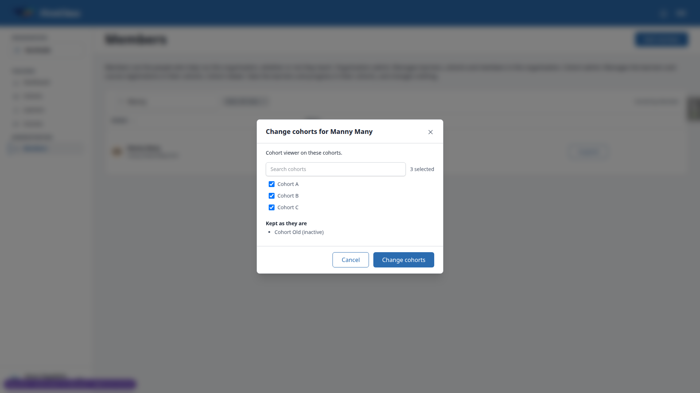 |
| 6.2 | desktop | pass | Untick B: confirmation Removes: Cohort B / loses Cohort viewer on Cohort B, nothing added, button Change cohorts. After: scope A, C, Old (title attribute lists them). | |
| 6.3 | desktop | pass | Add one, remove one: confirmation shows Adds and Removes lines, the widening sentence and the loses sentence. Scope updates accordingly. Manny restored to A, B, C, Old afterwards. | |
| 6.4 | desktop | pass | No change: This change was not made / Nothing changed. Tick or untick a cohort first. Dialog stays open with Close. | |
| 6.5 | desktop | pass | Vera unticking her only cohort: title Remove Vera Viewer from Cohort viewer, button Remove; she drops off the list. Added back. | |
| 6.6 | desktop | pass | Noa Change cohorts open in tab 1, role removed in tab 2, confirm in tab 1: This is no longer available. Noa added back as viewer on Cohort B. | |
| 6.7 | desktop | pass | No Change cohorts on Organisation admin entries (Oscar, Olga, Lars) nor on Otto row. | |

### §7 Suspend and reactivate

| Test | Viewport | Result | Notes | Screenshot |
|---|---|---|---|---|
| 7.1 | desktop | pass | Reactivate Lars Lapsed lists Organisation admin on Whole organisation and Cohort viewer on Cohort A; after confirm Suspended is gone and Suspend is offered. | 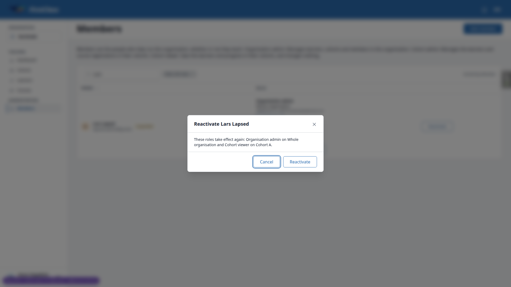 |
| 7.2 | desktop | pass | lapsed.admin opens Northside members (200) once reactivated. | |
| 7.3 | desktop | pass | Suspend dialog: keeps roles but can do nothing in Northside until reactivated; no last-admin warning. After confirm Suspended returns and lapsed.admin gets 404. | |
| 7.4 | desktop | pass | Stale Suspend dialog in tab 2 after tab 1 suspended: This is no longer available. | |
| 7.5 | desktop | pass | Olga suspended fine. Self-suspend by URL (POST user=72): 422 self message. As site.admin, Oscar row offers Suspend. With Olga, Lars and Eve (org admin since 3.9) suspended, the dialog warns Oscar is the only organisation admin. With Eve still active there is correctly no warning. Cancelled; Olga and Eve reactivated. | 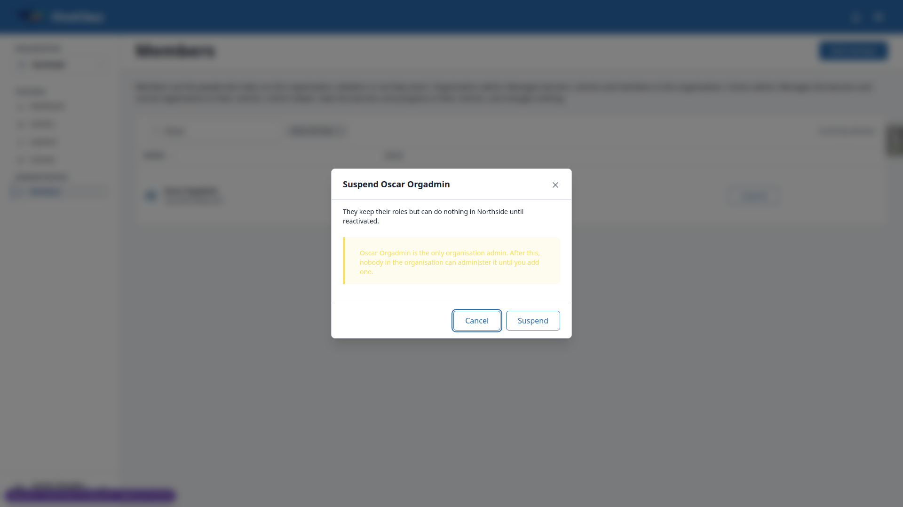 |
| 7.6 | desktop | pass | As Olga, Oscar Suspend dialog carries no warning. Cancelled. | |
| 7.7 | desktop | pass | Sita row: no Suspend/Reactivate. Otto row: only Remove. Own row: lock text and no buttons. | |

### §8 Cohort overview

| Test | Viewport | Result | Notes | Screenshot |
|---|---|---|---|---|
| 8.1 | desktop | pass | Cohort A Educators panel lists Cora (Cohort admin), Lena, Manny, Ola, Sandra, Sita, Vera (Cohort viewer) and an Add member button. Lars (suspended) and Otto (turned off) are not listed even though they hold viewer on A. | 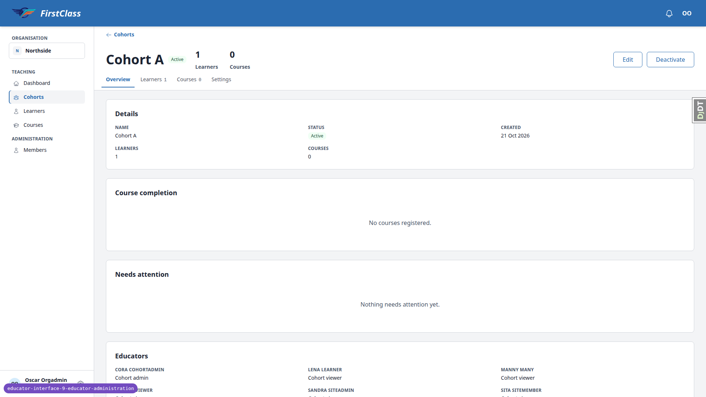 |
| 8.2 | desktop | pass | Dialog title Add a member to Cohort A (earlier bug B7 fixed); role step offers only Cohort admin and Cohort viewer, no checklist, no rank line. Confirm closes the dialog and the panel re-renders with Eve Existing / Cohort viewer; a window marker survived, so no page load. | 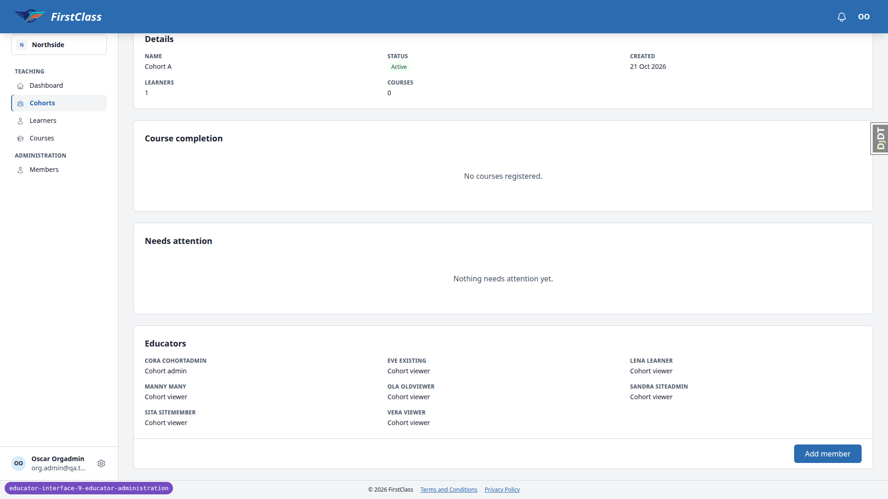 |
| 8.3 | desktop | pass | Northside Members: Eve row shows the new Cohort viewer / Cohort A entry beside Organisation admin. | |
| 8.4 | desktop | pass | cohort.admin on Cohort A overview: no Educators panel and no Add member (verified in 1.2). | |
| 8.5 | desktop | pass | site.admin on Cohort S overview: panel reads No educators assigned to this cohort. with Add member; dialog titled Add a member to Cohort S; cancelled. | |

### §9 Mid-session removal

| Test | Viewport | Result | Notes | Screenshot |
|---|---|---|---|---|
| 9.1 | desktop | pass | Context 1 Vera on Cohort A overview; context 2 Oscar removed her only role. | |
| 9.2 | desktop | pass | Vera clicking the Learners tab (htmx) reloads the page into the 404 page (earlier bug B8 fixed: no silent no-op). /educator/ answers 404 since Northside was her only organisation. | |
| 9.3 | desktop | pass | Vera added back as Cohort viewer on Cohort A. | |
| 9.4 | desktop | pass | Olga with Eve Remove dialog open; Oscar removed Olga role; Olga confirming reloads into the 404 page (unmarked 404 on the htmx action). Eve row unchanged for Oscar. Olga added back. | |

### §10 Cohort deletion cleanup

| Test | Viewport | Result | Notes | Screenshot |
|---|---|---|---|---|
| 10.1 | desktop | pass | Created Cohort Doomed via Cohorts > Create Cohort; added existing@qa.test as Cohort viewer on it; Eve scope read Cohort A, Cohort Doomed. | |
| 10.2 | desktop | pass | Settings tab > Delete > confirm: redirected to the Cohorts list. | |
| 10.3 | desktop | pass | Eve Cohort viewer entry now names Cohort A only. | |
| 10.4 | desktop | pass | Shell: cohort ObjectRoleAssignment and UserObjectPermission counts returned to the pre-step baseline (36 / 64); zero rows point at the deleted cohort pk; no orphan rows for any cohort. | |
| 10.5 | desktop | pass | As demodev: created Cohort Doomed Two, added Eve as viewer on it, deleted it at /admin/freedom_ls_learner_management/cohort/&lt;pk&gt;/delete/. Eve scope back to Cohort A; counts back to baseline; zero rows point at that pk. | |

### §11 Isolation and enumeration

| Test | Viewport | Result | Notes | Screenshot |
|---|---|---|---|---|
| 11.1 | desktop | pass | south.admin: Northside members, add_member and remove_role URLs all 404 (htmx and plain). | |
| 11.2 | desktop | pass | Oscar: members/&lt;uuid&gt; and members/76 are 404; remove_role for Sam (user 99) answers 404 with the no-longer-available fragment on GET and POST; change_cohorts POST naming Cohort S answers 404 no-longer-available and writes nothing (Vera still Cohort A only). | |
| 11.3 | desktop | pass | The other-site message in 3.15 never named Avery Away. | |

### §12 Layout at the QA viewports

| Test | Viewport | Result | Notes | Screenshot |
|---|---|---|---|---|
| 12.1 | desktop | pass | 1920: no horizontal scroll (scrollWidth 1920); row actions 38px high at desktop density by design. | |
| 12.2 | desktop | pass | Add member dialog at 1920: email step, radio cards, checklist with search and count, confirmation all fit; buttons inside the viewport. |  |
| 12.1 | mobile | pass | 375: no horizontal scroll; rows are cards with the bold member chip, markers beside it, a Roles label and stacked actions; Remove/Change cohorts/Suspend all 44px high (earlier bug B6 fixed); Filter and Sort 44px; pager Next 44px and reachable. Filter sheet shows Role as a single select (All roles / Organisation admin / Cohort admin / Cohort viewer). | 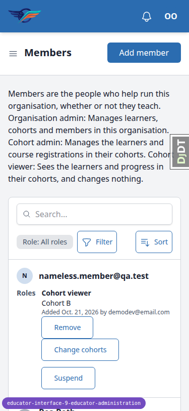 |
| 12.2 | mobile | pass | Add member dialog is a full-width bottom sheet: email step, three radio cards 291px wide with wrapped descriptions, checklist with search and 2 selected count, confirmation. The body scrolls inside the dialog with the header and footer pinned; Cancel/Add member stay inside the viewport. | 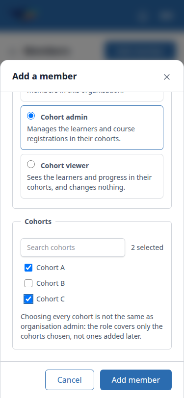 |
| 12.3 | mobile | pass | Remove, Change cohorts, Suspend and Reactivate dialogs at 375 are readable, no horizontal overflow, buttons at bottom 796 of 812. | 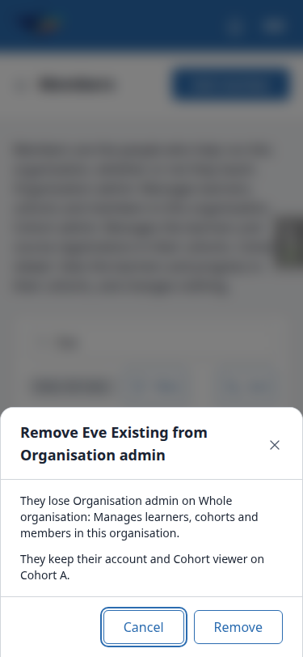 |
| 12.4 | mobile | pass | Cohort A Educators panel at 375: single column list with the Add member button, no overflow. Hamburger drawer opens with Organisation, Teaching and Administration groups. | 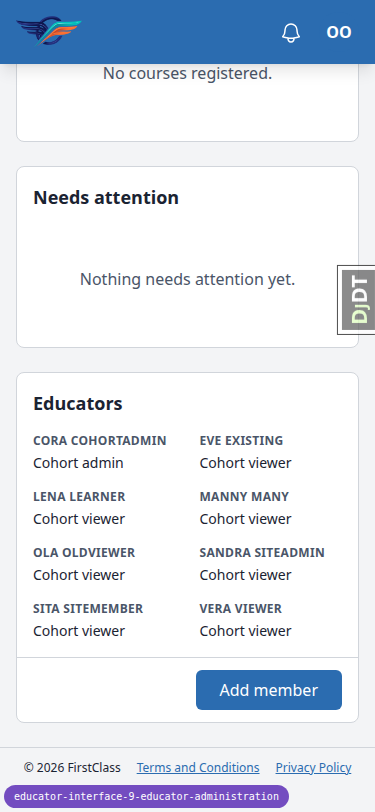 |
| 12.1 | tablet | pass | 768: table layout kept (Member, Roles, actions) with no horizontal scroll; toolbar shows search, Role chip and Sorted by; hamburger drawer used for navigation and opens with both groups. | 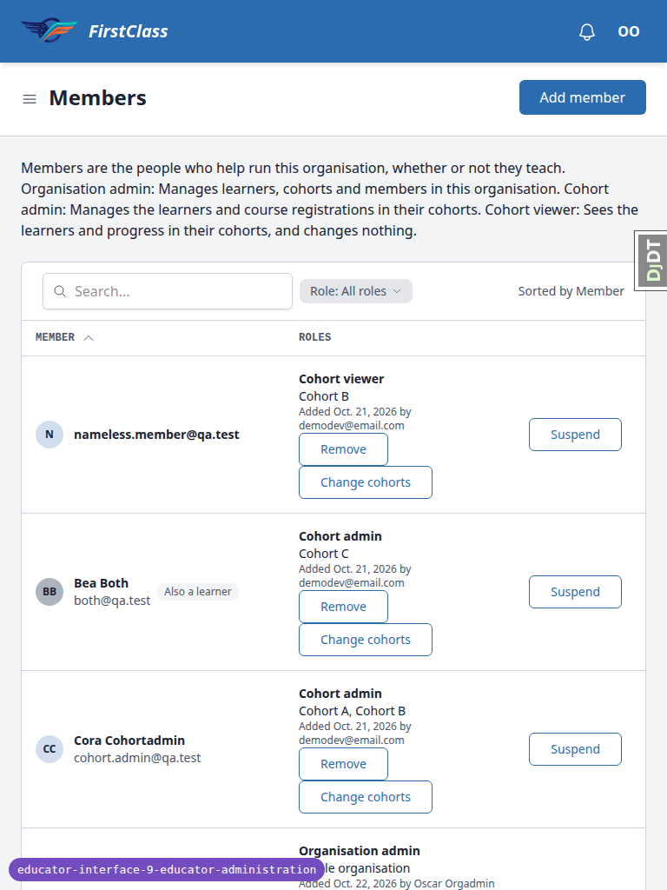 |
| 12.2 | tablet | pass | Add member dialog at 768 is a centred 512px modal; radio cards 428px wide; checklist and buttons inside the viewport. | 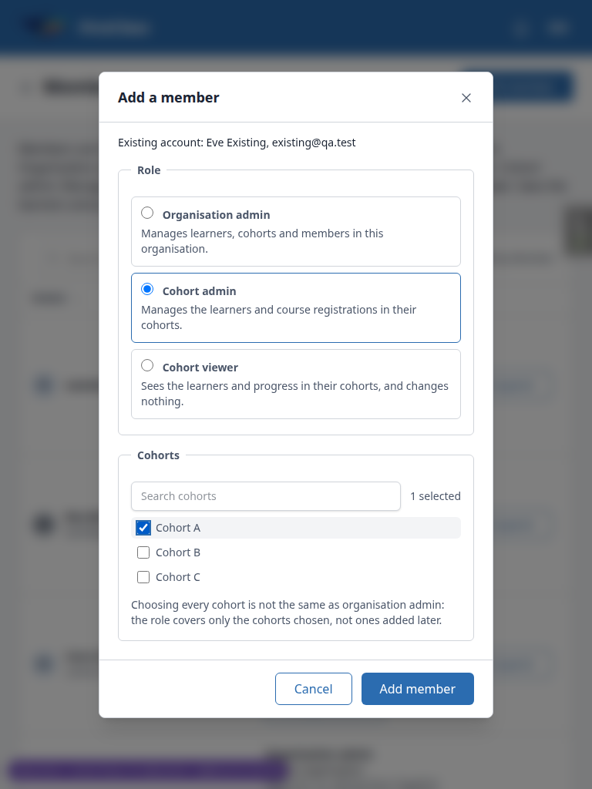 |
| 12.4 | tablet | pass | Educators panel at 768 lays out in three columns with the Add member button; no overflow. | 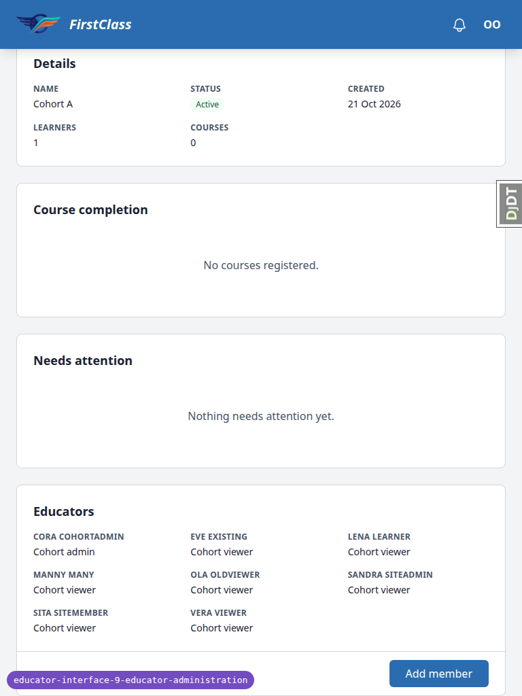 |

## Design check

no design states tested

## Bugs

No bugs were found this run. The five bugs the previous run filed were all re-verified fixed:

- B2 (clear-filters search text): test 2.15.
- B3 (default sort direction): test 2.16.
- B6 (44px touch targets): test 12.1 on mobile.
- B7 (cohort-preset dialog title and rank line): test 8.2.
- B8 (htmx reload on an unmarked 403/404): test 9.2.

## Bug status

No bugs this run.

## General notes

- Data: the previous run left residue (a Nina Newmember account and extra grants on Eve, Sandra, Lena, Lars, Noa). The seed command qa_create_member_administration_scenario adds grants but never removes stray ones, so the data helper deleted the residue by pk before this run. Future runs will need the same.
- Set-password email link host: account_setup.py builds the link from user.site.domain (DemoDev is 127.0.0.1:8000) because the mail is sent on commit with no request in scope, so the link points at port 8000 rather than the QA server port. Expected for the configured dev Site domain; the link key worked once the port was swapped.
- Plain non-htmx GET of a row action URL (e.g. remove_role?user=72&role=organisation_admin) renders the confirmation as a bare unstyled fragment with no layout and no htmx, so its Remove button cannot submit on its own. The server-side guards were verified by posting the form directly (422 self message). Observation only; the actions are designed to run inside the dialog.
- Add member confirmation for a person with no member row (including someone with no roles at all, e.g. Eve in 3.6) includes the spec-mandated sentence: X has no active membership here. Adding this role creates one, and any roles they already hold here take effect with it. The QA plan 3.6 did not list it; the spec (Elsewhere: Adding a role to a person with no member row makes them active, and the confirmation says so) does.
- The Role filter is a single-choice link list (All roles / Organisation admin / Cohort admin / Cohort viewer); the plan 2.14 wording about ticking All roles while Cohort viewer is still ticked does not apply, All roles simply clears the filter.
- The Educators panel omits suspended members (Lars) and turned-off accounts (Otto) who hold a role on the cohort; it lists active holders only.
- Tampered hidden cohort input (3.16) is refused with the form error Select a valid choice. &lt;uuid&gt; is not one of the available choices. The raw UUID is echoed in the message.
- Touch targets outside the B6 scope at 375: the filter sheet Cancel/Show results buttons and the dialog footer buttons are 42px high; the navigation drawer links are 36px high. Row actions, Filter/Sort chips and pager controls are 44px as required.
- The plan 7.5 step assumes Oscar becomes the only organisation admin once Olga is suspended, but Eve still holds Organisation admin from 3.9; the warning correctly appeared only after Eve was suspended too.
- Stale-dialog confirmation after losing access (9.4) reloads the page into the 404 page (the shared htmx 403/404 reload from the earlier B8 fix) rather than showing a fragment; the plan accepts either.
- Transient: right after login the dashboard briefly showed a Could not load your notifications alert once; it did not recur on reload.
- The Django debug toolbar handle (DjDT) overlaps the right edge in screenshots; dev-only.
- No compression was needed: no PNG was over 1024KB.

status: ok · reason: report rendered, 0 bugs documented
