# Frontend QA report: member administration

Run date 2026-10-22, dev server on port 8496. All 100 test records passed across desktop (1920x1080), mobile (375x812) and tablet (768x1024); no bugs were found. The dev database was wiped and reseeded before the run (full wipe: db drop, create, migrate, `create_demo_data --yes`, `content_save ./demo_content DemoDev`, `qa_create_member_administration_scenario`) because the previous run's residue (Eve's roles, Nina's account) would have blocked §3 and §4.

## Methodology

- Screenshots were collected into `<spec-dir>/screenshots/` and every referenced image exists beside this report.
- Tests were driven by hand with Playwright MCP: navigation, snapshots, clicks, and scripted multi-step flows that returned the dialog text and list rows.
- Second browser contexts were used for the other personas and for stale-tab flows.
- Mailpit's API was read for §4.
- Three shell checks backed §10.4/§10.5 and §11.2.
- The compression step found no PNG over 1024KB.
- Nothing was skipped.

## Diff scoping

Class: FULL. Templates, static JS and CSS changed under educator_interface, panel_framework, base and accounts, plus Python across educator_interface, panel_framework, learner_management, role_based_permissions and accounts. Desktop, mobile and tablet passes all ran; nothing was skipped.

## Smoke gate

Pass. Pages loaded as org.admin@qa.test: `/` and `/educator/organisations/northside/members`.

## Results by section

### §1 Who can open the section

| Test | Viewport | Result | Notes |
|---|---|---|---|
| 1.1 | desktop | pass | As org.admin: sidebar has Teaching (Dashboard, Cohorts, Learners, Courses) and Administration (Members) groups; page heading Members; title 'Members — Northside — DemoDev'. |
| 1.2 | desktop | pass | cohort.admin: sidebar has only Teaching; /members 404; /members/__actions/add_member 404; Cohort A overview has no Educators panel and no Add member. |
| 1.3 | desktop | pass | cohort.viewer: same three answers as 1.2. |
| 1.4 | desktop | pass | site.admin opens Members for all four organisations (by URL). Sandra is listed in none except Northside, where 3.12 had already given her Cohort viewer on Cohort A (run order), shown with the You marker. |
| 1.5 | desktop | pass | demodev opens Members for all four organisations and is listed in none. |
| 1.6 | desktop | pass | south.admin: Northside members 404; Southside lists exactly Sam South with You and the locked message, no buttons. |

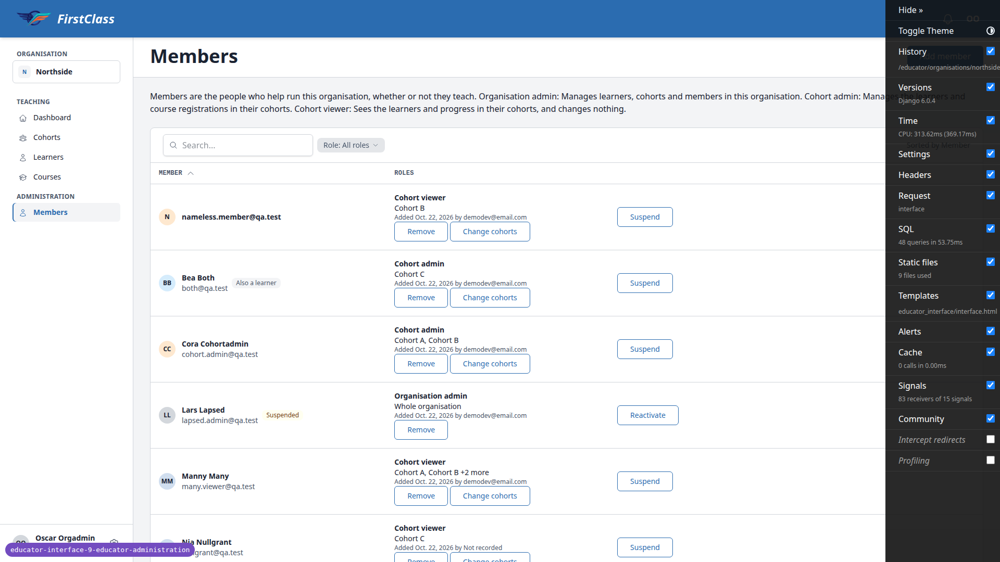

### §2 The list

| Test | Viewport | Result | Notes |
|---|---|---|---|
| 2.1 | desktop | pass | Help paragraph present with the three role descriptions word for word. |
| 2.2 | desktop | pass | Columns Member / Roles / unlabelled actions; chip reads 'Role: All roles'; Page 1 of 3 pager; rows ordered by first name (nameless email first, then Bea, Cora, Lars...). |
| 2.3 | desktop | pass | Oscar: You marker, Organisation admin / Whole organisation / Added ... by demodev@email.com, lock icon with self message, no buttons. |
| 2.4 | desktop | pass | Lars: Suspended marker; Remove on entry, Reactivate on row, no Suspend. |
| 2.5 | desktop | pass | Noa: Suspended marker; Remove, Change cohorts, Reactivate. |
| 2.6 | desktop | pass | Otto: Account turned off marker (chip-muted); only Remove. |
| 2.7 | desktop | pass | Bea: Also a learner marker uses chip-muted (neutral), Cohort admin on Cohort C; Change cohorts + Remove; Suspend. |
| 2.8 | desktop | pass | Ola scope: 'Cohort A, Cohort Old (inactive)'. |
| 2.9 | desktop | pass | Manny scope 'Cohort A, Cohort B +2 more'; title attribute lists all four cohorts. |
| 2.10 | desktop | pass | nameless: email shown as the name, no second line. |
| 2.11 | desktop | pass | Nia: 'Added ... by Not recorded'. |
| 2.12 | desktop | pass | Sita listed once, Cohort viewer on Cohort A only; no Site admin entry; no Suspend/Reactivate. |
| 2.13 | desktop | pass | Lena, Sandra: 'No members match.' Searching 'Eve' matched Vee Eleven and Vee Seven by substring but not Eve Existing (she holds no role). |
| 2.14 | desktop | pass | Cohort admin: Bea, Cora. Organisation admin: Lars, Olga, Oscar. Cohort viewer: 20 rows. Ticking roles accumulates (cohort_admin+organisation_admin gave the union); All roles returns the full list. Chip label follows the selection. |
| 2.14 | mobile | pass | Filter chip opens a 'Filter and sort' bottom sheet with Role as a single select (All roles / Organisation admin / Cohort admin / Cohort viewer), Reset, Cancel and Show results; choosing Cohort admin and Show results lists Bea and Cora with the chip reading 'Role: Cohort admin'. |
| 2.15 | desktop | pass | 'zzz' shows 'No members match.' with Clear filters; clicking it restores the full list and empties the search box. |
| 2.16 | desktop | pass | First click on Member header sorts descending (Vera first, ?members-sort=-first_name); second click ascending. |
| 2.17 | desktop | pass | Westside: one row (Wes, You) and callout 'You're the only member here. Add another organisation admin...'. Adding Eve as Organisation admin refreshed the list in place with the callout still showing; after reload it was gone. Eve's role removed again; callout back after reload. |
| 2.18 | desktop | pass | Eastside: 'No members in this organisation yet.' with an Add member button inside the empty state. After an htmx refresh to an empty list an sr-only 'No results' live-region announcement is present (not visible). |

2.17 (desktop):

2.14 (mobile):

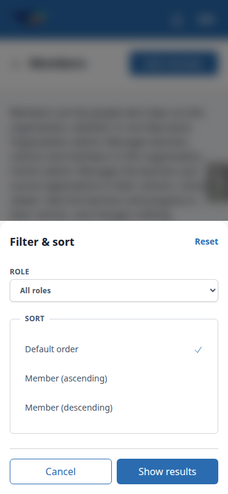

### §3 Add member existing account

| Test | Viewport | Result | Notes |
|---|---|---|---|
| 3.1 | desktop | pass | Dialog 'Add a member' with email field + Look up. Empty submit is blocked by the browser's required validation, dialog stays open. |
| 3.2 | desktop | pass | '  EXISTING@qa.test ' resolves to 'Existing account: Eve Existing, existing@qa.test'; after Cancel Eve is absent from the list. |
| 3.3 | desktop | pass | Three radio cards with the exact descriptions, none preselected; no rank line, no no-cohorts line. |
| 3.4 | desktop | pass | Organisation admin hides the checklist; Cohort admin shows Cohort A/B/C (not Old, not S), search box, '0 selected', and the not-the-same-as-organisation-admin note. Search 'B' narrows to Cohort B; ticking A and C gives '2 selected'. |
| 3.5 | desktop | pass | Submit with no cohort: 'Choose at least one cohort.' (422) inside the open dialog. |
| 3.6 | desktop | pass | Confirmation: 'Add Eve Existing as Cohort admin', description, 'Scope: Cohort A and Cohort C.', widening line; no account-creation sentence, no current-roles block. It also carries the no-active-membership sentence, which fits (Eve has no member row). Cancel leaves the list unchanged. |
| 3.7 | desktop | pass | Confirm closes the dialog; list refreshes without a page load (window marker survived); Eve's row: Cohort admin, Cohort A, Cohort C, added today by Oscar Orgadmin. |
| 3.8 | desktop | pass | Same grant again: 'This change wasn't made / Eve Existing already holds this role on these cohorts.' (422, Close button; header X also closes it). A and B: confirmation says Cohort A stays as it is and only Cohort B is added, with Now/After blocks; after confirm scope reads 'Cohort A, Cohort B +1 more' (spec: first two names then +N more; the plan's 'Cohort A, Cohort B, Cohort C' wording was the slip). |
| 3.9 | desktop | pass | Organisation admin confirmation shows Now (Cohort admin on three cohorts) and After (plus Organisation admin). Row now has two entries. |
| 3.10 | desktop | pass | Lars: confirmation says the role takes effect only once they are reactivated; row gains Cohort viewer on Cohort A and keeps Suspended. |
| 3.11 | desktop | pass | Noa: confirmation says a membership row is created and existing roles take effect; afterwards Suspended marker gone, row offers Suspend, scope Cohort B, Cohort C. |
| 3.12 | desktop | pass | Sandra: confirmation says she already has access to every organisation and the role lists her among members; row appears with Cohort viewer on Cohort A, no Suspend/Reactivate. |
| 3.13 | desktop | pass | Otto: confirm answers 'This person's account is turned off, so they can't be given a role.'; row unchanged (Cohort A only). |
| 3.14 | desktop | pass | Self: 'You can't change your own roles. Ask another organisation admin.' |
| 3.15 | desktop | pass | away@qa.test: 'This address belongs to an account on another site. Use a different address.' No name, no role step (0 radios). |
| 3.16 | desktop | pass | Hidden cohorts input set to Cohort S's pk: refused with a form error ('Select a valid choice. <uuid> is not one of the available choices.' + 'Choose at least one cohort.'); Lena gained no role. Polish note: the error echoes the raw uuid. |
| 3.17 | desktop | pass | Lena added normally: row appears with 'Also a learner' marker, Cohort viewer on Cohort A. |
| 3.18 | desktop | pass | Westside role step offers only Organisation admin with 'This organisation has no active cohorts yet.' |

3.4:

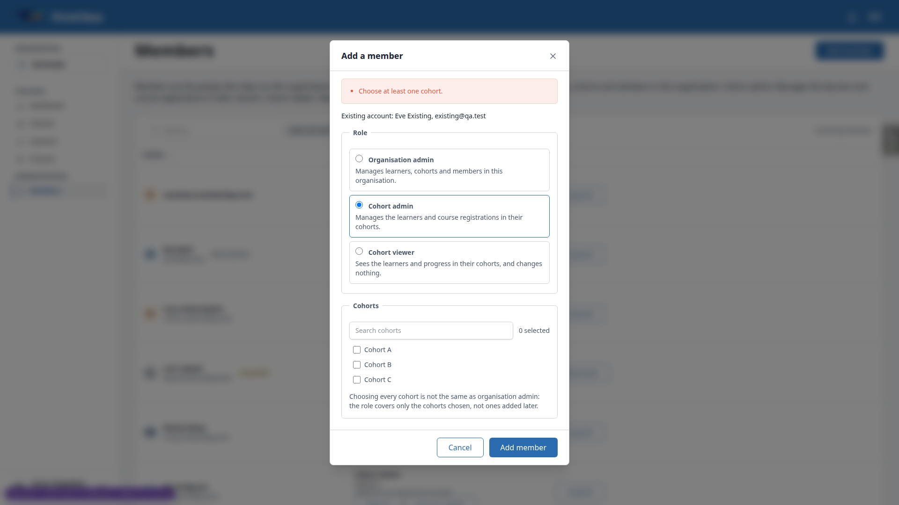

3.6:

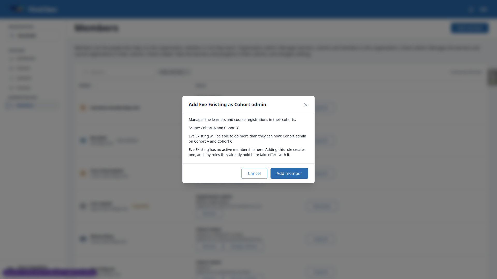

3.8:

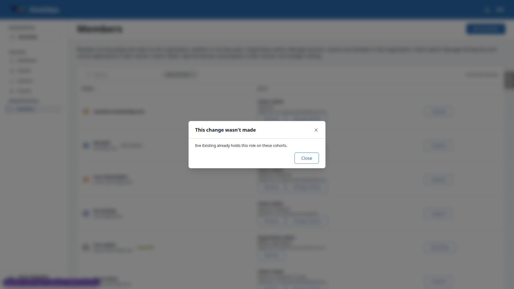

### §4 Add member new account

| Test | Viewport | Result | Notes |
|---|---|---|---|
| 4.1 | desktop | pass | Lookup of new.member@qa.test: 'No account yet. One will be created and a setup email sent.' with optional First name / Last name fields; Cohort viewer on Cohort B chosen. |
| 4.2 | desktop | pass | Confirmation: 'An account will be created for new.member@qa.test and a setup email sent.' Cancel: Mailpit still empty, no Nina row. |
| 4.3 | desktop | pass | Confirm: Nina Newmember row with Cohort viewer on Cohort B. Mailpit: exactly one message to new.member@qa.test, subject '[FirstClass] Set your password', naming Northside, with a set-password link. The link's host is the Site's configured domain 127.0.0.1:8000 rather than the request's port 8496 (the port was rewritten to follow it). |
| 4.4 | desktop | pass | In a fresh browser context the link opened the Change Password form; after setting the password Nina was logged in (no consent step appeared); /educator/ opened Northside's dashboard and the Cohorts page lists Cohort B only. Logged out. |
| 4.6 | desktop | pass | Lookup again reads 'Existing account: Nina Newmember, new.member@qa.test'. |
| 4.5 | desktop | pass | Second Mailpit message '[FirstClass] Your password has been set' to new.member@qa.test: logo header, 'Hi Nina,', Security Information block (IP, browser, time), 'Cheers, The FirstClass Team'; text view carries the same wording. It says the account 'on FirstClass' is ready to use (email_label is the site's display name by design). |

### §5 Remove a role

| Test | Viewport | Result | Notes |
|---|---|---|---|
| 5.1 | desktop | pass | Dialog 'Remove Eve Existing from Cohort admin': loses Cohort admin on Cohort A, Cohort B and Cohort C with the description; keeps account and Organisation admin on Whole organisation; no learner access named. Cancel: unchanged. |
| 5.2 | desktop | pass | Confirm: dialog closes, list refreshes, Eve's row shows only Organisation admin. |
| 5.3 | desktop | pass | Bea's Remove: 'They keep their account and their learner access in this organisation.' Cancelled. |
| 5.4 | desktop | pass | Removing Olga's Organisation admin: no last-admin warning. After confirm Olga drops off; in Olga's own context Northside members and /educator/ both answer 404 (Northside was her only organisation). |
| 5.5 | desktop | pass | Olga added back. Plain GET of remove_role?user=71 renders the confirmation (bare fragment); POSTing it answers 422 'You can't change your own roles. Ask another organisation admin.'; Oscar's row unchanged. |
| 5.6 | desktop | pass | As site.admin, removing Sam's Organisation admin warns 'Sam South is the only organisation admin. After this, nobody in the organisation can administer it until you add one.' Confirm: empty state. Sam added back (added by Sandra Siteadmin). |
| 5.7 | desktop | pass | south.admin: plain GET of remove_role?user=<self> renders the confirmation as a bare fragment (no layout, no htmx, so its submit button does nothing natively); a POST with the same fields answers 422 'You can't change your own roles. Ask another organisation admin.' and nothing changes. |
| 5.8 | desktop | pass | Sita's Remove dialog: 'Their site-level access is unaffected; this only takes them off this organisation's member list. They keep their account.' No 'lose' sentence. After confirm Sita is off the list, yet logged in as site.member Northside's Members still opens (200). Sita added back as Cohort viewer on Cohort A. |
| 5.9 | desktop | pass | Tab 1 held Vera's Remove dialog while tab 2 removed her role; confirming in tab 1 answered 'This is no longer available / It may have been removed, or you may no longer have access'. Vera added back. |

5.8:

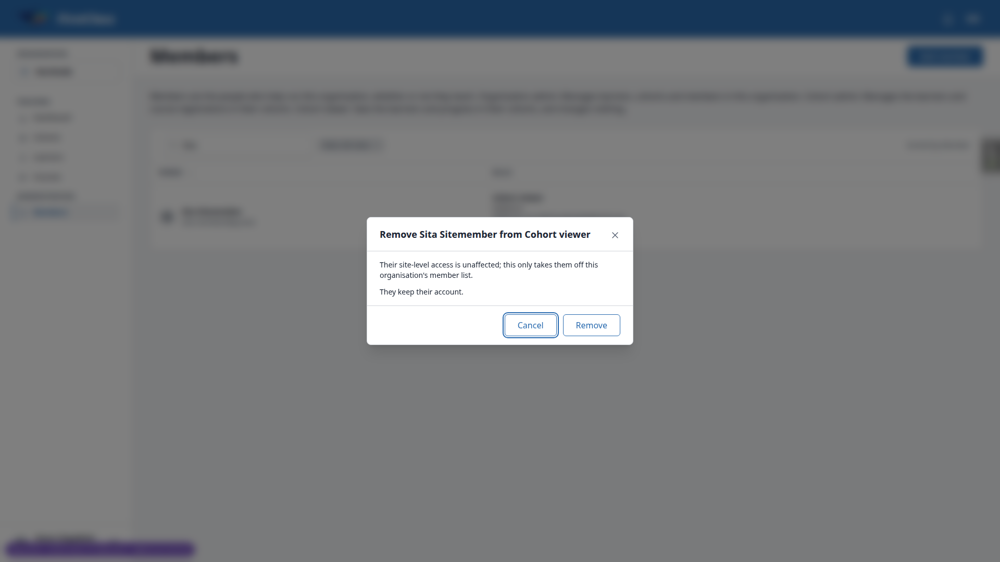

### §6 Change cohorts

| Test | Viewport | Result | Notes |
|---|---|---|---|
| 6.1 | desktop | pass | Manny's Change cohorts: A, B, C ticked, search box, '3 selected', 'Kept as they are: Cohort Old (inactive)' with no checkbox. |
| 6.2 | desktop | pass | Untick B: confirmation 'Removes: Cohort B / Manny Many loses Cohort viewer on Cohort B.' with a Change cohorts button; afterwards scope 'Cohort A, Cohort C +1 more' (Old). |
| 6.3 | desktop | pass | Tick B, untick A: 'Adds: Cohort B / Removes: Cohort A' with both the widening and loss sentences; scope then 'Cohort B, Cohort C +1 more'. |
| 6.4 | desktop | pass | No change: 'This change wasn't made / Nothing changed. Tick or untick a cohort first.' (422, dialog open). |
| 6.5 | desktop | pass | Vera unticking Cohort A: confirmation titled 'Remove Vera Viewer from Cohort viewer' with a Remove button; she drops off the list; added back. |
| 6.6 | desktop | pass | Noa's Change cohorts open in tab 1 while tab 2 removed her role: tab 1 answers 'This is no longer available'. Noa added back as Cohort viewer on Cohort B. |
| 6.7 | desktop | pass | No Change cohorts on Organisation admin entries (Oscar, Olga, Lars's org-admin entry) nor on Otto's row. Lars's only Change cohorts is on the Cohort viewer entry 3.10 added. |

6.1:

### §7 Suspend and reactivate

| Test | Viewport | Result | Notes |
|---|---|---|---|
| 7.1 | desktop | pass | Reactivate Lars: 'These roles take effect again: Organisation admin on Whole organisation and Cohort viewer on Cohort A.' After confirm Suspended marker gone, row offers Suspend. |
| 7.2 | desktop | pass | lapsed.admin: Northside Members opens (200). |
| 7.3 | desktop | pass | Suspend Lars: 'They keep their roles but can do nothing in Northside until reactivated.' No last-admin warning. After confirm Suspended returns; lapsed.admin gets 404 on Northside Members. |
| 7.4 | desktop | pass | Suspend dialog opened in tab 2 before tab 1 suspended Lars: confirming in tab 2 answers 'This is no longer available'. |
| 7.5 | desktop | pass | Suspending Olga: no warning. POST suspend?user=71 (self): 422 self message; plain GET renders the bare confirmation. As site.admin Oscar's row offers Suspend. With Eve still an active Organisation admin (from 3.9) the dialog carried no warning, correctly; after suspending Eve and Olga too the dialog warned 'Oscar Orgadmin is the only organisation admin. After this, nobody in the organisation can administer it until you add one.' Cancelled; Olga and Eve reactivated as Sandra. |
| 7.6 | desktop | pass | As Olga, Oscar's Suspend dialog carries no warning (Olga remains). Cancelled. |
| 7.7 | desktop | pass | Sita's, Otto's and Oscar's rows offer neither Suspend nor Reactivate. |

### §8 Cohort overview

| Test | Viewport | Result | Notes |
|---|---|---|---|
| 8.1 | desktop | pass | Cohort A overview Educators panel lists Cora (Cohort admin), Lena, Ola, Sandra, Sita, Vera (Cohort viewer) with an Add member button. Manny is absent because 6.3 took Cohort A out of his scope; Lars (suspended) is not listed. |
| 8.2 | desktop | pass | Dialog 'Add a member to Cohort A'; after lookup only Cohort admin and Cohort viewer radios, no checklist; confirmation shows Now/After; on confirm the dialog closes and the Educators panel refreshes in place (window marker survived) listing Eve Existing as Cohort viewer. |
| 8.3 | desktop | pass | Northside Members: Eve's row shows the new Cohort viewer / Cohort A entry beside Organisation admin. |
| 8.4 | desktop | pass | cohort.admin on Cohort A overview: no Educators panel, no Add member (checked in 1.2). |
| 8.5 | desktop | pass | site.admin on Cohort S overview: Educators panel ('No educators assigned to this cohort.') offers Add member; dialog titled 'Add a member to Cohort S'; cancelled. |

8.1:

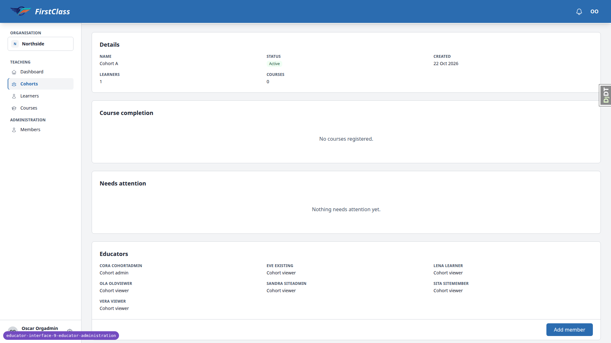

### §9 Mid-session removal

| Test | Viewport | Result | Notes |
|---|---|---|---|
| 9.1 | desktop | pass | Vera's context had Cohort A's overview open; Oscar removed her only role. |
| 9.2 | desktop | pass | Clicking the htmx Learners tab in Vera's stale page reloaded into the 404 page (shared htmx 404 listener); /educator/ answers 404 (Northside was her only organisation). |
| 9.3 | desktop | pass | Vera added back as Cohort viewer on Cohort A. |
| 9.4 | desktop | pass | Olga's context held Eve's Remove dialog while Oscar removed Olga's Organisation admin; confirming reloaded into the 404 page for Northside (unmarked 404 on the htmx POST); Eve's entries unchanged on Oscar's reload. Olga added back. |

### §10 Cohort deletion cleanup

| Test | Viewport | Result | Notes |
|---|---|---|---|
| 10.1 | desktop | pass | Created 'Cohort Doomed' via Cohorts > Create Cohort; Add member offered it in the checklist; Eve's Cohort viewer entry read 'Cohort A, Cohort Doomed'. |
| 10.2 | desktop | pass | Settings tab > Delete > 'Delete Cohort Doomed / Deleting this cohort cannot be undone.' Confirmed; back on the Cohorts list. |
| 10.3 | desktop | pass | Eve's Cohort viewer entry reads 'Cohort A' only. |
| 10.4 | desktop | pass | Shell: cohort role rows 37 -> 36 and guardian cohort perms 64 -> 62 (exactly the Doomed rows: 1 and 2); zero rows with object_id/object_pk = the deleted pk; cohort gone. |
| 10.5 | desktop | pass | Recreated Cohort Doomed with Eve's Cohort viewer role, then deleted it as demodev via /admin/freedom_ls_learner_management/cohort/ (delete confirmation listed only the cohort). Shell: role rows and guardian perms back to 36 / 62, none pointing at the pk. |

### §11 Isolation and enumeration

| Test | Viewport | Result | Notes |
|---|---|---|---|
| 11.1 | desktop | pass | south.admin: Northside members, add_member and remove_role?user=75&role=cohort_viewer all 404. |
| 11.2 | desktop | pass | As Oscar: /members/<uuid> 404; remove_role?user=98 (Sam, not a Northside member): GET 404, POST 404 with the 'no longer available' fragment; change_cohorts POST naming Cohort S's pk for Vera: 404 'no longer available' and Vera's scope unchanged (Cohort A only, confirmed in the shell). |
| 11.3 | desktop | pass | The other-site message in 3.15 never named Avery Away. |

### §12 Layout at the QA viewports

| Test | Viewport | Result | Notes |
|---|---|---|---|
| 12.1 | desktop | pass | 1920x1080: document, body and main scrollWidth all 1920 (no horizontal scroll); table 1598px wide. |
| 12.2 | desktop | pass | Add member dialog at 1920: email step, radio cards, cohort checklist and confirmation all fit (512px wide, inside the viewport, no overflow); Cancel/Look up/Add member buttons inside the viewport. |
| 12.1 | mobile | pass | 375x812: no horizontal scroll (scrollWidth 375). Rows render as cards: bold member line with avatar, email and markers; 'Roles' as a labelled line with each entry's scope and added-by; Remove/Change cohorts/Suspend/Reactivate all 44px high; Filter and Sort chips 44px; pager Next 44px, 'Page 1 of 3' shown. |
| 12.2 | mobile | pass | Add member bottom sheet at 375: email step, three radio cards (291px wide, descriptions wrap, no overflow), cohort checklist with search and count, confirmation. Buttons are inside the viewport on every step; on the checklist step the sheet fills the viewport and scrolls internally, so Cancel/Add member sit below the fold until the sheet is scrolled (header Close is sticky). No document overflow. |
| 12.3 | mobile | pass | Remove, Change cohorts, Suspend and Reactivate dialogs at 375: 16px body text, full-width bottom sheets, Cancel and the action button inside the viewport (bottom 796 of 812). |
| 12.4 | mobile | pass | Cohort A overview at 375: Educators panel 343px wide, no overflow, seven entries, Add member button (146x40) inside the viewport. Page has no horizontal scroll. |
| nav | mobile | pass | 'Open navigation panel' opens a bottom-sheet drawer with the Teaching and Administration groups (Dashboard, Cohorts, Learners, Courses, Members); Escape closes it; no overflow. |
| 12.1 | tablet | pass | 768x1024: no horizontal scroll (scrollWidth 768). The desktop table renders at 718px with Member (303) / Roles (265) / actions (150) columns, desktop Role chip 'Role: All roles', 'Sorted by Member', pager 'Page 1 of 3'. Row actions are desktop density (38px) since 768 is the md breakpoint. Sidebar collapses to the 'Open navigation panel' hamburger. |
| 12.2 | tablet | pass | Add member at 768 is a centred 512px modal; email, radio cards (428px, no overflow), checklist (839px tall, fits without scrolling) and confirmation all inside the viewport with buttons inside. |
| 12.4 | tablet | pass | Cohort A overview at 768: Educators panel 720px wide (single column), seven entries, Add member button (146x40) inside; no horizontal scroll. |
| nav | tablet | pass | Hamburger opens the bottom-sheet drawer (768px wide, 475px tall) with Teaching and Administration groups; Escape closes it; content not overlapped when closed. |

12.1 mobile:

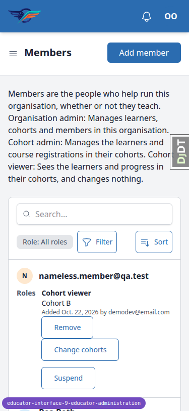

12.2 mobile:

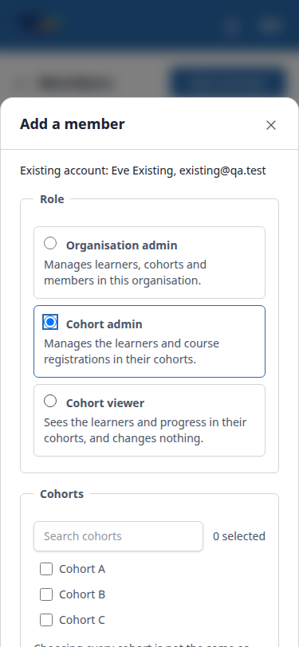

12.3 mobile (Remove):

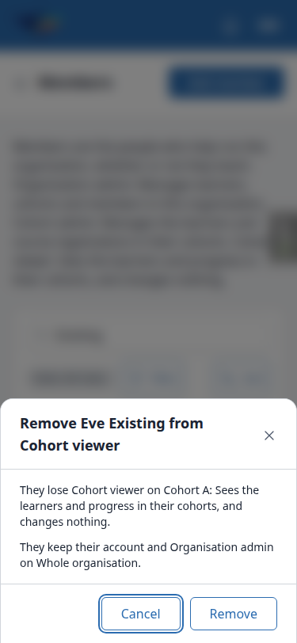

12.3 mobile (Change cohorts):

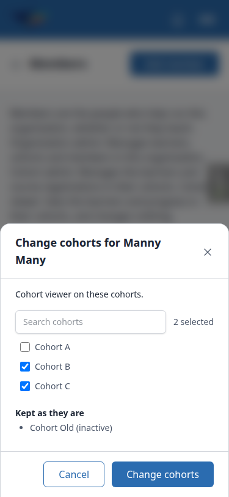

12.3 mobile (Suspend):

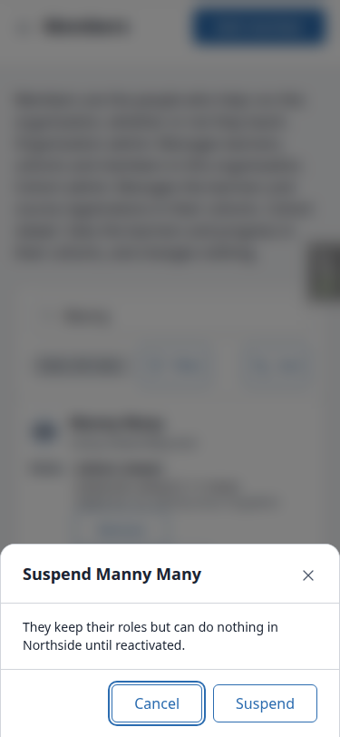

12.4 mobile:

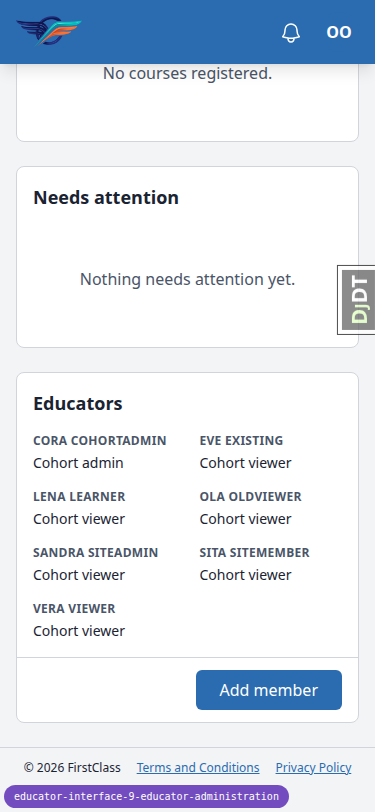

nav mobile:

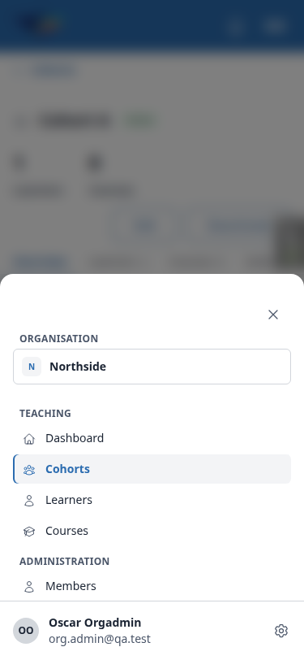

12.1 tablet:

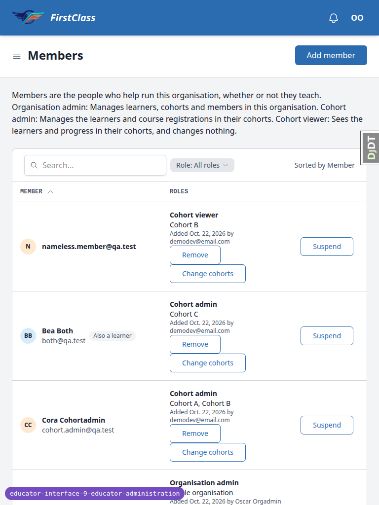

12.2 tablet:

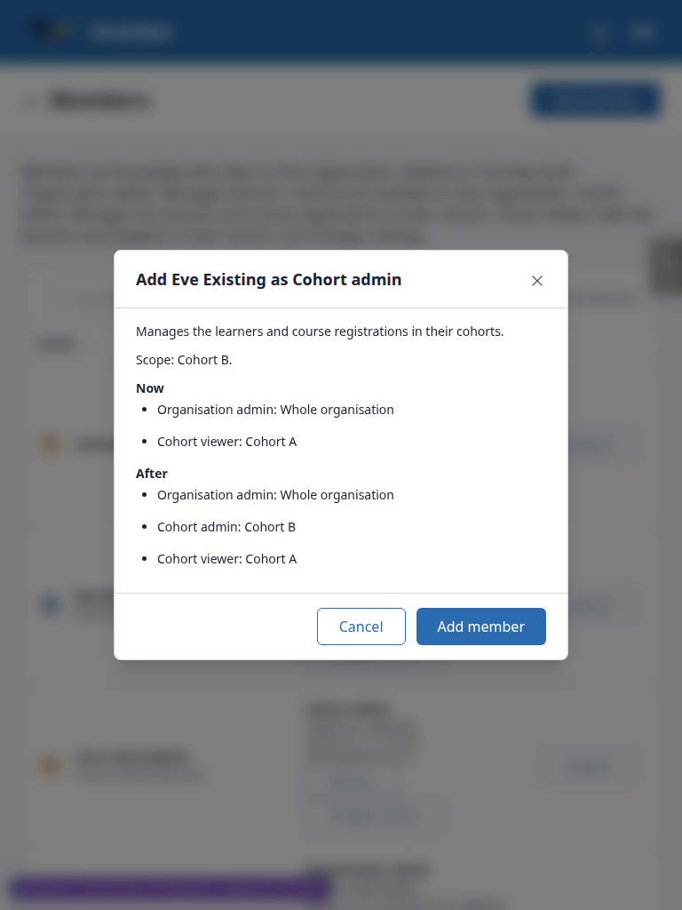

nav tablet:

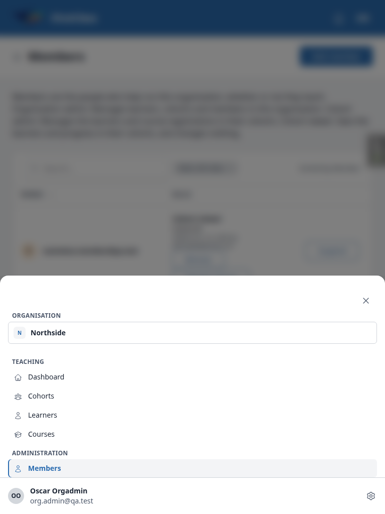

12.4 tablet:

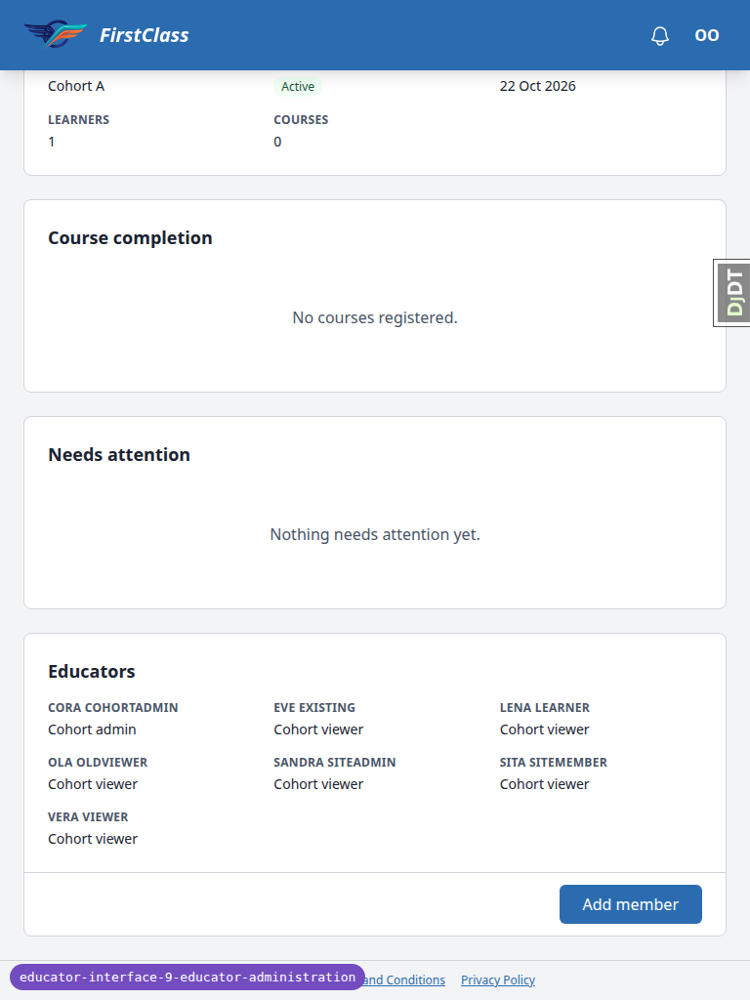

12.1 and 12.2 desktop reuse the screenshots shown under §1 (page-2026-10-22T08-33-18-031Z.png) and §3 (page-2026-10-22T08-38-29-432Z.png).

## Design check

No design states tested.

## Bug status

No bugs found this run.

## General notes

- The set-password email's link uses the Site's configured domain (127.0.0.1:8000) rather than the request port; the QA run rewrote the port to follow it. This is the Django Sites domain in the demo data, not a feature defect.
- The password-set email names the site ("your account on FirstClass is ready to use") rather than the organisation; `email_label` is the site's display name everywhere by design and neither spec nor plan requires the organisation name there. The plan's "on Northside" wording in §4.5 is the slip.
- A scope with three cohorts renders as "Cohort A, Cohort B +1 more" (spec: first two names, then "+N more"); the plan's §3.8 wording listing all three was the slip.
- The hand-made cohort choice (§3.16) is refused with a form error that echoes the raw UUID ("Select a valid choice. <uuid> is not one of the available choices.") — functional, slightly unpolished.
- A plain (non-htmx) GET of an action URL such as `remove_role?user=…` renders the confirmation as a bare fragment without the page layout or htmx, so its button does nothing natively; the server-side guard was verified by POST instead (422 with the self message).
- After an htmx refresh leaves a list empty, an sr-only "No results" live-region announcement is present (not visible); a fresh load has none.
- Searching "Eve" also matched Vee Eleven and Vee Seven by substring.
- At 375 the Add member bottom sheet scrolls internally on the checklist step, so Cancel/Add member sit below the fold until the sheet is scrolled; the header Close is sticky. At 768 row actions are desktop density (38px) since 768 is the md breakpoint; the 44px minimum applies below md as decided in B6.
- The Educators panel's Add member button is 40px high at 375 (a standard secondary button; the 44px rule covered the members list's row actions, chips and pager).
- In §7.5 Eve still held Organisation admin from §3.9, so the first check of Sandra's Suspend dialog for Oscar correctly showed no warning; after suspending Eve and Olga the warning appeared. The plan's step order leaves Eve as an org admin at that point.
- §9.4 and §9.2: a stale htmx request that now answers an unmarked 404 reloads the page into the 404 page (the shared listener added for B8), which is what the plan allows ("no longer available or the denied fragment") in spirit — the person has lost the whole organisation.
- The §1.4 check ran after §3.12, so Sandra was listed in Northside through the Cohort viewer role that step gave her.

status: ok
reason: report rendered, 0 bugs documented, 100 test records (all pass), 20 screenshots verified
