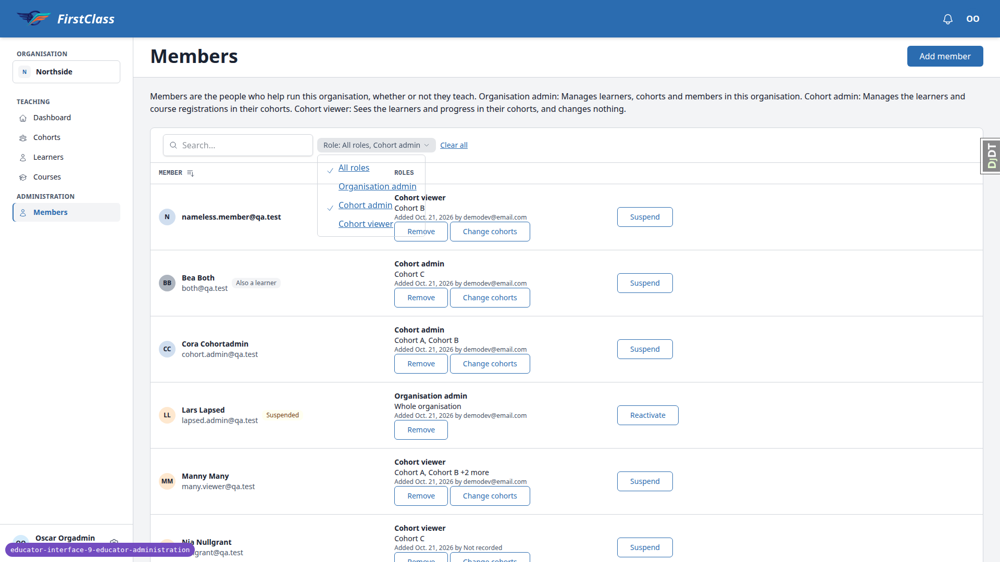
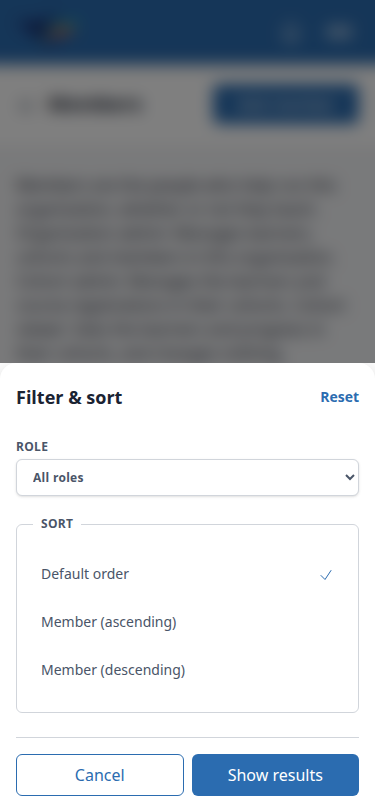
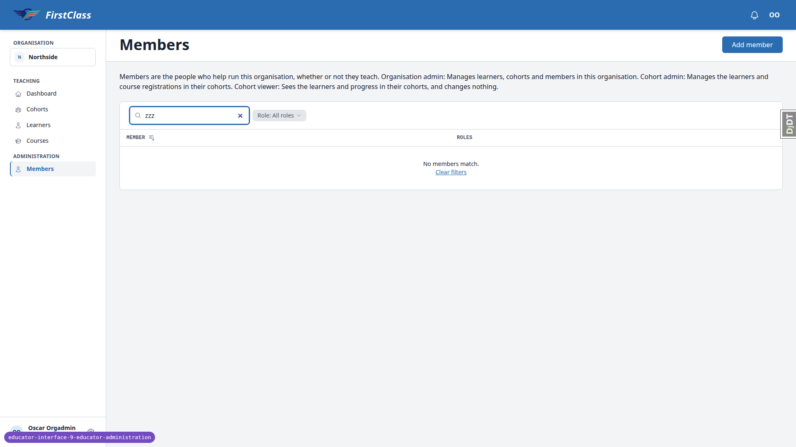
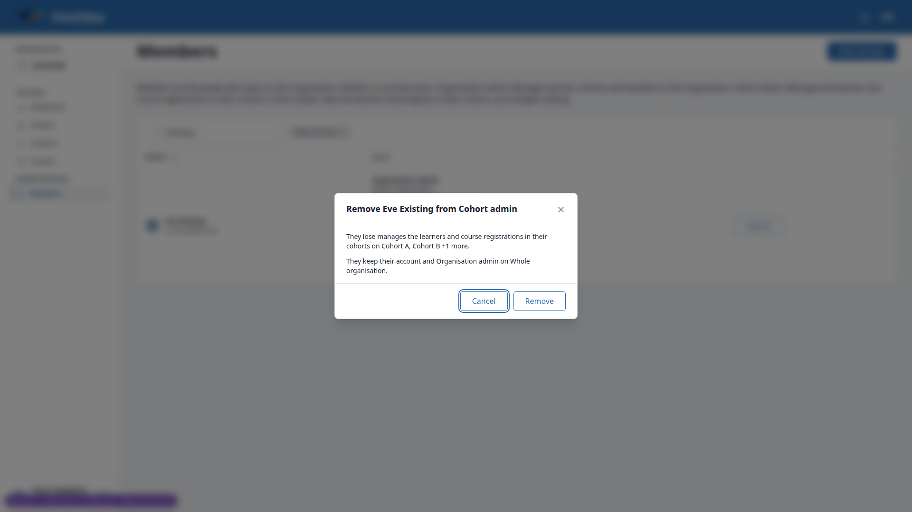
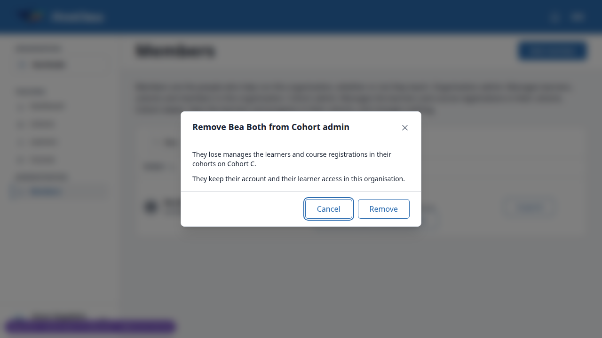
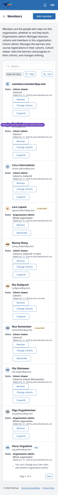
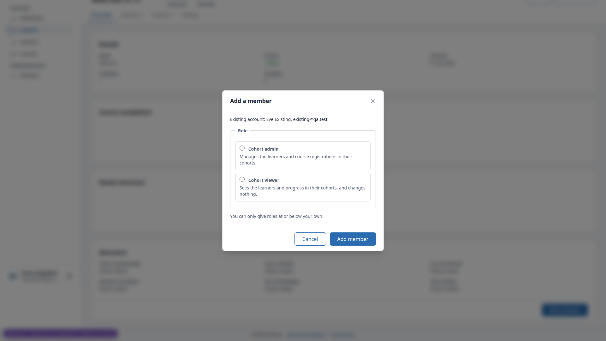
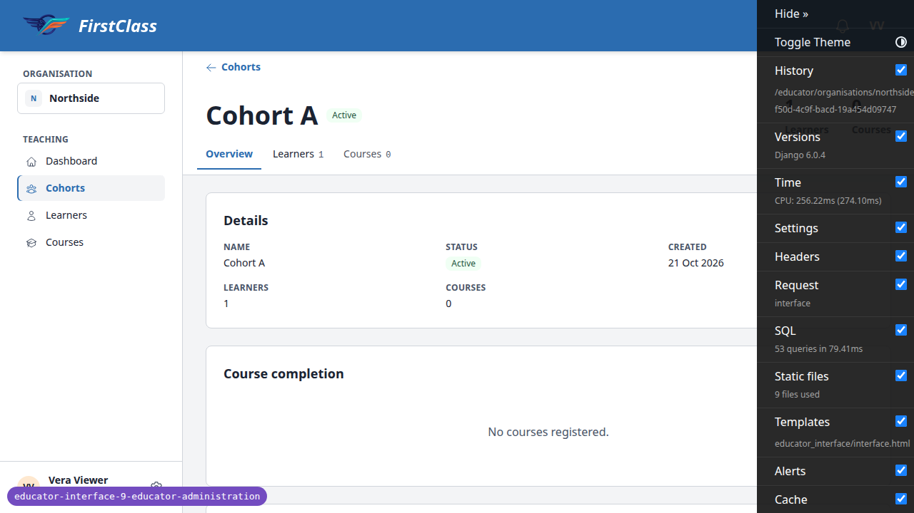

# Frontend QA report: educator-interface-9-educator-administration

## Methodology

Manual run with the Playwright MCP against a dev server on port 8343. Personas were logged in per the plan's section 0 (`3. frontend_qa.md`). Data was seeded with the new `qa_create_member_administration_scenario` management command. Screenshots were collected into `screenshots/` beside this report, and every image referenced below exists there.

The run was paused midway to auto-fix B4 (the 500 on add/remove role) at the user's request. Section 2.17 onward was then run against the fixed code (commit bfd66e9f). Test 2.17 was re-verified after the fix and passed.

## Diff scoping

Class: **FULL**. It was triggered by changes to these template and static files:

- `freedom_ls/educator_interface/static/educator_interface/js/alpine-components.js`
- `freedom_ls/educator_interface/templates/educator_interface/data-table-cells/member.html`
- `freedom_ls/educator_interface/templates/educator_interface/data-table-cells/member_actions.html`
- `freedom_ls/educator_interface/templates/educator_interface/data-table-cells/member_roles.html`
- `freedom_ls/educator_interface/templates/educator_interface/interface.html`
- `freedom_ls/educator_interface/templates/educator_interface/modal/add_member.html`
- `freedom_ls/educator_interface/templates/educator_interface/modal/change_cohorts.html`
- `freedom_ls/educator_interface/templates/educator_interface/modal/member_change_refused.html`
- `freedom_ls/educator_interface/templates/educator_interface/modal/reactivate_member_confirmation.html`
- `freedom_ls/educator_interface/templates/educator_interface/modal/remove_role_confirmation.html`
- `freedom_ls/educator_interface/templates/educator_interface/modal/suspend_member_confirmation.html`
- `freedom_ls/educator_interface/templates/educator_interface/partials/members_empty.html`
- `freedom_ls/educator_interface/templates/educator_interface/partials/members_intro.html`
- `freedom_ls/panel_framework/templates/cotton/data-table.html`
- `freedom_ls/panel_framework/templates/panel_framework/panels/_data_table_region_base.html`
- `freedom_ls/panel_framework/templates/panel_framework/views/_list_view_base.html`
- `freedom_ls/panel_framework/tests/templates/panel_framework/test_cell_context.html`
- `freedom_ls/panel_framework/tests/templates/panel_framework/test_empty_state.html`
- `freedom_ls/panel_framework/tests/templates/panel_framework/test_header_actions_empty.html`
- `freedom_ls/panel_framework/tests/templates/panel_framework/test_intro.html`
- `freedom_ls/panel_framework/tests/templates/panel_framework/test_row_action.html`

Skipped: nothing. Everything ran (desktop, mobile, tablet).

## Smoke gate

**Pass.** Pages checked:

- http://127.0.0.1:8343/
- http://127.0.0.1:8343/educator/organisations/northside/members

## Results

| Test | Viewport | Status | Notes | Screenshot |
|---|---|---|---|---|
| 1.1 | desktop | pass | Sidebar has Teaching and Administration (Members) groups; heading and title correct. | [img](screenshots/page-2026-10-21T09-35-36-594Z.png) |
| 1.2 | desktop | pass | cohort.admin: no Administration group; members and add_member 404; no Educators panel. | |
| 1.3 | desktop | pass | cohort.viewer: same three answers as 1.2. | |
| 1.4 | desktop | pass | site.admin: Members opens for all four organisations; Sandra listed in none. | |
| 1.5 | desktop | pass | demodev: Members opens for all four; demodev in no member cell. | |
| 1.6 | desktop | pass | south.admin: northside members 404; Southside lists only Sam South (You marker, no buttons). | |
| 2.1 | desktop | pass | Help paragraph present with the three exact role descriptions. | [img](screenshots/page-2026-10-21T09-35-36-594Z.png) |
| 2.2 | desktop | pass | Columns Member, Roles, actions; chip "Role: All roles"; ten per page; sorted by first name. | |
| 2.3-2.13 | desktop | pass | All searches match the plan (suspended, turned-off, learner, inactive cohort, +N more, nameless, Nia, Sita, Lena/Sandra, "Eve" substring). | |
| 2.14 | desktop | fail | Picking a role in the Role chip keeps "All roles" selected, so the full list remains (see B1). | [img](screenshots/page-role-chip-open-all-plus-cohort-admin.png) |
| 2.15 | desktop | fail | "Clear filters" restores the list but the search box still shows "zzz" (see B2). | [img](screenshots/page-no-members-match.png) |
| 2.16 | desktop | fail | First click on Member header sorts ascending, identical to the default order (see B3). | |
| 2.17 | desktop | fail | Confirm Add member returns HTTP 500 ImproperlyConfigured from Site.objects.get_current() (see B4). | [img](screenshots/page-2026-10-21T09-38-38-004Z.png) |
| 3.18 | desktop | pass | west.admin lookup offers only Organisation admin with the "no active cohorts" line. | |
| 2.18 | desktop | pass | Eastside as site.admin: empty state with Add member button inside it. | [img](screenshots/page-2026-10-21T10-05-47-182Z.png) |
| 3.1 | desktop | pass | "Add a member" email step; empty submit blocked by native validation. | [img](screenshots/page-add-member-empty-email.png) |
| 3.2-3.3 | desktop | pass | Trimmed/case-insensitive lookup finds Eve; three radio cards, none preselected. | |
| 3.4-3.5 | desktop | pass | Org admin: no checklist; cohort admin: checklist, search, count, note; no-cohort gives 422 error. | [img](screenshots/page-add-member-cohort-checklist.png) |
| 3.6 | desktop | pass | Confirmation restates role and scope; Cancel adds nothing. | [img](screenshots/page-add-member-confirm-eve.png) |
| 3.13 | desktop | pass | Otto (account turned off): confirm gives "This change wasn't made" refusal. | [img](screenshots/page-add-member-turned-off-refused.png) |
| 3.14 | desktop | pass | Self add refused: "You can't change your own roles." | |
| 3.15 | desktop | pass | Other-site address gives the use-a-different-address message; no name shown. | [img](screenshots/page-add-member-other-site.png) |
| 3.16 | desktop | pass | Tampered cohort gives 422 form error; Lena gains no role. | [img](screenshots/page-add-member-tampered-cohort.png) |
| 5.3 | desktop | fail | Remove dialog "They lose manages the learners..." is ungrammatical (see B5). | [img](screenshots/page-remove-bea-dialog.png) |
| 6.1 | desktop | pass | Change cohorts checklist ticked, search, count, inactive cohort kept read-only. | [img](screenshots/page-change-cohorts-manny.png) |
| 12.1 | mobile | fail | No horizontal scroll, card rows OK, but action buttons are 38px high, under 44px (see B6). | [img](screenshots/page-2026-10-21T10-09-40-370Z.png) |
| 2.14 | mobile | fail | Filter sheet Role select has duplicate "All" and "All roles" options (see B1). | [img](screenshots/page-mobile-filter-sheet.png) |
| 12.1 | tablet | pass | 768 wide: hamburger nav, table fits, no horizontal scroll. | [img](screenshots/page-2026-10-21T10-10-12-676Z.png) |
| 2.17 | desktop | pass | Re-verified after B4 fix: Eve added as Organisation admin (204), list refreshes, callout gone after reload. | [img](screenshots/page-westside-after-add.png) |
| 3.7-3.8 | desktop | pass | Eve added as Cohort admin on A, C; repeat and overlap messages correct; scope shows "Cohort A, Cohort B +1 more". | |
| 3.9-3.12 | desktop | pass | Org admin current-roles block; Lars, Noa and Sandra cases behave per plan. | [img](screenshots/page-add-org-admin-current-roles.png) |
| 3.17 | desktop | pass | Lena added as Cohort viewer; row shows "Also a learner". | |
| 4.1-4.3 | desktop | pass | New-account flow: one setup email via Mailpit; link host is the tenant Site domain. | [img](screenshots/page-add-new-account-confirm.png) |
| 4.4-4.5 | desktop | pass | Set-password form logs Nina in; she sees Cohort B only. | [img](screenshots/page-set-password-form.png) |
| 5.1 | desktop | fail | Remove Eve: loss sentence ungrammatical and scope truncated by "+1 more" (see B5). | [img](screenshots/page-remove-eve-cohort-admin.png) |
| 5.2 | desktop | pass | Confirm removes the role (204); Eve keeps only Organisation admin. | |
| 5.4 | desktop | pass | Olga's Organisation admin removed with no warning; she then gets 404s. | |
| 5.5 | desktop | pass | Self-removal refused with htmx POST (422); nothing changed. | [img](screenshots/page-2026-10-21T10-17-49-661Z.png) |
| 5.6-5.7 | desktop | pass | Last-organisation-admin warning shown; self-remove POST gives 422. | [img](screenshots/page-remove-last-org-admin-warning.png) |
| 5.8 | desktop | pass | Sita removal says site-level access is unaffected; works as specified. | |
| 5.9 | desktop | pass | Stale remove confirm gives "This is no longer available" fragment. | [img](screenshots/page-stale-remove-no-longer-available.png) |
| 6.2-6.3 | desktop | pass | Change-cohorts confirmation lists adds/removes and scope after. | [img](screenshots/page-change-cohorts-confirm-both.png) |
| 6.4 | desktop | pass | No change gives "Nothing changed" refusal with Close. | |
| 6.5 | desktop | pass | Unticking the only cohort becomes a Remove; Vera drops off. | |
| 6.6 | desktop | pass | Stale change-cohorts confirm gives "no longer available". | |
| 6.7 | desktop | pass | Change cohorts absent on org-admin entries and Otto's row. | |
| 7.1-7.4 | desktop | pass | Reactivate and Suspend flows, stale-tab 404 fragment all correct. | [img](screenshots/page-reactivate-lars.png) |
| 7.5-7.7 | desktop | pass | Suspend last-admin warning appears once Eve is also suspended; self-suspend 422. | [img](screenshots/page-suspend-last-org-admin-warning.png) |
| 8.1 | desktop | pass | Cohort A Educators panel lists expected people and Add member. | |
| 8.2 | desktop | fail | Cohort-preset dialog title is generic and shows "at or below your own" to an org admin (see B7). | [img](screenshots/page-cohort-add-member-role-step.png) |
| 8.3-8.5 | desktop | pass | Eve's new entry appears; cohort.admin sees no panel; site.admin sees Add member. | [img](screenshots/page-cohort-a-educators-after-add.png) |
| 9.1-9.2 | desktop | fail | After losing access, Learners tab click 404s but the page silently stays on Overview (see B8). | [img](screenshots/page-vera-after-removal-click.png) |
| 9.3 | desktop | pass | Vera added back as Cohort viewer on Cohort A. | |
| 9.4 | desktop | fail | Confirm in an open dialog after access loss 404s but the dialog stays unchanged (see B8). | |
| 10.1-10.4 | desktop | pass | Deleting a cohort removes its role assignments and guardian rows. | |
| 10.5 | desktop | pass | Cohort created in educator UI, deleted via admin; no leftover rows. | |
| 11.1-11.3 | desktop | pass | Cross-organisation and tampered requests all answer 404. | |
| 12.2 | mobile | pass | Add member bottom sheet fits at 375; scrolls internally; no horizontal scroll. | [img](screenshots/page-mobile-add-roles-checklist.png) |
| 12.3 | mobile | pass | Remove, Change cohorts, Suspend, Reactivate dialogs readable; buttons in viewport (42px). | [img](screenshots/page-mobile-change-cohorts.png) |
| 12.4 | mobile | pass | Educators panel fits at 375 with Add member inside the card. | [img](screenshots/page-mobile-educators-panel.png) |
| 12.2 | tablet | pass | 768: centred 512px dialog, checklist, buttons in viewport. | [img](screenshots/page-tablet-add-member-checklist.png) |
| 12.2 | desktop | pass | 1920: dialog steps render centred, buttons in viewport. | [img](screenshots/page-add-member-confirm-eve.png) |

## Design check

No design states tested.

## B1: Role filter keeps "All roles" selected beside a picked role, so picking a role does not filter

Manifestations: 2.14 (desktop), 2.14 (mobile).

- **Expected:** From the default state, picking "Cohort admin" in the Role chip shows only Cora and Bea (chip reads "Role: Cohort admin"). The mobile filter sheet's Role select has one "All roles" option.
- **Actual:** MemberRoleFilter models "All roles" as an explicit value `all` that is ticked by default. Picking a role links to `?members-role=all&members-role=cohort_admin`, the chip reads "Role: All roles, Cohort admin" and the full list stays. The mobile select lists both "All" and "All roles". Filtering by URL with only the role works.

## B2: "Clear filters" in the members empty state leaves the old search text in the search box

Manifestations: 2.15 (desktop).

- **Expected:** After clicking "Clear filters", the full list returns and the search box is empty.
- **Actual:** The full list returns but the search box still reads "zzz" (`members_empty.html` swaps only the table region). The visible search contradicts the list, and the next keystroke re-applies it.

## B3: First click on the Member header sorts ascending, which looks identical to the default order

Manifestations: 2.16 (desktop).

No screenshot.

- **Expected:** Test plan: first click flips to descending, second back to ascending.
- **Actual:** First click goes to `?members-sort=first_name` (ascending, same as the default first-name order), so nothing visibly changes. The second click gives descending. This is the same neutral-to-ascending convention as the Learners table.

## B4: Adding or removing a member's role returns 500 in the dev server (no SITE_ID)

Manifestations: 2.17 (desktop).

- **Expected:** Confirming Add member writes the role and refreshes the list.
- **Actual:** POST add_member returns 500 ImproperlyConfigured. `assign_object_role` / `remove_object_role` called `check_role_name_in_config` without a site name, falling back to `Site.objects.get_current()`, which needs SITE_ID. Dev and multi-site deployments have none. This blocked Add, Remove and Change cohorts. (Auto-fixed mid-run in commit bfd66e9f; 2.17 re-verified passing.)

## B5: Remove confirmation's "They lose" sentence is ungrammatical and truncates the scope

Manifestations: 5.1 (desktop), 5.3 (desktop).

- **Expected:** The dialog says what they lose: the role's description on every cohort in scope (e.g. Cohort A, Cohort B and Cohort C), in a readable sentence.
- **Actual:** "They lose manages the learners and course registrations in their cohorts on Cohort A, Cohort B +1 more." The description (a verb phrase) is lower-cased and spliced after "They lose" (`actions.py` loss, `remove_role_confirmation.html`), which is ungrammatical for all three roles ("They lose sees the learners..."). The scope uses the list's truncated "+N more", so the dialog hides cohorts being lost.

## B6: Member row actions are under 44px tall at 375 wide

Manifestations: 12.1 (mobile).

- **Expected:** Each entry's Remove/Change cohorts and the row's Suspend/Reactivate are at least 44px high at 375.
- **Actual:** They are 38px high (Filter/Sort chips 35px, pager Next 34px).

## B7: Cohort-preset Add member dialog does not name the cohort and tells an organisation admin "You can only give roles at or below your own."

Manifestations: 8.2 (desktop).

- **Expected:** Test plan: dialog title names Cohort A; role step offers Cohort admin and Cohort viewer only.
- **Actual:** Title is the generic "Add a member". The role step shows "You can only give roles at or below your own." to Oscar (an organisation admin) because Organisation admin is left out by the cohort preset. Spec R6 says the line shows whenever `grantable_roles` leaves a role out "for any other reason", so spec and plan disagree.

## B8: After losing access to the organisation, htmx clicks and open dialogs silently do nothing

Manifestations: 9.1-9.2 (desktop), 9.4 (desktop).

- **Expected:** A tab click answers with a 404 / no-access page. A confirm in an open dialog answers with the "no longer available" or denied fragment.
- **Actual:** The server correctly answers 404, but htmx drops the bare 404. Vera's Learners tab click leaves her on Overview with no message. Olga's Remove confirm leaves the unchanged confirmation open with no message.

## Bug status

| Bug | Status |
|---|---|
| B1 | **FIXED** (commit: 4f5c55c6) — Role filter keeps 'All roles' selected beside a picked role, so picking a role does not filter |
| B2 | **UNRESOLVED** — 'Clear filters' in the members empty state leaves the old search text in the search box (reason: fix budget exhausted this run) |
| B3 | **UNRESOLVED** — First click on the Member header sorts ascending, which looks identical to the default order (reason: plan and the shared table sort convention disagree; which is intended is a product decision) |
| B4 | **FIXED** (commit: bfd66e9f) — Adding or removing a member's role returns 500 in the dev server (no SITE_ID); fixed mid-run at the user's request although it touches the permissions code |
| B5 | **FIXED** (commit: d3ab8df1) — Remove confirmation's 'They lose' sentence is ungrammatical and truncates the scope |
| B6 | **UNRESOLVED** — Member row actions are under 44px tall at 375 wide (reason: fix budget exhausted this run) |
| B7 | **UNRESOLVED** — Cohort-preset Add member dialog does not name the cohort and tells an organisation admin 'You can only give roles at or below your own.' (reason: spec R6 and the test plan disagree on the title and the 'at or below' line) |
| B8 | **UNRESOLVED** — After losing access to the organisation, htmx clicks and open dialogs silently do nothing (reason: security-adjacent access-denial path; needs a decision on how lost access is surfaced to htmx requests across the interface) |

## General notes

- The plan's section 4.3 expects the setup link on the QA port. The link uses the tenant Site domain (127.0.0.1:8000 for DemoDev in dev data), which is by design.
- A plain (non-htmx) GET of a member action URL renders the bare, unstyled modal fragment whose hx-post form cannot submit without htmx. This is pre-existing panel_framework behaviour for every non-bulk action, so section 5.5's self-refusal was checked with an htmx POST instead.
- The plan's section 7.5 expected a last-admin warning while Eve Existing (made Organisation admin in section 3.9) was still an active organisation admin. The warning correctly appeared once Eve was also suspended.
- The Django admin cohort add form's organisation select was empty, so section 10.5's cohort was created in the educator UI and deleted through the admin.
- Minor copy observations:
  - Nia's line reads "Added Oct. 21, 2026 by Not recorded".
  - The "+N more" title tooltip omits "(inactive)".
  - "already holds this role on Cohort A, so those stay as they are" uses "those" for one cohort.
  - Confirmations for people with no member row (e.g. Eve, Sandra) say "any roles they already hold here take effect with it" even when they hold none.
  - The tampered-cohort error echoes the raw UUID ("Select a valid choice. <uuid> is not one of the available choices.").
- The plan's section 2.13 "Eve" search matches Vee Eleven / Vee Seven by substring (expected). Section 3.8 scope shows "Cohort A, Cohort B +1 more" per the spec's two-names rule rather than all three names as the plan wrote.

status: ok · reason: 8 bugs — 3 fixed, 5 unresolved; report rendered, screenshots verified
