# Frontend QA report: educator course content preview

All tests in the plan passed except 8.2, which was skipped as not applicable (the application-gated demo course is not loaded in this branch's database). 0 bugs were found. The design check had no states to test, and the layout probe was clean on every probed page.

## Methodology

- Playwright MCP at three viewports: 1920x1080 (desktop), 375x812 (mobile) and 768x1024 (tablet).
- Dev server on port 8065 for branch `educator-interface-course-content-preview`.
- The layout probe was loaded and run on the probed pages (see Layout probe).
- Screenshots were collected into `screenshots/` beside this report. Every image referenced here was checked to exist there.
- Headless Chromium hides scrollbars, so the always-visible scrollbar track cannot be seen in any screenshot. It was checked through computed styles and measured gutters instead.

## Diff scoping

Class: **FULL**. 101 files changed; 25 front-end paths trigger FULL:

- `claude_plugins/sdd/resources/qa_layout_probe.js`
- `freedom_ls/base/static/base/js/alpine-components.js`
- `freedom_ls/base/templates/_base_interface.html`
- `freedom_ls/content_engine/templates/content_engine/partials/course_details_body.html`
- `freedom_ls/content_engine/templates/content_engine/partials/course_details_hero.html`
- `freedom_ls/content_engine/templates/cotton/content-link.html`
- `freedom_ls/content_engine/templates/cotton/course-price.html`
- `freedom_ls/content_engine/templates/cotton/organisation-byline.html`
- `freedom_ls/content_engine/templates/cotton/organisation-mark.html`
- `freedom_ls/educator_interface/static/educator_interface/js/alpine-components.js`
- `freedom_ls/educator_interface/templates/educator_interface/_shell.html`
- `freedom_ls/educator_interface/templates/educator_interface/modal/content_preview.html`
- `freedom_ls/educator_interface/templates/educator_interface/modal/course_details_preview.html`
- `freedom_ls/educator_interface/templates/educator_interface/panels/course_content.html`
- `freedom_ls/form_engine/templates/cotton/correct-answer-mark.html`
- `freedom_ls/form_engine/templates/form_engine/inputs/checkboxes.html`
- `freedom_ls/form_engine/templates/form_engine/inputs/dropdown.html`
- `freedom_ls/form_engine/templates/form_engine/inputs/file_upload.html`
- `freedom_ls/form_engine/templates/form_engine/inputs/multiple_choice.html`
- `freedom_ls/form_engine/templates/form_engine/partials/form_facts.html`
- `freedom_ls/learner_interface/templates/learner_interface/course_detail.html`
- `freedom_ls/learner_interface/templates/learner_interface/course_form.html`
- `freedom_ls/panel_framework/static/panel_framework/js/alpine-components.js`
- `freedom_ls/panel_framework/templates/panel_framework/partials/modal_host.html`
- `freedom_ls/panel_framework/templates/panel_framework/partials/table_toolbar.html`

Nothing was skipped: desktop, mobile and tablet all ran.

## Smoke gate

**Pass.** Pages checked:

- `/`
- `/educator/organisations/demodev/courses/c21af064-3581-4adc-9a6a-58738d82c636`

## Results by section

### §1 Details panel

| Test | Viewport | Status | Screenshot | Notes |
|---|---|---|---|---|
| 1.1 | desktop | pass | [img](screenshots/page-2026-11-11T18-29-48-930Z.png) | Rows Title, Subtitle, Category, Visibility, Level, Duration ~1 hour 30 min, Time limit 90 days, both learning outcomes, Lessons 3. Sidebar is a left column. |
| 1.2 | desktop | pass | [img](screenshots/page-2026-11-11T18-30-39-049Z.png) | QA Empty Course: Lessons 0; no Subtitle, Duration, Time limit or Learning outcomes rows. |

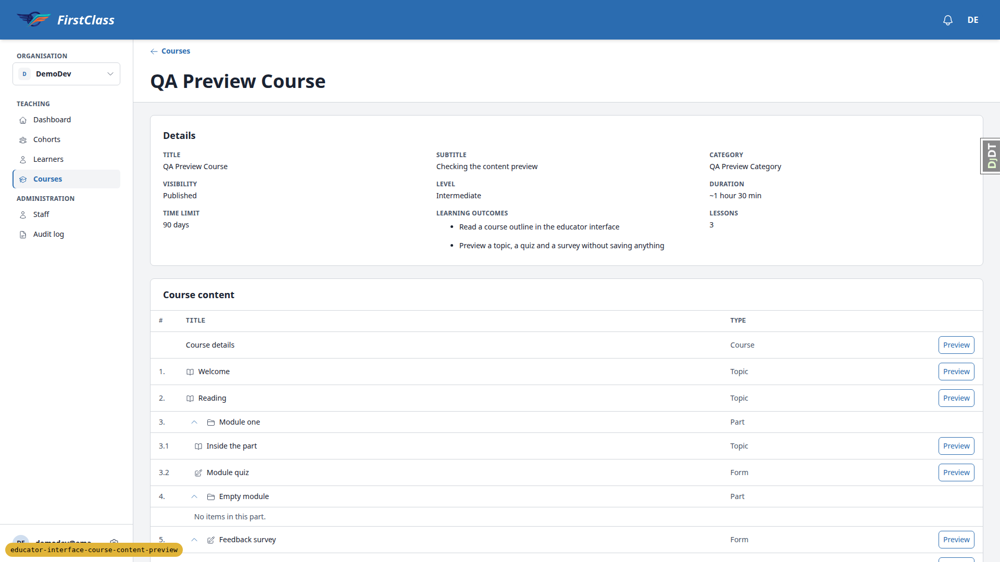

### §2 Course outline

| Test | Viewport | Status | Screenshot | Notes |
|---|---|---|---|---|
| 2.1 | desktop | pass | [img](screenshots/page-2026-11-11T18-29-48-930Z.png) | Course content table after Details; header #/Title/Type/sr-only Actions; Course details first row; numbering 1.,2.,3.,3.1,3.2,4.,5.,5.1-5.3 as planned; Module quiz has no page rows. |
| 2.2 | tablet | pass | [img](screenshots/page-2026-11-11T18-40-20-888Z.png) | Type icon beside each title and type in Type column; no title ends in an ellipsis at 768; chevron beside the title and Preview at the row end. At 1920 the Preview sits at the far right of a wide actions column, as the panel-framework data-table rule specifies. |
| 2.3 | desktop | pass | — | Module one and Feedback survey chevrons collapse children, aria-expanded flips false/true; reload reopens all groups. Chevron 32px with aria-controls. |
| 2.4 | desktop | pass | [img](screenshots/page-2026-11-11T18-29-48-930Z.png) | Empty module shows child row "No items in this part." |
| 2.5 | desktop | pass | — | Preview on course details, topic, form and page rows with names "Preview course details page", "Preview <title>", "Preview Feedback survey: <page>"; none on parts; panel header has no button. Buttons 34px tall at desktop. |
| 2.6 | desktop | pass | — | hx-get URLs under `/educator/organisations/demodev/courses/<pk>/__panels/content/__actions/preview_content?item=...`; page rows add `&page=`. No learner `/courses/` or `/learn` URLs in page source. |
| 2.7 | desktop | pass | [img](screenshots/page-2026-11-11T18-30-39-049Z.png) | Course details row then "No content in this course yet." |
| 2.8 | desktop | pass | [img](screenshots/page-2026-11-11T18-30-48-667Z.png) | Info callout "Learners can't see this outline yet. The course is marked as still in development." above the table; table and 9 Preview buttons present. |

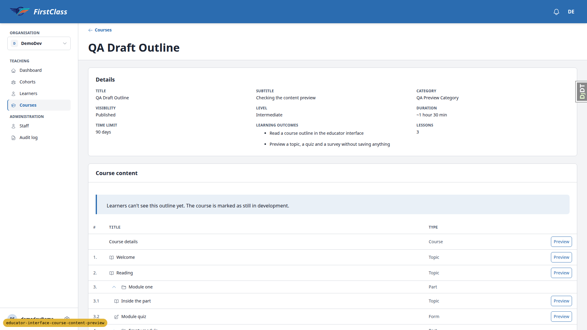

### §3 Topic preview

| Test | Viewport | Status | Screenshot | Notes |
|---|---|---|---|---|
| 3.2 | desktop | pass | [img](screenshots/page-2026-11-11T18-31-47-286Z.png) | #app-modal open, 1024px (64rem) wide; header "Welcome (Preview)" + chip "Topic"; no callout; reading column 672px (42rem) centred (168px each side). |
| 3.3 | desktop | pass | [img](screenshots/page-2026-11-11T18-32-10-713Z.png) | Focus on #app-modal-title. Header stays pinned while scrolling. data-more-below true at top, false at end and ::after opacity 0. overflow-y: scroll with a stable 17px gutter; headless Chromium hides scrollbars so the track itself cannot be seen in screenshots. |
| 3.4 | desktop | pass | [img](screenshots/page-2026-11-11T18-32-10-713Z.png) | 10-column table (876px) scrolls in its own overflow-x:auto box (670px); code block (1696px) scrolls in its overflow-x-auto wrapper; dialog scrollWidth == clientWidth, no widening. |
| 3.5 | desktop | pass | [img](screenshots/page-2026-11-11T18-32-26-925Z.png) | Flashcard flips (aria-pressed true). Expand opens lightbox over the preview; Escape closes only the lightbox, preview open at same scrollTop (34). |
| 3.6 | desktop | pass | [img](screenshots/page-2026-11-11T18-31-47-286Z.png) | No Mark complete, previous/next or breadcrumbs inside the dialog. |
| 3.7 | desktop | pass | — | Escape closes; focus returns to "Preview Welcome". |
| 3.8 | desktop | pass | — | Backdrop click closes, no Discard changes prompt, focus back on Preview Welcome. |
| 3.9 | desktop | pass | — | Counts before 0 4 0 0 1, after the topic previews 0 4 0 0 1 (TopicProgress, CourseProgress, FormProgress, QuestionAnswer, AuditLogEntry). |
| 3.10 | desktop | pass | — | "Inside the part" preview renders (200). Reading also renders (200). |

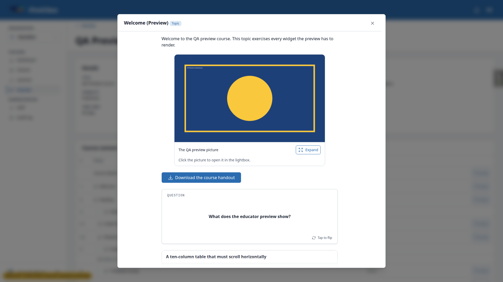

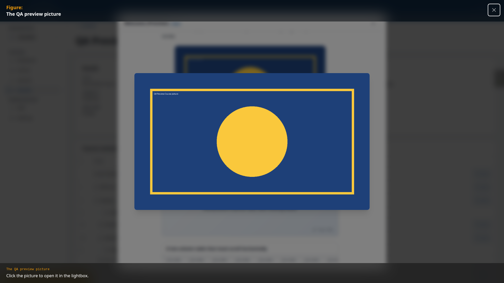

### §4 Quiz preview with the answer key

| Test | Viewport | Status | Screenshot | Notes |
|---|---|---|---|---|
| 4.1 | desktop | pass | [img](screenshots/page-2026-11-11T18-33-06-574Z.png) | Header "Module quiz (Preview)" chip "Form"; no callout; intro then page "Quiz questions"; select and text input 672px (reading column). |
| 4.2 | desktop | pass | [img](screenshots/page-2026-11-11T18-33-06-574Z.png) | All 9 inputs (radio, checkbox, select, text) disabled. |
| 4.3 | desktop | pass | [img](screenshots/page-2026-11-11T18-33-06-574Z.png) | Check icon + "Correct answer" on Mercury, Two and Seven; "Correct answer: Green" under the dropdown. |
| 4.4 | desktop | pass | — | No Submit/Next/Save; zero `<form>` elements in #app-modal; only button Close. |
| 4.5 | desktop | pass | — | Escape closes; focus returns to Preview Module quiz. |

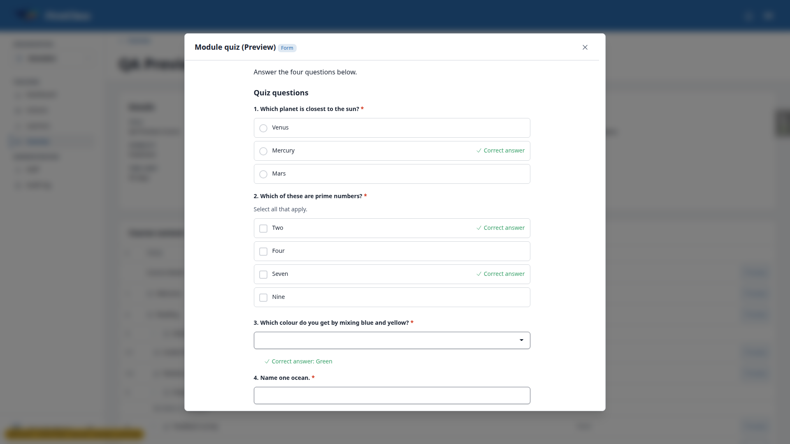

### §5 Survey preview: conditional page and file upload

| Test | Viewport | Status | Screenshot | Notes |
|---|---|---|---|---|
| 5.1 | desktop | pass | — | "Feedback survey (Preview)" chip Form; intro then chips "7 questions" "3 pages"; no question, no Start, no attempts. |
| 5.2 | desktop | pass | [img](screenshots/page-2026-11-11T18-33-24-369Z.png) | "Tell us more (Preview)" chip "Form page"; "Page 2 of 3: Tell us more"; "Shown only if Did you enjoy it? is answered No"; only question 6. Page 1 "Page 1 of 3: Your feedback" 5 questions no condition; page 3 "Page 3 of 3: Anything else". |
| 5.3 | desktop | pass | [img](screenshots/page-2026-11-11T18-33-26-837Z.png) | File-upload question shows "File upload question"; no file input, no Choose a file, no "No file attached." |
| 5.4 | desktop | pass | — | No form_engine/upload requests while survey dialogs were open. |
| 5.5 | desktop | pass | — | Counts unchanged after the quiz and survey previews: 0 4 0 0 1. |

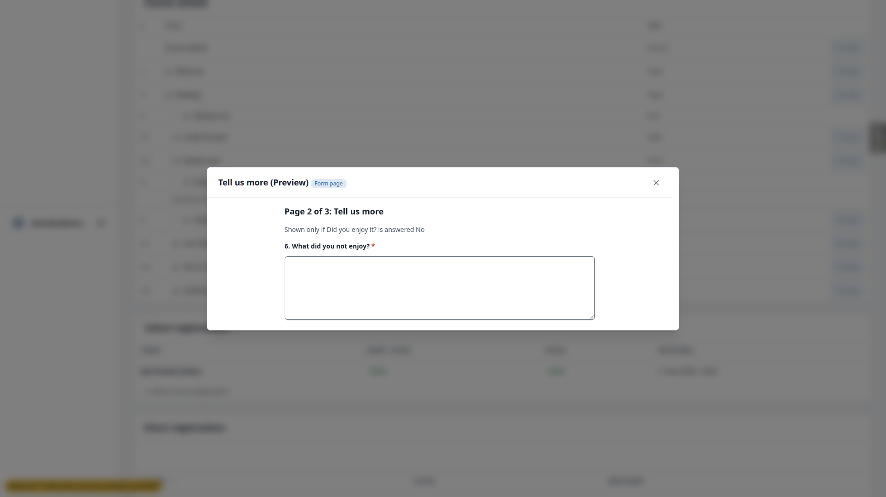

### §6 Course details preview

| Test | Viewport | Status | Screenshot | Notes |
|---|---|---|---|---|
| 6.1 | desktop | pass | [img](screenshots/page-2026-11-11T18-34-11-474Z.png) | Header "QA Preview Course (Preview)" chip "Course details"; no callout. |
| 6.2 | desktop | pass | [img](screenshots/page-2026-11-11T18-34-11-474Z.png) | Hero inside dialog with rounded corners: category chip, title, subtitle, stats Lessons "3 lessons", Level, Duration, Time limit, Price $49.00. |
| 6.3 | desktop | pass | [img](screenshots/page-2026-11-11T18-34-11-474Z.png) | About this course with content, What you'll learn with both outcomes. |
| 6.4 | desktop | pass | [img](screenshots/page-2026-11-11T18-34-11-474Z.png) | No Course content section, Enrolment stat, sign-up panel, Enrol/Start/Continue, Express interest or organisation card; only button Close. |
| 6.5 | desktop | pass | — | Escape closes; focus on "Preview course details page". |
| 6.6 | desktop | pass | — | QA Empty Course details preview 200, Lessons "0 lessons". |

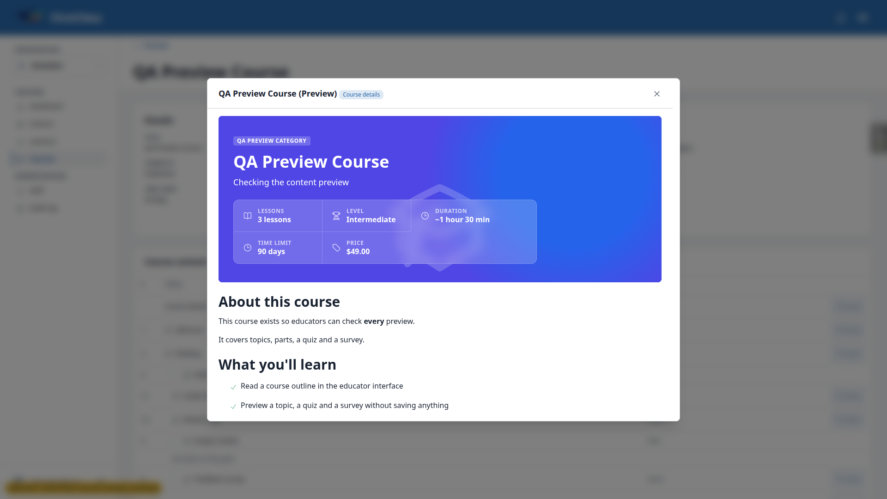

### §7 The learner course details page is unchanged

| Test | Viewport | Status | Screenshot | Notes |
|---|---|---|---|---|
| 7.2 | desktop | pass | [img](screenshots/page-2026-11-11T18-37-05-140Z.png) | Full-bleed hero (1920 wide), category chip, title, subtitle, stats Lessons/Level/Duration/Time limit/Price/Enrolment, sign-up panel with "Start course", This course includes "3 lessons" "Includes assessments", About, What you'll learn, Course content outline. |
| 7.3 | desktop | pass | [img](screenshots/page-2026-11-11T18-38-29-163Z.png) | Viewed as qa-other-learner (a learner in QA Other Org): organisation byline with QO mark in the hero and organisation card in the side column both render. |
| 7.4 | desktop | pass | — | As qa-other-learner (not registered for QA Preview Course): dashboard card shows $49.00; /courses/ rows show $49.00. qa-learner (registered) sees no price, as course_listing_price.html shows price only to not-registered viewers. |

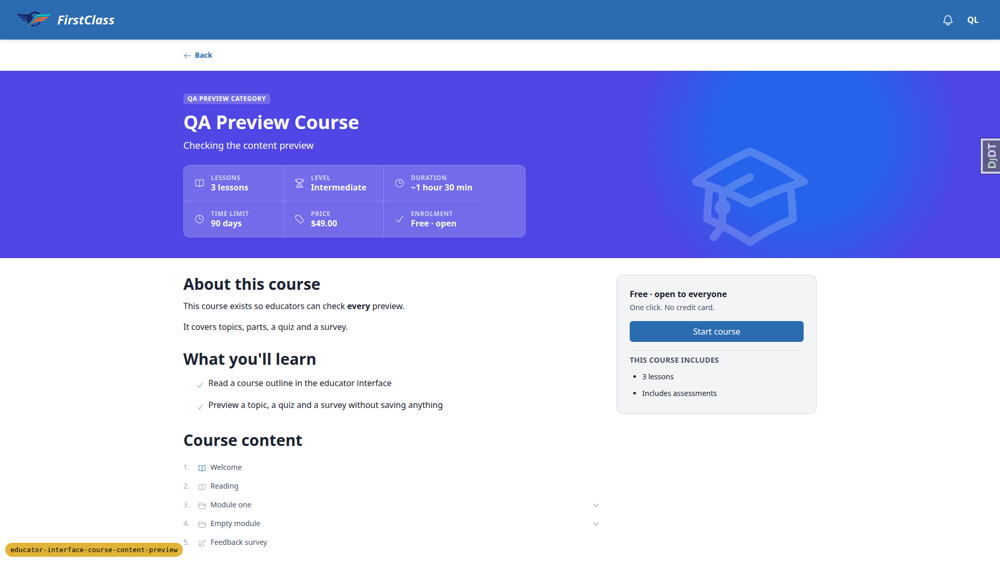

### §8 The answer key never leaks

| Test | Viewport | Status | Screenshot | Notes |
|---|---|---|---|---|
| 8.1 | desktop | pass | [img](screenshots/page-2026-11-11T18-38-14-895Z.png) | Learner quiz page in the player: no "Correct answer" text, no check marks beside options. |
| 8.2 | desktop | skip | — | Conditional step: the application-gated demo course is not loaded in this branch's DB (demo_content not saved), so there is no application form page to check. |

### §9 Scoping and adversarial branches

| Test | Viewport | Status | Screenshot | Notes |
|---|---|---|---|---|
| 9.1 | desktop | pass | — | Preview URL without HX-Request: 404. |
| 9.2 | desktop | pass | — | With HX-Request: other-org item 404, part item 404, not-a-uuid 404, zero uuid 404, no item 404; valid Welcome item 200 as control. |
| 9.3 | desktop | pass | — | POST with HX-Request and CSRF token: 404. |
| 9.4 | desktop | pass | — | qa-other-educator: demodev course page 404, preview action fetch with HX-Request 404; own org cohorts 200 as control. |
| 9.5 | desktop | pass | — | Superuser GET /educator/organisations/demodev/courses/<QA Other Org Course pk>: 404. |

### §10 Other dialogs keep the standard width

| Test | Viewport | Status | Screenshot | Notes |
|---|---|---|---|---|
| 10.1 | desktop | pass | [img](screenshots/page-2026-11-11T18-34-43-542Z.png) | Create cohort dialog 512px (32rem); data-more-below false, no fade. Reserved scrollbar gutter on the right is the spec's always-visible track (spec item 16). |
| 10.2 | desktop | pass | — | Learner page "Remove from Cohort" confirmation 512px. |
| 10.3 | desktop | pass | — | Preview (1024px) -> close -> HTMX sidebar nav to Cohorts (no full load) -> Create cohort 512px. No width leak. |

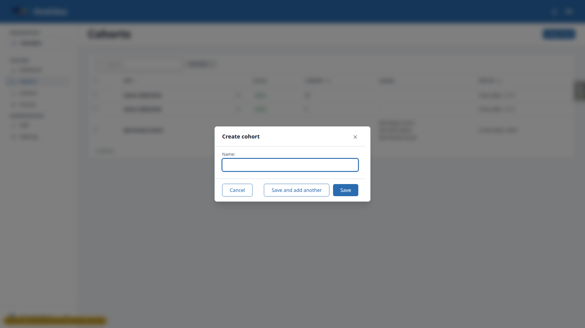

### §11 Viewports

#### Desktop (1920x1080)

| Test | Viewport | Status | Screenshot | Notes |
|---|---|---|---|---|
| 11.4 | desktop | pass | [img](screenshots/page-2026-11-11T18-32-26-925Z.png) | 1920 lightbox covers the viewport above the preview, image 896x523 fits, title and close in view, scrollWidth 1920. |

(Desktop §11 steps 1, 2, 3 and 6 are covered by §1, §2, §3 and the console note under tablet 11.6.)

#### Mobile (375x812)

| Test | Viewport | Status | Screenshot | Notes |
|---|---|---|---|---|
| 11.1 | mobile | pass | [img](screenshots/page-2026-11-11T18-39-09-872Z.png) | scrollWidth 375 = innerWidth; Type column hidden; numbers and Preview buttons in view (max right 342); Preview buttons 44px; no ellipsis; outline region does not scroll. |
| 11.2 | mobile | pass | [img](screenshots/page-2026-11-11T18-39-20-128Z.png) | Bottom sheet 771px of 812 (95%), rounded top corners 16px, bottom 0; content scrolls inside; document scrollWidth 375 <= 375; data-more-below true (fade shown). |
| 11.3 | mobile | pass | — | Table box 308 wide scrolls 876; code wrapper 308 scrolls 1696; dialog scrollWidth == clientWidth. |
| 11.4 | mobile | pass | [img](screenshots/page-2026-11-11T18-39-30-576Z.png) | Lightbox modal covers 375x812 above the sheet; image 375x219 fits; title and 44px close in view; scrollWidth 375. Escape closes only the lightbox (preview open, same scrollTop); second Escape closes the preview. |
| 11.5 | mobile | pass | [img](screenshots/page-2026-11-11T18-39-42-391Z.png) | Quiz, survey page 1 and course details previews at 375: readable, nothing past the right edge, inputs 310px filling the sheet's content width. |
| 11.5b | mobile | pass | [img](screenshots/page-2026-11-11T18-39-52-693Z.png) | Survey page 1 preview at 375. |
| 11.5c | mobile | pass | [img](screenshots/page-2026-11-11T18-39-55-866Z.png) | Course details preview at 375: hero stacks its stats; nothing clipped. |
| 11.6 | mobile | pass | — | No error-level console entries at 375. |

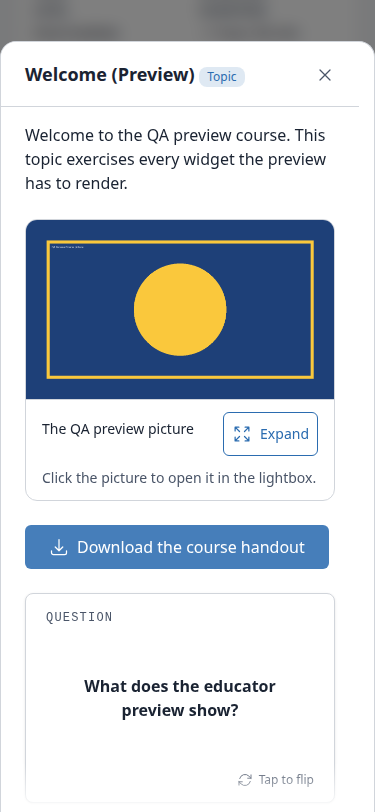

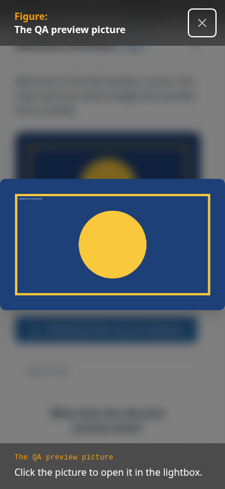

#### Tablet (768x1024)

| Test | Viewport | Status | Screenshot | Notes |
|---|---|---|---|---|
| 11.1 | tablet | pass | [img](screenshots/page-2026-11-11T18-40-20-888Z.png) | 768: navigation is the hamburger sheet toggle in the page heading (column from lg); scrollWidth 768; Type column visible; outline fits (region 718, no scroll); Preview buttons 34px in view. |
| 11.2 | tablet | pass | [img](screenshots/page-2026-11-11T18-40-35-770Z.png) | Centred dialog 707px (92vw), data-more-below true; table box 640 scrolls 876, code wrapper 640 scrolls 1696; no page overflow. |
| 11.4 | tablet | pass | [img](screenshots/page-2026-11-11T18-40-38-054Z.png) | Lightbox covers 768x1024 above the preview; image fits 768x448; close 44px in view; Escape closes the lightbox only, second Escape closes the preview. |
| 11.6 | tablet | pass | — | No error-level console entries at 768. At 1920 the only error entries were the deliberate §9 404 probes. |

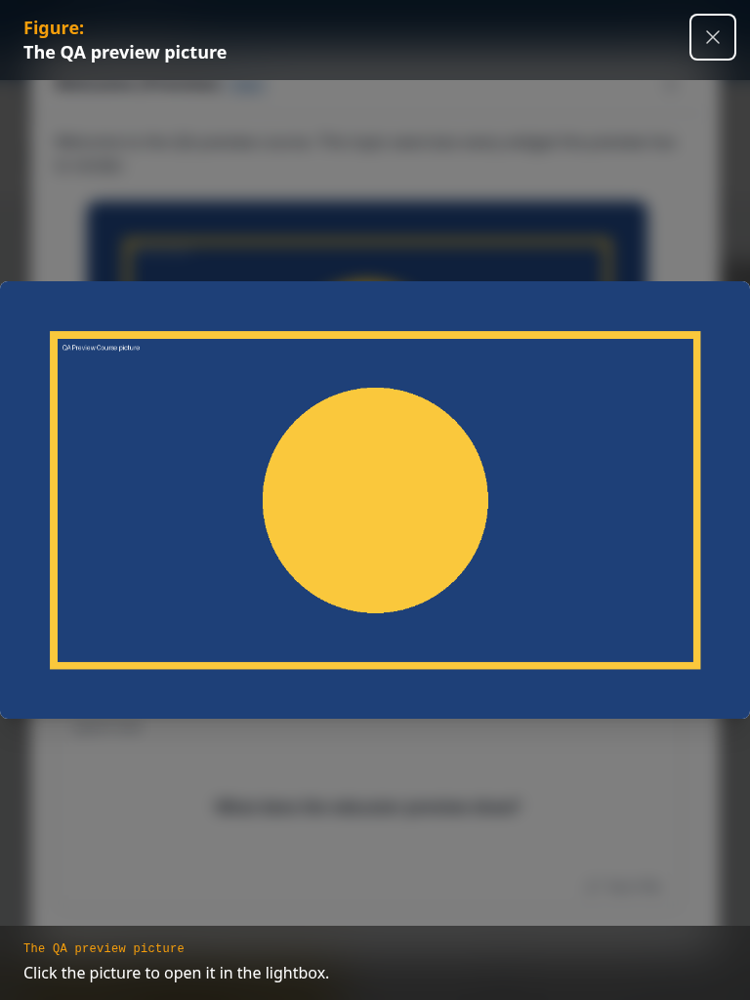

### §12 Reopen after Back

| Test | Viewport | Status | Screenshot | Notes |
|---|---|---|---|---|
| 12.1 | desktop | pass | — | Preview, close, HTMX nav to Courses, Back, Preview Welcome again: dialog opens with title and 1845 chars of content. |

### §13 Shell: navigation is a left column at desktop widths

| Test | Viewport | Status | Screenshot | Notes |
|---|---|---|---|---|
| 13.1 | desktop | pass | [img](screenshots/page-2026-11-11T18-29-48-930Z.png) | Shell expression true on fresh load at 1920. |
| 13.2 | desktop | pass | [img](screenshots/page-2026-11-11T18-36-30-261Z.png) | At 375 nav sheet opened as modal; resized to 1920: docked column, expression true, sheet no longer modal, no scrim. |
| 13.3 | desktop | pass | — | Expression true after Courses+Back and after opening/closing the Welcome preview. |

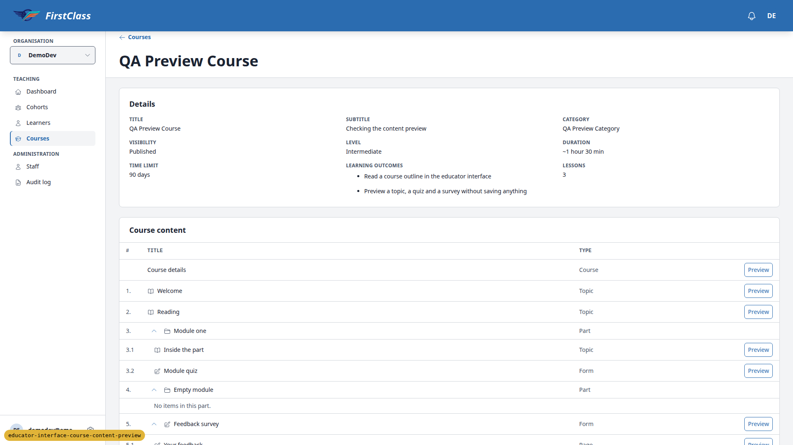

## Design check

No design states tested.

## Layout probe

| Test | Viewport | URL | Screenshot | Result |
|---|---|---|---|---|
| 1.1 | desktop | /educator/organisations/demodev/courses/<preview> | [img](screenshots/page-2026-11-11T18-29-48-930Z.png) | clean |
| 1.2 | desktop | /educator/organisations/demodev/courses/<empty> | [img](screenshots/page-2026-11-11T18-30-39-049Z.png) | clean |
| 2.8 | desktop | /educator/organisations/demodev/courses/<draft> | [img](screenshots/page-2026-11-11T18-30-48-667Z.png) | clean |
| 3.2 | desktop | /educator/organisations/demodev/courses/<preview> (Welcome preview open) | [img](screenshots/page-2026-11-11T18-31-47-286Z.png) | clean |
| 4.1 | desktop | /educator/organisations/demodev/courses/<preview> (quiz preview open) | [img](screenshots/page-2026-11-11T18-33-06-574Z.png) | clean |
| 5.2 | desktop | /educator/organisations/demodev/courses/<preview> (survey page 2 open) | [img](screenshots/page-2026-11-11T18-33-24-369Z.png) | clean |
| 6.1 | desktop | /educator/organisations/demodev/courses/<preview> (course details preview open) | [img](screenshots/page-2026-11-11T18-34-11-474Z.png) | clean |
| 10.1 | desktop | /educator/organisations/demodev/cohorts (Create cohort open) | [img](screenshots/page-2026-11-11T18-34-43-542Z.png) | clean |
| 13.2 | desktop | /educator/organisations/demodev/courses/<preview> (after 375 sheet then 1920) | [img](screenshots/page-2026-11-11T18-36-30-261Z.png) | clean |
| 7.2 | desktop | /courses/qa-preview-course/detail/ (qa-learner) | [img](screenshots/page-2026-11-11T18-37-05-140Z.png) | clean |
| 7.3 | desktop | /courses/qa-other-org-course/detail/ (qa-other-learner) | [img](screenshots/page-2026-11-11T18-38-29-163Z.png) | clean |
| 8.1 | desktop | /courses/qa-preview-course/4/fill_form/1 (qa-learner) | [img](screenshots/page-2026-11-11T18-38-14-895Z.png) | clean |
| 11.1 | mobile | /educator/organisations/demodev/courses/<preview> | [img](screenshots/page-2026-11-11T18-39-09-872Z.png) | clean |
| 11.2 | mobile | /educator/organisations/demodev/courses/<preview> (Welcome preview) | [img](screenshots/page-2026-11-11T18-39-20-128Z.png) | clean |
| 11.4 | mobile | /educator/organisations/demodev/courses/<preview> (lightbox) | [img](screenshots/page-2026-11-11T18-39-30-576Z.png) | clean |
| 11.5 | mobile | /educator/organisations/demodev/courses/<preview> (quiz preview) | [img](screenshots/page-2026-11-11T18-39-42-391Z.png) | clean |
| 11.1 | tablet | /educator/organisations/demodev/courses/<preview> | [img](screenshots/page-2026-11-11T18-40-20-888Z.png) | clean |
| 11.2 | tablet | /educator/organisations/demodev/courses/<preview> (Welcome preview) | [img](screenshots/page-2026-11-11T18-40-35-770Z.png) | clean |
| 11.4 | tablet | /educator/organisations/demodev/courses/<preview> (lightbox) | [img](screenshots/page-2026-11-11T18-40-38-054Z.png) | clean |

## Data changes

| Via | What |
|---|---|
| sdd:qa-data-helper | Ran qa_create_course_content_preview: QA Preview Course, QA Empty Course, QA Draft Outline, QA Other Org Course, QA Preview Cohort, qa-learner and qa-other-educator (delete-and-recreate) |

## Bug status

No bugs found this run.

## General notes

- Pre-step rebase: the branch was rebased onto origin/main (33 commits). Conflicts in modal_host.html (twice), .claude/skills/brand-guidelines/visual.md, claude_plugins/fls-dev/skills/panel-framework/SKILL.md and docs/product/educator-interface.md were resolved by keeping both sides. Lost-change check clean, full tier 12670 passed, pre-commit clean, force-pushed. The fls-dev front-end check ran as part of this QA pass (same pages, same three viewports): no failures.
- Scrollbar track: headless Chromium hides scrollbars, so the always-visible track (spec item 16) cannot be seen in any screenshot. The CSS is in place (overflow-y: scroll, scrollbar-gutter: stable, a 17px reserved gutter). A side effect: every #app-modal dialog, short ones included, reserves that gutter, so the header divider stops ~15px short of the right edge and the right padding reads wider than the left wherever scrollbars overlay (macOS, phones). That is the spec's decided design, recorded as a pass; worth a look if the asymmetry bothers anyone.
- §2.2 "no wide gap between the title and the controls": at 1920 the Preview button sits at the far right of the table's actions column, a long way from short titles. The panel-framework rule for the course outline (a data table with the action in a c-data-table-actions cell) describes exactly this, so it is a pass by Rule 5; the test-plan sentence may be left over from the earlier flex-list design.
- The seed puts the content-link in "Reading" rather than "Welcome" as §0 asks. Reading previews fine (200) and the link renders as plain text with no href; the spec puts content-link / Topic.preview_url out of scope ("previewed content behaves as it does for learners today").
- QA Preview Course shows "Price $49.00" beside "Enrolment: Free · open" and the sign-up panel "Free · open to everyone. One click. No credit card.". The heading comes from freedom_ls/course_access/backends.py, untouched by this branch; the seed gives an open-access course a price. Pre-existing copy contradiction, not caused by this branch.
- With a modal open and the page scrolled, the sidebar's user block appeared mid-viewport behind the scrim (html overflow: hidden while a modal is open). Not visible with no dialog open; covered by the scrim; affects every #app-modal dialog. Observation only.
- §7.3 was viewed as qa-other-learner (a learner in QA Other Org) rather than the superuser. §7.4 prices were checked as qa-other-learner because listing prices show only to viewers not registered for the course; qa-learner is registered for the only priced course.

status: ok · reason: report rendered, 0 bugs documented, screenshots verified
