# QA report: educator interface course content preview

## Methodology

Playwright MCP driven by hand at 1920x1080 (desktop), 768x1024 (tablet) and 375x812 (mobile). Screenshots were collected into `screenshots/` beside this report, and every image referenced here exists there. The QA plan is `3. frontend_qa.md`.

## Diff scoping

Class: FULL. Everything ran; nothing was skipped.

Changed areas: `freedom_ls/educator_interface/**`, learner_interface `course_detail.html` and `views.py`, `content_engine` templates, `form_engine` templates, and `panel_framework/partials/modal_host.html`.

## Smoke gate

Pass. Pages checked:

- `/`
- `/educator/organisations/demodev/courses/b44275e9-192b-489e-a621-9192bc07f932`

## Results

| Test | Viewport | Status | Notes | Screenshot |
|---|---|---|---|---|
| 1.1 | desktop | fail | All nine rows present with correct values (Duration ~1 hour 30 min, Time limit 90 days, Lessons 3), but the category row is labelled "Dashboard category" instead of "Category" (B1). | 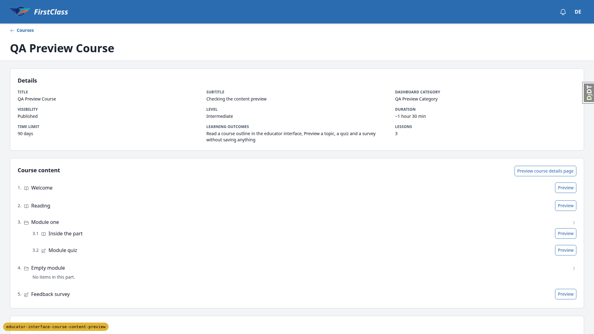 |
| 1.2 | desktop | pass | QA Empty Course: only Title, Visibility, Lessons 0; no subtitle, duration, time limit or outcomes rows. | none |
| 2.1-2.6 | desktop | pass | Outline numbered 1., 2., 3., 3.1, 3.2, 4., 5.; type icons with sr-only labels; parts open by default; Module one toggles aria-expanded false/true and hides its children; reload reopens; Empty module shows "No items in this part."; Preview buttons only on topic/form rows with aria-label "Preview <title>"; hx-get under `/educator/organisations/demodev/courses/.../__panels/content/__actions/preview_content?item=`; no learner `/courses/` hrefs in the page. |  |
| 2.7 | desktop | pass | QA Empty Course shows "No content in this course yet." and the header still offers "Preview course details page". | none |
| 2.8 | desktop | pass | QA Draft Outline shows the in-development callout above the outline; 6 preview triggers present. | none |
| 3.2-3.4 | desktop | pass | Welcome preview: `#app-modal` 1024px wide (64rem), header "Welcome" + "Topic" chip, callout text exact, rendered content. Focus on `#app-modal-title`. Header stays pinned after scrolling 600px. Code block scrolls inside its own box; dialog scrollWidth equals clientWidth; no document horizontal scroll. | 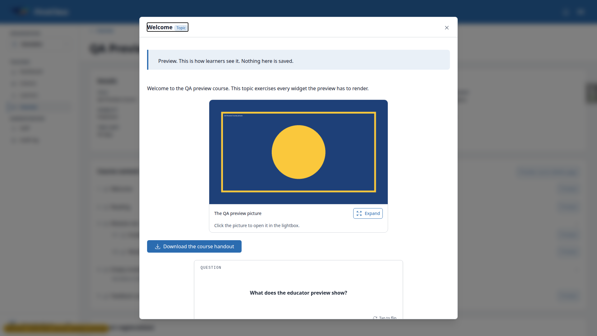 |
| 3.5-3.8 | desktop | pass | Flashcard flips (aria-pressed false to true). Lightbox opens from the picture's Expand button and Escape closes the lightbox first, then the preview. No Mark complete, no prev/next, no breadcrumb. Escape returns focus to "Preview Welcome". Backdrop click closes with no discard prompt. | none |
| 3.9 | desktop | pass | Row counts TopicProgress/CourseProgress/FormProgress/QuestionAnswer/AuditLogEntry = 0 4 0 0 1 before and after opening every preview. | none |
| 3.10 | desktop | pass | "Inside the part" (3.1) preview renders with title and "Topic" chip. | none |
| 3.x-reading | desktop | fail | Preview on "Reading" (markdown holds `<c-content-link>` to another topic) returns HTTP 500; the dialog never opens and the educator sees nothing (console: Response Status Error Code 500). See B2. | none |
| 4.1-4.5 | desktop | pass | Module quiz: "Form" chip, callout, intro, page "Quiz questions". 9 inputs, all disabled; no `<form>`. Exactly Mercury, Two, Seven marked "Correct answer" with check icon; dropdown shows "Correct answer: Green" under the select. No Submit/Next/Save. Escape returns focus to "Preview Module quiz". | 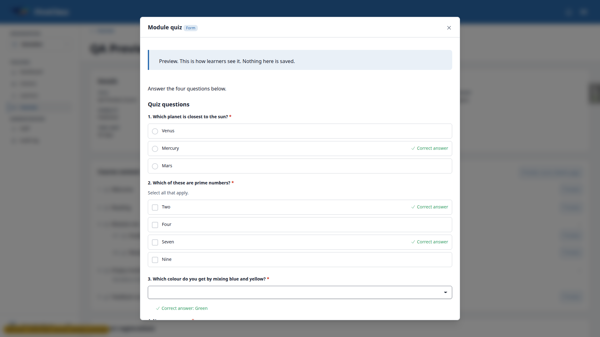 |
| 5.1-5.4 | desktop | pass | Feedback survey: pages "Your feedback" then "Tell us more" with "Shown only if Did you enjoy it? is answered No". Upload question shows only "File upload question"; no file input, no uploader, no "No file attached.". Only network request while open was the preview fragment itself (plus debug toolbar). Counts unchanged. | 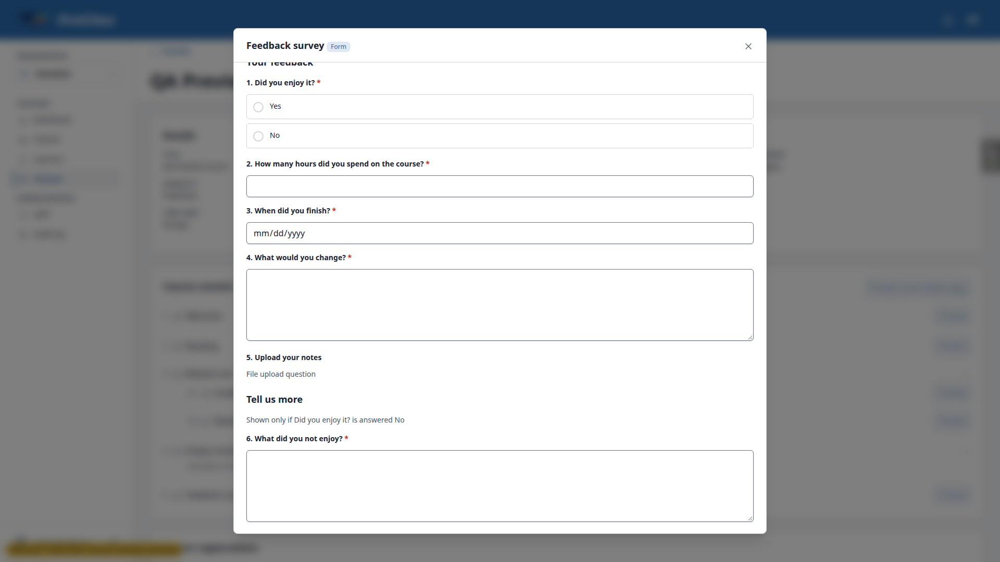 |
| 6.1-6.6 | desktop | pass | Course details preview: title + "Course details" chip, callout, hero with category chip, title, subtitle, stats Lessons "3 lessons", Level, Duration, Time limit, Price $49.00; hero inset 25px each side with 8px radius. About this course and What you'll learn. No Course content, Enrolment, sign-up panel, CTA, Express interest, organisation card or form. Escape returns focus to the header trigger. QA Empty Course renders with "0 lessons". | 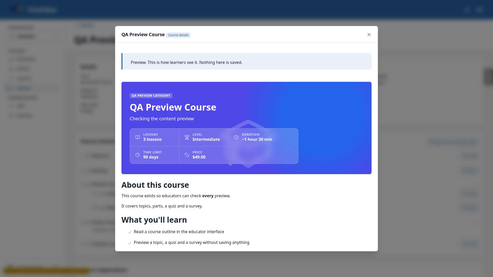 |
| 7.1-7.2 | desktop | pass | Learner details page unchanged: full-bleed hero (left 0, width 1920), category chip, title, subtitle, stats, Enrolment "Free · open"; sign-up panel with "Start course"; "This course includes" with "3 lessons" and "Includes assessments"; About this course; What you'll learn; Course content outline. |  |
| 7.3 | desktop | pass | Superuser gets 404 on the other org course's learner page (not in its audience), so checked as qa-other-learner: organisation byline "QA Other Org" with mark in the hero and organisation card render (components moved to content_engine). | 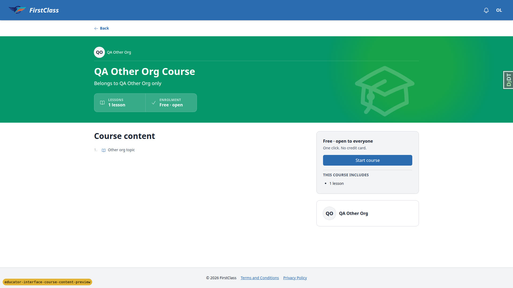 |
| 7.4 | desktop | pass | Course price $49.00 renders on dashboard cards and on `/courses/` list. | none |
| 8.1 | desktop | pass | Learner's Module quiz page in the player (`/courses/qa-preview-course/4/fill_form/1`): no "Correct answer" text and no mark beside any option. | 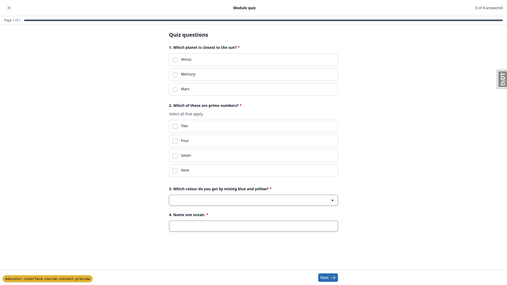 |
| 8.2 | desktop | skip | No application-gated demo course in this dev DB; covered by `course_applications/tests/test_views.py`, which asserts no "Correct answer" on open and completed application form pages (passed in the full run). | none |
| 9.1-9.5 | desktop | pass | Preview URL without HX-Request: 404, no fragment. With HX-Request: other org topic item 404, part item 404, not-a-uuid 404, zero uuid 404, no item 404, valid item 200 (control). POST with CSRF: 404. qa-other-educator: course page, preview_content and preview_course_details all 404. Superuser on QA Other Org Course under demodev: 404. | none |
| 10.1-10.3 | desktop | pass | Create cohort dialog 512px (32rem) wide with no data-modal-size; topic preview 1024px; Create cohort again after a preview: still 512px. 10.2 (learner row action) not separately exercised: the same `#app-modal` width rule applies and the wide-size invariant test guards it. | 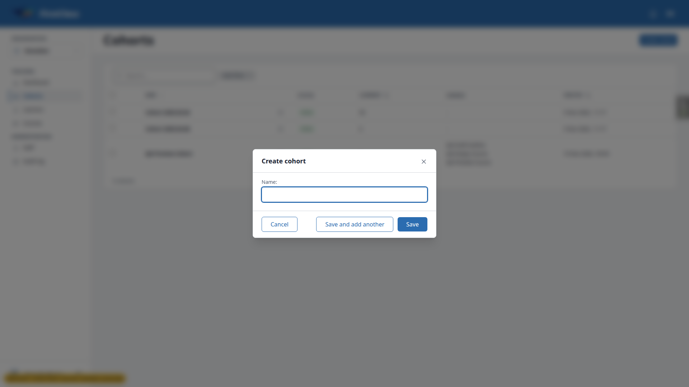 |
| 12.1-12.2 | desktop | pass | Open/close Welcome preview, sidebar Courses (HTMX nav), Back, Preview Welcome again: dialog shows "Welcome Topic" with content. | none |
| 11.1-11.5 | mobile | pass | 375x812: no page horizontal scroll, titles wrap (no ellipsis), Preview buttons in view. Welcome preview is a bottom sheet 771px tall (95% of 812) with 16px top radius and 0 bottom radius; table (876px) and code block (1696px) scroll inside their own boxes in a 323px column; dialog and document scrollWidth equal client width. Quiz and course details previews: nothing clipped at the right edge. No console errors. | 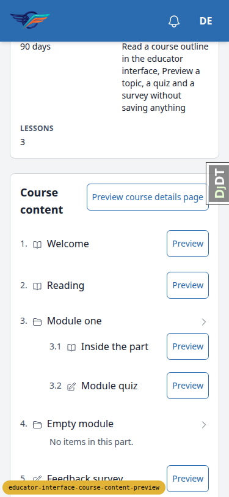 |
| 11.4 | mobile | pass | Course details preview at 375: hero stats stack in one column, readable, inside the sheet. | 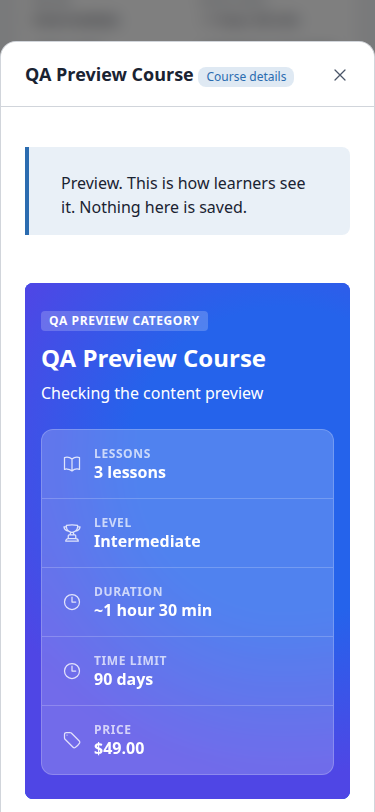 |
| 11.1-11.5 | tablet | pass | 768x1024: no page horizontal scroll, no ellipsis; Welcome preview centred (31px margins), 707px wide; no overflow; no console errors. | 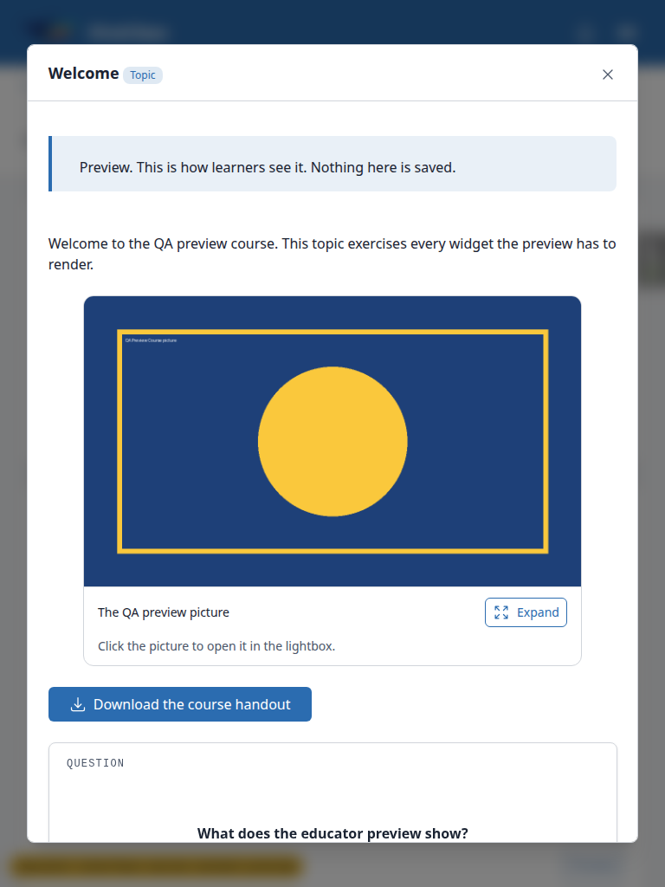 |
| 11.1-11.5 | desktop | pass | 1920x1080: centred, 1024px wide dialog; no overflow. Only console errors were the Reading preview's 500 (B2). |  |

## Design check

no design states tested

## Bugs

### B1: Course Details panel labels the category row "Dashboard category"

- Manifestations: test 1.1 (desktop)
- Screenshots: 
- Expected: the category row is labelled "Category", the word the learner page and the QA plan use.
- Actual: the row is labelled "Dashboard category" (the model field's verbose name), because `CourseDetailsPanel.labels` has no entry for `dashboard_category`.

### B2: Previewing a topic that contains a content-link fails with a 500 and nothing is shown

- Manifestations: test 3.x-reading (desktop)
- Screenshots: none (the dialog never opens; the evidence is the HTTP 500 and console error)
- Expected: the Reading topic preview opens like any other topic.
- Actual: the preview action returns HTTP 500; the dialog never opens and the educator gets no message. `cotton/content-link.html` renders `content_obj.preview_url`, and `Topic.preview_url` reverses `content_engine:topic_detail`, whose route is commented out in `config/urls.py` and `learner_interface/urls.py`. Pre-existing: the same component breaks the learner player for this topic too.

## Layout probe

| Test | Viewport | URL | Screenshot | Result |
|---|---|---|---|---|
| 1.1 | desktop | `/educator/organisations/demodev/courses/<preview>` |  | clean |
| 3.2 | desktop | `/educator/.../courses/<preview>` (Welcome preview open) |  | clean |
| 11.1 | mobile | `/educator/.../courses/<preview>` |  | clean |
| 11.2 | mobile | `/educator/.../courses/<preview>` (Welcome preview) | 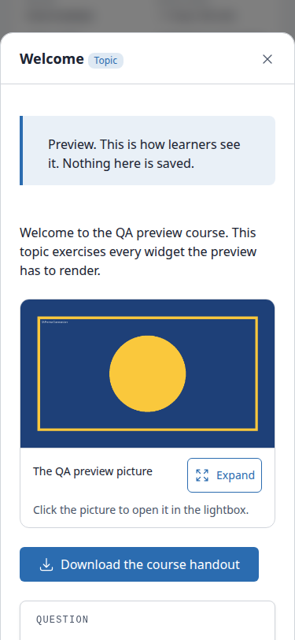 | clean |
| 11.2 | tablet | `/educator/.../courses/<preview>` (Welcome preview) |  | clean |

## Data changes

| Via | What |
|---|---|
| sdd:qa-data-helper | Seeded the QA preview courses, users and cohorts with the new `qa_create_course_content_preview` command (content-link placed in Reading instead of Welcome, as content-link is known broken). |
| sdd:qa-data-helper | Marked Welcome, Reading and Inside the part complete for qa-learner@example.com on QA Preview Course so the player unlocks Module quiz (Reading cannot be completed through the UI because it 500s). |

## Bug status

| Bug | Status |
|---|---|
| B1 | **FIXED** (commit: a40c81dc9) — Course Details panel labels the category row "Dashboard category". Re-verified in the browser: the row reads "Category" 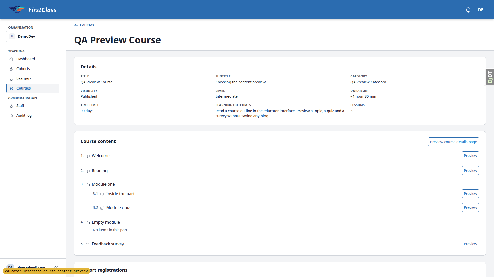 |
| B2 | **UNRESOLVED** — Previewing a topic that contains a content-link fails with a 500 and nothing is shown (reason: pre-existing; fixing needs a product decision on where a content-link should point now that `content_engine:topic_detail` is commented out, in the learner player and in the educator preview) |

## General notes

- The QA plan's section 0 seed asked for the content-link inside Welcome. It was moved into Reading because content-link is known broken, so B2 surfaces without blocking the Welcome checks.
- Section 3.5 "click the picture" is inaccurate: the picture component opens its lightbox only from its Expand button, which worked.
- The expanded-part chevron points right and the collapsed one down, matching the learner course outline's convention (the icon names the action).
- Test 8.2 was skipped in the browser (no application-gated demo course in this DB) and covered by automated tests.
- The superuser gets a 404 on the other-org course's learner page, so 7.3 was checked as a learner of that org.
- A failed htmx request (B2) surfaces no message to the user at all; that is general htmx error handling, noted only.

status: ok · reason: 2 bugs — 1 fixed, 1 unresolved; report rendered, screenshots verified
