# Frontend QA report

## Methodology

- Screenshots were collected into `screenshots/` beside this report, and every referenced image exists there.
- Viewports: desktop 1920x1080, mobile 375x812, tablet 768x1024.
- The run used Playwright MCP against a dev server on its own port.
- Plan: `3. frontend_qa.md` in this spec directory.

## Diff scoping

- Class: FULL.
- Changed files that triggered it:
  - `freedom_ls/educator_interface/templates/educator_interface/panels/course_content.html`
  - `freedom_ls/educator_interface/views.py`
  - `freedom_ls/educator_interface/actions.py`
  - `freedom_ls/learner_management/queries.py`
  - `freedom_ls/content_engine/*`
  - `demo_content/*`
- Skipped: nothing.

## Smoke gate

Outcome: pass. Pages checked: `/` and `/educator/organisations/harbour-college/courses`.

## Test results

| Test id | Viewport | Status | Notes | Screenshot |
|---|---|---|---|---|
| 1.1 | desktop | pass | 15 courses over 2 pages: Harbour's own and Northwind's shared Workplace Safety Essentials (ids 1eb2b2d6, 26c2e0d5) and the no-organisation courses; no Forklift Safety Basics row. Step 4 (search for Forklift) not runnable: the Courses list has no search box. Content Widgets (no organisation) is absent too, likely unpublished, which predates this branch. | 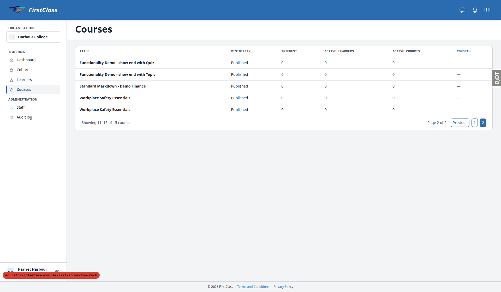 |
| 1.2 | desktop | pass | Shared Northwind course detail shows Details, Course content with outline (Course details, 1. Safety on site) and Preview buttons, Cohort and Direct registration panels. | 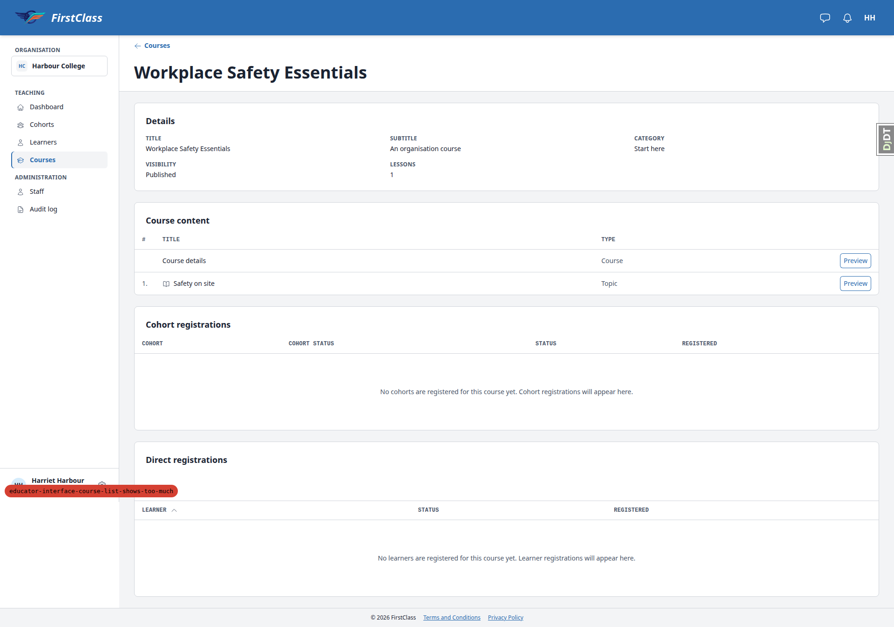 |
| 1.2-preview-details | desktop | pass | Course details preview dialog titled 'Workplace Safety Essentials (Preview)', shows Northwind Logistics card. |  |
| 1.2-preview-topic | desktop | pass | Topic preview 'Safety on site (Preview)' opens read-only. | 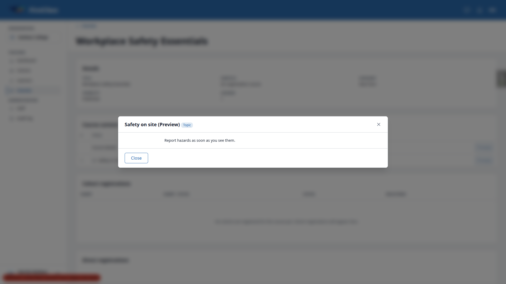 |
| 1.3 | desktop | pass | Forklift Safety Basics detail URL under harbour-college returns 404 (Django DEBUG not-found page in dev). Its preview_course_details action URL returns 404 with HX-Request; the shared course's returns 200. | none |
| 1.4-filters | desktop | pass | cohorts-course and learners-course filter selects each list 15 courses + All, including both Workplace Safety Essentials (Harbour 1eb2b2d6, Northwind shared 26c2e0d5) and no Forklift Safety Basics. Filter button could not be clicked by accessible name; options read from the DOM. | 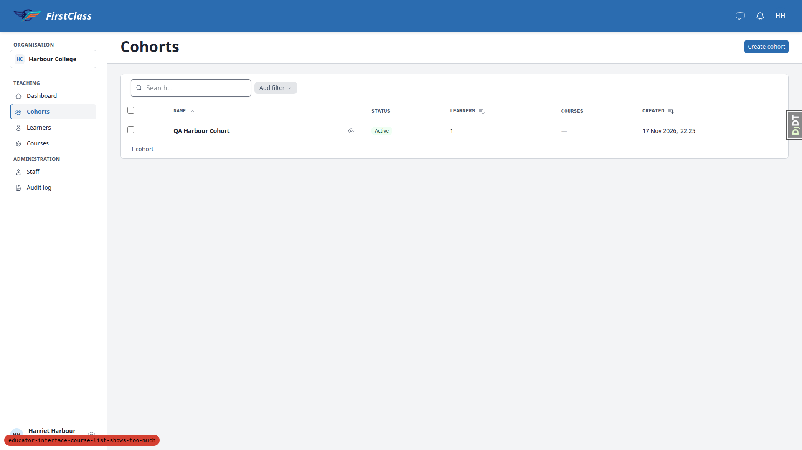 |
| 1.4-cohort-register | desktop | pass | QA Harbour Cohort register picker offers Northwind's shared course, not Forklift. Registered the cohort on 26c2e0d5; row shows Active in the cohort's Courses tab, DB confirms. | 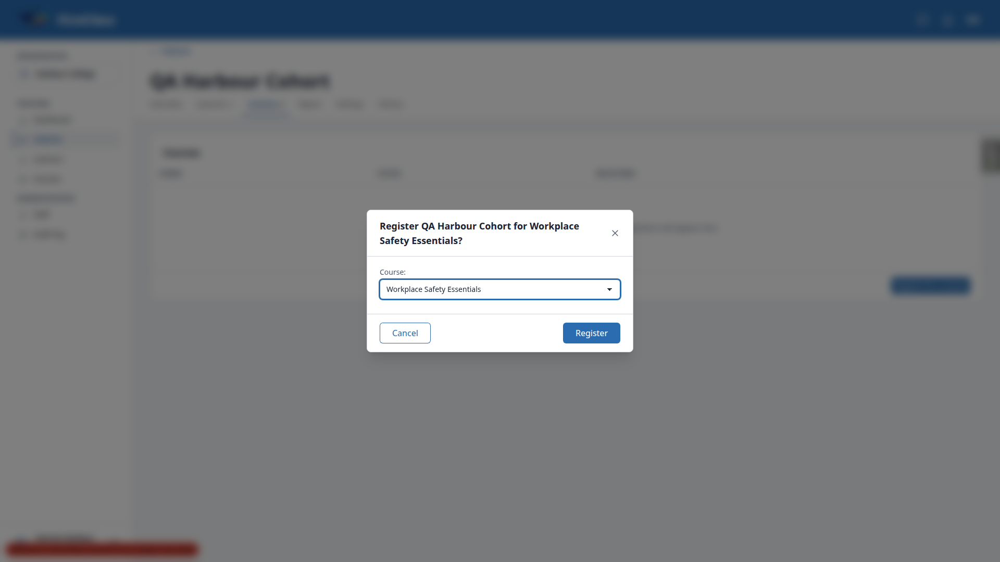 |
| 1.4-learner-register | desktop | pass | Sol Harbour's register-for-course picker: same 15 courses, both Workplace Safety Essentials, no Forklift. Closed without registering. | none |
| 1.4-bulk-register | desktop | pass | Learners list bulk register-for-course with Sol Harbour selected: same picker contents. Cancelled. | 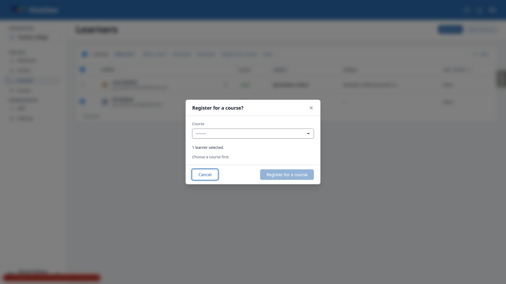 |
| 1.4-picker-labels | desktop | fail | Every course picker and filter lists two options both labelled 'Workplace Safety Essentials' (Harbour's own and Northwind's shared) with nothing to tell them apart. The Courses list has the same two identical rows. See B1. |  |
| 2.1 | desktop | pass | After revoking the share: Northwind's Workplace Safety Essentials still listed (1 active learner, QA Harbour Cohort); detail shows Details, Course content with 'Content preview isn't shared with your organisation.' and no outline or Preview buttons, plus both registration panels. preview_course_details and preview_content return 404. Register picker (checked on Sol Harbour's learner register action) no longer offers 26c2e0d5. | 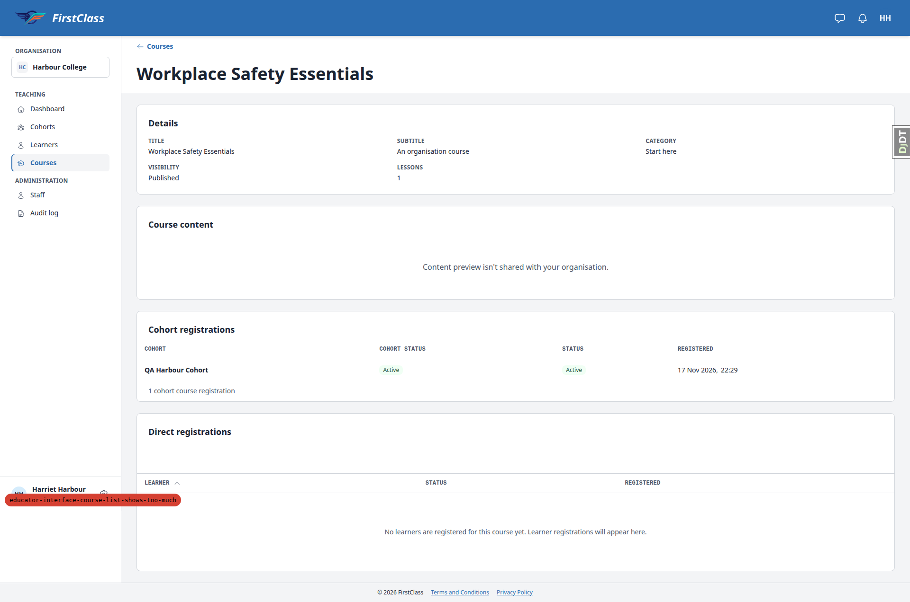 |
| 2.2 | desktop | pass | Learner Overview > Registrations panel: Reactivate on the inactive Workplace Safety Essentials row, then confirm: dialog stays open with 'This course is not open to the organisation.'; DB shows registration still inactive. | 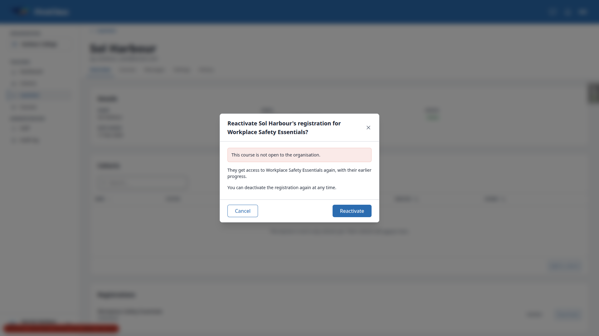 |
| 2.3 | desktop | pass | After restoring shared_with: detail shows the outline and 2 Preview buttons again; reactivating Sol Harbour's registration succeeds, row shows Active, DB is_active True. | 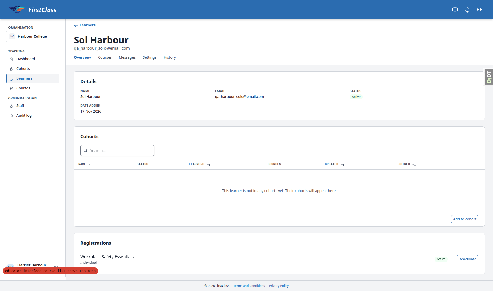 |
| 3 | desktop | pass | Northwind educator's Courses list: 15 courses incl. Forklift Safety Basics (c358d156) and the shared Workplace Safety Essentials (26c2e0d5); no Harbour Workplace Safety Essentials row. Harbour's course URL under northwind-logistics returns 404. |  |
| 4.1 | desktop | pass | qa_harbour_learner (registered through QA Harbour Cohort) sees Northwind's Workplace Safety Essentials on the dashboard and opens topic 1 'Safety on site' with its content. |  |
| 4.2 | desktop | pass | qa_harbour_solo sees both Northwind public courses; Forklift Safety Basics detail offers 'Enrol for free'; enrolling opens topic 1 'Before you drive'. | 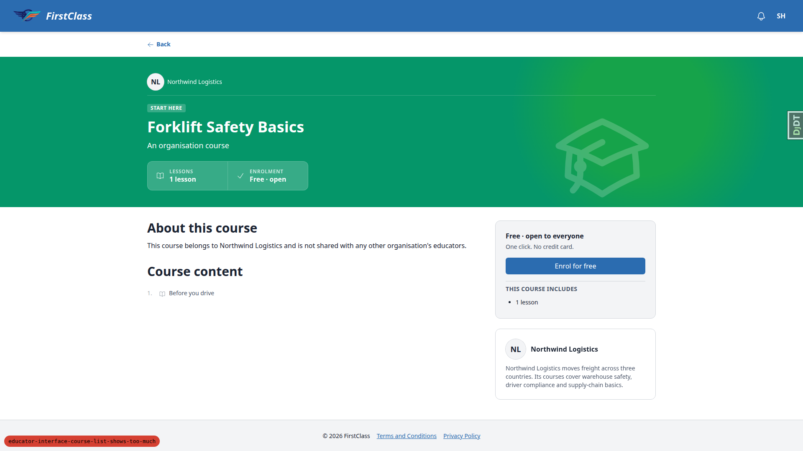 |
| 1.1 | mobile | pass | Courses list page 2 renders as stacked cards; both Workplace Safety Essentials present, no Forklift. | 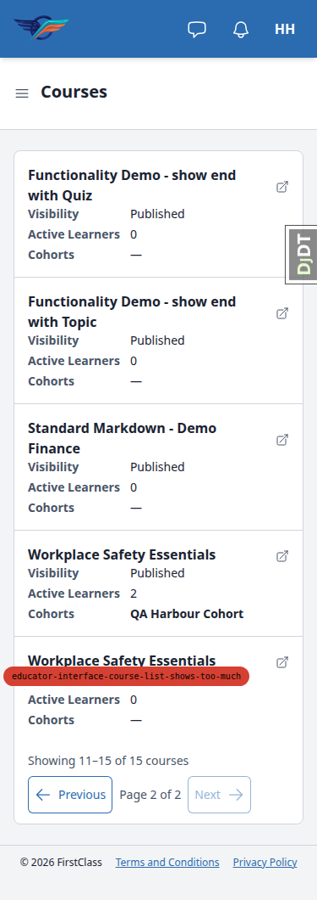 |
| 1.1 | tablet | pass | Courses list table fits at 768px; both Workplace Safety Essentials rows present. | 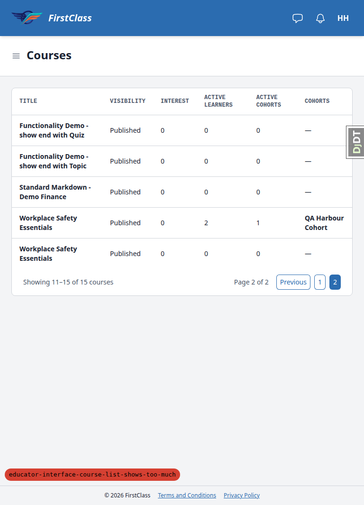 |
| 2.1 | mobile | pass | Share revoked again for this check: Course content panel shows the withheld message centred, no outline; registration panels stack as cards. | 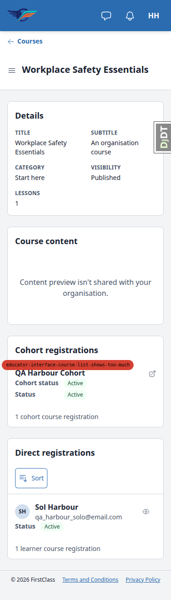 |
| 2.1 | tablet | pass | Withheld message in the Course content panel; layout matches the desktop panel order. | 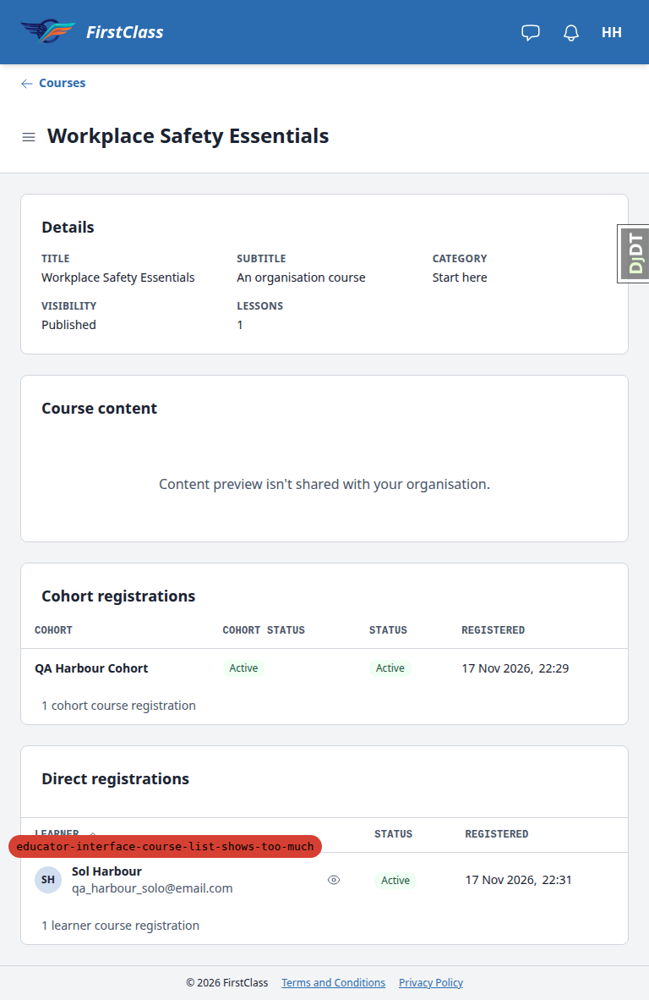 |

## Design check

No design states tested.

## B1: Two courses with the same title are indistinguishable in the educator Courses list, filters and register pickers

Manifestations:
- 1.4-picker-labels (desktop)

Screenshots:

- Expected: When an organisation's own course and a course shared with it share a title, an educator can tell them apart (e.g. the owning organisation shown beside a shared course) before registering a cohort or learner.
- Actual: The Courses list shows two 'Workplace Safety Essentials' rows, and the cohort/learner course filters and every register picker offer two identical 'Workplace Safety Essentials' options with no owner, slug or other distinguishing text.

## Layout probe

| Test id | Viewport | URL | Screenshot | Result |
|---|---|---|---|---|
| 1.1 | desktop | `/educator/organisations/harbour-college/courses?courses-page=2` | [screenshot](screenshots/page-2026-11-17T22-27-37-149Z.png) | clean |
| 1.2 | desktop | `/educator/organisations/harbour-college/courses/26c2e0d5-534f-40dc-86de-8218355233e5` | [screenshot](screenshots/page-2026-11-17T22-27-54-992Z.png) | clean |
| 2.1 | desktop | `/educator/organisations/harbour-college/courses/26c2e0d5-534f-40dc-86de-8218355233e5` | [screenshot](screenshots/page-2026-11-17T22-30-42-023Z.png) | clean |
| 2.3 | desktop | `/educator/organisations/harbour-college/learners/0a414a56-85ef-4125-85bb-496512cd50fd/__tabs/overview` | [screenshot](screenshots/page-2026-11-17T22-32-39-094Z.png) | clean |
| 1.1 | mobile | `/educator/organisations/harbour-college/courses?courses-page=2` | [screenshot](screenshots/page-2026-11-17T22-33-46-845Z.png) | clean |
| 1.1 | tablet | `/educator/organisations/harbour-college/courses?courses-page=2` | [screenshot](screenshots/page-2026-11-17T22-33-54-091Z.png) | clean |
| 2.1 | mobile | `/educator/organisations/harbour-college/courses/26c2e0d5-534f-40dc-86de-8218355233e5` | [screenshot](screenshots/page-2026-11-17T22-34-12-583Z.png) | clean |
| 2.1 | tablet | `/educator/organisations/harbour-college/courses/26c2e0d5-534f-40dc-86de-8218355233e5` | [screenshot](screenshots/page-2026-11-17T22-34-10-401Z.png) | clean |

## Data changes

| # | Via | What |
|---|---|---|
| 1 | sdd:qa-data-helper | create_demo_data --yes (DemoDev site, orgs, superuser), content_save demo_content DemoDev, QA educators for Harbour College and Northwind Logistics, QA Harbour Cohort with qa_harbour_learner, learner qa_harbour_solo |
| 2 | test plan 2.1 | removed shared_with from demo_content/functionality_demo_organisation_course_northwind/course.md and re-ran content_save demo_content DemoDev (restored in 2.3) |
| 3 | sdd:qa-data-helper | inactive LearnerCourseRegistration 7cf44571 for qa_harbour_solo on Northwind's Workplace Safety Essentials (26c2e0d5) |
| 4 | test plan 2.3 | git checkout of the Northwind course.md and content_save demo_content DemoDev; share restored |
| 5 | test plan 4.2 | qa_harbour_solo self-enrolled on Forklift Safety Basics |
| 6 | test plan 2.1/2.3 repeat | share revoked and restored once more (course.md edit + content_save) for the mobile and tablet withheld-state check |
| 7 | sdd:qa-data-helper | test plan 5.2 clean-up: deleted the 4 QA users with their role grants, staff and learner rows (incl. a third learner row for qa_harbour_solo under the DemoDev organisation created by the Forklift self-registration), QA Harbour Cohort with its membership and course registration, 2 learner course registrations and 5 progress rows; 36 rows |

## Bug status

| Bug | Title | Status |
|---|---|---|
| B1 | Two courses with the same title are indistinguishable in the educator Courses list, filters and register pickers | **UNRESOLVED** (reason: how to tell same-titled courses apart, e.g. showing the owning organisation beside a shared course, is a product/UX decision the spec does not make) |

## General notes

- (a) 1.1 step 4 could not run: the educator Courses list has no search box, so the plan step assumes a control that does not exist.
- (b) The plan's URLs omit the `organisations/` segment; the real paths are `/educator/organisations/<slug>/...`.
- (c) The plan's 2.2 says "Course registrations", but reactivation lives in the learner Overview tab's "Registrations" panel.
- (d) Content Widgets - Demo Reference (no owning organisation) does not appear in the Courses list, most likely because it is unpublished, which predates this branch.
- (e) 2.1 step 6 was checked on a learner's register picker rather than a second cohort's (same registerable-course queryset).
- (f) The Harbour learner's dashboard listed Northwind's courses but not Harbour's own organisation_learners Workplace Safety Essentials (not registered; outside this plan's scope, observation only).
- (g) The Forklift self-enrolment created a second learner row for qa_harbour_solo under the DemoDev organisation (existing self-join behaviour, observation only).
- (h) The cohort-list Filter button could not be clicked by accessible name in Playwright, so the filter options were read from the DOM.
- (i) Django DEBUG is on in dev, so 404s render Django's debug not-found page rather than the interface's own.

status: ok · reason: 1 bug — 0 fixed, 1 unresolved (red lane, needs a UX decision); report rendered, screenshots verified
