# Frontend QA report: educator-interface-design-learner-csv-upload-design-fix

## Methodology

- Playwright MCP against a dev server on port 8300 for this branch (branch badge confirmed), logged in as the QA admin.
- Viewports: 1920x1080 (desktop), 375x812 (mobile), 768x1024 (tablet).
- Screenshots were collected into `screenshots/` beside this report, and every image referenced here exists there.
- A pre-step rebase onto main ran first: 36 upstream commits, one conflict in `test_organisation/import_contracts.toml` resolved, full test suite 11563 passed, pushed. Upstream-change review: unchanged.
- Screenshot compression ran: no PNG over 1 MB.

## Diff scoping

Class: **FULL**.

Why: templates, static files and JS changed. Changed files: `freedom_ls/educator_interface/templates/educator_interface/*.html`, `freedom_ls/base/static/base/js/alpine-components.js`, `freedom_ls/educator_interface/views.py`, `freedom_ls/educator_interface/learner_import.py`, `freedom_ls/educator_interface/forms.py`, `freedom_ls/base/templatetags/time_tags.py`.

Skipped: nothing.

## Smoke gate

Status: **pass**. Pages checked: `/` and `/educator/organisations/demodev/learners/import/`. No failure URL or reason.

## Test results

| Test | Viewport | Result | Note | Screenshot |
|---|---|---|---|---|
| 1 | desktop | pass | Stepper Step 1 of 3, two columns, dashed zone with browse link, format table (email Required, 3 Optional, in HEADERS order), Download template downloads `learner-import-template.csv` with header `email,first_name,last_name,cohort`. No sideways scroll. | 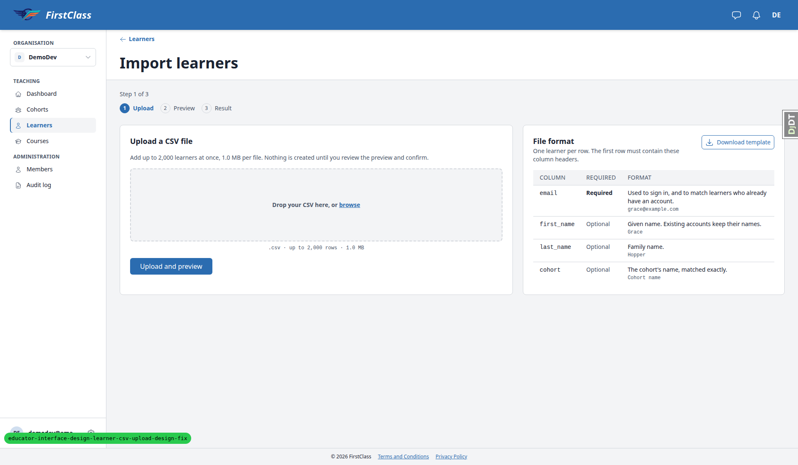 |
| 2 | desktop | pass | Focus ring on the whole zone; click opens picker; chosen state shows name, size ('132 bytes'), 'Choose a different file'; drag-over shows solid border and 'Drop to choose this file'; leave to child keeps state, leave to outside reverts; drop sets the file; URL never changed. No-JS: label opens picker and upload reaches Step 2. Step 6 (real OS drag) not possible headless. | 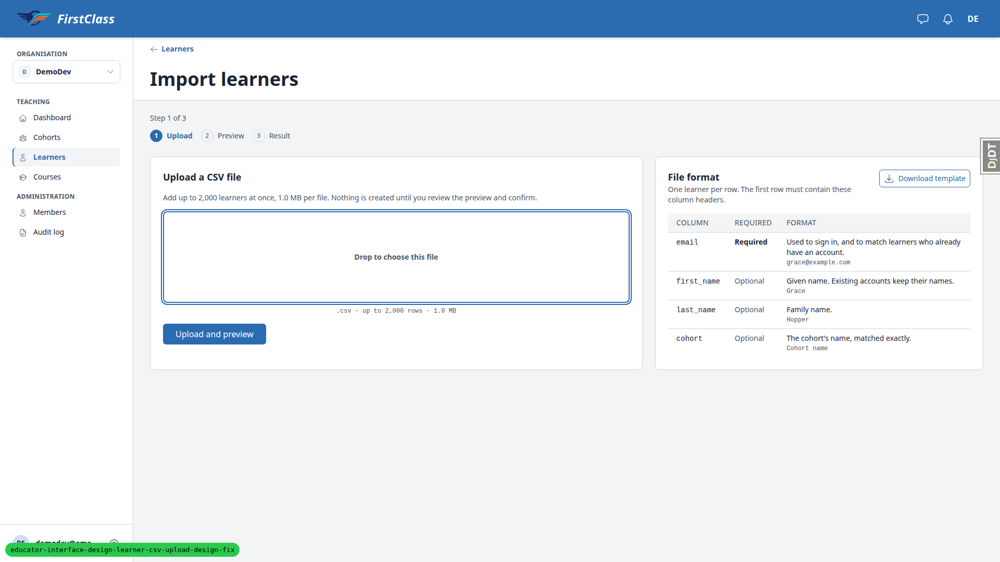  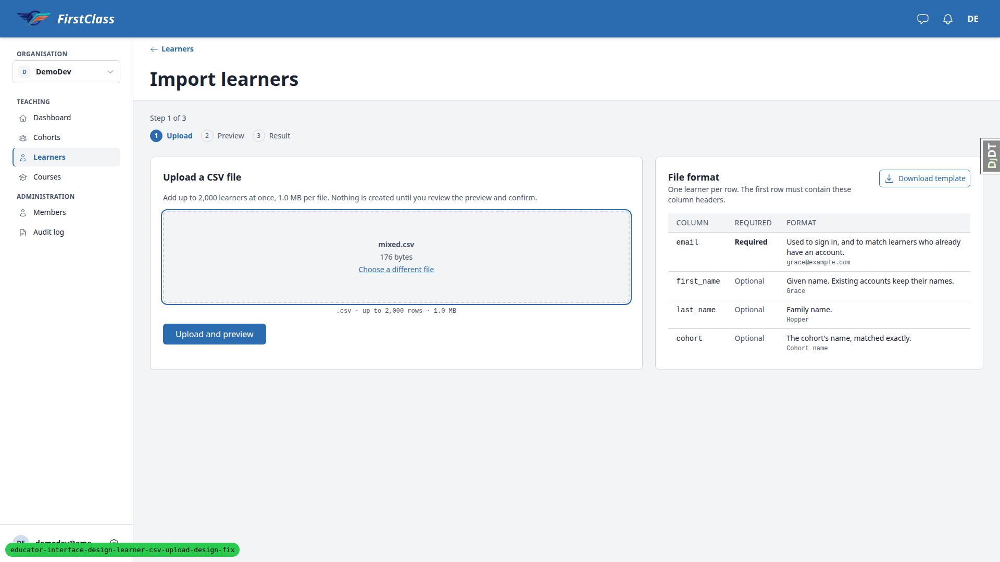 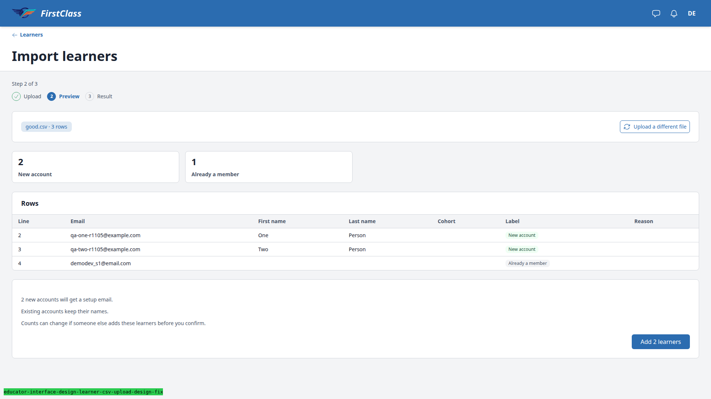 |
| 3 | desktop | pass | bad-header.csv: 422, alert above zone with error icon and list item, 4px error left border and tint, alert is `document.activeElement`. Zone still works afterwards. notes.txt gets the server's existing header message. | 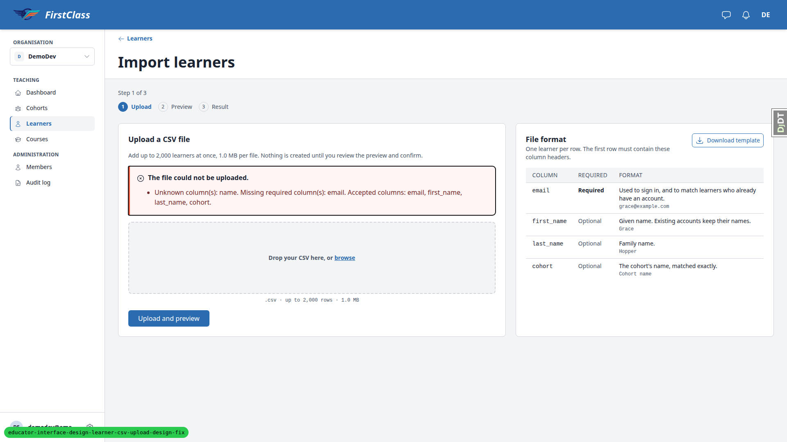 |
| 4 | desktop | **fail** | Step 2 of 3; chip, tiles as links with accessible names, error block, error table, download, Rows card, confirm card all correct. Error filter, Clear filter and New account filter work. FAIL: Error tile count renders in body colour, not red (B2). | 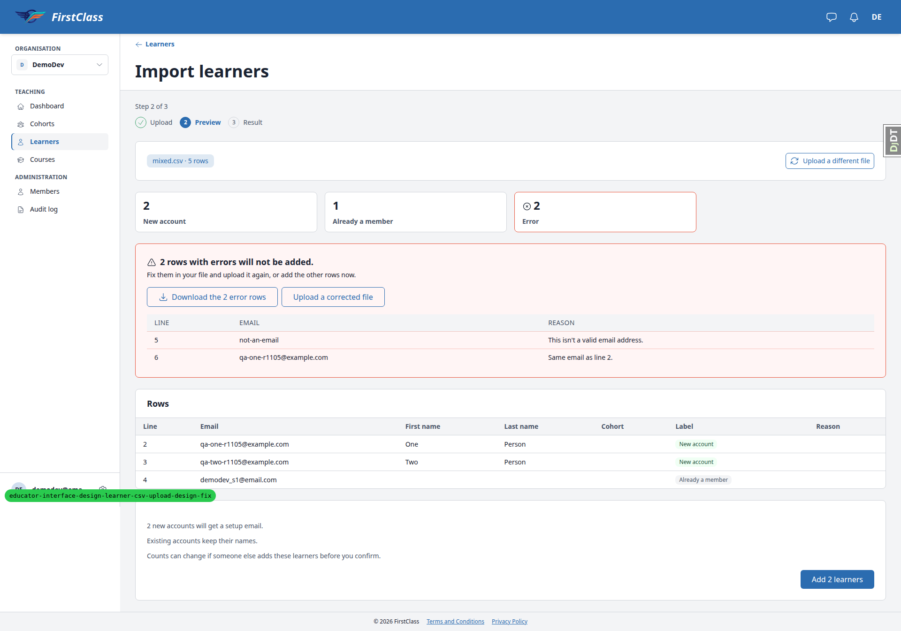  |
| 4-visual | desktop | **fail** | Confirm card has about 40px above its first line against 24px below its button (B4). |  |
| 5 | desktop | pass | big.csv: error block lists 50 rows with 'Showing the first 50 of 55' note; filtered list paginates (Page 1 of 2, Next to page 2 with 5 rows, Previous keeps filter); Clear filter shows 5 good rows. |  |
| 6 | desktop | pass | all-errors.csv: error block, no Rows card, 'Nothing can be added' and primary 'Upload a different file', no submit. good.csv: no error block, tiles and setup-email line. Members-only CSV: single 'Already a member: 2' tile. Back/Forward re-renders the preview. | 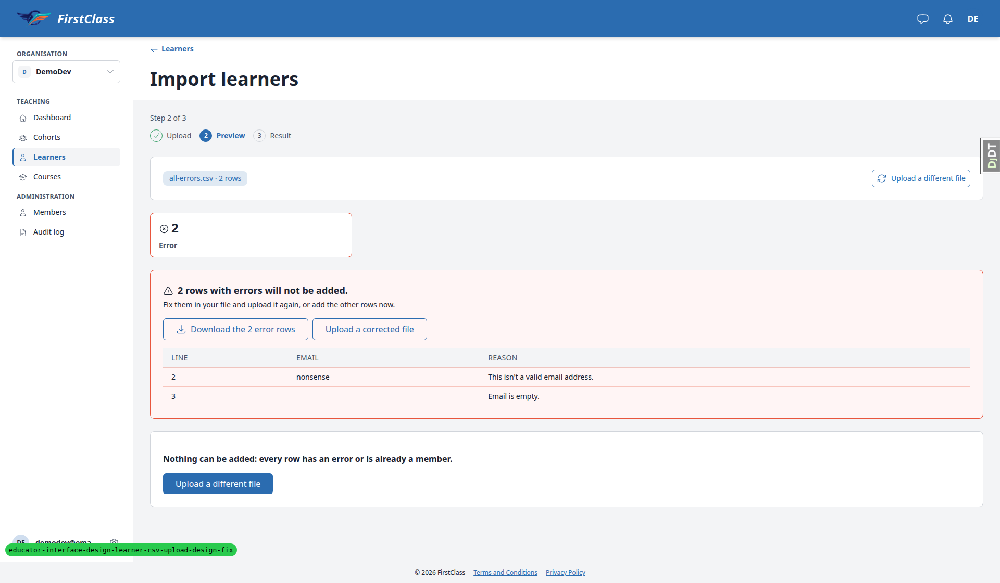 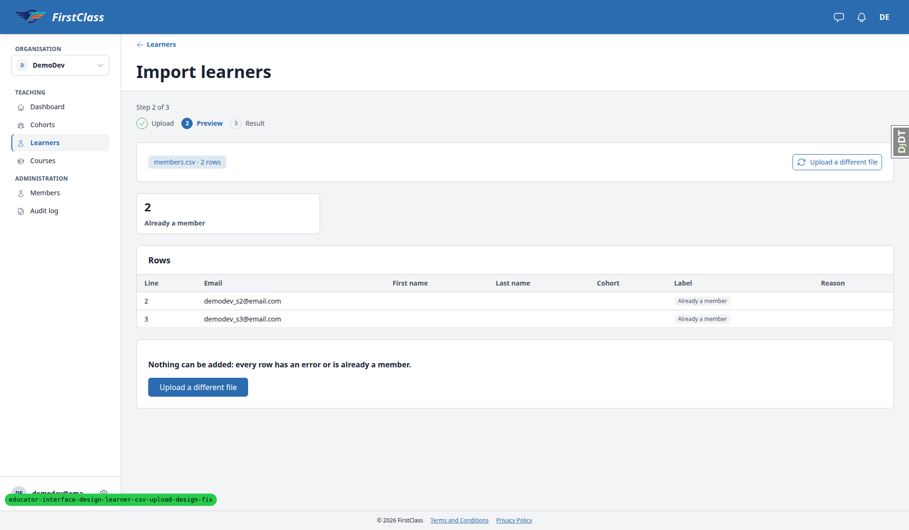 |
| 6-join-and-404 | desktop | pass | outsider.csv shows one 'Joined the organisation: 1' tile with info-tone badge, 'Add 1 learner', no setup-email line. A different org's educator gets HTTP 404 on the preview URL. | 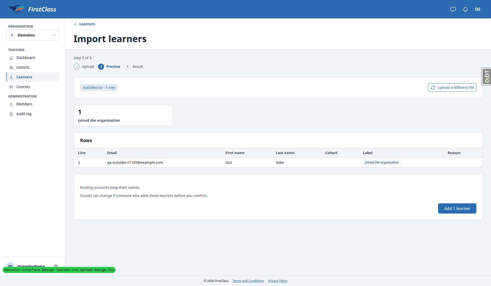 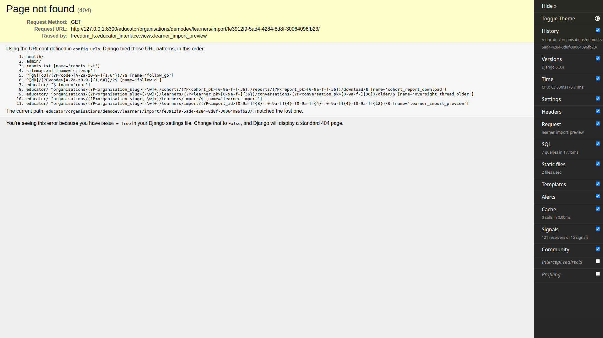 |
| 7 | desktop | pass | Step 3 of 3; centred card 672px in 1664px canvas; headline focused; counts rows; setup emails line; error block and download; re-upload note; both actions at the right. Back to learners opens list with new learners. Reload renders the same. fresh.csv: 'Added 2 learners.' with no '0 rows' clause. | 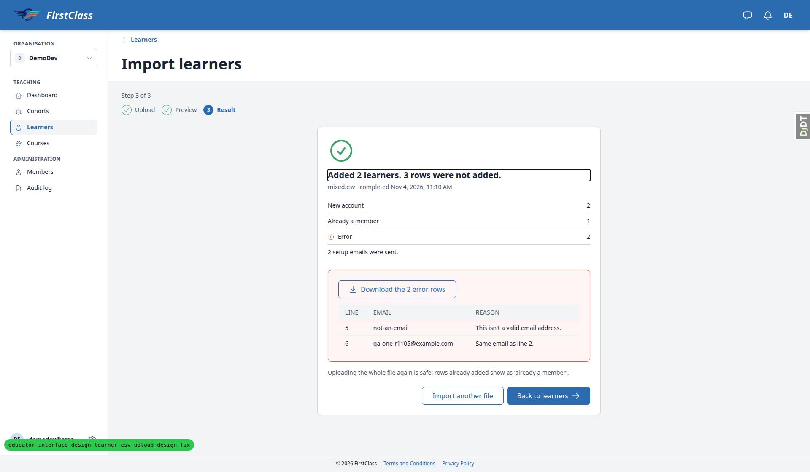 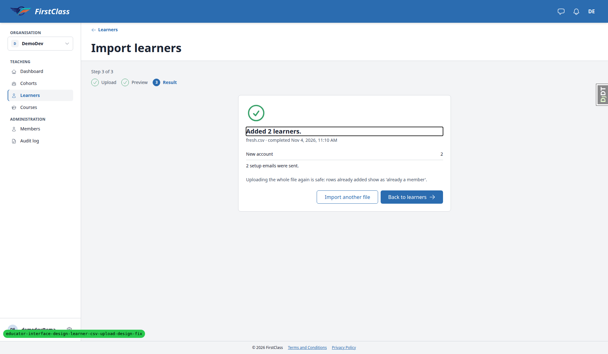 |
| 7-join-only | desktop | pass | 'Added 1 learner.' focused, count row 'Joined the organisation 1', no setup-email row. | none |
| 8 | desktop | pass | Running import: centred 672px card, 'Importing learners', '120 of 300 rows processed.', 40% bar; status polled every 2s; on completion the page reloaded itself and showed 'Added 300 learners.' focused; polling stopped. | 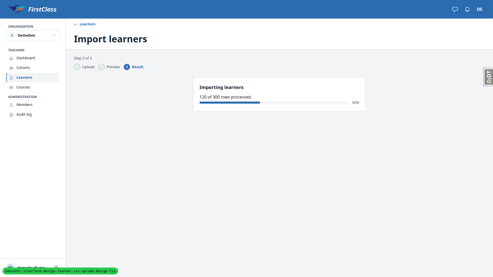 |
| 8-failure | desktop | pass | Failed import: centred narrow card, error icon, 'Stopped after 0 of 3 rows' focused, 'Something broke.', re-upload note, both buttons. | 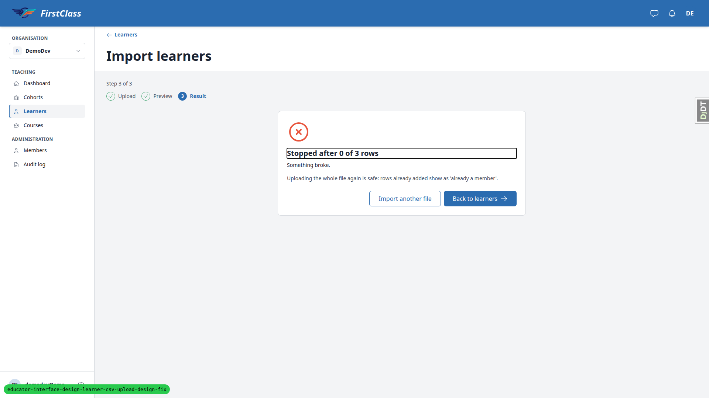 |
| 8-background-notice | desktop | pass | 300-row file: confirm card says 'This import runs in the background. The result page will show progress.' Dev's ImmediateBackend ran the import inline; the running card was checked on a helper-created running import. | none |
| 9 | desktop | pass | Cohort entry (`?cohort=<id>`): card sentence, ignored cohort row in format table, template href keeps cohort, alert keeps cohort name, rows show cohort name, 'Upload a different file' keeps `?cohort=`, primary 'Back to the cohort's learners' opens the cohort tab. | 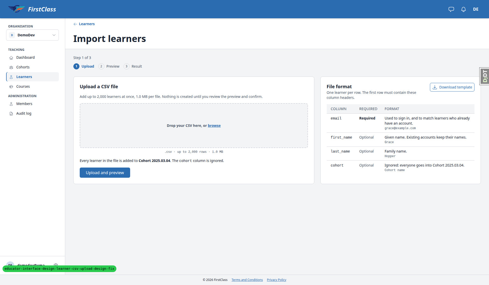 |
| 10 | desktop | pass | Tab order matches visual order with visible focus ring on every stop (upload, preview, result). Stepper is nav 'Import steps' with `aria-current='step'`; tile names '<label>: <count>'; file input described by the limits line; result headline focused; status never colour alone. | none |
| 1 | mobile | **fail** | Stepper labels sr-only, format table becomes 4 cards, Upload and preview full width, drop zone 176px, no sideways scroll. FAIL: buttons under 44px (B1); description squeezed beside Download template (B3). | 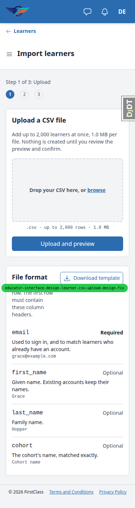 |
| 2 | mobile | pass | Drop zone 176px tall at 375; states as on desktop. |  |
| 3 | mobile | pass | Upload alert fits the card at 375, no sideways scroll. | 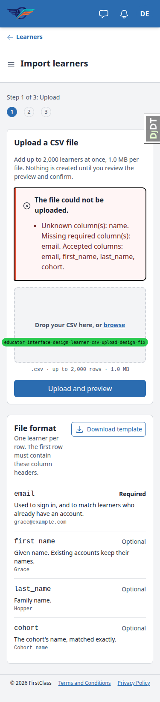 |
| 4 | mobile | **fail** | Tiles two columns (86px), rows become cards, 'Add 2 learners' full width, no sideways scroll. FAIL: buttons under 44px (B1); error-block card labels blue (B5); Error count colour as desktop (B2). | 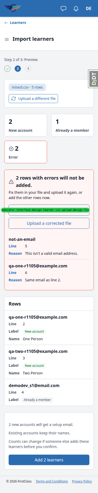 |
| 7 | mobile | **fail** | Actions stack full width; error table becomes cards; no sideways scroll. FAIL: buttons under 44px (B1); error-block card labels blue (B5). | 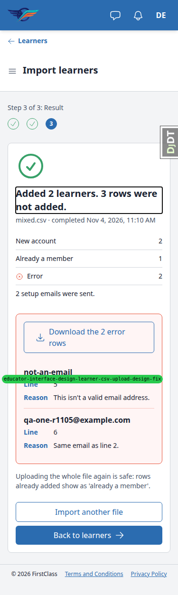 |
| 1 | tablet | pass | Cards stack, upload first; format table still a table; description has room beside the button; no sideways scroll. | 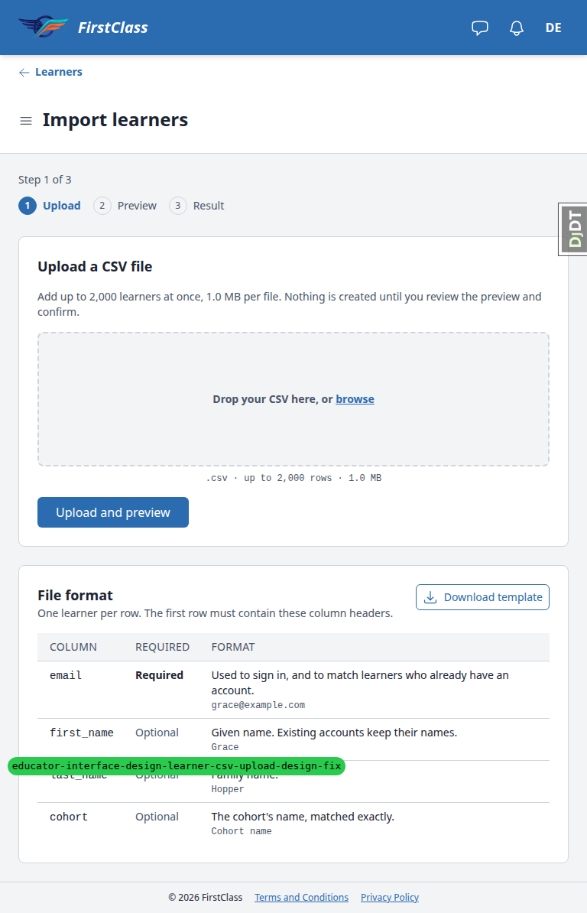 |
| 4 | tablet | pass | Tiles two columns, both tables still tables, no sideways scroll. | 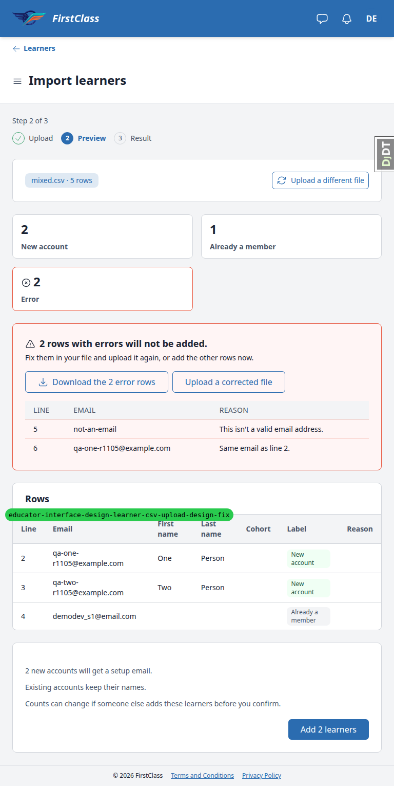 |
| 7 | tablet | pass | Card 672px centred in a 720px canvas, no sideways scroll. | 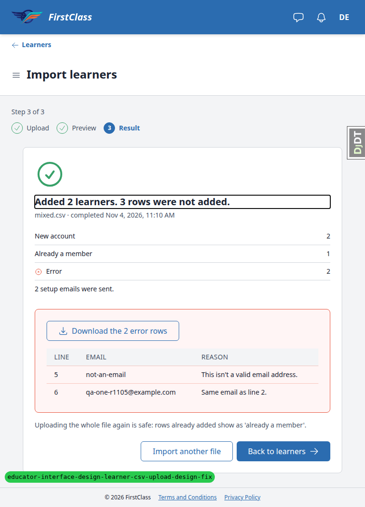 |

## Design check

| Test | Viewport | This run | Design | Result |
|---|---|---|---|---|
| 1-design | desktop |  | 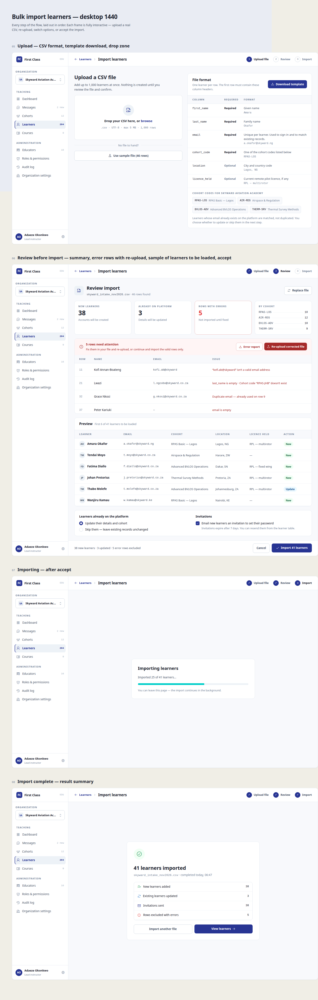 | pass |
| 3-design | desktop |  |  | pass |
| 4-design | desktop |  |  | pass |
| 7-design | desktop |  |  | pass |
| 8-design | desktop |  |  | pass |
| 1-design | mobile |  | 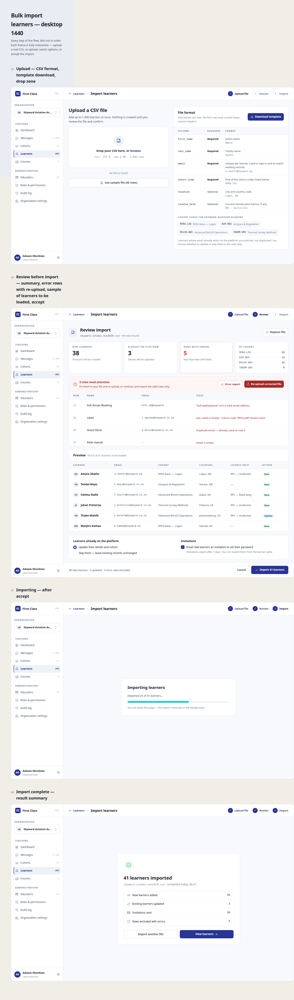 | pass |
| 7-design | mobile |  |  | pass |
| 7-design | tablet |  |  | pass |

## Bugs

### B1: Buttons on the import pages are under 44px tall below md

Manifestations: test 1 mobile, test 4 mobile, test 7 mobile.

- Expected: touch targets for buttons, tiles and the drop zone are at least 44px tall below md (the QA plan names 'Upload and preview' at >=44px at 375).
- Actual: at 375, Upload and preview 40px, Download template 34px, Upload a different file 34px, Download the N error rows / Upload a corrected file 42px, Add N learners 40px, Import another file 42px, Back to learners 40px. Tiles (86px) and drop zone (176px) are fine.

### B2: Error tile count is not red

Manifestations: test 4 desktop, test 4 mobile.

- Expected: plan design table says 'Error tile outline and red count' (border-error text-error on the tile); QA plan Test 4 step 3 says 'red count'.
- Actual: the count renders rgb(26,35,50). The tile's text-error is inherited, but the theme rule `dd { color: var(--color-on-surface) }` sets the dd's own colour, so the count is body-coloured. Outline and icon are correct.

### B3: File format description squeezed beside Download template at phone width

Manifestation: test 1 mobile.

- Expected: at 375 the card header text reads at a normal measure, like the other cards on the page.
- Actual: the panel-card header keeps the description and the Download template button on one row, so the description is a 118px column with 3-4 words per line.

### B4: Preview confirm card has an extra gap above its first line

Manifestation: test 4-visual desktop.

- Expected: the confirm card's content starts at the card's normal top padding, like the other cards.
- Actual: the notes list (and the 'Nothing can be added' line) carries mt-4 as the first child of an untitled padded card, so about 40px opens above the first line against 24px below the button.

### B5: Error-block row cards label Line/Reason in primary blue

Manifestations: test 4 mobile, test 7 mobile.

- Expected: card labels styled like the Rows cards' labels (text-muted).
- Actual: the error-block cards' `<dt>` elements have no class (`import_error_block.html` lines 43, 45), so the theme dt rule paints them bold primary blue on the error tint, while the Rows cards on the same page use text-muted.

## Layout probe

| Test | Viewport | URL | Screenshot | Result |
|---|---|---|---|---|
| 1 | desktop | `/educator/organisations/demodev/learners/import/` | [link](screenshots/page-2026-11-04T09-06-07-040Z.png) | clean |
| 3 | desktop | `/educator/organisations/demodev/learners/import/` | [link](screenshots/page-2026-11-04T09-08-16-469Z.png) | clean |
| 4 | desktop | `/educator/organisations/demodev/learners/import/<id>/` | [link](screenshots/page-2026-11-04T09-08-32-618Z.png) | clean |
| 7 | desktop | `/educator/organisations/demodev/learners/import/<id>/result/` | [link](screenshots/page-2026-11-04T09-10-34-799Z.png) | clean |
| 1 | mobile | `/educator/organisations/demodev/learners/import/` | [link](screenshots/page-2026-11-04T09-17-12-872Z.png) | clean |
| 4 | mobile | `/educator/organisations/demodev/learners/import/<id>/` | [link](screenshots/page-mobile-preview.png) | clean |
| 7 | mobile | `/educator/organisations/demodev/learners/import/<id>/result/` | [link](screenshots/page-mobile-result.png) | clean |
| 8 | desktop | `/educator/organisations/demodev/learners/import/<id>/result/` | [link](screenshots/page-2026-11-04T09-18-38-373Z.png) | clean |
| 1 | tablet | `/educator/organisations/demodev/learners/import/` | [link](screenshots/page-tablet-upload.png) | clean |
| 4 | tablet | `/educator/organisations/demodev/learners/import/<id>/` | [link](screenshots/page-tablet-preview.png) | clean |
| 7 | tablet | `/educator/organisations/demodev/learners/import/<id>/result/` | [link](screenshots/page-tablet-result.png) | clean |

## Data changes

| What changed | Agent / command |
|---|---|
| Created user qa-outsider-r1105@example.com (pk 79) on DemoDev with no demodev membership; created org qa-other-org and educator qa-otherstaff-r1105@example.com (pk 80, organisation_admin of qa-other-org); set LearnerImport 38d52845-e7b3-4b0e-8405-bce7ee33c694 to status failed, error_message 'Something broke.'. The helper also added a `--password` option to `freedom_ls/qa_helpers/management/commands/qa_create_single_org_educator.py` (uncommitted). | sdd:qa-data-helper |
| Created running LearnerImport b0a8013a-f296-486a-a209-17ab55684f0e (300 rows, 120 processed, rows only, no accounts), then marked it done (300/300, all rows final label new_account). | sdd:qa-data-helper |

## Bug status

- B1: **FIXED** (commit: 664b2848a) — Buttons on the import pages are under 44px tall below md. Re-verified at 375: every button on upload, preview, nothing-to-add preview and result is 44px; desktop sizes unchanged.
- B2: **FIXED** (commit: 36ec47aaa) — Error tile count is not red. Re-verified: count and icon are rgb(232, 85, 61); other tiles unchanged ([screenshot](screenshots/page-b2-reverify.png)).
- B3: **FIXED** (commit: 4f3062a7c) — File format description squeezed beside Download template at phone width. Re-verified: at 375 the description is 309px of a 341px header with the button below it; at 768 and 1920 the button stays top-right ([375](screenshots/page-b3-reverify-375.png), [768](screenshots/page-b3-reverify-768.png)).
- B4: **FIXED** (commit: 888f95b93) — Preview confirm card has an extra gap above its first line. Re-verified: the gap above the card's first line now equals the gap below its button at every QA viewport (was 33px vs 17px at 375, 40 vs 24 at desktop).
- B5: **FIXED** (commit: c48fa737a) — Error-block row cards label Line/Reason in primary blue. Re-verified at 375: the error-block card labels are rgb(74, 85, 104), the same muted colour as the Rows cards' labels (was rgb(43, 108, 176)).

## General notes

- Test 2 step 6 (a real OS drag from a file manager) can't be done in headless Playwright; drag behaviour was checked with synthetic DragEvents carrying realistic relatedTargets. The drop zone uses a relatedTarget check (the spec allows it) rather than a counter, so the plan's two-dragleave sequence with null relatedTarget is not representative.
- Test 2: file size shows '132 bytes' for small files; the plan's "0.1 KB" was an example, and the plan's formatSize prints bytes under 1 KB.
- Test 3 step 4: notes.txt gets the server's existing header error (it parses as a one-column CSV), not a "not a CSV" message; that is the server's existing behaviour, as the plan allows.
- Test 7 step 1's "fills the canvas at 768" contradicts the spec (narrower from md, md = 768px); the build follows the spec, so the QA plan line should change.
- Test 10: the file input's accessible name is the whole label ('CSV file Drop your CSV here, or browse'), not just 'CSV file'; the spec only requires it to start with the hidden 'CSV file' span.
- Copy observation, no action taken: on an all-errors file, the error block still says "or add the other rows now" though nothing can be added.
- Test 9 used a fresh two-email file instead of good.csv because good.csv's emails had already been imported earlier in the run.
- The data helper added a `--password` option to `freedom_ls/qa_helpers/management/commands/qa_create_single_org_educator.py` to create the second educator; that change is uncommitted in the working tree.
- Full test run after the QA fixes: 11542 passed; 21 setup errors in `freedom_ls/educator_interface/tests/invariants/test_permission_matrix.py` came from a second pytest run (left over from a fixer) holding the same xdist test database. Re-run alone once that run ended, the file passed (501 passed). No test assertion failed.
- Downloaded CSVs (template, error rows) were checked in the browser and kept out of the screenshots directory.

status: ok · reason: 5 bugs — 5 fixed; report rendered, screenshots verified
