# Frontend QA report: educator learner CSV import restyle

## Summary

The restyle of the educator learner CSV import (upload, preview, result) was checked against the test plan in `3. frontend_qa.md`.

- Test records: 33 pass, 4 fail, 2 skip (39 total).
- Design records: 4 pass, 1 fail.
- Layout probe: all 16 records clean.
- Smoke gate: pass.
- Bugs: 3 documented.
  - B1: import error block buttons are default size, not small.
  - B2: import completion time uses the browser locale's format.
  - B3: preview status badges wrap onto two lines in the 768 Rows table.

## Methodology

The pages were driven by hand in Chromium via Playwright MCP at 1920x1080 (desktop), 375x812 (mobile) and 768x1024 (tablet). The dev server ran on port 8544 and served this branch (the branch badge was checked). The session was logged in as the QA admin. Screenshots were collected into `screenshots/` beside this report, and every image referenced here exists there.

Pre-step: the branch was rebased onto main. 29 commits were replayed. There were two conflicts in the qa-data-helper memory index, both resolved by keeping both lines. The full suite then ran: 12212 passed, with 1 flaky playwright test (panel_framework `test_quick_view_drawer`) that passed when run alone.

The post-rebase front-end check (fls-dev `frontend_check.md`) was folded into this run on the same server. It is recorded as test `frontend-check`: the plan's pages at 1920, 375 and 768 loaded with 200, 422 and 403 as expected, nav and content were present, and there were no console errors beyond the browser's own log of the expected 422.

## Diff scoping

Class: **FULL**.

The triggering files are the educator_interface templates (`learner_import_upload.html`, `learner_import_preview.html`, `learner_import_result.html`, and the partials `import_stepper.html`, `import_error_block.html`, `learner_import_result_body.html`) and `freedom_ls/base/static/base/js/alpine-components.js`. The diff also touches views, forms, `learner_import.py`, the time and deadline template tags, tests, docs and spec files.

Nothing was skipped by scoping: all three viewports ran.

## Smoke gate

Outcome: **pass**. Pages checked: `/` and `/educator/organisations/demodev/learners/import/`.

## Results by test

| Test | Viewport | Status | Note | Screenshot |
|---|---|---|---|---|
| capture-check | desktop | pass | Screenshot written to `qa-screenshots/`. First shot showed the debug toolbar open; prep fixed and retaken. | 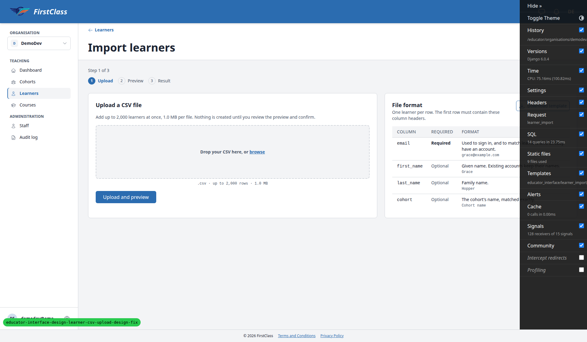 |
| 1.1-1.8 | desktop | pass | Stepper "Step 1 of 3", two columns, dashed drop zone, format table, template download named `learner-import-template.csv`, no sideways scroll. | 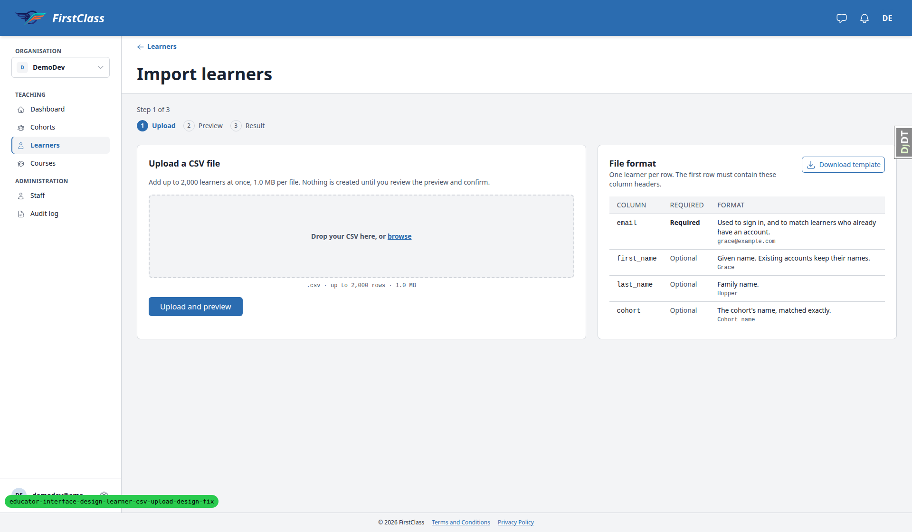 |
| 2.1 | desktop | pass | Tab lands on the sr-only input; the label shows a 2px primary ring. | 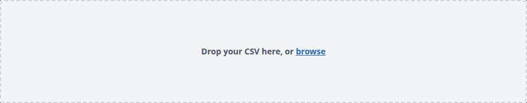 |
| 2.2-2.4 | desktop | pass | Zone opens the picker; chosen file shows name and size. Files under 1 KB show bytes by design. | none |
| 2.5 | desktop | pass | Drag states work; component uses relatedTarget, not a counter. Drop sets the input. |  |
| 2.6 | desktop | skip | Real OS drag not available headless; covered by 2.5. | none |
| 2.7 | desktop | pass | URL unchanged through choose, drag and drop. | none |
| 2.8 | desktop | pass | With JavaScript off, the label opens the picker and submitting reaches the preview. | 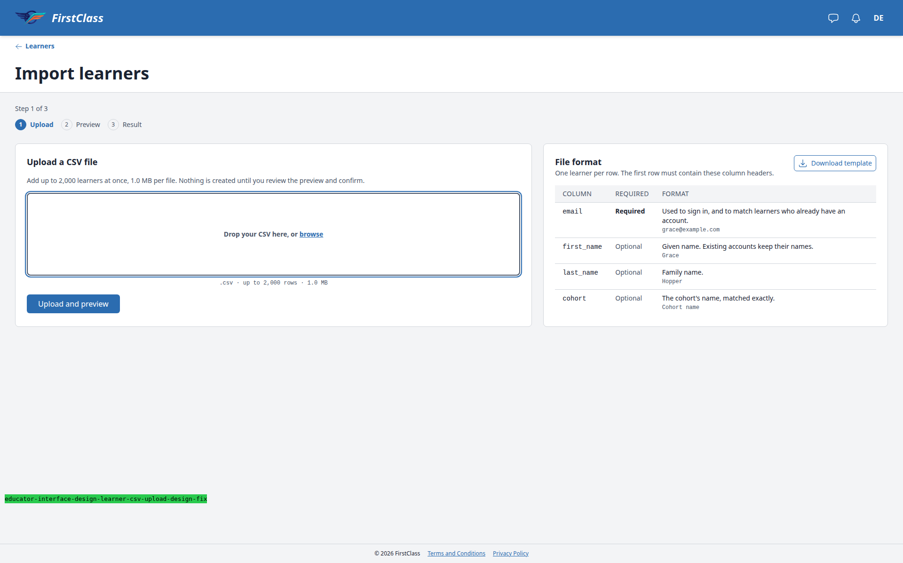 |
| 11.1 | mobile | pass | No native "Choose file" text with JS on or off; zone height 176; scrollWidth 375. | 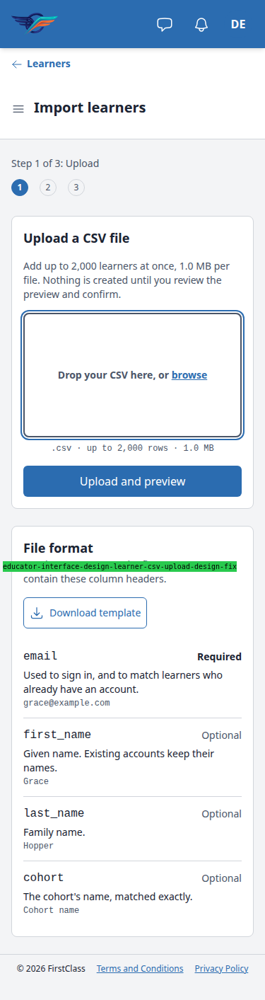 |
| 3.1-3.4 | desktop | pass | 422 alert with error icon, column message, focused on load; zone still accepts a valid file. | 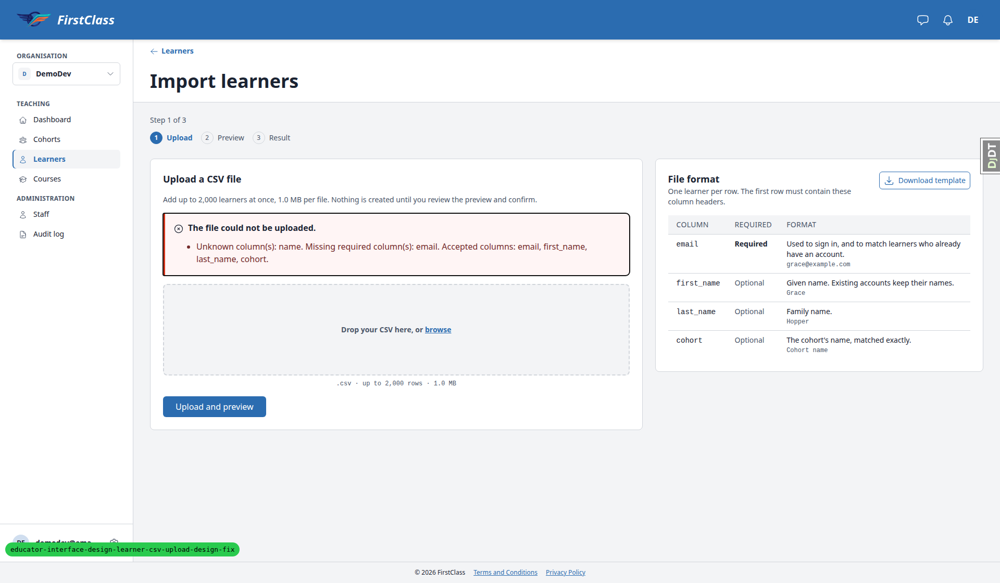 |
| 4.1-4.10 | desktop | pass | Preview step 2: chip, tiles, error block, rows card, confirm card, error filter and Clear filter all as planned. | 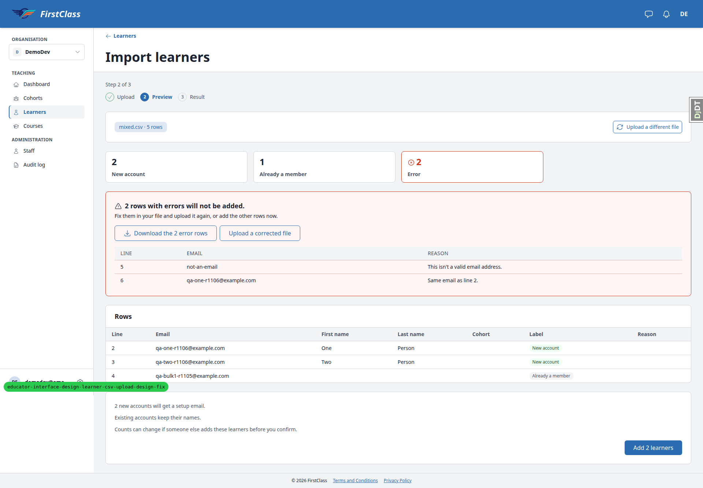 |
| 4.panel-checklist | desktop | **fail** | Error-block buttons are default size while "Upload a different file" is small (B1). |  |
| 5.1-5.3 | desktop | pass | 55-row error file: 50 shown with a download note, pager keeps the filter. | 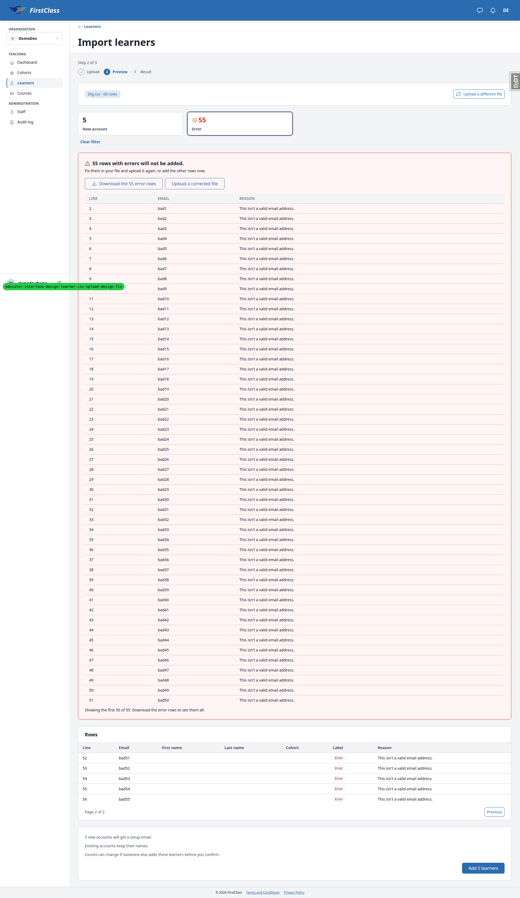 |
| 6.1-6.3,6.5 | desktop | pass | All-errors, fresh-emails and members-only files render the expected states; Back then Forward re-renders the preview. | none |
| 7.1-7.6,7.8 | desktop | pass | Step 3 result: card centred, headline focused, counts, setup emails, error block, buttons. | 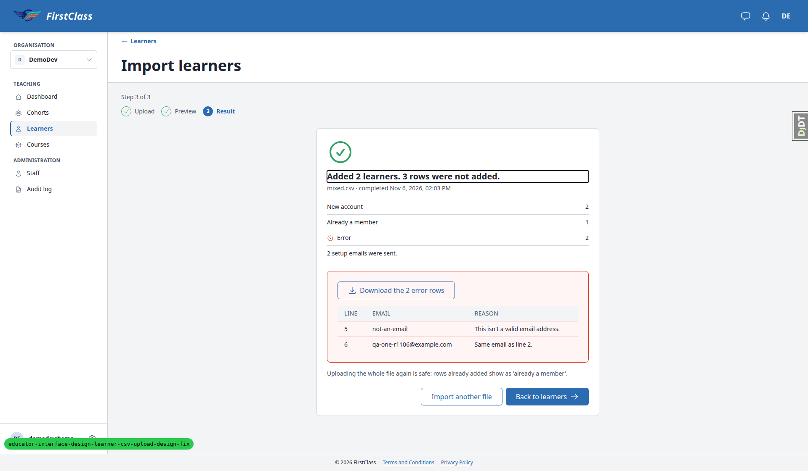 |
| 7.2-datetime | desktop | **fail** | Completion time reads "Nov 6, 2026, 02:03 PM", expected "6 Nov 2026, 14:03" (B2). |  |
| 7.7 | desktop | pass | Members-only result has no submit; fresh.csv confirms with "Added 2 learners." and no "0 rows" clause. | none |
| 9.1-9.4 | desktop | pass | Cohort-scoped import keeps `?cohort=` and the cohort name through upload, preview and result. "Add existing learners" is absent for an org admin (plan out of date). | none |
| 6.4,7.7-joiner | desktop | pass | Site user outside the org shows "Joined the organisation: 1"; no setup-email line. | none |
| 6.6 | desktop | pass | Another organisation's admin gets 404 on a demodev preview URL. | none |
| 8.2 | desktop | pass | Staged RUNNING import: narrow card, 120 of 300, progress bar at 40%, polling every 2s. | 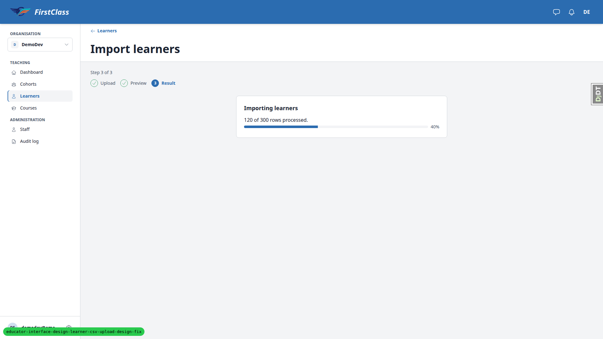 |
| 8.1,8.3 | desktop | skip | Needs a 250+ add import; the staged RUNNING import never finishes. | none |
| 8.4,11.9 | desktop | pass | FAILED import shows error icon, focused headline, message and exactly one "Back to learners". |  |
| 11.8 | desktop | pass | Cohort admin gets 403 card with a back link; no stepper, no sideways scroll at 1920, 768, 375. | 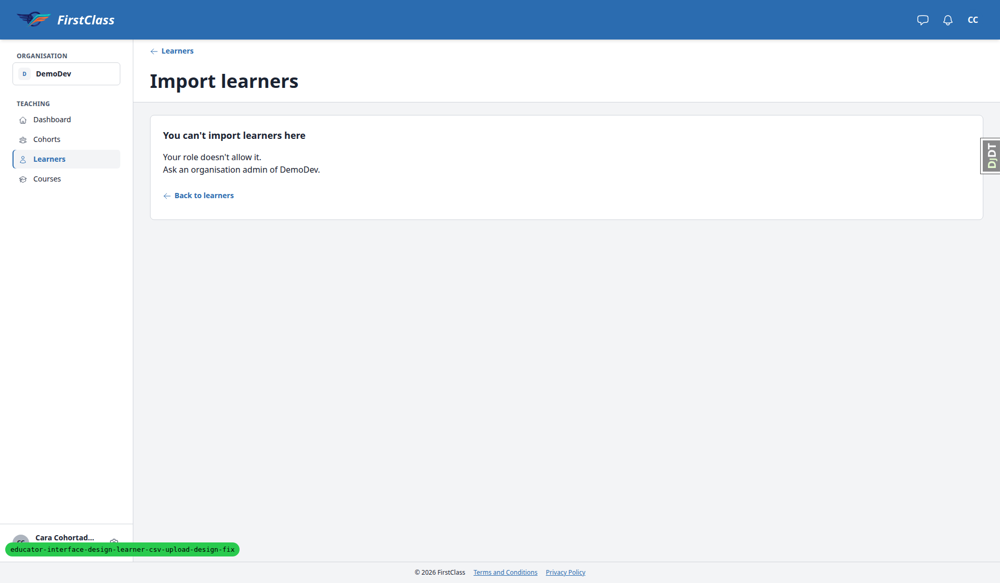 |
| 10.1-10.3 | desktop | pass | Tab order, focus rings, ARIA names and focus on load all as planned. | none |
| 11.3 | desktop | pass | No bare hand-styled links on upload, filtered preview or result. | none |
| 11.7 | desktop | pass | Learners list "Add learner" and "Import learners" buttons and the add dialog as planned. | none |
| 1.10,1.11,2.9 | mobile | pass | Cards stacked, format table as cards, full-width 44px buttons, scrollWidth 375. | 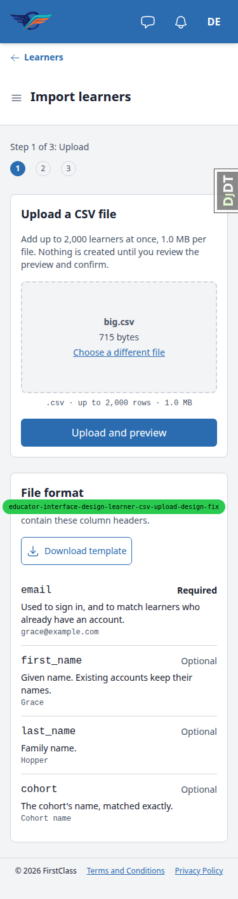 |
| 4.11,11.2,11.5 | mobile | pass | Tiles in a two-column grid, rows as cards, every button 44px, scrollWidth 375. | 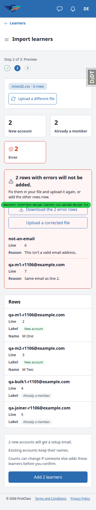 |
| 3.6,11.4 | mobile | pass | Alert and result headline sit below the sticky header; scrollWidth 375. | none |
| 7.9 | mobile | pass | Result buttons stacked, full width, 44 tall; error table as cards. | 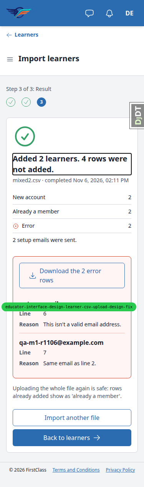 |
| 7.9-error-button-wrap | mobile | **fail** | Default-size "Download the 2 error rows" wraps to two lines (275x66) (B1). |  |
| 11.6 | mobile | pass | User menu and nav panel open, close on Escape and scroll, with focus returned; no console errors. | none |
| 1.9 | tablet | pass | Cards stacked, format table still a table, full stepper labels, scrollWidth 768. | 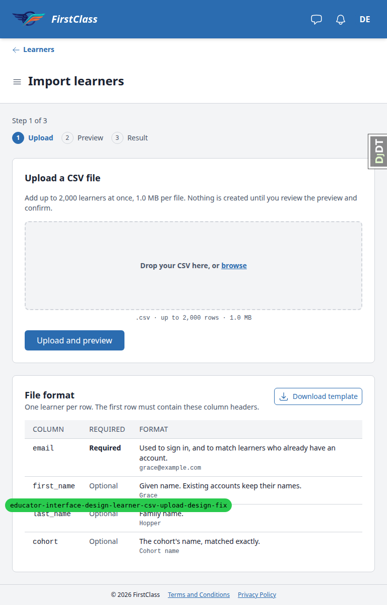 |
| 3.6,11.4 | tablet | pass | Alert and result headline below the 76px header; scrollWidth 768. | none |
| 4.11 | tablet | pass | Tiles in two columns, tables not cards, scrollWidth 768. | 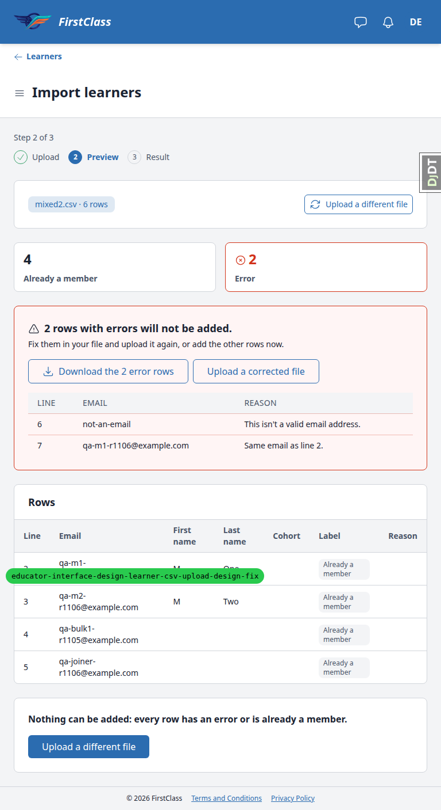 |
| 4.11-badge-wrap | tablet | **fail** | Status badges wrap onto two lines in the Rows table (B3). |  |
| 7.1,7.9 | tablet | pass | Card 672 wide, centred; buttons side by side. The time again uses the locale format (B2). | 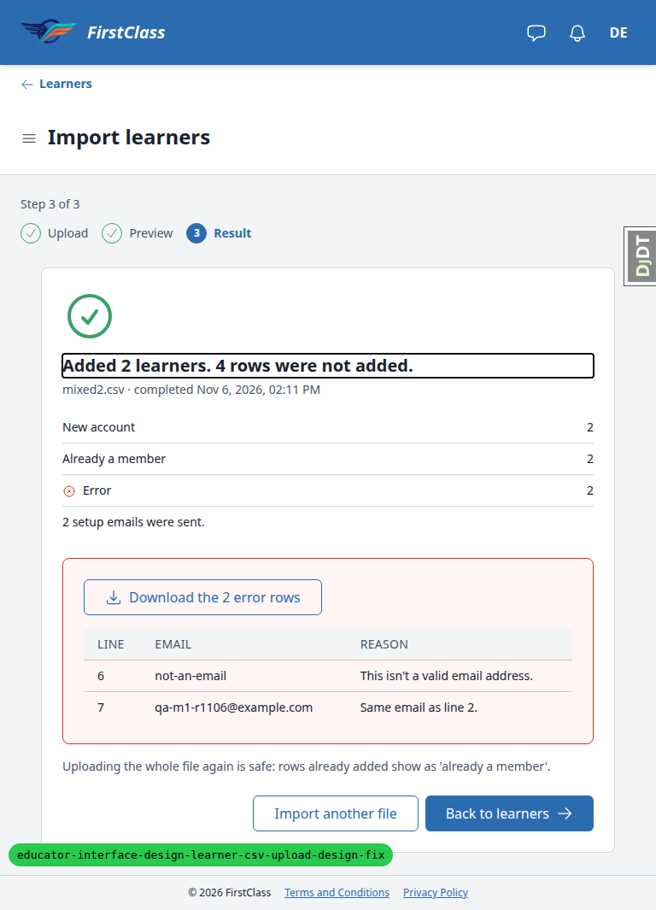 |
| frontend-check | all | pass | Post-rebase front-end check folded in; see Methodology. | none |

## Design check

| Test | Viewport | This run | Design | Result |
|---|---|---|---|---|
| 1.0-design | desktop |  |  | pass |
| 3.0-design | desktop |  |  | pass |
| 4.0-design | desktop | 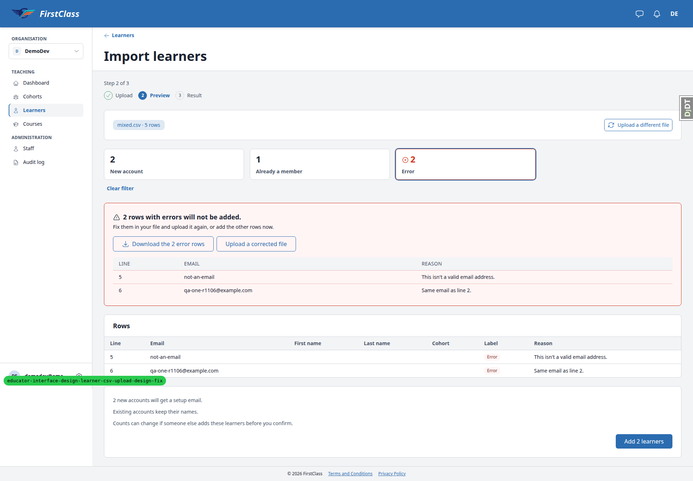 |  | pass |
| 7.0-design | desktop |  |  | fail: the file name and completion time should be a muted line with the time as `6 Nov 2026, 09:12`; the time renders as "Nov 6, 2026, 02:03 PM" (B2) |
| 8.0-design | desktop |  |  | pass |

## B1: Import error block buttons are default size, not small

Manifestations:
- 4.panel-checklist, desktop
- 7.9-error-button-wrap, mobile

Expected: per the panel-framework visual checklist ("every action trigger outside a dialog footer is the small size, and the triggers on one page are one size") and the design (error-block buttons drawn small like "Replace file"), "Download the N error rows" and "Upload a corrected file" use size small, like "Upload a different file" on the same page.

Actual: `import_error_block.html` (lines 15-16) renders both with the default size. On the 375 result card "Download the 2 error rows" wraps to two lines (66px tall). The same partial renders on the preview and the result page.

## B2: Import completion time uses the browser locale's format

Manifestations:
- 7.2-datetime, desktop
- 7.0-design, desktop
- 7.9, mobile
- 7.1,7.9, tablet

Expected: "completed 6 Nov 2026, 14:03": day, short month, year, 24-hour clock, in the viewer's zone (brand voice "Dates and times"; panel_framework `DATETIME_DISPLAY_FORMAT` `j M Y, H:i`).

Actual: "completed Nov 6, 2026, 02:03 PM". base's `localTime` Alpine component formats with `Intl.DateTimeFormat(undefined, …)`, so the order and clock follow the browser locale (en-US here). The brand voice rule forbids leaving a date to the locale default.

## B3: Preview status badges wrap onto two lines in the 768 Rows table

Manifestations:
- 4.11-badge-wrap, tablet

Expected: at 768 the Rows table stays a table and each status badge is one line ("Already a member" in one pill).

Actual: the seven columns squeeze the Label column, so each badge wraps to "Already a / member" inside the pill, and emails break mid-address. The Reason column is empty but keeps its width. The badge cell (`learner_import_preview.html:59`) has no nowrap.

## Layout probe

| Test | Viewport | URL | Screenshot | Result |
|---|---|---|---|---|
| 1.1 | desktop | /educator/organisations/demodev/learners/import/ |  | clean |
| 3.1 | desktop | /educator/organisations/demodev/learners/import/ |  | clean |
| 4.1 | desktop | /educator/organisations/demodev/learners/import/<id>/ |  | clean |
| 4.8 | desktop | /educator/organisations/demodev/learners/import/<id>/?label=error |  | clean |
| 5.2 | desktop | /educator/organisations/demodev/learners/import/<id>/?label=error&page=2 |  | clean |
| 7.1 | desktop | /educator/organisations/demodev/learners/import/<id>/result/ |  | clean |
| 8.4 | desktop | /educator/organisations/demodev/learners/import/<id>/result/ |  | clean |
| 11.8 | desktop | /educator/organisations/demodev/learners/import/ |  | clean |
| 11.8 | tablet | /educator/organisations/demodev/learners/import/ | 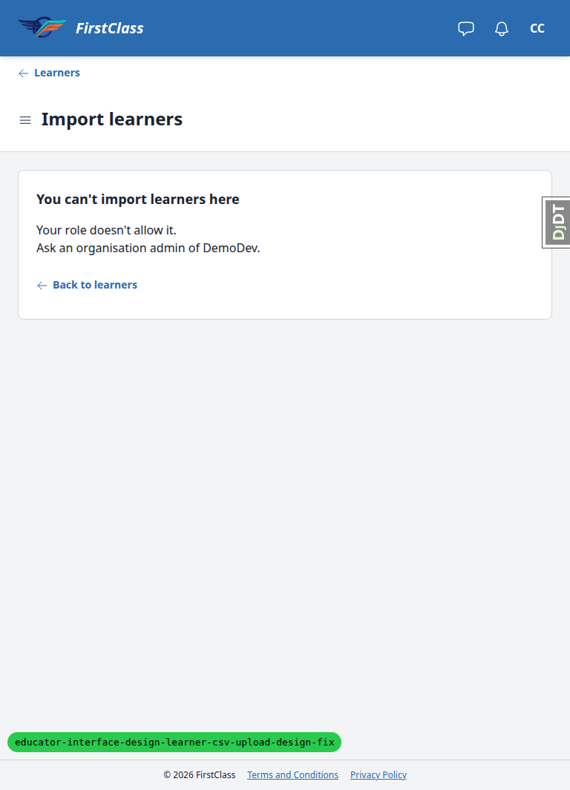 | clean |
| 11.8 | mobile | /educator/organisations/demodev/learners/import/ | 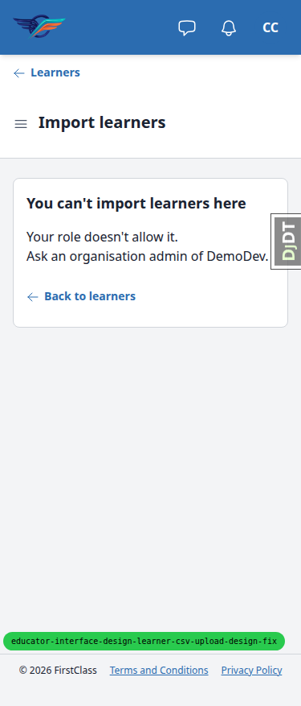 | clean |
| 1.10 | mobile | /educator/organisations/demodev/learners/import/ |  | clean |
| 4.11 | mobile | /educator/organisations/demodev/learners/import/<id>/ |  | clean |
| 7.9 | mobile | /educator/organisations/demodev/learners/import/<id>/result/ |  | clean |
| 1.9 | tablet | /educator/organisations/demodev/learners/import/ |  | clean |
| 4.11 | tablet | /educator/organisations/demodev/learners/import/<id>/ |  | clean |
| 7.1 | tablet | /educator/organisations/demodev/learners/import/<id>/result/ |  | clean |

The layout probe reports no flags. The badge wrap in B3 and the button wrap in B1 were found by hand and recorded as test failures.

## Data changes

| Via | Change |
|---|---|
| sdd:qa-data-helper | Created qa-joiner-r1106@example.com (site user, no organisation) and qa-cohortadmin-r1106@example.com (cohort_admin on demodev "Cohort 2025.04.06"). Reset qa-otherstaff-r1105@example.com's password (organisation_admin of qa-other-org). Reused RUNNING import 962e2d06 (120 of 300) and FAILED import 38d52845 ("Something broke."). Added a `--cohort-name` option to `qa_create_single_org_educator` (uncommitted helper change). |

## Bug status

| Bug | Status |
|---|---|
| B1 | **FIXED** (commit: c916731b3) — Import error block buttons are default size, not small. Re-verified: both buttons btn-sm, 34px tall at 1920 like "Upload a different file", 44px at 375 with the result card's download label on one line. |
| B2 | **FIXED** (commit: 0348baa97) — Import completion time uses the browser locale's format. Re-verified: "mixed.csv · completed 6 Nov 2026, 14:03" at 1920 and 375; home, courses and upload pages load with no console errors. |
| B3 | **FIXED** (commit: a58f9d6ae) — Preview status badges wrap onto two lines in the 768 Rows table. Re-verified at 768: every "Already a member" badge on one line, scrollWidth 768. 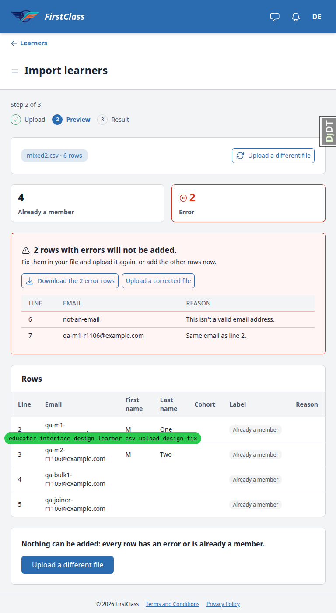 |
| — | **UNRESOLVED** — full run after the fixes left tests failing (reason: freedom_ls/learner_interface/tests/playwright/test_course_browse_flow.py::test_due_date_reads_in_the_browser_time_zone[chromium] — fails in the full run and alone; it asserts the old locale-default text "Mar 15, 2999, 05:59 PM" (and "... PM EDT" with the zone) where localTime now renders "15 Mar 2999, 17:59" after B2's fix. Full run: 1 failed, 12216 passed.) |

The dev server's login session was dropped after each fixer's test run (the browser had to log in again before each re-verify); it did not affect any result.

## General notes

Plan corrections for the next revision:
- Test 2 step 5 describes a dragleave counter, but `fileDropZone` uses relatedTarget. The two are equivalent for real drags; a synthetic dragleave with no relatedTarget ends the state.
- Test 2 step 3's "0.1 KB" example: files under 1 KB show bytes.
- Test 6 step 2 expects three tiles for good.csv, but that file has two labels, so it shows two tiles.
- Test 9 step 1 expects "Add existing learners" for the QA login; main offers it only to users who cannot add learners.
- Test 7.1 ("fills the canvas at 768") contradicts the Test 8 checklist ("narrower than the canvas from md"). The build follows the checklist.

Observations, no action:
- The error-block table headers are uppercase while the Rows table headers are title case.
- Without JavaScript the drop zone does not show the chosen file's name; the plan does not require it.
- Safari has historically sent dragleave with a null relatedTarget, which would make the zone flicker there. This was not testable in this Chromium run.
- The QA plan's emails were tagged `-r1106` to avoid collisions with earlier runs' data.
- The rebase's full suite had one flaky failure (panel_framework `test_quick_view_drawer`) that passed when re-run alone under lighter load.

Skipped (not run):
- Test 2 step 6 (real OS drag), covered by the relatedTarget check in 2.5.
- Test 8 steps 1 and 3 (need a 250+ add import; the staged RUNNING import never finishes, so the HX-Refresh reload could not be observed).
- The data helper added an uncommitted `--cohort-name` option to `freedom_ls/qa_helpers/management/commands/qa_create_single_org_educator.py`.

status: ok · reason: 3 bugs — 3 fixed, 0 unresolved; full run after the fixes left 1 test failing; report rendered, screenshots verified
