# QA report: educator-interface-page-polish

## Methodology

Frontend QA ran in a browser against seeded demo data at desktop (1920 and 1280), tablet (768) and mobile (375) viewports. Screenshots were collected into `screenshots/` beside this report, and every image linked below exists there. Tests that need no visual evidence (behaviour checks, downloads, network-held requests) have no screenshot.

Two QA plan expectations did not match the code's intended behaviour, as the test records explain:

- **Test 1.1 (learner A's order).** The plan expected c1, c2, c5. The actual order is c1 Flagged 40%, c4 Not Started 0%, c2 Shared 40%. Course c4 has no record on a course with items, so the existing "No recorded activity" rule flags it and it ranks with the flagged courses. This follows the spec's ranking, so the plan was wrong, not the code. Test 1.1 is recorded as pass.
- **Test 4.2 (blank first name).** The plan expected a field error. The form accepts a blank first name, which is existing behaviour this spec did not change, so no error appears. The Email row stays after the save. Test 4.2 is recorded as pass.

## Diff scoping

Class: `FULL`. Changed files that triggered it: templates, CSS, JS and Python under `freedom_ls/educator_interface`, `freedom_ls/panel_framework`, `freedom_ls/reports` and `freedom_ls/content_engine`, plus `tailwind.components.css`. Nothing was skipped: desktop, tablet and mobile passes all ran.

## Smoke gate

Outcome: **pass**. Pages loaded: `/` and `/educator/organisations/demodev/learners`. No failure URL or reason.

## Design check

No design states tested.

## Test results summary

| Test | Viewport | Result | Notes |
|---|---|---|---|
| 1.1 | desktop | pass | Order differs from the plan (see Methodology) |
| 1.2-1.8 | desktop | pass | Aria labels, 3-row cap, em dash, de-duplication, c4 empty bar, progress matches Courses tab |
| 1.9 | mobile, tablet | pass | Cards, capped cell, 44px hit area on "+2 more" |
| 1.10, 1.11 | desktop | pass | Sort and page 2; CSV export lists all 5 courses |
| 2.1-2.3 | desktop | pass | Table, course cell and reason badges |
| 2.4 | desktop | **fail** | B1 |
| 2.5 | desktop | **fail** | B2 |
| 2.6-2.8, 2.10 | desktop | pass | |
| 2.9 | mobile, tablet | pass | Cards, no sideways scroll |
| 3.1-3.3 | desktop, mobile | pass | Messages rule and icon placement |
| 4.1 | desktop | **fail** | B3 |
| 4.2 | desktop | pass | Plan expectation mismatched (see Methodology) |
| 4.3, 4.5, 4.6 | desktop | pass | |
| 4.4 | mobile | **fail** | B3 |
| 5.1, 5.2 | desktop | pass | |
| 6.1-6.3, 6.5, 6.6 | desktop | pass | |
| 6.4 | desktop | skip | No cohort over `REPORTS_MAX_LEARNERS` (500); covered by unit tests only |
| 6.7 | mobile | pass | |
| 7.1-7.5, 7.7-7.9 | desktop | pass | |
| 7.6 | desktop | **fail** | B4 |
| 8.1-8.3, 8.5 | mobile | pass | |
| 8.4 | desktop | pass | |

## B1: Courses tab Progress column squeezes the bar to ~22px

Manifestations:
- test 2.4, desktop

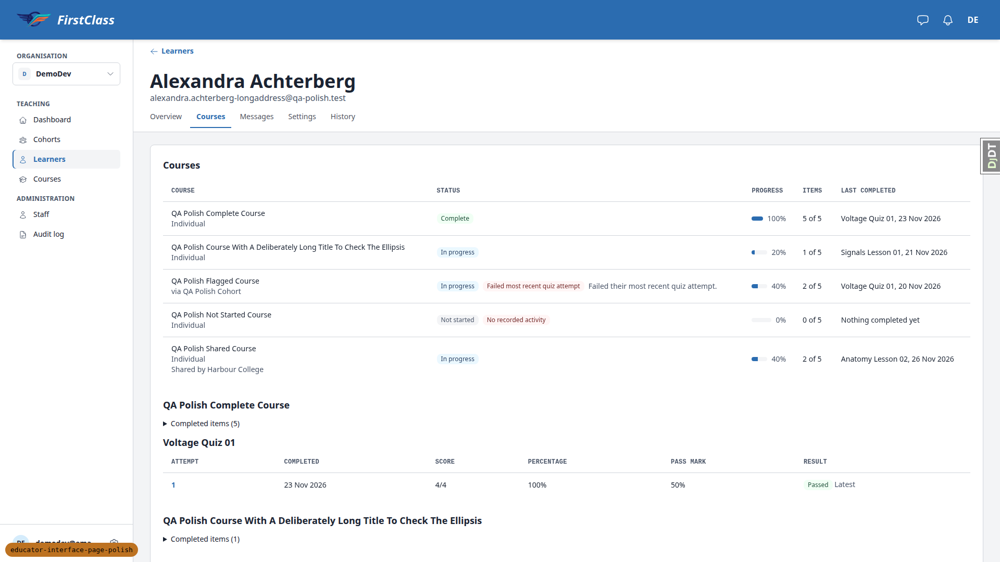

Expected: in the learner Courses tab table, the Progress cell shows a readable bar beside its percentage, like the learners list cell.

Actual: at 1920px the Progress column is the narrowest column. The `<progress>` renders about 22px wide while the Status column takes most of the width.

## B2: Quiz headings in a course section look the same as the course heading

Manifestations:
- test 2.5, desktop

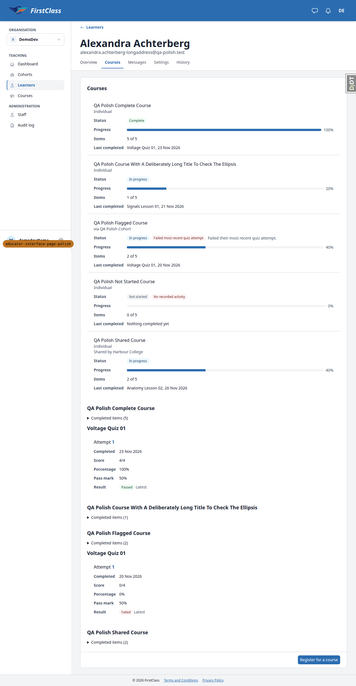

Expected: each section below the table is headed by the course title, and the quiz attempt tables inside it read as part of that course.

Actual: the quiz heading (h4, e.g. "Voltage Quiz 01") renders at the same 18px / semibold as the course section heading (h3), so each quiz reads as a sibling section.

## B3: Settings Name panel Email row is half-width and flush against the form

Manifestations:
- test 4.1, desktop
- test 4.4, mobile

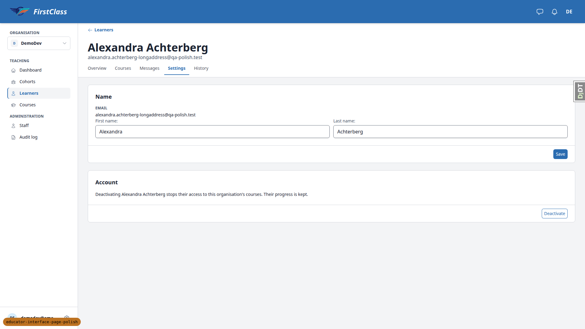
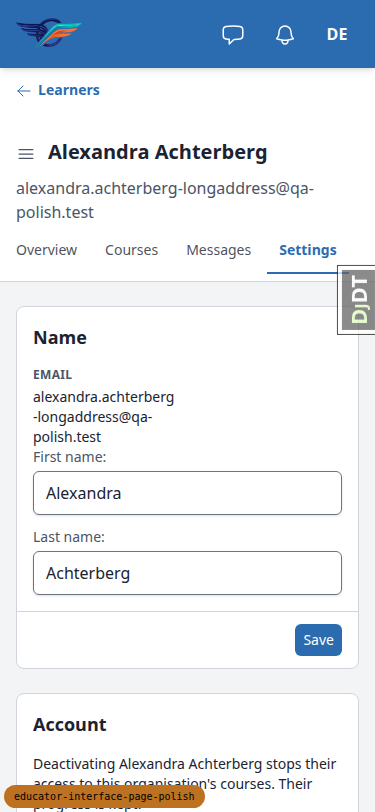

Expected: the Email row sits above the name fields with the panel's usual spacing and uses the panel width, so a long address wraps only when it must.

Actual: the single-row `<c-panel-definition-list>` keeps its `grid-cols-2` / `md:grid-cols-3` grid, so the address gets one column (half the panel at 375px, breaking over 3 lines). The list's bottom touches the "First name:" label (0px gap).

## B4: A failed (5xx) bulk confirm request shows no error

Manifestations:
- test 7.6, desktop

No screenshot (the state has no visible error to capture).

Expected: when the in-request bulk run's POST fails with a server error, the dialog unlocks and tells the educator the run failed.

Actual: the dialog unlocks (Cancel and close enabled, Esc closes) but its body is unchanged and no error appears anywhere, so the failure is silent.

## Layout probe

| Test id | Viewport | URL | Screenshot | Result |
|---|---|---|---|---|
| 1.1 | desktop | `/educator/organisations/demodev/learners` |  | clean |
| 2.1 | desktop | `/educator/organisations/demodev/learners/<A>/__tabs/courses` |  | clean |
| 2.5 | desktop-1280 | `/educator/organisations/demodev/learners/<A>/__tabs/courses` |  | clean |
| 3.1 | desktop | `/educator/organisations/demodev/learners` (quick view open) | 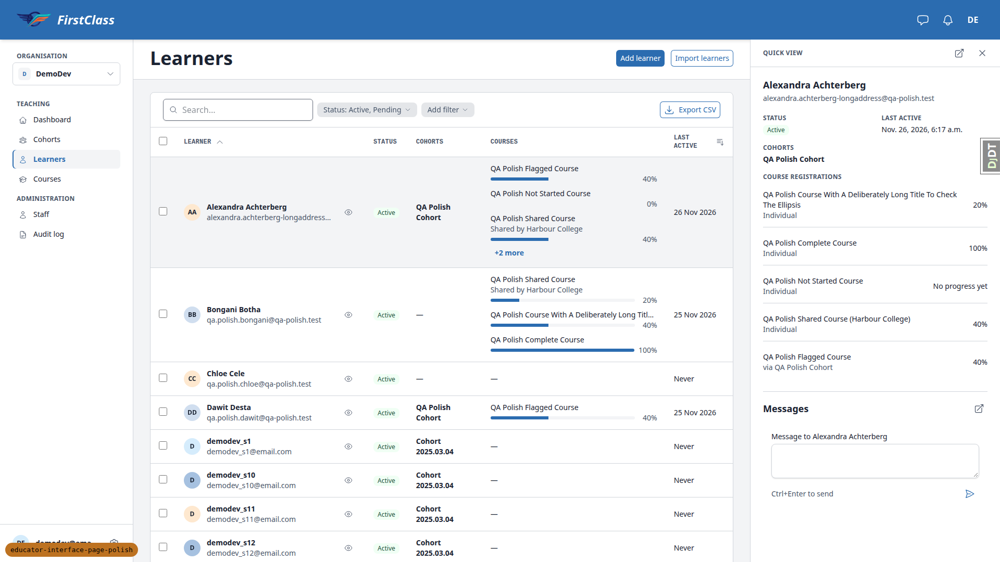 | clean |
| 4.1 | desktop | `/educator/organisations/demodev/learners/<A>/__tabs/settings` |  | clean |
| 6.1 | desktop | `/educator/organisations/demodev/dashboard` | 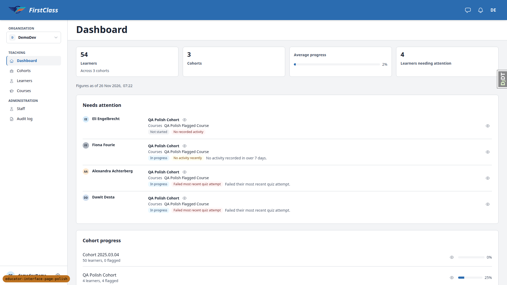 | clean |
| 1.9 | mobile | `/educator/organisations/demodev/learners` | 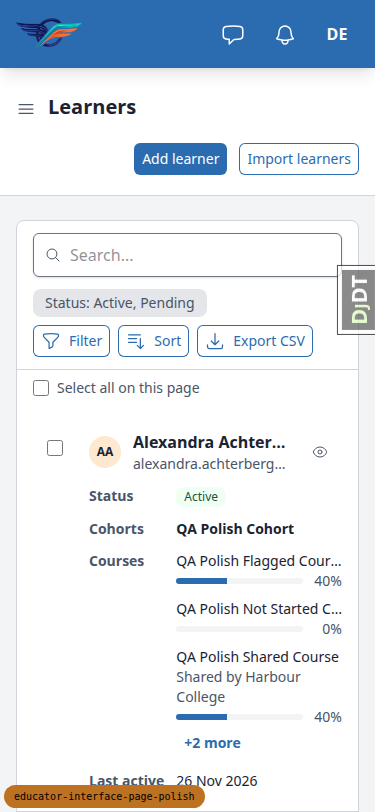 | clean |
| 2.9 | mobile | `/educator/organisations/demodev/learners/<A>/__tabs/courses` | 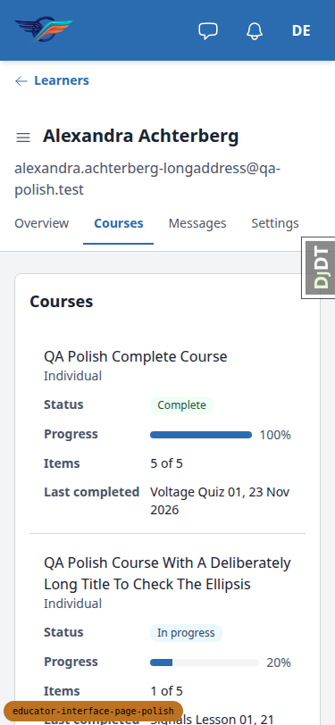 | clean |
| 4.4 | mobile | `/educator/organisations/demodev/learners/<A>/__tabs/settings` |  | clean |
| 8.1 | mobile | `/educator/organisations/demodev/learners` (Add learner dialog) | 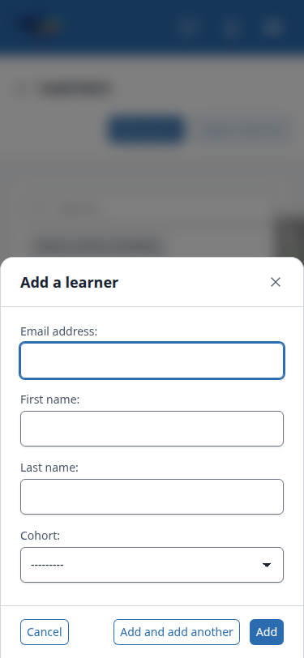 | clean |
| 8.2 | mobile | `/educator/organisations/demodev/learners` (bulk dialog) | 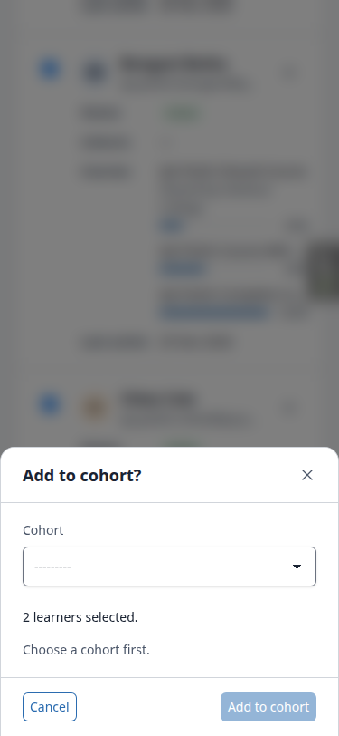 | clean |
| 3.3 | mobile | `/educator/organisations/demodev/learners` (quick view) | 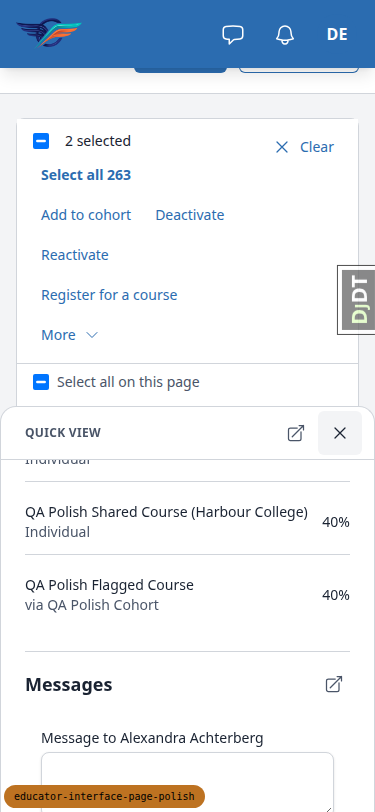 | clean |
| 6.7 | mobile | `/educator/organisations/demodev/dashboard` | 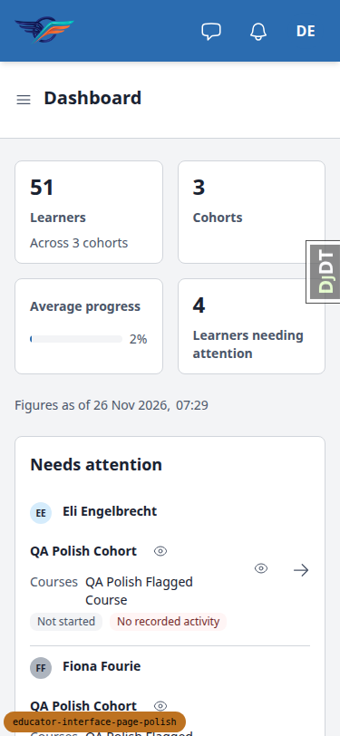 | clean |
| 2.9 | tablet | `/educator/organisations/demodev/learners/<A>/__tabs/courses` | 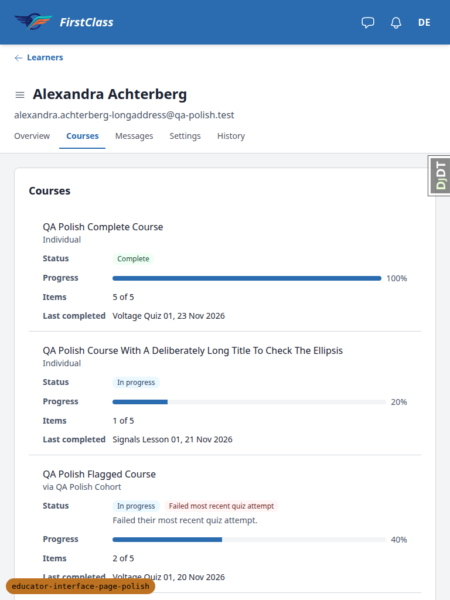 | clean |
| 1.9 | tablet | `/educator/organisations/demodev/learners` | 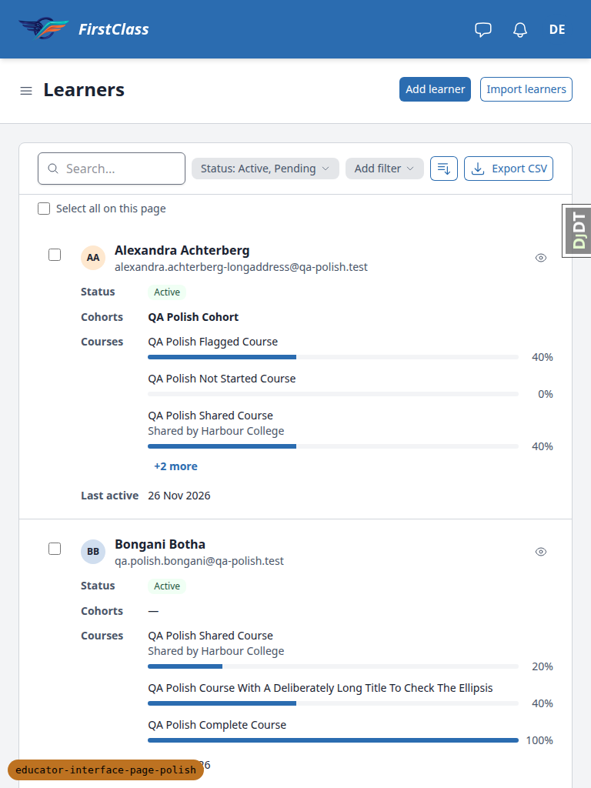 | clean |

The probe flags were empty everywhere, yet the 4.1 and 4.4 screenshots show the B3 spacing and width problem. The probe does not catch these.

## Data changes

| What changed | Made by | Files written |
|---|---|---|
| Seeded demo data (`create_demo_data`, `content_save DemoDev`), the QA scenario (learners A-F, 5 QA Polish courses, QA Polish Cohort, cohort-scoped viewer `qa.polish.viewer@qa-polish.test`) and 210 bulk learners. The over-limit cohort was not seeded (`REPORTS_MAX_LEARNERS=500`). | `sdd:qa-data-helper` | `freedom_ls/qa_helpers/management/commands/qa_create_educator_page_polish_scenario.py` |
| 3 demodev learners (rows 6-8 of the list, `demodev_s1x`) deactivated | the app's bulk Deactivate, during test 7.5 | none |

## Bug status

| Bug | Title | Status |
|---|---|---|
| B1 | Courses tab Progress column squeezes the bar to ~22px | **FIXED** (commit: 438f158d7). Bars now 84–100px at 1920px |
| B2 | Quiz headings in a course section look the same as the course heading | **FIXED** (commit: 67076a7c8). Quiz h4 now 16px under the 18px course h3 |
| B3 | Settings Name panel Email row is half-width and flush against the form | **FIXED** (commit: 1d1832564). Inline row across the panel, 12px above the form ([after](screenshots/page-2026-11-26T07-50-05-436Z.png)) |
| B4 | A failed (5xx) bulk confirm request shows no error | **FIXED** (commit: f8b16e141, 57ea69b5d, a5d03a8ec) — A failed (5xx) bulk confirm request shows no error — after the fix: the error shows as an error callout in the dialog body, not a bare red line: 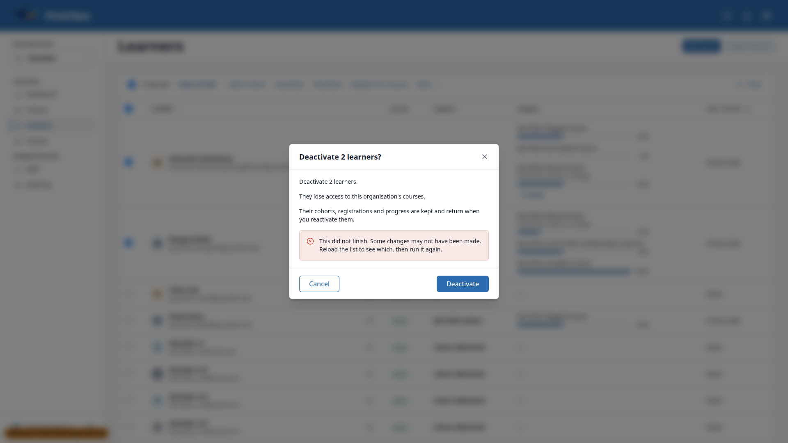 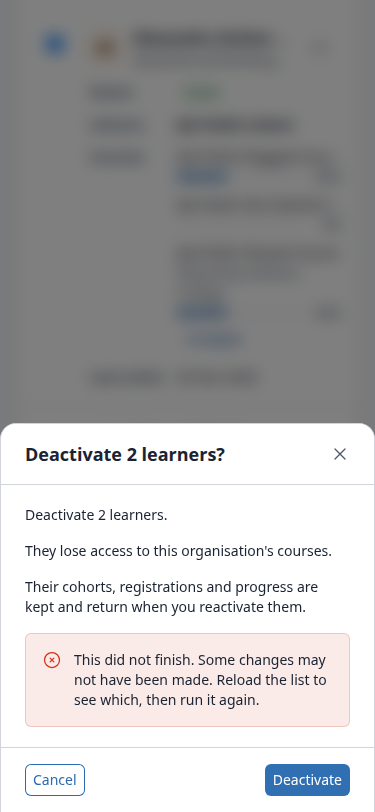 |

## General notes

- Test 6.4 (over-limit cohort message) was run after QA, with REPORTS_MAX_LEARNERS lowered to 10 for the dev server: the dashboard callout reads "Cohort 2025.03.04 has 47 learners, over the report's learner limit of 10, so it is not included.", the cohort name is a link that opens the cohort page, and at 375px the callout wraps with no sideways scroll. PASS. 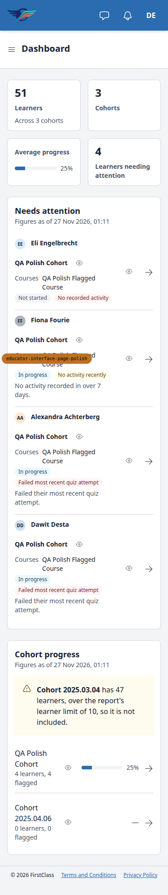 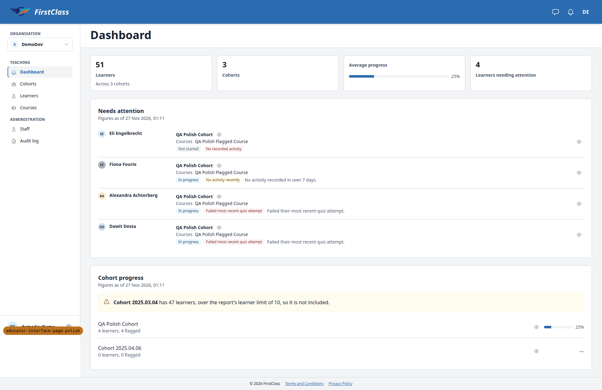
- After review, two rules were applied across the panel-framework pages. (1) Every error or warning is a `<c-panel-callout>`: the failed bulk confirm, a failed form dialog ([screenshot](screenshots/fixed/form-dialog-request-error-callout-1920.png)), a failed inline form, the form error summary and the quick view's load error ([screenshot](screenshots/fixed/quick-view-load-error-callout-1920.png)). (2) Nothing sits on the canvas outside a box: on the dashboard the over-limit notice is inside the Cohort progress card and "Figures as of" is the description of both cards; the staff list's sole-admin notice is inside the list card; the import pages' step indicator is in the header band and their error rows, "Clear filter" and result buttons are inside cards; the sign out question is inside its card. Invariant tests and the browser check `assert_canvas_holds_only_boxes` enforce both. Test 9 of the QA plan covers them; its steps 4 to 7 (staff list as sole admin, Report tab, import pages, account pages) were checked by the browser tests, not by hand.
- Test 6.3: no course outside the viewer's visible set exists in the data, so the plain-text (unlinked) branch was not exercised.
- Test 7.8: the background-run confirmation was not confirmed, to keep the QA learners active.
- Test 2.1: at 1280px the Courses tab panel container is about 910px, under the table's 58rem card breakpoint, so it shows cards rather than the table. This is the framework's `cards_when_narrow` rule. The table was checked at 1920.
- Three demodev learners remain deactivated from test 7.5, so the list shows 263 active/pending learners.

status: ok · reason: 4 bugs — 4 fixed, 0 unresolved; report rendered, screenshots verified
