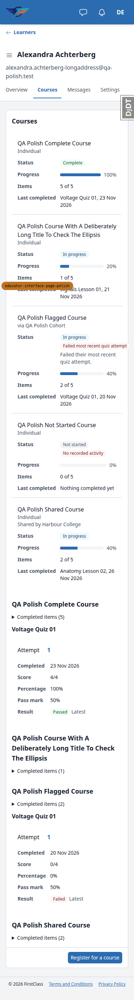
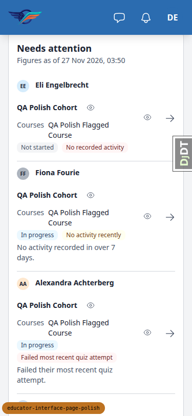
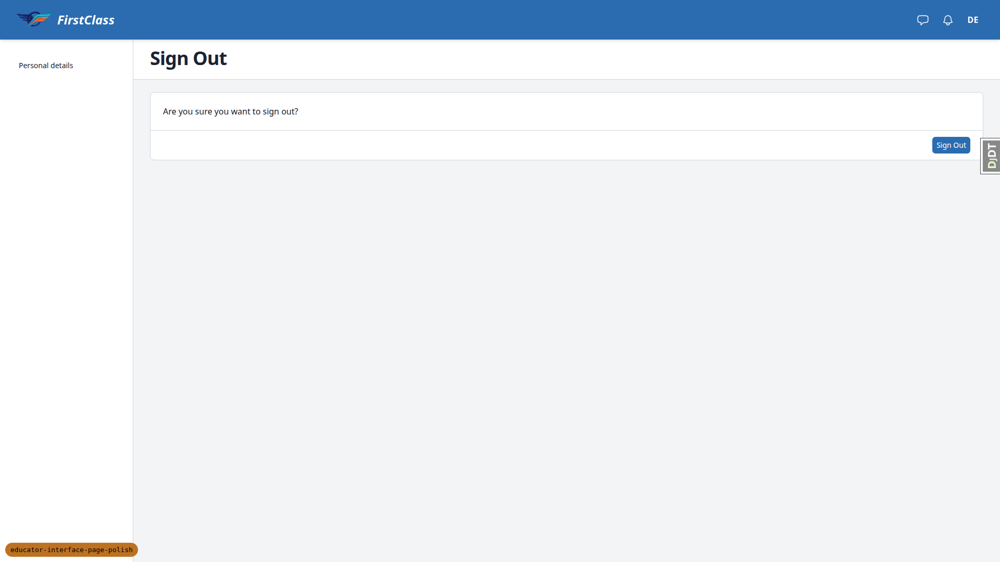
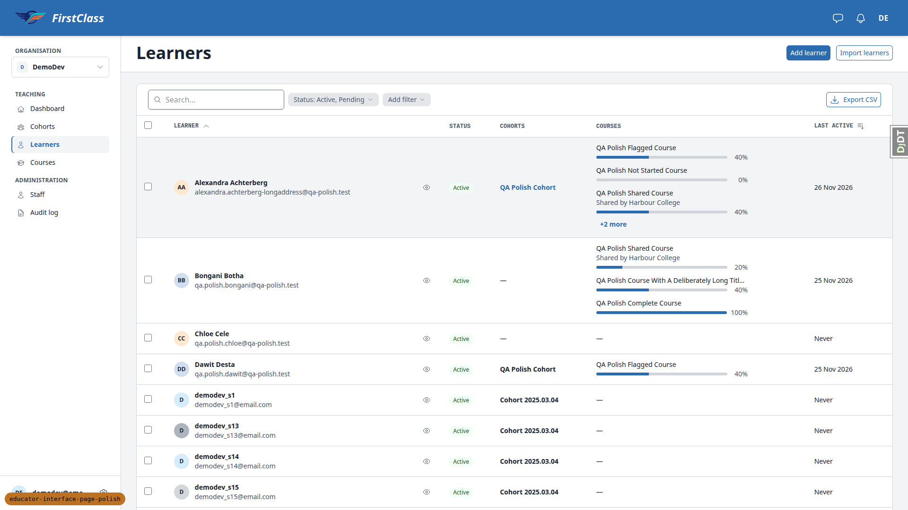
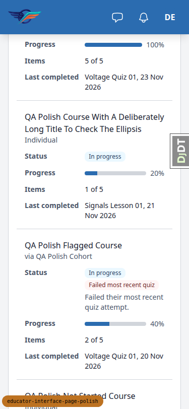
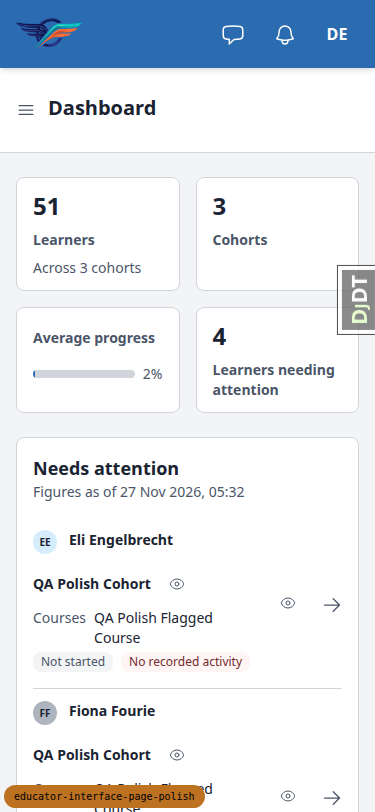

# Frontend QA report: educator-interface-page-polish

## Methodology

Screenshots were collected into `spec_dd/2. in progress/educator-interface-page-polish/screenshots/`. Every image referenced below exists beside this report. Tests ran in a browser against the dev server at desktop (1280 and 1920), tablet (768) and mobile (375) viewports. The dev server ran with a git-ignored settings override (REPORTS_MAX_LEARNERS=10, BULK_BACKGROUND_THRESHOLD=5), deleted after the run.

## Diff scoping

Class: **FULL**. The changed files include panel framework templates, CSS and JS, educator interface templates and panels, the reports app and the account templates. Nothing was skipped: desktop, tablet and mobile passes all ran.

## Smoke gate

Outcome: **pass**. Pages loaded: `/` and `/educator/organisations/demodev/dashboard`. The run was not aborted.

## Design check

There are no design records, so no design states tested.

## Bug B1: Progress bar track disappears on a hovered table row

Manifestations: test 1.12-hover (desktop).

- Expected: the empty part of every progress bar stays visible whatever the row state, so a 0% course still shows an empty bar.
- Actual: the panel-progress-bar track (rgb(243,244,246)) matches the data-table row hover background (rgb(243,244,246)). On a hovered row in the learners list Courses cell the track vanishes and a 0% bar shows nothing.

## Bug B2: Flag badge overflows the Courses tab phone card

Manifestations: test 2.9 (mobile).

- Expected: at 375px every badge in a Courses tab card stays inside its value cell and the card, wrapping if needed.
- Actual: "Failed most recent quiz attempt" is white-space:nowrap and 195px wide in a 158px value cell. Its right edge (363px) passes the card's right border (359px).

## Bug B3: Dashboard text links have no 44px hit area on a phone

Manifestations: test 6.7 (mobile).

- Expected (QA plan test 6.7): at 375px the dashboard's tiles, icons and links are tappable with 44px hit areas.
- Actual: Needs attention cohort-name links are 20px tall, course-name links 39px, and the over-limit callout's cohort link 22px, with no expanded hit area. The cohort name sits 4px from its 44px quick view icon.

## Bug B4: Sign out page content is not inside the shell's content region

Manifestations: test 9.7 (desktop), test 9.7 (mobile), test 9.7 (tablet).

- Expected: the sign out page places its header band and card the way its sibling account page (Personal details) does, which the layout probe passes.
- Actual: the probe reports "misaligned: header ink starts at x=256, content at x=288" (offsets of 16px at 375 and 24px at 768). The title and card both start at x=288 on screen, but the card is a direct child of `#interface-main` instead of sitting in the full-width content region the profile page uses.

## Layout probe

| Test | Viewport | URL | Screenshot | Result |
|---|---|---|---|---|
| 6.0 | desktop | /educator/organisations/demodev/dashboard | [shot](screenshots/page-2026-11-27T03-27-41-616Z.png) | clean |
| 1.1 | desktop | /educator/organisations/demodev/learners | [shot](screenshots/page-2026-11-27T03-31-42-257Z.png) | clean |
| 2.1 | desktop | /educator/organisations/demodev/learners/<A>/__tabs/courses | [shot](screenshots/page-2026-11-27T03-31-15-385Z.png) | clean |
| 2.10 | desktop | /educator/organisations/demodev/learners/<C>/__tabs/courses | [shot](screenshots/page-2026-11-27T03-34-09-729Z.png) | clean |
| 3.1 | desktop | /educator/organisations/demodev/learners (quick view open) | [shot](screenshots/page-2026-11-27T03-34-43-801Z.png) | clean |
| 4.1 | desktop | /educator/organisations/demodev/learners/<A>/__tabs/settings | [shot](screenshots/page-2026-11-27T03-35-19-091Z.png) | clean |
| 5.1b | desktop | /educator/organisations/demodev/cohorts/<QA Polish>/__tabs/report | [shot](screenshots/page-2026-11-27T03-38-06-264Z.png) | clean |
| 9.9 | desktop | /educator/organisations/demodev/cohorts/<QA Polish>/__tabs/settings | [shot](screenshots/page-2026-11-27T03-42-09-984Z.png) | clean |
| 9.10 | desktop | /educator/organisations/demodev/cohorts | [shot](screenshots/page-2026-11-27T03-42-24-655Z.png) | clean |
| 9.2 | desktop | /educator/organisations/northwind-logistics/dashboard | [shot](screenshots/page-2026-11-27T03-46-12-102Z.png) | clean |
| 9.4 | desktop | /educator/organisations/northwind-logistics/staff | [shot](screenshots/page-2026-11-27T03-46-48-631Z.png) | clean |
| 9.6 | desktop | /educator/organisations/demodev/learners/import/<id>/ | [shot](screenshots/page-2026-11-27T03-47-30-381Z.png) | clean |
| 9.6 | desktop | /educator/organisations/demodev/learners/import/<id>/result/ | [shot](screenshots/page-2026-11-27T03-47-51-616Z.png) | clean |
| 9.7 | desktop | /accounts/logout/ | [shot](screenshots/page-2026-11-27T03-43-11-344Z.png) | misaligned: header ink starts at x=256, content at x=288 (32px) |
| 1.9 | mobile | /educator/organisations/demodev/learners | [shot](screenshots/page-2026-11-27T03-48-38-715Z.png) | clean |
| 2.9 | mobile | /educator/organisations/demodev/learners/<A>/__tabs/courses | [shot](screenshots/page-2026-11-27T03-48-54-638Z.png) | clean |
| 3.3 | mobile | /educator/organisations/demodev/learners (quick view) | [shot](screenshots/page-2026-11-27T03-49-18-054Z.png) | clean |
| 6.7 | mobile | /educator/organisations/demodev/dashboard | [shot](screenshots/page-2026-11-27T03-50-43-402Z.png) | clean |
| 9.7 | mobile | /accounts/logout/ | none | misaligned: header ink starts at x=0, content at x=16 (16px) |
| 2.9 | tablet | /educator/organisations/demodev/learners/<A>/__tabs/courses | [shot](screenshots/page-2026-11-27T03-51-52-709Z.png) | clean |
| 1.9 | tablet | /educator/organisations/demodev/learners | [shot](screenshots/page-2026-11-27T03-51-59-079Z.png) | clean |
| 9.7 | tablet | /accounts/logout/ | none | misaligned: header ink starts at x=0, content at x=24 (24px) |

## Data changes

| What changed | Made by | Files written |
|---|---|---|
| Dev server run with git-ignored `config/settings_local.py` setting REPORTS_MAX_LEARNERS=10 so a cohort crosses the report learner limit; file deleted after the run | settings override | none |
| Added BULK_BACKGROUND_THRESHOLD=5 to the same git-ignored `config/settings_local.py` so a bulk action runs in the background (test 7.8); file deleted after the run | settings override | none |
| qa.polish.bulk001-003 deactivated in test 7.5 and reactivated afterwards; net no change | app UI (bulk Deactivate then Reactivate) | none |
| Vusi Viewer staff member deactivated and reactivated while probing test 9.4; net no change | app UI (Deactivate/Reactivate staff member) | none |
| demodev@email.com added as Organisation admin of Northwind Logistics, so it is that organisation's only staff member (test 9.4) | app UI (Add staff member) | none |
| Imported learner qa.polish.import1@qa-polish.test from a 3-row CSV with 2 error rows (test 9.6); the CSV lives in `.sdd-work/qa_import_errors.csv` and is deleted with the scratch files | app UI (Import learners) | none |

## Bug status

| Bug | Title | Status |
|---|---|---|
| B1 | Progress bar track disappears on a hovered table row | **FIXED** (commit: eee8623ee): the track now uses the border token, visible on a hovered row (rgb(209,213,219) on rgb(243,244,246))  |
| B2 | Flag badge overflows the Courses tab phone card | **FIXED** (commit: 01aab8b1a) — Flag badge overflows the Courses tab phone card — after the fix:  |
| B3 | Dashboard text links have no 44px hit area on a phone | **FIXED** (commit: d6c4de404) — Dashboard text links have no 44px hit area on a phone — after the fix:  |
| B4 | Sign out page content is not inside the shell's content region | **FIXED** (commit: 375922549): the card sits in a canvas wrapper as on Personal details; the probe passes at 1920, 375 and 768 with the look unchanged  |

## General notes

- Dev server settings: the server ran with a git-ignored settings override (REPORTS_MAX_LEARNERS=10, BULK_BACKGROUND_THRESHOLD=5).
- Test 1.1: the plan expected the not-started course hidden, but it carries the "No recorded activity" at-risk flag, so per the spec's ordering it ranks with flagged courses. Spec wins. The "+2 more" text sits about 8px right of the course titles' left edge (its own padding).
- Test 4.2 ran by an alternate route. First name is optional (blank saves, pre-existing model behaviour), so clearing it shows no error. The error path used a 260-character name instead: 422 with "Ensure this value has at most 200 characters". Side observation, pre-existing and extreme data: a 200-character unbroken first name overflows the Account card's sentence. The name was restored to Alexandra.
- Test 6.3: the plain-text branch was not exercised, because the data has no course outside the viewer's visible set.
- Front-end check after the rebase: the upstream change was one admin stylesheet outside the shared paths. This QA run covered every branch page at three viewports.
- Screenshots `page-2026-11-27T03-36-30-000Z.png` and `page-2026-11-27T03-36-40-000Z.png` come from a second browser context (cohort viewer, test 4.6) with the debug toolbar open. They are not used as evidence images.
- Tests 2.9 and 1.9 passed at tablet (768) and 1.9 at mobile; the failures are limited to the badge overflow (B2) at 375px.

status: ok · reason: 4 bugs — 4 fixed, 0 unresolved; report rendered
