# QA report: semantic icons app, standalone

Test plan: `3. frontend_qa.md` (Tests 1 to 4).

## Methodology

Screenshots were collected into `screenshots/` beside this report, and every image referenced below
exists there. The run did not abort at the smoke gate, so every step ran. Tests 1 to 4 ran at desktop
1920x1080. The viewport-marked tests (1 and 3) were re-run at mobile 375x812, and a tablet 768 pass was
added for Tests 1 and 3.

Setup checks: `manage.py check` printed no `icons.*` line (no W002 to W004, no E002, no E008). The
server log showed no `KeyError` or `IconResolutionError`. The only 500 was the first home-page load,
before the pending form_engine migrations were applied (see Data changes).

## Diff scoping

Class: **FULL**. Changed files that triggered it: `freedom_ls/icons/*`,
`freedom_ls/icons/data/*/icons.json`, `config/settings_base.py`, `freedom_ls/base/app_settings.py`,
`freedom_ls/panel_framework/app_settings.py`, `package.json`, `pyproject.toml`,
`scripts/generate_icon_subset.py`, docs and plugin docs, tests. Non-`.py` files (icons.json,
package.json, pyproject.toml) changed, so Rule 4 makes it FULL. Nothing was skipped.

## Smoke gate

Outcome: **pass**. Pages loaded: `/` and `/courses/content-widgets-demo-reference/4/`.

## Design check

No design states tested: no design records exist this run (the plan has no `-design` tests).

## Test results

| Test | Viewport | Result | Notes | Screenshot |
|---|---|---|---|---|
| 1 Home | desktop | pass | 51 visible icons, none empty, sizes 16/20/24/48, none stretched or tiny | 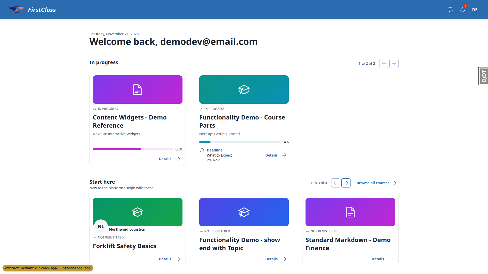 |
| 2 Regulation glyph | desktop | pass | Label "Regulation" with heroicons `scale` glyph, 20x20, not fallback, not blank | 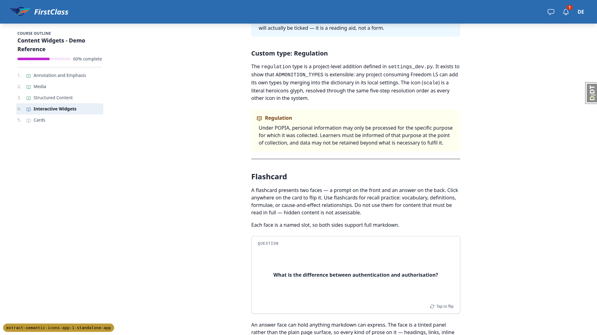 |
| 2-data-icon | desktop | **fail** | No `data-icon` on the Regulation svg (see B1) |  |
| 2-other-admonitions | desktop | pass | Note, Tip, Important, Warning, Danger, notes, check, info each draw their own 20px icon | 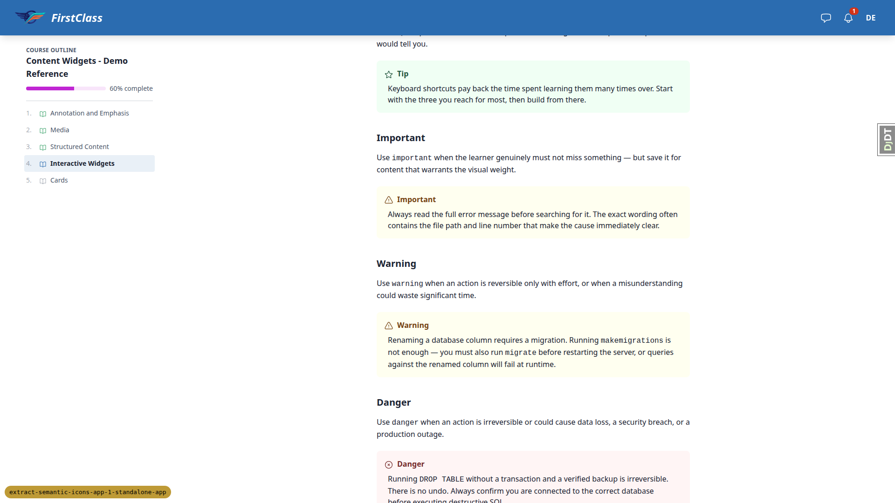 |
| 1 Course list | desktop | pass | 36 visible icons, none empty | 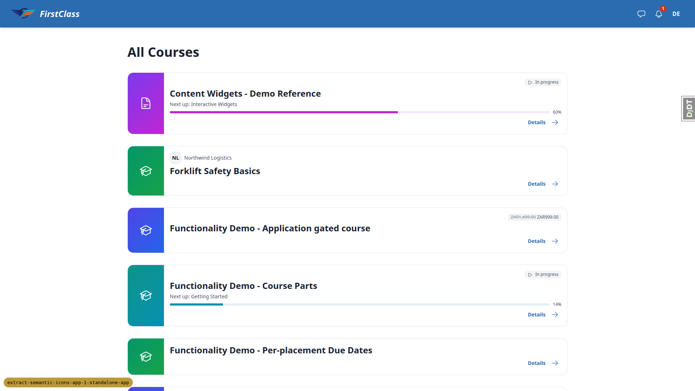 |
| 1 Course detail | desktop | pass | Back arrow, stat icons, outline icons draw; hero art is the intended size-60 decoration | 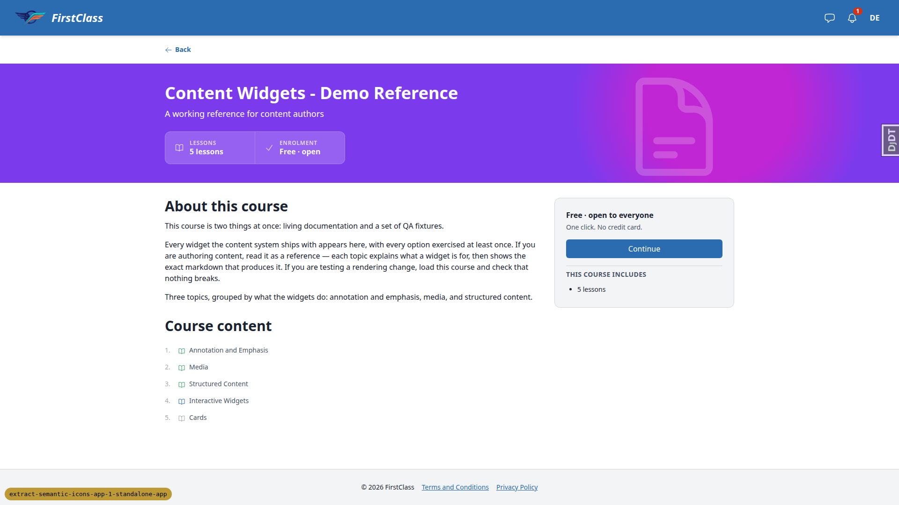 |
| 1 Topic page | desktop | pass | Outline, part chevrons, prev/next, deadline clock draw; no empty svgs | 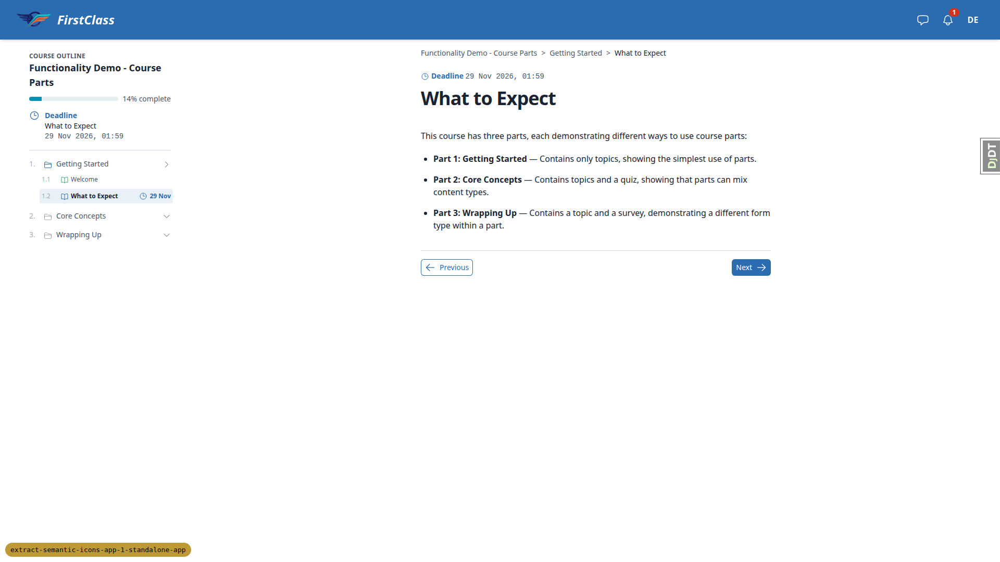 |
| 1-chevron | desktop | **fail** | Open part shows right chevron, not up (see B2) |  |
| 3 Dashboard | desktop | pass | Nav icons, org switcher chevron, settings draw |  |
| 3 Learners list | desktop | pass | Search, filter chevrons, Export CSV, sort, eye draw; 0 empty svgs. Pager is text buttons, no arrow icons |  |
| 3 Quick view | desktop | pass | open_page, close, send draw at 20px; closed with x | 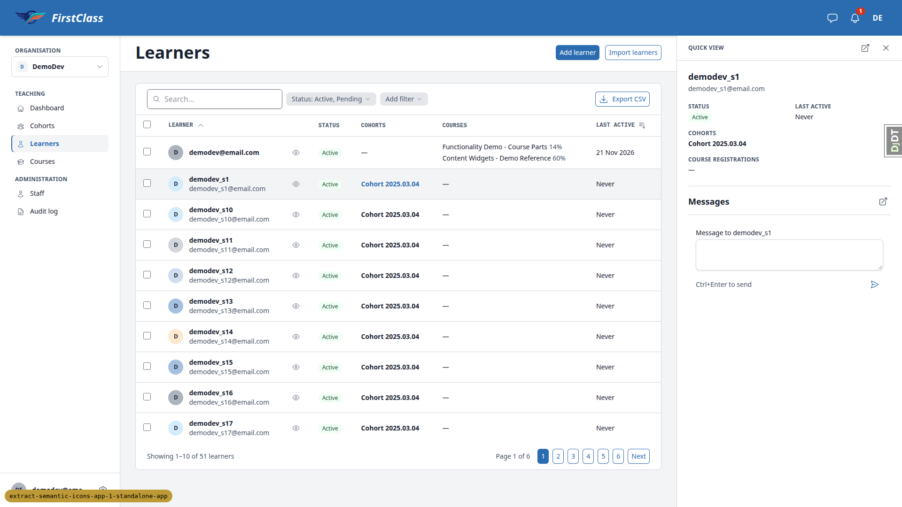 |
| 3 Status filter | desktop | pass | Check marks at 16px, chevron turns up while open |  |
| 3 Cohort detail | desktop | pass | Back arrow, nav, Learners tab icons draw |  |
| 3 Cohort list | desktop | pass | Search, sort, quick-view icons draw | 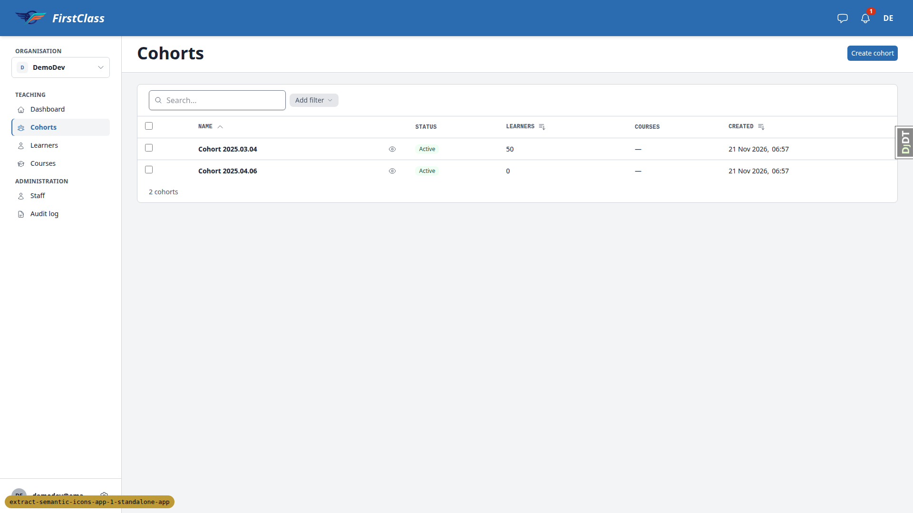 |
| 3 Learner page | desktop | pass | Back arrow, search, sort draw | 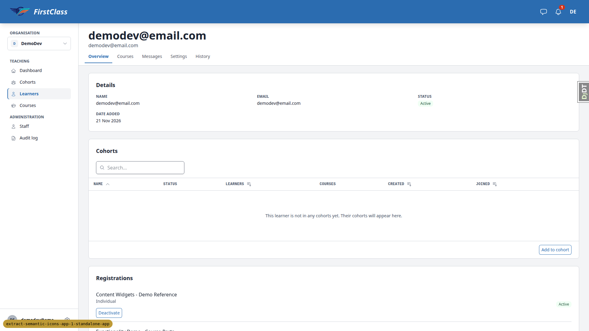 |
| 3-solid | desktop | pass | Only the header bell/messages use solid (24px, intended, not clipped); no mini/micro variant in any template | 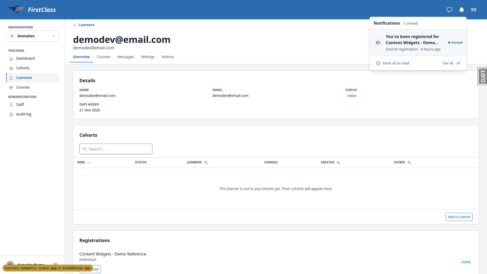 |
| 3-more-options | desktop | skip | No more_options (vertical ellipsis) control renders on any educator page with the demo data; only used by cotton dropdown-menu components not instanced on these pages | none |
| 4 404 page | desktop | pass | See note below | 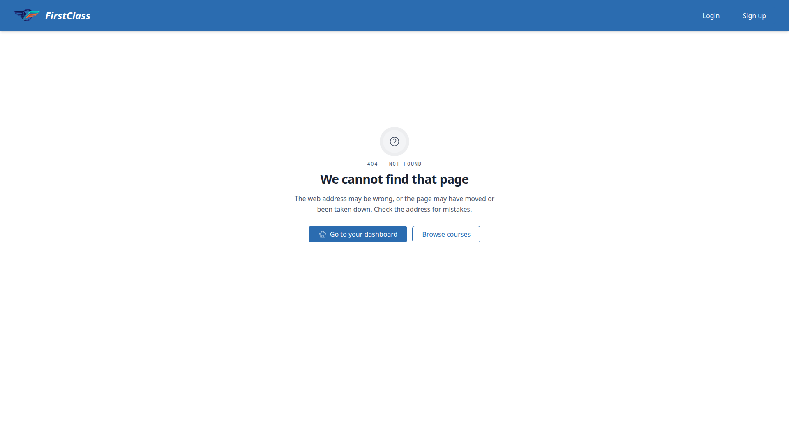 |
| 1 Home | mobile | pass | Icons draw, scrollWidth 375, no sideways scroll | 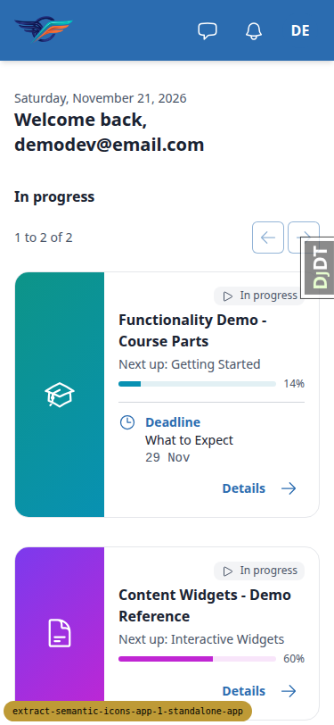 |
| 1 Topic page | mobile | pass | TOC toggle (44x48 target), deadline, prev/next draw; no sideways scroll | 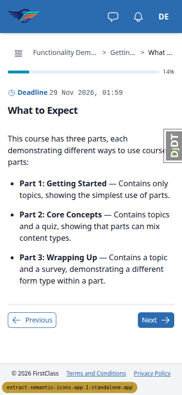 |
| 1 Outline sheet | mobile | pass | Outline icons draw at 16px, 0 empty svgs; same right chevron on open parts as desktop (B2) | 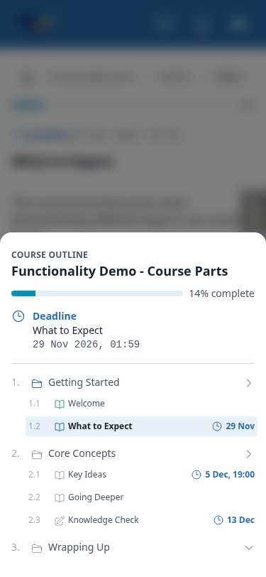 |
| 3 Learners list | mobile | pass | Cards, nav toggle, search, Filter, Sort, Export CSV, eye draw; no sideways scroll |  |
| 3 Pager | mobile | pass | Previous/Next arrows at 20px | 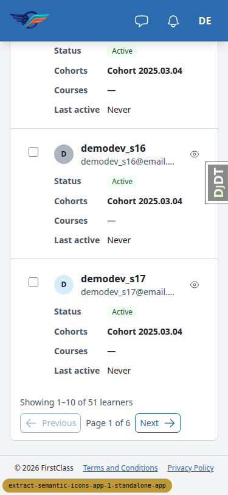 |
| 3 Quick view sheet | mobile | pass | open_page and close draw at 20px; closed with x | 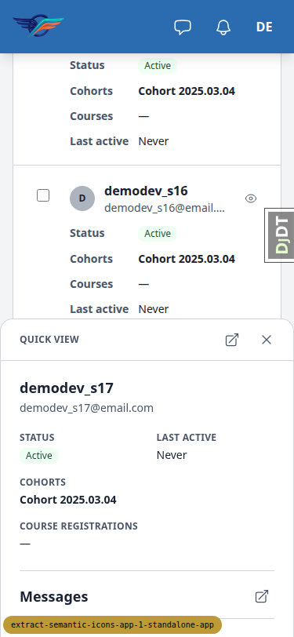 |
| 3 Nav panel sheet | mobile | pass | Org switcher chevron, nav icons, settings cog draw | 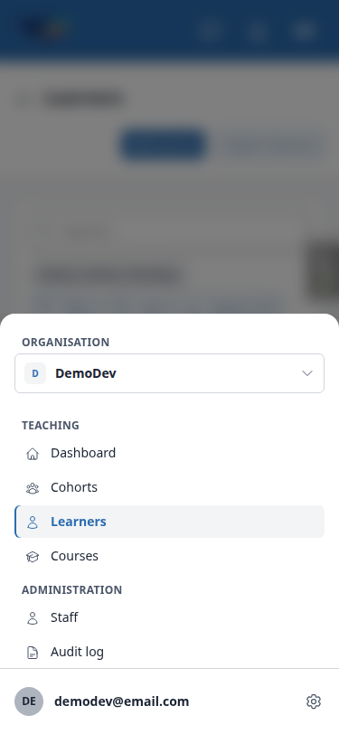 |
| 3 Learners list | tablet | pass | Cards at 768, toolbar one row, no sideways scroll | 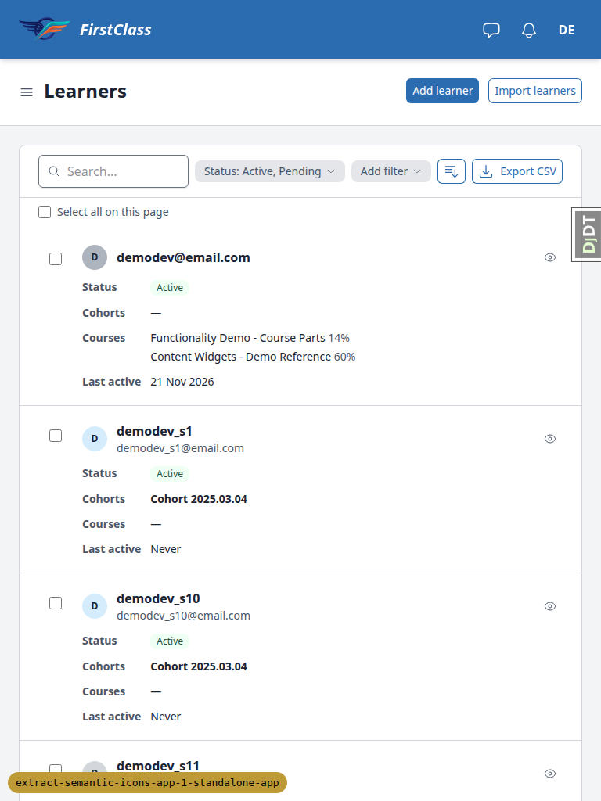 |
| 1 Interactive Widgets | tablet | pass | TOC toggle, admonition icons, flashcard retry, accordion chevrons, prev/next draw; no sideways scroll | 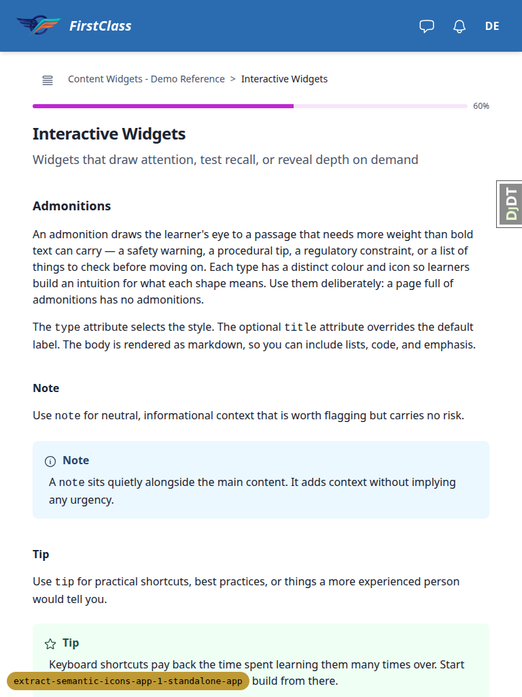 |

Test 4 note: the dev server runs DEBUG=True, so the live URL shows Django's technical 404. The project
`404.html` was rendered with DEBUG=False through the test client (status 404, not 500) and loaded in
the browser on the dev origin. The 'unknown' icon (28px) and the 'home' icon on "Go to your
dashboard" (20px) both draw.

## Bug: B1, Literal (authored) glyphs render without data-icon

Manifestations:
- `2-data-icon`, desktop

- Expected: the Regulation admonition svg has `data-icon` naming `scale` (test plan Test 2; `2. plan.md:474` expects the course-icon test to assert `data-icon` for `scale`).
- Actual: the svg has `role=img aria-label=scale` and no `data-icon`. `freedom_ls/icons/render.py` `_render_literal` calls `build_svg` without `data_name`, so every literal/authored glyph renders without `data-icon`. The glyph itself renders correctly. The behaviour predates this branch (render.py is unchanged here), and `test_course_icon.py` checks the path body rather than `data-icon`. The icon-usage skill defines `data-icon` as the semantic name, which a literal glyph does not have.

## Bug: B2, Open course part in the learner outline shows a right chevron, not an up chevron

Manifestations:
- `1-chevron`, desktop
- `1`, mobile (outline bottom sheet)

- Expected: brand `visual.md` checklist says every expand chevron points down while closed and up while open.
- Actual: `course_minimal_toc.html` shows `<c-icon name=collapse>` (chevron-right, caret-right for ph) while the part is expanded. Pre-existing: the expand/collapse mappings and the outline template are unchanged on this branch.

## Layout probe

| Test | Viewport | URL | Screenshot | Result |
|---|---|---|---|---|
| 1 | desktop | `/` | 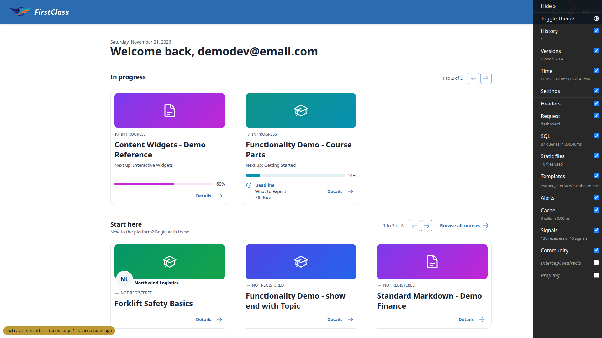 | clean (debug toolbar open in this shot; retaken below) |
| 1 | desktop | `/` |  | clean |
| 2 | desktop | `/courses/content-widgets-demo-reference/4/` |  | clean |
| 2 | desktop | `/courses/content-widgets-demo-reference/4/` |  | clean |
| 1 | desktop | `/courses/` |  | clean |
| 1 | desktop | `/courses/content-widgets-demo-reference/detail/` |  | clean |
| 1 | desktop | `/courses/functionality-demo-course-parts/2/` |  | clean |
| 3 | desktop | `/educator/organisations/demodev/dashboard` |  | clean |
| 3 | desktop | `/educator/organisations/demodev/learners` |  | clean |
| 3 | desktop | learners (quick view open) |  | clean |
| 3 | desktop | learners (filter open) |  | clean |
| 3 | desktop | `/educator/organisations/demodev/cohorts/684c05e9-.../` |  | clean |
| 3 | desktop | `/educator/organisations/demodev/cohorts` |  | clean |
| 3 | desktop | `/educator/organisations/demodev/learners/<id>` |  | clean |
| 3 | desktop | learner page (bell open) |  | clean |
| 4 | desktop | `/this-page-does-not-exist/` |  | clean |
| 1 | mobile | `/` |  | clean |
| 1 | mobile | `/courses/functionality-demo-course-parts/2/` |  | clean |
| 1 | mobile | `/courses/functionality-demo-course-parts/2/` (outline sheet open) |  | fail: stacked (sidebar ink spans x=0..375), overlap (content and sidebar ink intersect). Not a bug, see below |
| 3 | mobile | learners |  | clean |
| 3 | mobile | learners (duplicate shot, scroll attempt timed out) | 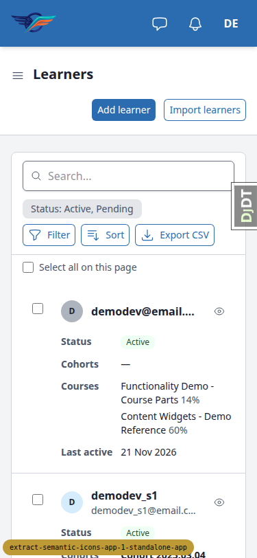 | clean |
| 3 | mobile | learners (scrolled to pager) |  | clean |
| 3 | mobile | learners (quick view open) |  | clean |
| 3 | mobile | learners (nav panel open) |  | fail: stacked (sidebar ink spans x=0..375), overlap (content and sidebar ink intersect). Not a bug, see below |
| 3 | tablet | learners |  | clean |
| 1 | tablet | `/courses/content-widgets-demo-reference/4/` |  | clean |

The two `fail` rows are probe false positives. The probe ran with a modal bottom sheet open over a
dimmed page at 375px (the course outline, the educator nav panel). That is the shell's intended phone
design (panel-framework rule: a sheet on a phone, closed by backdrop tap or Esc), not a bug.

## Data changes

| What changed | Call or command | Files written |
|---|---|---|
| Applied 3 pending form_engine migrations (0011_shuffle, 0012_formprogress_furthest_page, 0013_remove_formprogress_furthest_page_reached) to the branch dev DB. The home page returned a 500 (UndefinedColumn `furthest_page_id`) before this. | migrate (pending migrations) | none |

## Bug status

| Bug | Status | Detail |
|---|---|---|
| B1 | **UNRESOLVED** | Literal (authored) glyphs render without data-icon. Reason: decision needed. The icon-usage skill defines data-icon as the semantic name, which a literal glyph lacks; the spec documents expect data-icon naming `scale`. Choose: emit the glyph name (it can collide with semantic names such as `check`), emit `<set>:<glyph>`, or correct the QA plan and plan to check the path body as the shipped test does. |
| B2 | **FIXED** (commit: 311a8a6dd) | Open course part in the learner outline shows a right chevron, not an up chevron. The open part now draws the expand chevron rotated 180deg (template only, mappings unchanged). Re-verified at desktop: open parts point up, closed parts point down, and toggling a part flips it. Targeted run after the fix: 1211 passed. 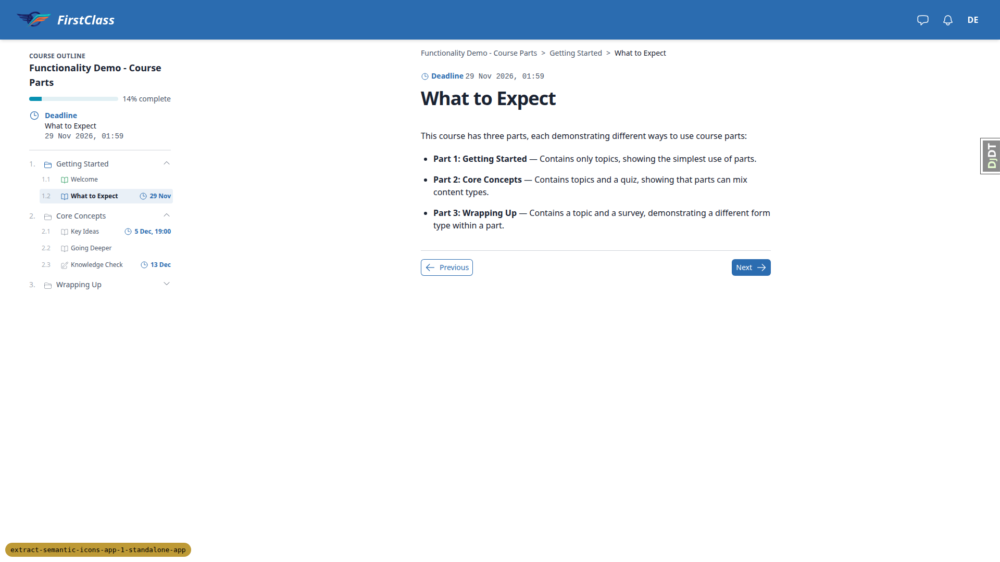 |

## General notes

- Not tested: `3-more-options` was skipped. No more_options (vertical ellipsis) control renders on any educator page with the demo data, so the plan's "more options menu" step could not run. The icon is only used by cotton dropdown-menu components not instanced on these pages.
- The mini variant check found no mini/micro variant in any template. The only non-outline variant is the header bell/messages (solid, size-6 at 24px, as intended).
- The educator learners pager is text buttons (1..6, Next) on desktop, with no arrow icons. On mobile the Previous/Next arrows draw at 20px.
- The first desktop home capture had the debug toolbar open (the prep check missed the position:fixed toolbar). It was retaken.
- Test 4 used the test-client DEBUG=False render of `404.html` because the dev server shows the technical 404.
- The course detail hero art icon is deliberately large (size-60, 240px), not a stretching bug.

status: ok · reason: 2 bugs, 1 fixed, 1 unresolved; report rendered, screenshots verified
