# QA report: semantic icons app, standalone

## Methodology

Screenshots were collected into `spec_dd/2. in progress/extract-semantic-icons-app-1-standalone-app/screenshots/`, and every image referenced below exists beside this report. The run did not abort at the smoke gate, so every step ran. Tests came from `3. frontend_qa.md`. Tests 1 and 3 ran at desktop, mobile and tablet. Test 2 ran at desktop and tablet. Test 4 ran at desktop only.

## Diff scoping

Class: **FULL**. The changed files that triggered it:

- `freedom_ls/icons/**` and `freedom_ls/icons/data/*.json`
- `config/settings_base.py`
- `package.json` and `package-lock.json`
- `pyproject.toml`
- `scripts/generate_icon_subset.py`
- the tests and test_organisation files

Nothing was skipped. Every pass ran.

## Smoke gate

Outcome: **pass**. Pages loaded: `/` and `/courses/functionality-demo-course-parts/1/`. No failure URL and no failure reason.

## Design check

No design states tested. No test has a design checklist.

## Layout probe

| Test id | Viewport | URL | Screenshot | Result |
|---|---|---|---|---|
| 1.1 | desktop | / | 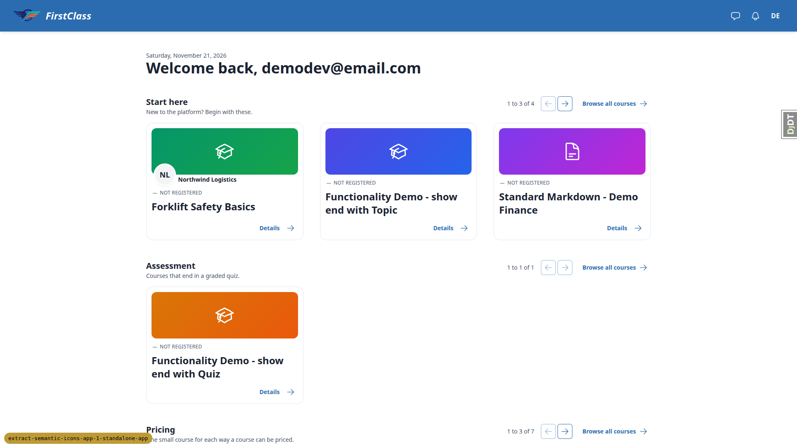 | clean |
| 1 | desktop | /courses/ | 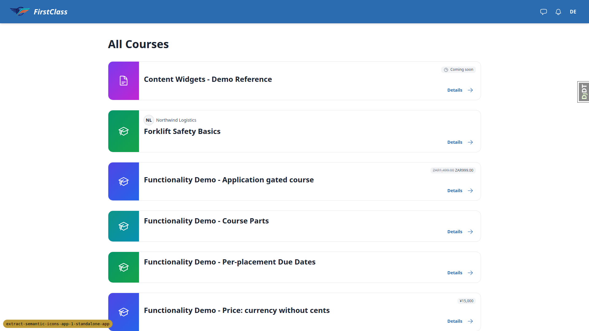 | clean |
| 1 | desktop | /courses/functionality-demo-course-parts/detail/ | 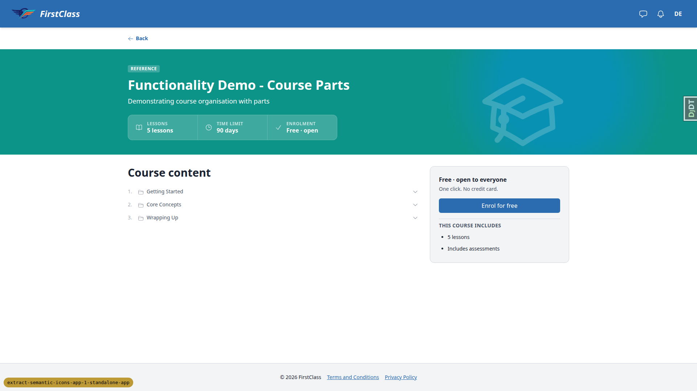 | clean |
| 1 | desktop | /courses/functionality-demo-course-parts/1/ | 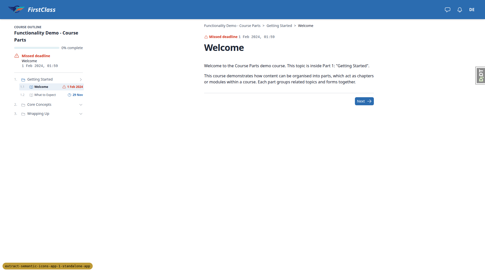 | clean |
| 1 | desktop | /courses/functionality-demo-course-parts/2/ | 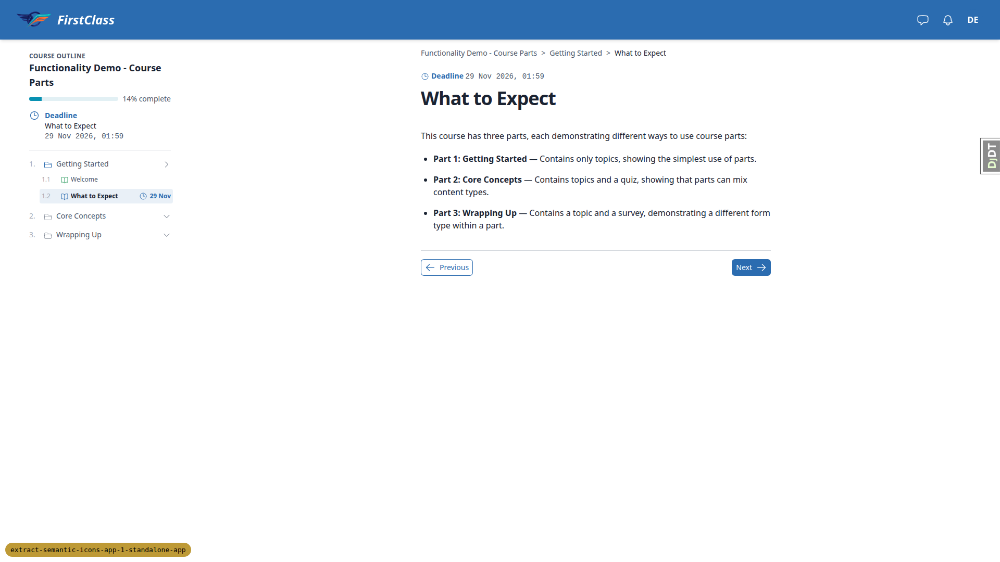 | clean |
| 3 | desktop | /educator/organisations/demodev/dashboard | 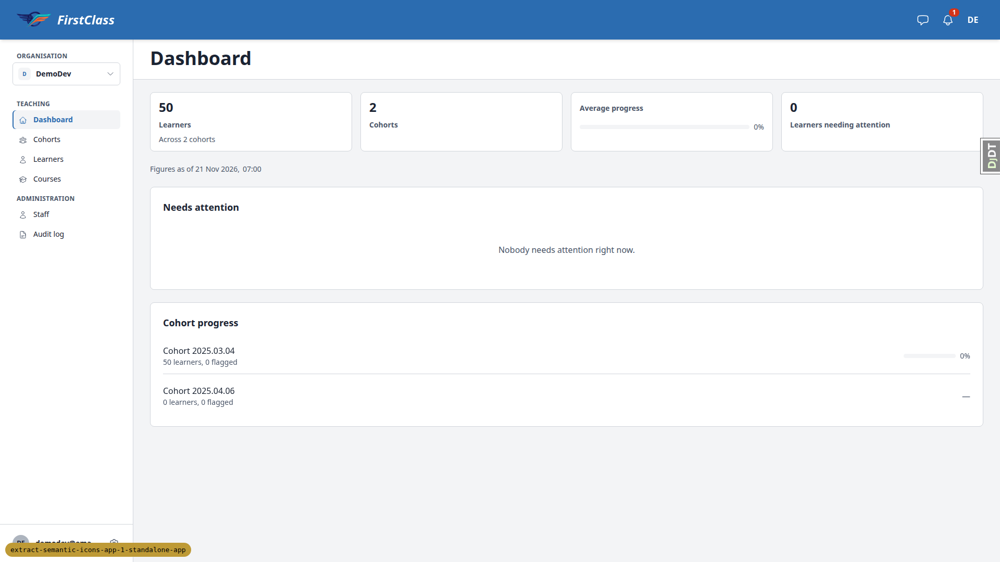 | clean |
| 3 | desktop | /educator/organisations/demodev/cohorts/684c05e9-cea4-4a75-89e7-ec7c2a7ab41c | 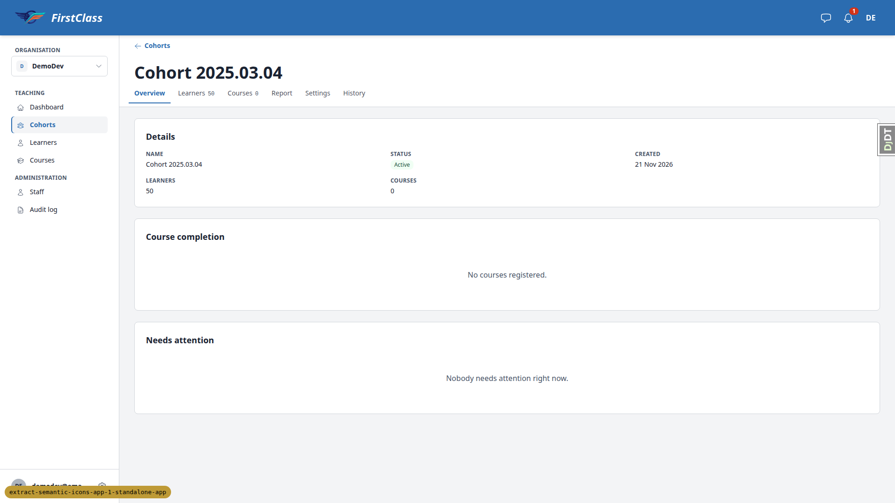 | clean |
| 3 | desktop | /educator/organisations/demodev/learners |  | clean |
| 3 | desktop | /educator/organisations/demodev/learners (quick view open) |  | clean |
| 3 | desktop | /educator/organisations/demodev/learners (Add filter open) | 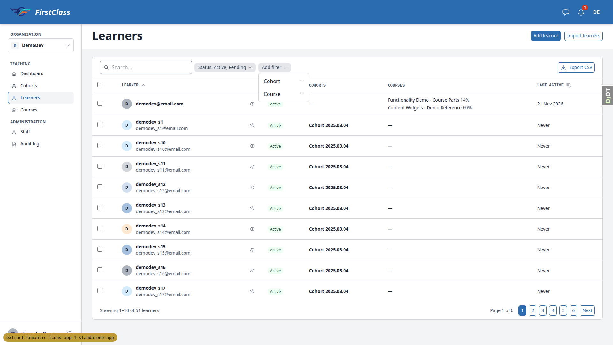 | clean |
| 3 | desktop | /educator/organisations/demodev/learners/4fedbe0b-f380-4864-989b-4bbea4f05e00 | 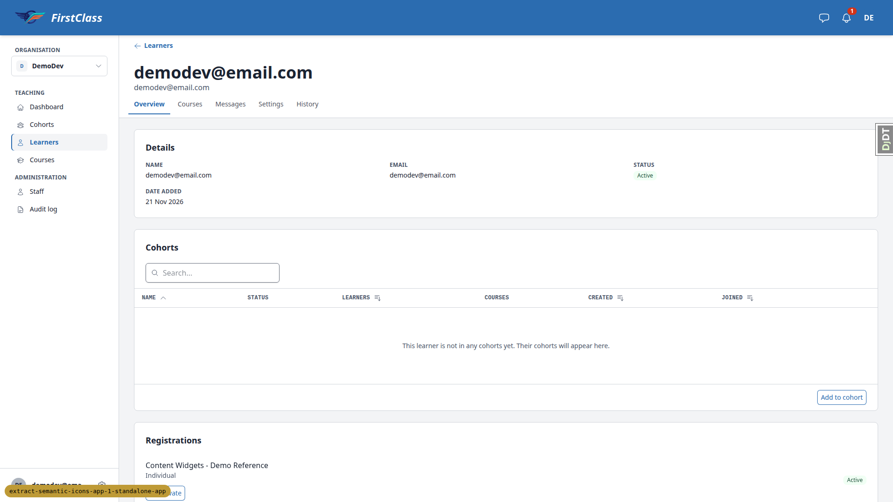 | clean |
| 2 | desktop | /courses/content-widgets-demo-reference/4/ (scrolled to Custom type: Regulation) | 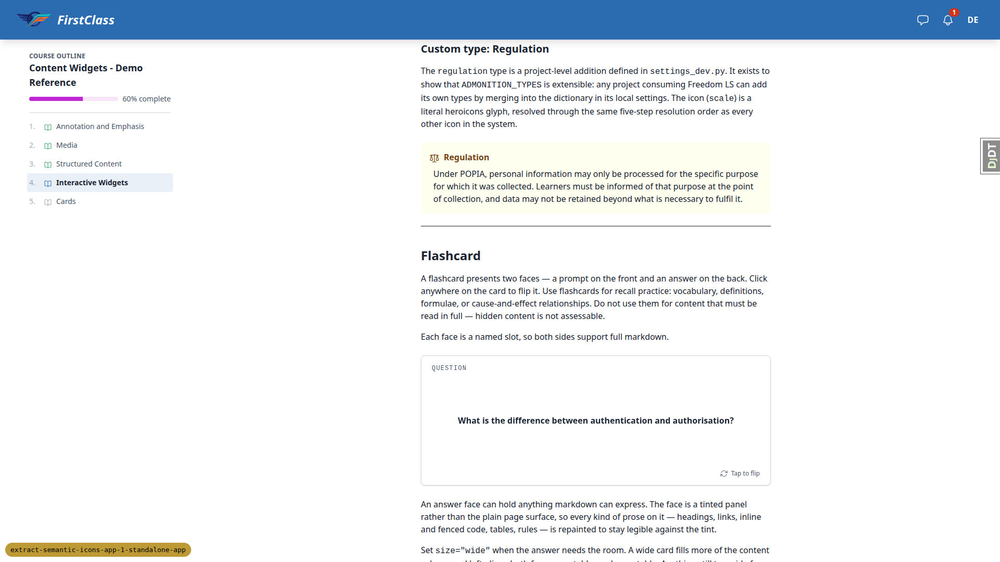 | clean |
| 4 | desktop | /this-page-does-not-exist/ | 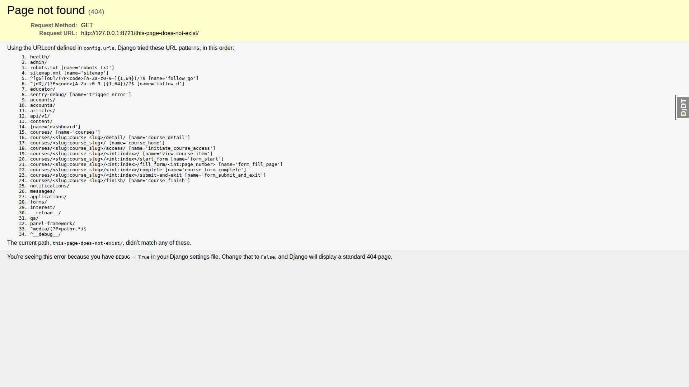 | clean |
| 1 | mobile | /courses/functionality-demo-course-parts/2/ | 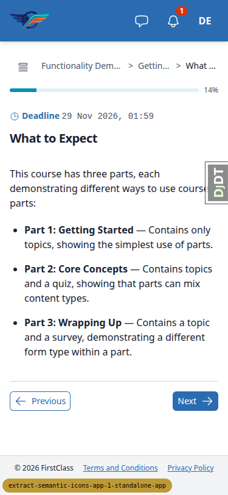 | clean |
| 1 | mobile | /courses/functionality-demo-course-parts/2/ (course outline sheet open) | 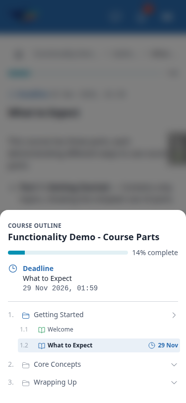 | flags: "stacked: sidebar ink spans x=0..375, more than half of the 375px viewport"; "overlap: content and sidebar ink intersect". Both come from the deliberately opened modal bottom sheet (`dialog.side-panel-dialog`) drawn over the blurred page, which is the intended mobile outline. With the sheet closed the same page has no flags. Not a defect. |
| 1 | mobile | / |  | clean |
| 3 | mobile | /educator/organisations/demodev/learners |  | clean |
| 2 | tablet | /courses/content-widgets-demo-reference/4/ |  | clean |
| 3 | tablet | /educator/organisations/demodev/learners | 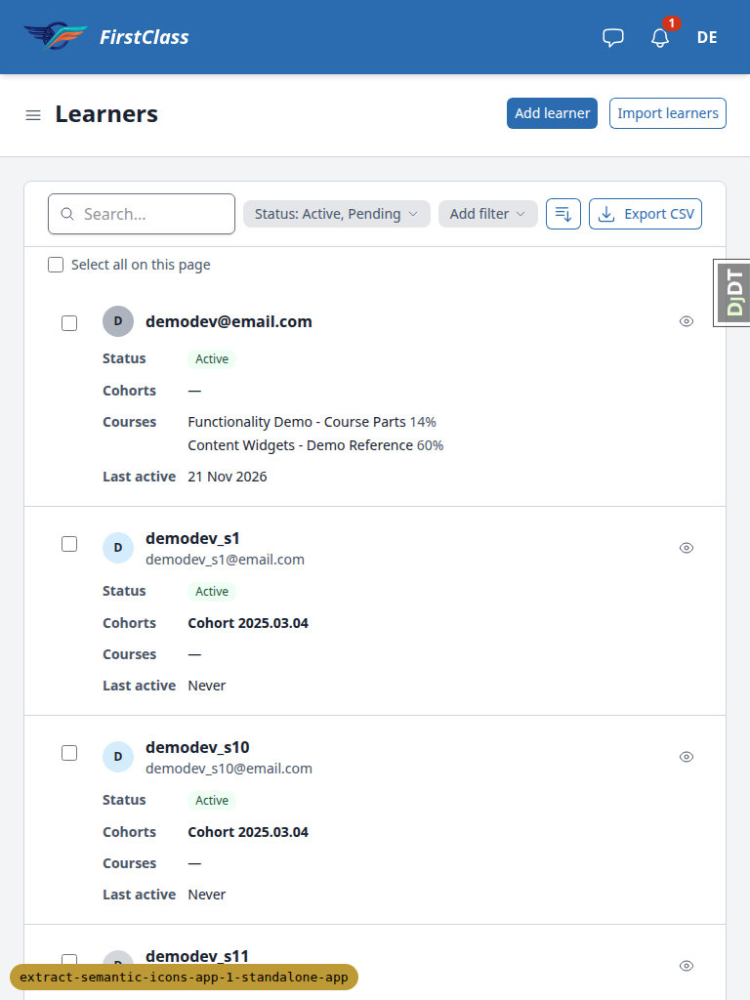 | clean |

## Test results

Every test passed.

| Test | Viewport | Result | Notes |
|---|---|---|---|
| 1 | desktop | pass | Home, course list, course detail and two topics: every visible SVG has drawn content (JS probe: 0 empty on every page). Sizes were 16/20/24 px inline, 36/48 px on course-card icons, and a 240 px decorative hero mark on course detail. Header message and bell, outline folder, chevron, topic and deadline markers, the missed-deadline warning, the completed-item marker and the previous/next arrows all draw. No horizontal scroll. demodev was enrolled in "Functionality Demo - Course Parts" through the UI's Enrol button. |
| 3 | desktop | pass | Dashboard, cohort list, cohort detail, learner list and learner page: 0 empty SVGs on every page. Sidebar nav icons, org dropdown chevron, search, filter chevrons, Export CSV download, sort asc/neutral, quick-view eye, the quick view's open-page/close/send icons and back arrows all draw. Quick view opens and closes, and the Add filter menu opens. Small variants draw at 12/16/20 px, none at an unexpected 24 px, none clipped. There is no "more options" (vertical ellipsis) row menu on these panel-framework pages, so that step had nothing to open. Pagination is numbered buttons plus a text "Next". |
| 2 | desktop | pass | The Regulation admonition shows the label "Regulation" with the heroicons `scale` glyph (`svg aria-label='scale'`, 1 drawn path, 20x20). That glyph is outside the bundled required glyphs and is served from `SEMANTIC_ICONS_ICONIFY_DIR`. It is not a fallback info icon and not blank. The other admonitions show info, star, warning and error icons. 0 empty SVGs on the page. The plan's `data-icon='scale'` check does not match how literal glyphs render: `backend.build_svg` writes `data-icon` only for a semantic name, and literal `set:glyph` icons carry `aria-label` instead. This branch did not change that behaviour. |
| 4 | desktop | pass | 404 Not Found, not 500. The dev server runs with DEBUG=True, so this is Django's technical 404 page, which carries no project icons. |
| 1 | mobile | pass | Home and topic page at 375x812: 0 empty SVGs, no horizontal scroll. The table-of-contents toggle shows its icon and opens the outline sheet with folder, topic, deadline and chevron icons. Header message and bell icons, previous/next arrows and course-card icons draw at normal sizes. |
| 3 | mobile | pass | Educator learner list at 375x812: hamburger menu, search, Filter, Sort, Export CSV download, quick-view eye and pager previous/next icons all draw at 16/20/24 px. 0 empty SVGs, no horizontal scroll. |
| 2 | tablet | pass | Interactive Widgets topic at 768x1024: outline toggle, note (info) and tip (star) admonition icons draw. The scale glyph (`svg aria-label='scale'`) is present. 0 empty SVGs, no horizontal scroll. |
| 3 | tablet | pass | Educator learner list at 768x1024: menu, search, filter chevrons, sort, Export CSV download and quick-view eye draw at 12/16/20/24 px. 0 empty SVGs, no horizontal scroll. |

## Data changes

| What changed | Made by | Files written |
|---|---|---|
| Empty branch dev DB seeded: `create_demo_data --yes`; `content_save demo_content DemoDev`; demodev@email.com granted site_admin, organisation_admin and staff member on demodev | seed (QA data helper) | none |
| demodev@email.com registered on "Content Widgets - Demo Reference" and items 0-2 marked complete so the Interactive Widgets topic opens. Created Learner 4fedbe0b, LearnerCourseRegistration 2b18c8a3 and 3 TopicProgress rows | `qa_register_org_course`, `qa_set_item_completion` | none |

## Bug status

No `bug` records. There are no bugs to track.

## General notes

- The dev database was empty at the start. The first page load returned a `Site.DoesNotExist` 500 before seeding. The data_change record above covers it, and it is not a product bug.
- `manage.py check` printed "System check identified no issues (0 silenced)", with no `icons.*` lines (no W002 to W004, no E002, no E008).
- The server log had no `KeyError` or `IconResolutionError`, and no 500 after seeding.
- Console errors were only that pre-seed 500, a missing `/favicon.ico` (404), and the deliberate 404 test URL.
- The test 2 plan check (`data-icon` naming `scale`) does not match how literal glyphs render, as the test 2 row explains. The `scale` icon renders correctly. The plan wording could be corrected to check `aria-label='scale'`.
- Test 3's "more options" (vertical ellipsis) step could not run because those pages have no such menu. The plan step may be stale.
- On mobile home, the collapsed django-debug-toolbar tab sits over the pager's right arrow. This is dev tooling in the state the configured screenshot prep leaves it, and no action is attached.
- The 404 page in test 4 is Django's DEBUG technical page, so it did not exercise project icons on an error page. A DEBUG=False run would be needed to test that.

status: ok · reason: report rendered, 0 bugs documented
