# Frontend QA report: extract_panels_framework-1-gather-generic-code

Desktop (1920x1080): 70 test records passed, 17 failed and 2 were skipped. Mobile (375x812): 9 passed, 2 failed and 0 were skipped. Tablet (768x1024): 3 passed, 1 failed and 0 were skipped. The failing tests come down to 16 distinct bugs.

## Methodology

The plan was walked by hand in a browser through Playwright MCP at 1920x1080 (desktop), 375x812 (mobile) and 768x1024 (tablet). The pages were served by a dev server on port 8070 on branch extract_panels_framework-1-gather-generic-code. Screenshots were collected into `screenshots/` beside this report, and every image referenced here exists there. A JavaScript-off session and a separate learner session were used for some tests; their screenshots have names ending `-001Z.png`.

## Diff scoping

Class: FULL. Trigger: 342 files changed against main; 147 of them are templates, static, .html, .css or .js under freedom_ls/panel_framework, freedom_ls/educator_interface, freedom_ls/base, freedom_ls/comms and tailwind.components.css. Nothing was skipped: desktop, mobile and tablet all ran.

## Smoke gate

Outcome: pass. Pages checked:

- `/`
- `/educator/organisations/demodev/dashboard`
- `/educator/organisations/demodev/learners`
- `/educator/organisations/demodev/cohorts`

## Design check

no design states tested

## Test results

### Desktop (1920x1080)

| Test | Status | Screenshot | Notes |
|---|---|---|---|
| 9.1 | pass | [page-2026-11-14T11-01-53-931Z.png](screenshots/page-2026-11-14T11-01-53-931Z.png) | Dashboard shows 5 skeleton placeholders first, then figures. Cohorts tile is one link; attention rows have a person link and a quick-view button that opens the quick view. No console errors. |
| 6.1 | pass | [page-2026-11-14T11-02-08-604Z.png](screenshots/page-2026-11-14T11-02-08-604Z.png) | Quick view opens beside the page (480px wide, page undimmed); close control is 44x44. |
| 6.2 | pass | — | Closing with the control returns focus to the 'Quick view: Aaron Abrahams' button that opened it. |
| 6.3 | pass | [page-2026-11-14T11-02-18-178Z.png](screenshots/page-2026-11-14T11-02-18-178Z.png) | Esc with a typed draft shows 'Discard your message?' / 'The message you wrote hasn't been sent.' with Keep editing (left, focused) and Discard (right, red). Keep editing returns the draft; Discard closes and focus returns to the trigger. |
| 11.1 | pass | [page-2026-11-14T11-03-08-016Z.png](screenshots/page-2026-11-14T11-03-08-016Z.png) | Cohort overview: Details panel shows Status as a badge and Created as '13 Nov 2026'; section headings one style. Settings tab staff list shows name with email under a named person (page-2026-11-14T11-03-23-343Z.png). |
| 1.1-1.4 | pass | [page-2026-11-14T11-03-44-354Z.png](screenshots/page-2026-11-14T11-03-44-354Z.png) | Deactivate (Settings tab) opens 'Deactivate QA cohort A?' with body paragraphs, 'Reason (optional):' field and help text, Cancel left (focused) and one Deactivate right. Body, label and help text all 14px. |
| 1.5 | pass | — | Footer Cancel with a typed reason closes at once, no discard prompt. |
| 1.6 | pass | [page-2026-11-14T11-04-01-436Z.png](screenshots/page-2026-11-14T11-04-01-436Z.png) | Header close with a typed reason shows 'Discard changes?' / 'The changes you made haven't been saved.' with Keep editing left and Discard right. Keep editing returns the typed reason; Esc shows the prompt again; Discard closes. |
| 1.6-focus | fail | — | After 'Keep editing' in the discard prompt of the reason dialog, document.activeElement is <body>: focus is not put back on a control inside the dialog (the field that was being edited). |
| 1.7 | pass | [page-2026-11-14T11-04-31-424Z.png](screenshots/page-2026-11-14T11-04-31-424Z.png) | Reason of 520 chars (maxlength removed) answers 422; dialog stays open with 'Ensure this value has at most 500 characters (it has 520).' on the field, aria-invalid set, focus on the field; cohort still active. |
| 1.8 | pass | [page-2026-11-14T11-04-44-625Z.png](screenshots/page-2026-11-14T11-04-44-625Z.png) | Submit shows 'Deactivating…' (single ellipsis character, button disabled), then the page shows the cohort Inactive with a header badge and a Reactivate action. |
| 1.9 | pass | [page-2026-11-14T11-05-01-407Z.png](screenshots/page-2026-11-14T11-05-01-407Z.png) | Cohort History lists 'Cohort deactivated' at the top; its details row holds 'Reason: QA test reason'. Table has sort headers and Add filter / Export CSV. |
| visual-dialog-rules | fail | [page-2026-11-14T11-03-44-354Z.png](screenshots/page-2026-11-14T11-03-44-354Z.png) | Panel-framework visual checklist: 'header and footer rules running the full width of the dialog'. The dialog is 512px wide (x 704-1216) with overflow-y: scroll and scrollbar-gutter: stable; its header and footer (and their rules) span x 705-1200, leaving a 16px blank strip at the right edge where no rule is drawn. Same on the discard prompt (page-2026-11-14T11-04-01-436Z.png). |
| visual-trigger-size | fail | [page-2026-11-14T11-03-23-343Z.png](screenshots/page-2026-11-14T11-03-23-343Z.png) | Panel-framework visual checklist: 'the triggers on one page are one size'. On the cohort Settings tab the primary small triggers (Save, Add staff member) are 32px tall and the secondary small triggers (Change role, Remove from cohort, Deactivate) are 34px tall. In dialog footers Cancel (secondary) is 42px and the primary confirm is 40px. The secondary button's border adds 2px. |
| 2.1 | pass | — | Reactivate on the inactive cohort: 'Reactivate QA cohort A?', no reason field, Cancel focused, one primary Reactivate; shows 'Reactivating…' then the cohort is active. |
| 3.2 | pass | [page-2026-11-14T11-05-57-679Z.png](screenshots/page-2026-11-14T11-05-57-679Z.png) | Stale Reactivate: dialog 'QA cohort A is already active' / 'Nothing changed. Someone else may have reactivated it already.' No form, no Cancel, one footer Close (focused). Close closes it. |
| 3.1 | pass | [page-2026-11-14T11-06-22-574Z.png](screenshots/page-2026-11-14T11-06-22-574Z.png) | Stale Deactivate: dialog 'QA cohort A is inactive' says 'The change was not made.' with one footer Close (focused), no form; page behind unchanged. |
| 3.1-copy | fail | [page-2026-11-14T11-06-22-574Z.png](screenshots/page-2026-11-14T11-06-22-574Z.png) | The refusal for deactivating an already-inactive cohort reads 'The change was not made. Reactivate the cohort from its Settings tab to deactivate it.' The second sentence tells the person to reactivate the cohort in order to deactivate it, which makes no sense for the change they asked for. The matching reactivate refusal reads 'Nothing changed. Someone else may have reactivated it already.' |
| 2.5 | pass | [page-2026-11-14T11-07-06-780Z.png](screenshots/page-2026-11-14T11-07-06-780Z.png) | Row 'Remove' on QA cohort A's learner list opens 'Remove Amy Achterberg from QA cohort A?' with reason field, Cancel focused and a red (btn-error) Remove. Cancel closes. The row trigger reads 'Remove' with aria-label 'Remove Amy Achterberg from QA cohort A'. |
| 5.1 | pass | [page-2026-11-14T11-07-17-202Z.png](screenshots/page-2026-11-14T11-07-17-202Z.png) | Row 'Move' opens a cohort picker; with nothing chosen Move is disabled and 'Choose a cohort to move them to.' is shown and named by aria-describedby. Choosing QA cohort B enables Move. |
| 5.1-footer | fail | [page-2026-11-14T11-07-17-202Z.png](screenshots/page-2026-11-14T11-07-17-202Z.png) | Move dialog footer: the disabled reason 'Choose a cohort to move them to.' wraps onto its own line above the Move button instead of sitting beside it, so the footer is two lines tall and Cancel no longer lines up with Move. The reason also renders larger than the dialog's 14px body text (rule: body text in a dialog is one size; a disabled confirm has its reason beside it). |
| 5.2 | pass | — | Stale move (learner removed from the cohort in a second tab): refusal 'Amy Achterberg is no longer in QA cohort A' / 'Nothing changed. …so they cannot be moved from it.' with one footer Close, focused, no form. |
| 2.4 | pass | [page-2026-11-14T11-08-06-391Z.png](screenshots/page-2026-11-14T11-08-06-391Z.png) | Learner Registrations panel: row Deactivate opens a dialog with a reason field and deactivates that row's registration; row Reactivate opens one with no reason field and reactivates that row. Each acted on the row it was opened from. |
| visual-registration-badge-column | fail | [page-2026-11-14T11-08-06-391Z.png](screenshots/page-2026-11-14T11-08-06-391Z.png) | Learner Registrations panel: on a row the viewer cannot act on (a registration via a cohort) the status badge sits at the far right where the other rows have their button, so the badges do not share a column. Checklist: 'A list of records in a panel has the same fields in the same places on every row' and 'A row the viewer cannot act on shows its fields and an empty buttons column'. |
| visual-list-rules | fail | [page-2026-11-14T11-08-06-391Z.png](screenshots/page-2026-11-14T11-08-06-391Z.png) | Brand visual checklist: 'no rule between list items, no box inside a box'. <c-panel-list> draws a rule between every row (Registrations, Course completion, Needs attention, the quick view's registrations), and the learner Courses panel draws each course as a bordered box inside the panel card (page-2026-11-14T11-10-34-601Z.png). The component's own comment says the list is 'divided by rules', so component and checklist disagree. Dividers of this kind exist on main too (dashboard_region.html), so this likely predates the branch. |
| 2.2 | pass | — | Learner Settings: Deactivate dialog has title, body, reason field, Cancel (focused) and one primary Deactivate; cancelled. On a deactivated learner Reactivate has title, body, Cancel and one Reactivate; confirming made the learner active again. |
| 3.3 | pass | [page-2026-11-14T11-09-04-560Z.png](screenshots/page-2026-11-14T11-09-04-560Z.png) | Stale learner Deactivate: 'Amy Achterberg was already changed' / 'Nothing changed. Someone else may have already used Deactivate on this learner.' One footer Close (focused), no form, no Cancel. |
| 2.3 | pass | — | Pending learner: 'Resend setup email' opens 'Resend the setup email to New Learner?' with Cancel and one primary confirm; confirming closes the dialog with no error (POST 204). |
| 3.5 | pass | — | Second resend straight after: 'Setup email sent recently' / 'New Learner was sent a setup email recently. Try again in 15 minutes.' with one footer Close, focused. |
| 11.7 | pass | [page-2026-11-14T11-09-20-768Z.png](screenshots/page-2026-11-14T11-09-20-768Z.png) | Empty states: a learner in no cohort shows a centred empty message inside the table; no registrations shows a centred empty message; a learner with no messages shows 'No messages with … yet.' |
| 11.2 | pass | [page-2026-11-14T11-10-34-601Z.png](screenshots/page-2026-11-14T11-10-34-601Z.png) | Learner page: details show status badge and date; Registrations are list rows with row actions; Courses panel shows the quiz attempts in a table with the shared header style (12px uppercase) and Failed as a badge (chip-error). |
| 5.6 | pass | [page-2026-11-14T11-11-13-040Z.png](screenshots/page-2026-11-14T11-11-13-040Z.png) | Messages tab: opening the other-educator conversation shows the thread in a dialog titled 'Conversation with Cora Cohortadmin' that ends in a footer with Close; closing returns focus to the row that opened it. |
| visual-embedded-conversation | fail | [page-2026-11-14T11-10-57-700Z.png](screenshots/page-2026-11-14T11-10-57-700Z.png) | The embedded conversation does not line up with its container. In the Messages panel the composer (label, textarea, hint, Send) starts at x=305 and ends at x=1870 while the panel's heading and padding run 313 to 1863, and a rule is drawn above it. In the conversation dialog (page-2026-11-14T11-11-13-040Z.png) the thread starts at x=721 while the title and Close start at x=729, and a second header 'CC Cora Cohortadmin' repeats the dialog title. Checklist: 'Content embedded in a panel shows no second header or rule, starts on the panel's left padding'. |
| visual-person-list-row | fail | [page-2026-11-14T11-03-23-343Z.png](screenshots/page-2026-11-14T11-03-23-343Z.png) | Checklist: 'a person in a list row has a small name and a small avatar centred on the name's first line'. In the cohort Settings staff list and the learner's 'Other educator conversations' list (page-2026-11-14T11-10-57-700Z.png) the name is base size, regular weight, with a 32px avatar centred on the two lines rather than a small semibold name with a small avatar on the first line. |
| 5.7 | pass | [page-2026-11-14T11-11-53-363Z.png](screenshots/page-2026-11-14T11-11-53-363Z.png) | Add to cohort on a learner page: form dialog with a cohort select; changing the select re-renders with no error (title becomes 'Add Amy Achterberg to QA cohort A?'); an empty submit (browser 'required' removed) answers 422 with an error summary '1 field to fix.' that takes focus; choosing QA cohort A and submitting adds the learner. |
| 5.7-inactive-option | fail | [page-2026-11-14T11-11-53-363Z.png](screenshots/page-2026-11-14T11-11-53-363Z.png) | Add to cohort dialog on a learner page: the cohort select lists only active cohorts when the dialog opens and after a picker change, but the 422 re-render after an invalid submit also lists 'QA cohort inactive'. The invalid-submit form offers an inactive cohort the first render hides. |
| 3.4 | pass | [page-2026-11-14T11-12-47-935Z.png](screenshots/page-2026-11-14T11-12-47-935Z.png) | Staged with a setup link from the data helper: resend dialog opened on pending Penny Pending, her password set in a separate browser session, then submitted. Refusal 'Penny Pending has already set up their account' / 'Nothing was sent. …' with one footer Close, focused. |
| 2.6 | pass | [page-2026-11-14T11-13-01-068Z.png](screenshots/page-2026-11-14T11-13-01-068Z.png) | Staff page: 'Deactivate staff member' and 'Deactivate role' for Cora each open a confirm dialog with a reason field, Cancel focused and a primary Deactivate; both cancelled. |
| 2.7 | pass | — | Across the dialogs opened: Deactivate and Reactivate confirms are btn-primary, Remove is btn-error, loading texts seen ('Deactivating…', 'Reactivating…') end in the single ellipsis character. |
| 3.6 | pass | — | The QA user is a site admin, so the staff page offers no self-deactivate and allows deactivating its own last admin role with a warning rather than refusing (not confirmed, to keep the QA login intact). A staff refusal was staged instead with a stale tab (Cora deactivated in a second tab): 'This is no longer available' / 'It may have been removed, or you may no longer have access to it.' with Close in the footer, not the body, and no form. |
| 5.3 | pass | [page-2026-11-14T11-14-01-007Z.png](screenshots/page-2026-11-14T11-14-01-007Z.png) | Add staff member: empty email answers 422 with an error summary '1 field to fix.' at the top that takes focus. Entering Cora's email and Next shows the role step with a searchable cohort checklist. Footer Cancel after choosing a role closes with no discard prompt. |
| 5.4 | pass | [page-2026-11-14T11-14-18-669Z.png](screenshots/page-2026-11-14T11-14-18-669Z.png) | Change cohorts on Cora's cohort-limited role shows the same searchable cohort checklist as the add-staff role step. Submitting unchanged gives the refusal 'This change wasn't made' / 'Nothing changed. Tick or untick a cohort first.' with Close. |
| 5.5 | pass | [page-2026-11-14T11-15-18-989Z.png](screenshots/page-2026-11-14T11-15-18-989Z.png) | Add learner with a new email shows the result dialog 'Learner added' / 'Account created and setup email sent.' with a footer holding Close and Add another; no button group. |
| 11.6 | pass | [page-2026-11-14T11-15-18-989Z.png](screenshots/page-2026-11-14T11-15-18-989Z.png) | With search 'qa.a' applied, adding a learner refreshed the table by itself (3 rows became 4, no navigation) and kept the search and the Status filter in the URL. |
| 7.1 | pass | [page-2026-11-14T11-15-39-210Z.png](screenshots/page-2026-11-14T11-15-39-210Z.png) | Ticking 3 learners replaces the toolbar with the selection bar (3 selected, Select all 179, Add to cohort, Deactivate, Reactivate, Register for a course, More, Clear). Deactivate opens 'Deactivate 3 learners?' with the sentence, Cancel (focused) and Deactivate. Cancelled. |
| 7.2 | pass | [page-2026-11-14T11-15-59-026Z.png](screenshots/page-2026-11-14T11-15-59-026Z.png) | One pending and one set-up learner, More > Resend setup email: 'Resend the setup email to 1 learner.' and '1 learner is already set up and will be skipped.' Confirming shows a result dialog ('1 learner changed.' / '1 learner already set up.') with a Close button (page-2026-11-14T11-16-09-360Z.png). |
| 7.3 | pass | [page-2026-11-14T11-16-27-918Z.png](screenshots/page-2026-11-14T11-16-27-918Z.png) | Only set-up learners selected: the confirm button is disabled and the reason 'Nothing to change: all 2 selected learners will be skipped.' is shown and named by aria-describedby (bulk-confirm-reason). |
| 7.3-footer | fail | [page-2026-11-14T11-16-27-918Z.png](screenshots/page-2026-11-14T11-16-27-918Z.png) | Same footer fault as the Move dialog: the disabled reason is 16px while the dialog body is 14px, and it sits on two lines above the confirm button (reason y 573-621, button y 633-673) rather than beside it, so Cancel floats between the two lines. |
| 7.8 | pass | — | Bulk Add to cohort with no cohort chosen: 'Add to cohort' is disabled with 'Choose a cohort first.' named by aria-describedby. Choosing a cohort removes the line and enables the button (title becomes 'Add 2 learners to QA cohort empty?'). Cancelled. |
| 7.6 | pass | [page-2026-11-14T11-17-09-802Z.png](screenshots/page-2026-11-14T11-17-09-802Z.png) | Select all 179, More > Resend setup email: button reads 'Sending…', run finishes with a result ('28 learners changed.' / '148 learners already set up.' / '3 setup emails were sent recently.') and Close. No notification was raised for this run: 179 rows is under BULK_BACKGROUND_THRESHOLD (default 250), so the run was inline and only a background run notifies. The notification half is re-tested as 7.6-background once the data helper has added learners past the threshold. |
| 8.1 | pass | [page-2026-11-14T11-19-47-942Z.png](screenshots/page-2026-11-14T11-19-47-942Z.png) | Cohorts table hides inactive cohorts by default. Add filter > Show inactive adds cohorts-inactive=1 to the URL and shows 'QA cohort inactive'; removing the chip drops the parameter and the row. |
| 8.4 | pass | [page-2026-11-14T11-19-47-942Z.png](screenshots/page-2026-11-14T11-19-47-942Z.png) | With a filter applied the toolbar shows an applied-filter chip ('Show inactive ×') that removes the filter when clicked, plus Clear all; search field, Add filter, sort headers (and Export CSV on the learners and History tables) sit in their usual places. |
| 11.4 | pass | [page-2026-11-14T11-19-32-345Z.png](screenshots/page-2026-11-14T11-19-32-345Z.png) | Cohorts table: courses column is a list, learner count filled, '—' where a cohort has no courses. The table has a Created column and no last-active column; last-active is on the learners table, where it is filled ('Never' or a date). |
| 7.7 | pass | — | Two cohorts ticked: bar shows Register for a course, Deactivate a course registration, Deactivate, Reactivate. That is the registration order of the classes on main (RegisterCohortForCourse, DeactivateCohortRegistration, DeactivateCohorts, ReactivateCohorts), which the spec says the bar keeps, so the order is unchanged. The QA plan lists a different order (Deactivate, Reactivate, Register, Deactivate a course registration); the plan's list is what is wrong. |
| 7.6-background | pass | [page-2026-11-14T11-21-36-799Z.png](screenshots/page-2026-11-14T11-21-36-799Z.png) | Select all 269, Resend setup email: the confirm says 'It runs in the background. You'll get a notification when it finishes.', the run finishes with '90 learners changed. / 148 learners already set up. / 31 setup emails were sent recently.', and the notification panel lists 'Resend setup email finished: 90 learners changed, 179 skipped.' (read, since the result was shown). |
| 4.1 | pass | — | Empty cohort: Delete opens 'Delete QA cohort empty?' saying it cannot be undone, with a reason field, Cancel focused and one red Delete. |
| 4.2 | pass | [page-2026-11-14T11-03-23-343Z.png](screenshots/page-2026-11-14T11-03-23-343Z.png) | QA cohort A (not empty) has no Delete action; its Status panel explains it can't be deleted while it has learners and registrations. |
| 4.3 | pass | [page-2026-11-14T11-22-02-237Z.png](screenshots/page-2026-11-14T11-22-02-237Z.png) | Stale delete (learner added in a second tab): 422, dialog stays open with an error box 'QA cohort empty can't be deleted while it has 1 learner…' that has focus, no Delete button, cohort still there. |
| 4.4 | pass | — | After removing the learner, Delete shows 'Deleting…' then lands on the cohorts list without the cohort. The emptied cohort's learner table showed 'This cohort has no learners yet. Learners you add to it will appear here.' |
| 8.2 | pass | [page-2026-11-14T11-22-43-814Z.png](screenshots/page-2026-11-14T11-22-43-814Z.png) | Audit log: Add filter > When offers Today, Last 7 days, Last 30 days, Last 90 days, Last 12 months. 'Last 7 days' sets audit_log-when=7d, shows a 'When: Last 7 days' chip and 362 of 364 entries; the oldest entry under the filter is 13 Nov 2026 (the two older entries, 14 Oct and 3 Nov, are excluded). |
| 8.3 | pass | — | audit_log-when=bogus answers 200 with the full list (364 entries) and no chip. |
| 9.2 | pass | [page-2026-11-14T11-23-54-089Z.png](screenshots/page-2026-11-14T11-23-54-089Z.png) | Cohort Report tab: two skeleton placeholders first, then the body. Tables share the data-table header style (12px uppercase mono), section headings are one style (18px semibold), statuses are badges. |
| 9.3 | pass | [page-2026-11-14T11-24-16-576Z.png](screenshots/page-2026-11-14T11-24-16-576Z.png) | Generate report shows 'Generating…' then lists the new file in the downloads table (same header style). A cohort with no downloads reads 'No reports yet.' as a compact empty state. |
| 9.4 | pass | [page-2026-11-14T11-25-00-001Z.png](screenshots/page-2026-11-14T11-25-00-001Z.png) | JavaScript off: the Report tab shows a 'Load the figures' link where the body would be; following it renders the body (4 tables). |
| 7.5 | pass | [page-2026-11-14T11-25-40-001Z.png](screenshots/page-2026-11-14T11-25-40-001Z.png) | JavaScript off: ticking 2 learners and submitting Deactivate from the bar's fallback renders the learners page with 'Deactivate 2 learners?' open over it as a modal; Close and Cancel are links to /learners?learners-q=audit.bulk (same query string). |
| visual-nojs-navigation | fail | [page-2026-11-14T11-25-30-001Z.png](screenshots/page-2026-11-14T11-25-30-001Z.png) | With JavaScript off the educator pages have no navigation at all at 1920: the sidebar lives in dialog.side-panel-dialog, which only Alpine opens, so the content takes the full width and there is no link to Dashboard, Cohorts, Staff or the audit log. The dialog-based sidebar is on main too (_base_interface.html), so this predates the branch. |
| 7.4 | skip | — | Not staged: no selection in this run produced a selection-changed notice. The plan words this step as conditional ('If a selection produces a notice'). |
| 9.5 | skip | — | Not run: no cohort exceeds the report limit and lowering the limit means restarting the server with a changed setting. The plan words this step as conditional. |
| 10.1 | pass | [page-2026-11-14T11-25-08-588Z.png](screenshots/page-2026-11-14T11-25-08-588Z.png) | Import upload page: the File format table uses the shared table header style; 'Upload and preview' and 'Download template' are the small size. |
| 10.2 | pass | [page-2026-11-14T11-25-32-148Z.png](screenshots/page-2026-11-14T11-25-32-148Z.png) | A file with headers 'mail,name' answers 422 with a red notice, role=alert: 'The file could not be uploaded. Unknown column(s): mail, name. Missing required column(s): email. …' |
| 10.3 | pass | [page-2026-11-14T11-25-50-604Z.png](screenshots/page-2026-11-14T11-25-50-604Z.png) | 30-row file with 2 bad rows: preview shows stat tiles (New account 28, Error 2) that filter the rows (?label=error) and mark the chosen tile aria-current; row statuses are badges; the Rows table uses the shared style. The preview pages at 50 rows, so a 30-row file shows no pager; a 60-row file was uploaded separately to see the pager (10.3-pager). |
| 10.3-footer | fail | [page-2026-11-14T11-25-50-604Z.png](screenshots/page-2026-11-14T11-25-50-604Z.png) | Import preview Rows table on a single page (28 rows) has no footer at all: no entry count under the table. Checklist: 'The table footer states the entry count at the left, in line with the pager, on a single-page table too'. The 28 rows also grow the page rather than scrolling in a capped region. |
| 10.4 | pass | [page-2026-11-14T11-25-50-604Z.png](screenshots/page-2026-11-14T11-25-50-604Z.png) | Error rows are a table in the shared style inside an amber warning notice (border-warning/bg-warning, no role=alert) headed '2 rows with errors will not be added.' |
| 10.5 | pass | [page-2026-11-14T11-26-25-988Z.png](screenshots/page-2026-11-14T11-26-25-988Z.png) | Confirming adds 28 learners and shows the result page: 'Added 28 learners. 2 rows were not added.', outcomes as list rows (New account 28, Error 2), and small action buttons (Download errors, Import another file, Back to learners). |
| 10.5-clock | fail | [page-2026-11-14T11-26-25-988Z.png](screenshots/page-2026-11-14T11-26-25-988Z.png) | The import result reads 'completed 14 Nov 2026, 13:26' while every other time on the educator pages at that moment read 11:2x (audit log 'Cohort deleted 14 Nov 2026, 11:22', report 'Figures as of 14 Nov 2026, 11:24'). The result page uses  (the browser's zone, UTC+2 here) and the tables render server time (TIME_ZONE UTC), so one product shows two clocks two hours apart. The same template line is on main. |
| visual-focus-box | fail | [page-2026-11-14T11-26-25-988Z.png](screenshots/page-2026-11-14T11-26-25-988Z.png) | The import result's heading takes focus on load and is drawn inside a heavy black focus rectangle the width of the card; the upload error notice does the same (page-2026-11-14T11-25-32-148Z.png). It reads as a boxed input rather than a heading or notice. |
| 10.3-pager | pass | [page-2026-11-14T11-27-55-436Z.png](screenshots/page-2026-11-14T11-27-55-436Z.png) | A 60-row file previews 50 rows with the shared pager under the table ('Page 1 of 2', 1, 2, Next, Last). Not confirmed, so nothing was added. |
| 11.5 | pass | [page-2026-11-14T11-28-15-918Z.png](screenshots/page-2026-11-14T11-28-15-918Z.png) | Audit log: expanding a row shows a label/value list (dl: 'Description QA cohort empty'). The entry by deleted user 'Gwen Gone' shows a grey user-icon fallback in place of the initials avatar. |
| 11.3 | pass | [page-2026-11-14T11-28-32-815Z.png](screenshots/page-2026-11-14T11-28-32-815Z.png) | Saving a new cohort name updates the browser title and the page header with no navigation. An empty name (browser 'required' removed) answers 422 and the cohort keeps its name. |
| 11.3-error-notice | fail | [page-2026-11-14T11-28-32-815Z.png](screenshots/page-2026-11-14T11-28-32-815Z.png) | The QA plan expects an error notice for an empty cohort name. The page shows plain red text under the field, 'Name: This field is required.' (a 
 with no role and no notice box), and it repeats the field's label. The learner Settings name form is the sibling to compare. |
| 12.6 | pass | [page-2026-11-14T11-28-53-390Z.png](screenshots/page-2026-11-14T11-28-53-390Z.png) | Component reference at /panel-framework/components/ shows a notice in each tone (info, warning, error with role=alert, success with role=status), static tables, list rows and the section heading. |
| 13.3 | pass | — | Keyboard: in the cohort Deactivate confirm, Tab cycles Cancel, Deactivate, Close, reason and never lands on a page control; Esc closes and focus returns to the Deactivate trigger. Same in the Add staff member form dialog (Close, email, Cancel, Next), returning to its trigger. |
| 13.3-second-escape | fail | — | Dirty dialog (cohort Deactivate with a typed reason): Esc shows 'Discard changes?'; choose Keep editing (click or Enter); press Esc again and the dialog closes at once with no prompt, dropping the typed reason. Reproduced 4 of 4 times, including after typing another character. The prompt only shows again if the first prompt was opened from the header close button. |
| 13.1 | pass | — | Swept 18 educator URLs (dashboard, learners, cohorts, staff, audit log, courses, import, every cohort tab, learner tabs): all 200, no literal <c-…> tag, no raw {{ }} or , no layout flags, no console errors apart from the expected 422 network lines. |
| 13.2 | pass | — | Every dialog opened in this run (cohort and learner state changes, registration row actions, remove, move, add to cohort, add learner, add staff member, change cohorts, staff and role deactivate, resend, bulk confirms and results, refusals, conversation, delete) had one header with a close control, a body and exactly one footer. |
| 12.2 | pass | [page-2026-11-14T11-01-53-931Z.png](screenshots/page-2026-11-14T11-01-53-931Z.png) | At 1920 the sidebar is docked as a 256px column on every page and stays docked after reloads. There is no collapse control at this width, so there is no collapsed state to remember. |
| 12.3 | pass | — | The header messages button shows its count ('Messages, 1 unread'). After the learner replied from another session, the educator's count went from 1 to 2 within 40 seconds with no reload. The learner's own count did the same (none to 1 in 40 seconds) when the educator messaged them. |
| 12.4 | pass | [page-2026-11-14T11-31-20-001Z.png](screenshots/page-2026-11-14T11-31-20-001Z.png) | Learner (qa.alice) at 1920: course outline docked as a left column; messages button opens its panel (conversation with Cora, New message, See all messages); notification bell opens its panel. No console errors. |
| 12.5 | pass | [page-2026-11-14T11-34-00-001Z.png](screenshots/page-2026-11-14T11-34-00-001Z.png) | Learner topic pages and the form item (Course Feedback Survey start page) render as before with no console errors and no raw template text. The course has no item of type activity; the form is the closest. |

### Mobile (375x812)

| Test | Status | Screenshot | Notes |
|---|---|---|---|
| 12.4 | pass | [page-2026-11-14T11-35-10-001Z.png](screenshots/page-2026-11-14T11-35-10-001Z.png) | Learner at 375: the 'Open course outline' toggle (44x48) opens the outline as a bottom sheet; it closes on a tap outside and on Esc. The sheet has no close control of its own, as on main. Header buttons are 44x44; no sideways scroll; messages panel fits (page-2026-11-14T11-35-20-001Z.png). |
| 12.1 | pass | [page-2026-11-14T11-37-14-508Z.png](screenshots/page-2026-11-14T11-37-14-508Z.png) | At 375 the header's menu button (44x48) opens the navigation as a sheet with a close control (44x48). It closes with the control and with Esc, and following its Cohorts link closes it and loads the page. |
| 8.5 | pass | [page-2026-11-14T11-37-39-998Z.png](screenshots/page-2026-11-14T11-37-39-998Z.png) | At 375 the toolbar's Filter button opens a bottom sheet with a header, Reset, a close control, the filter fields and a Cancel / Show results footer. At 1920 the sheet never showed. |
| 1.10 | pass | [page-2026-11-14T11-38-03-151Z.png](screenshots/page-2026-11-14T11-38-03-151Z.png) | At 375 the Deactivate dialog is a bottom sheet (rounded top corners) with the same title, body, reason field and help text; Cancel focused; footer in view (y 735-812 of 812); close control 44x44; body and label both 14px; no sideways scroll. |
| visual-dialog-rules | fail | [page-2026-11-14T11-38-03-151Z.png](screenshots/page-2026-11-14T11-38-03-151Z.png) | Same scrollbar-gutter fault at 375: the sheet's header and footer rules stop 16px short of the right edge, and the content has 24px of padding on the left but 40px on the right (field and Deactivate end at x=335 of 375). |
| 11.8 | pass | [page-2026-11-14T11-37-51-939Z.png](screenshots/page-2026-11-14T11-37-51-939Z.png) | Cohort page (Settings tab) and learner page at 375: no sideways scroll, and no button under 44px tall. |
| 6.4 | pass | [page-2026-11-14T11-38-57-891Z.png](screenshots/page-2026-11-14T11-38-57-891Z.png) | At 375 the learner quick view opens as a full-width sheet with rounded top corners, a 44x44 close control in reach, the page behind undimmed and no sideways scroll. |
| 7.1 | pass | [page-2026-11-14T11-39-09-532Z.png](screenshots/page-2026-11-14T11-39-09-532Z.png) | At 375 the selection bar takes the toolbar's place above the cards, stays inside the viewport and every action is 44px tall. It wraps to five rows (305px) and is sticky. |
| 9.6 | pass | [page-2026-11-14T11-39-40-001Z.png](screenshots/page-2026-11-14T11-39-40-001Z.png) | At 375 the report tables scroll inside their own regions (overflow-x auto) and the page has no sideways scroll. |
| 9.6-squeezed | fail | [page-2026-11-14T11-39-40-001Z.png](screenshots/page-2026-11-14T11-39-40-001Z.png) | Cohort report at 375: in the three progress tables the learner column shows the avatar and only the first letter of the name ('A', 'A', 'A', 'P'), so three of four rows read 'AA A' and learners cannot be told apart; the 'Not started' badge wraps onto two lines; in the Downloads table the Download button is cut off at the right edge, behind the region's sideways scroll. Checklist: 'no region is squeezed, clipped or cut off' and 'no button cut off or behind a sideways scroll'. |
| 10.3 | pass | [page-2026-11-14T11-39-45-535Z.png](screenshots/page-2026-11-14T11-39-45-535Z.png) | Import preview at 375 renders the rows as cards (email, Line, Label, Name) with the table hidden; no sideways scroll; buttons 44px. |

### Tablet (768x1024)

| Test | Status | Screenshot | Notes |
|---|---|---|---|
| 12.1 | pass | [page-2026-11-14T11-41-30-001Z.png](screenshots/page-2026-11-14T11-41-30-001Z.png) | At 768 the tablet gets the phone navigation: a menu button opens the navigation as a full-width bottom sheet with a close control; Esc closes it. No sideways scroll. |
| 13.1 | pass | [page-2026-11-14T11-40-19-665Z.png](screenshots/page-2026-11-14T11-40-19-665Z.png) | Learners table at 768: toolbar is one row (search, Status chip, Add filter, Export CSV), page header buttons fit, no sideways scroll. |
| 2.6 | pass | [page-2026-11-14T11-40-50-001Z.png](screenshots/page-2026-11-14T11-40-50-001Z.png) | Staff table at 768 renders as cards with every action button in view; the Add staff member dialog is 512px wide and centred (page-2026-11-14T11-41-00-001Z.png). |
| visual-tablet-table-squeeze | fail | [page-2026-11-14T11-40-40-001Z.png](screenshots/page-2026-11-14T11-40-40-001Z.png) | At 768 the cohort's Learners table, which has an action column (Remove, Move), stays a table instead of cards, and its learner cell is clipped to 'A..' over 'q...', so no learner can be identified. The organisation learners table at 768 clips names to 'Aar…', 'Alic…' (page-2026-11-14T11-40-19-665Z.png). Checklist: 'A table with action columns is cards at 768' and 'no region is squeezed, clipped or cut off'. |

## Bugs

### B1: Discard prompt: Keep editing drops focus and the next Esc closes the dialog without asking

Manifestations:

- 1.6-focus (desktop)
- 13.3-second-escape (desktop)

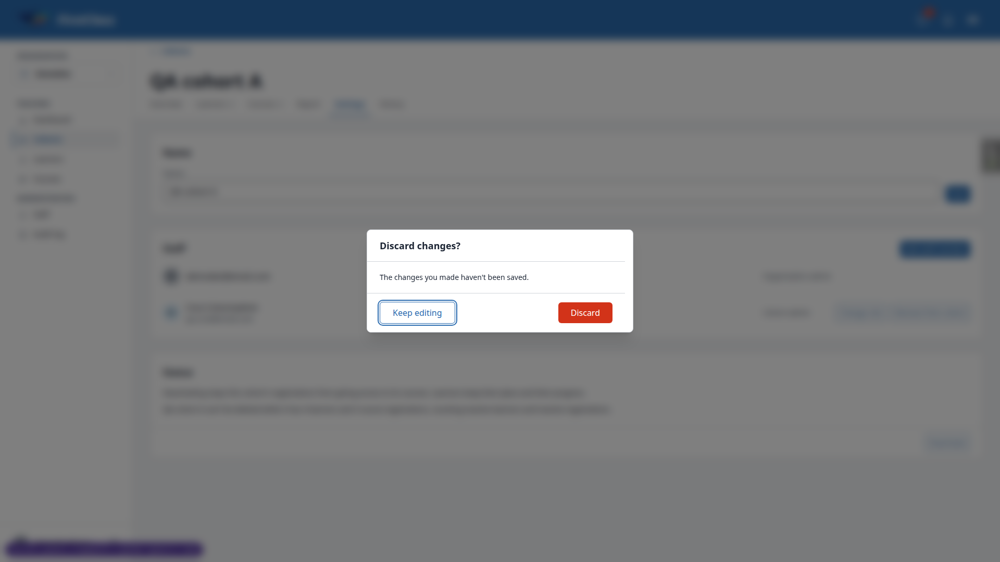

Expected: After 'Keep editing' focus returns to a control inside the dialog, and every Esc on a dialog with unsaved input shows 'Discard changes?' again.

Actual: After 'Keep editing' document.activeElement is <body>. Pressing Esc again closes the dialog at once with no prompt and the typed text is lost (4 of 4 attempts on the cohort Deactivate dialog).

### B2: Add to cohort dialog offers an inactive cohort after a validation error

Manifestations:

- 5.7-inactive-option (desktop)

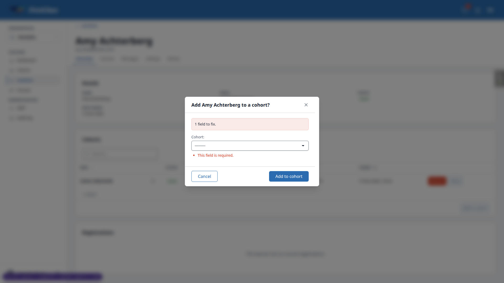

Expected: The cohort select on a learner's Add to cohort dialog lists the same cohorts on every render: active ones only.

Actual: The 422 re-render after an invalid submit also lists 'QA cohort inactive', which the first render and the picker-change re-render leave out.

### B3: Dialog header and footer rules stop 16px short of the right edge

Manifestations:

- visual-dialog-rules (desktop)
- visual-dialog-rules (mobile)

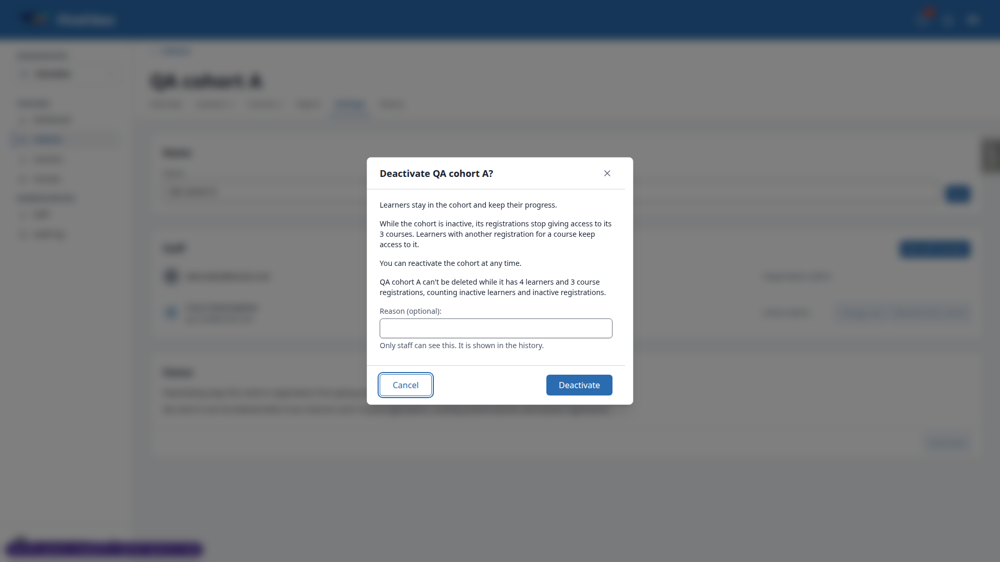
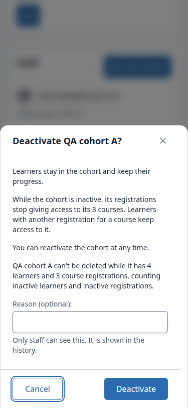

Expected: A dialog's header and footer rules run the full width of the dialog and its content has equal padding left and right.

Actual: The modal dialog has overflow-y: scroll with scrollbar-gutter: stable, so header, footer and their rules span x 705-1200 of a 704-1216 dialog; at 375 the content has 24px padding on the left and 40px on the right.

### B4: A disabled confirm's reason is larger than the dialog text and sits above the button

Manifestations:

- 5.1-footer (desktop)
- 7.3-footer (desktop)

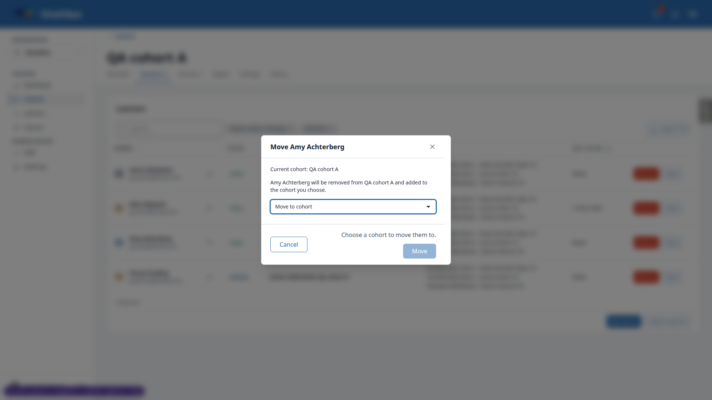
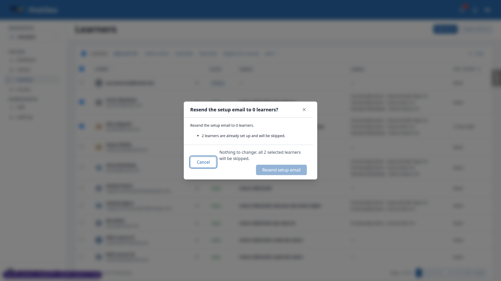

Expected: The reason sits beside the disabled confirm at the dialog's text size, with Cancel and the confirm on one line.

Actual: The reason is 16px against 14px body text and wraps to its own line(s) above the confirm, making the footer two or three lines tall with Cancel floating between them. A 512px dialog has no room for Cancel, a sentence and the confirm on one line.

### B5: Secondary buttons are 2px taller than primary ones

Manifestations:

- visual-trigger-size (desktop)

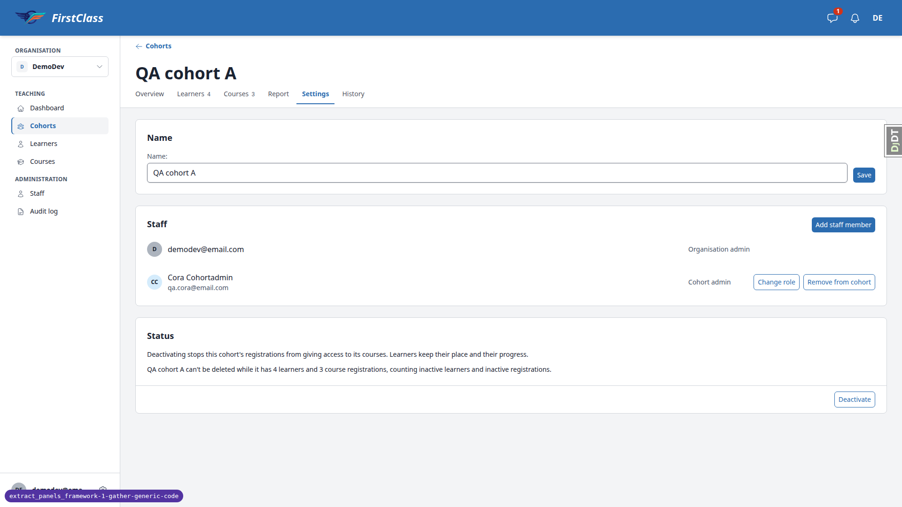

Expected: The triggers on one page are one size.

Actual: Small primary and error buttons are 32px tall, small secondary buttons 34px; in dialog footers the primary confirm is 40px and Cancel 42px. The secondary button's border adds the 2px.

### B6: Refusal for deactivating an inactive cohort tells the person to reactivate it in order to deactivate it

Manifestations:

- 3.1-copy (desktop)

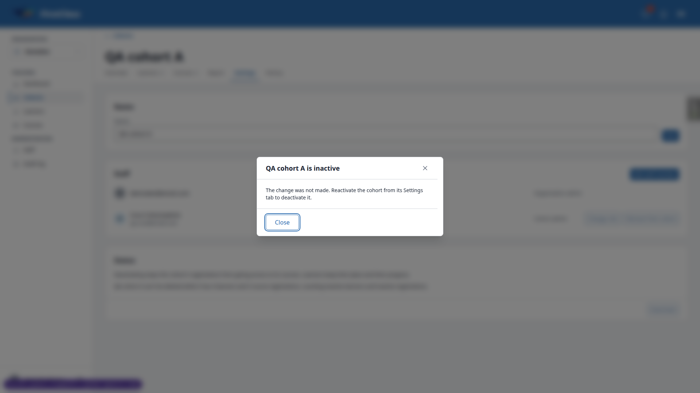

Expected: A message that fits the change asked for, as the reactivate refusal does ('Nothing changed. Someone else may have reactivated it already.').

Actual: 'The change was not made. Reactivate the cohort from its Settings tab to deactivate it.'

### B7: Registrations list: status badge of a row with no action sits in the button column

Manifestations:

- visual-registration-badge-column (desktop)

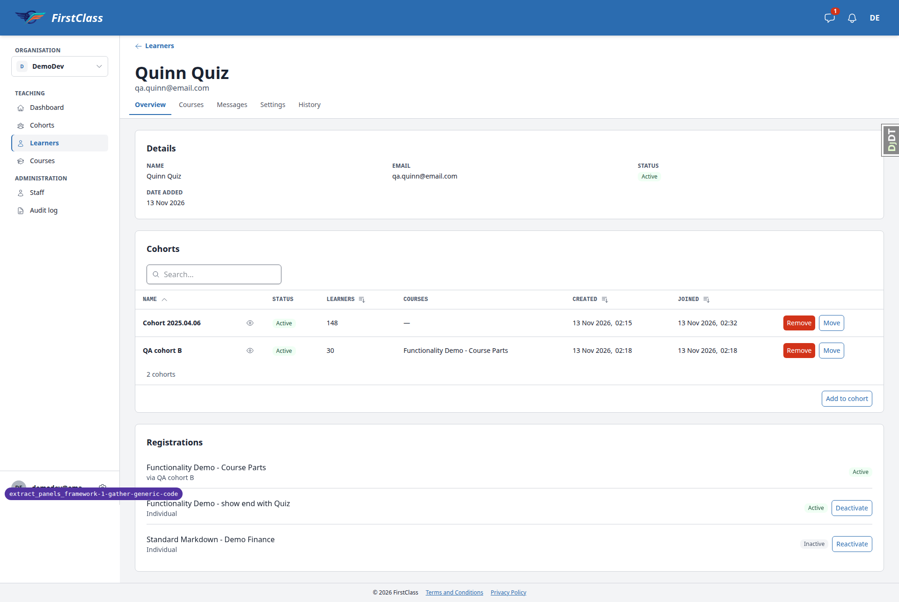

Expected: Every row has its status badge in the same place, and a row the viewer cannot act on keeps an empty buttons column.

Actual: A registration that comes via a cohort has no button, so its badge slides to the far right edge while the other rows' badges sit left of their button.

### B8: Panel lists draw a rule between rows and course cards are boxes inside a box, against the brand checklist

Manifestations:

- visual-list-rules (desktop)

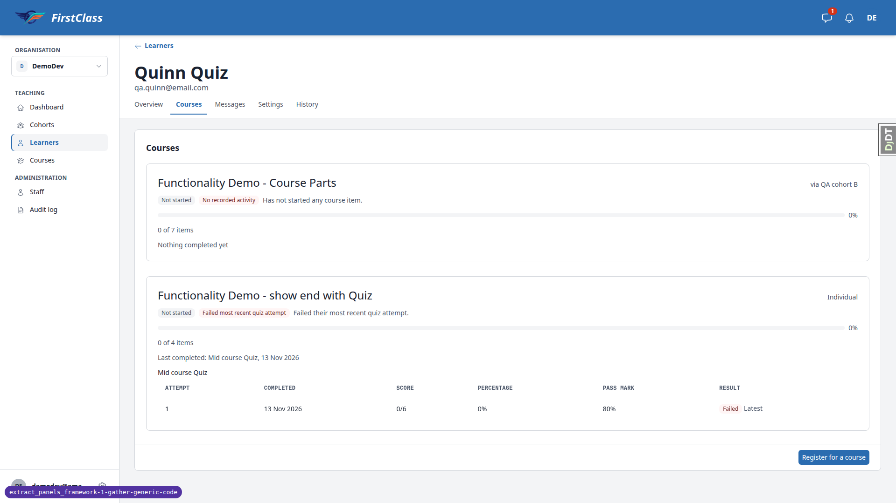

Expected: Brand visual checklist: no rule between list items, no box inside a box.

Actual: <c-panel-list> is documented and built as 'divided by rules'; the learner Courses panel and the cohort report draw each course as a bordered box inside the panel card. Component and checklist disagree; the dividers exist on main too.

### B9: Embedded conversation does not line up with its panel or dialog and repeats a header

Manifestations:

- visual-embedded-conversation (desktop)

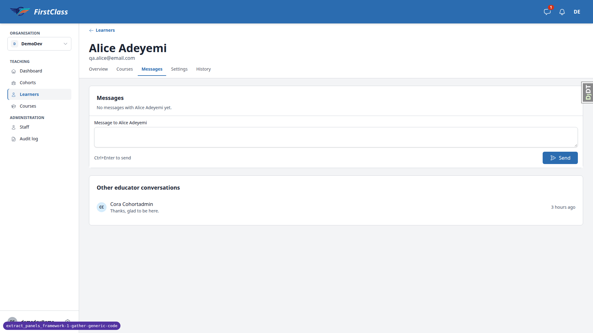
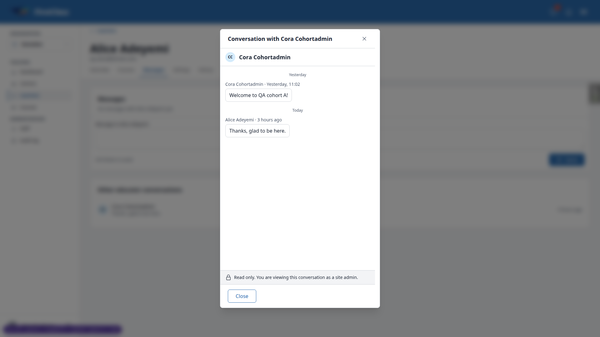

Expected: Content embedded in a panel shows no second header or rule and starts on the panel's left padding.

Actual: The Messages panel's composer overhangs the panel padding by 8px each side under a rule; the conversation dialog's thread starts 8px left of the title and shows a second 'Cora Cohortadmin' header under the dialog title.

### B10: People in the cohort staff list and the other-educator conversations list are not the small person row

Manifestations:

- visual-person-list-row (desktop)

Expected: A person in a list row has a small semibold name and a small avatar centred on the name's first line.

Actual: Both lists show the name at base size and regular weight with a 32px avatar centred on the two lines.

### B11: No navigation on educator pages when JavaScript is off

Manifestations:

- visual-nojs-navigation (desktop)

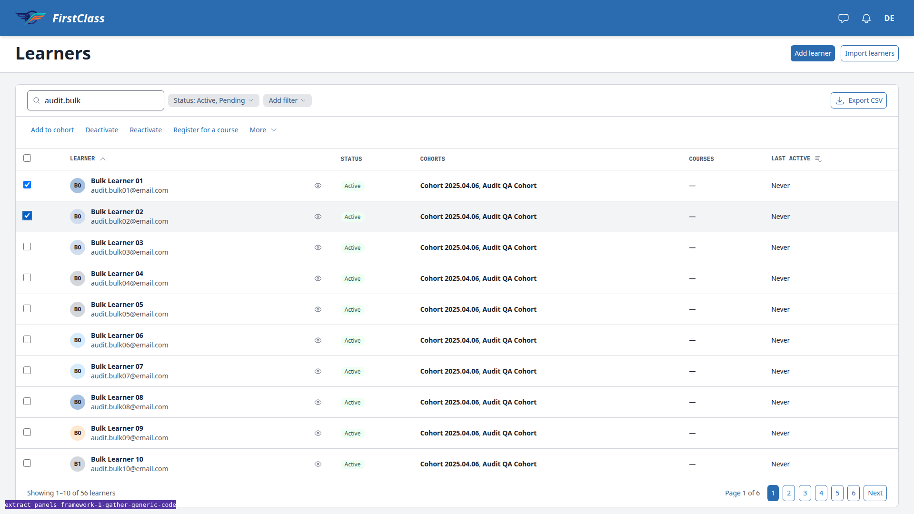

Expected: At 1024px and wider the navigation is a left column beside the content, never missing.

Actual: The sidebar is a dialog only Alpine opens, so with JavaScript off there is no navigation at any width. Same on main.

### B12: Import preview Rows table has no entry count in its footer

Manifestations:

- 10.3-footer (desktop)

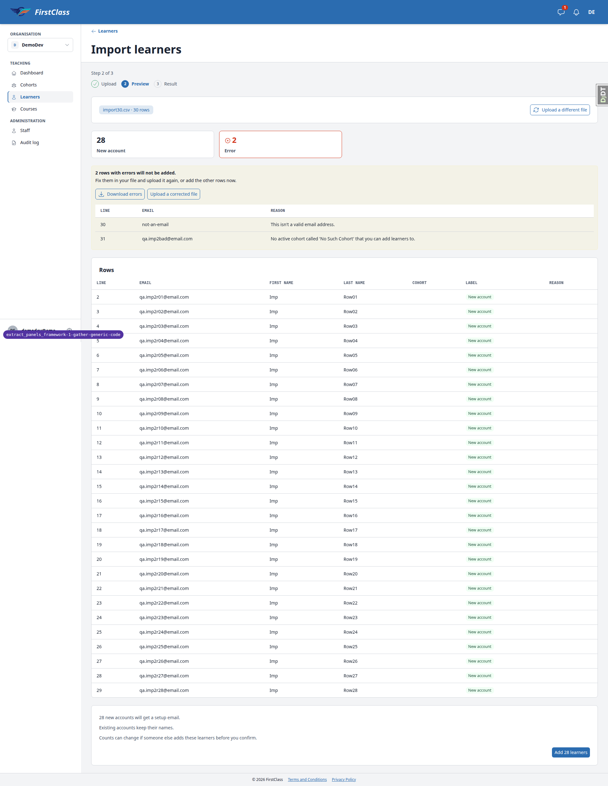
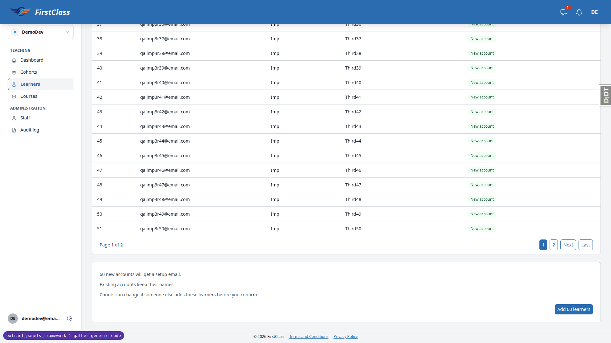

Expected: The table footer states the entry count at the left, in line with the pager, on a single-page table too.

Actual: With one page (28 rows) there is no footer at all; with two pages the footer reads 'Page 1 of 2' with no entry count. The table also grows the page instead of scrolling in a capped region.

### B13: Import result shows browser-local time while the tables show server time

Manifestations:

- 10.5-clock (desktop)

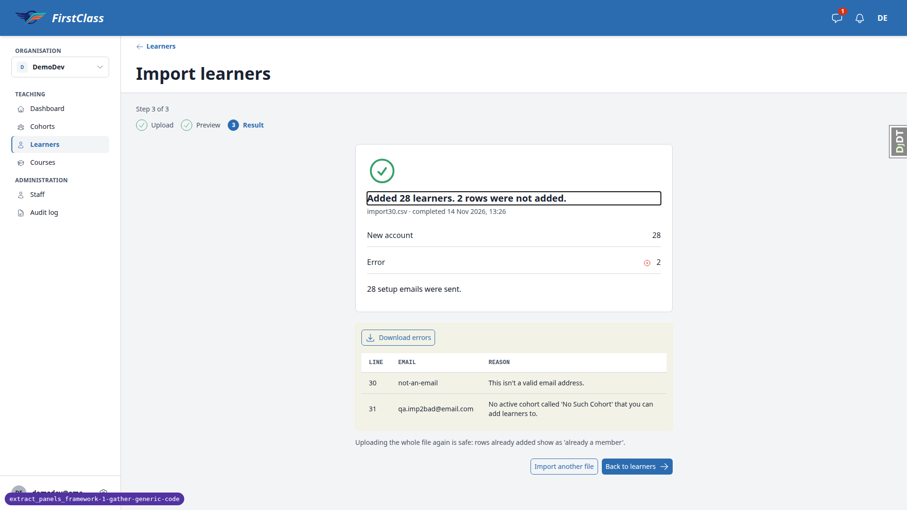

Expected: One clock across the educator pages.

Actual: 'completed 14 Nov 2026, 13:26' on the import result (, browser zone UTC+2) against 11:2x in the audit log and report at the same moment (server TIME_ZONE UTC). Same on main.

### B14: Programmatically focused heading and notice are drawn inside a heavy black box

Manifestations:

- visual-focus-box (desktop)

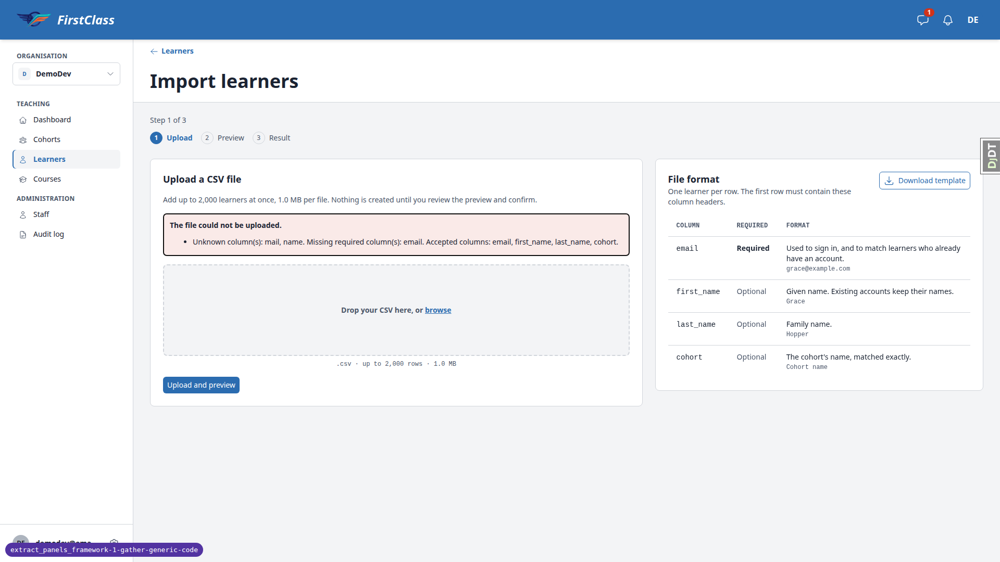

Expected: A heading or notice that takes focus for screen readers does not look like a boxed input.

Actual: The import result heading and the upload error notice show a thick black focus rectangle on load.

### B15: Empty cohort name shows inline red text, not the error notice the QA plan expects

Manifestations:

- 11.3-error-notice (desktop)

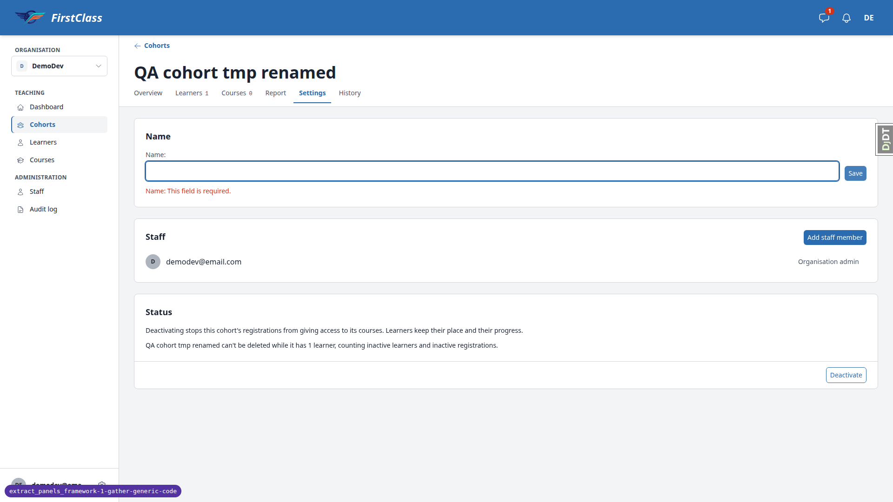

Expected: QA plan Test 11.3: 'Submit an empty name: expect an error notice.'

Actual: 'Name: This field is required.' as plain red text under the field, repeating the label, with no notice box or role. Other forms in this run (dialog reason field) also show field errors inline.

### B16: Tables clip the learner's name to one or three letters at 375 and 768

Manifestations:

- 9.6-squeezed (mobile)
- visual-tablet-table-squeeze (tablet)

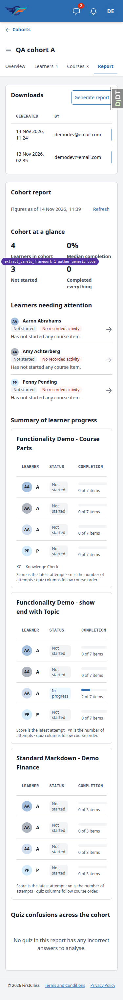
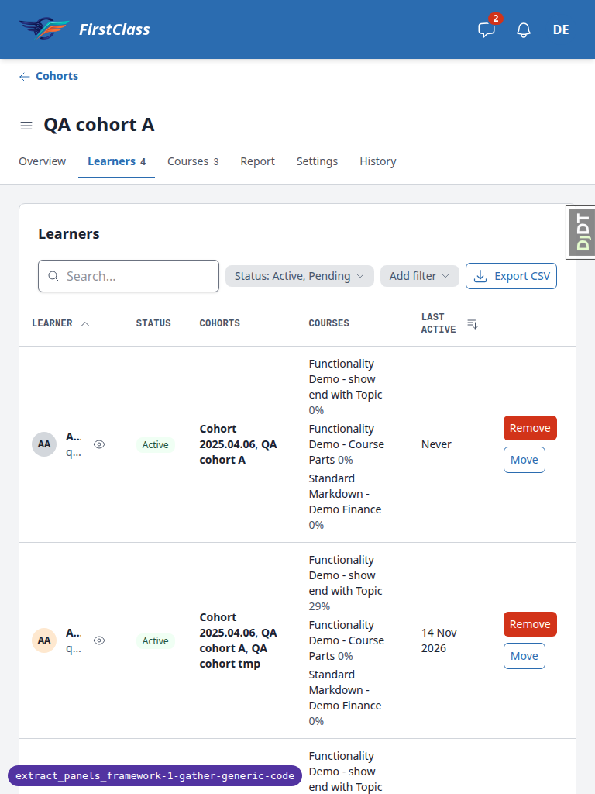
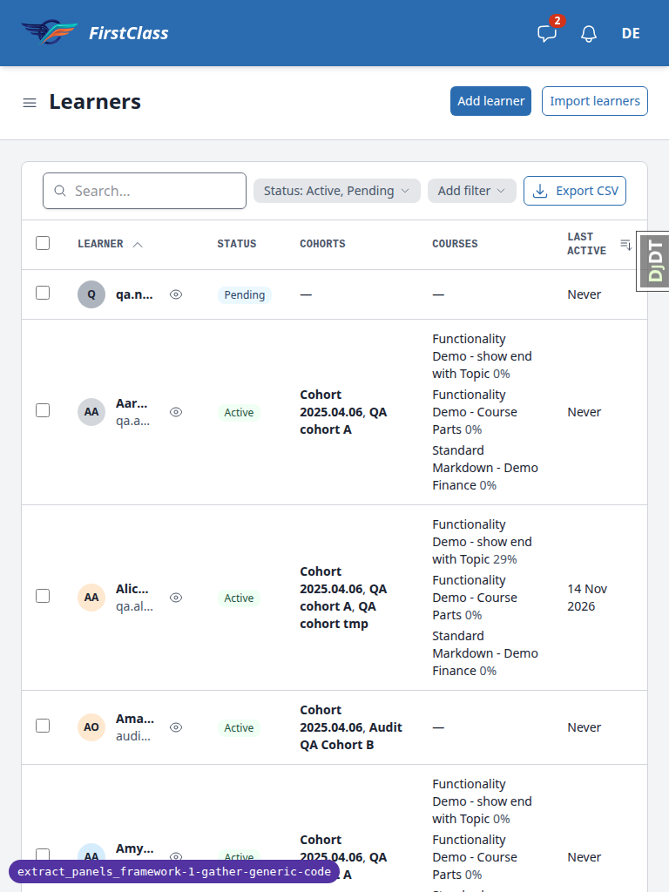

Expected: A table with action columns is cards at 768, and no name is clipped so far that the person cannot be identified; no button sits behind a sideways scroll.

Actual: Cohort report tables at 375 show 'AA A' for every learner and cut the Download button off; the cohort Learners table (Remove, Move column) stays a table at 768 with the learner cell clipped to 'A..'; the learners table at 768 clips names to 'Aar…'.

## Layout probe

| Test | Viewport | URL | Screenshot | Result |
|---|---|---|---|---|
| 9.1 | desktop | /educator/organisations/demodev/dashboard | [page-2026-11-14T11-01-53-931Z.png](screenshots/page-2026-11-14T11-01-53-931Z.png) | clean |
| 6.1 | desktop | /educator/organisations/demodev/dashboard (quick view open) | [page-2026-11-14T11-02-08-604Z.png](screenshots/page-2026-11-14T11-02-08-604Z.png) | clean |
| 6.3 | desktop | /educator/organisations/demodev/dashboard (discard prompt) | [page-2026-11-14T11-02-18-178Z.png](screenshots/page-2026-11-14T11-02-18-178Z.png) | clean |
| 11.1 | desktop | /educator/organisations/demodev/cohorts/<QA cohort A> | [page-2026-11-14T11-03-08-016Z.png](screenshots/page-2026-11-14T11-03-08-016Z.png) | clean |
| 11.1 | desktop | /educator/organisations/demodev/cohorts/<QA cohort A>/__tabs/settings | [page-2026-11-14T11-03-23-343Z.png](screenshots/page-2026-11-14T11-03-23-343Z.png) | clean |
| 1.1-1.4 | desktop | cohort settings (deactivate dialog) | [page-2026-11-14T11-03-44-354Z.png](screenshots/page-2026-11-14T11-03-44-354Z.png) | clean |
| 1.6 | desktop | cohort settings (discard prompt) | [page-2026-11-14T11-04-01-436Z.png](screenshots/page-2026-11-14T11-04-01-436Z.png) | clean |
| 1.7 | desktop | cohort settings (deactivate dialog, field error) | [page-2026-11-14T11-04-31-424Z.png](screenshots/page-2026-11-14T11-04-31-424Z.png) | clean |
| 1.8 | desktop | cohort settings (inactive) | [page-2026-11-14T11-04-44-625Z.png](screenshots/page-2026-11-14T11-04-44-625Z.png) | clean |
| 1.9 | desktop | /educator/organisations/demodev/cohorts/<QA cohort A>/__tabs/history | [page-2026-11-14T11-05-01-407Z.png](screenshots/page-2026-11-14T11-05-01-407Z.png) | clean |
| 3.2 | desktop | cohort settings (refusal dialog) | [page-2026-11-14T11-05-57-679Z.png](screenshots/page-2026-11-14T11-05-57-679Z.png) | clean |
| 3.1 | desktop | cohort settings (refusal dialog) | [page-2026-11-14T11-06-22-574Z.png](screenshots/page-2026-11-14T11-06-22-574Z.png) | clean |
| 2.5 | desktop | /educator/organisations/demodev/cohorts/<QA cohort A>/__tabs/learners | [page-2026-11-14T11-06-50-582Z.png](screenshots/page-2026-11-14T11-06-50-582Z.png) | clean |
| 2.5 | desktop | cohort learners (remove dialog) | [page-2026-11-14T11-07-06-780Z.png](screenshots/page-2026-11-14T11-07-06-780Z.png) | clean |
| 5.1 | desktop | cohort learners (move dialog) | [page-2026-11-14T11-07-17-202Z.png](screenshots/page-2026-11-14T11-07-17-202Z.png) | clean |
| 2.4 | desktop | /educator/organisations/demodev/learners/<Quinn Quiz> | [page-2026-11-14T11-08-06-391Z.png](screenshots/page-2026-11-14T11-08-06-391Z.png) | clean |
| 3.3 | desktop | learner settings (refusal dialog) | [page-2026-11-14T11-09-04-560Z.png](screenshots/page-2026-11-14T11-09-04-560Z.png) | clean |
| 11.7 | desktop | /educator/organisations/demodev/learners/<New Learner> | [page-2026-11-14T11-09-20-768Z.png](screenshots/page-2026-11-14T11-09-20-768Z.png) | clean |
| 11.2 | desktop | /educator/organisations/demodev/learners/<Quinn Quiz>/__tabs/courses | [page-2026-11-14T11-10-34-601Z.png](screenshots/page-2026-11-14T11-10-34-601Z.png) | clean |
| 5.6 | desktop | /educator/organisations/demodev/learners/<Alice>/__tabs/messages | [page-2026-11-14T11-10-57-700Z.png](screenshots/page-2026-11-14T11-10-57-700Z.png) | clean |
| 5.6 | desktop | learner messages (conversation dialog) | [page-2026-11-14T11-11-13-040Z.png](screenshots/page-2026-11-14T11-11-13-040Z.png) | clean |
| 5.7 | desktop | learner overview (add to cohort dialog, 422) | [page-2026-11-14T11-11-53-363Z.png](screenshots/page-2026-11-14T11-11-53-363Z.png) | clean |
| 3.4 | desktop | learner settings (refusal dialog) | [page-2026-11-14T11-12-47-935Z.png](screenshots/page-2026-11-14T11-12-47-935Z.png) | clean |
| 2.6 | desktop | /educator/organisations/demodev/staff | [page-2026-11-14T11-13-01-068Z.png](screenshots/page-2026-11-14T11-13-01-068Z.png) | clean |
| 5.3 | desktop | staff (add staff member, role step) | [page-2026-11-14T11-14-01-007Z.png](screenshots/page-2026-11-14T11-14-01-007Z.png) | clean |
| 5.4 | desktop | staff (change cohorts dialog) | [page-2026-11-14T11-14-18-669Z.png](screenshots/page-2026-11-14T11-14-18-669Z.png) | clean |
| 5.5 | desktop | /educator/organisations/demodev/learners (learner added dialog) | [page-2026-11-14T11-15-18-989Z.png](screenshots/page-2026-11-14T11-15-18-989Z.png) | clean |
| 13.1 | desktop | /educator/organisations/demodev/learners | [page-2026-11-14T11-15-27-893Z.png](screenshots/page-2026-11-14T11-15-27-893Z.png) | clean |
| 7.1 | desktop | /educator/organisations/demodev/learners (selection bar) | [page-2026-11-14T11-15-39-210Z.png](screenshots/page-2026-11-14T11-15-39-210Z.png) | clean |
| 7.2 | desktop | learners (bulk resend confirm) | [page-2026-11-14T11-15-59-026Z.png](screenshots/page-2026-11-14T11-15-59-026Z.png) | clean |
| 7.2 | desktop | learners (bulk resend result) | [page-2026-11-14T11-16-09-360Z.png](screenshots/page-2026-11-14T11-16-09-360Z.png) | clean |
| 7.3 | desktop | learners (bulk resend, disabled confirm) | [page-2026-11-14T11-16-27-918Z.png](screenshots/page-2026-11-14T11-16-27-918Z.png) | clean |
| 7.6 | desktop | learners (bulk result, 179 rows) | [page-2026-11-14T11-17-09-802Z.png](screenshots/page-2026-11-14T11-17-09-802Z.png) | clean |
| 8.1 | desktop | /educator/organisations/demodev/cohorts | [page-2026-11-14T11-19-32-345Z.png](screenshots/page-2026-11-14T11-19-32-345Z.png) | clean |
| 8.1 | desktop | /educator/organisations/demodev/cohorts?cohorts-inactive=1 | [page-2026-11-14T11-19-47-942Z.png](screenshots/page-2026-11-14T11-19-47-942Z.png) | clean |
| 7.6-background | desktop | /educator/organisations/demodev/learners (notification panel open) | [page-2026-11-14T11-21-36-799Z.png](screenshots/page-2026-11-14T11-21-36-799Z.png) | clean |
| 4.3 | desktop | cohort settings (delete refused in dialog) | [page-2026-11-14T11-22-02-237Z.png](screenshots/page-2026-11-14T11-22-02-237Z.png) | clean |
| 8.2 | desktop | /educator/organisations/demodev/audit-log | [page-2026-11-14T11-22-43-814Z.png](screenshots/page-2026-11-14T11-22-43-814Z.png) | clean |
| 9.2 | desktop | /educator/organisations/demodev/cohorts/<QA cohort A>/__tabs/report | [page-2026-11-14T11-23-54-089Z.png](screenshots/page-2026-11-14T11-23-54-089Z.png) | clean |
| 9.3 | desktop | /educator/organisations/demodev/cohorts/<QA cohort B>/__tabs/report | [page-2026-11-14T11-24-16-576Z.png](screenshots/page-2026-11-14T11-24-16-576Z.png) | clean |
| 10.1 | desktop | /educator/organisations/demodev/learners/import/ | [page-2026-11-14T11-25-08-588Z.png](screenshots/page-2026-11-14T11-25-08-588Z.png) | clean |
| 10.2 | desktop | /educator/organisations/demodev/learners/import/ (upload error) | [page-2026-11-14T11-25-32-148Z.png](screenshots/page-2026-11-14T11-25-32-148Z.png) | clean |
| 10.3 | desktop | /educator/organisations/demodev/learners/import/<id>/ | [page-2026-11-14T11-25-50-604Z.png](screenshots/page-2026-11-14T11-25-50-604Z.png) | clean |
| 10.5 | desktop | /educator/organisations/demodev/learners/import/<id>/result/ | [page-2026-11-14T11-26-25-988Z.png](screenshots/page-2026-11-14T11-26-25-988Z.png) | clean |
| 10.3-pager | desktop | /educator/organisations/demodev/learners/import/<id>/ (60 rows) | [page-2026-11-14T11-27-55-436Z.png](screenshots/page-2026-11-14T11-27-55-436Z.png) | clean |
| 11.5 | desktop | /educator/organisations/demodev/audit-log?audit_log-page=7 | [page-2026-11-14T11-28-15-918Z.png](screenshots/page-2026-11-14T11-28-15-918Z.png) | clean |
| 11.3 | desktop | cohort settings (empty name error) | [page-2026-11-14T11-28-32-815Z.png](screenshots/page-2026-11-14T11-28-32-815Z.png) | clean |
| 12.6 | desktop | /panel-framework/components/ | [page-2026-11-14T11-28-53-390Z.png](screenshots/page-2026-11-14T11-28-53-390Z.png) | clean |
| 12.4 | desktop | /courses/functionality-demo-show-end-with-topic/1/ | [page-2026-11-14T11-31-20-001Z.png](screenshots/page-2026-11-14T11-31-20-001Z.png) | clean |
| 12.5 | desktop | /courses/functionality-demo-show-end-with-topic/3/ | [page-2026-11-14T11-34-00-001Z.png](screenshots/page-2026-11-14T11-34-00-001Z.png) | clean |
| 12.4 | desktop | / (learner home) | [page-2026-11-14T11-31-00-001Z.png](screenshots/page-2026-11-14T11-31-00-001Z.png) | clean |
| 12.4 | mobile | /courses/functionality-demo-show-end-with-topic/1/ | [page-2026-11-14T11-35-00-001Z.png](screenshots/page-2026-11-14T11-35-00-001Z.png) | clean |
| 12.4 | mobile | /courses/functionality-demo-show-end-with-topic/1/ (outline sheet open) | [page-2026-11-14T11-35-10-001Z.png](screenshots/page-2026-11-14T11-35-10-001Z.png) | clean |
| 12.1 | mobile | /educator/organisations/demodev/dashboard | [page-2026-11-14T11-37-04-564Z.png](screenshots/page-2026-11-14T11-37-04-564Z.png) | clean |
| 12.1 | mobile | /educator/organisations/demodev/dashboard (navigation sheet open) | [page-2026-11-14T11-37-14-508Z.png](screenshots/page-2026-11-14T11-37-14-508Z.png) | clean. The probe reported 'stacked' and 'overlap' for the sidebar region while the navigation sheet was open; that is the modal sheet drawn over the page on purpose, so it is not recorded as a fault. |
| 8.5 | mobile | /educator/organisations/demodev/cohorts | [page-2026-11-14T11-37-29-895Z.png](screenshots/page-2026-11-14T11-37-29-895Z.png) | clean |
| 8.5 | mobile | /educator/organisations/demodev/cohorts (filter sheet open) | [page-2026-11-14T11-37-39-998Z.png](screenshots/page-2026-11-14T11-37-39-998Z.png) | clean. Probe 'stacked'/'overlap' on the sidebar selector came from the open filter sheet, a modal over the page by design. |
| 1.10 | mobile | cohort settings (deactivate sheet) | [page-2026-11-14T11-38-03-151Z.png](screenshots/page-2026-11-14T11-38-03-151Z.png) | clean |
| 11.8 | mobile | /educator/organisations/demodev/cohorts/<QA cohort A>/__tabs/settings | [page-2026-11-14T11-37-51-939Z.png](screenshots/page-2026-11-14T11-37-51-939Z.png) | clean |
| 11.8 | mobile | /educator/organisations/demodev/learners/<Quinn Quiz> | [page-2026-11-14T11-39-30-001Z.png](screenshots/page-2026-11-14T11-39-30-001Z.png) | clean |
| 6.4 | mobile | /educator/organisations/demodev/learners | [page-2026-11-14T11-38-14-767Z.png](screenshots/page-2026-11-14T11-38-14-767Z.png) | clean |
| 6.4 | mobile | /educator/organisations/demodev/learners (quick view open) | [page-2026-11-14T11-38-57-891Z.png](screenshots/page-2026-11-14T11-38-57-891Z.png) | clean |
| 7.1 | mobile | /educator/organisations/demodev/learners (selection bar) | [page-2026-11-14T11-39-09-532Z.png](screenshots/page-2026-11-14T11-39-09-532Z.png) | clean |
| 9.6 | mobile | /educator/organisations/demodev/cohorts/<QA cohort A>/__tabs/report | [page-2026-11-14T11-39-40-001Z.png](screenshots/page-2026-11-14T11-39-40-001Z.png) | clean |
| 10.3 | mobile | /educator/organisations/demodev/learners/import/<id>/ | [page-2026-11-14T11-39-45-535Z.png](screenshots/page-2026-11-14T11-39-45-535Z.png) | clean |
| 12.1 | tablet | /educator/organisations/demodev/dashboard (navigation sheet open) | [page-2026-11-14T11-41-30-001Z.png](screenshots/page-2026-11-14T11-41-30-001Z.png) | clean |
| 13.1 | tablet | /educator/organisations/demodev/learners | [page-2026-11-14T11-40-19-665Z.png](screenshots/page-2026-11-14T11-40-19-665Z.png) | clean |
| 2.6 | tablet | /educator/organisations/demodev/staff | [page-2026-11-14T11-40-50-001Z.png](screenshots/page-2026-11-14T11-40-50-001Z.png) | clean |
| 5.3 | tablet | staff (add staff member dialog) | [page-2026-11-14T11-41-00-001Z.png](screenshots/page-2026-11-14T11-41-00-001Z.png) | clean |
| 2.5 | tablet | /educator/organisations/demodev/cohorts/<QA cohort A>/__tabs/learners | [page-2026-11-14T11-40-40-001Z.png](screenshots/page-2026-11-14T11-40-40-001Z.png) | clean |

## Data changes

| What changed | Made by |
|---|---|
| Ran qa_create_dev_org_baseline --site-name DemoDev: created 'QA cohort empty' (active, no learners, no registrations); re-added Amy Achterberg to QA cohort A; set Dan Deactivated back to inactive; reset baseline persona passwords to the dev default. All other setup items already existed. | sdd:qa-data-helper |
| Amy Achterberg removed from QA cohort A while staging the stale-move refusal (Test 5.2); QA cohort A deactivated and reactivated twice (Tests 1, 3.1, 3.2). | QA run through the UI |
| Amy Achterberg deactivated and reactivated (Tests 3.3, 2.2) and added back to QA cohort A (Test 5.7); Quinn Quiz's two individual registrations toggled and restored; setup email resent to qa.newlearner@email.com. | QA run through the UI |
| Read-only: fetched the setup link for qa.newlearner@email.com from the local mail catcher and generated one for qa.penny@email.com without sending. No database rows changed. The helper also wrote a note file .claude/agent-memory/sdd-qa-data-helper/reference_reading_setup_email_links.md plus a MEMORY.md index line. | sdd:qa-data-helper |
| Penny Pending set a password through her setup link (Test 3.4), so she is no longer pending. Cora Cohortadmin deactivated and reactivated as a staff member (Test 3.6). | QA run through the UI |
| Added learner qa.addtest10913@email.com (Qa Addtest, pending). Bulk 'Resend setup email' sent setup emails to 29 pending learners (dev mail catcher). | QA run through the UI |
| Created 90 pending learners qa.bg001@email.com to qa.bg090@email.com in demodev so a bulk run exceeds BULK_BACKGROUND_THRESHOLD (learners table total 269). The helper wrote a new uncommitted command freedom_ls/qa_helpers/management/commands/qa_create_bulk_learners.py and notes under .claude/agent-memory/sdd-qa-data-helper/. | sdd:qa-data-helper |
| Bea Botha added to and removed from 'QA cohort empty'; 'QA cohort empty' deleted (Test 4.4). Bulk 'Resend setup email' over 269 learners sent 90 setup emails to the dev mail catcher. | QA run through the UI |
| Learner import of import30.csv added 28 pending learners (qa.imp2r01 to qa.imp2r28@email.com) to demodev and sent 28 setup emails to the dev mail catcher. | QA run through the UI |
| 'QA cohort tmp' renamed and renamed back (Test 11.3). A 60-row import was uploaded for preview only and not confirmed. One extra cohort report download generated for QA cohort A. | QA run through the UI |
| demodev sent Alice Adeyemi a message and Alice replied (Test 12.3); Alice completed the first two topics of 'Functionality Demo - show end with Topic' (29% progress) to reach the form item (Test 12.5). | QA run through the UI |

## Bug status

| Bug | Status |
|---|---|
| B1 | **FIXED** (commit: 6fa29689c) — Discard prompt: Keep editing drops focus and the next Esc closes the dialog without asking |
| B2 | **FIXED** (commit: ab737e8e4) — Add to cohort dialog offers an inactive cohort after a validation error |
| B3 | **UNRESOLVED** — Dialog header and footer rules stop 16px short of the right edge (reason: the fix, commit 9c7ac77a1, dropped the always-reserved scrollbar gutter and reworded the rule "the scrollbar track is always visible" in the panel-framework skill; choosing between that rule and full-width rules is a design decision, so the fix was reverted in 4a67ac950) |
| B4 | **UNRESOLVED** — A disabled confirm's reason is larger than the dialog text and sits above the button (reason: a 512px footer has no room for Cancel, a sentence and the confirm on one line, so where the reason goes and at what size needs a design decision) |
| B5 | **UNRESOLVED** — Secondary buttons are 2px taller than primary ones (reason: the button styles are shared with learner pages, which this spec says must not change; evening the sizes needs a decision on which size wins site-wide) |
| B6 | **UNRESOLVED** — Refusal for deactivating an inactive cohort tells the person to reactivate it in order to deactivate it (reason: needs a copy decision on what this refusal should say) |
| B7 | **FIXED** (commit: a69e136b5) — Registrations list: status badge of a row with no action sits in the button column |
| B8 | **UNRESOLVED** — Panel lists draw a rule between rows and course cards are boxes inside a box, against the brand checklist (reason: the list component is documented as divided by rules while the brand checklist says no rule between list items; which one is right is a design decision) |
| B9 | **UNRESOLVED** — Embedded conversation does not line up with its panel or dialog and repeats a header (reason: the thread and composer are shared with learner message pages, which this spec says must not change; needs a decision on changing the shared partial or wrapping it) |
| B10 | **FIXED** (commit: 5d183b582) — People in the cohort staff list and the other-educator conversations list are not the small person row |
| B11 | **UNRESOLVED** — No navigation on educator pages when JavaScript is off (reason: how the sidebar renders without JavaScript is a design decision; same on main) |
| B12 | **UNRESOLVED** — Import preview Rows table has no entry count in its footer (reason: needs a decision on whether static panel tables carry the data table's count-and-pager footer and a height cap) |
| B13 | **UNRESOLVED** — Import result shows browser-local time while the tables show server time (reason: needs a decision on which clock educator pages show; same on main) |
| B14 | **UNRESOLVED** — Programmatically focused heading and notice are drawn inside a heavy black box (reason: needs a design decision on the focus style for elements focused for screen readers) |
| B15 | **UNRESOLVED** — Empty cohort name shows inline red text, not the error notice the QA plan expects (reason: the plan asks for a notice while other forms show field errors inline; which shape this form uses is a design decision) |
| B16 | **UNRESOLVED** — Tables clip the learner's name to one or three letters at 375 and 768 (reason: needs a design decision between cards at these widths and a minimum name width with sideways scroll, for the report tables and the learner tables) |

Fix verification, re-driven in the browser after each commit:

- B1: on the cohort Deactivate dialog, Esc, Keep editing, Esc shows the prompt again every time; focus returns to the reason field; the quick view's "Discard your message?" prompt behaves the same; clean dialogs still close on Esc and footer Cancel still closes without a prompt.
- B2: the cohort select lists the same active cohorts before and after an invalid submit.
- B7: every registration row's badge ends in the same column at 1920 and at 375 (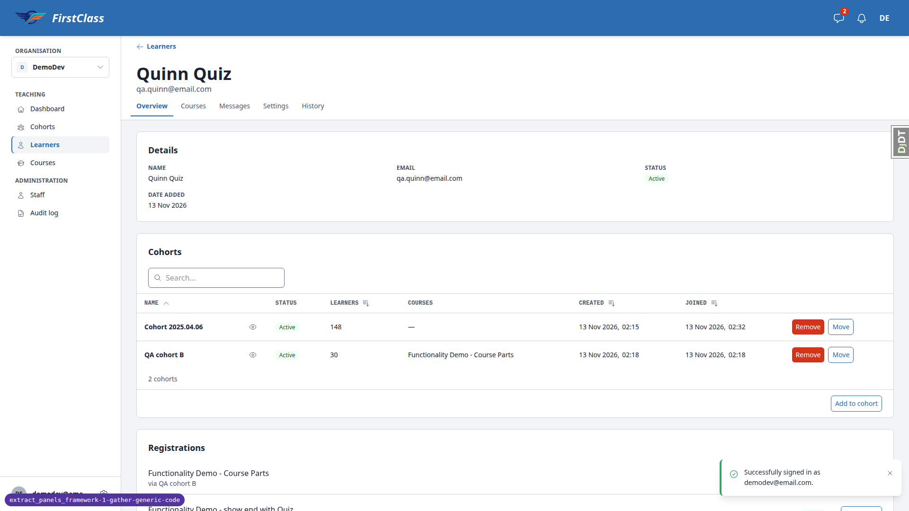).
- B10: both lists show a 14px semibold name with a 24px avatar on the name's line; row buttons and the conversation dialog still work (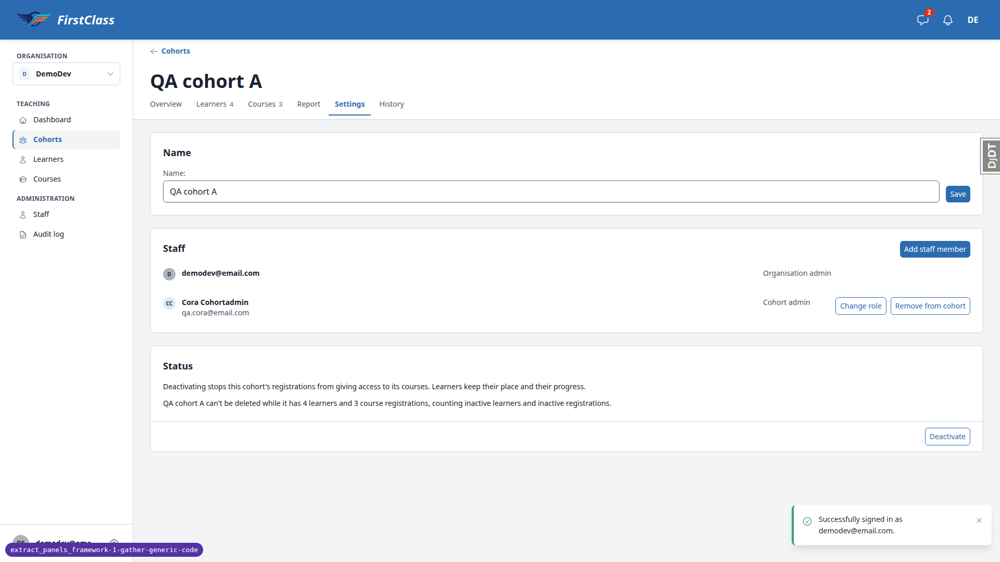, 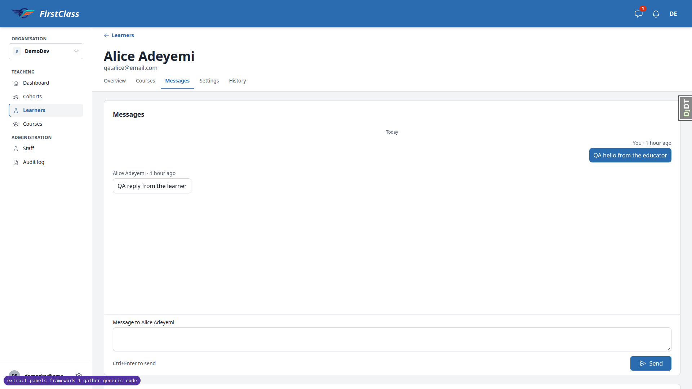).

## General notes

- Tests 7.4 and 9.5 were not run; the plan words both as conditional (see their skip notes).
- Test 7.7: the bar's order matches main's registration order; the QA plan's listed order is what is out of date.
- Test 7.6: a notification is only raised for a background run, which starts above BULK_BACKGROUND_THRESHOLD (default 250 rows), not above 25 as the plan implies.
- Test 8.1 and 8.2: the URL parameters are prefixed with the table name (`cohorts-inactive=1`, `audit_log-when=7d`), not bare `inactive=1` / `when=7d` as the plan writes them.
- Test 11.4: the cohorts table has a Created column, not a last-active column.
- Test 3.6: the QA login is a site admin, so its own last admin role can be deactivated with a warning rather than being refused; the refusal was staged with a stale tab instead.
- Console: the only console errors were the browser's own "422 (Unprocessable Content)" lines for validation and refusal responses, which are by design, and connection-refused lines from a stale tab of an earlier session pointing at port 8428.
- The deactivate dialog for a cohort repeats the Status panel's "can't be deleted while it has N learners" sentence, which is not about deactivating.
- The learner's course outline sheet at 375 has no close control of its own (closes on a tap outside or Esc); it is the same on main.
- At 375 the selection bar wraps to five rows (305px) and is sticky, so it holds over a third of the screen while scrolling.
- Names in the staff cards at 768 are truncated ("Cora Cohortad…") although the card has room.
- The data helper wrote files during the run that are not committed: `freedom_ls/qa_helpers/management/commands/qa_create_bulk_learners.py` and notes under `.claude/agent-memory/sdd-qa-data-helper/`.

status: ok · reason: 16 bugs: 4 fixed, 12 unresolved (1 of them a reverted fix); report rendered, screenshots verified
