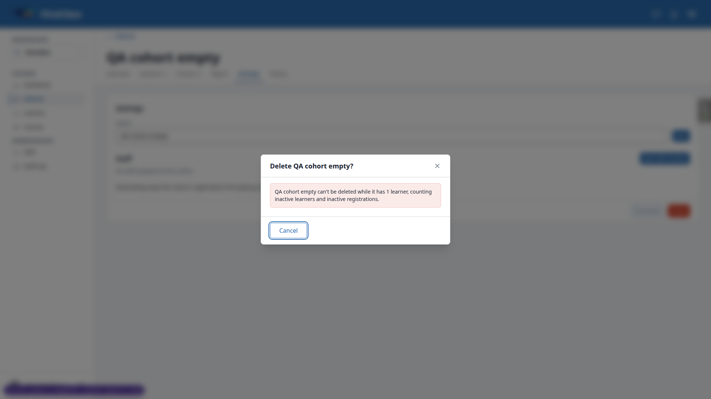
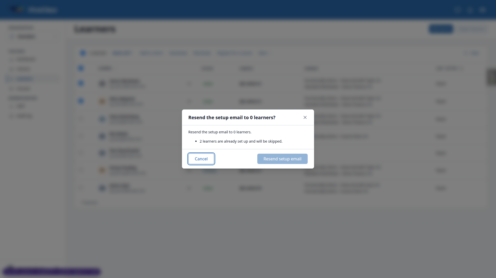
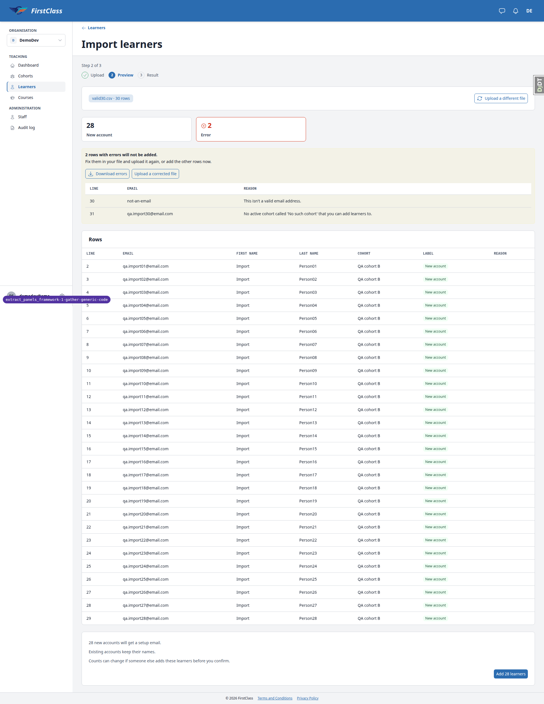

# Frontend QA report: extract_panels_framework-1-gather-generic-code

Summary: 67 test records were run. Desktop (1920) has 58 records: 47 pass, 7 fail, 4 skip. Mobile (375) has 8 records: 8 pass, 0 fail, 0 skip. Tablet (768) has 1 record: 1 pass. Seven bugs (B1 to B7) are documented below. The smoke gate passed and no layout probe raised flags.

## Methodology

- Playwright MCP run at 1920, 375 and 768 against a dev server on this branch.
- Screenshots are collected into `screenshots/` beside this report, and every image referenced here exists there.
- The dev database was unseeded at the start. It was seeded by the QA data helper (see Data changes).
- The test plan is `3. frontend_qa.md` in this spec directory.

## Diff scoping

Class: FULL. Trigger: 249 changed files, made up of `freedom_ls/panel_framework` (135), `freedom_ls/educator_interface` (80), and comms, base, reports, deployment, audit_log, `tailwind.components.css`, templates and static JS. Skipped: nothing.

## Smoke gate

Status: pass. Pages checked: `/` and `/educator/organisations/demodev/dashboard`. No failure URL or reason.

## Design check

No design states tested.

## Results

### Desktop (1920)

| Test | Status | Notes | Screenshot |
|---|---|---|---|
| 1.1-1.4 | pass | Dialog 'Deactivate QA cohort A?', body paragraphs 16px (label 14px), Reason (optional) with help text, Cancel left and focused, one Deactivate right. | [shot](screenshots/page-2026-11-13T02-21-08-119Z.png) |
| 1.5-1.6 | pass | Footer Cancel closes at once; header close shows 'Discard changes?' with Keep editing left and Discard right; Keep editing keeps the reason; Esc re-shows prompt; Discard closes. | none |
| 1.7 | pass | Field has maxlength=500; with it removed a 520-char reason returns 422, dialog stays open with field error. Console shows only the expected 422 line. | [shot](screenshots/page-2026-11-13T02-21-53-079Z.png) |
| 1.8-1.9 | pass | Cohort goes Inactive with a Reactivate button. 'Deactivating…' in markup (too fast to observe). History entry expands to 'Reason QA test reason'. | [shot](screenshots/page-2026-11-13T02-22-20-974Z.png) |
| 2.1 | pass | Reactivate dialog has no reason field, Cancel focused, one Reactivate (btn-primary, 'Reactivating…'); cohort active again. | none |
| 2.2 | pass | Learner Deactivate (Alice) dialog correct; cancelled. Dan's Reactivate confirmed. | [shot](screenshots/page-2026-11-13T02-22-59-794Z.png) |
| 2.3 | pass | Penny: 'Resend the setup email to Penny Pending?' confirm closes the dialog, no console error. | none |
| 2.4 | pass | Quinn Registrations rows: Deactivate (with reason) and Reactivate act on the same registration; panel refreshed each time. | [shot](screenshots/page-2026-11-13T02-24-16-864Z.png) |
| 2.5 | pass | 'Remove Aaron Abrahams from QA cohort A?' confirm in btn-error, 'Removing…'; cancelled. | none |
| 2.6-2.7 | pass | Staff deactivate dialogs for Cora with reason, primary confirm, Cancel focused. All dialog loading texts end in one '…'. | [shot](screenshots/page-2026-11-13T02-25-22-357Z.png) |
| 3.5 | pass | Second resend: 'Setup email sent recently', one focused Close in the footer, no form, no Cancel. Console shows the expected 422 line. | [shot](screenshots/page-2026-11-13T02-23-47-451Z.png) |
| 3.1-3.2 | pass | Two-tab stale deactivate and reactivate on QA cohort B show the already-changed messages with no form, no Cancel, one focused Close. | none |
| 3.3 | pass | Stale learner deactivate: 'Alice Adeyemi was already changed' with one focused Close. | none |
| 3.4 | skip | Not run: staging needs the pending learner's emailed setup link in a second tab; the plan allows recording it as not run. | none |
| 3.6 | skip | Not reachable: the Staff page renders no role or deactivate controls on your own row, so the refusal cannot be triggered from the UI. | [shot](screenshots/page-2026-11-13T02-25-22-357Z.png) |
| 4.1-4.2 | pass | Empty cohort 'Delete QA cohort empty?' with reason field, Cancel focused, one btn-error Delete. QA cohort A Settings offers no Delete. | [shot](screenshots/page-2026-11-13T02-26-47-524Z.png) |
| 4.3 | fail | Stale delete: 422 re-render keeps the dialog open with an error notice and the cohort remains, but focus lands on the footer Cancel, not the error box. See B2. | [shot](screenshots/page-2026-11-13T02-27-18-359Z.png) |
| 4.4 | pass | Removed the learner, deleted the empty cohort: 'Deleting…' shown, then the cohorts list without it. | [shot](screenshots/page-2026-11-13T02-28-37-502Z.png) |
| 5.7 | pass | Add to cohort: select change re-renders without error; empty submit stopped by required; server 422 with '1 field to fix.' summary, focused; valid submit adds the learner. | [shot](screenshots/page-2026-11-13T02-28-12-295Z.png) |
| 11.4 | pass | Cohorts table: courses as a list, learner counts filled, '—' where no courses. No last-active column. | [shot](screenshots/page-2026-11-13T02-28-37-502Z.png) |
| 8.1 | pass | Show inactive filter adds `cohorts-inactive=1`, chip with remove link and Clear all; removing hides the inactive cohort. | [shot](screenshots/page-2026-11-13T02-29-13-713Z.png) |
| 7.7 | pass | With 2 cohorts ticked: Register for a course, Deactivate a course registration, Deactivate, Reactivate. Order unchanged from main (see General notes). | [shot](screenshots/page-2026-11-13T02-29-26-094Z.png) |
| 7.1 | pass | 3 learners ticked, Deactivate: 'Deactivate 3 learners?' with sentence, consequences, Cancel and Deactivate; cancelled. | none |
| 7.2 | pass | Penny + Alice, Resend setup email: skip line shown; confirmed result dialog '0 learners changed. 1 learner already set up. 1 setup email was sent recently.' with Close. | [shot](screenshots/page-2026-11-13T02-30-47-842Z.png) |
| 7.3 | fail | Only set-up learners selected: the confirm button is disabled with no reason beside it and no aria-describedby. See B6. | [shot](screenshots/page-2026-11-13T02-31-38-022Z.png) |
| 7.6 | skip | PARTIAL: Select all 149 > Add to cohort ran inline and finished with '149 learners changed.' Notification part not exercised (see General notes). | none |
| 7.5 | pass | JS disabled: bar's Deactivate goes to the `__actions/deactivate` URL with dialog open; Close and Cancel are links; More menu items render as plain buttons via noscript. | none |
| 8.2-8.4 | pass | When options listed; Last 7 days gives `audit_log-when=7d`, 185 to 183 entries; bogus value gives 200 with full list and no chip; chip, Add filter, Clear all, Export CSV in place. | [shot](screenshots/page-2026-11-13T02-33-28-724Z.png) |
| 9.1 | pass | Dashboard renders 5 skeleton placeholders before figures load. Cohorts tile is one link. Attention rows have learner, cohort and 'Quick view: <name>' links. | [shot](screenshots/page-2026-11-13T02-34-42-301Z.png) |
| 6.1-6.3 | pass | Quick view opens beside content; close control 44x44; focus returns to trigger; composer Esc shows 'Discard your message?' with Keep editing and Discard. | [shot](screenshots/page-2026-11-13T02-34-54-637Z.png) |
| 9.2-9.3 | pass | QA cohort A Report: skeletons then body with panel-heading sections, shared table style, 'No reports yet.' empty text; Generate report adds a row. | [shot](screenshots/page-2026-11-13T02-35-21-077Z.png) |
| 9.4 | pass | JS off: Report tab shows 'Load the figures' link; following it renders the body. | none |
| 9.5 | skip | Not run: no cohort larger than the report limit exists in demodev and lowering the limit needs a settings change and server restart. | none |
| 10.1-10.2 | pass | Format table in shared style, 'Upload and preview' btn-sm. Wrong header gives 422, red notice with role=alert, focused. | [shot](screenshots/page-2026-11-13T02-36-12-220Z.png) |
| 10.3 | pass | 30-row file: stat tiles New account 28 / Error 2 filter rows (`?label=error`, aria-current=true); badges; shared table. | [shot](screenshots/page-2026-11-13T02-36-25-483Z.png) |
| 10.4 | fail | Error rows section is an amber warning notice, not the error notice the plan expects. See B7. | [shot](screenshots/page-2026-11-13T02-36-25-483Z.png) |
| 10.5 | pass | Result page 'Added 28 learners. 2 rows were not added.', divided list rows, btn-sm actions. | [shot](screenshots/page-2026-11-13T02-37-03-242Z.png) |
| 5.1 | fail | Move dialog works but choosing a cohort logs an htmx hx-disabled-elt console error. See B1. | none |
| 5.2 | pass | Stale move: 'Amy Achterberg is no longer in QA cohort A' with one focused Close. Same console error as 5.1 (tracked under B1). | none |
| 5.3 | pass | Add a staff member: 422 summary focused; role step; Cohort admin reveals the Cohorts checklist; footer Cancel closes with no discard prompt. | [shot](screenshots/page-2026-11-13T02-38-58-611Z.png) |
| 5.4 | pass | Change cohorts for Cora: same checklist with QA cohort A ticked; unchanged submit shows 'This change wasn't made' with Close. | none |
| 5.5 | pass | Add a learner: 'Learner added' result with footer Close and Add another. | none |
| 5.6 | pass | Other educator conversation with Cora: read-only thread, footer Close. | [shot](screenshots/page-2026-11-13T02-41-16-843Z.png) |
| 5.8 | pass | Register QA cohort A: title re-renders with the course; registration appears in the Courses tab. No console errors. | none |
| 11.6 | pass | Adding qa.newsecond through Add learner refreshes the table behind the dialog and keeps the search (2 rows). | none |
| 11.4b | fail | Learners table mixes '—' (Cohorts) and '-' (Courses) for empty cells. See B5. | none |
| 11.1 | pass | Cohort details: Active badge, Created date; Settings staff as list rows; 18px panel headings. | [shot](screenshots/page-2026-11-13T02-42-16-275Z.png) |
| 11.2 | pass | Learner details with Active badge; Registrations as list rows; quiz attempts table with Failed badge. | [shot](screenshots/page-2026-11-13T02-42-45-450Z.png) |
| 11.3 | pass | Rename saves without full reload; h1 and title update. Empty name gives 422 with field error under the input. | none |
| 11.5 | pass | History row expands to a label/value list (Reason QA test reason). | [shot](screenshots/page-2026-11-13T02-22-20-974Z.png) |
| 11.7 | pass | 'No staff assigned to this cohort.' and 'No messages with Alice Adeyemi yet.' render as compact empty state. | [shot](screenshots/page-2026-11-13T02-40-29-185Z.png) |
| 12.6 | fail | Component reference page logs TypeError at shell-components.js:114 (sidePanel.init). See B3. | none |
| 12.6b | fail | Reference page has no notice section. See B4. | none |
| 13.1 | pass | 18 educator pages: all 200, no literal `<c-...>` tags, no raw template syntax, no empty buttons, no script errors. | none |
| 13.3 | pass | Tab order in modal dialogs cycles Close, fields, Cancel, confirm; focus returns to trigger on close. | none |
| 11.5b | pass | Audit entry whose actor was deleted shows the fallback 'user' icon with the stored name 'Gwen Gone'. | [shot](screenshots/page-t11-5-gone.png) |
| 12.2 | pass | At 1920 the educator sidebar is docked (open, non-modal, 256px). No collapse control at this width, so remembered collapsed state not exercised. | [shot](screenshots/page-2026-11-13T02-22-20-974Z.png) |
| 12.3 | pass | Header label changed to 'Messages, 1 unread' after 35s with no reload. | none |

### Mobile (375)

| Test | Status | Notes | Screenshot |
|---|---|---|---|
| 12.4-12.5 | pass | Learner course at 375: 'Open course outline' opens a modal bottom sheet; Esc and backdrop tap close it; no sideways scroll or console errors. At 1920 the outline is docked (320px). The sheet has no close button of its own. | [shot](screenshots/page-t12-4-mobile-open.png) |
| 1.10 | pass | Deactivate dialog is a bottom sheet, footer in view, close 44x44, Cancel focused, no sideways scroll. | [shot](screenshots/page-2026-11-13T02-48-58-012Z.png) |
| 6.4 | pass | Learner quick view opens full width, close 44x44, no sideways scroll. | [shot](screenshots/page-t6-4-mobile.png) |
| 8.5 | pass | Toolbar Filter button (44px) opens the filter sheet as a modal bottom sheet with close, Reset, Cancel and Show results. | [shot](screenshots/page-t8-5-mobile.png) |
| 9.6 | pass | Report tables scroll inside their own regions; page has no sideways scroll. | [shot](screenshots/page-t9-6-mobile.png) |
| 10.3m | pass | Import format and preview render as card lists, no sideways scroll; upload buttons 44px. | [shot](screenshots/page-2026-11-13T02-50-33-358Z.png) |
| 11.8 | pass | Cohort and learner pages at 375: no sideways scroll, no button or tab under 44px. | [shot](screenshots/page-t11-8-learner-mobile.png) |
| 12.1 | pass | Header menu opens sidebar as a modal sheet; close control 44x48 returns focus; Esc closes; a link navigates and closes it. | [shot](screenshots/page-t12-1-sidebar-mobile.png) |

### Tablet (768)

| Test | Status | Notes | Screenshot |
|---|---|---|---|
| tablet-sweep | pass | Dashboard, learners, cohort report and audit log have no layout-probe flags or console errors; sidebar is an off-canvas sheet; add-staff dialog centred at 512px. Learners table scrolls in its region; Courses column wraps heavily (unchanged markup). | [shot](screenshots/page-tablet-learners.png) |

## Bugs

### B1: Picker dialogs log an hx-disabled-elt console error when the select changes

Manifestations: 5.1 (desktop), 5.2 (desktop). No screenshots.

- Expected: choosing a destination in the Move dialog re-renders it with no console error (on main the form's hx-disabled-elt was `#app-modal-body button[type=submit]`).
- Actual: htmx logs `The selector "find button[type='submit']" on hx-disabled-elt returned no matches!` because the destination select inherits the form's `find button[type=submit]` for its own hx-get and `find` searches inside the select. `move_confirmation.html`, `change_cohorts.html` and `add_staff_member.html` use the same selector.

### B2: Refused delete does not move focus to its error box

Manifestations: 4.3 (desktop).

- Expected: after a stale delete is refused (422), focus lands on the error notice naming why, as appModal does for data-error-summary on a 422.
- Actual: the notice carries data-error-summary and tabindex=-1, but focus ends on the footer's Cancel (the confirm.html footer focus_cancel/autofocus wins after appModal focuses the summary). The form dialog's 422 does focus its summary.

### B3: Component reference page throws in sidePanel.init from the applied-filter toolbar example

Manifestations: 12.6 (desktop). No screenshots.

- Expected: the reference page loads with no console errors.
- Actual: `TypeError: Cannot read properties of undefined (reading 'addEventListener')` at shell-components.js:114. The 'toolbar-applied' example passes sheet_key to `<c-panel-toolbar>`, making its mobile row x-data=sidePanel, but the example contains no sheet dialog.

### B4: Component reference page has no notice examples

Manifestations: 12.6b (desktop). No screenshots.

- Expected: the reference page shows `<c-panel-notice>` in each tone (and the static table, list rows and heading).
- Actual: Table and List and heading sections exist, but there is no notice section or example.

### B5: Learners table mixes '—' and '-' for empty cells

Manifestations: 11.4b (desktop). No screenshots.

- Expected: empty cells read '—' throughout, as the converted related-list cells do.
- Actual: empty Cohorts reads '—' (framework related_list cell) but empty Courses reads '-' (`educator_interface/data-table-cells/learner_courses.html`).

### B6: Disabled bulk confirm shows no reason when no selected row qualifies

Manifestations: 7.3 (desktop).

- Expected: with only set-up learners selected, Resend setup email is disabled with the reason shown beside it (and named by aria-describedby).
- Actual: the button is disabled with no reason beside it and no aria-describedby; only the body's skip line explains. confirm_disabled_reason is only set from `error`, and a selection where none qualify sets confirm_disabled without one.

### B7: Import error section is an amber warning notice, not an error notice

Manifestations: 10.4 (desktop).

- Expected: the QA plan expects the error rows inside an error notice section.
- Actual: the section is tone=warning, chosen so the error notice's role=alert does not announce the whole table. The spec only says a panel notice replaces it. Needs a decision.

## Layout probe

| Test | Viewport | URL | Screenshot | Result |
|---|---|---|---|---|
| 9.1 | desktop | /educator/organisations/demodev/dashboard | [shot](screenshots/page-2026-11-13T02-20-34-891Z.png) | clean |
| 1.9 | desktop | /educator/organisations/demodev/cohorts/&lt;A&gt;/__tabs/history | [shot](screenshots/page-2026-11-13T02-22-20-974Z.png) | clean |
| 2.6 | desktop | /educator/organisations/demodev/staff | [shot](screenshots/page-2026-11-13T02-25-22-357Z.png) | clean |
| 11.4 | desktop | /educator/organisations/demodev/cohorts | [shot](screenshots/page-2026-11-13T02-28-37-502Z.png) | clean |
| 8.2 | desktop | /educator/organisations/demodev/audit-log?audit_log-when=7d | [shot](screenshots/page-2026-11-13T02-33-28-724Z.png) | clean |
| 9.2 | desktop | /educator/organisations/demodev/cohorts/&lt;A&gt;/__tabs/report | [shot](screenshots/page-2026-11-13T02-35-21-077Z.png) | clean |
| 10.3 | desktop | /educator/organisations/demodev/learners/import/&lt;id&gt;/ | [shot](screenshots/page-2026-11-13T02-36-25-483Z.png) | clean |
| 1.10 | mobile | /educator/organisations/demodev/cohorts/&lt;B&gt;/__tabs/settings | [shot](screenshots/page-2026-11-13T02-48-58-012Z.png) | clean |
| tablet-sweep | tablet | /educator/organisations/demodev/learners | [shot](screenshots/page-tablet-learners.png) | clean |
| tablet-sweep | tablet | /educator/organisations/demodev/cohorts/&lt;A&gt;/__tabs/report | [shot](screenshots/page-tablet-cohorts.png) | clean |

## Data changes

| Via | What |
|---|---|
| sdd:qa-data-helper | Seeded the unseeded DemoDev dev DB: create_demo_data, content_save, the qa_create_* scenario commands, and a new qa_create_dev_org_baseline command (uncommitted) creating QA cohort A/B/inactive/empty, Quinn/Penny/Alice/Dan/Cora personas and 2 audit entries older than 7 days in demodev. |
| sdd:qa-data-helper | Sent Cora to demodev@ direct message (conversation 50e924ab...) and wrote a cohort.created audit entry (2ab3467e...) on QA cohort B whose actor (throwaway user qa.gone@email.com) was then deleted. |

## Bug status

| Bug | Title | Status |
|---|---|---|
| B1 | Picker dialogs log an hx-disabled-elt console error when the select changes | **FIXED** (commit: edca1f785) — re-verified: no console error on the Move dialog's select change |
| B2 | Refused delete does not move focus to its error box | **FIXED** (commit: 07d4f4f8b) — re-verified: focus lands on the error notice after a stale delete |
| B3 | Component reference page throws in sidePanel.init from the applied-filter toolbar example | **FIXED** (commit: 1fe57ea5e) — re-verified: the reference page loads with no errors |
| B4 | Component reference page has no notice examples | **FIXED** (commit: 9ad76e556) — a Notice section shows each tone |
| B5 | Learners table mixes '—' and '-' for empty cells | **FIXED** (commit: b4ee8d4a2) — the empty Courses cell reads '—' |
| B6 | Disabled bulk confirm shows no reason when no selected row qualifies | **FIXED** (commit: d9e61e610) — decided: "Nothing to change: all N selected <noun> will be skipped." beside the button, named by aria-describedby |
| B7 | Import error section is an amber warning notice, not an error notice | **RESOLVED** — decided: it stays a warning (the import can still proceed; an error notice's alert would read the whole table aloud); the QA plan's Test 10.4 now says so. No code change. |

## General notes

- The organisation root `/educator/organisations/<slug>/` renders an empty content area. The URL routing is unchanged on this branch; the sidebar's Dashboard link is `/dashboard`.
- The cohort-name Save button's loading text is 'Saving...' with three dots. This is pre-existing and not a dialog.
- Console '422 Failed to load resource' lines are the browser logging intended 422 refusals and validation responses, not script errors.
- The QA plan's 7.7 'before' order disagrees with main. Main registers Register, Deactivate registration, Deactivate, Reactivate, which is the order observed.
- The learner course-outline sheet has no close button of its own (learner templates are unchanged on this branch).
- Tests not run:
  - 3.4: staging needs the pending learner's emailed setup link in a second tab; the plan allows recording it as not run.
  - 3.6: the Staff page renders no role or deactivate controls on your own row, so the refusal cannot be triggered from the UI.
  - 7.6 (notification part): Select all 149 > Add to cohort ran inline because BULK_BACKGROUND_THRESHOLD is 250 and demodev has 149 learners. Finished-run notifications are only raised for background runs, so the notification path was not exercised.
  - 9.5: no cohort larger than the report limit exists in demodev, and lowering the limit needs a settings change and server restart.
- Filter URL parameters are table-prefixed (`cohorts-inactive=1`, `audit_log-when=7d`).

status: ok · reason: 7 bugs — 6 fixed, 1 resolved by aligning the QA plan; report rendered, screenshots verified
