# Frontend QA report

## Methodology

Playwright MCP driven by hand at 1920x1080 (desktop), 375x812 (mobile) and 768x1024 (tablet). Screenshots were collected into `screenshots/` beside this report, and every image referenced below exists there. The plan is `3. frontend_qa.md`.

## Diff scoping

Class: **FULL**. Triggered by changes to panel framework templates (`freedom_ls/panel_framework/templates/...`), educator interface templates (`freedom_ls/educator_interface/templates/...`), static JavaScript and `tailwind.components.css`. Nothing was skipped.

## Smoke gate

Outcome: **pass**. Pages loaded: `/` and `/educator/organisations/demodev/courses/050dfb55-bde3-4d20-9baa-5956042371ad`.

## Design check

no design states tested

## Results by test

| Test | Viewport | Result | Note | Screenshot |
|---|---|---|---|---|
| 1.1-1.7 | desktop | pass | Outline columns, numbering, chevrons and Preview as planned; titles align | 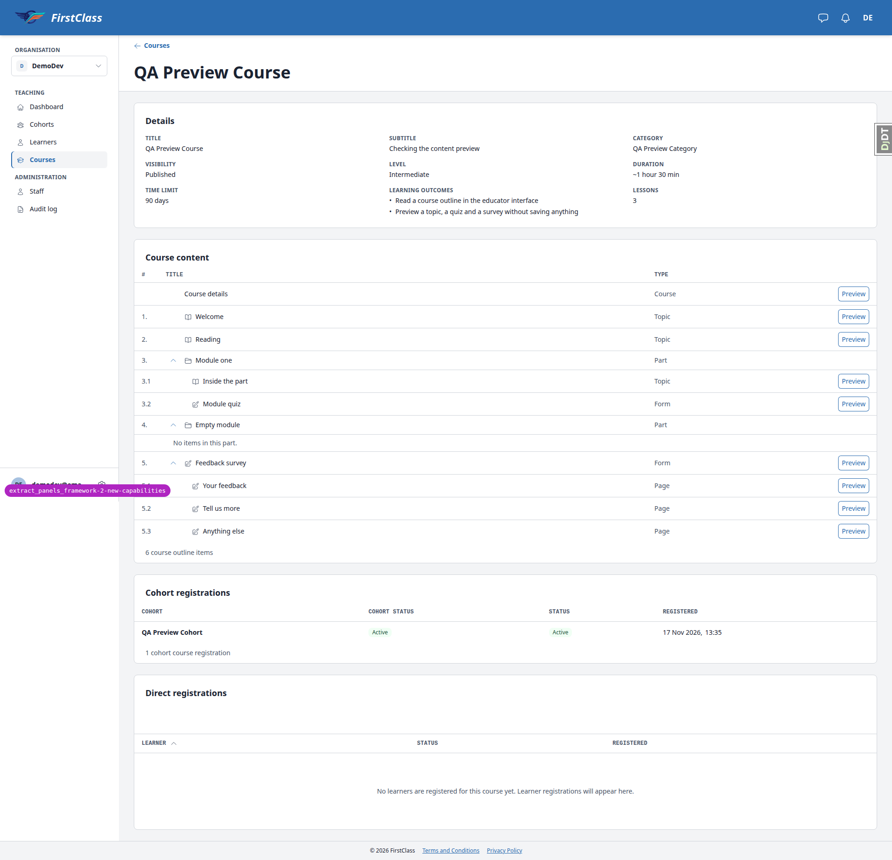 |
| 1.8 | desktop | **fail** | 'No items in this part.' not indented under its part (B1) |  |
| 1.9 | desktop | **fail** | One-line rows differ in height: 49px vs 41px vs 37px (B2) |  |
| 1.10-1.12 | desktop | pass | Footer '6 course outline items' (plan said 7; 6 is correct); no search, filter, sort or Export; no sideways scroll |  |
| 2.1-2.5 | desktop | pass | Collapse and expand by click, Enter and Space; focus and tab order correct; reload reopens parts | 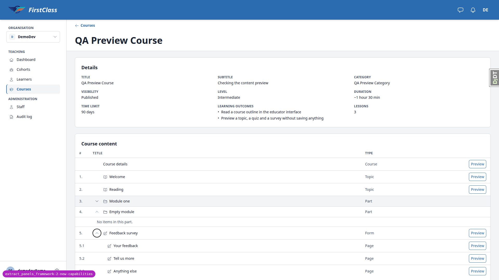 |
| 2.6-2.7 | desktop | pass | Nested parts close and reopen independently; indents 441, 457, 473 | none |
| 3 | desktop | pass | Multi-page form rows with Preview; Escape leaves the form open; one-page form has no chevron | 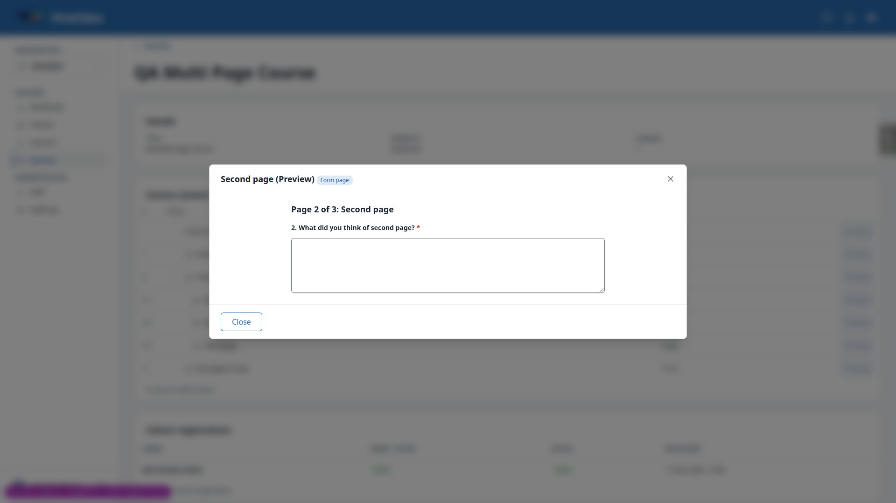 |
| 4 | desktop | pass | Empty course message; Draft Outline callout aligned; Preview Course has no callout | 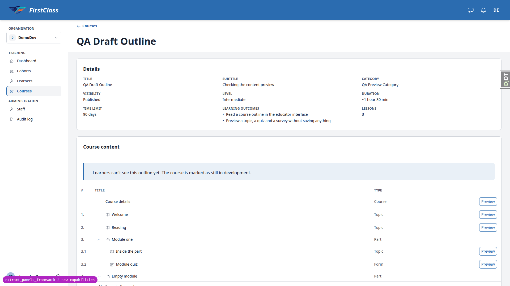 |
| 5 | desktop | pass | Pagination 'Showing 1-10 of 14', part stays on page 1, URL param handling for 999 and abc | 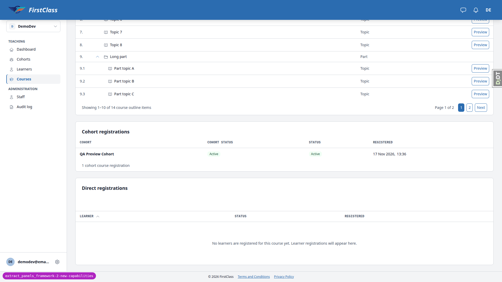 |
| 6.1-6.8 | mobile | pass | Cards replace table, indented children, 44px targets, bottom sheet, no sideways scroll | 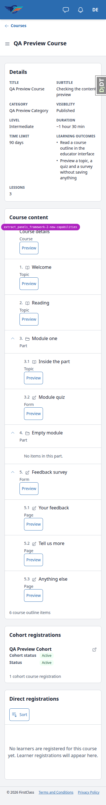 |
| 6.7 | mobile | pass | Welcome preview as a full-width sheet with Close in footer | 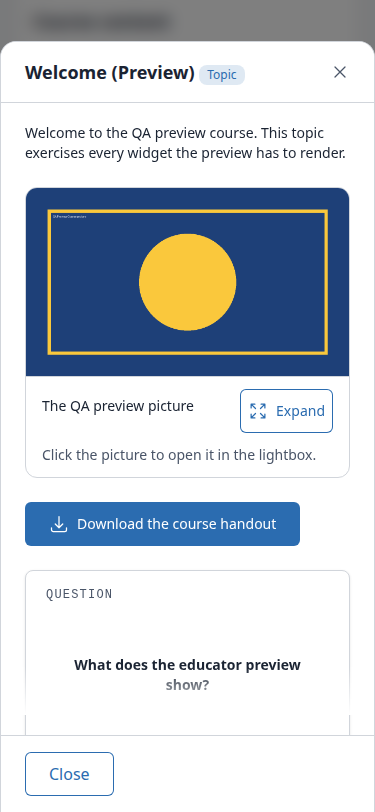 |
| 6.9 | mobile | pass | Long course footer and Previous/Next under cards; nested cards indented | 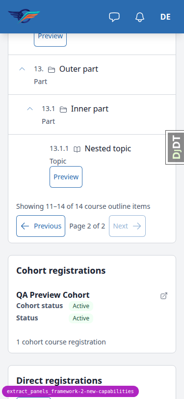 |
| 6.10 | tablet | pass | Table with Type column, no sideways scroll; same row-height split (filed under B2) | 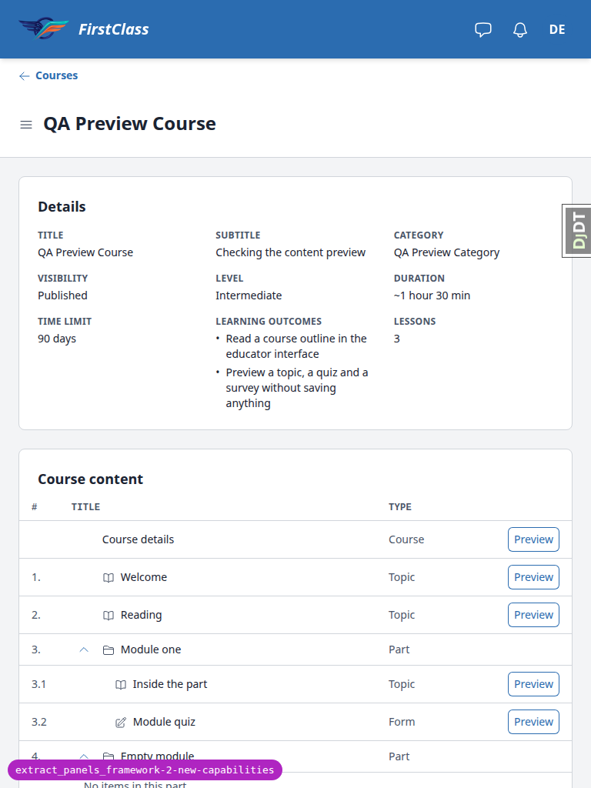 |
| 6.11 | mobile | pass | Table and card open state are separate, as expected; no console errors across tests 1-6 | none |
| 7.1-7.2 | desktop | pass | 'Use ...' lines; row detail chevrons toggle the detail | 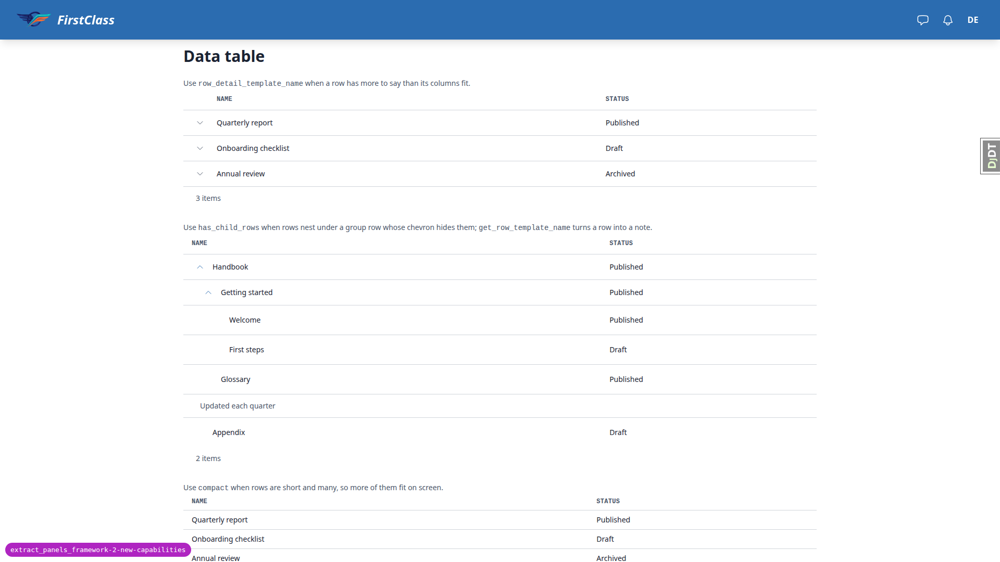 |
| 7.3-7.4 | desktop | **fail** | Behaviour passes; note row lacks depth indent (B1) and leaf rows are 57px vs 49px group rows (B2) |  |
| 7.5 | desktop | pass | Compact rows 37px vs row detail rows 49px |  |
| 7.6 | mobile | pass | Cards indent by depth; chevron hides and restores cards; no sideways scroll | 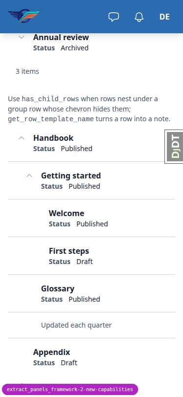 |
| 7.7 | tablet | pass | Tables at 768 with no sideways scroll; same 49/57px split as desktop | none |
| 8.1-8.4 | desktop | pass | Three reason dialog examples with correct fields and labels | 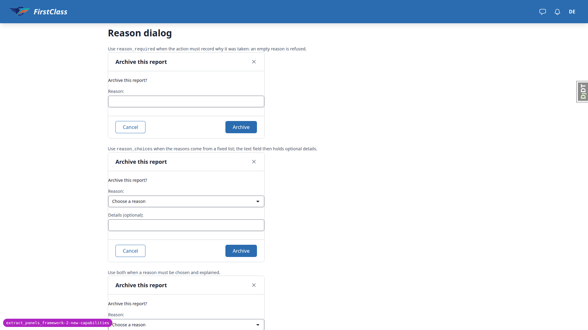 |
| 8.5 | desktop | **fail** | Dialog body has no horizontal padding (B3) |  |
| 8.6-8.7 | desktop | pass | Focus rings shown; Archive with empty fields posts back with no error | 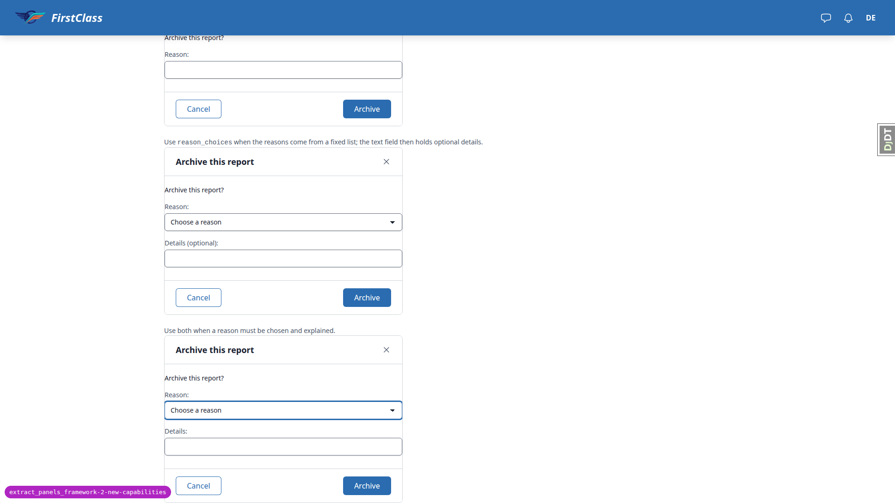 |
| 8.8 | desktop | pass | Lazy panel 'As of 15 Jan 2026, 09:30 UTC' in 14px muted text with `<time>` | 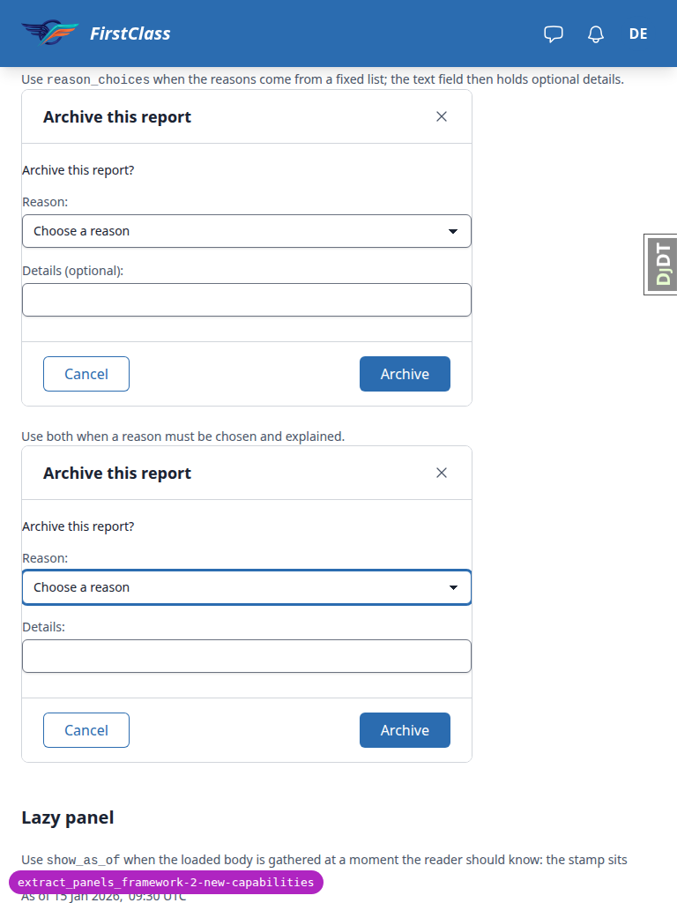 |
| 8.9 | mobile | pass | No sideways scroll at 375 and 768; fields inside dialogs | none |
| 9.1-9.2 | desktop | pass | Deactivate dialog optional reason; 600 characters gives 422 and keeps text | 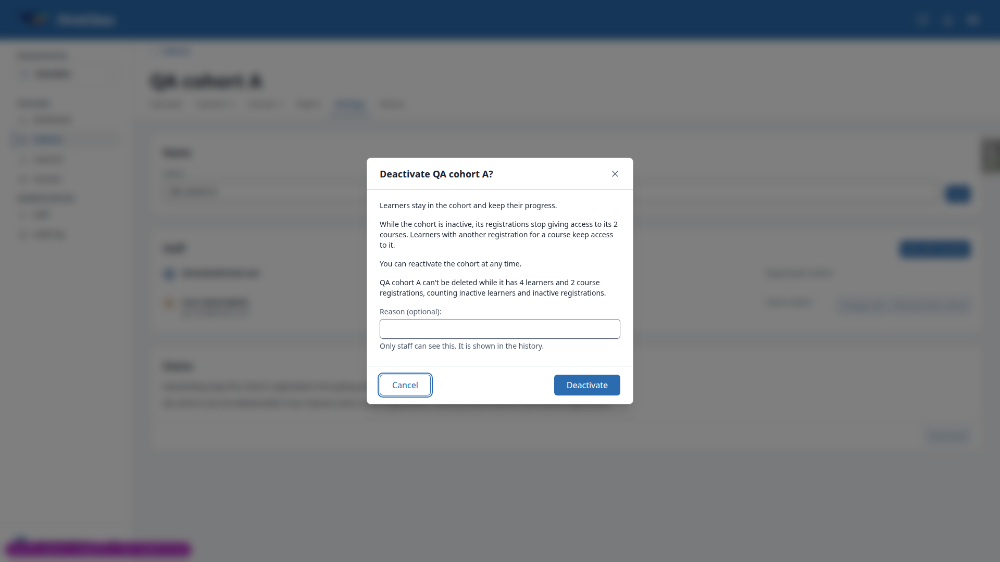 |
| 9.3 | desktop | pass | Dashboard and Report lazy panels load with no 'As of' line | 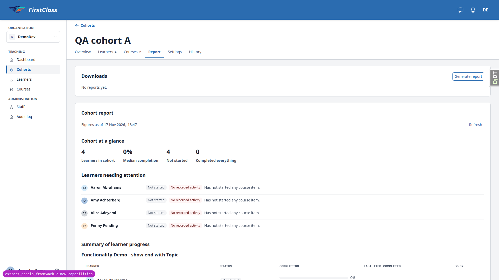 |
| 9.4-9.5 | desktop | pass | Learners table features intact; audit log one page, row detail works | none |
| 9.6 | mobile | pass | Learners and audit log cards; no sideways scroll | 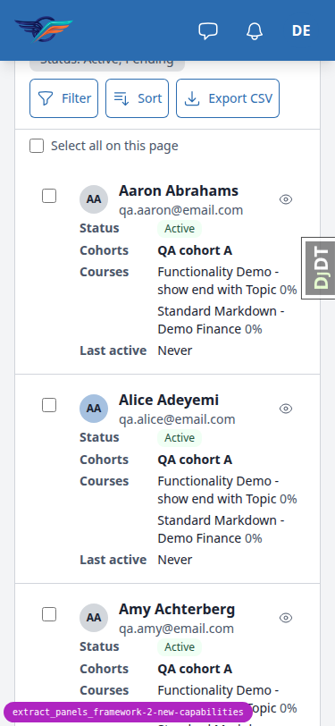 |
| 9.6b | mobile | pass | Audit log cards keep the chevron slot, aligned | 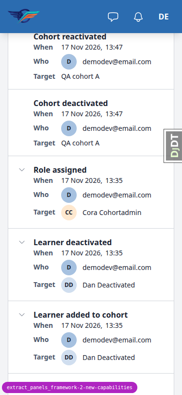 |
| 9.7-9.8 | desktop | pass | Bulk add to cohort works; CSV export downloads; no console errors | none |
| 10 | desktop | pass | JavaScript off: all rows show; pagination links do a full page load | none |

## Bugs

### B1: A per-row template row loses its depth indent

Manifestations: test 1.8 (desktop), test 6.10 (tablet), test 7.3-7.4 (desktop).

- **Expected:** A row whose `get_row_template_name` returns a template renders it "with the row's depth indent". 'No items in this part.' sits indented under 'Empty module' like the part's children, and the reference page's 'Updated each quarter' note sits at its siblings' indent under Handbook.
- **Actual:** The template cell starts at the table's base indent. Outline note text is at x=373 vs the part's title at 412 and child titles at 428. The reference note is at x=384 vs Handbook at 408 and its other children at 424. Cards at 375 indent correctly.

### B2: One-line rows in a child-rows table differ in height

Manifestations: test 1.9 (desktop), test 6.10 (tablet), test 7.3-7.4 (desktop).

- **Expected:** Every one-line row of a table is the same height (QA plan: all one-line outline rows the same height).
- **Actual:** The group-row chevron button is size-8 with -my-1 (24px net), but the leaf rows' chevron spacer span is size-8 with no negative margin (32px), so leaf rows are 8px taller. Reference child-rows example: 57px leaf vs 49px group rows. Outline: 49px for rows with a Preview button vs 41px for part rows (the Preview button is also 32px).

### B3: Reference page reason dialog examples have no body padding

Manifestations: test 8.5 (desktop), test 8.9 (tablet).

- **Expected:** Each reason dialog example is laid out as the app's confirm dialogs: body text and fields inset like the title and footer (the real Deactivate dialog insets its field 25px each side).
- **Actual:** The body ('Archive this report?', labels, select and text field) sits flush with the dialog's left and right edges while the title and footer are inset 24px.

## Layout probe

| Test | Viewport | URL | Screenshot | Result |
|---|---|---|---|---|
| 1 | desktop | /educator/organisations/demodev/courses/&lt;QA Preview Course&gt; | [screenshot](screenshots/page-2026-11-17T13-37-39-232Z.png) | clean |
| 4 | desktop | /educator/organisations/demodev/courses/&lt;QA Draft Outline&gt; | [screenshot](screenshots/page-2026-11-17T13-40-50-242Z.png) | clean |
| 5 | desktop | /educator/organisations/demodev/courses/&lt;QA Long Course&gt; | [screenshot](screenshots/page-2026-11-17T13-42-29-233Z.png) | clean |
| 6 | mobile | /educator/organisations/demodev/courses/&lt;QA Preview Course&gt; | [screenshot](screenshots/page-2026-11-17T13-42-50-284Z.png) | clean |
| 6 | tablet | /educator/organisations/demodev/courses/&lt;QA Preview Course&gt; | [screenshot](screenshots/page-2026-11-17T13-43-25-239Z.png) | clean |
| 7 | desktop | /panel-framework/components/ | [screenshot](screenshots/page-2026-11-17T13-43-58-613Z.png) | clean |
| 8 | tablet | /panel-framework/components/ | [screenshot](screenshots/page-2026-11-17T13-45-40-481Z.png) | clean |
| 9 | mobile | /educator/organisations/demodev/learners/ | [screenshot](screenshots/page-2026-11-17T13-48-29-841Z.png) | clean |

## Data changes

| Via | What |
|---|---|
| DB drop, DB create, Migrate | Dev database had no DemoDev site (every page 500); dropped, recreated and migrated it |
| sdd:qa-data-helper | `create_demo_data --yes`, `content_save demo_content DemoDev`, `qa_create_dev_org_baseline`, `qa_create_course_content_preview`, and new `qa_create_course_structure_variants` (QA Multi Page Course with a 3-page and a 1-page form; QA Long Course with 13 top-level items, part 10th, Outer part > Inner part > Nested topic) |
| sdd:qa-data-helper | QA Long Course: swapped the order of 'Long part' and 'Topic 9' so the part is the 9th top-level item (last row of page 1); `qa_create_course_structure_variants` updated to match |

## Bug status

| Bug | Status |
|---|---|
| B1 | **FIXED** (commit: c437a3c0e) — A per-row template row loses its depth indent. Re-checked: the reference note lines up with its siblings' titles (x=424); the outline note lines up with its sibling rows' kind icons, one step in from the part. |
| B2 | **FIXED** (commit: d5f7d86ab) — One-line rows in a child-rows table differ in height. Re-checked: outline one-line rows all 41px at 1920 and 768, reference child rows all 49px; Preview stays 32px. |
| B3 | **FIXED** (commit: 8618ace0f) — Reference page reason dialog examples have no body padding. Re-checked: fields inset 25px from the dialog's left edge at 1920, 768 and 375, as in the app's Deactivate dialog. |

## General notes

- The plan expects a footer count of 7, but the correct count for the seeded outline is 6 (Course details plus 5 top-level items).
- 'As of' shows UTC because the project's `TIME_ZONE` is UTC, not the plan's SAST example.
- The long course's part had to be moved so it ends page 1 (it is now the 9th top-level item, last row of page 1 after Course details).
- The dev database had to be rebuilt at the start because it had no DemoDev site.

- The full run after the fixes: 15578 passed, 1 failed. The failure was `test_quick_view_drawer`, the known flaky test already filed in todo.md (it times out on a loaded machine and passes when run alone).

- After the fixes, the first reason dialog example's Cancel button showed a focus ring on a fresh page load, so something on the reference page takes focus on load. Not covered by the QA plan; noted only.

status: ok · reason: 3 bugs — 3 fixed, 0 unresolved; report rendered, screenshots verified
