# Frontend QA report: extract_panels_framework-2-new-capabilities

## Methodology

- Playwright MCP, driven by hand at three viewports: desktop 1920x1080, mobile 375x812 and tablet 768x1024.
- Screenshots were collected into `screenshots/` beside this report. Every image linked below exists in that folder (checked with Glob before linking).
- A layout probe was run after every screenshot.
- Images were not compressed (none was over 1MB).

## Diff scoping

Class: **FULL**. Nothing was skipped. Desktop, mobile and tablet all ran.

Changed app files, summarised by directory:

- `freedom_ls/base/templates/cotton/`: `pagination.html`.
- `freedom_ls/educator_interface/`: `views.py`, the `alpine-components.js` file, the `panels/course_content.html` template, and the `course_outline_*`, `audit_log_card` and `staff_card` partials. The educator Playwright tests, `test_views.py` and `test_touch_targets.py` also changed.
- `freedom_ls/panel_framework/`: `actions.py`, `bulk_actions.py`, `config.py`, `context.py`, `forms.py`, `lazy_panels.py`, `panels.py`, `reference.py`, `tables.py`, `views.py` and the app's `alpine-components.js`.
- `freedom_ls/panel_framework/templates/`: the cotton components (`data-table`, `data-table-card`, `modal-footer`, `panel-definition-list`, `panel-table-card`), the modal confirm template, the data table region and lazy region templates, the `as_of`, `child_rows_toggle` and `row_indent` partials, and the component reference templates (`_examples`, `_lazy_panel`, `_note_row`, `_reason_dialog`, `_row_detail`, `component_reference`).
- `freedom_ls/panel_framework/tests/`: component, invariant, Playwright and unit tests, plus stub panels and test templates.
- `freedom_ls/qa_helpers/management/commands/`: three QA data commands (course cohort registrations, course structure variants, direct course registrations).
- `tailwind.components.css`.

## Smoke gate

Pass. Both pages loaded: `/` and `/educator/organisations/demodev/courses/da3c1aa1-1d96-45f2-bdce-5a393cad06aa`.

## Results by test

| Test | Viewport | Result | Note | Screenshot |
|---|---|---|---|---|
| 1 | desktop | pass | Outline columns, numbering, chevrons, indent, empty-part row and footer ("10 course outline items") all as the spec describes. | 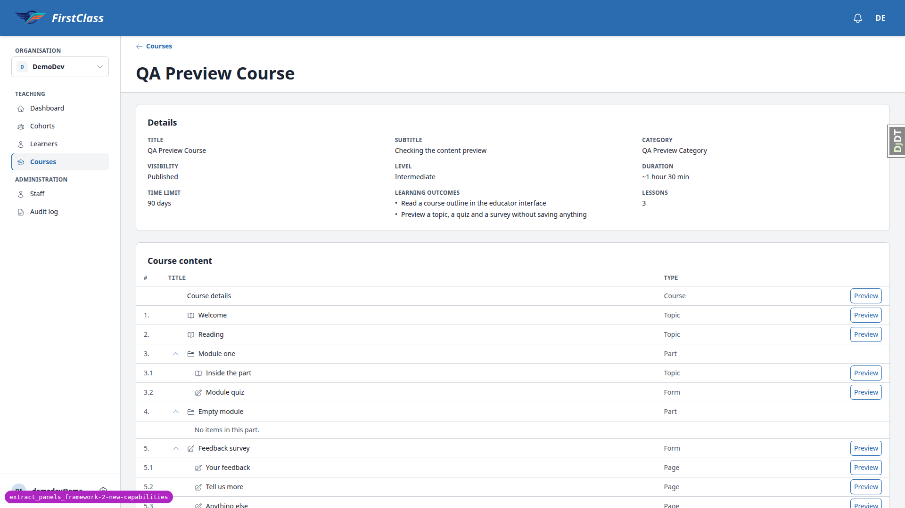 |
| 2.1-2.4 | desktop | pass | Collapse and expand by click, Enter and Space; focus stays on the chevron; Tab skips hidden rows. | 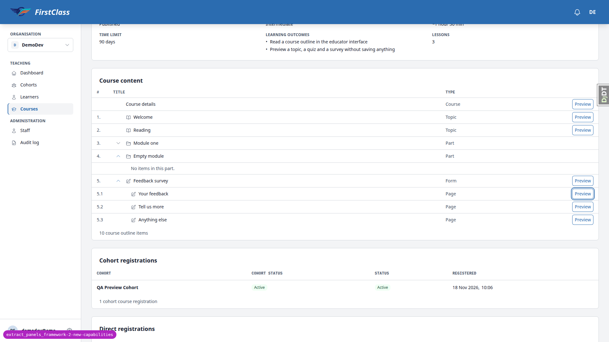 |
| 4.1 | desktop | pass | Empty course shows the course details row and the "No content in this course yet." empty state. | 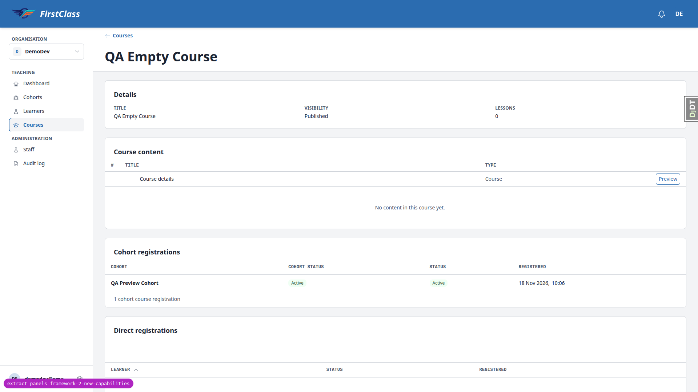 |
| 2.5-2.7 | desktop | pass | Nested collapse and expand in QA Long Course; reload reopens every part; indent steps 417, 433, 449px. | 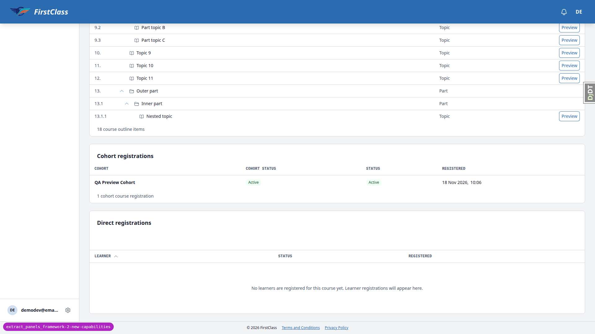 |
| visual-direct-registrations | desktop | **fail** | Empty 67px toolbar band on the Direct registrations panel (B3, predates this branch). |  |
| 3 | desktop | pass | Multi-page forms: page rows, Preview on each page, collapse and expand. No console errors. |  |
| 4.2 | desktop | **fail** | 48px gap between the panel heading and the in-development callout (B2, predates this branch). |  |
| 4.3 | desktop | pass | QA Preview Course shows no in-development callout. |  |
| 5.1-5.7 | desktop | pass | Superseded by the spec: all rows on one page, footer "18 course outline items", no pager. See general note 1. |  |
| 5.8 | desktop | **fail** | Preview on a topic nested two parts deep returns 404 (B1). | 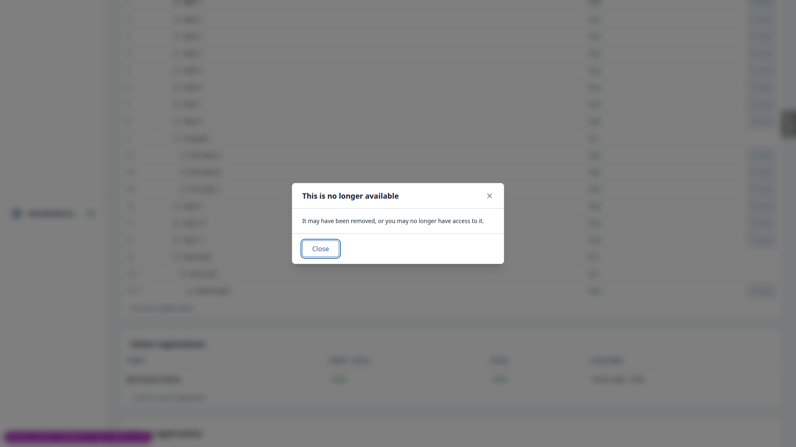 |
| 7.1-7.5 | desktop | pass | Row detail and child rows examples work by mouse and keyboard; compact rows 37px; no sideways scroll. | 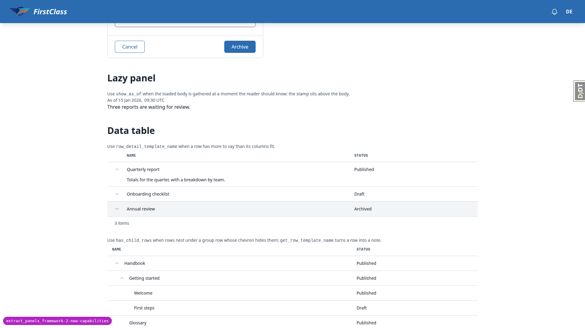 |
| 8.1-8.8 | desktop | pass | Three reason dialog examples, focus rings, lazy panel "As of" stamp. | 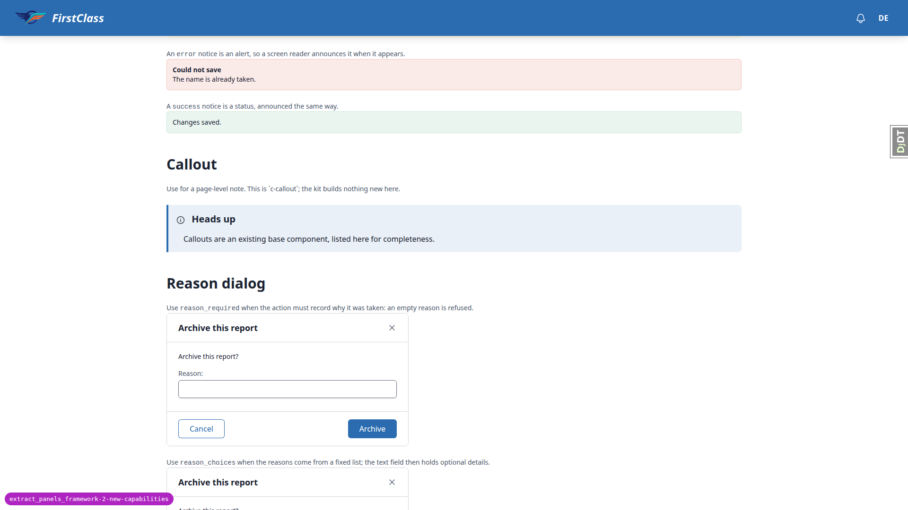 |
| 9.1-9.2 | desktop | pass | Deactivate dialog with optional reason; 520-character value gives a 422 with the error shown; empty reason deactivates. | 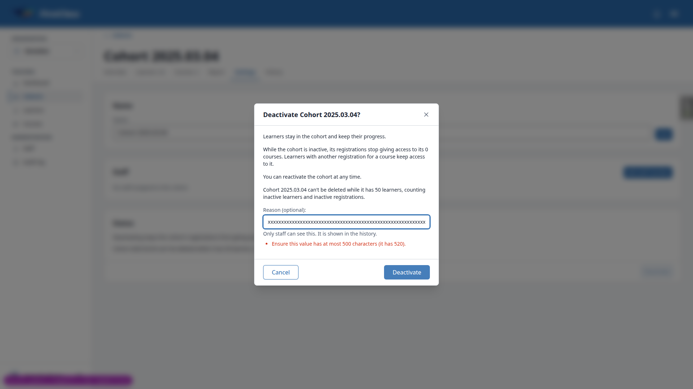 |
| 9.3 | desktop | pass | Dashboard lazy panels have no "As of" line; the cohort report keeps its own "Figures as of" line. | 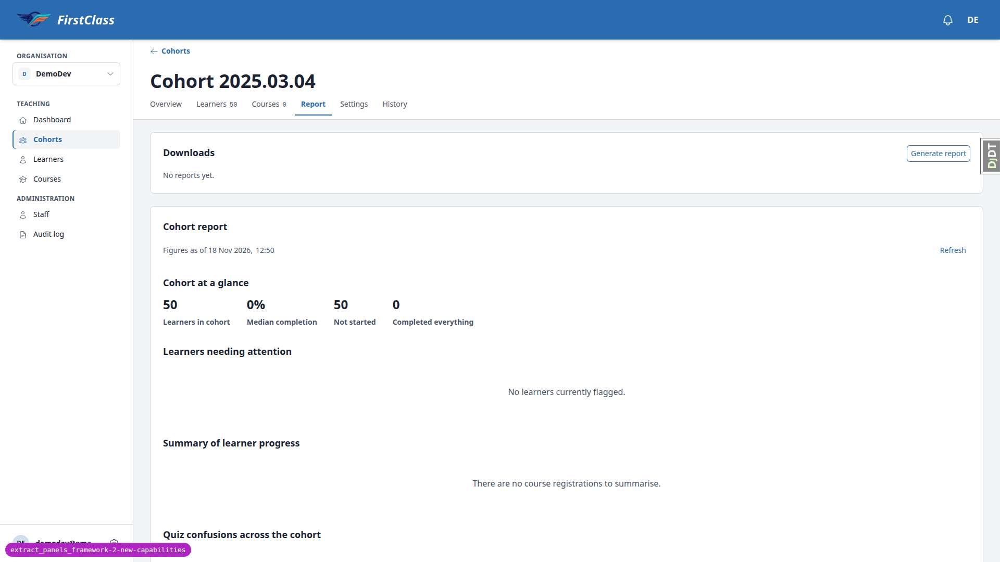 |
| 9.4 | desktop | pass | Learners table: 65px rows, 10 per page, search, filters, sort, checkboxes. | 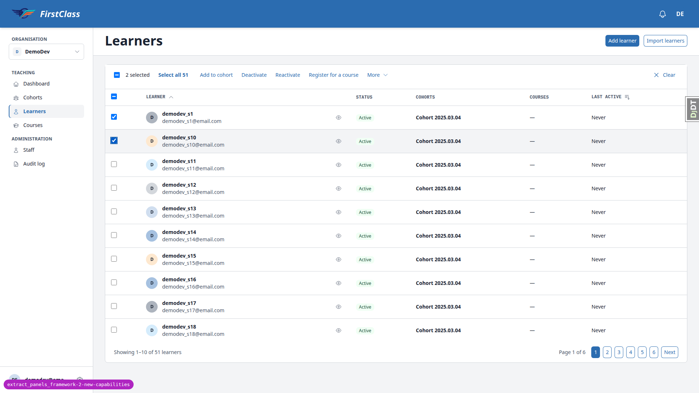 |
| 9.7-9.8 | desktop | pass | Bulk Add to cohort preview and result; CSV export has 51 data rows. |  |
| 9.5 | desktop | pass | Audit log pages at 25; row-detail chevrons closed by default; open and close work. | 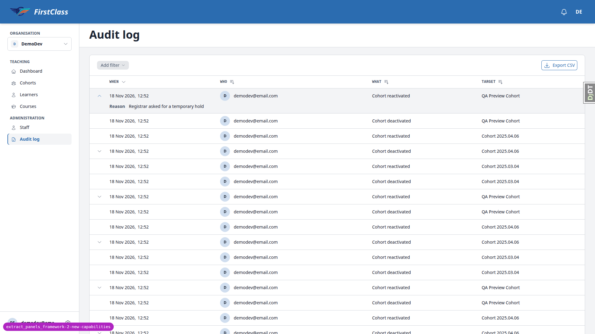 |
| 10 | desktop (JS off) | pass | All 12 outline rows visible with JavaScript off; no-JS paging checked on Learners (10.3 replaced). | 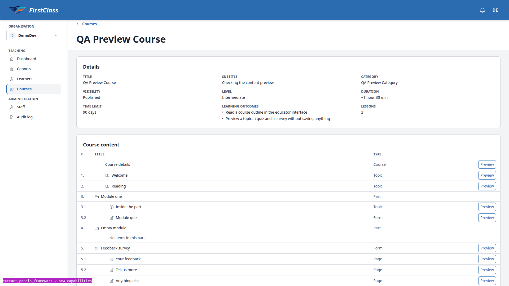 |
| 6.1-6.8 | mobile | pass | Cards, indent, 44px chevrons, collapse and expand, Preview bottom sheet, no sideways scroll. | 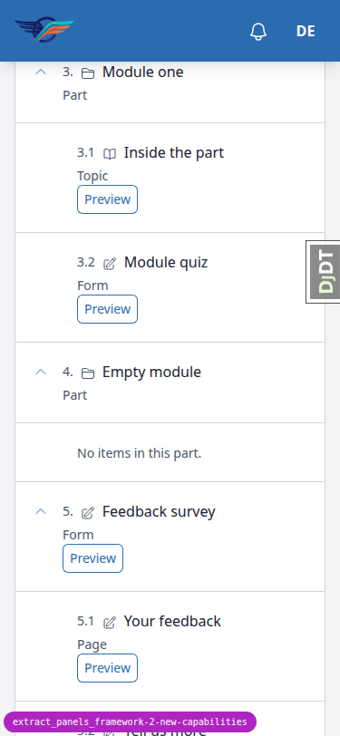 |
| 6.7 | mobile | pass | Preview opens as a bottom sheet inside the screen with title and Close. | 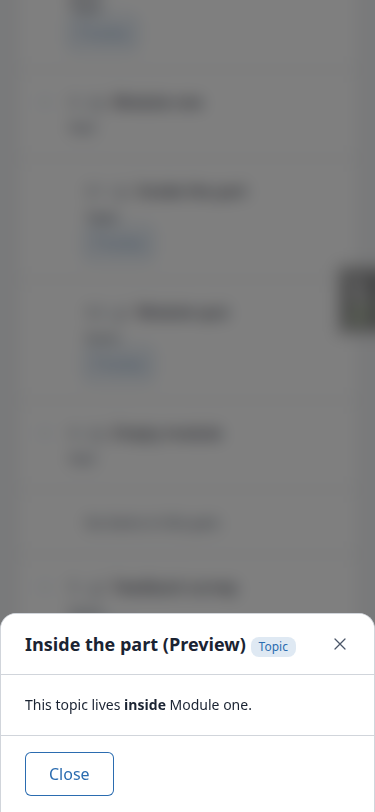 |
| 6.3-6.9 | mobile | pass | QA Long Course: 19 cards, indents 16/32/48px, footer count, no page controls. | 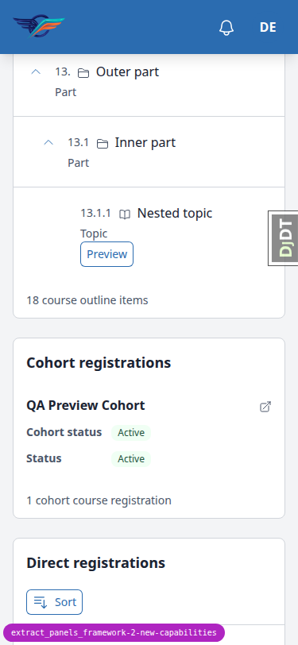 |
| 7.6-8.9 | mobile | pass | Reference page examples render as cards; child rows collapse and restore; dialogs fit. | 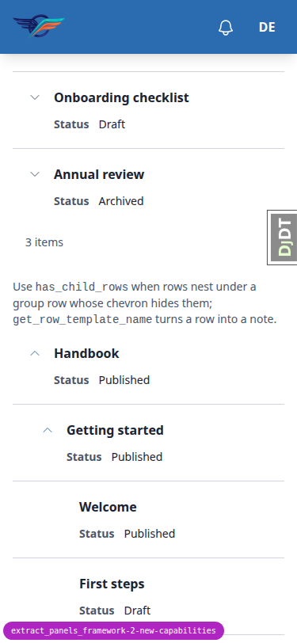 |
| 9.6-learners | mobile | pass | Learners cards spaced and indented correctly; 32px toolbar and pager buttons. | 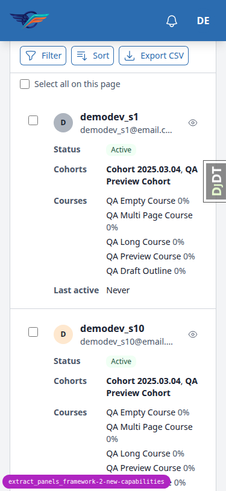 |
| 9.6-audit | mobile | pass | Audit log cards keep the chevron slot; chevron opens the Reason detail. | 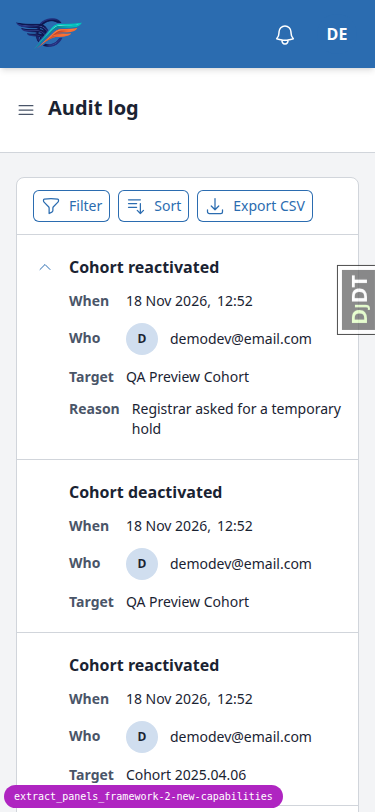 |
| 6.10 | tablet | pass | Outline is a table (not cards) at 768; 41px rows; no sideways scroll. | 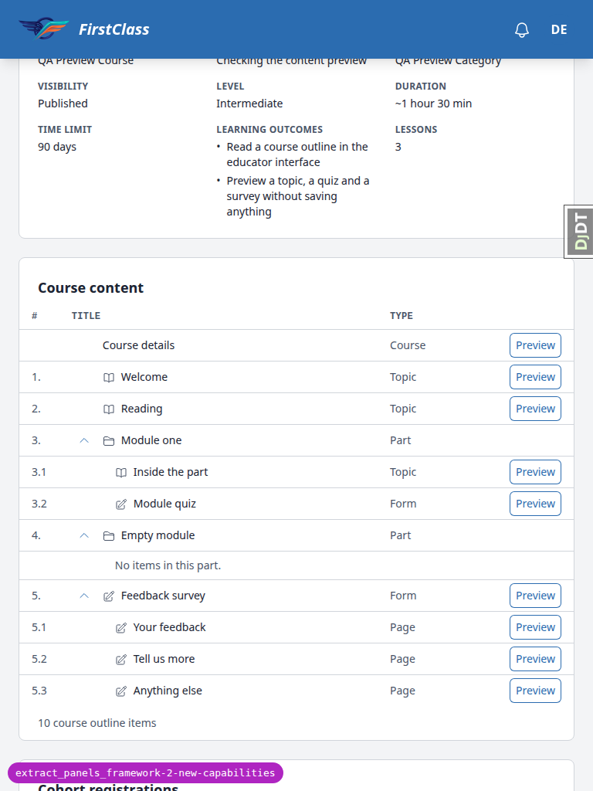 |
| 7.7-8.9 | tablet | pass | Reference page examples are tables; dialogs fit; lazy panel stamp shown. | 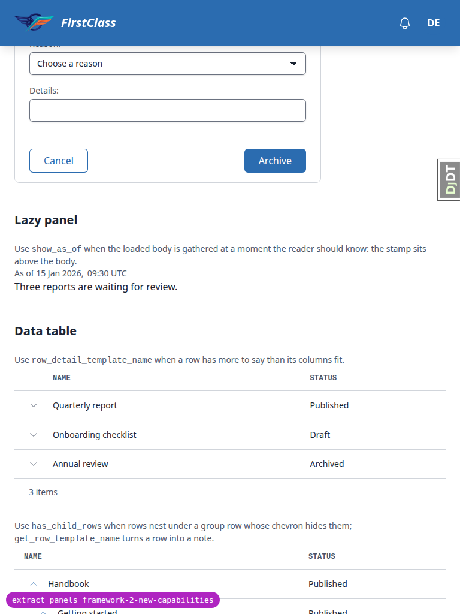 |

## Design check

no design states tested

## B1: Nested part's topic Preview returns 404 ('This is no longer available')

Manifestations:

- Test 5.8, desktop.

**Expected:** Every row the outline gives a Preview button opens that item's preview. That includes a topic inside a part that is itself inside a part (13.1.1 "Nested topic" in QA Long Course).

**Actual:** `preview_content?item=<nested topic item pk>` returns 404, the dialog says "This is no longer available", and the console logs the 404. `PreviewContentAction` (`freedom_ls/educator_interface/views.py`, around line 2381) searches `Course.collection_items_flat()`. That method flattens only one level of part nesting. `outline_rows` and `_outline_item_rows` recurse to any depth and render the Preview button. Topics at depth 0 and 1 preview fine.

## B2: In-development callout's class="my-0" loses to the callout's own my-6, leaving a 48px gap under the panel heading

Manifestations:

- Test 4.2, desktop.

**Expected:** `course_content.html` passes `class="my-0"` to `<c-callout>`, so the callout should sit directly in its `px-4 pt-4 sm:px-6` wrapper under the "Course content" heading.

**Actual:** `callout.html` renders `class="my-6 ... my-0"`. Tailwind's `my-6` wins (computed margin 24px top and bottom). The callout starts 48px below the heading (heading bottom 568, callout top 616) and sits 24px above the table.

This predates this branch: `callout.html` and the panel's callout wrapper are unchanged here.

## B3: Sort-only data table shows an empty toolbar band at md and up

Manifestations:

- Test visual-direct-registrations, desktop.

**Expected:** A table whose toolbar has nothing to show from md up (no search, filters or export; only the phone Sort menu) shows no toolbar band. Its header row should follow the panel heading, as in the Cohort registrations panel.

**Actual:** The course page's Direct registrations panel renders a 67px toolbar row with a bottom border and nothing in it at 1920. Its only content, the Sort menu, is hidden from md up.

This predates this branch: `table_toolbar.html` and its include are unchanged here.

## Layout probe

| Test | Viewport | URL | Screenshot | Result |
|---|---|---|---|---|
| 1 | desktop | /educator/organisations/demodev/courses/&lt;QA Preview Course&gt; | [screenshot](screenshots/page-2026-11-18T12-43-07-646Z.png) | clean |
| 2 | desktop | /educator/organisations/demodev/courses/&lt;QA Preview Course&gt; | [screenshot](screenshots/page-2026-11-18T12-43-56-957Z.png) | clean |
| 4.1 | desktop | /educator/organisations/demodev/courses/&lt;QA Empty Course&gt; | [screenshot](screenshots/page-2026-11-18T12-44-23-402Z.png) | clean |
| 2.6 | desktop | /educator/organisations/demodev/courses/&lt;QA Long Course&gt; | [screenshot](screenshots/page-2026-11-18T12-45-35-113Z.png) | clean |
| 3 | desktop | /educator/organisations/demodev/courses/&lt;QA Multi Page Course&gt; | [screenshot](screenshots/page-2026-11-18T12-46-11-745Z.png) | clean |
| 4.2 | desktop | /educator/organisations/demodev/courses/&lt;QA Draft Outline&gt; | [screenshot](screenshots/page-2026-11-18T12-44-46-257Z.png) | clean |
| 7 | desktop | /panel-framework/components/ | [screenshot](screenshots/page-2026-11-18T12-48-00-277Z.png) | clean |
| 8 | desktop | /panel-framework/components/ | [screenshot](screenshots/page-2026-11-18T12-48-31-052Z.png) | clean |
| 9.3 | desktop | /educator/organisations/demodev/cohorts/&lt;id&gt;/__tabs/report | [screenshot](screenshots/page-2026-11-18T12-50-36-516Z.png) | clean |
| 9.4 | desktop | /educator/organisations/demodev/learners/ | [screenshot](screenshots/page-2026-11-18T12-51-54-270Z.png) | clean |
| 9.5 | desktop | /educator/organisations/demodev/audit-log/ | [screenshot](screenshots/page-2026-11-18T12-53-41-844Z.png) | clean |
| 6 | mobile | /educator/organisations/demodev/courses/&lt;QA Preview Course&gt; | [screenshot](screenshots/page-2026-11-18T12-54-29-988Z.png) | clean |
| 6.9 | mobile | /educator/organisations/demodev/courses/&lt;QA Long Course&gt; | [screenshot](screenshots/page-2026-11-18T12-54-58-481Z.png) | clean |
| 7 | mobile | /panel-framework/components/ | [screenshot](screenshots/page-2026-11-18T12-55-13-113Z.png) | clean |
| 9.6-learners | mobile | /educator/organisations/demodev/learners/ | [screenshot](screenshots/page-2026-11-18T12-55-24-181Z.png) | clean |
| 9.6-audit | mobile | /educator/organisations/demodev/audit-log/ | [screenshot](screenshots/page-2026-11-18T12-55-36-418Z.png) | clean |
| 6.10 | tablet | /educator/organisations/demodev/courses/&lt;QA Preview Course&gt; | [screenshot](screenshots/page-2026-11-18T12-56-01-514Z.png) | clean |
| 7 | tablet | /panel-framework/components/ | [screenshot](screenshots/page-2026-11-18T12-56-14-549Z.png) | clean |

## Data changes

| What | Via | Files |
|---|---|---|
| 36 audit entries in demodev (3 cohorts deactivated and reactivated 6 times each through the app's own functions, every 3rd with a reason), so the audit log pages at 25 and shows row details | sdd:qa-data-helper | `freedom_ls/qa_helpers/management/commands/qa_create_audit_log_paging.py` |

## Bug status

| Bug | Status |
|---|---|
| B1 | **FIXED** (commit: 93288f81b) — Nested part's topic Preview returns 404 ('This is no longer available'). Re-verified: the nested topic previews (200); depth-1 and form-page previews still work. The fix could only be committed after c8b362f5a removed a duplicate `_go_back_and_wait_for_restore` in `test_quick_view_flow.py`. That duplicate was already committed at HEAD, and the mypy hook rejected every commit until it was removed. |
| B2 | **FIXED** (commit: 84fa626e4, after-fix screenshot: [B2 fixed](screenshots/page-2026-11-18T13-55-07-558Z.png)) — In-development callout's class="my-0" loses to the callout's own my-6, leaving a 48px gap under the panel heading. Re-verified: the callout's margin is now 0 and it sits 24px under the heading. Callers that pass no margin class keep my-6. |
| B3 | **FIXED** (commit: ff3fdc226, after-fix screenshot: [B3 fixed](screenshots/page-2026-11-18T14-22-04-306Z.png)) — Sort-only data table shows an empty toolbar band at md and up. Re-verified: Direct registrations' header now sits 8px under its heading, the same as Cohort registrations. The phone Sort menu is still shown, and the Learners and audit log toolbars are unchanged. |

## General notes

1. The test plan is stale where the spec changed after it was written. Test 1.10 expects "7 course outline items", and Test 5 expects the outline to page at 10 top-level rows. The spec (section 4) and commit e892c2324 now put every row on one page, with a footer counting parts, topics, forms and form pages. So the page's "10 course outline items" and "18 course outline items" with no pager follow the spec, and were recorded as passes. Test 10.3 (outline page 2 with JS off) was replaced by a no-JS paging check on the Learners table. The plan should be updated to match.
2. Test 9.2: the reason input has `maxlength=500`, so the over-long value was set by script to reach the server-side 422.
3. In the outline and the child-rows example, the Title column header sits at the cell's left edge, over the chevron slot, not over the titles. The row-detail example's leading chevron column keeps its header over the names. The spec does not describe this either way. It is recorded as an observation, not a bug.
4. The collapsed debug-toolbar tab overlaps the right edge at 375 and 768. This is dev tooling only.
5. Files in `qa-screenshots/` from earlier sessions were moved aside to the session scratchpad rather than collected, so the report links only this run's screenshots.

Full test tier after the fixes: 15103 passed, 0 failed.

status: ok · reason: 3 bugs — 3 fixed, 0 unresolved; full tier passed; report rendered, screenshots verified
