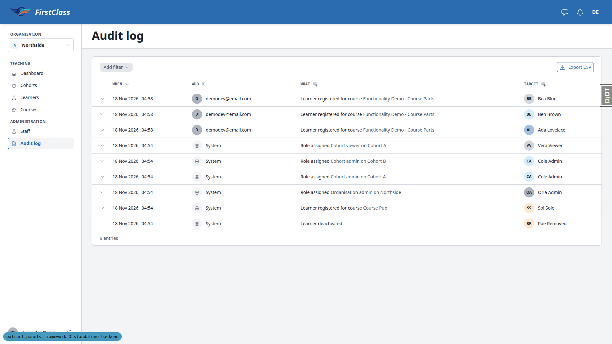
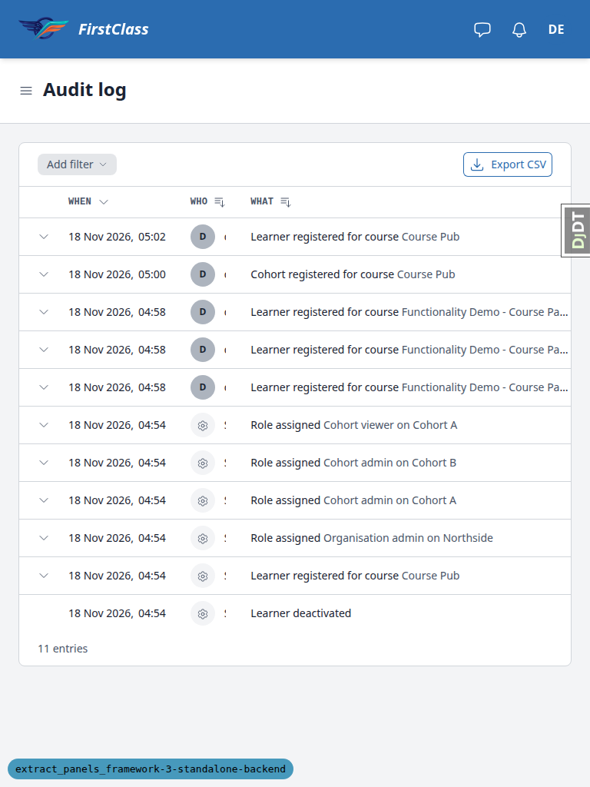

# QA report: extract_panels_framework-3-standalone-backend

Seventeen tests ran across three viewports. Fifteen passed and two failed. Two bugs are documented (B1, B2). Both are pre-existing and not caused by this branch.

| Viewport | Pass | Fail |
|---|---|---|
| Desktop (1920x1080) | 10 | 1 |
| Mobile (375x812) | 4 | 0 |
| Tablet (768x1024) | 1 | 1 |

## Methodology

- Playwright MCP at 1920x1080, 375x812 and 768x1024.
- Screenshots were collected into this spec directory's `screenshots/` folder. Every referenced image exists beside this report.
- No frontend QA plan existed in the spec dir. `2. plan.md` states that nothing a browser renders changes. Test cases were derived from `1. spec.md` sections 2-6 and 8 (site resolver, BulkActionRun site scoping, CSV helpers, date formats) and run against the educator interface panels.
- Rebase: the pre-step rebase replayed 13 commits onto origin/main (one docs-only commit, sacaa-compliance specs). There were no conflicts. The lost-change check found only roadmap.md context drift. The targeted tier was none, pre-commit was clean, and the branch was pushed. The rebase front-end check was folded into this QA run, which visits the same pages at all three viewports.
- The screenshot `page-2026-11-18T04-57-33-842Z.png` is superseded. It was taken with the debug toolbar open. The replacement is `page-2026-11-18T04-57-43-358Z.png`.
- Screenshots were not compressed because none was over 1 MB.

## Diff scoping

Class: **FULL**.

Changed files that triggered it:

- `freedom_ls/panel_framework/tests/standalone_templates/*.html` (16 stand-in templates, test-only)
- `freedom_ls/panel_framework/{app_settings,bulk_actions,bulk_runs,checks,config,csv_safety,field_display,housekeeping,models,sites,tables,views,apps}.py`
- `config/settings_base.py`
- `pyproject.toml`, `uv.lock`
- `.github/workflows/tests.yml`
- test files and spec docs

Skipped: nothing. Everything ran. Rule 1 fired on the test-only `.html` stand-in templates. No served template changed, so the mobile and tablet passes focus on the panel pages whose server code changed.

## Smoke gate

Outcome: **pass**. Pages loaded: `/` and `/educator/organisations/northside/learners`.

The first load of `/` returned 500 because the post-rebase rebuild left the dev DB empty. Seeding (see Data changes) fixed it before the gate ran.

## Test results

| Test id | Viewport | Status | Screenshot | Notes |
|---|---|---|---|---|
| 0.smoke-home | desktop | pass | [link](screenshots/page-2026-11-18T04-57-43-358Z.png) | Dashboard renders after seeding; branch badge names this branch. The earlier shot page-2026-11-18T04-57-33-842Z.png was taken with the debug toolbar open and is superseded. |
| 0.smoke-learners | desktop | pass | [link](screenshots/page-2026-11-18T04-57-54-486Z.png) | Learners panel list: 66 learners, 10 per page, filters, Export CSV, row checkboxes; sidebar column beside content. |
| 1.csv-export | desktop | pass | — | Export CSV on the Northside learners panel downloads learners-2026-11-18.csv: UTF-8 BOM present (csv_safety.UTF8_BOM), header plus 66 rows, quoted multi-value cells. Exercises the framework's own csv_safety/EchoWriter copies. |
| 2.bulk-confirm | desktop | pass | [link](screenshots/page-2026-11-18T04-58-45-578Z.png) | Selecting 3 learners shows the selection bar; Register for a course opens the confirm dialog, which disables submit until a course is picked and then names the 3 learners and the course. |
| 2.bulk-run | desktop | pass | [link](screenshots/page-2026-11-18T04-58-57-901Z.png) | Confirming POSTs to `__actions/register_for_course` (200). The result dialog reads "3 learners changed." and the table refreshes with the new course. RecordedBulkAction.execute resolved the site through PANEL_FRAMEWORK_SITE_RESOLVER (get_cached_site) and wrote the run with site= (no PermissionDenied). |
| 3.date-format | desktop | pass | [link](screenshots/page-2026-11-18T05-00-07-045Z.png) | Audit log WHEN column renders "18 Nov 2026, 04:58", matching the framework's own DATETIME_DISPLAY_FORMAT "j M Y, H:i" (unchanged from before). |
| 3.run-summary | desktop | fail | [link](screenshots/page-2026-11-18T05-00-07-045Z.png) | Pre-existing, not from this branch. See B1. |
| 2.bulk-run-cohorts | desktop | pass | [link](screenshots/page-2026-11-18T05-00-39-577Z.png) | Cohorts panel: select Cohort C, Register for a course > Course Pub; POST `__actions/register` 200; result dialog "1 cohort changed.". Cohort list's date column renders "18 Nov 2026, 04:54". |
| 4.run-status-scoping | desktop | pass | — | Logged in as demodev on DemoDev, GET learners/__runs/<id> with HX-Request: own DemoDev run b979a2b9 returns 200 with "3 learners changed."; the same user's run on the Bloom site 30903178 returns 404 "This is no longer available"; an unknown id returns 404. BulkActionRun.objects.for_request scopes by the resolved site. |
| 5.csv-formula-escaping | desktop | pass | — | Learner named "=1+2 @SUM(A1)" exports as "'=1+2 @SUM(A1)": the framework's escape_csv_formula prefixes a quote. |
| 6.console | desktop | pass | — | Console errors were all expected: the pre-seed 500 on /, the two deliberate `__runs` 404s, and a favicon.ico 404 that predates this branch. |
| 0.smoke-learners | mobile | pass | [link](screenshots/page-2026-11-18T05-01-44-326Z.png) | Learners panel becomes stacked cards with filter, sort and Export CSV buttons; the formula-named learner renders as plain text. |
| 2.bulk-confirm | mobile | pass | [link](screenshots/page-2026-11-18T05-02-13-720Z.png) | The selection bar wraps its actions. The confirm dialog is a bottom sheet the width of the viewport (375x323), with the title and both buttons inside it. |
| 2.bulk-run | mobile | pass | [link](screenshots/page-2026-11-18T05-02-24-339Z.png) | Registering Ada for Course Pub returns 200, and the result sheet reads "1 learner changed.". |
| 3.date-format | mobile | pass | [link](screenshots/page-2026-11-18T05-02-33-415Z.png) | Audit log cards show When "18 Nov 2026, 05:02". |
| 2.bulk-confirm | tablet | pass | [link](screenshots/page-2026-11-18T05-03-00-508Z.png) | At 768 the learners panel shows cards with a one-line selection bar. The confirm dialog is centred at 512px wide, with its title, field and both buttons inside it. |
| 3.audit-who-column | tablet | fail | [link](screenshots/page-2026-11-18T05-03-09-124Z.png) | Pre-existing; this branch does not touch the audit log table. See B2. |

## Design check

no design states tested

## B1: Bulk runs write no audit-log run summary and no shared run_id

Pre-existing and not caused by this branch: it does not touch audit_log or `educator_interface/actions.py`.

Manifestations: 3.run-summary (desktop).

- **Expected:** per the educator-interface-11-audit-log spec (decision 3, and the Spec 8 paragraph under Documentation), a recorded bulk action writes one entry per changed object plus one `bulk_action.completed` summary entry, all sharing a run_id. The organisation audit log shows only the summary row, with the per-object entries folded under "Show N entries".
- **Actual:** registering 3 Northside learners for a course wrote three separate per-object entries with no run_id, and they show as three rows in the organisation log. No production code calls `audit_log.writer.record_run_summary`; only the `qa_create_audit_log_history` seed does.

## B2: Audit log WHO column squeezed to one character at tablet width

Pre-existing and not caused by this branch: it does not touch the audit log table.

Manifestations: 3.audit-who-column (tablet).

- **Expected:** at 768px the actor's name in the WHO column stays readable. The panel-framework skill says a read-only table that scrolls sideways has a minimum width on its name column, so a person's name stays readable at every width.
- **Actual:** WHO is 79px wide and shows the avatar plus one clipped character of "demodev@email.com". The table scrolls sideways (834px in 718px), and When (159px, one line) and WHAT (448px) take the space. The layout probe does not flag it because the clipped ink sits inside a scroll region.

## Layout probe

The probe's `header` region was reported missing on every page. The configured selector does not match this shell, so it is not a flag.

| Test id | Viewport | URL | Screenshot | Result |
|---|---|---|---|---|
| 0.smoke-home | desktop | / | [link](screenshots/page-2026-11-18T04-57-43-358Z.png) | clean |
| 0.smoke-learners | desktop | /educator/organisations/northside/learners | [link](screenshots/page-2026-11-18T04-57-54-486Z.png) | clean |
| 2.bulk-confirm | desktop | /educator/organisations/northside/learners | [link](screenshots/page-2026-11-18T04-58-45-578Z.png) | clean |
| 2.bulk-run | desktop | /educator/organisations/northside/learners | [link](screenshots/page-2026-11-18T04-58-57-901Z.png) | clean |
| 3.date-format | desktop | /educator/organisations/northside/audit-log | [link](screenshots/page-2026-11-18T05-00-07-045Z.png) | clean |
| 2.bulk-run-cohorts | desktop | /educator/organisations/northside/cohorts | [link](screenshots/page-2026-11-18T05-00-39-577Z.png) | clean |
| 0.smoke-learners | mobile | /educator/organisations/northside/learners | [link](screenshots/page-2026-11-18T05-01-44-326Z.png) | clean |
| 2.bulk-confirm-selection | mobile | /educator/organisations/northside/learners | [link](screenshots/page-2026-11-18T05-02-03-715Z.png) | clean |
| 2.bulk-confirm | mobile | /educator/organisations/northside/learners | [link](screenshots/page-2026-11-18T05-02-13-720Z.png) | clean |
| 2.bulk-run | mobile | /educator/organisations/northside/learners | [link](screenshots/page-2026-11-18T05-02-24-339Z.png) | clean |
| 3.date-format | mobile | /educator/organisations/northside/audit-log | [link](screenshots/page-2026-11-18T05-02-33-415Z.png) | clean |
| 2.bulk-confirm-selection | tablet | /educator/organisations/northside/learners | [link](screenshots/page-2026-11-18T05-02-53-104Z.png) | clean |
| 2.bulk-confirm | tablet | /educator/organisations/northside/learners | [link](screenshots/page-2026-11-18T05-03-00-508Z.png) | clean |
| 3.date-format | tablet | /educator/organisations/northside/audit-log | [link](screenshots/page-2026-11-18T05-03-09-124Z.png) | clean |

## Data changes

| Via | What changed |
|---|---|
| sdd:qa-data-helper | Seeded the empty per-branch dev DB (recreated by the post-rebase rebuild): `create_demo_data --yes`, `content_save demo_content DemoDev`, `qa_create_dev_org_baseline`, `qa_create_educator_interface_seed`, `qa_create_bulk_operations_scenario` (all `--site-name DemoDev`). |
| sdd:qa-data-helper | Created BulkActionRun 30903178-8a88-4e65-9cb5-3ee09e0ab9fa on the Bloom site (copy of DemoDev run b979a2b9..., requested_by demodev pk 8) for the cross-site check. Renamed User 183 (bulk60@qa.test) from "Bulk 60 Beta" to "=1+2 @SUM(A1)" for the CSV formula-escaping check. |

## Bug status

| Bug | Status |
|---|---|
| B1 | **UNRESOLVED** — Bulk runs write no audit-log run summary and no shared run_id (reason: red lane. Wiring `RecordedBulkAction` to `record_run_summary` crosses the boundary this spec draws: the framework may not import FLS's `audit_log`, so the hook's shape is a design decision. The audit-log spec also ties it to a reason input in the bulk confirmation, which is a UX decision.) |
| B2 | **FIXED** (commit: 3ebf5c197) — Audit log WHO column squeezed to one character at tablet width |
| — | **UNRESOLVED** — full run after the fixes left tests failing (reason: the run is unusable because Docker stopped mid-run and the test database on 127.0.0.1:6543 refused connections. 8976 errors came from that. 7 tests failed with assertions under that load: test_course_player::test_player_page_query_count_with_deadlines_does_not_grow_with_items, test_permission_matrix::test_can_matches_the_matrix[assign_cohort_viewer-cohort_viewer-cohort-other_organisation], test_dashboard::test_started_course_ranks_before_unstarted_course_regardless_of_registration_order, webhooks test_events TestFireWebhookEventWithoutRequest (2 tests), mail test_backends::test_the_database_task_backend_carries_only_the_row_id, tests/test_playwright_fixtures.py::test_closes_connection_opened_while_playwright_loop_is_current. None touches the audit log code B2 changed. The fixer's targeted tier passed (2579). Re-run the full tier with Docker up.) |

B2 re-verification: at 768px the organisation audit log's WHO and TARGET columns are 192px (`min-w-48`), and the actor reads "demodev@ema…" with an ellipsis. "System" shows in full. The table still scrolls inside its own wrapper, with no page-level overflow ([after](screenshots/page-2026-11-18T05-25-40-223Z.png)). Spot checks: Ada Lovelace's History tab at 768 is clean ([shot](screenshots/page-2026-11-18T05-25-54-918Z.png)), and the audit log at 1920 has no overflow and no probe flags.

## General notes

- The favicon.ico 404 predates this branch.
- The cross-site Bloom run 30903178 was scoped to the Northside organisation, which is a test artefact.
- The background-task path (over BULK_BACKGROUND_THRESHOLD=250 rows) and the W001 system check were not driven in the browser. The unit tests cover them, and the todo already holds a user item for the `manage.py check` run.

status: ok · reason: 2 bugs — 1 fixed, 1 unresolved; full run after the fix blocked by the test database going down; report rendered, screenshots verified
