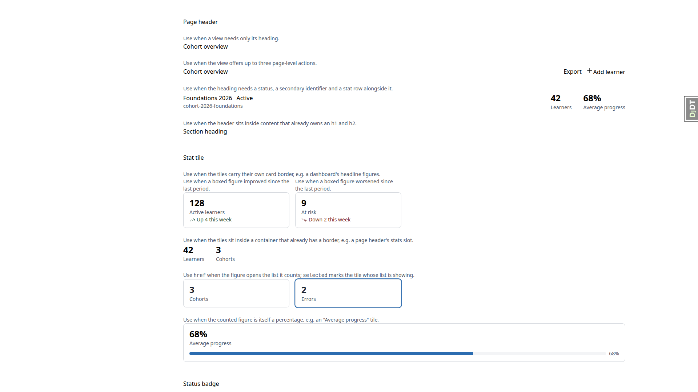
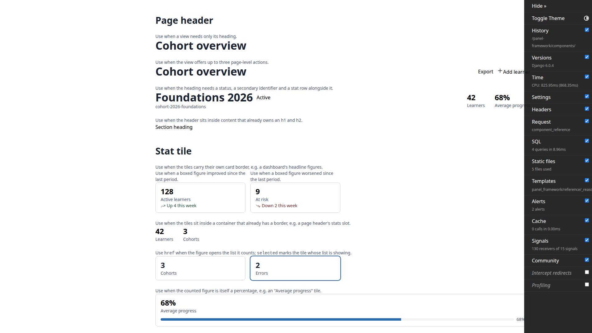
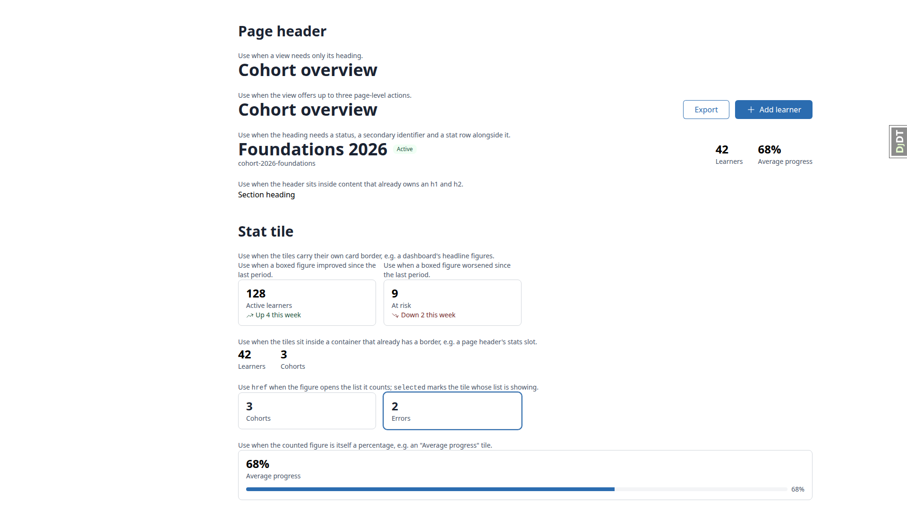
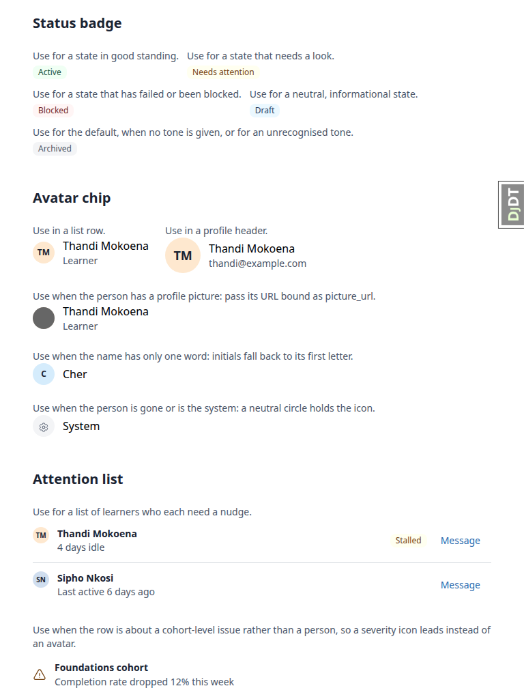
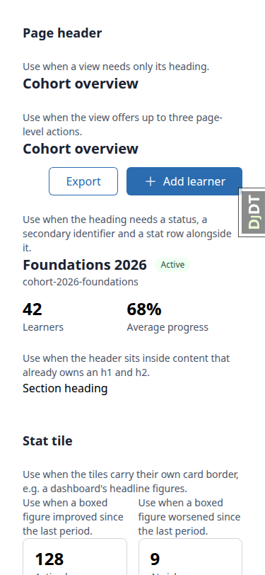
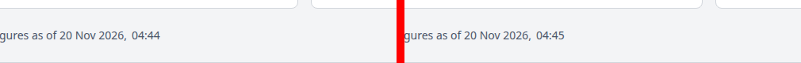
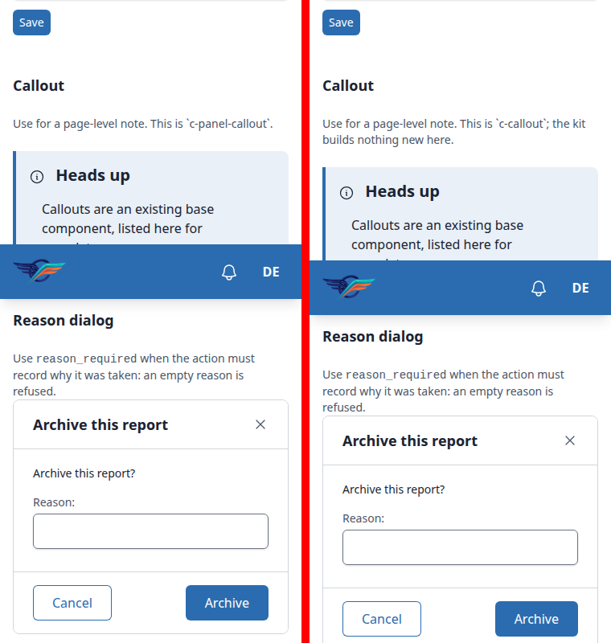
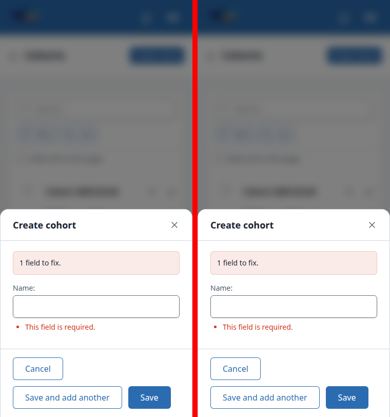
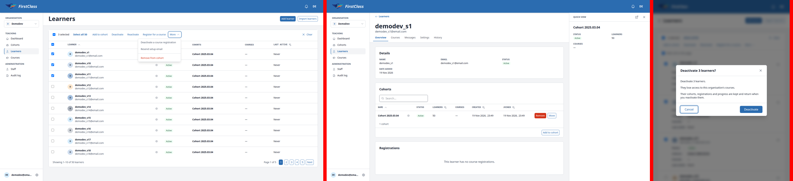

# Frontend QA report: panel framework templates, JS and CSS stop assuming FLS

## Methodology

Screenshots were collected into `screenshots/` beside this report. Every image referenced below was checked and exists there. The run did not abort at the smoke gate, so every step ran. Several tests are PARTIAL or skipped, and each is listed in General notes.

## Diff scoping

Class: FULL. The changed files were 163 files, including templates/, static/, .css and .js. Nothing was skipped. All three viewports and all sections ran.

## Smoke gate

Pass. Pages loaded: `/` and `/educator/organisations/demodev/dashboard`.

## Test results

| Test | Viewport | Result | Screenshot | Notes |
| --- | --- | --- | --- | --- |
| 0.3 | desktop | skip | none | No main baseline. §1 was judged against the §1.3 checklist alone. |
| 1.1a | desktop | pass | [shot](screenshots/page-2026-11-19T23-51-23-580Z.png) | Educator dashboard; FLS shell, no overflow, no console errors. |
| 1.1b | desktop | pass | [shot](screenshots/page-2026-11-19T23-51-31-984Z.png) | Cohorts list uses btn and chip classes; dates formatted correctly. |
| 1.1c | desktop | pass | [shot](screenshots/page-2026-11-19T23-52-30-906Z.png) | Applied-filter chip and Clear all. |
| 1.1d | desktop | pass | [shot](screenshots/page-2026-11-19T23-52-42-159Z.png) | Cohort page overview. |
| 1.1g | desktop | pass | [shot](screenshots/page-2026-11-19T23-53-36-419Z.png) | Numbered pager on page 2. |
| 1.1e | desktop | pass | [shot](screenshots/page-2026-11-19T23-53-48-668Z.png) | Selection bar with 3 selected (Learners list). |
| 1.1f | desktop | pass | [shot](screenshots/page-2026-11-19T23-53-55-491Z.png) | More menu opens under its trigger. |
| 1.1i | desktop | pass | [shot](screenshots/page-2026-11-19T23-58-48-513Z.png) | Learner page dates. |
| 1.1j | desktop | pass | [shot](screenshots/page-2026-11-19T23-58-55-840Z.png) | Quick view opens beside content. |
| 1.1k | desktop | pass | [shot](screenshots/page-2026-11-19T23-55-18-843Z.png) | Create cohort dialog. |
| 1.1l | desktop | pass | [shot](screenshots/page-2026-11-19T23-58-01-430Z.png) | 422 and field error inside dialog. |
| 1.1m | desktop | pass | [shot](screenshots/page-2026-11-19T23-58-33-470Z.png) | Deactivate confirm dialog. |
| 1.1n | desktop | pass | [shot](screenshots/page-2026-11-20T00-02-28-197Z.png) | Component reference in the FLS shell. |
| 1.1n | desktop | pass | [shot](screenshots/page-2026-11-20T00-02-10-849Z.png) | Reason dialog examples; one chevron. |
| 1.1h | mobile | pass | [shot](screenshots/page-2026-11-20T00-00-59-650Z.png) | Filter bottom sheet. |
| 1.3-pager | mobile | pass | [shot](screenshots/page-2026-11-20T00-00-45-559Z.png) | Previous and Next only. |
| 1.1k | mobile | pass | [shot](screenshots/page-2026-11-20T00-01-14-909Z.png) | Create dialog bottom sheet, 44px buttons. |
| 1.1h | tablet | pass | [shot](screenshots/page-2026-11-20T00-01-40-826Z.png) | Numbered pager, no overflow. |
| 1.1i | tablet | pass | [shot](screenshots/page-2026-11-20T00-01-44-859Z.png) | Learner page, no overflow. |
| 2.1.1 | desktop | pass | [shot](screenshots/page-2026-11-19T23-53-55-491Z.png) | Menu opens beside trigger, on screen. |
| 2.1.2 | desktop | pass | none | Esc closes and returns focus; outside click closes. |
| 2.1.3 | mobile | pass | [shot](screenshots/page-2026-11-20T00-01-55-033Z.png) | Sort menu sets learners-sort and closes. |
| 2.1.4 | desktop | pass | none | Header user menu works alongside panel menus. |
| 2.1.5 | desktop | pass | none | Scroll closes the menu; same body as dropdownMenu per drift test. |
| 2.2.1 | mobile | pass | [shot](screenshots/page-2026-11-20T00-00-45-559Z.png) | Table swaps in place; URL carries learners-page. |
| 2.2.2 | desktop | pass | none | Sort survives page change. |
| 2.2.3 | desktop | pass | none | Search survives page change. |
| 2.3.1 | desktop | pass | none | Sidebar navigation swaps without a full load; tab title keeps its suffix. |
| 2.3.2 | desktop | pass | none | Back link returns to the list. |
| 2.3.3 | desktop | pass | none | Reload matches the htmx navigation. |
| 2.4.1 | desktop | pass | [shot](screenshots/page-2026-11-19T23-58-01-430Z.png) | Errors inside the open dialog, "1 field to fix." |
| 2.4.2 | desktop | pass | none | Dialog closes and the new cohort's page opens. |
| 2.4.3 | desktop | skip | none | PARTIAL: no required-reason action exists to exercise. |
| 2.4.4 | desktop | pass | none | Double-click produced one POST; button disabled and showing "Saving…". |
| 2.5.1 | desktop | pass | none | Counts update to 10 and then 50 selected. |
| 2.5.2 | desktop | pass | [shot](screenshots/page-2026-11-20T00-00-07-867Z.png) | Bulk deactivate; result dialog with FLS Close button. |
| 2.5.3 | desktop | pass | none | Clear unchecks rows and hides the bar. |
| 1.3-console | desktop | pass | none | No Alpine warnings; only the aborted-request and deliberate-422 errors. |
| 3 | desktop | pass | [shot](screenshots/page-2026-11-20T00-03-18-318Z.png) | first_class theme: panel-surface is white, canvas is #F8F9FC, semibold buttons, pill chips. |
| 3 | desktop | pass | [shot](screenshots/page-2026-11-20T00-03-21-113Z.png) | first_class create dialog. |
| 4-load | desktop | pass | [shot](screenshots/page-2026-11-20T00-04-40-858Z.png) | Minimal shell loads; reference.css 200; no console errors; no overflow. |
| 4-styled | desktop | FAIL | [shot](screenshots/page-2026-11-20T00-04-44-370Z.png) | Headings unstyled (see B1). |
| 4-classes | desktop | FAIL | [shot](screenshots/page-2026-11-20T00-04-44-370Z.png) | Buttons and chips unstyled with FLS class names (see B2). |
| 4-nav | mobile | skip | [shot](screenshots/page-2026-11-20T00-06-20-732Z.png) | PARTIAL: no navigation toggle on the reference page. |
| 4-examples | desktop | pass | none | Child rows, lazy panel, reason dialog POST (200, CSRF header present), one chevron. |
| 4-educator | desktop | pass | [shot](screenshots/page-2026-11-20T00-06-26-330Z.png) | /educator/ still renders in the FLS shell. |
| 5 | desktop | pass | none | E009 raised; hint names PANEL_REFERENCE_BASE_TEMPLATE and HOST_CONTRACT.md#reference-page. |

## Design check

No design states tested.

## B1: Minimal shell leaves h1/h2 unstyled

Manifestations:

- 4-styled, desktop

Expected: page titles and section headings in the minimal shell have heading sizes and weight, as the FLS shell gives them.

Actual: h1 and h2 compute 16px and weight 400. Their sizes live only in FLS's `tailwind.components.css` base layer. `minimal_shell.css` does not replace that layer, and `HOST_CONTRACT.md` does not list it.

## B2: FLS wrappers make the minimal-shell reference page unstyled

Manifestations:

- 4-classes, desktop

Expected: per QA plan §4, a button's class list holds `panel-btn` and a chip's holds `panel-chip`, both styled by `reference.css`.

Actual: under FLS settings the FLS wrappers replace every primitive. The page carries `btn` and `chip` classes that `reference.css` does not define, so buttons and chips render unstyled (transparent, 0 padding, 0 radius).

## Layout probe

| Test | Viewport | URL | Screenshot | Result |
| --- | --- | --- | --- | --- |
| all | desktop | (every page above) | none | clean |
| 1.1h | mobile | /educator/organisations/demodev/learners (filter sheet open) | [shot](screenshots/page-2026-11-20T00-00-59-650Z.png) | clean. The probe flagged "stacked" and "overlap" because the sheet is itself `dialog.side-panel-dialog`, which the config's sidebar selector matches. Judged a selector artefact after visual review. |

## Data changes

| What changed | Made by | Files written |
| --- | --- | --- |
| The dev DB was empty, so it was created and seeded. This ran DB create, `create_demo_data --yes` and `content_save demo_content DemoDev`. The 50-learner cohort "Cohort 2025.03.04" already existed, so no data helper was needed. Created cohort "QA Cohort 1795132691198". Deactivated then reactivated demodev_s1, s10 and s11. | Manual commands and UI actions during QA | none |

## Bug status

- **FIXED** (commit: 13994114b) — B1: Minimal shell leaves h1/h2 unstyled. Re-verified on a fresh minimal-shell server: h2 30px/700, h1 36px/700 (); the educator cohorts page is unchanged.
- **FIXED** (commit: d09d6b02b) — B2: FLS wrappers make the minimal-shell reference page unstyled. Decided as a QA-plan fix: §4's settings now put the framework's template directory ahead of FLS's wrappers, as the framework's test tiers do. No product code changed. Re-checked on a server with those settings: 21 `panel-btn` and 14 `panel-chip` elements, no `btn` or `chip`, styled by `reference.css`, no overflow, layout probe clean — after the fix:   

## Before/after comparison against `main` (run after QA)

The §1 comparison the first run skipped was run afterwards. A throwaway worktree at `origin/main` served a copy of this branch's dev database, so both servers showed the same records. Each of the 14 states in §1.1 (a to n) was captured on both servers at 1920×1080, 768×1024 and 375×812 and compared pixel for pixel, with the branch badge and debug toolbar hidden. The worktree, its branch and its database were deleted afterwards.

Result: 38 of 42 pairs are identical. The four that differ:

| Pair | Difference | Verdict |
| --- | --- | --- |
| a (dashboard), desktop and tablet | The "Figures as of" time reads 04:44 on one server and 04:45 on the other.  | Clock, not a change. |
| n (component reference), desktop and mobile | The Callout example's intro sentence was reworded on this branch ("This is `c-panel-callout`."). It is one line shorter at 375 wide, so everything below sits 20px higher.  | The reference page's own copy, changed on purpose. No educator page differs. |

Every educator page (a to m) is pixel-identical apart from the clock. Example pair, the create dialog submitted empty at 375 wide, branch left and `main` right: . The branch's desktop shots of the actions menu, the quick view and the deactivate dialog: .

Limits: full-page shots paint the sticky header as a band partway down the page, so about 70px of each full-page pair is covered. State f, j, k, l and m were viewport shots. State h at desktop is the list as loaded, because the Sort menu exists only below md. The first_class theme (§3) was not compared against `main`.

## General notes

- Not run in the first pass (run afterwards, see the section above): the §0.3 main baseline. The main worktree's dev DB has no DemoDev data and another session is working in it. §1 was judged against the §1.3 checklist alone, as §0.3.3 allows. The §3 comparison against main was also not possible.
- 2.4.3 is now covered by `test_empty_required_reason_keeps_dialog_open_with_error_until_filled` (commit dfd89d186) and the QA plan points at it. In the first pass 2.4.3 was PARTIAL. Every reason field in the demo data is optional, and the reference page's reason_required example posts to the page itself with no validation.
- 4-nav: the QA plan no longer checks a navigation toggle on the reference page, which has no navigation (commit d09d6b02b). In the first pass 4-nav was PARTIAL. The reference page renders no navigation toggle, because the toggle comes from `page_title.html` and the reference page sets no page_title or menu_groups. The shell docks its sidebar from lg (1024), not 768.
- 4-examples: the reference page has no dropdown-menu, quick-view or openable-dialog example, so those bullets had nothing to exercise.
- The reference page loads scrolled to the first reason-dialog example because its Cancel button takes focus. Noted, not judged a regression.
- Page 1.1e used the Learners list, because the cohort learners table has no row selection.
- Tablet coverage was limited to 1.1h and 1.1i. The Sort menu exists only below md.
- The tab title reads "Cohorts — DemoDev — DemoDev" because the org scope and site are both named DemoDev. Same format as main.
- The console errors seen were an htmx sendAbort from a search aborted by pressing Enter mid-request, and the 422 from the deliberate empty submit.

status: ok · reason: 2 bugs — 2 fixed, 0 unresolved; main comparison run, 38 of 42 pairs identical, 4 explained; report rendered, screenshots verified
