# Frontend QA report: panel framework templates, JS and CSS stop assuming FLS

Test plan: `3. frontend_qa.md` in this folder. 4 bugs found (B1 to B4); all are not yet triaged.

## Methodology

Screenshots were collected into `screenshots/` beside this report. Every image referenced below exists in that folder. The run did not abort at the smoke gate, so every step ran or was individually recorded as pass, fail or skip.

Before QA, the branch was rebased onto main (39 commits). Conflicts in the panel-callout, form partial, dialog invariant and panel-framework skill files were resolved to main's `tone` callout API. Two follow-up commits were made: one untracked a built `reference.css` that the rebase had picked up, and one fixed the callout tests and `HOST_CONTRACT.md` for `tone`. The full test run after the rebase found 6 callout-test failures, which were fixed. The framework and base tiers then passed (3208 passed).

The run covered four areas:
- Section 1 (FLS unchanged), judged against the 1.3 checklist alone.
- Section 2 (behaviour).
- Section 3 (first_class theme).
- Section 4 (minimal shell).

Not every section-1 page was captured at all three viewports. See General notes.

## Diff scoping

Class: **FULL**. The changed files were 251 files, including templates, static, css and js under `freedom_ls/panel_framework` and `freedom_ls/base`. Nothing was skipped on account of scoping. Desktop, tablet and mobile passes were all in scope.

## Smoke gate

Outcome: **pass**. Pages loaded: `/` and `/educator/organisations/demodev/dashboard`.

## Design check

No design states tested. The plan names no design screenshots, so there are no `design` records.

## Per-bug sections

### B1: Minimal shell leaves form controls, h3 headings and table row rules unstyled

Manifestations:
- 4.styled (desktop)
- 4.reason (desktop)

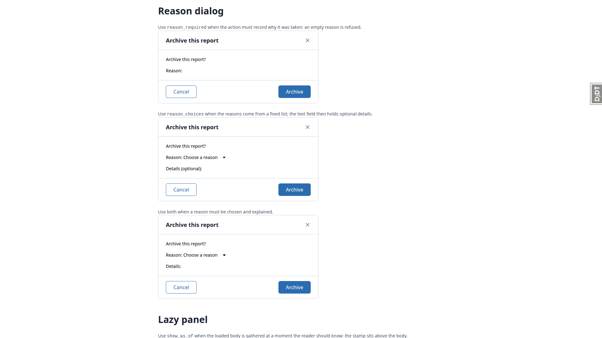
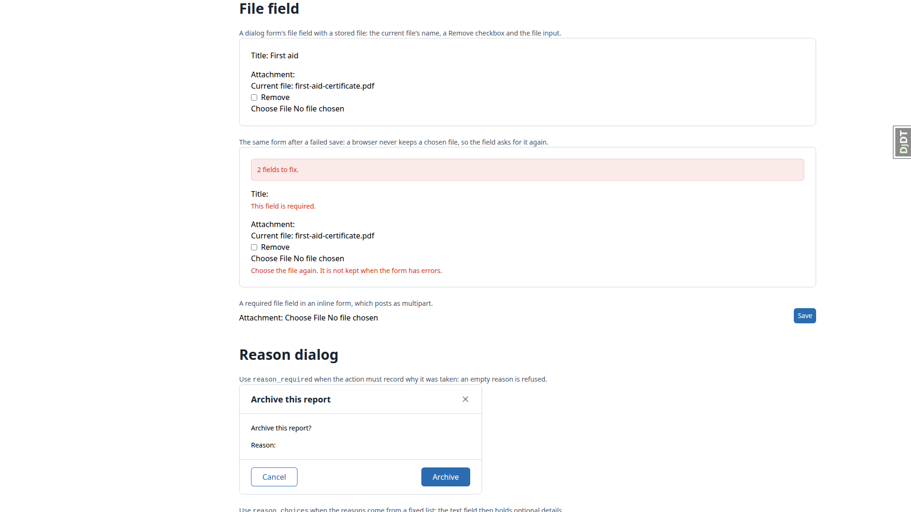
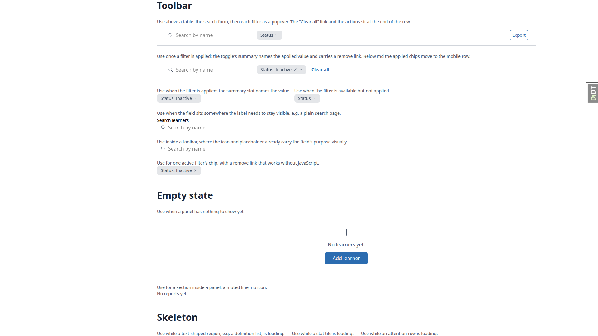
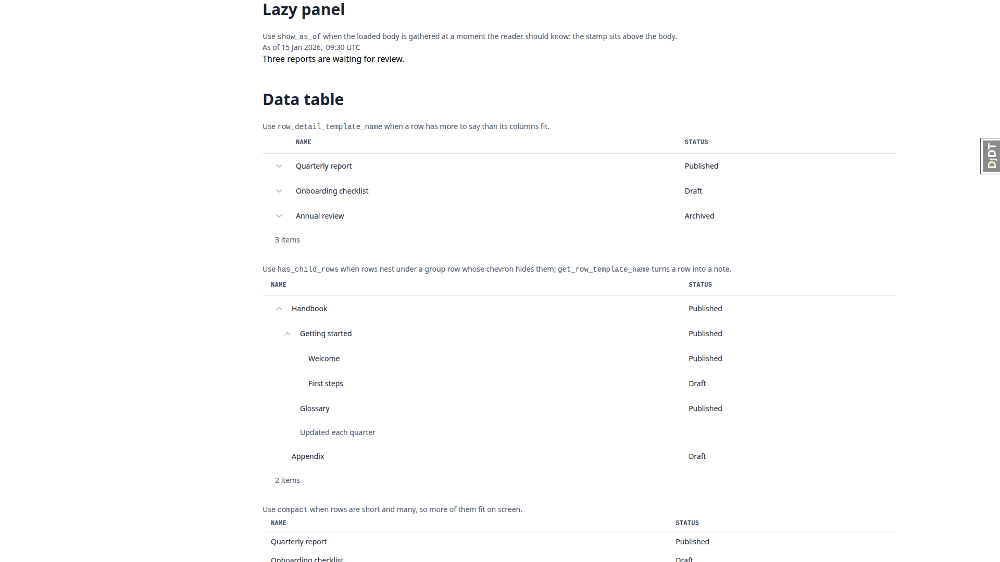

Expected: Section 4 expects the reference page in the minimal shell to be styled, with buttons, chips, cards and tables looking finished. The reason dialog examples render their fields. Text, file, search and select controls have a visible border and padding with the label above, as the FLS shell renders them.

Actual: `reference.css` gives every input and select a 0px border and 0px padding.
- The required Reason text field is invisible.
- Labels sit inline beside their control ("Reason: Choose a reason", "Title: First aid").
- The page-header example at heading_level 3 renders at 16px weight 400.
- Table body rows have no rule between them.

### B2: Educator interface returns 500 under section 4's template order (framework c-panel-icon has no 'home')

Manifestation:
- 4.educator (desktop)

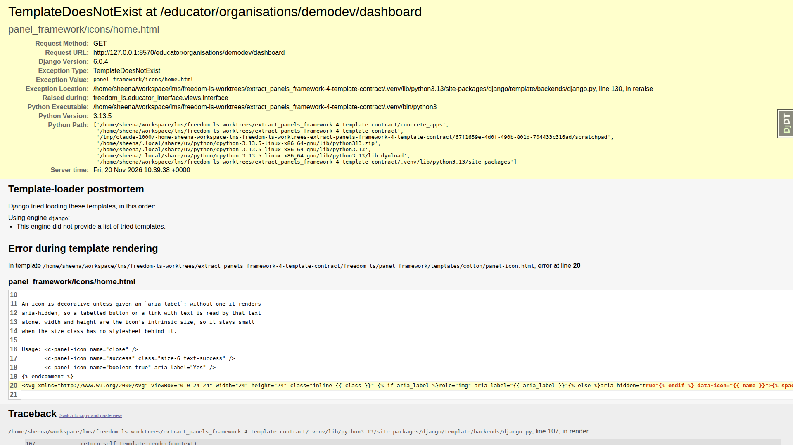

Expected: With the framework's templates directory ahead of FLS's, `/educator/` still renders in the FLS shell with header, sidebar and footer.

Actual: HTTP 500 `TemplateDoesNotExist: panel_framework/icons/home.html` on `/educator/` and `/educator/.../learners`. The template order shadows FLS's c-panel-icon wrapper, which was added in 02f9da0, after section 4 was written. FLS's sidebar menu icon names therefore reach the framework's default c-panel-icon. That component ships 28 icon bodies and raises TemplateDoesNotExist for an unknown name.

### B3: Dialog footer actions start at the left edge when the footer wraps at 375

Manifestation:
- 1.3-footer-end (mobile)

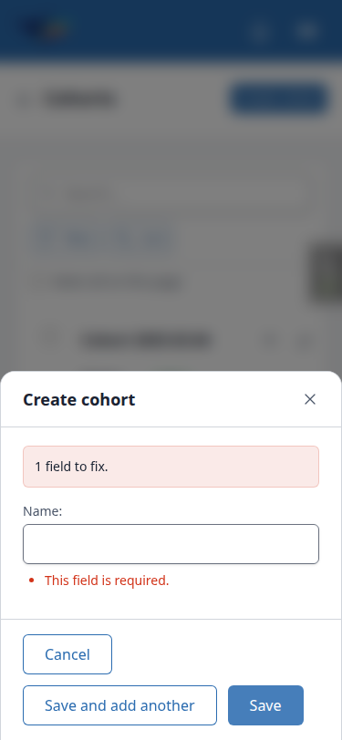

Expected: A dialog's Cancel sits at the left and its actions at the right (panel-framework rule; checklist 1.3 "Dialog footers hold their buttons at the end"). When the footer wraps at 375, the action buttons stay at the end of their row.

Actual: In Create cohort at 375, Cancel is on row one. "Save and add another" and "Save" are on row two, starting at x=25 and ending at x=333, short of the right padding edge. The actions wrapper in `cotton/modal-footer.html` is content-width, so its justify-end has no effect once it wraps. This is pre-existing: the layout is unchanged from main apart from the c-panel-button rename.

### B4: No sort control at 768 when the Learners table shows as cards

Manifestation:
- 768-sort (tablet)

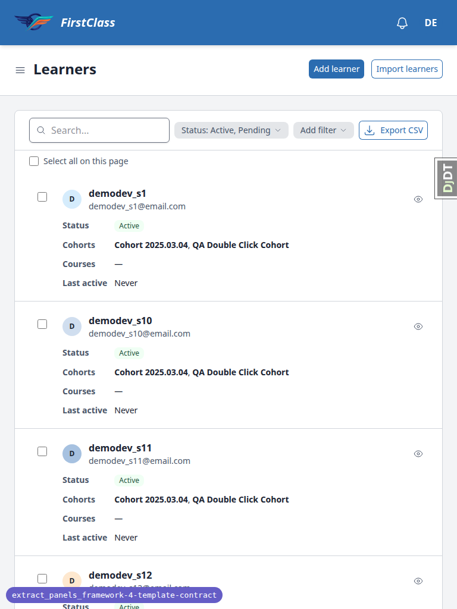

Expected: Whenever a sortable table renders as cards (no column headers), the toolbar offers its Sort menu, as it does at 375.

Actual: At 768 the Learners list renders cards with no column headers. The toolbar shows search, status chip, Add filter and Export CSV but no Sort, so the list cannot be sorted at tablet width. This is pre-existing: `table_toolbar.html` is unchanged from main apart from the panel-* renames.

## Layout probe

| Test id | Viewport | URL | Screenshot | Result |
| --- | --- | --- | --- | --- |
| smoke-home | desktop | `/` | 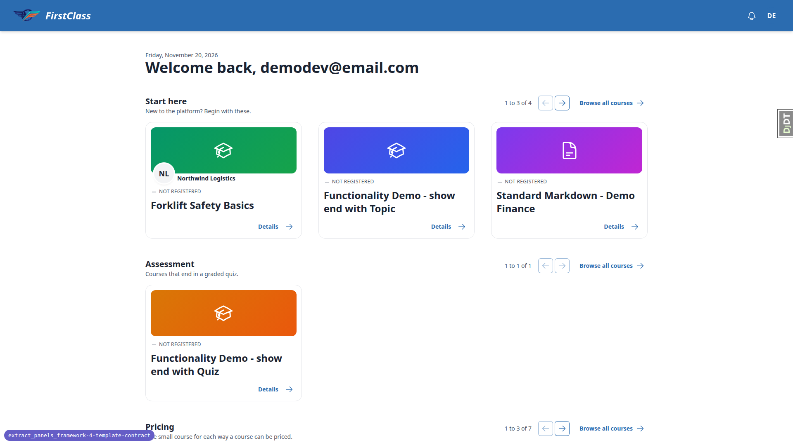 | clean |
| 1.1a | desktop | `/educator/organisations/demodev/dashboard` | 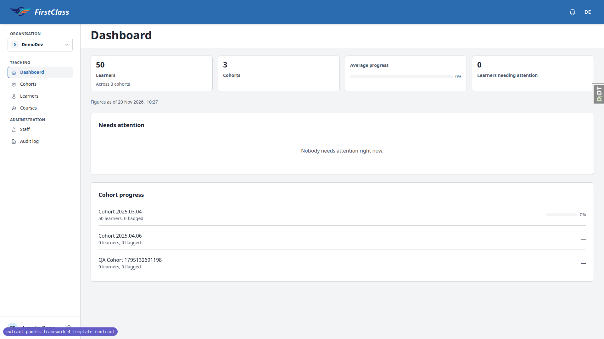 | clean |
| 1.1b | desktop | `/educator/organisations/demodev/cohorts` | 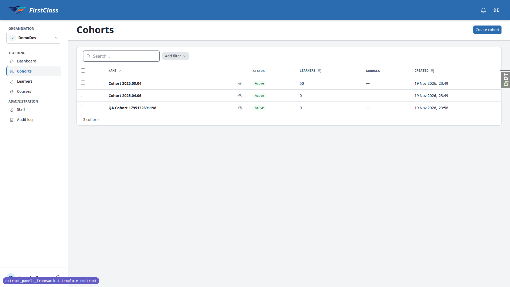 | clean |
| 1.1c | desktop | `/educator/organisations/demodev/cohorts?cohorts-q=Cohort&cohorts-inactive=1` |  | clean |
| 1.1d | desktop | `/educator/organisations/demodev/cohorts/6ab4084d-3c7c-48b5-943c-97547f4fc35e` | 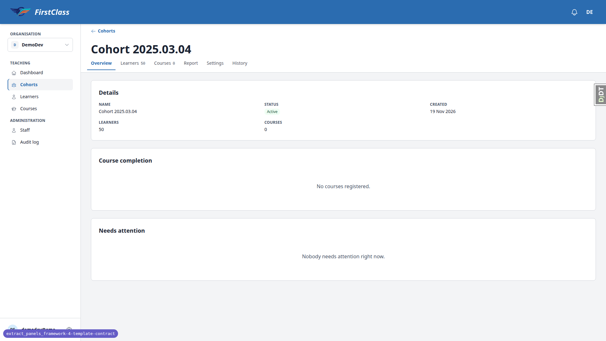 | clean |
| 1.1e | desktop | `/educator/organisations/demodev/learners` | 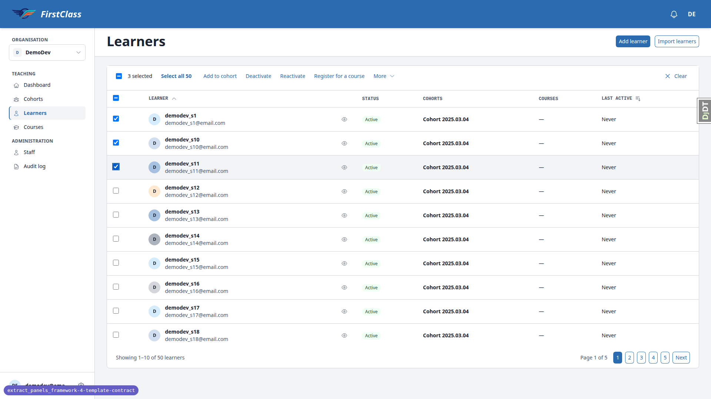 | clean |
| 1.1g | desktop | `/educator/organisations/demodev/learners?learners-page=2` | 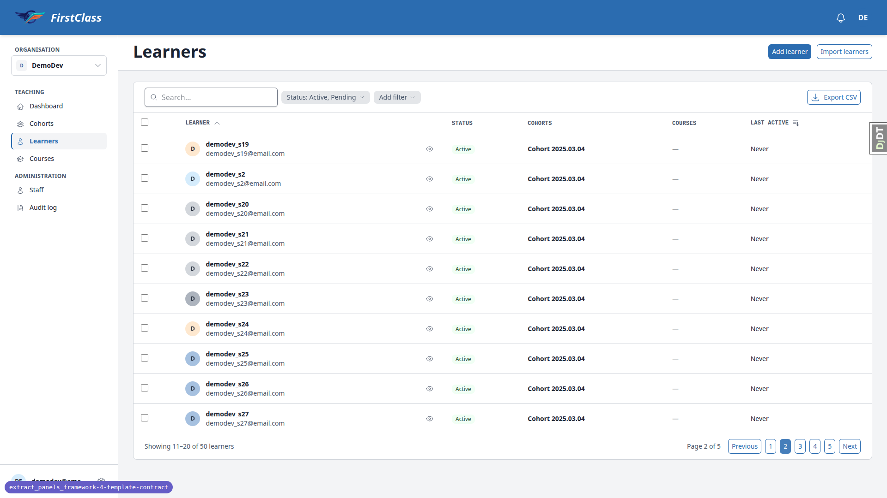 | clean |
| 1.1i | desktop | `/educator/organisations/demodev/learners/08c09844-4e0b-4200-ad8c-4b43d53ae116` | 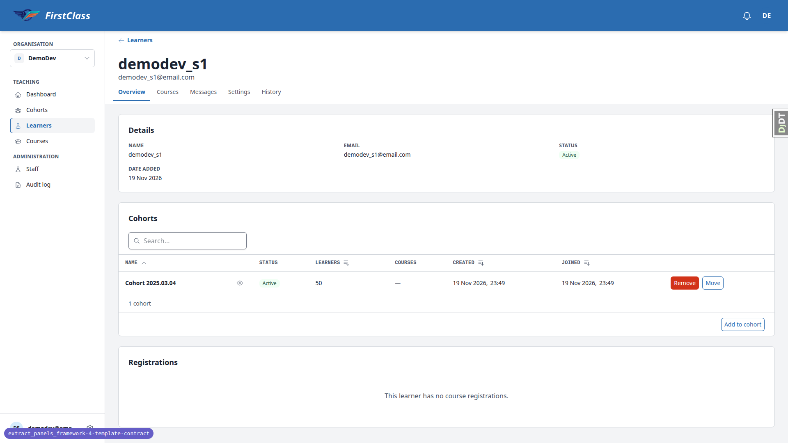 | clean |
| 1.1j | desktop | `/educator/organisations/demodev/learners/08c09844-4e0b-4200-ad8c-4b43d53ae116` | 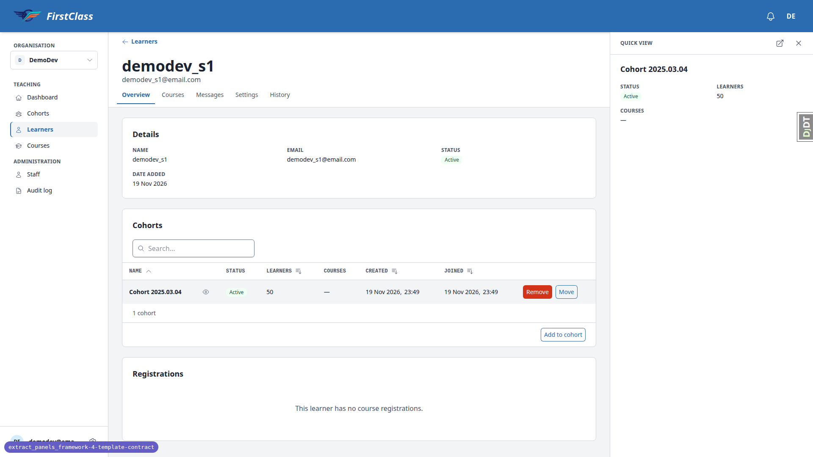 | clean |
| 1.1l | desktop | `/educator/organisations/demodev/cohorts` | 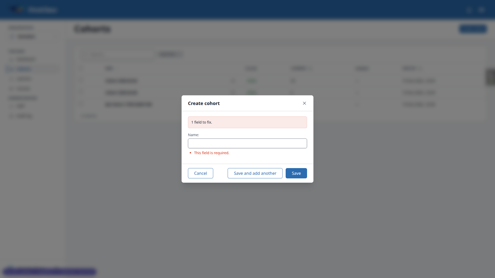 | clean |
| 1.1n | desktop | `/panel-framework/components/` | 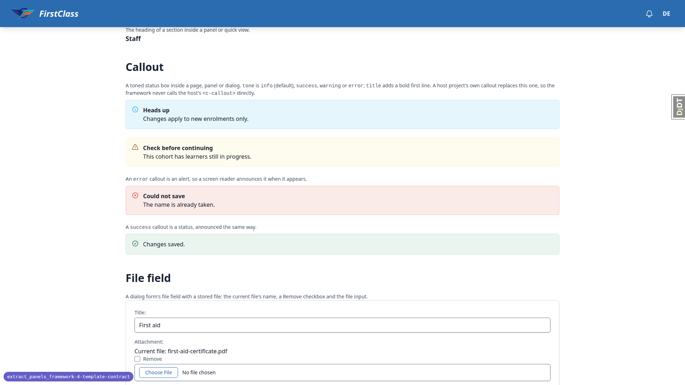 | clean |
| 4.styled | desktop | `/panel-framework/components/` (minimal shell) |  | clean (the probe found no overflow; the unstyled controls are bug B1) |
| 1.1g | mobile | `/educator/organisations/demodev/learners?learners-page=2` | 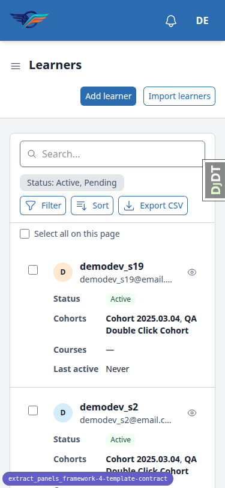 | clean |
| 1.1h | mobile | `/educator/organisations/demodev/learners?learners-sort=last_active` | 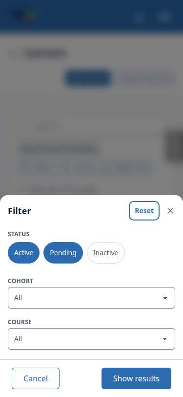 | clean |
| 4.shell | mobile | `/panel-framework/components/` (minimal shell) |  | clean |
| 1.1e | tablet | `/educator/organisations/demodev/learners` |  | clean (the missing Sort control is bug B4) |
| 4.compact | tablet | `/panel-framework/components/` (minimal shell) | 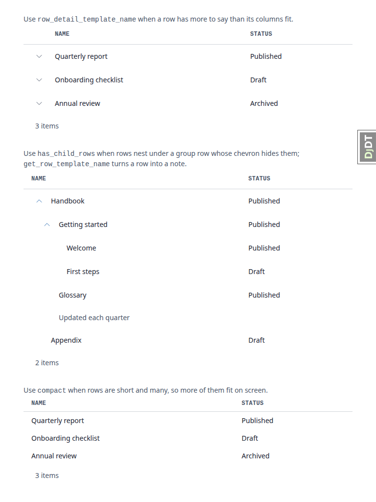 | clean |

## Data changes

| What changed | Made by | Files written |
| --- | --- | --- |
| Cohort "QA Double Click Cohort" created on DemoDev | The 2.4.2 and 2.4.4 create-cohort dialog test (including the double-click on Save) | none |
| 50 DemoDev learners added to cohort "QA Double Click Cohort" | The 2.5.2 "Add to cohort" bulk action | none |

## Bug status

- B1: **FIXED** (commit: 87d3591a9) — Minimal shell leaves form controls, h3 headings and table row rules unstyled. Re-verified on the minimal-shell server: every field has a 1px border and 12px padding, labels sit above, h3 weight 600, toolbar search fields bordered.
- B2: **UNRESOLVED** — Educator interface returns 500 under section 4's template order (framework c-panel-icon has no 'home') (reason: decision needed. Either amend section 4 of the plan, because that template order now shadows FLS's c-panel-icon wrapper the same way it shadows panel-btn and panel-chip, or change the documented contract that an unknown c-panel-icon name raises TemplateDoesNotExist. That contract is a deliberate HOST_CONTRACT rule.)
- B3: **FIXED** (commit: be8c7665d) — Dialog footer actions start at the left edge when the footer wraps at 375. Re-verified: at 375 Save ends at x=350 (the footer padding edge); the desktop Deactivate dialog footer is unchanged.
- B4: **FIXED** (commit: a442c4c37) — No sort control at 768 when the Learners table shows as cards. Re-verified: at 768 the toolbar shows the Sort menu and choosing Last active re-sorts; at 1920 the column headers sort and no extra Sort button shows; 375 unchanged.

## Test results by section

Records not tied to a bug passed unless marked.

| Section | Test ids | Result |
| --- | --- | --- |
| 0.3 | 0.3 | skip: no main baseline server (see General notes) |
| 1 (desktop) | 1.1a, 1.1b, 1.1c, 1.1d, 1.1e, 1.1f, 1.1g, 1.1i, 1.1j, 1.1k, 1.1l, 1.1m, 1.1n, 1.1n-tables | pass |
| 1 (mobile) | 1.1g, 1.1h, 1.1i, 1.1j, 1.1l, 1.1n, mobile-nav | pass |
| 1 (mobile) | 1.3-footer-end | fail (B3) |
| 1 (tablet) | 1.1e, 1.1k | pass |
| 1 (tablet) | 768-sort | fail (B4) |
| 2.1 | 2.1.1, 2.1.2, 2.1.3 (mobile), 2.1.4, 2.1.5 | pass |
| 2.2 | 2.2.2, 2.2.3 | pass |
| 2.3 | 2.3.1, 2.3.2, 2.3.3 | pass |
| 2.4 | 2.4.1, 2.4.2, 2.4.4 | pass |
| 2.5 | 2.5.1, 2.5.2, 2.5.3 | pass |
| 3 (first_class) | 3.b, 3.d, 3.k | pass |
| 4 | 4.shell, 4.classes, 4.icons, 4.tables, 4.footer (mobile), 4.compact (tablet) | pass |
| 4 | 4.styled, 4.reason | fail (B1) |
| 4 | 4.educator | fail (B2) |
| 4 | 4.dropdown, 4.quickview, 4.dialog, 4.csrf | skip: the reference page has no such interactive example |

## General notes

- **No main baseline.** The `main` baseline server for section 1's side-by-side comparison was not run (test 0.3). Building, migrating and seeding the main worktree was blocked by the permission classifier, because it changes another worktree. Section 1 was therefore judged against the 1.3 checklist alone, not compared pixel for pixel against main. A same-looking-as-main claim is not established by this run. The notes on B3 and B4 that call them "pre-existing" rest on the template files being unchanged from main apart from the renames, not on a rendered comparison.
- **Section 4 skips.** 4.dropdown, 4.quickview, 4.dialog and 4.csrf had nothing to act on. These are skips, not passes.
  - 4.dropdown: the reference page has no dropdown menu example (no panelDropdownMenu, dropdownMenu or role=menu on it).
  - 4.quickview: the quick view trigger is a static button with no `hx-get`, so clicking it opens nothing.
  - 4.dialog: the confirm and reason dialogs render in place inside `hx-disable` wrappers, so no example opens a dialog and the dimmed-backdrop check had nothing to open.
  - 4.csrf: no request on the page goes through htmx. The child rows toggle in the browser, the lazy panel arrives pre-rendered, and the dialog examples post as plain forms (that POST returned the page, not a 403). The body's `hx-headers` attribute does carry a real `X-CSRFToken`.
  - Because of these gaps, the framework's menu, quick view and dialog JS is not exercised in the minimal shell at all. The 4.educator 500 (B2) also blocked exercising `panelDropdownMenu` on the educator pages of that server.
- **Sort arrows.** 4.icons could not check the sort arrows, because no sortable table is on the reference page.
- **Coverage gaps.**
  - Not every section-1 page was captured at all three viewports. Mobile covered pages g, h, i, j, l and n. Tablet covered pages e and k.
  - Pages a to d and m have no mobile or tablet records. Page f has no records at either size.
  - No desktop run of page h (the Learners sort menu); the sort menu was checked at 375 (2.1.3).
  - No records for 2.2.1 (page 2 then "Previous" at 375) or 2.4.3, which the plan assigns to automated tests.
  - 3.b, 3.d and 3.k were recorded without a main comparison.
- **First_class theme.** The server was stopped, rebuilt and restarted without `FLS_THEME` for section 4.
- **Cohort Learners tab.** On the cohort's own Learners tab there are no row checkboxes (row Remove/Move buttons only; Remove is variant=error, as on main). Section 1's states e to g therefore ran on the organisation Learners list (50 learners), not a cohort's learners table.
- **Reference page autofocus.** The reference page loads scrolled to the reason-dialog examples because a Cancel button there has autofocus. Main behaves the same way.
- **422 in the console.** The 422 on an invalid create-cohort submit shows in the console as a failed resource load. That is the expected HTMX validation response, not a script error.
- **Shell landmark.** The minimal shell has no `<main>` landmark, though the spec names `#interface-main` as the region. This is tangential and has no action attached.
- **Test fixtures.** The QA cohort and its 50 learner memberships remain in the dev database (see Data changes).

status: ok · reason: 4 bugs — 3 fixed, 1 unresolved; report rendered, screenshots verified
