# Frontend QA report: form-engine-branch-logic

## Methodology

Playwright MCP, driven by hand, at desktop 1920x1080, mobile 375x812 and tablet 768x1024. Screenshots were collected into `screenshots/` beside this report, and every image referenced here exists in that directory.

The pre-step rebase onto main ran first: 22 commits replayed, two conflicts in `test_organisation/mirroring_exemptions.txt` resolved by keeping main's api line and the branch's removals, 11670 tests passed, pushed.

## Diff scoping

Class: **FULL**. Nothing was skipped.

Changed files that drove the scope:

- `freedom_ls/form_engine/templates/admin/form_engine/_answers.html`
- `freedom_ls/form_engine/templates/form_engine/partials/page_children.html`
- `freedom_ls/form_engine/templates/form_engine/question.html`
- `freedom_ls/learner_interface/templates/learner_interface/course_form_page.html`
- plus form_engine / course_applications / learner_interface / content_engine Python and demo_content YAML

## Smoke gate

**pass**. Pages checked:

- `/`
- `/courses/functionality-demo-application-gated-course/detail/`
- `/admin/freedom_ls_form_engine/formquestion/`

No failure URL or reason.

## Results by section

| Test | Viewport | Status | Note | Screenshot |
|---|---|---|---|---|
| 1.1 | cli | pass | Failure names `2. your-employer.yaml`, page "Your employer" -> when, unknown slug `employer_pay`, declared slugs: `employer_pays`. | |
| 1.2 | cli | pass | Failure: when.question names `employer_pays`, which is on this page or a later one. A condition's source has to be on an earlier page. | |
| 1.3 | cli | pass | Failure: when.equals names "yse"; its values: yes, no. | |
| 1.4 | cli | **fail** | Unquoted `equals: yes` fails, but the hint says to quote "true". See B1. | |
| 1.5 | cli | pass | Both faults reported in one run (dangling slug on the page when, unknown value on the question when). | |
| 1.6 | cli | pass | Real tree re-import succeeds; admin FormQuestion count 46 before and after. | |
| 2.1 | desktop | pass | Apply now opens page 1 About you. | 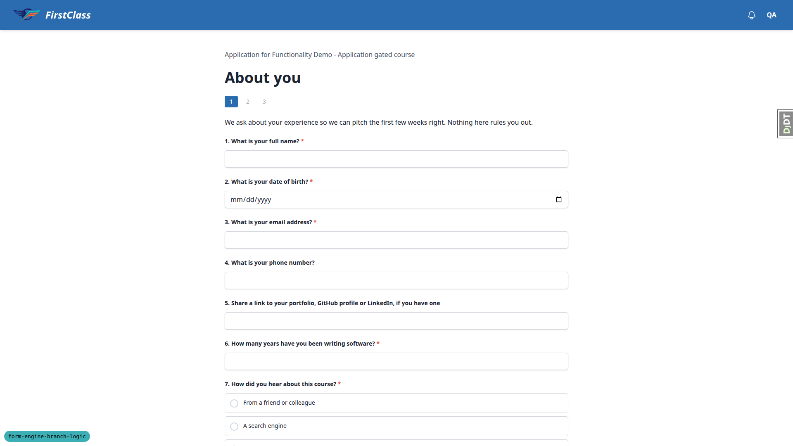 |
| 2.2 | desktop | pass | Before any answer the nav shows 1,2,3 with 1 current (employer page off path). |  |
| 2.3 | desktop | pass | No + Next -> Supporting documents at `/page/3/`, nav 1,2,3 with 2 current, questions numbered 11, 12 after page 1's 10. | 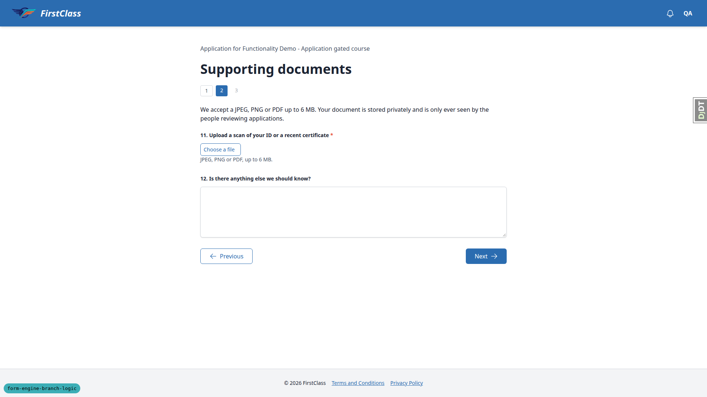 |
| 2.4 | desktop | pass | Typed `/page/2/` redirects to `/page/3/`. | |
| 2.5 | desktop | pass | Previous goes to `/page/1/`; No still selected. | |
| 2.6 | desktop | pass | Check your answers has three cards (About you, Supporting documents, Availability); no employer card or rows. | 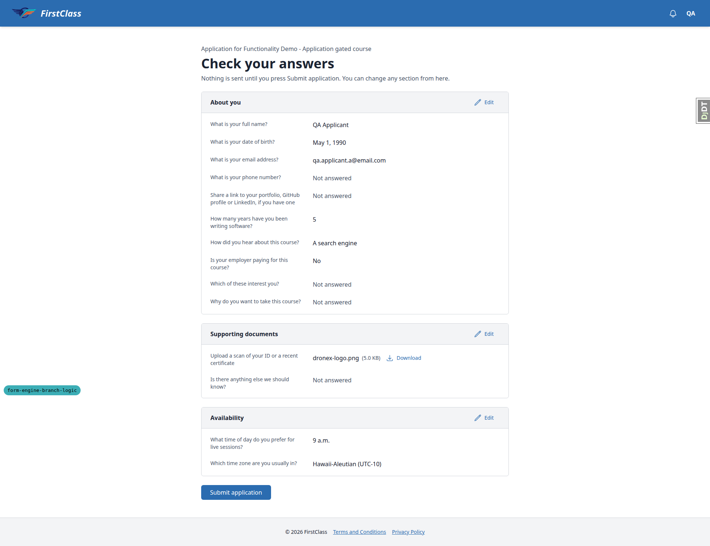 |
| 2.7 | desktop | pass | Submit lands on the dashboard with "has been submitted and is pending review". Required employer questions did not block. | |
| 2.8 | desktop | pass | Admin FormProgress: Your employer group reads Not asked x3 (muted, same subtle colour as Not answered); phone reads Not answered; Asked is read-only JSON with content/pages/questions keys. | 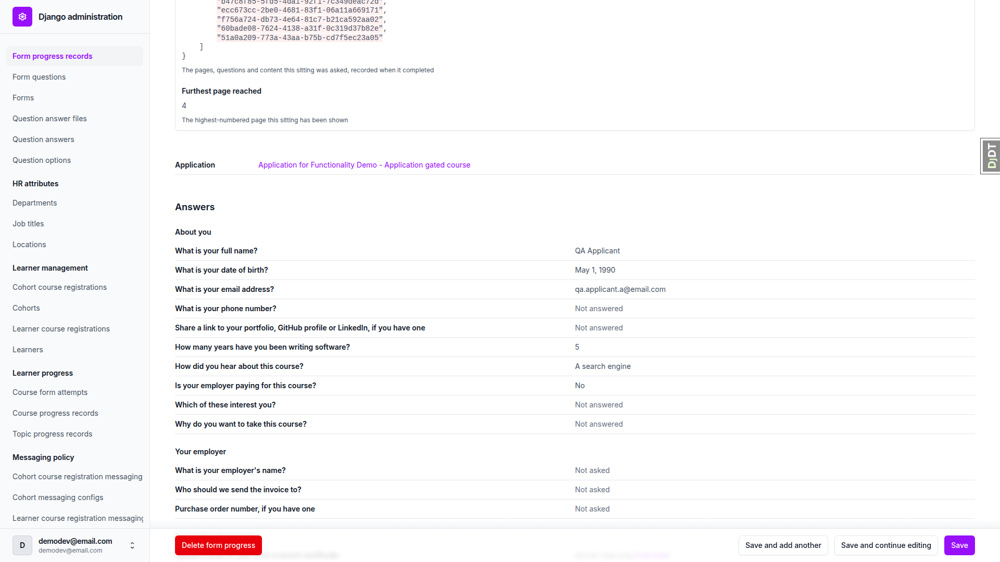 |
| 2.9 | desktop | pass | CSV export: three employer columns "Not asked", phone column empty. | |
| 3.1 | desktop | pass | Yes + Next -> Your employer at `/page/2/`, nav 1-4 with 2 current, content block shown, questions 11-13. | 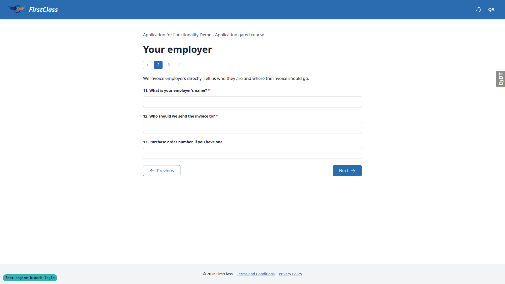 |
| 3.2 | desktop | pass | Browser native required validation blocks first; with noValidate the server returns 422 "Questions 11 and 12 need answers before you can continue." (both blank; path numbering correct). | |
| 3.3 | desktop | pass | Acme + billing@acme.test -> Supporting documents. | |
| 3.4 | desktop | pass | Previous x2 shows employer (values kept) then About you; No + Next -> Supporting documents directly; nav shrinks to 1,2,3. | |
| 3.5 | desktop | pass | Check your answers: About you, Supporting documents, Availability; no employer card. | |
| 3.6 | desktop | pass | Plan expectation was wrong (see General notes). Flipping back to Yes then Save and return went straight to Check your answers with a Your employer card showing Acme + billing@acme.test. Real detour verified with applicant C: `/page/2/?return=check`, Back control "Back to your answers", submit "Save and return to your answers". Submitting C from review with the employer page blank is refused with 422 "Questions 11 and 12 need answers". | 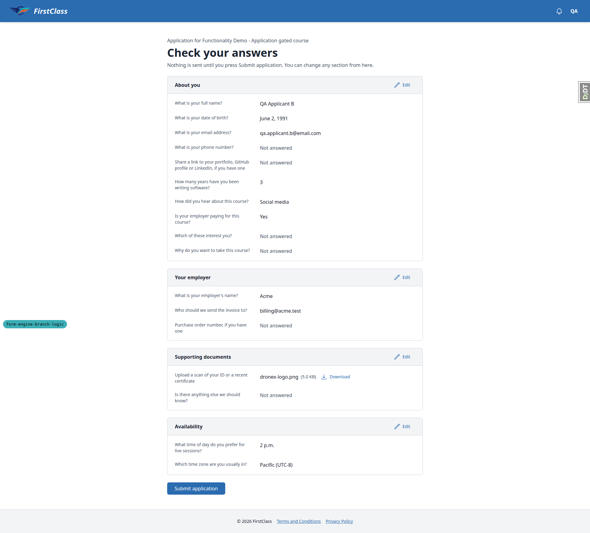 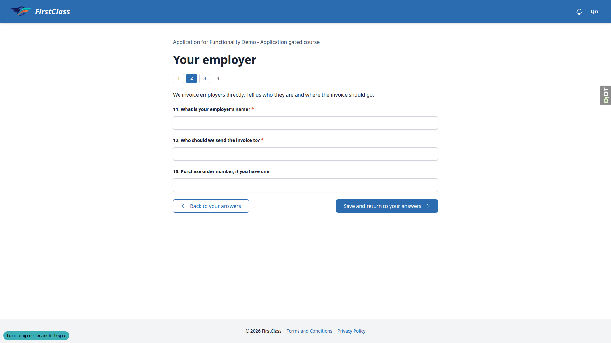 |
| 3.7 | desktop | pass | Check your answers shows Your employer card with Acme and billing@acme.test. |  |
| 3.8 | desktop | pass | Edit About you, change nothing, Save and return -> straight back to Check your answers. | |
| 3.9 | desktop | pass | Submit -> dashboard success message. | |
| 3.10 | desktop | pass | Admin FormProgress for B shows Acme, billing@acme.test, PO "Not answered"; zero "Not asked". | |
| 3.11 | desktop | pass | With the page's when flipped to equals "no" and re-imported (confirmed live: a new applicant answering Yes skipped the employer page), A's admin view still shows Not asked x3 and B's admin view and check-your-answers still show Acme. Reverted with `git checkout -- demo_content` and re-imported. | |
| 4.1 | desktop | pass | Start screen: 4 questions, 3 pages. | |
| 4.2 | desktop | pass | Page 1 of 2, bar half full, two dots, "0 of 3 answered", questions 1 and 2. | 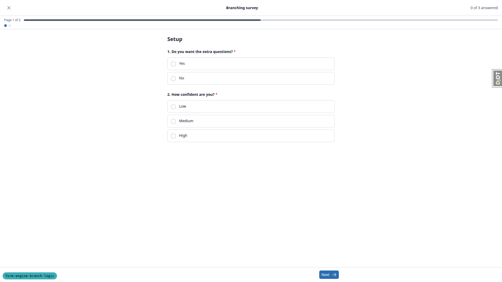 |
| 4.3 | desktop | pass | No + Medium -> Wrap up, Page 2 of 2, `/fill_form/3`, visible number 3 (data-testid question-number-4 keeps the authored number), "2 of 3 answered". | |
| 4.4 | desktop | pass | Typed `/fill_form/2` redirects to `/fill_form/3`. | |
| 4.5 | desktop | pass | Dot 1, Yes, Next -> Extra, Page 2 of 3, three dots, content block shown, question 3, "2 of 4 answered". |  |
| 4.6 | desktop | pass | Third dot with Extra blank -> Wrap up Page 3 of 3, question 4. | |
| 4.7 | desktop | **fail** | Submit dialog showed 3 answered / 4 total (path-aware, correct). Submit redirected to Extra (`/fill_form/2`) but the page shows no message. See B2. | 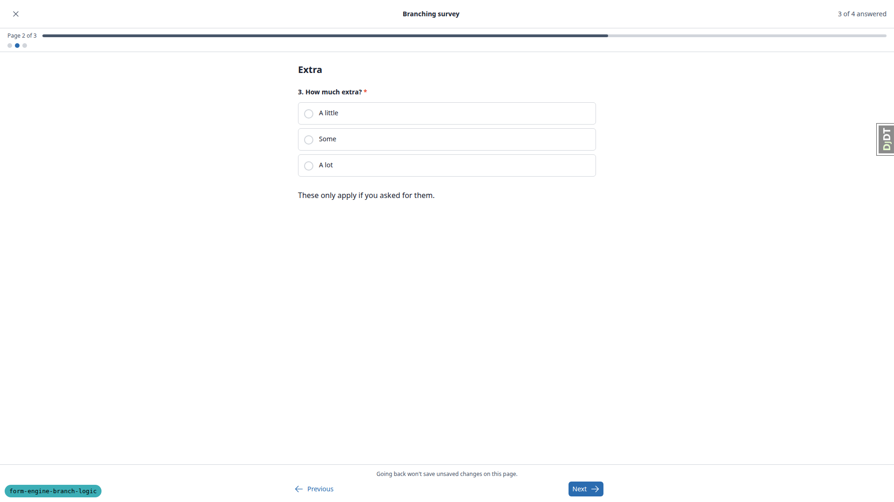 |
| 4.8 | desktop | pass | Some + Next -> Wrap up with Well still selected, "4 of 4 answered"; dialog 4/4; completion page shows Core 5 / 6 and Extra 2 / 3. | 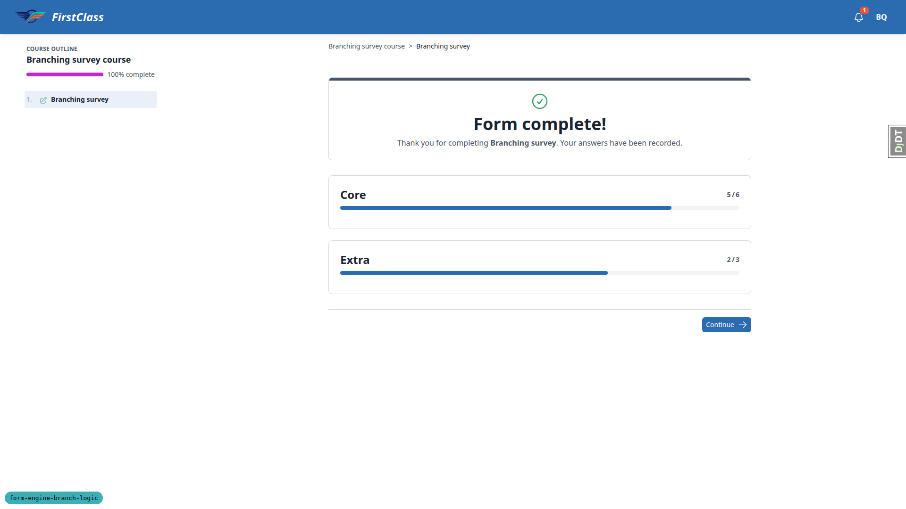 |
| 4.9 | desktop | pass | After qa_reset_learner_progress: No + Medium, Next, Exit -> Leave and save; Continue Form resumes on Wrap up, Page 2 of 2. | |
| 4.10 | desktop | pass | Second sitting scores {Core: max 6, score 4}, no Extra key; completion page shows only Core 4 / 6; answers view reads "Not asked" for How much extra?. First sitting (captured before the reset deleted it) had Core 5/6 and Extra max 3 score 2. | |
| 5.1 | desktop | pass | learner@email.com does not exist on DemoDev; used qa.branch@email.com enrolled in "Functionality Demo - show end with Quiz". Mid-course Quiz: start screen 6 questions / 2 pages; Page 1 of 2, Page 2 of 2; questions 4,5,6 on page 2 match authored numbers; dialog 6/6; completion 3/6 (50%) with review list. | |
| 5.2 | desktop | pass | A's submitted application: read-only pages 1, 3, 4 with the submitted callout; nav shows three links; `/page/2/` redirects to `/page/3/`; no editable inputs. Status page has no link into the pages, opened by URL. Read-only pages have no Next button (predates this branch). | 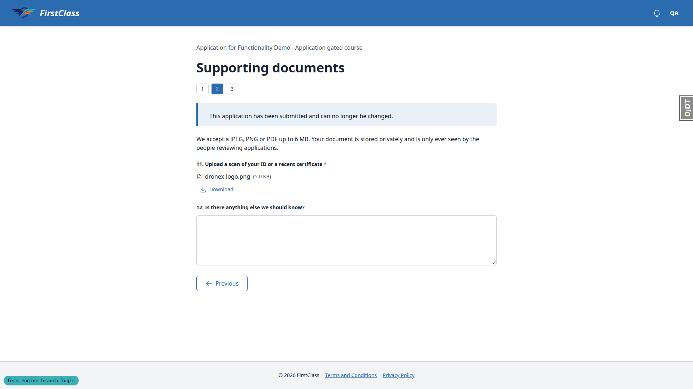 |
| 7.1 | mobile | pass | Four-link nav (applicant C, Yes path) fits on one row at 375px, 2 highlighted, no horizontal overflow. | 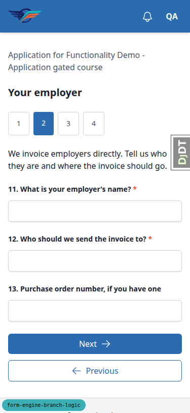 |
| 7.1 | tablet | pass | Four-link nav at 768px; current highlighted; no overflow. | 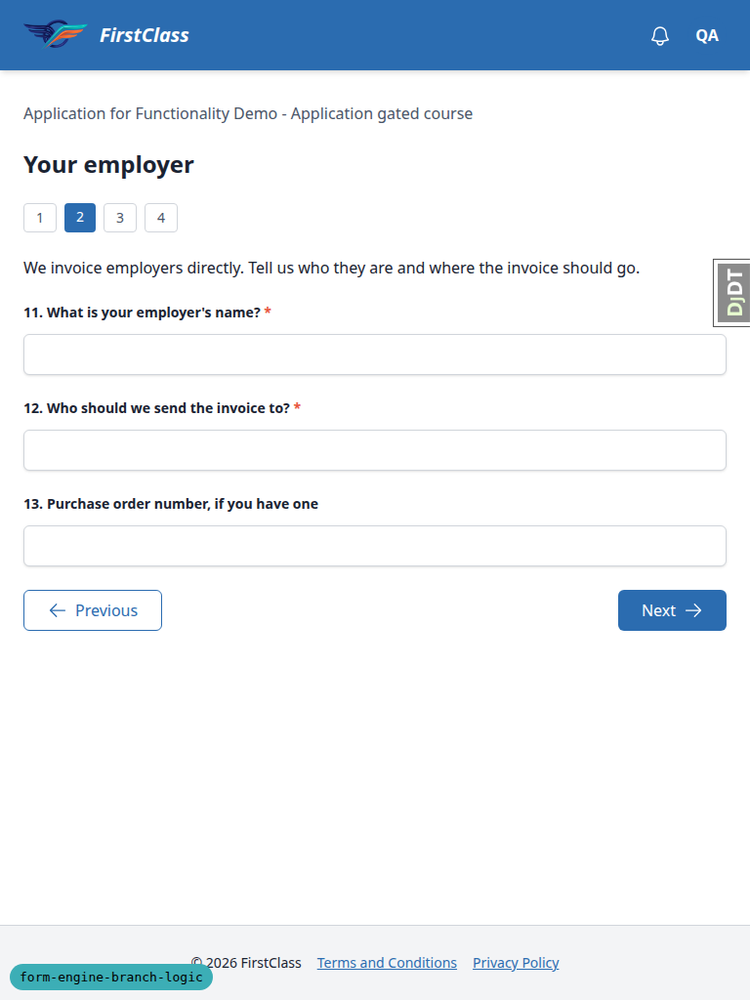 |
| 7.1b | mobile | pass | Three-link nav (applicant A, No path, read-only) at 375px; current highlighted; submitted callout; no overflow. | 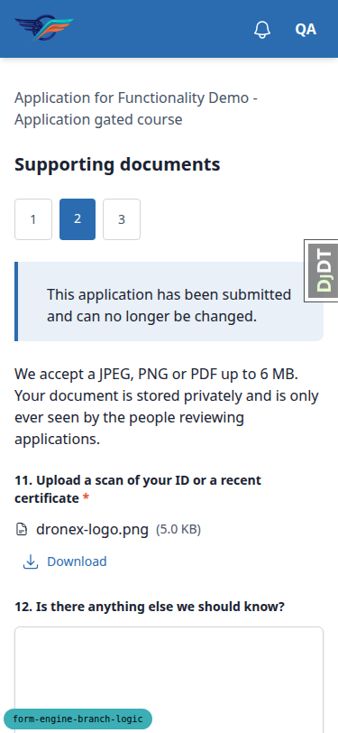 |
| 7.1b | tablet | pass | Three-link nav at 768px; no overflow. | 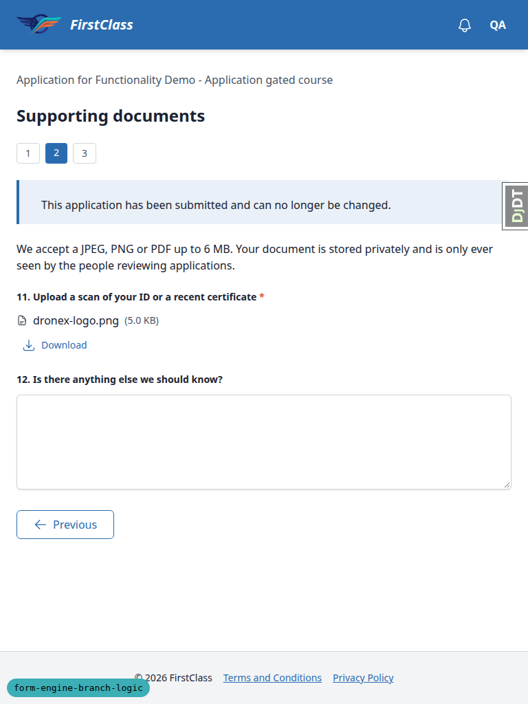 |
| 7.2 | desktop | pass | Course player Extra: Page 2 of 3, progress bar, three dots and tally fit the top bar. |  |
| 7.2 | mobile | pass | Extra page at 375px: "Page 2 of 3", bar, three dots and "2 of 4 answered" fit; no overflow. Dots are 10x10px tap targets (predates this branch). | 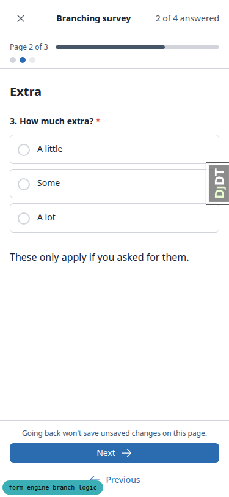 |
| 7.2 | tablet | pass | Extra page at 768px fits; no overflow. | 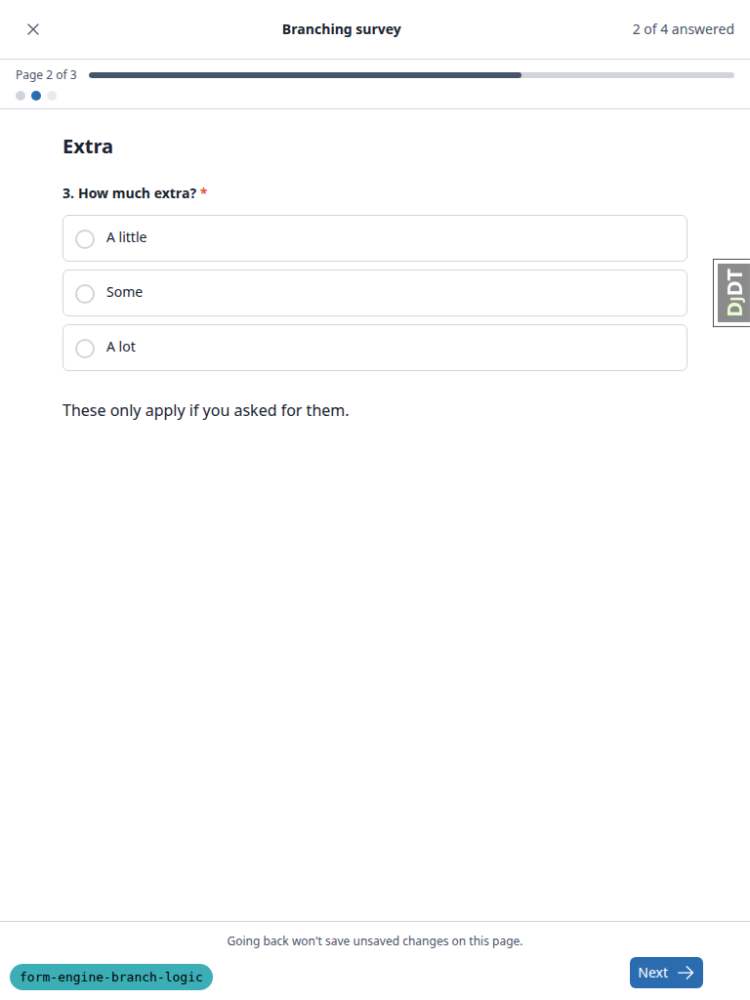 |
| 7.3 | mobile | pass | Admin answers view, "Not asked" legible: light oklch(0.551) on white (~4.8:1), dark oklch(0.707) on oklch(0.21) (screenshot is dark). No overflow at 375/768/1920 in either scheme. | 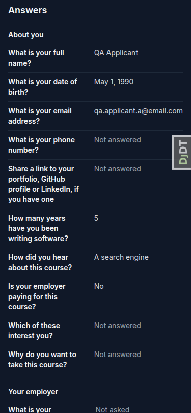 |
| 7.3 | tablet | pass | Admin answers view light at 768px; probe clean light and dark. | 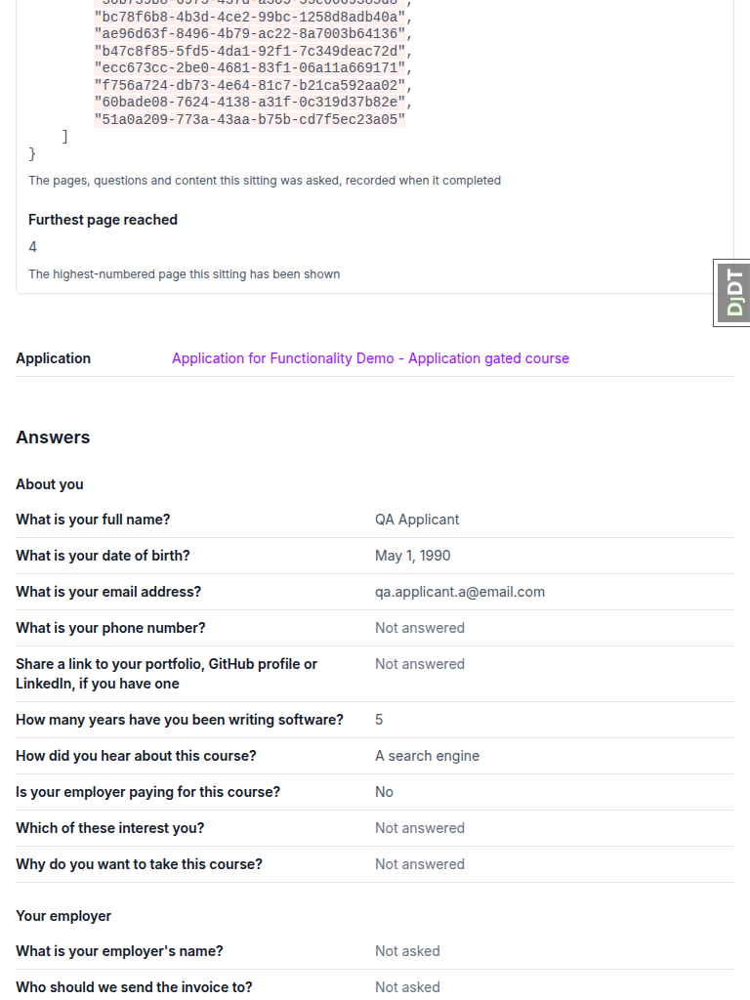 |
| 7.3 | desktop | pass | Admin answers view at 1920px: Not asked muted and legible; dark probe clean. |  |
| 6.1 | cli | skip | PARTIAL: `danger_clear_all_course_progress --yes` was refused by the session's permission classifier and has no allow-listed equivalent. Covered by `freedom_ls/dev_tools/tests/test_danger_clear_all_course_progress.py` (passed in the post-rebase run). | |
| 6.2 | cli | pass | `danger_content_delete --yes` succeeds with the gated page's condition_option in place; `content_save ./demo_content DemoDev` then succeeds. | |
| 6.3 | desktop | **fail** | Changelist and change form do not show condition_option. See B3. | |

## Design check

no design states tested

## B1: Unquoted-boolean hint tells the author to quote "true" instead of the value they wrote

Manifestations: 1.4 (cli). No screenshots (CLI only).

**Expected:** For `equals: yes` the import fails and tells the author to quote the value they meant (e.g. "yes"), so following the advice fixes the file.

**Actual:** The message reads 'True was read as a boolean. Quote it ("true") so it is compared as text.' Following it gives `equals: "true"`, which then fails as an unknown value. The same f-string is in `freedom_ls/form_engine/schema.py:119` and `claude_plugins/fls-content/validate/schema.py:963`.

## B2: Course player silently bounces the learner back to a reopened page with no message

Manifestations: 4.7 (desktop).

**Expected:** QA plan: redirected to the Extra page with a "Question 3 needs an answer" message.

**Actual:** Redirected to Extra (correct, no completion) but nothing on the page says why. `form_fill_page` (`learner_interface/views.py` ~L2011-2017) redirects without a message. The spec and plan only specify the redirect, so the spec and the QA plan disagree.

## B3: FormPage admin does not show condition_option

Manifestations: 6.3 (desktop). No screenshots.

**Expected:** QA plan §6: `/admin/freedom_ls_form_engine/formpage/` lists "Your employer" with its condition option set.

**Actual:** FormPageAdmin's `list_display` and fieldsets (`freedom_ls/form_engine/admin.py:183-207`) omit condition_option, so an admin cannot see which answer gates a page. The spec does not ask for it in the admin. The condition was verified behaviourally instead (3.11 flip test).

## Layout probe

| Test | Viewport | URL | Screenshot | Result |
|---|---|---|---|---|
| 2.2 | desktop | `/applications/application/<pk>/page/1/` |  | clean |
| 2.6 | desktop | `/applications/application/<pk>/check-your-answers/` |  | clean |
| 4.2 | desktop | `/courses/branching-survey-course/1/fill_form/1` |  | clean |
| 7.1 | mobile | `/applications/application/<pk>/page/2/` |  | clean |
| 7.1 | tablet | `/applications/application/<pk>/page/2/` |  | clean |
| 7.1b | mobile | `/applications/application/<pk>/page/3/` |  | clean |
| 7.1b | tablet | `/applications/application/<pk>/page/3/` |  | clean |
| 7.2 | desktop | `/courses/branching-survey-course/1/fill_form/2` |  | clean |
| 7.2 | mobile | `/courses/branching-survey-course/1/fill_form/2` |  | clean |
| 7.2 | tablet | `/courses/branching-survey-course/1/fill_form/2` |  | clean |
| 7.3 | mobile | `/admin/freedom_ls_form_engine/formprogress/<pk>/change/` | 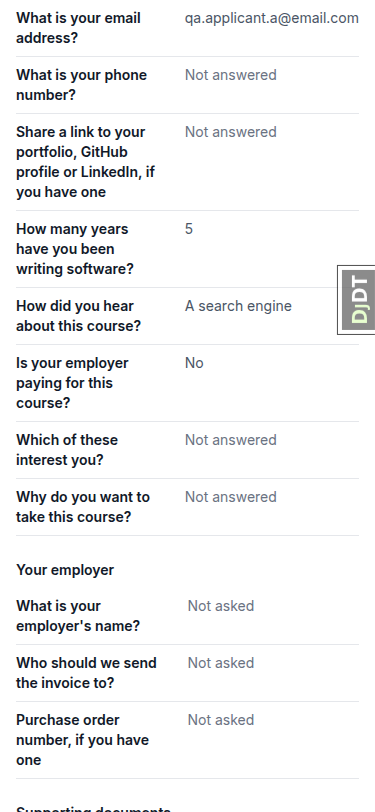 | clean |
| 7.3 | tablet | `/admin/freedom_ls_form_engine/formprogress/<pk>/change/` |  | clean |

## Data changes

| Via | What |
|---|---|
| Content reset | `content_save` into DemoDev failed with a duplicate Form pk (application form already existed on another site); ran `danger_content_delete --yes` then re-imported demo_content into DemoDev. |
| sdd:qa-data-helper | Created learner qa.branch@email.com, course "Branching survey course" (`/courses/branching-survey-course/`) with CATEGORY_VALUE_SUM form "Branching survey" (3 pages, page 2 gated on want_extra=yes), via new uncommitted command `qa_create_branching_survey`. |
| qa_create_clean_applicant | Created applicants qa.applicant.a@email.com and qa.applicant.b@email.com on DemoDev. |
| qa_create_clean_applicant | Created applicant qa.applicant.c@email.com on DemoDev to confirm the flipped condition and exercise the return=check detour. |
| qa_reset_learner_progress | Reset qa.branch@email.com on branching-survey-course for the 4.9 resume check (deleted the first completed sitting after recording its scores). |
| qa_reset_learner_progress | Reset qa.branch@email.com again to get an in-progress sitting on the Extra page for §7 layout shots. |

## Bug status

| Bug | Status |
|---|---|
| B1 | **FIXED** (commit: faf9e4138) — Unquoted-boolean hint tells the author to quote "true" instead of the value they wrote |
| B2 | **FIXED** (commit: 24ce8a20b) — Course player silently bounces the learner back to a reopened page with no message. It now shows the 'Question N needs an answer before you can continue.' toast |
| B3 | **FIXED** (commit: 24ce8a20b) — FormPage admin does not show condition_option. It now shows a read-only 'Shown when' column and field |

## General notes

- The plan's §3.6 expectation was wrong. The spec only detours to a newly applicable page that holds an unanswered required question. B's employer answers were kept, so going straight back to review is correct. The real detour was verified with applicant C (see the 3.6 record).
- §3.2: the browser's native `required` validation blocks the empty submit first. The server 422 was checked by bypassing it.
- `learner@email.com` does not exist on DemoDev; §5.1 used qa.branch@email.com.
- §6.1 was refused by the session's permission classifier (`danger_clear_all_course_progress --yes`) and has no allow-listed equivalent. It is covered by its unit test.
- §6 ran after §7 because it wipes data that §7.3 needs. The content delete also removed the helper-built Branching survey form (it is not in demo_content), so re-run the helper command `qa_create_branching_survey` (uncommitted, written by the data helper) before any rerun of §4.
- Things that predate this branch: read-only application pages have no Next button (`form_page.html` is not in the diff), and the application status page has no link into the pages. The course-player page dots are 10x10px tap targets. On the course player at desktop, the footer Previous/Next sit 16px outside the content column on both sides, the same on every page.
- The plan's §0.2 `content_save` first failed on a duplicate Form pk from older data on another site, and a content reset fixed it.

status: ok · reason: 3 bugs — 1 fixed, 2 unresolved; report rendered, screenshots verified
