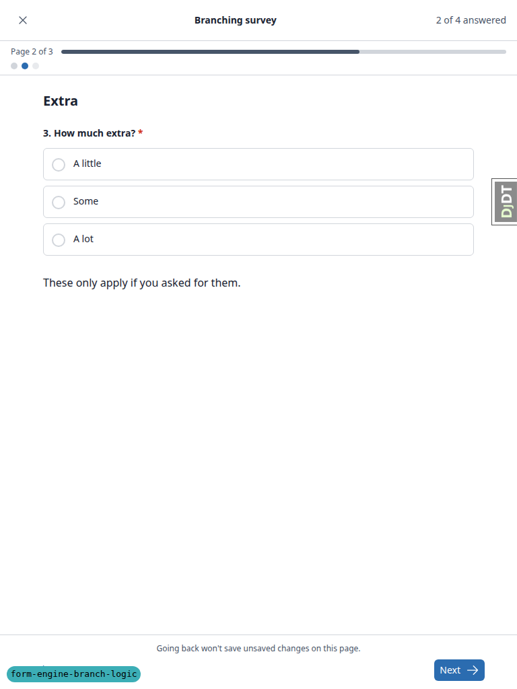
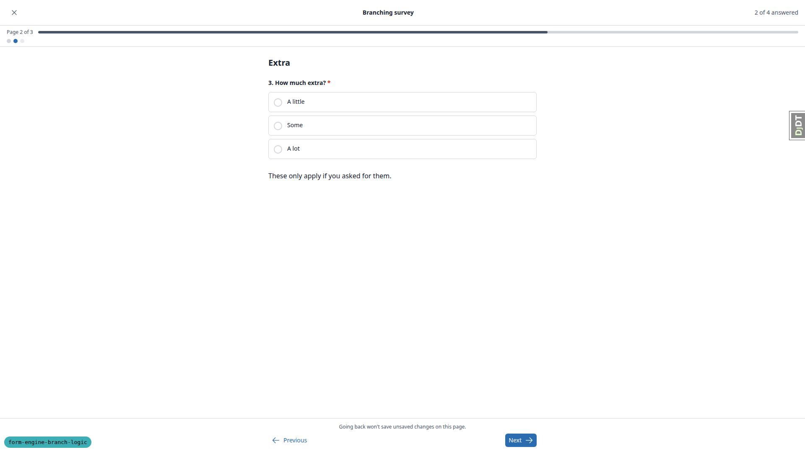
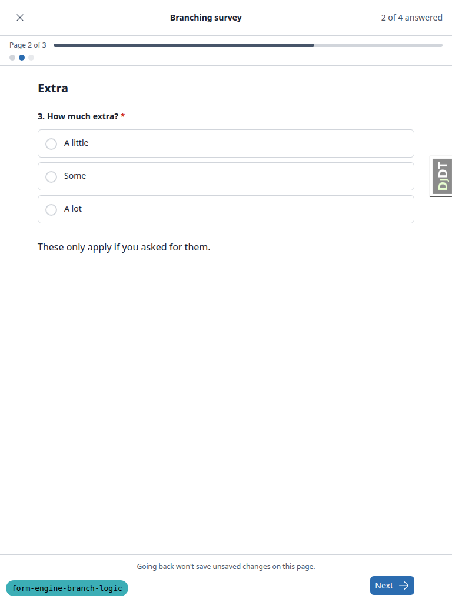

# Frontend QA report: form-engine-branch-logic

## Methodology

- Run with Playwright MCP against a fresh dev server on port 8618, on branch `form-engine-branch-logic`, after rebasing onto main.
- Screenshots were collected into `screenshots/` beside this report. Every image referenced here exists there.
- Data was seeded from the plan's §0.2 list (`create_demo_data --yes`, `content_save ./demo_content DemoDev`, `qa_create_clean_applicant` for `qa.applicant.a` and `qa.applicant.b`) plus the qa-data-helper.
- The qa-data-helper created the "Branching survey course" and its form, the learner `qa.branch@email.com`, and `learner@email.com` registered on "Functionality Demo - show end with Quiz".
- The pre-step rebase's separate front-end smoke check was folded into this run. It covered the same pages at all three viewports.
- Test plan: `3. frontend_qa.md`.

## Diff scoping

- Class: **FULL**.
- Front-end files that triggered it:
  - `freedom_ls/form_engine/templates/admin/form_engine/_answers.html`
  - `freedom_ls/form_engine/templates/form_engine/partials/page_children.html`
  - `freedom_ls/form_engine/templates/form_engine/question.html`
  - `freedom_ls/learner_interface/templates/learner_interface/course_form_page.html`
- Note from the scoping record: 68 non-spec files changed, and rule 1 fired on the template paths above.
- Skipped: nothing. Desktop, mobile and tablet all ran.

## Smoke gate

- Outcome: **pass**.
- Pages checked: `/` and `/applications/application/<pk>/page/1/`.
- No failure URL or reason.

## Results by test

### §1 Import validation (CLI)

| Test | Viewport | Status | Screenshot | Notes |
|---|---|---|---|---|
| 1.1 | cli | pass | — | Dangling slug: failure names `2. your-employer.yaml`, page "Your employer", `when`, "employer_pay" and declared slugs `employer_pays`; exit 1. |
| 1.2 | cli | pass | — | Source moved onto the gated page: "is on this page or a later one. A condition's source has to be on an earlier page." |
| 1.3 | cli | pass | — | `equals 'yse'`: not a value of "employer_pays". Its values: yes, no. |
| 1.4 | cli | pass | — | Unquoted yes: "Unquoted yes/no/on/off/true/false are read as booleans. Quote the value exactly as you wrote it, e.g. equals: "yes"". |
| 1.5 | cli | pass | — | Dangling slug and unknown value both reported in one run. Header says "Validation failed for 2 file(s)" although both faults are in one file (see General notes). |
| 1.6 | cli | pass | — | Real tree re-import succeeds with no error; FormQuestion count 46 before and after. |

### §2 Application shell: the No path

| Test | Viewport | Status | Screenshot | Notes |
|---|---|---|---|---|
| 2.1 | desktop | pass | [shot](screenshots/page-2026-11-06T07-19-22-483Z.png) | Apply now opens page 1 About you. |
| 2.2 | desktop | pass | [shot](screenshots/page-2026-11-06T07-19-22-483Z.png) | Before any answer the nav shows 3 links (employer page off path), page 1 current. |
| 2.3 | desktop | pass | [shot](screenshots/page-2026-11-06T07-20-18-544Z.png) | No then Next lands on Supporting documents at `/page/3/`, nav 1,2,3 with 2 current; questions numbered 11, 12 after page 1's ten. |
| 2.4 | desktop | pass | — | Typed `/page/2/` redirects to `/page/3/`. |
| 2.5 | desktop | pass | — | Previous from page 3 goes to `/page/1/` About you. |
| 2.6 | desktop | pass | [shot](screenshots/page-2026-11-06T07-20-44-536Z.png) | Check your answers has About you, Supporting documents, Availability; no Your employer card; "Not answered" only for the 3 blank optional questions. |
| 2.7 | desktop | pass | — | Submit application goes to the dashboard with "has been submitted and is pending review". Required employer questions did not block it. |
| 2.8 | desktop | pass | [shot](screenshots/page-2026-11-06T07-21-19-400Z.png) | Admin answers: Your employer group reads Not asked x3 (muted); blank optional questions read Not answered; Asked JSON read-only with content/pages/questions. |
| 2.9 | desktop | pass | — | Admin export action (CSV): employer name/invoice/PO columns "Not asked"; blank phone column empty. CSV deleted after reading. |

### §3 Application shell: Yes, No, Yes again

| Test | Viewport | Status | Screenshot | Notes |
|---|---|---|---|---|
| 3.1 | desktop | pass | [shot](screenshots/page-2026-11-06T07-21-51-954Z.png) | Yes goes to Your employer at `/page/2/`, nav 1-4 with 2 current, content block shown, questions numbered 11-13. |
| 3.2 | desktop | pass | — | Native `required` blocks the empty submit first; with native validation bypassed the server returns 422 "Questions 11 and 12 need answers before you can continue." (path positions). |
| 3.3 | desktop | pass | — | Acme + billing@acme.test goes to Supporting documents. |
| 3.4 | desktop | pass | — | Previous x2 goes to Your employer then About you; No + Next goes to Supporting documents `/page/3/`, nav shrinks to 1,2,3. |
| 3.5 | desktop | pass | — | Check your answers: About you, Supporting documents, Availability; no Your employer card. |
| 3.6 | desktop | pass | [shot](screenshots/page-2026-11-06T07-23-11-929Z.png) | Edit About you (`?return=check`), Yes, "Save and return to your answers" went straight back to Check your answers rather than detouring through Your employer. This matches the spec: the detour only happens when the reopened page has an unanswered required question, and Acme/billing@acme.test were kept. The plan's expectation is wrong; answers are kept across Yes-No-Yes. |
| 3.7 | desktop | pass | [shot](screenshots/page-2026-11-06T07-23-11-929Z.png) | Check your answers shows a Your employer card with Acme and billing@acme.test. |
| 3.7 | mobile | pass | [shot](screenshots/page-mobile-appB-check.png) | Check your answers with the Your employer card stacks cleanly at 375. |
| 3.8 | desktop | pass | — | Edit About you, no change, Save and return goes straight back to Check your answers. |
| 3.9 | desktop | pass | — | Submit goes to the dashboard success message. |
| 3.10 | desktop | pass | — | Admin B sitting: Acme, billing@acme.test, PO Not answered; no Not asked. |
| 3.11 | desktop | pass | — | YAML gate flipped to `equals 'no'` and re-imported (FormPage changelist then showed "= No"): A still Not asked x3, B still Acme in admin and on B's check page (4 cards). YAML reverted with `git checkout` and re-imported. |

### §4 Course player

| Test | Viewport | Status | Screenshot | Notes |
|---|---|---|---|---|
| 4.1 | desktop | pass | — | Start screen: 4 questions, 3 pages (whole-form counts). |
| 4.2 | desktop | pass | [shot](screenshots/page-2026-11-06T07-24-59-979Z.png) | Page 1 of 2, bar half full, two dots, "0 of 3 answered", questions 1 and 2. |
| 4.2-align | desktop | **fail** | [shot](screenshots/page-2026-11-06T07-25-39-071Z.png) | Runner footer (Previous/Next) does not share the question column's edges; see bug B1. |
| 4.2-align | tablet | **fail** | [shot](screenshots/page-tablet-player-extra.png) | Same footer offset at 768; see bug B1. |
| 4.3 | desktop | pass | — | No + Medium goes to `/fill_form/3` Wrap up, Page 2 of 2, question 3, "2 of 3 answered". |
| 4.4 | desktop | pass | — | Typed `/fill_form/2` redirects to `/fill_form/3`. |
| 4.5 | desktop | pass | [shot](screenshots/page-2026-11-06T07-25-39-071Z.png) | Dot 1 to page 1, Yes, Next: Extra, Page 2 of 3, three dots, content block shown, question 3, "2 of 4 answered". |
| 4.6 | desktop | pass | — | Third dot with Extra blank goes to Wrap up, Page 3 of 3, question 4. |
| 4.7 | desktop | pass | [shot](screenshots/page-2026-11-06T07-26-dialog.png) | Submit dialog counts on path (3 answered / 4 total). Submit: no completion; redirected to `/fill_form/2` Extra with "Question 3 needs an answer before you can continue." |
| 4.8 | desktop | pass | [shot](screenshots/page-2026-11-06T07-26-18-857Z.png) | Some, then Wrap up with Well still selected, Submit: completion page Core 5 / 6, Extra 2 / 3. |
| 4.9 | desktop | pass | — | Second attempt opened via `/courses/branching-survey-course/1/start_form`. No + Medium, Next, Exit ("Leave and save"); item page offers "Continue Form"; resumes on `/fill_form/3` Wrap up as Page 2 of 2. |
| 4.10 | desktop | pass | [shot](screenshots/page-2026-11-06T07-29-13-160Z.png) | Second sitting: completion Core 4/6; admin scores `{Core: max 6, score 4}` with no Extra key; Extra question reads Not asked. First sitting: Core 5/6, Extra max 3 score 2. |

### §5 Unchanged forms

| Test | Viewport | Status | Screenshot | Notes |
|---|---|---|---|---|
| 5.1 | desktop | pass | — | `learner@email.com` (created by the data helper) on Mid course Quiz: Page 1 of 2 / Page 2 of 2 matching 2 authored pages, questions 1-3 then 4-6, tally 3 of 6 then 6 of 6, submission lands on results page with Retry quiz. |
| 5.2 | desktop | pass | — | Applicant A's submitted application: read-only pages with the "submitted and can no longer be changed" callout; nav shows 3 links mapping to authored pages 1, 3, 4; typed `/page/2/` redirects to `/page/3/`. |

### §6 Dev tools

| Test | Viewport | Status | Screenshot | Notes |
|---|---|---|---|---|
| 6.1 | cli | pass | — | `danger_clear_all_course_progress --yes`, `danger_content_delete --yes` (deleted 173 forms; the gated page's condition_option did not block it) and `content_save ./demo_content DemoDev` all succeeded; FormPage changelist lists "Your employer" with "Is your employer paying for this course? = Yes". |

### §7 Layout

| Test | Viewport | Status | Screenshot | Notes |
|---|---|---|---|---|
| 7.1 | mobile | pass | [shot](screenshots/page-mobile-appA-p1.png) | 3-link nav (No path) fits, no overflow (scrollWidth 375), current highlighted, links ~42x46. |
| 7.1 | tablet | pass | [shot](screenshots/page-tablet-appA-p3.png) | 3-link nav at 768, no overflow. |
| 7.1b | mobile | pass | [shot](screenshots/page-mobile-appB-p2.png) | 4-link nav (Yes path) fits on one row, no overflow. |
| 7.1b | tablet | pass | [shot](screenshots/page-tablet-appB-p2.png) | 4-link nav at 768, no overflow. |
| 7.2 | mobile | pass | [shot](screenshots/page-mobile-player-extra.png) | Player Extra page: Page 2 of 3, bar, three dots and "2 of 4 answered" fit in the top bar; Next full-width, Previous below. Dots are ~10px targets (pre-existing design). |
| 7.2 | tablet | pass | [shot](screenshots/page-tablet-player-extra.png) | Strip, dots and tally fit at 768. |
| 7.3 | desktop | pass | [shot](screenshots/page-2026-11-06T07-29-20-871Z.png) | Admin "Not asked" muted text legible in light and dark (dark: oklch L 0.707 on L 0.21). |

## Design check

No design states tested.

## B1: Course player footer buttons sit 16px outside the question column

Manifestations:

- `4.2-align`, desktop.
- `4.2-align`, tablet.

**Expected:** The Previous/Next footer shares the question column's left and right edges (640..1280 at 1920; 64..704 at 768).

**Actual:** The footer's inner wrapper is `max-w-2xl mx-auto` without the content's `px-4` (`freedom_ls/learner_interface/templates/learner_interface/course_form_page.html`, footer ~line 300 vs content line 221). Next ends at 1296 (desktop) / 720 (tablet) and Previous starts ~16px left of the column. Pre-existing; not introduced by this branch.

## Layout probe

| Test | Viewport | URL | Screenshot | Result |
|---|---|---|---|---|
| 2.3 | desktop | `/applications/application/<pk>/page/3/` | [shot](screenshots/page-2026-11-06T07-20-18-544Z.png) | clean |
| 2.6 | desktop | `/applications/application/<pk>/check-your-answers/` | [shot](screenshots/page-2026-11-06T07-20-44-536Z.png) | clean |
| 2.8 | desktop | `/admin/freedom_ls_form_engine/formprogress/<pk>/change/` | [shot](screenshots/page-2026-11-06T07-21-19-400Z.png) | clean |
| 3.1 | desktop | `/applications/application/<pk>/page/2/` | [shot](screenshots/page-2026-11-06T07-21-51-954Z.png) | clean |
| 3.7 | desktop | `/applications/application/<pk>/check-your-answers/` | [shot](screenshots/page-2026-11-06T07-23-11-929Z.png) | clean |
| 4.2 | desktop | `/courses/branching-survey-course/1/fill_form/1` | [shot](screenshots/page-2026-11-06T07-24-59-979Z.png) | clean |
| 4.5 | desktop | `/courses/branching-survey-course/1/fill_form/2` | [shot](screenshots/page-2026-11-06T07-25-39-071Z.png) | clean |
| 7.3 | desktop | `/admin/freedom_ls_form_engine/formprogress/<pk>/change/` | [shot](screenshots/page-2026-11-06T07-29-20-871Z.png) | clean |
| 7.1 | mobile | `/applications/application/<pk>/page/1/` | [shot](screenshots/page-mobile-appA-p1.png) | clean |
| 7.1b | mobile | `/applications/application/<pk>/page/2/` | [shot](screenshots/page-mobile-appB-p2.png) | clean |
| 3.7 | mobile | `/applications/application/<pk>/check-your-answers/` | [shot](screenshots/page-mobile-appB-check.png) | clean |
| 7.2 | mobile | `/courses/branching-survey-course/1/fill_form/2` | [shot](screenshots/page-mobile-player-extra.png) | clean |
| 7.2 | tablet | `/courses/branching-survey-course/1/fill_form/2` | [shot](screenshots/page-tablet-player-extra.png) | clean |
| 7.1b | tablet | `/applications/application/<pk>/page/2/` | [shot](screenshots/page-tablet-appB-p2.png) | clean |
| 7.1 | tablet | `/applications/application/<pk>/page/3/` | [shot](screenshots/page-tablet-appA-p3.png) | clean |

## Data changes

| What changed | Via |
|---|---|
| `create_demo_data --yes`, `content_save ./demo_content DemoDev`, `qa_create_clean_applicant` for `qa.applicant.a` and `qa.applicant.b` | test plan §0.2 seed list |
| `qa_create_branching_survey` on DemoDev (Branching survey course, form Branching survey, learner `qa.branch@email.com`); `qa_reset_learner_progress` removed one old FormProgress for `qa.branch`; created `learner@email.com` and registered it on Functionality Demo - show end with Quiz | sdd:qa-data-helper |
| `demo_content` gate flipped to "no", `content_save`, then reverted and re-imported | test plan §3.11 |
| `danger_clear_all_course_progress`, `danger_content_delete`, `content_save ./demo_content DemoDev` | test plan §6 |

## Bug status

| Bug | Title | Status |
|---|---|---|
| B1 | Course player footer buttons sit 16px outside the question column | **FIXED** (commit: 81dbecfc8): `sm:px-4` on the footer row; re-verified live at 1920 (640–1280), 768 (64–704) and 375 (unchanged) —   |

## General notes

Observations only; no action is attached to them.

- Plan correction for §3.6: the plan expects a detour through "Your employer" after switching back to Yes from the check page. The spec only detours when the reopened page has an unanswered required question. Acme/billing@acme.test were kept, so the app correctly returned straight to Check your answers. The plan's wording should be updated.
- §3.2: the browser's native `required` stops an empty submit before the server sees it. The server's 422 ("Questions 11 and 12 need answers…", numbered on the path) was exercised by disabling native validation.
- §1.5: the two-fault import report says "Validation failed for 2 file(s)" although both faults are in one file.
- Every `content_save` validation failure prints a Python traceback above the friendly report. This is pre-existing on main: `raise ValueError(...)` in `freedom_ls/content_engine/validate.py`.
- After completing a survey the course item only offers "Finish Course". The plan's §4.9 second attempt was opened by visiting `/courses/branching-survey-course/1/start_form` directly (no data change needed).
- `learner@email.com` is not created by `create_demo_data`; the data helper created it for §5.1. The plan's §5.1 should say so.
- Read-only (submitted) application pages have Previous but no Next; paging forward is via the page-jump nav.
- The course-player page dots are ~10px touch targets on mobile (pre-existing design).
- During setup a stray `git checkout` briefly detached the worktree onto origin/main (a few seconds, clean tree, restored immediately). This is why the data helper saw a qa_helpers command file disappear and reappear. No work was lost.

status: ok · reason: 1 bug — 1 fixed, 0 unresolved; report rendered, screenshots verified
