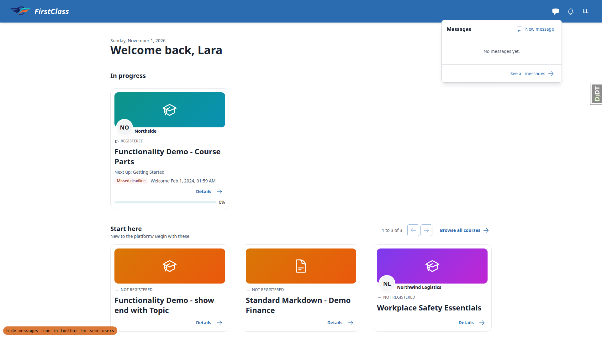
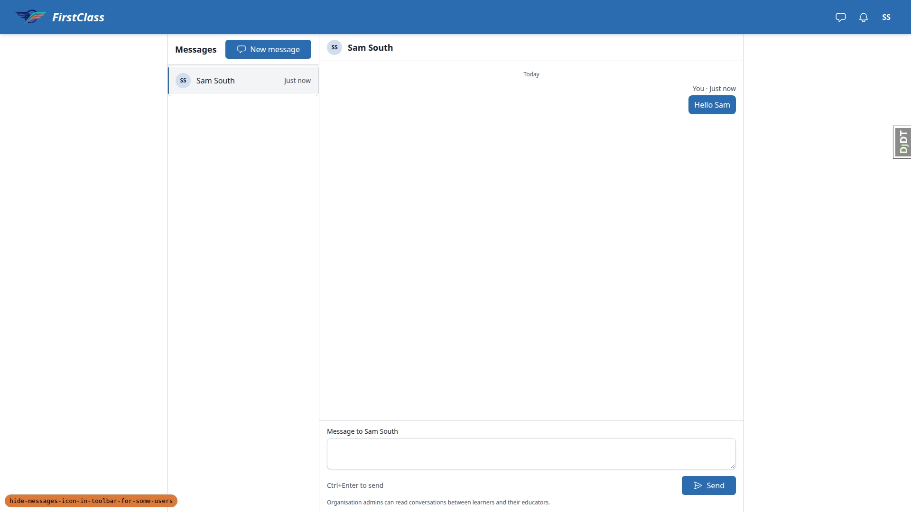
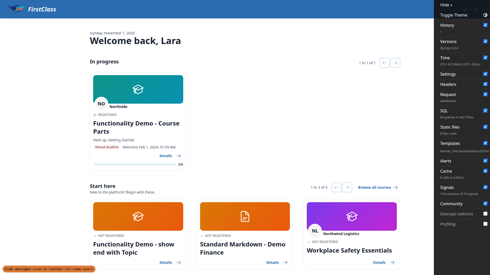
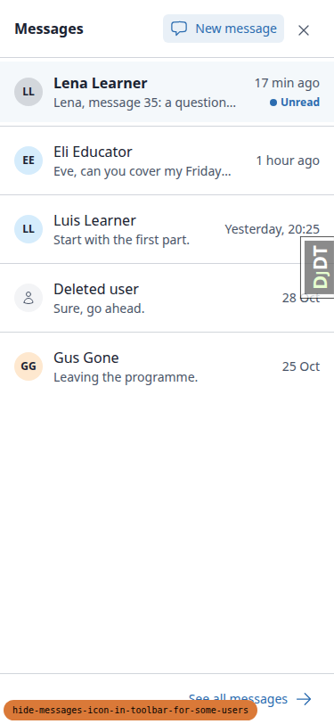
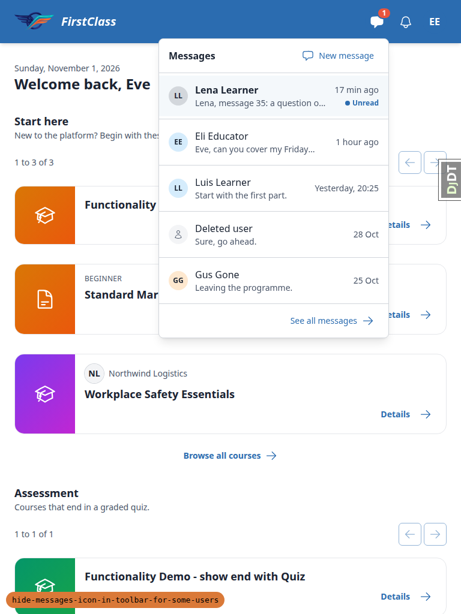

# Frontend QA report: hide-messages-icon-in-toolbar-for-some-users

## Methodology

Playwright MCP against a dev server on port 8554 using the dev settings. §5 ran on a scratch settings module with `MESSAGING_ENABLED=False`, which was deleted afterwards. The server was then restarted on the dev settings. Screenshots are collected in `screenshots/` beside this report.

## Diff scoping

Class: FULL.

Changed files:
- `freedom_ls/comms/messaging.py`
- `freedom_ls/comms/messaging_policy.py`
- `freedom_ls/comms/messaging_views.py`
- `freedom_ls/comms/templatetags/comms_tags.py`
- `docs/product/messaging.md`
- `docs/product/configuration-and-extension.md`
- spec, plan, research and todo `.md` files
- tests (`*.py`)
- `test_organisation/mirroring_exemptions.txt`
- uncommitted in the worktree: `freedom_ls/comms/templates/comms/partials/messages_panel.html`

Skipped: nothing. Non-.py paths such as .md/.txt make the class FULL, and the uncommitted template change would also trip Rule 1. Everything ran: desktop, mobile and tablet.

## Smoke gate

Result: pass.

Pages checked:
- `http://127.0.0.1:8554/` as demodev@email.com: 200, header and main present.
- `http://127.0.0.1:8554/messages/`: 200, Messages heading.

## Results

### §1 A learner with an open route keeps the button

| Test | Viewport | Status | Notes | Screenshot |
|---|---|---|---|---|
| 1.2 | desktop | pass | Lara's dashboard has `#messages-button` beside the bell. The sr-only label reads "Messages, none unread". The plan said "Messages"; that wording predates this branch and is on main. | none |
| 1.3 | desktop | pass | Panel opens with "No messages yet.", one "New message" link (`/messages/new/`) and "See all messages". |  |
| 1.4 | desktop | pass | Escape closes the panel (aria-expanded=false); focus returns to `#messages-button`. | none |
| 1.5 | desktop | pass | The course detail page `/courses/functionality-demo-course-parts/detail/` header still has the button. | none |

### §2 A learner with no route and no conversation has no button

| Test | Viewport | Status | Notes | Screenshot |
|---|---|---|---|---|
| 2.2 | desktop | pass | Sam has no conversation and no route. `#messages-button` and `#messages-panel` are absent from the DOM. Bell at x=1800, avatar at x=1848 (8px gap), no empty slot. |  |
| 2.3 | desktop | pass | Bell opens the notification panel ("Nothing yet."). | none |
| 2.4 | desktop | pass | Escape closes the notification panel; focus returns to `#notification-bell`. | none |
| 2.5 | mobile | pass | 375x812: no Messages button. Bell x=271, avatar x=319, same y. scrollWidth=375, so no horizontal scroll. |  |
| 2.5 | tablet | pass | 768x1024: no Messages button. Bell x=656, avatar x=704, same y. scrollWidth=768. |  |
| 2.6 | desktop | pass | `/messages/` returns 200: "Messages" heading, "No conversations yet.", no New message control. |  |
| 2.7 | desktop | pass | `/messages/new/` returns 200: "New message" page reading "There's no one you can message here. 0 people found". Not an error page. | none |

### §3 An existing conversation brings the button back

| Test | Viewport | Status | Notes | Screenshot |
|---|---|---|---|---|
| 3.1 | desktop | pass | south.admin (Sid) has the Messages button. | none |
| 3.2 | desktop | pass | Panel "New message", picked Sam South, sent "Hello Sam". The thread `/messages/abd9b2b6-.../` opened with the message. |  |
| 3.3 | desktop | pass | Sam's dashboard after reload: button present, label "Messages, 1 unread". | none |
| 3.4 | desktop | pass | Panel lists Sid South with excerpt "Hello Sam", marked unread. |  |
| 3.5 | desktop | pass | After opening the thread and reloading, the button stays and the label reads "Messages, none unread". | none |

### §4 Closing the organisation's educator route hides the button, except for a conversation

| Test | Viewport | Status | Notes | Screenshot |
|---|---|---|---|---|
| 4.2 | desktop | pass | Admin: created OrganisationMessagingConfig for Northside with Learner to educator = Closed (organisation is a select2 autocomplete). | none |
| 4.3 | desktop | pass | Lara's dashboard: no Messages button. |  |
| 4.4 | desktop | pass | Lara's `/messages/`: 200, "No conversations yet.", no New message control. | none |
| 4.5 | desktop | pass | Lena (l1): button present, "Messages, 1 unread". Panel lists Eve Educator and Vic Viewer, with no New message link. |  |
| 4.6 | desktop | pass | Eve (edu): button present, "Messages, 1 unread". Panel lists her conversations and offers New message. | none |
| 4.7-4.8 | desktop | pass | Deleted the Northside config row in the admin. Lara's reload shows the Messages button again. | none |

### §5 Messaging off: no button for anyone

| Test | Viewport | Status | Notes | Screenshot |
|---|---|---|---|---|
| 5.3 | desktop | pass | `MESSAGING_ENABLED=False` (scratch settings module): Lena has no Messages button. The bell is present and opens its panel. |  |
| 5.4 | desktop | pass | `/messages/` returns 404 with messaging off. | none |
| 5.5 | desktop | pass | Scratch settings module deleted; server restarted on the dev settings. | none |

### Mobile

| Test | Viewport | Status | Notes | Screenshot |
|---|---|---|---|---|
| M.1 | mobile | pass | Eve (button kept) at 375x812: messages button, bell and avatar are 40x40 at 8px spacing on one row. The panel opens as a full-width sheet. No horizontal scroll. |  |

### Tablet

| Test | Viewport | Status | Notes | Screenshot |
|---|---|---|---|---|
| T.1 | tablet | pass | Eve at 768x1024: header buttons aligned, unread badge visible, dropdown panel 382px wide inside the viewport. No horizontal scroll. |  |

## Design check

No design states tested.

## Bugs

No bugs were found.

## Data changes

| Via | Change |
|---|---|
| sdd:qa-data-helper | Ran `qa_create_direct_messaging_scenario --site-name DemoDev` (7 conversations created; site/Northside/Southside messaging configs reset to defaults). |
| sdd:qa-data-helper | Deleted Sam South's (s1@qa.test) only conversation, pk 422011fb-5ea6-4a5a-8760-1166d4da9e22, with south.admin (plan §0.3). |
| sdd:qa-data-helper | Plan §6 reset: re-ran `qa_create_direct_messaging_scenario --site-name DemoDev`; s1@qa.test is back to exactly one conversation with south.admin. |

## Bug status

No bugs.

## General notes

- The pre-step rebase was a no-op (the branch already contains origin/main).
- Uncommitted edits to `messages_panel.html` and `test_messaging_views.py` from another process were in the worktree during the run. The dev server served them, so the panel showed a single New message link.
- The Django debug toolbar handle overlaps the header buttons at desktop until hidden (dev-only).
- The sr-only label reads "Messages, none unread" (the plan said "Messages"); that wording is already on main.
- demodev@email.com (superuser) has no Messages button, which fits the rule.
- The capture-check screenshot `page-2026-11-01T21-25-13-146Z.png` is the anonymous home page.

status: ok · reason: report rendered, 0 bugs documented
