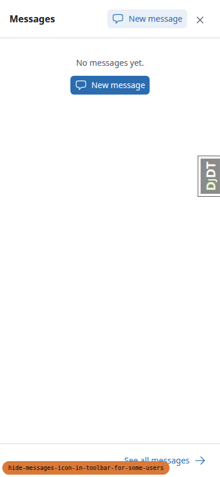
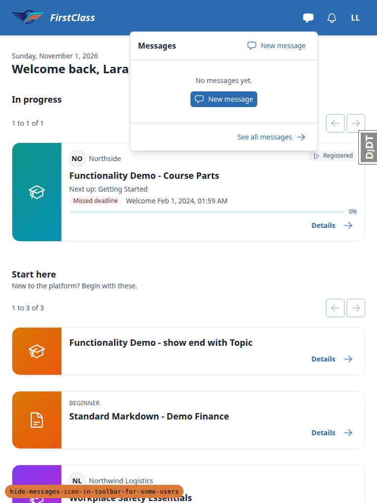
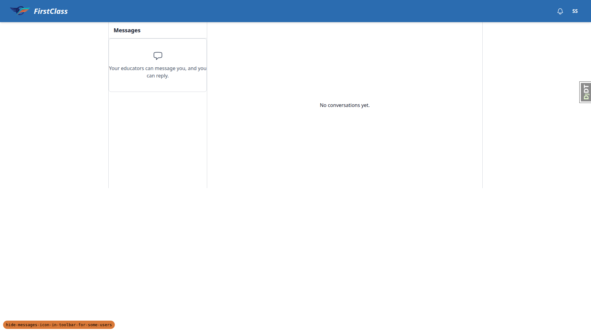
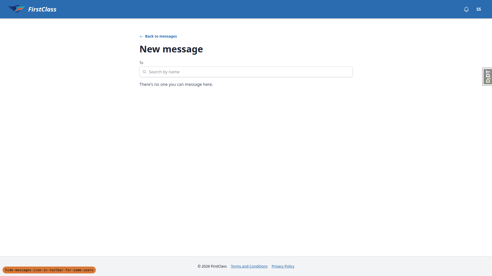
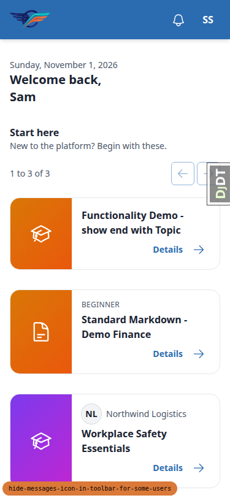
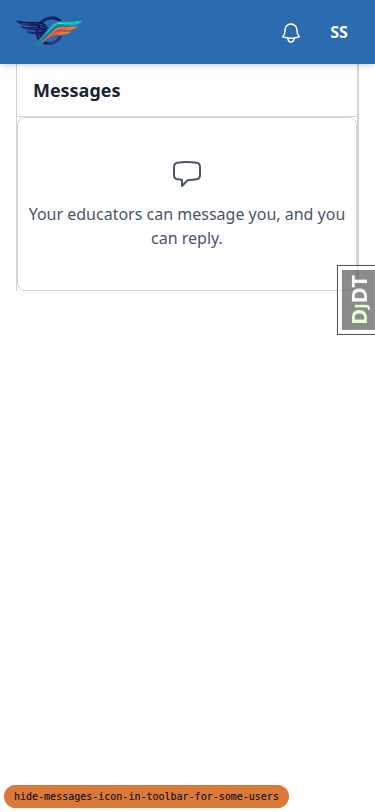
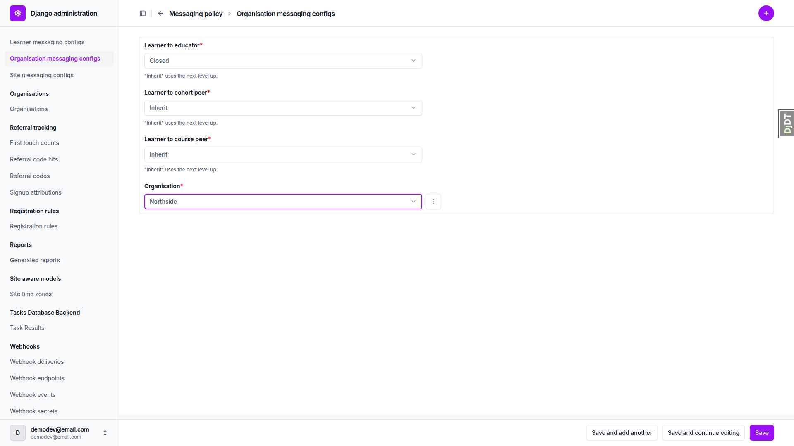
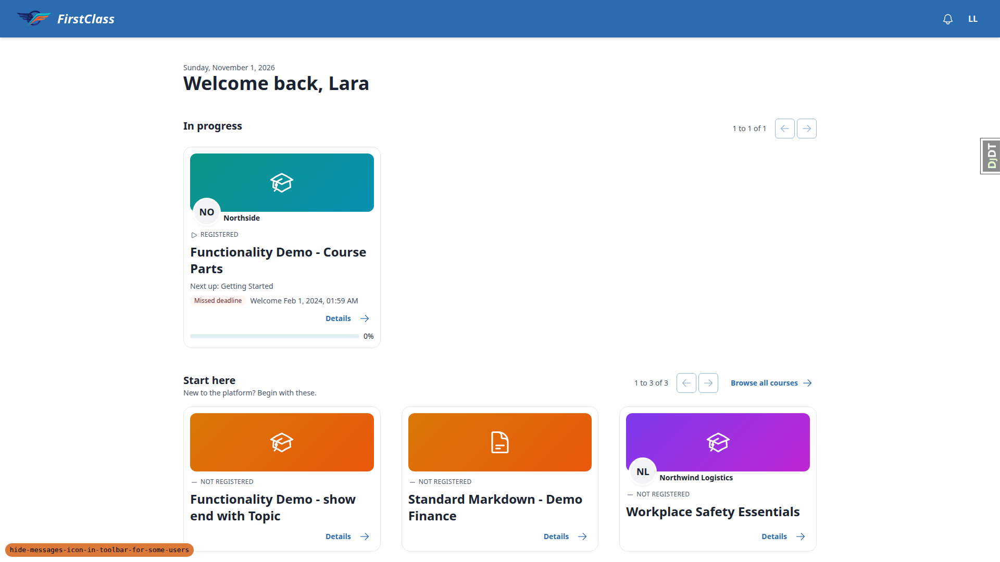
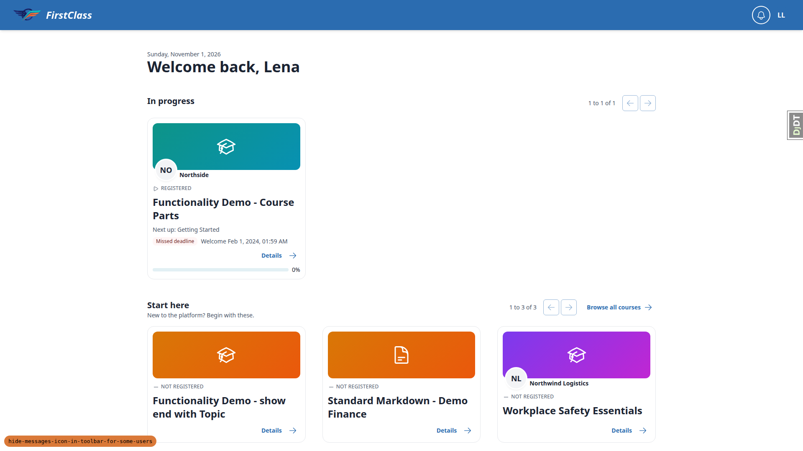
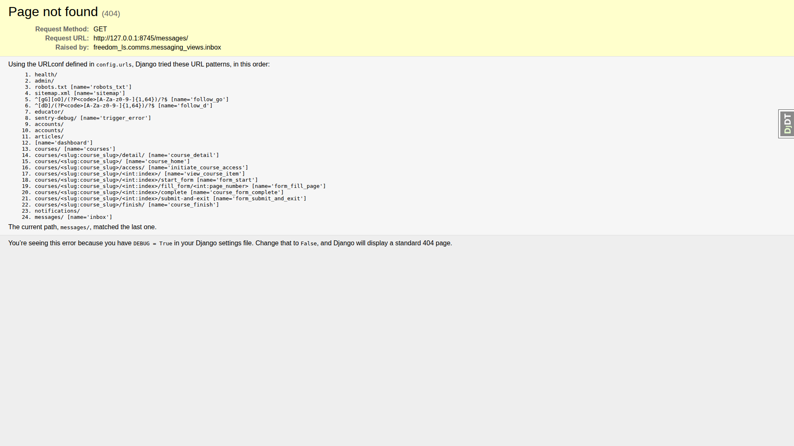

# Frontend QA report: hide messages icon in toolbar for some users

All tests passed. 0 bugs found.

## Methodology

- Tested by hand with the Playwright MCP.
- Viewports: 1920x1080 (desktop), 375x812 (mobile) and 768x1024 (tablet).
- The dev server ran on its own port (8745). The branch badge was verified before testing.
- Screenshots were collected into `screenshots/` beside this report. Every image linked below exists there.

## Diff scoping

- Class: FULL.
- Changed files:
  - `freedom_ls/comms/messaging.py`
  - `freedom_ls/comms/messaging_policy.py`
  - `freedom_ls/comms/messaging_views.py`
  - `freedom_ls/comms/templatetags/comms_tags.py`
  - `freedom_ls/conftest.py`
  - tests under `freedom_ls/*/tests/`
  - `docs/product/*.md`
  - spec_dd files (spec, plan, screenshots .png, todo.md)
  - `test_organisation/mirroring_exemptions.txt`
- Skipped: nothing. Non-.py paths such as .md, .png and .txt make the class FULL (Rule 4), and no template or static paths changed. Mobile and tablet both ran.

## Smoke gate

Pass. Pages loaded:

- http://127.0.0.1:8745/
- http://127.0.0.1:8745/messages/

## Results

### §1 Messages button for a user who can message

| Test | Viewport | Status | Notes | Screenshot |
|---|---|---|---|---|
| 1.2 | desktop | pass | l3 on dashboard: #messages-button present immediately left of bell. Accessible name after badge load is 'Messages, none unread' (plan said 'Messages'; existing badge wording, not a defect). |  |
| 1.3 | desktop | pass | Panel opens: 'No messages yet.' empty state plus 'New message' (header link and button), 'See all messages'. Django debug toolbar handle intercepted the first click; hid the toolbar first. |  |
| 1.4 | desktop | pass | Escape closes panel (aria-expanded=false), focus returns to #messages-button. | none |
| 1.5 | desktop | pass | Course detail /courses/functionality-demo-course-parts/detail/ header still has #messages-button. |  |
| 1.2-1.3 | mobile | pass | l3 at 375x812: button x=223 left of bell x=271, both 40x40 at y=12; no horizontal scroll. Panel opens as a full-screen sheet (0,0,375,812) with empty state, New message and a close button. |  |
| 1.2-1.3 | tablet | pass | l3 at 768x1024: button x=608, bell x=656, y=16; panel is a 382px dropdown (x=265) within the viewport; scrollWidth=768. |  |

### §2 No messaging relationships: button hidden

| Test | Viewport | Status | Notes | Screenshot |
|---|---|---|---|---|
| 2.2 | desktop | pass | s1 (no conversations, no recipients): #messages-button absent from DOM. Bell box x=1800 w=40, avatar x=1848: 8px gap, no hole. |  |
| 2.3 | desktop | pass | Bell opens notification-panel ('Nothing yet.'). |  |
| 2.4 | desktop | pass | Escape closes the panel, focus returns to the bell. | none |
| 2.6 | desktop | pass | /messages/ HTTP 200, 'Messages' heading, 'No conversations yet.', 0 'New message' controls. |  |
| 2.7 | desktop | pass | /messages/new/ HTTP 200 'New message' page with 'There's no one you can message here. 0 people found'. Not an error page. |  |
| 2.5 | mobile | pass | 375x812: no #messages-button; bell x=271 and avatar x=319 aligned at y=12; scrollWidth=375 (no horizontal scroll). Bell panel opens full-width (x=0,w=375) and closes on Escape. |  |
| 2.6 | mobile | pass | /messages/ 200 at 375 wide, no horizontal scroll, no New message control. |  |
| 2.5 | tablet | pass | 768x1024: no #messages-button; bell x=656, avatar x=704, both y=16; scrollWidth=768. |  |

### §3 Button appears once a conversation exists

| Test | Viewport | Status | Notes | Screenshot |
|---|---|---|---|---|
| 3.1 | desktop | pass | south.admin (organisation_admin) has #messages-button; panel shows empty state and New message. Users signed in sequentially in one context (cookies cleared) rather than two parallel contexts. | none |
| 3.2 | desktop | pass | New message picker lists Sam South (Cohort S, 1 person found); sent 'Hello Sam'; thread opens with the sent message. |  |
| 3.3 | desktop | pass | Sam's dashboard: #messages-button present again; label 'Messages, 1 unread'. |  |
| 3.4 | desktop | pass | Panel lists Sid South, excerpt 'Hello Sam', Unread. No New message control (Sam has no one to start a conversation with): consistent. |  |
| 3.5 | desktop | pass | After opening the thread and reloading: button still present, label 'Messages, none unread'. |  |

### §4 Organisation messaging policy (learner_to_educator closed)

| Test | Viewport | Status | Notes | Screenshot |
|---|---|---|---|---|
| 4.2 | desktop | pass | Admin add form: organisation select2 autocomplete -> Northside; learner_to_educator=Closed; saved OK. |  |
| 4.3 | desktop | pass | l3 with Northside learner_to_educator closed: #messages-button absent. |  |
| 4.4 | desktop | pass | l3 /messages/ 200, 'No conversations yet.', 0 New message controls. | none |
| 4.5 | desktop | pass | l1 keeps button, 'Messages, 1 unread'; panel lists Eve Educator and Vic Viewer conversations. |  |
| 4.6 | desktop | pass | edu keeps button, 'Messages, 1 unread'. |  |
| 4.7 | desktop | pass | Deleted the Northside config row via the admin delete confirmation page; list empty. | none |
| 4.8 | desktop | pass | l3 reload: #messages-button back. |  |

### §5 Messaging disabled globally

| Test | Viewport | Status | Notes | Screenshot |
|---|---|---|---|---|
| 5.3 | desktop | pass | MESSAGING_ENABLED=False via scratch settings module: l1 (has conversations) has no #messages-button; bell present and opens (aria-expanded=true), closes on Escape. |  |
| 5.4 | desktop | pass | /messages/ returns 404. |  |
| 5.5 | desktop | pass | Scratch settings module deleted; server restarted on dev settings. | none |

## Design check

No design states tested.

## Bugs

No bugs found.

## Data changes

| What changed | Via |
|---|---|
| Ran qa_create_direct_messaging_scenario --site-name DemoDev (demo data already present, not recreated) | sdd:qa-data-helper |
| Deleted s1@qa.test's single conversation with south.admin@qa.test (plan §0.3): 1 Conversation, 2 participants, 1 message | sdd:qa-data-helper |
| Created OrganisationMessagingConfig for Northside with learner_to_educator=Closed (removed again in §4 step 7) | QA plan §4 step 2 (admin UI, as demodev@email.com) |
| Deleted the Northside OrganisationMessagingConfig row created in §4 step 2 | QA plan §4 step 7 (admin UI) |
| §6 reset: re-ran qa_create_direct_messaging_scenario --site-name DemoDev; s1 has 1 conversation again (with south.admin), 0 Northside OrganisationMessagingConfig rows | sdd:qa-data-helper |
| Created scratch config/settings_qa_messaging_off.py (MESSAGING_ENABLED=False), restarted server on it, then deleted the file and restarted on dev settings | QA plan §5 (by hand) |

## Bug status

No bugs. No rows.

## General notes

- Anonymous visitor and the demodev superuser (no conversations, no recipients) also get no #messages-button; /messages/ answers 200 for the superuser.
- The plan expects the label 'Messages' for a user with no unread; once the badge loads the accessible name is 'Messages, none unread'. This is the existing badge wording, not part of this change.
- The Django debug toolbar's 'Hide' handle intercepts clicks on the header Messages button at 1920x1080 until the toolbar is hidden. Dev-only, not a product bug.
- §3 used one browser context with cookies cleared between Sid and Sam rather than two parallel contexts; the outcome is the same.
- Playwright accessibility snapshots (.yml) and console logs also landed in qa-screenshots/; they were deleted before collection so only PNGs reached screenshots/.
- The first qa-data-helper run wrote .claude/agent-memory/sdd-qa-data-helper/ files (MEMORY.md modified, reference_direct_messaging_scenario.md added), which CLAUDE.md forbids. They were left uncommitted for the user to decide.
- Screenshot compression: ok. No PNG over 1024KB; nothing compressed.

status: ok · reason: report rendered, 0 bugs documented, screenshots verified
