# QA report: the header Messages button shows only to users with a use for it

Test plan: `3. frontend_qa.md`. Run on 2026-11-01 against `runserver` on port 8065, branch
`hide-messages-icon-in-toolbar-for-some-users` (confirmed by `#debug-branch-badge`), after rebasing
onto `origin/main`.

**Result: every test passed at every viewport. No bugs.**

## Methodology

The browser was driven through the `ds` Playwright MCP server. Each persona signed in through
`/accounts/login/` with cookies cleared between personas. This replaces the plan's "second
browser context" in §3 and §4 and checks the same thing. Presence of the button was checked as
DOM presence of `#messages-button`, not visibility. Header alignment was checked from element
bounding boxes and `scrollWidth` against `clientWidth`.

The Django debug toolbar's handle covers the header's right edge at 1920px wide and blocks
clicks, so the toolbar was hidden with an injected style for the run.

Screenshots were collected into `screenshots/` beside this report. Every image referenced below
exists there.

Data: `create_demo_data --yes`, `content_save ./demo_content DemoDev`, then
`qa_create_direct_messaging_scenario --site-name DemoDev`, then §0.3 (Sam's conversation
deleted). Sam's conversation was deleted a second time before the mobile and tablet passes,
because §3 had given him a new one. §6's reset ran at the end.

## Diff scoping

Class **FULL**. The branch changes no templates or static files. The changed files are
`freedom_ls/comms/messaging.py`, `messaging_views.py`, `templatetags/comms_tags.py` and their
tests, but non-`.py` files (spec markdown, `test_organisation/mirroring_exemptions.txt`) also
changed, so the safe default applied. Desktop, mobile and tablet all ran. Nothing was skipped.

## Smoke gate

**Pass.** As `demodev@email.com`: `/` returned 200 with header and main, and `/messages/`
returned 200 with the "Messages" heading.

## Results

| Test | Viewport | Result | Notes |
|---|---|---|---|
| 1.2 | desktop | pass | Lara (`l3`): button present, left of bell. Accessible name "Messages, none unread" (see notes) |
| 1.3 | desktop | pass | Panel: "No messages yet.", New message, See all messages |
| 1.4 | desktop | pass | Escape closes; focus back on `#messages-button` |
| 1.5 | desktop | pass | Button present on a course page |
| 2.2 | desktop | pass | Sam (`s1`): no button in DOM; bell and avatar in the same positions as for a user with the button, no gap |
| 2.3 | desktop | pass | Bell opens notifications panel |
| 2.4 | desktop | pass | Escape closes; focus back on bell |
| 2.6 | desktop | pass | `/messages/` 200, "No conversations yet.", no New message control |
| 2.7 | desktop | pass | `/messages/new/` 200: "There's no one you can message here." / "0 people found". Not an error page |
| 3.1 | desktop | pass | Sid has the button |
| 3.2 | desktop | pass | Picker lists Sam South; "Hello Sam" sent; thread opens |
| 3.3 | desktop | pass | Sam: button back, "Messages, 1 unread", badge 1 |
| 3.4 | desktop | pass | Panel lists Sid South / "Hello Sam" / Unread |
| 3.5 | desktop | pass | After reading: button stays, "Messages, none unread" |
| 4.1–4.2 | desktop | pass | Northside config saved with Learner to educator = Closed |
| 4.3 | desktop | pass | Lara: no button |
| 4.4 | desktop | pass | Lara `/messages/` 200, empty, no New message |
| 4.5 | desktop | pass | Lena keeps button, "1 unread"; panel lists Eve and Vic |
| 4.6 | desktop | pass | Eve keeps button, "1 unread" |
| 4.7–4.8 | desktop | pass | Row deleted in admin; Lara's button is back |
| 5.3 | desktop | pass | `MESSAGING_ENABLED=False`: Lena has no button; bell opens |
| 5.4 | desktop | pass | `/messages/` 404 |
| 1.3 | mobile | pass | Lara: panel full width (x=0, w=375), no horizontal scroll |
| 2.5 | mobile | pass | Sam: no button; bell x=271, avatar x=319 (same as Lara's); no horizontal scroll; bell panel opens and Escape returns focus |
| 2.6 | mobile | pass | `/messages/` 200, no horizontal scroll |
| 1.3 | tablet | pass | Lara: button left of bell, panel within viewport |
| 2.5 | tablet | pass | Sam: no button; bell and avatar aligned (y=16, 40×40); no horizontal scroll; bell panel opens and Escape returns focus |
| 2.6 | tablet | pass | `/messages/` 200, no horizontal scroll |

### Screenshots

Lara's panel, empty state (1.3, desktop):
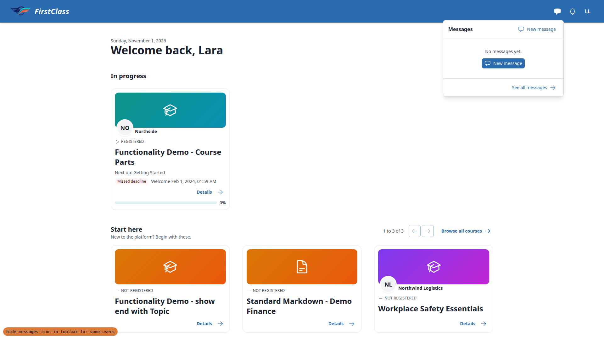

Course page with the button (1.5):
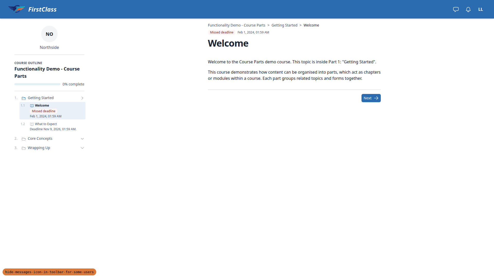

Sam with no button (2.2, desktop):

Bell panel for Sam (2.3):

`/messages/` for Sam (2.6):
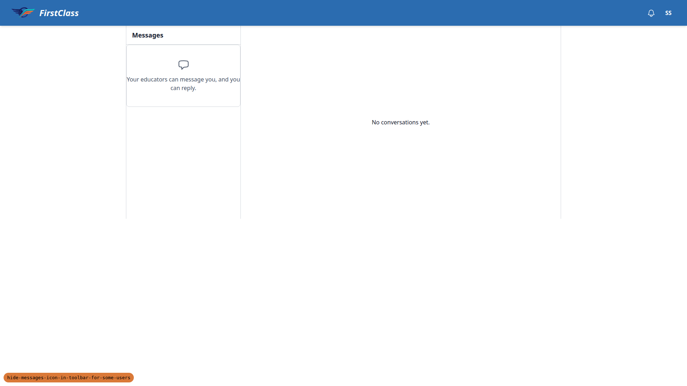

Sid's thread after sending "Hello Sam" (3.2):
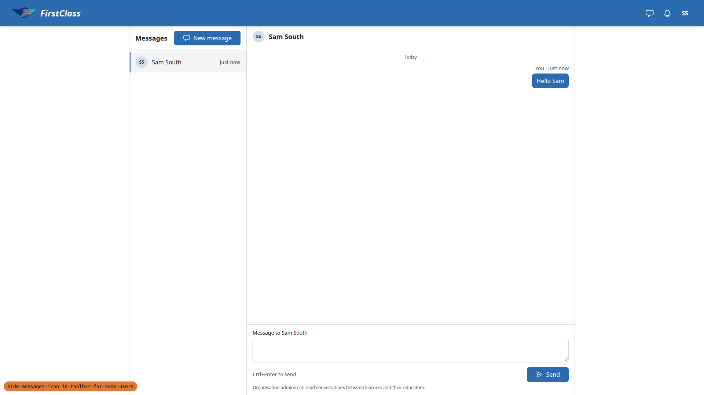

Sam's panel listing Sid's message (3.4):

Lara with Northside's educator route closed (4.3):

Lena keeps her conversations with the route closed (4.5):
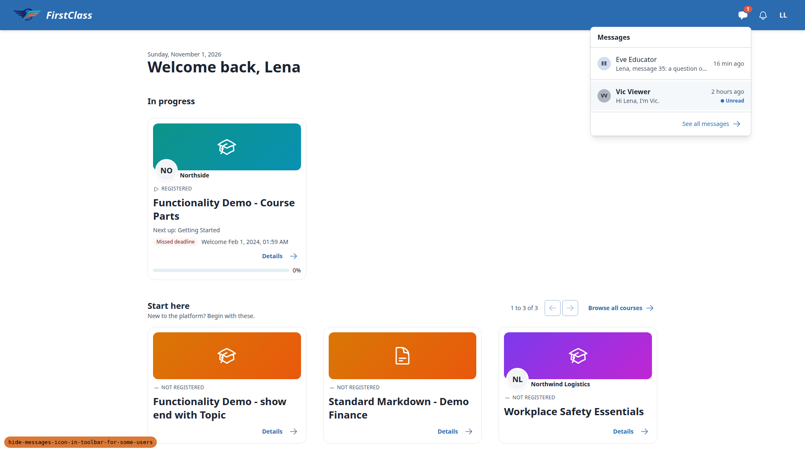

Messaging off: no button, bell open (5.3):

Mobile, Sam with no button (2.5):
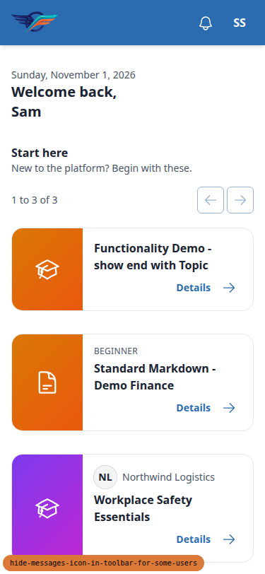

Mobile, Sam's `/messages/` (2.6):
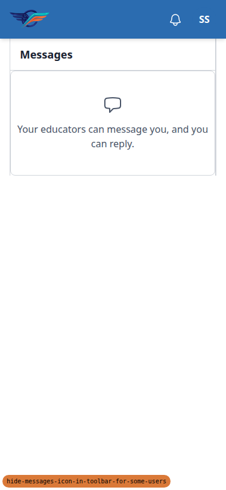

Mobile, Lara's panel (1.3):
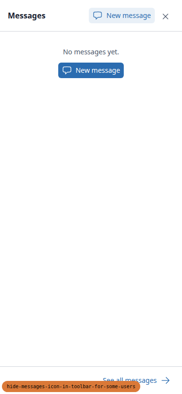

Tablet, Sam with no button (2.5):
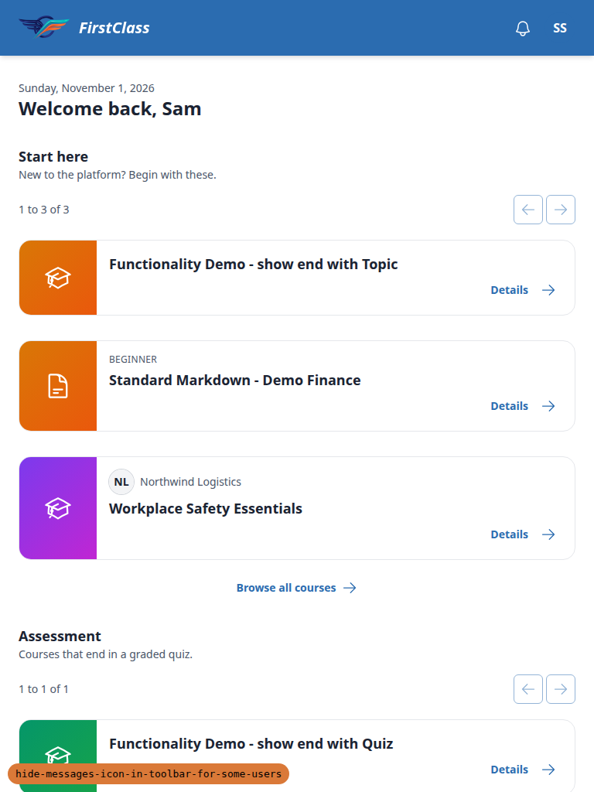

Tablet, Sam's `/messages/` (2.6):
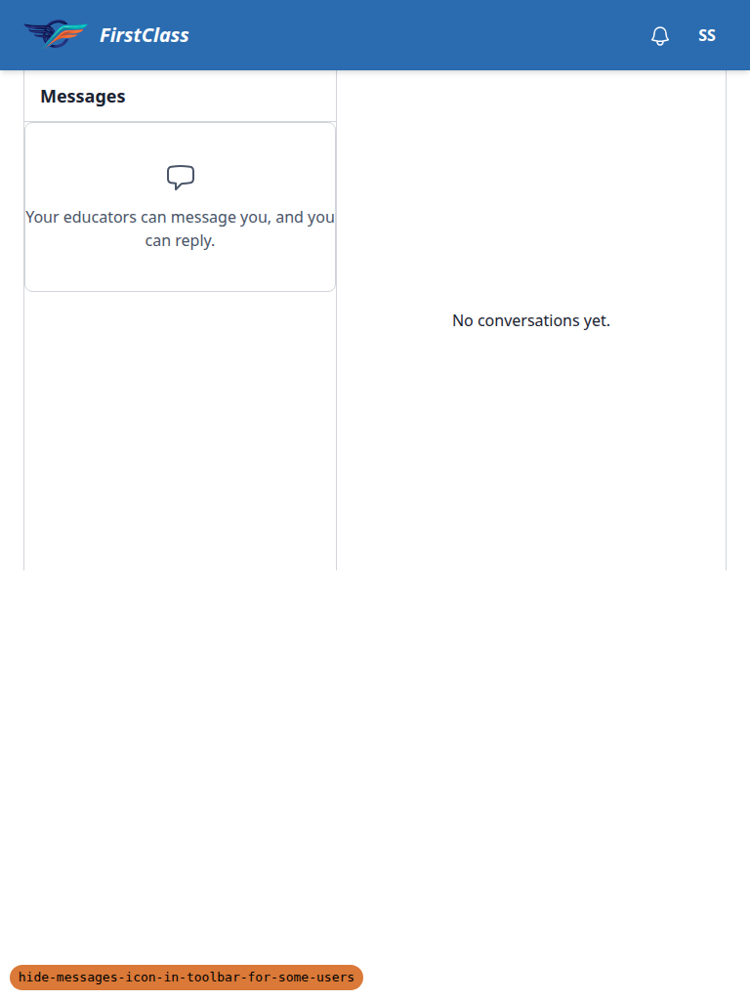

Tablet, Lara's panel (1.3):
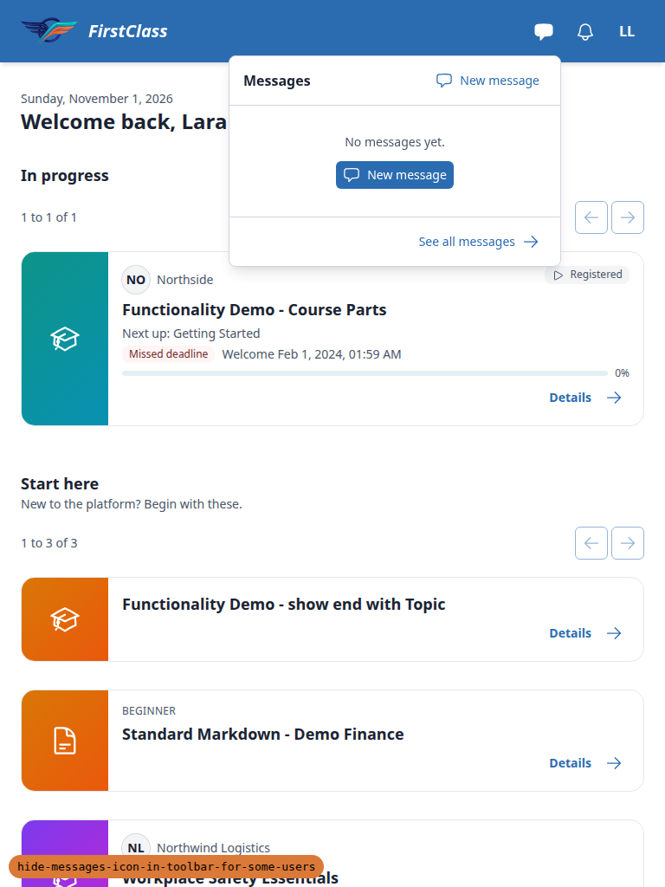

Smoke gate, home as admin:
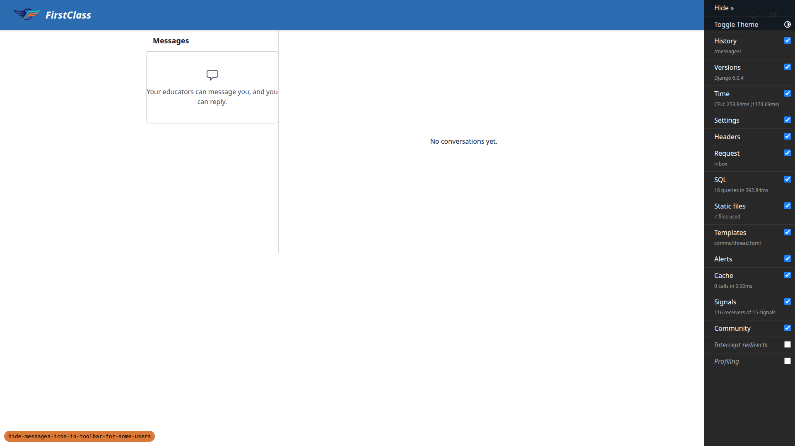

## Design check

No design states tested.

## Bug status

No bugs found.

## General notes

- **Accessible name wording.** The plan's §1.2 expects the sr-only label to be "Messages". The
  page shows "Messages, none unread". That is the shipped badge-label convention, matching the
  bell's "Notifications, none new", and this branch did not change it. Counted as a pass. The
  plan text could be updated.
- **§3.1 precondition.** Sid's seeded conversation with Sam was removed by §0.3, so Sid's panel
  was empty when §3 began. He still had the button through the recipient route, which is what
  §3.1 checks.
- **Debug toolbar.** The django-debug-toolbar handle sits over the header's right edge at 1920px
  and swallows clicks on the Messages button. This is a dev-only annoyance that predates this
  branch.
- **Favicon.** The admin pages log a 404 for `/favicon.ico`. Tangential and dev-only.
- **No admin button.** The superuser `demodev@email.com` has no Messages button (no conversation,
  no recipient). This is consistent with the spec.

status: ok
reason: report rendered, 0 bugs, 28 test records all pass across desktop, mobile and tablet
