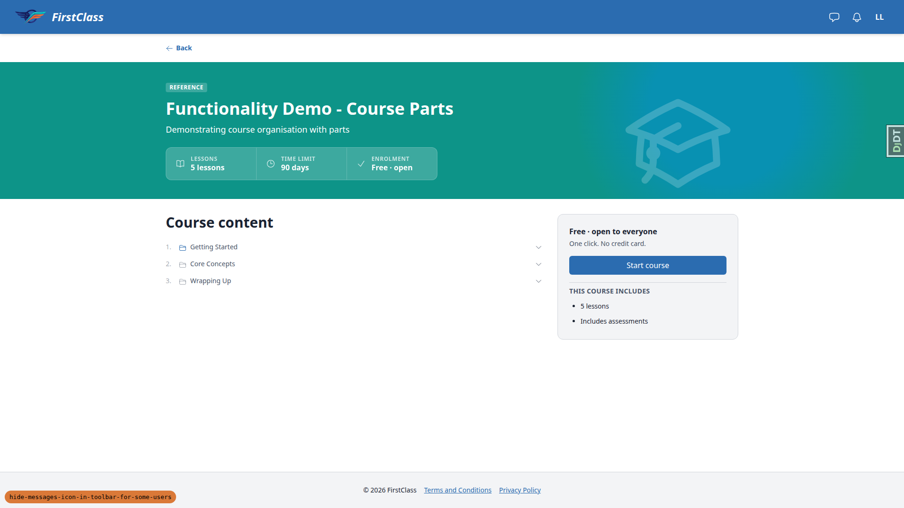
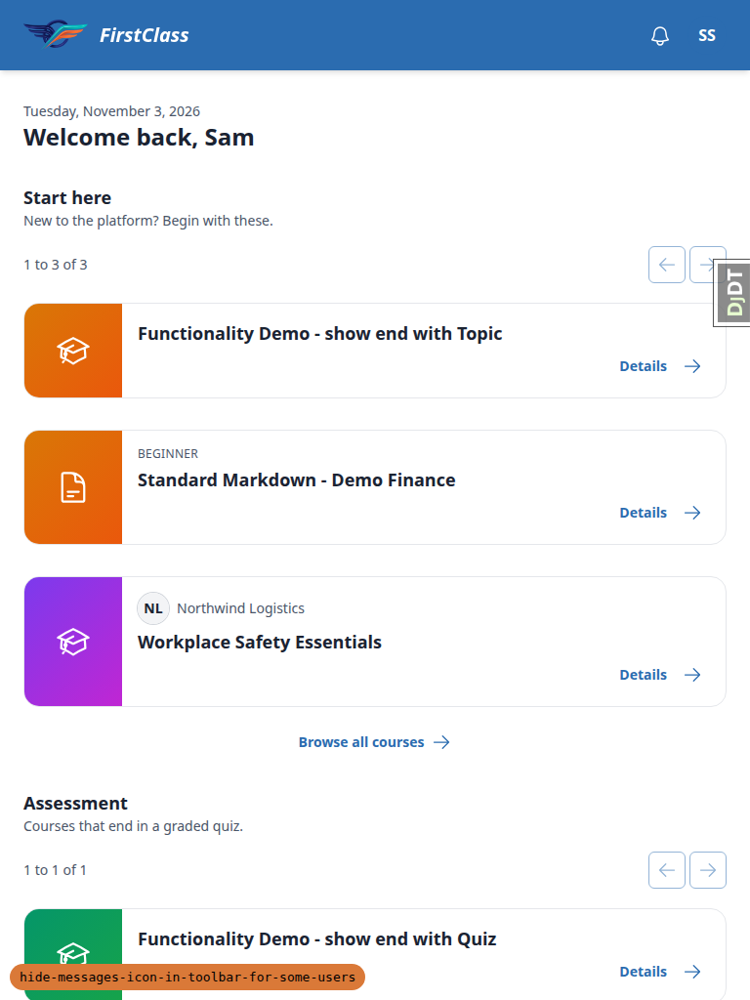
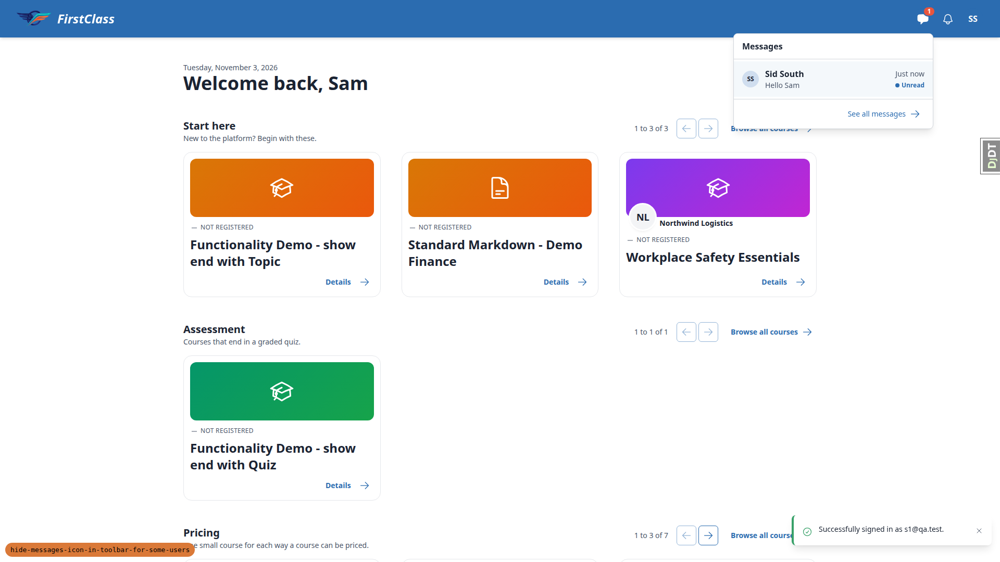
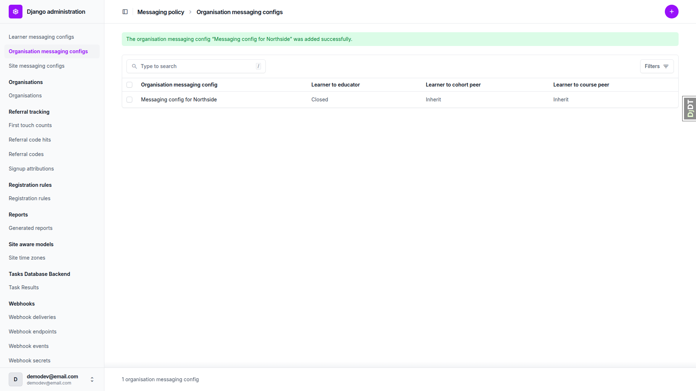
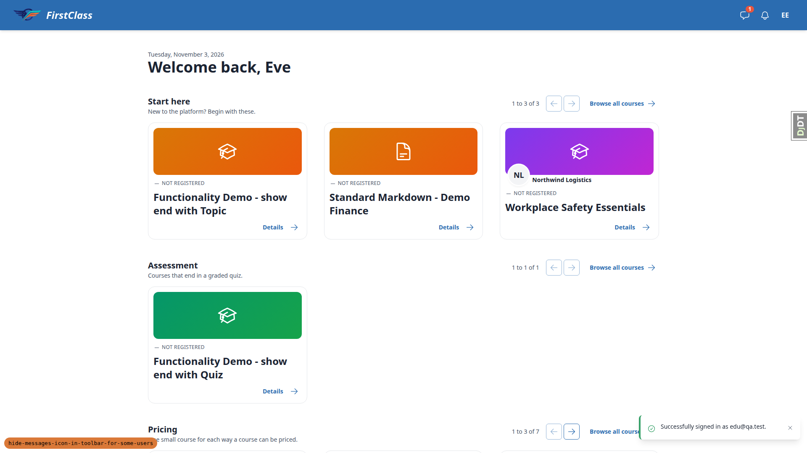
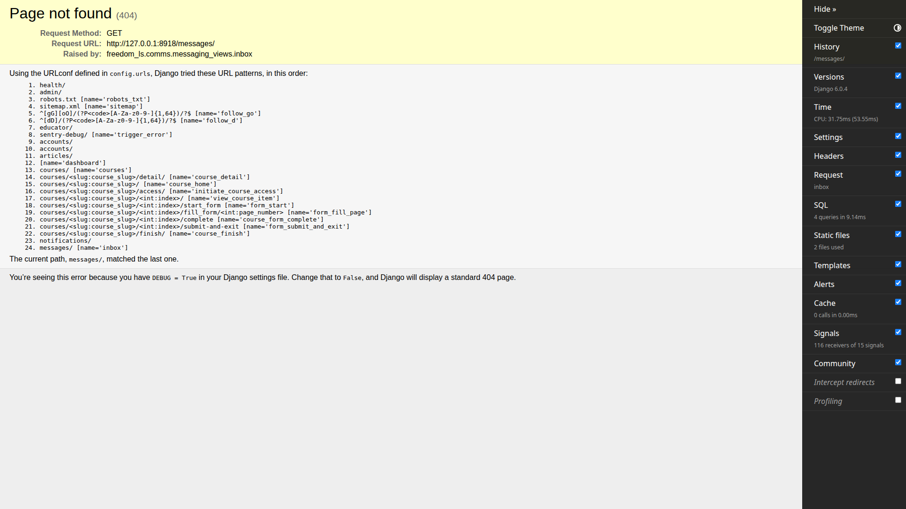
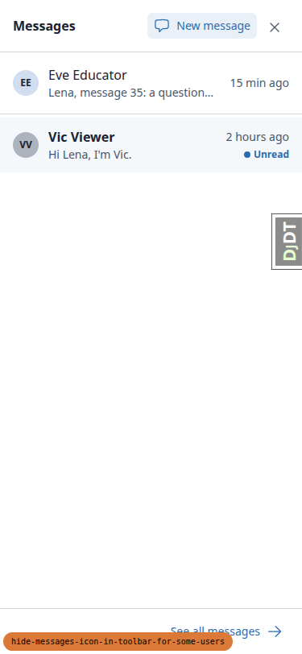
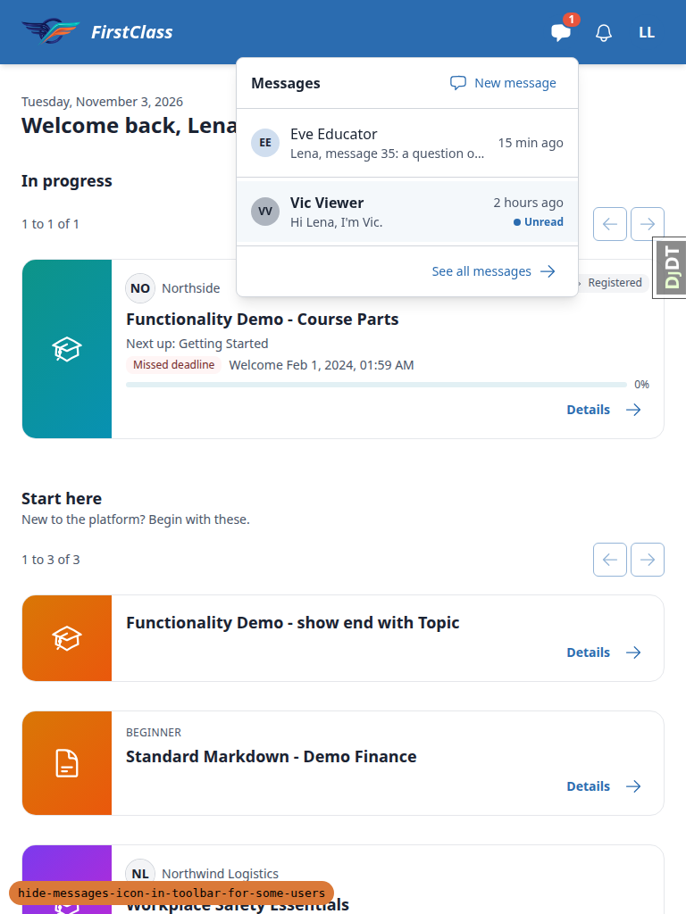

# Frontend QA Report: hide-messages-icon-in-toolbar-for-some-users

Date: 2026-11-03. Branch: `hide-messages-icon-in-toolbar-for-some-users`. Dev server port: 8579. All tests passed and 0 bugs were found. The run checked that the Messages button in the toolbar shows only for users who can actually use messaging, and that the bell and avatar lay out cleanly when it is hidden. It covered the desktop, mobile and tablet viewports, and the messaging-disabled and closed-route configurations.

## Methodology

Playwright MCP, driven by hand at three viewports: 1920x1080 (desktop), 375x812 (mobile) and 768x1024 (tablet). Screenshots were collected into `screenshots/` beside this report, and every image referenced below exists there. Only PNGs were collected, and none was over 1024KB, so none was compressed.

## Diff scoping

Class: **FULL**. Changed files that triggered it:

- `freedom_ls/comms/templates/comms/partials/messages_panel.html`
- `freedom_ls/comms/templatetags/comms_tags.py`
- `freedom_ls/comms/messaging.py`
- `freedom_ls/comms/messaging_policy.py`
- `freedom_ls/comms/messaging_views.py`
- plus tests, docs and spec files

Everything in the plan ran. Nothing was skipped.

## Smoke gate

Outcome: **pass**. Pages checked:

- http://127.0.0.1:8579/
- http://127.0.0.1:8579/messages/

## Results

| Test | Viewport | Status | Notes | Screenshot |
|---|---|---|---|---|
| 1.2 | desktop | pass | l3 dashboard: Messages button present left of bell; label 'Messages, none unread' after badge load (no count) |  |
| 1.3 | desktop | pass | Panel opens: 'No messages yet.', one 'New message' link in header, 'See all messages' |  |
| 1.4 | desktop | pass | Escape closes panel (aria-expanded=false), focus returns to #messages-button | none |
| 1.5 | desktop | pass | Course detail page header keeps the Messages button |  |
| 2.2 | desktop | pass | s1 dashboard: #messages-button absent from DOM; bell x1800-1840 and avatar x1848 sit side by side, 8px gap, no hole |  |
| 2.3 | desktop | pass | Bell opens notifications panel ('Nothing yet.') |  |
| 2.4 | desktop | pass | Escape closes notifications panel, focus returns to #notification-bell | none |
| 2.5 | mobile | pass | 375x812: no Messages button; bell x271, avatar x319 aligned at y12; scrollWidth 375, no horizontal scroll |  |
| 2.5 | tablet | pass | 768x1024: no Messages button; bell and avatar aligned; scrollWidth 768, no horizontal scroll |  |
| 2.6 | desktop | pass | /messages/ HTTP 200, 'Messages' heading, 'No conversations yet.', no New message control |  |
| 2.7 | desktop | pass | /messages/new/ HTTP 200: 'New message' page with empty recipient list, 'There's no one you can message here. 0 people found'. Not an error page |  |
| 3.1 | desktop | pass | south.admin has the Messages button. Run as sequential sign-in/out in one context rather than two parallel contexts (Playwright MCP tabs share cookies) | none |
| 3.2 | desktop | pass | Panel New message -> recipient list shows Sam South (Cohort S) -> sent 'Hello Sam'; thread opened with the message |  |
| 3.3 | desktop | pass | Sam's dashboard: button back, label 'Messages, 1 unread' with visible '1' badge |  |
| 3.4 | desktop | pass | Panel lists 'Unread. Sid South / Hello Sam / Just now'; no New message link (Sam has no recipients), as intended |  |
| 3.5 | desktop | pass | After reading the thread, dashboard reload keeps button; label 'Messages, none unread' |  |
| 4.2 | desktop | pass | Admin saved 'Messaging config for Northside': Learner to educator Closed, others Inherit |  |
| 4.3 | desktop | pass | l3 dashboard: Messages button absent; bell + avatar only |  |
| 4.4 | desktop | pass | l3 /messages/ HTTP 200, empty list, no New message control |  |
| 4.5 | desktop | pass | l1 keeps button ('Messages, 1 unread'); panel lists Eve Educator and Vic Viewer conversations |  |
| 4.6 | desktop | pass | edu keeps button ('Messages, 1 unread') |  |
| 4.8 | desktop | pass | After deleting the Northside row, l3's Messages button is back |  |
| 5.3 | desktop | pass | MESSAGING_ENABLED=False (scratch settings, second server on port 8918): l1 has no Messages button; bell opens the notifications panel |  |
| 5.4 | desktop | pass | /messages/ returns HTTP 404 |  |
| 5.5 | desktop | pass | Scratch settings module deleted; main dev-settings server on 8579 was never stopped (second server used instead of restart) | none |
| 4.5 | mobile | pass | 375x812, l1 (route reopened): Messages button x223 beside bell x271, aligned at y12; panel opens full-screen with conversations, New message, close button; no horizontal scroll |  |
| 4.5 | tablet | pass | 768x1024, l1: Messages button with '1' badge beside bell; dropdown panel 382px wide below header, fits viewport; no horizontal scroll |  |

## Design check

No design states tested.

## Bugs

No bugs were found this run.

## Data changes

| What | Via |
|---|---|
| Ran qa_create_direct_messaging_scenario --site-name DemoDev (7 conversations, messaging config reset to defaults) | sdd:qa-data-helper |
| Deleted s1@qa.test's only conversation (with south.admin, pk abd9b2b6…, 1 message) per plan §0.3 | sdd:qa-data-helper |
| Created OrganisationMessagingConfig for Northside with Learner to educator = Closed | admin UI (test plan §4 step 2) |
| Deleted that Northside OrganisationMessagingConfig row (pk 7284128b…) | admin UI (test plan §4 step 7) |
| §6 reset: re-ran qa_create_direct_messaging_scenario --site-name DemoDev; s1 back to 1 seeded conversation with south.admin ('Welcome, Sam.'), 'Hello Sam' message gone, 0 OrganisationMessagingConfig rows | sdd:qa-data-helper |

## Bug status

No bugs found this run.

## General notes

- The plan's "second browser context" steps (§3, §4) were run as sequential sign-out/sign-in in one Playwright context. The outcome is equivalent.
- §5 used a second server on port 8918 with the scratch settings instead of stopping and restarting the main server. The scratch settings file was deleted afterwards.
- The debug toolbar intercepted one bell click on the new port origin until it was collapsed. This is a harness issue, not an app defect.
- The superuser demodev@email.com has no Messages button (no conversations, no recipients). This is consistent with the change.
- The admin console showed only a favicon 404 and report-only CSP notices, unrelated to this branch.
- Snapshot .yml and console .log files were removed from the screenshot directory before collection. Only PNGs were collected.
- `page-2026-11-03T02-54-04-746Z.png` is the anonymous per-run capture check.
- Screenshot compression: status ok. No PNG was over 1024KB, so nothing was compressed.

status: ok · reason: report rendered, 0 bugs documented
