# Frontend QA report

- Test plan: `3. frontend_qa.md`
- Date: 2026-10-28
- Branch: learner-facing-ux-refinements
- Dev server: 127.0.0.1:8392

## Methodology

Playwright MCP, driven by hand. Viewports: desktop 1280x800 (the plan's own desktop size, which its lg checks depend on) plus one 1920x1080 sanity pass; phone 375x812; tablet 768x1024. Screenshots were collected into `screenshots/` beside this report and every referenced image exists there. Accessibility-snapshot .yml files and console logs were not kept. Personas: demodev_paging, qa.one.application, demodev_empty, demodev (educator), and signed-out.

## Diff scoping

Class: **FULL**.

Changed files:

- `freedom_ls/base/templates/cotton/section-pagination.html`
- `freedom_ls/course_applications/templates/course_applications/partials/dashboard_applications.html`
- `freedom_ls/learner_interface/static/learner_interface/js/alpine-components.js`
- `freedom_ls/learner_interface/templates/learner_interface/course_detail.html`
- `freedom_ls/learner_interface/templates/learner_interface/partials/course_card.html`
- `freedom_ls/learner_interface/templates/learner_interface/partials/course_deadline_line.html`
- `freedom_ls/learner_interface/templates/learner_interface/partials/course_list.html`
- `freedom_ls/learner_interface/templates/learner_interface/partials/course_row.html`
- `freedom_ls/learner_interface/templates/learner_interface/partials/course_row_list.html`

Desktop, mobile and tablet all ran. Nothing was skipped.

## Smoke gate

Outcome: **pass**. Pages checked:

- http://127.0.0.1:8392/
- http://127.0.0.1:8392/courses/

## Test results

| Test id | Viewport | Status | Screenshot | Notes |
|---|---|---|---|---|
| 1.1-1.6 | mobile | pass | 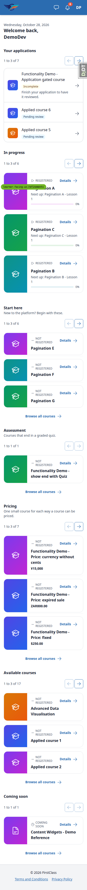 | Every section is one column of rows with the card grid hidden and the controls row between heading and rows. In progress has no Browse all; discovery sections have a centred Browse all courses below the rows; paging keeps URL, focus on H2, no horizontal scroll. |
| 1.5-back-nav | mobile | **fail** | 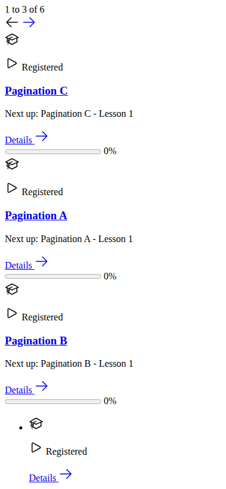 | After paging In progress to page 2 and back to 1, opening a course and pressing browser Back renders the cached htmx fragment as the whole page (no head, no CSS). Reproduced twice; see Bug B1. |
| 2.1-2.2 | tablet | pass | 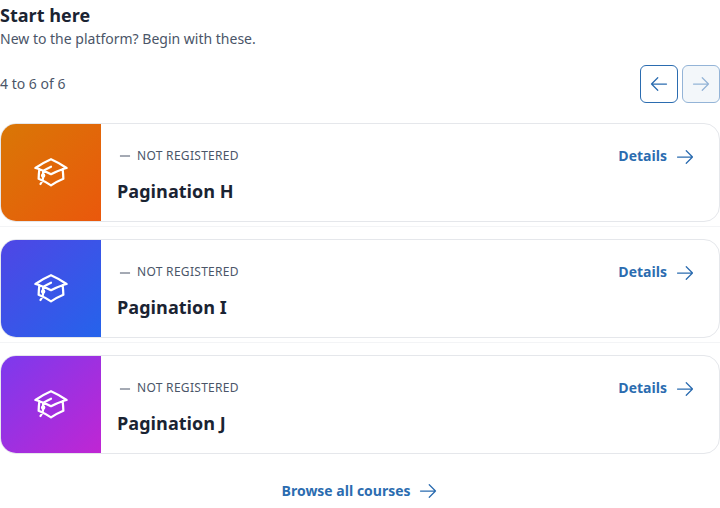 | At 768 every paged section is one column of rows with controls above and Browse all courses below; no orphaned card or horizontal scroll. Start here paging works with focus on H2. |
| tablet-panel+byline | tablet | pass | 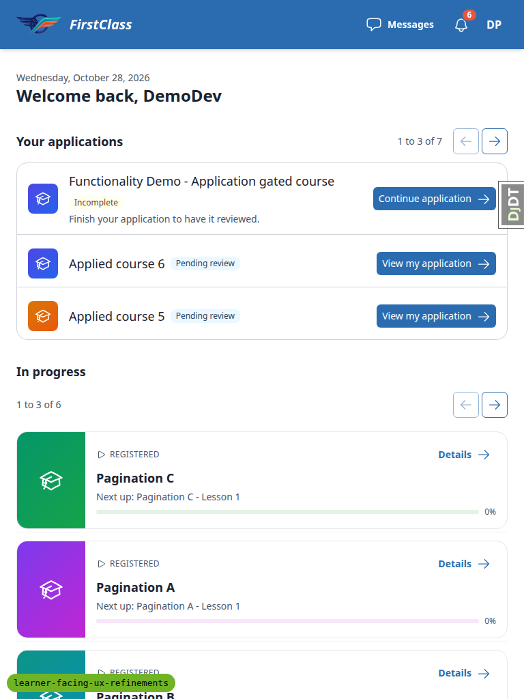 | Applications panel shows heading row, "1 to 3 of 7", arrows and visible action buttons. Harbour College byline visible on the Harbour Safety Basics row. |
| 3.1 | desktop | pass | 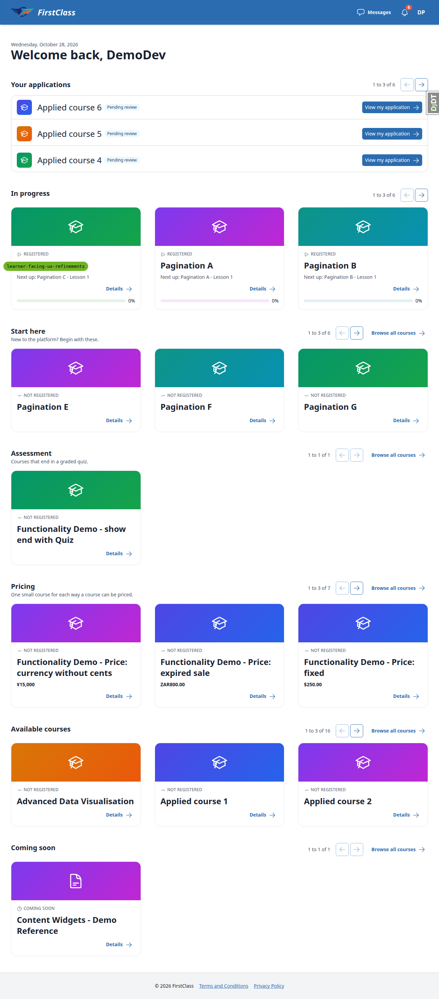 | At 1280 every paged section shows a 3-column card grid with the row list hidden; position text, arrows and Browse all courses sit on the heading row. In progress has no Browse all. |
| 3.2 | desktop | pass | — | In progress next swaps cards to the last page (4 to 6 of 6), URL unchanged, heading kept, focus on heading, next aria-disabled. |
| 3.3 | desktop | pass | 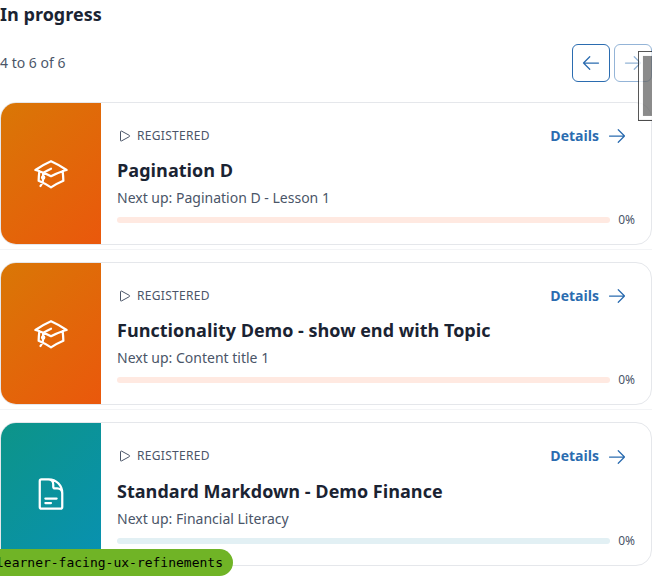 | Narrowing 1280 to 700 switches to the row list with page 2 kept, no reload, no overflow; widening restores the card grid on page 2. |
| 4.1-4.3 | mobile | pass | 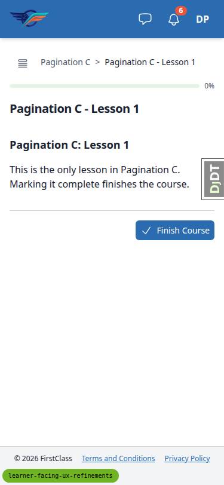 | In progress rows show "Next up" lines and link to the player (`/courses/<slug>/1/`), never the detail page. `/courses/` rows show the same Next up line; unregistered courses link to the detail page and show Details. |
| 5.1-5.4,5.7 | desktop | pass | 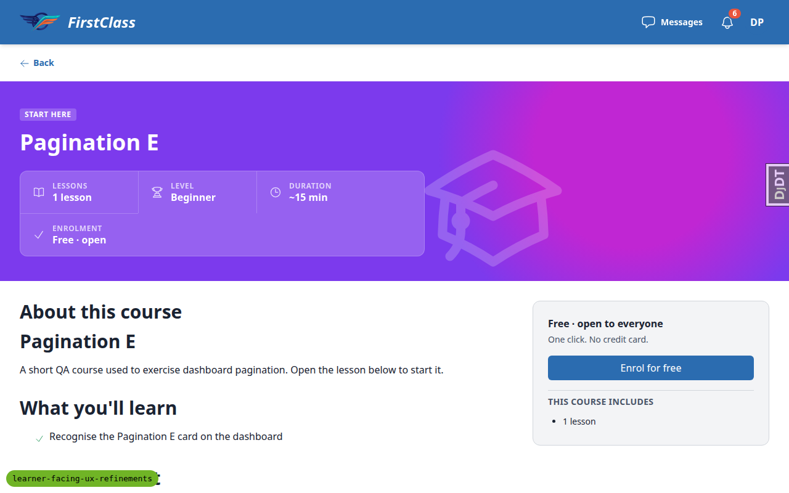 | Detail page shows a 44px Back link under the header, with no breadcrumb nav and no All courses link. Back returns to `/` from the dashboard, `/courses/` from the list, and `/` from a fresh tab; the player keeps its breadcrumbs. |
| 5.5 | desktop | pass | — | Signed out, the detail URL still shows the Back link (href `/`), landing on the public home page. |
| 5.6 | mobile | pass | 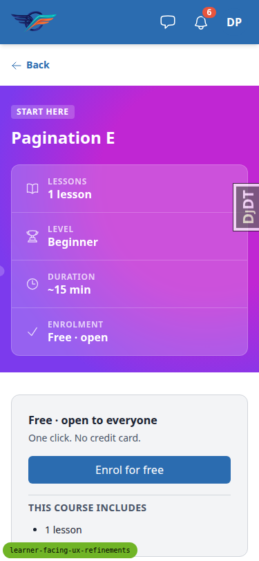 | Back link is 44px tall right under the header; tapping it returns to `/`. No horizontal scroll. |
| 6.1-6.7 | desktop | pass | 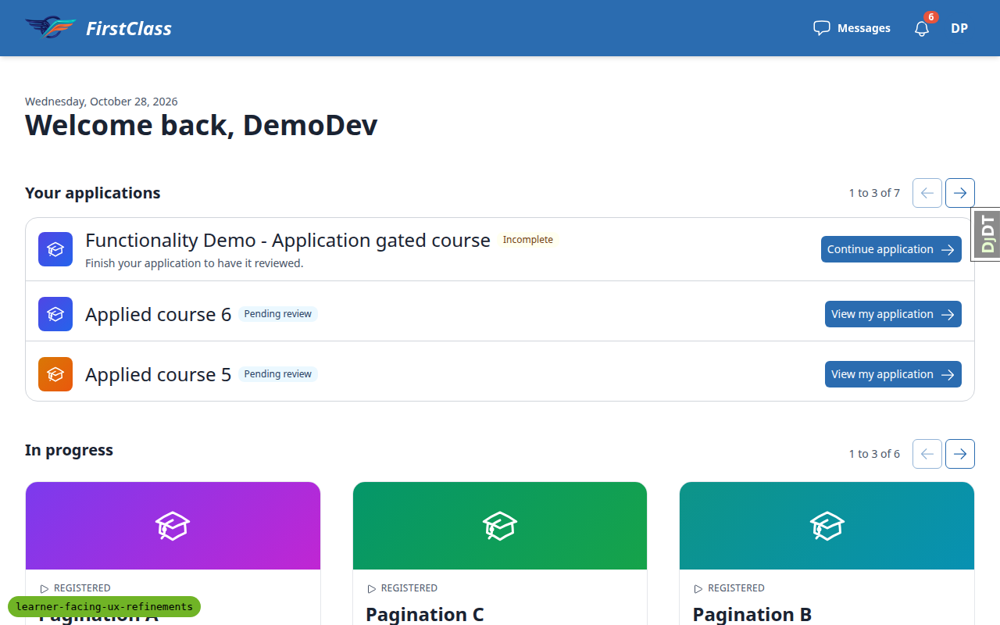 | Draft created via the UI; panel has heading left, position and arrows right, one bordered list with the draft row first (Incomplete chip, meta line, Continue application). Paging goes 1-3, 4-6, 7 of 7 and back with URL unchanged, independent of In progress; rows and buttons link to the status page or resume the form at page 2. |
| 7.1-7.4 | mobile | pass | 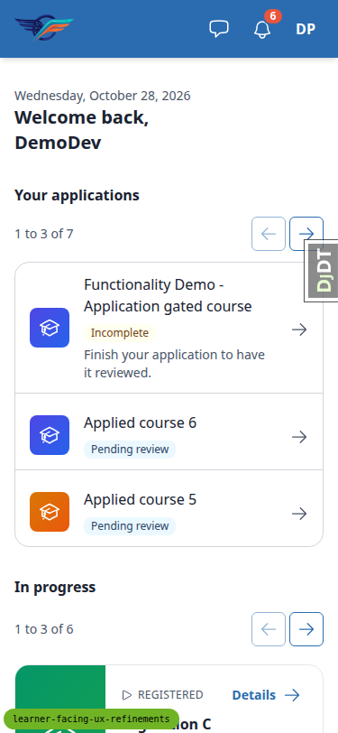 | Heading on its own row, position left and arrows right below. Rows have dividers and a grey chevron with no visible button; tapping empty row space opens the application status page; no horizontal scroll on any page. |
| 8.1 | desktop | pass | 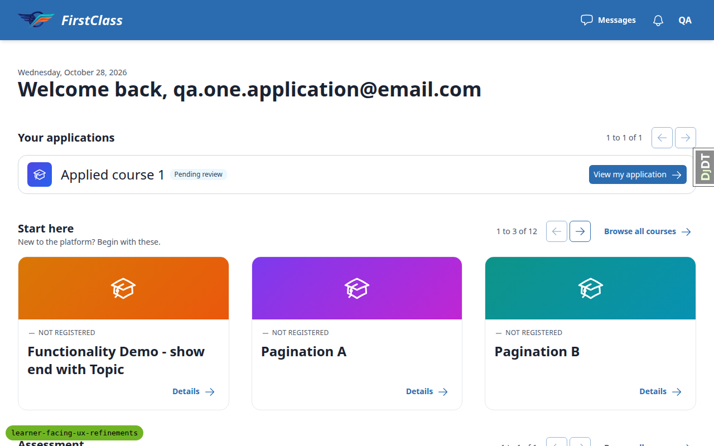 | qa.one.application sees one row (Pending review), "1 to 1 of 1", both arrows aria-disabled with no href/hx-get; a forced click does nothing. |
| 8.2 | desktop | pass | 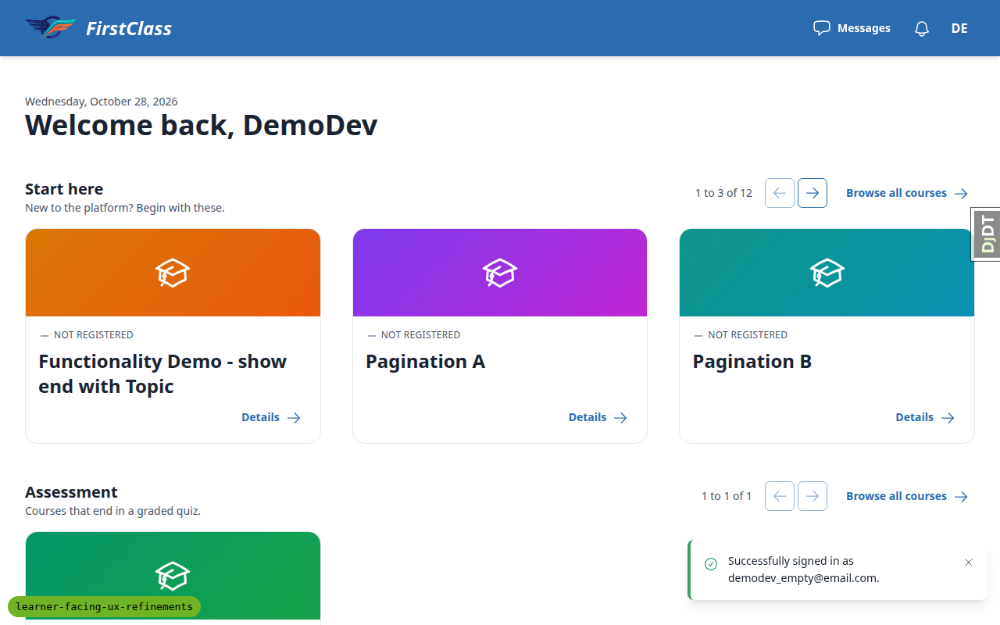 | demodev_empty has no Your applications panel; the greeting is followed directly by Start here. |
| 9.1-9.5 | desktop | pass | 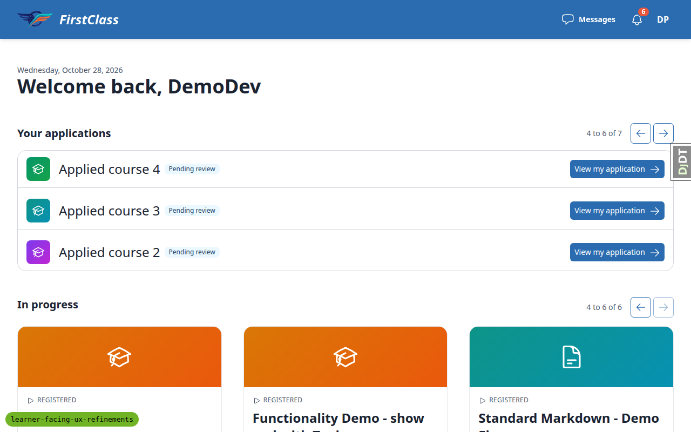 | junk/-1/0 give page one, 99 gives the last page, an unknown page key gives page one everywhere. Two-section URLs keep the other section's page in pager hrefs. |
| 10.1-10.5 | desktop | pass | 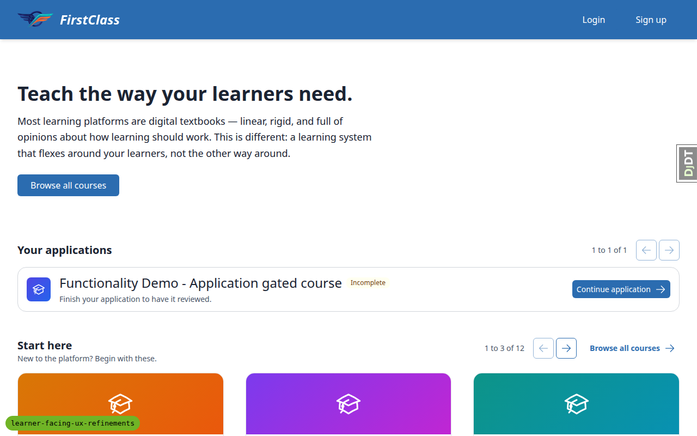 | Anonymous: no panel before applying; after applying one Incomplete draft row, "1 to 1 of 1", arrows disabled, no name or email in the markup. A fresh browser context sees no panel. |
| 10.3-10.4 | mobile | pass | 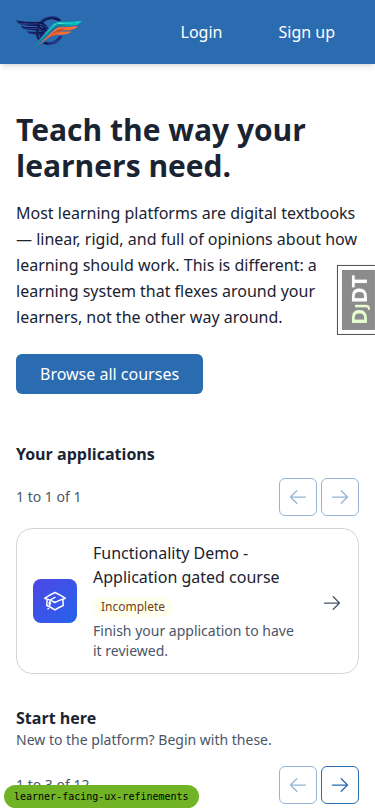 | At 375 the anonymous draft row shows a chevron and no button; tapping empty row space resumes the form at page 2. No horizontal scroll. |
| 11.1 | desktop | pass | — | `/courses/` renders 37 rows, each with Details, and no paging nav. |
| 11.2 | desktop | pass | 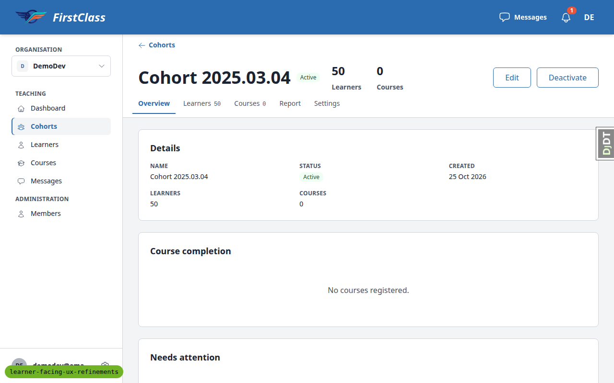 | Educator cohort instance page shows its "Cohorts" back link; clicking it returns to the cohort list. |
| 11.3 | desktop | pass | — | Nav landmarks are "Your applications pages" plus one per section; no course title appears twice per section among exposed links. |
| byline | desktop | pass |  | Harbour Safety Basics (non-default org Harbour College) on Available courses page 5 shows the byline on the visible card and the row copy; `/courses/` names no organisation. |
| byline | mobile | pass | 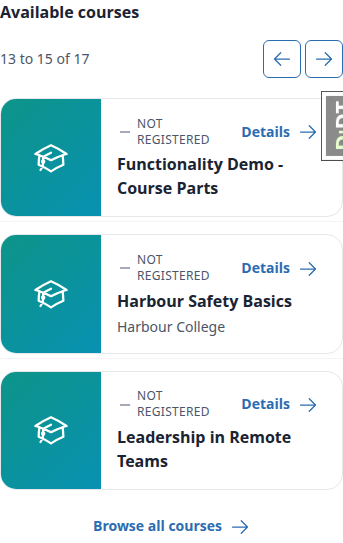 | On `/?page_available=5` at 375 the Harbour Safety Basics row shows the Harbour College byline. No horizontal scroll. |
| 1920-sanity | desktop | pass | 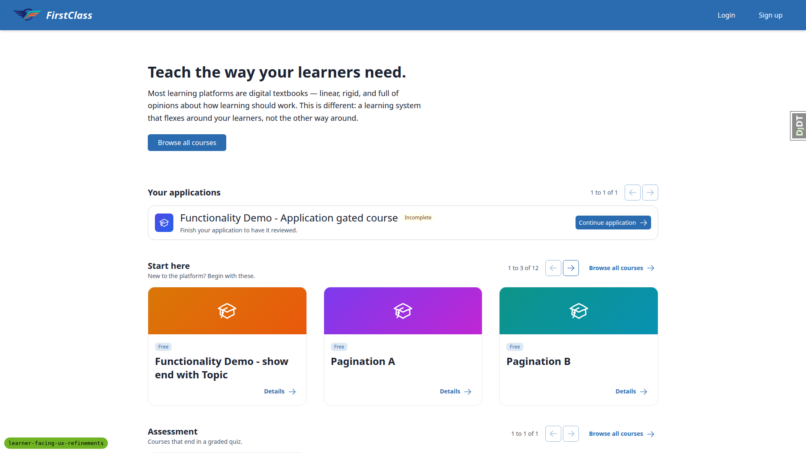 | Public home at 1920x1080 shows every section's card grid, row lists hidden, no horizontal overflow. |

## Design check

| Test id | Viewport | This run | Design | Result |
|---|---|---|---|---|
| 6-design | desktop |  | 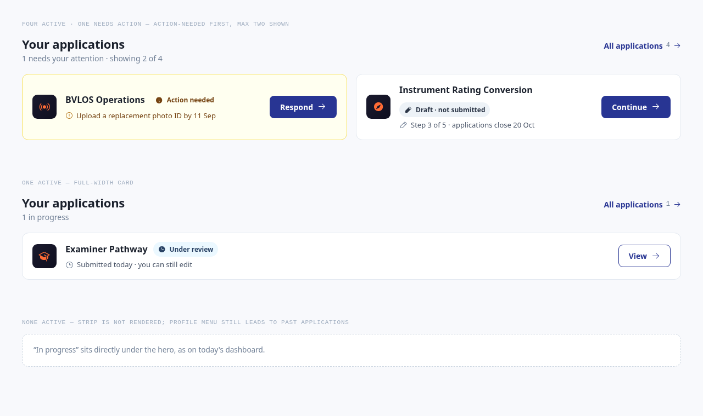 | pass |
| 7-design | mobile |  | 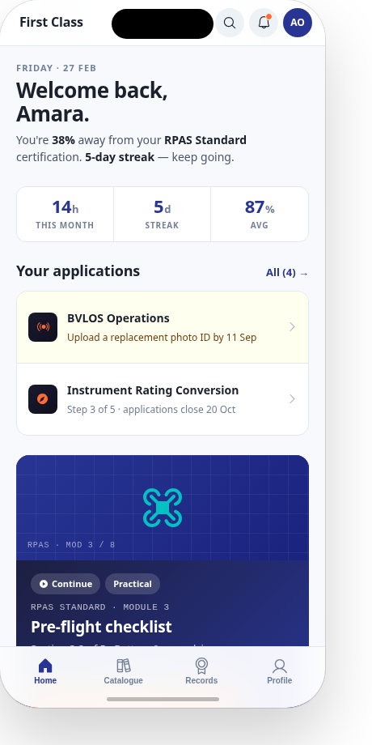 | pass |
| 8-design | desktop |  |  | pass |

## Bugs

### B1: Browser Back after paging a dashboard section to page 1 shows the bare htmx fragment

Manifestations:

- 1.5-back-nav, mobile

Expected: After paging a dashboard section (e.g. In progress next, then previous back to page 1), following a link away and pressing the browser Back button restores the full dashboard page.

Actual: The page-1 pager link hx-gets `/` itself, the same URL as the full dashboard. The browser caches that htmx partial response under `/`, and Back renders it as the whole document: no `<head>`, no CSS, no title, just the bare section markup. Responses for `/` send only `Vary: Cookie` (no `Vary: HX-Request` and no Cache-Control), so the browser cannot tell the fragment from the full page. Reproduced twice at 375; the cause is viewport-independent.

## Bug status

| Bug | Status |
|---|---|
| B1 | **FIXED** (commit: e9a60c367) — Browser Back after paging a dashboard section to page 1 shows the bare htmx fragment. The dashboard now sends `Vary: HX-Request, HX-Target`; re-verified at 375: next, previous, leave, Back restores the full page.  |

## General notes

- Data set up for this run: the stale paging-learner demo-course draft and an anonymous draft from the previous run were deleted so Tests 6 and 10 could create them through the UI. A non-default organisation "Harbour College" owning a public course "Harbour Safety Basics" was added so the organisation byline (added to course_row.html after the rebase brought in organisation-courses) could be checked on cards and rows. It appears on Available courses page 5.
- The pre-step rebase onto main ran twice (main moved mid-run). Two rebase-caused test failures were fixed on the branch: a main test needing scoping to the card grid, and the all-courses query budget raised from 26 to 29 because main's audience check adds one query per course. The per-course audience query is main's code and worth a look separately.
- The application form's radio and checkbox inputs are visually hidden behind their labels, so automation must click the label. This is not a bug.
- The only console error seen was a 404 for /favicon.ico on the dev server.
- Test 4.2: every registered Pagination course has a first item, so the "never started without an actionable item" case had no data. All rows linked into the player, never the detail page.
- Tapping a logged-in learner's draft row on a phone opens the application status page (Test 7.3 wording), while the anonymous draft row resumes the form (Test 10.4). Both match the plan.

status: ok
reason: 1 bug — 1 fixed, 0 unresolved; report rendered, screenshots verified
