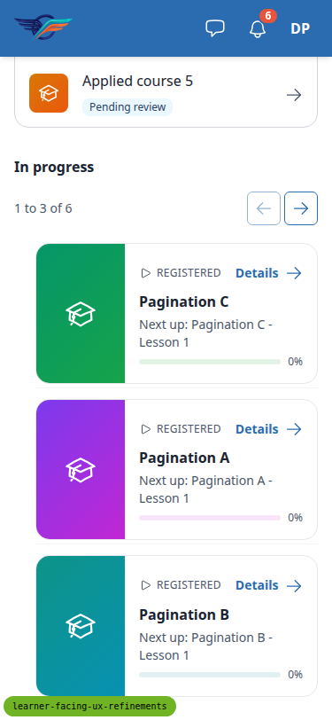
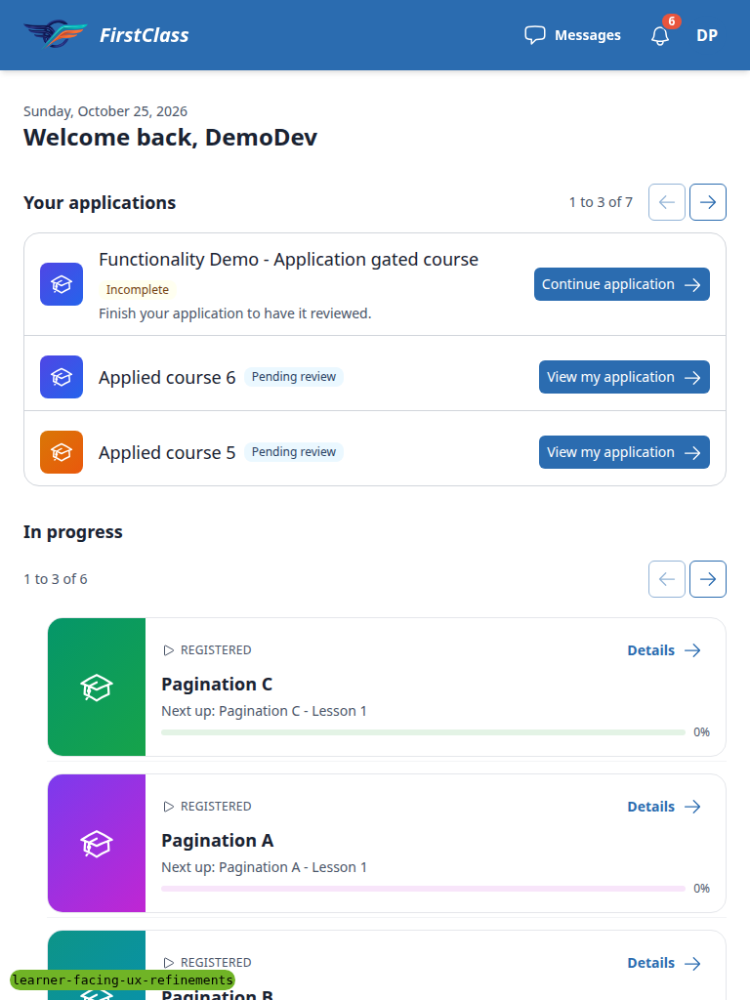
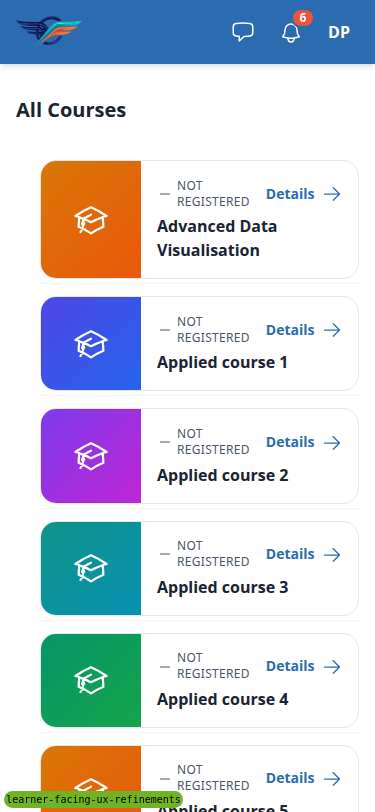
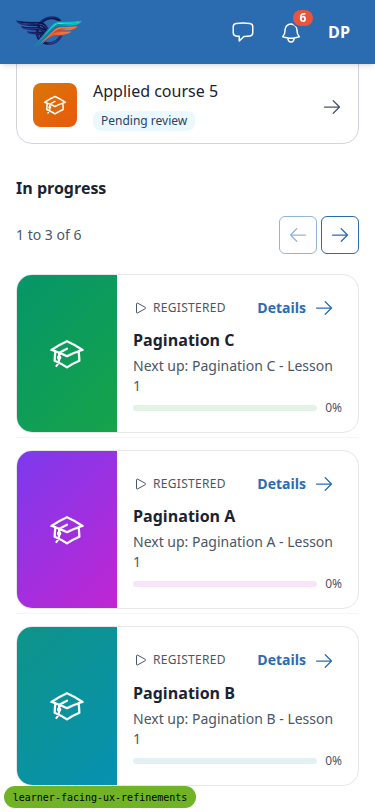
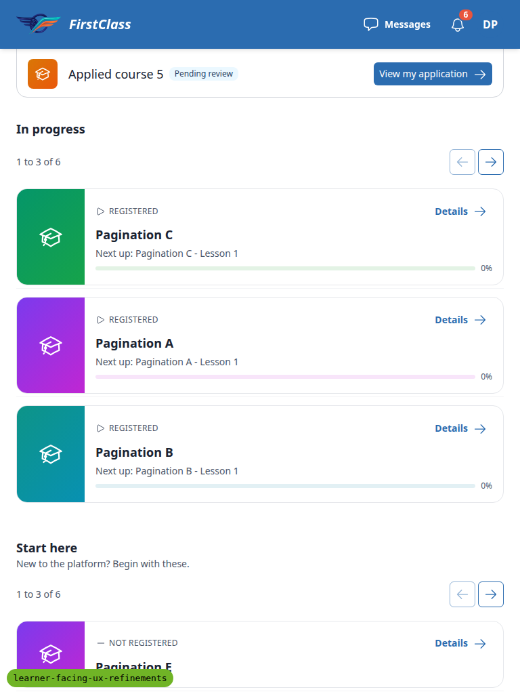
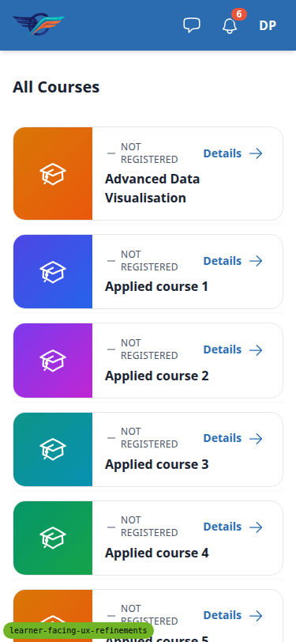

# Frontend QA report: learner-facing UX refinements

- Test plan: `3. frontend_qa.md`
- Date: 2026-10-25
- Branch: learner-facing-ux-refinements
- Dev server: 127.0.0.1:8645

## Methodology

Playwright MCP, driven by hand. Three viewports were used:

- desktop 1280x800, as the test plan specifies (its lg breakpoint checks depend on it)
- phone 375x812 (mobile)
- tablet 768x1024

Screenshots were collected into `screenshots/` beside this report. Every image referenced here exists in that folder. Design screenshots are in `design_screenshots/`.

## Diff scoping

Class: **FULL**. Skipped: nothing. Desktop, mobile and tablet all ran.

Triggering changed files:

- `freedom_ls/base/templates/cotton/section-pagination.html`
- `freedom_ls/course_applications/templates/course_applications/partials/dashboard_applications.html`
- `freedom_ls/learner_interface/static/learner_interface/js/alpine-components.js`
- `freedom_ls/learner_interface/templates/learner_interface/course_detail.html`
- `freedom_ls/learner_interface/templates/learner_interface/partials/course_row.html`
- `freedom_ls/learner_interface/templates/learner_interface/partials/course_row_list.html`
- `freedom_ls/learner_interface/templates/learner_interface/partials/course_list.html`

## Smoke gate

Outcome: **pass**. Pages checked: `/` and `/courses/pagination-a/detail/`. No failure URL.

## Results table

| Test | Viewport | Status | Note | Screenshot |
|---|---|---|---|---|
| 1 | mobile | **fail** | Structure correct; course rows indented 24px (see B1). Focus wording note below. | [page-mobile-inprogress.png](screenshots/page-mobile-inprogress.png) |
| 2 | tablet | **fail** | One-column rows, paging in place; course rows indented 24px (see B1). | [page-tablet-top.png](screenshots/page-tablet-top.png) |
| 3 | desktop | pass | 3-column card grid, controls on heading row; cards and rows switch on resize without reload and keep page 2. | [page-desktop-cards.png](screenshots/page-desktop-cards.png) |
| 4 | mobile | pass | "Next up: <lesson>" shown; titles link to the player. | [page-mobile-resume.png](screenshots/page-mobile-resume.png) |
| 4.3 | desktop | pass | /courses/ registered rows link to the player; unregistered rows link to the detail page. | [page-all-courses-desktop.png](screenshots/page-all-courses-desktop.png) |
| 5 | desktop | pass | Back link from `/`, `/courses/` and a new tab; player breadcrumbs unchanged. | [page-detail-back-desktop.png](screenshots/page-detail-back-desktop.png) |
| 5.5 | mobile | pass | Signed out, direct detail URL: Back href `/`, 44px tall. | [page-2026-10-25T15-23-35-464Z.png](screenshots/page-2026-10-25T15-23-35-464Z.png) |
| 5.6 | mobile | pass | Back link 44px tall at x=16 under the header. | [page-mobile-detail-back.png](screenshots/page-mobile-detail-back.png) |
| 6 | desktop | pass | Panel paging 1-3, 4-6, 7-7 and back; independent from In progress; row click targets and Tab stop correct. | [page-2026-10-25T15-26-08-647Z.png](screenshots/page-2026-10-25T15-26-08-647Z.png) |
| 7 | mobile | pass | Heading row, controls row, bordered container, trailing icon, no button; paging works. | [page-mobile-apps.png](screenshots/page-mobile-apps.png), [page-mobile-apps-p3.png](screenshots/page-mobile-apps-p3.png) |
| 8 | desktop | pass | One application: "1 to 1 of 1", arrows disabled. No applications: no panel. | [page-one-application.png](screenshots/page-one-application.png), [page-no-applications.png](screenshots/page-no-applications.png) |
| 9 | desktop | pass | Junk, negative, zero and out-of-range page params clamp; mixed params keep each other. All 200. | [page-mixed-params.png](screenshots/page-mixed-params.png) |
| 10 | mobile | pass | Anonymous: no panel before applying; after a draft, one row with Incomplete chip and arrow icon; tap resumes the form. | [page-2026-10-25T15-24-27-431Z.png](screenshots/page-2026-10-25T15-24-27-431Z.png) |
| 10 | desktop | pass | Draft row shows Continue application button; fresh context shows no panel. | [page-2026-10-25T15-24-43-244Z.png](screenshots/page-2026-10-25T15-24-43-244Z.png) |
| 11 | desktop | pass | /courses/ one row per course with Details, no paging controls; one navigation landmark per section. | [page-all-courses-desktop.png](screenshots/page-all-courses-desktop.png) |
| 11.1 | mobile | **fail** | /courses/ row list indented 24px (see B1). | [page-mobile-all-courses.png](screenshots/page-mobile-all-courses.png) |
| 11.2 | desktop | pass | Educator cohort instance panel back link returns to Cohorts list; unchanged. | [page-educator-back.png](screenshots/page-educator-back.png) |

## Design check

| Test | Viewport | This run | Design | Result |
|---|---|---|---|---|
| 6-design | desktop | [page-2026-10-25T15-26-08-647Z.png](screenshots/page-2026-10-25T15-26-08-647Z.png) | [strip__strip-states.png](design_screenshots/strip__strip-states.png) | pass |
| 8-design | desktop | [page-one-application.png](screenshots/page-one-application.png) | [strip__strip-states.png](design_screenshots/strip__strip-states.png) | pass |
| 7-design | mobile | [page-mobile-apps.png](screenshots/page-mobile-apps.png) | [phone__p-dash.png](design_screenshots/phone__p-dash.png) | pass |

## Bugs

### B1: Course row list indented 24px by the base ul margin

Manifestations:

- Test 1, mobile
- Test 2, tablet
- Test 11.1, mobile

**Expected:** The dashboard's narrow-layout course rows (and the /courses/ row list) line up with the section heading and controls, full width of the content column, as the applications panel list does.

**Actual:** The shared course-rows `<ul>` in `learner_interface/partials/course_row_list.html` has no `ml-0`. The base-layer rule `ul { @apply list-disc list-outside ml-6 space-y-2 }` in `tailwind.components.css` therefore gives it a 24px left margin. Rows start at x=40 on a 375 viewport (x=48 at 768), while the heading, controls and Browse all courses start at x=16 (x=24). The applications panel `ul` sets `ml-0` and is not affected. The /courses/ list has had the same markup since before this branch.

## Bug status

| Bug | Status |
|---|---|
| B1 | **FIXED** (commit: e2f39116d) — Course row list indented 24px by the base ul margin |

Re-verified after the fix: course rows start at the heading's left edge on `/` at 375 (x=16) and 768 (x=24) in every section, and on `/courses/` at 375; no horizontal scroll.

## General notes

- Data setup: the paging seed (`qa_create_dashboard_paging_fixtures`) failed because demo content renamed the category to `start-here-demo`. qa-data-helper fixed the command's `CATEGORY_SLUG` and also ran `qa_extend_start_here_section` (Pagination E-J) so the paging learner has a Start here section. The test plan's section 0 was corrected to match. `qa_extend_start_here_section` still defaults `--category-slug` to `start-here` (it resolves anyway).
- Test plan correction: Test 1 step 5 expected focus on the previous arrow after paging back to page 1. The code moves focus to the heading because that arrow becomes aria-disabled, and the spec keeps this focus handling unchanged. The plan wording was corrected. In Test 1 this is a test-plan wording issue, not a defect.
- Viewports: desktop tests ran at 1280x800 per the test plan, not the command's 1920x1080. The Django debug toolbar covered form buttons; it was hidden with an injected style for the run.
- Observations with no checklist line:
  1. Applications row titles are h3 with font-medium and inherit the base h3 size, so at 640px and wider they render about 22px at normal weight, larger than the section heading "Your applications". The design draws a semibold title at body size.
  2. On phone and tablet the course rows are card-like with their own borders, and the `ul`'s divide-y draws an extra hairline between cards.
  3. Dashboard swaps take about 0.9s on the dev server.
  4. `demodev_empty` has no In progress section at all (greeting goes straight to Start here), which Test 8 allows.
- Test 4: the seed gives the learner no actually completed items, so every "Next up" is Lesson 1.

status: ok · reason: 1 bug — 1 fixed, 0 unresolved; report rendered, screenshots verified
