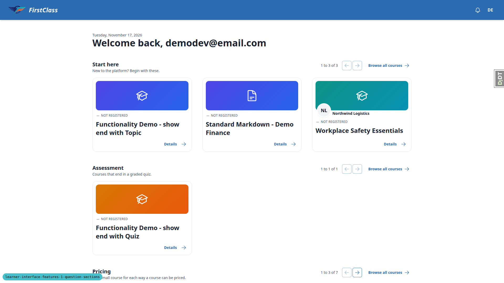
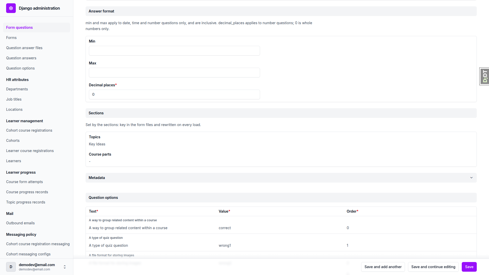
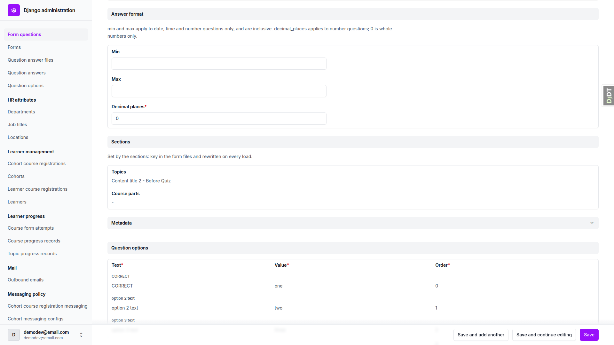
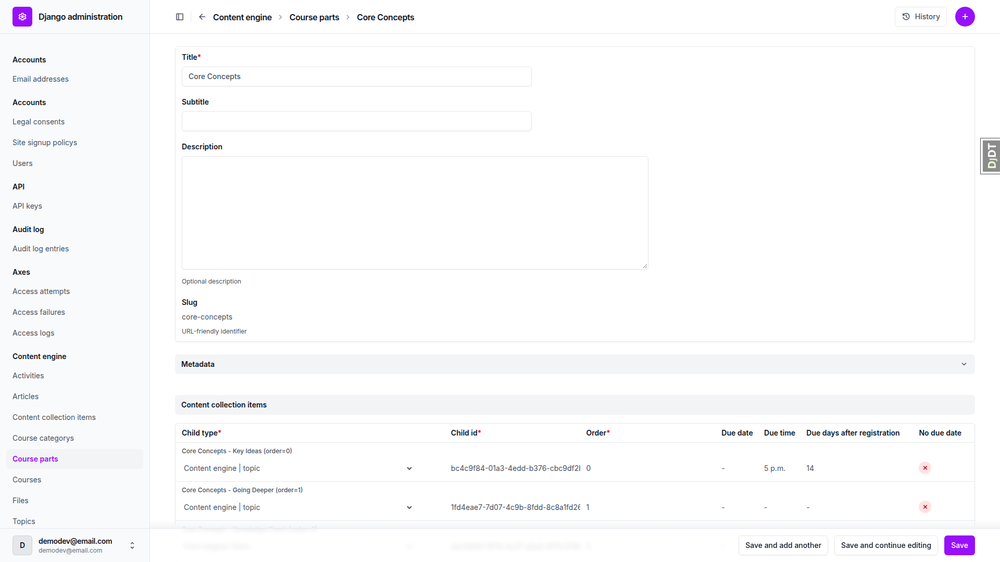
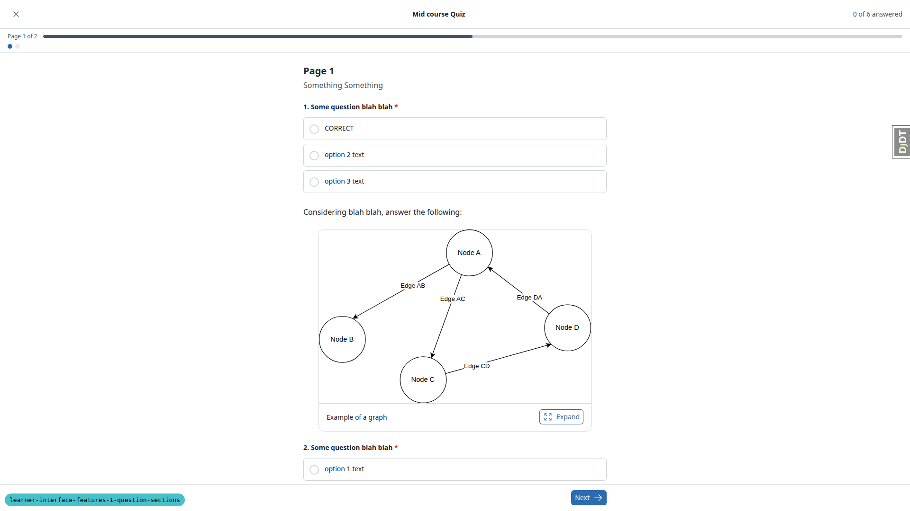
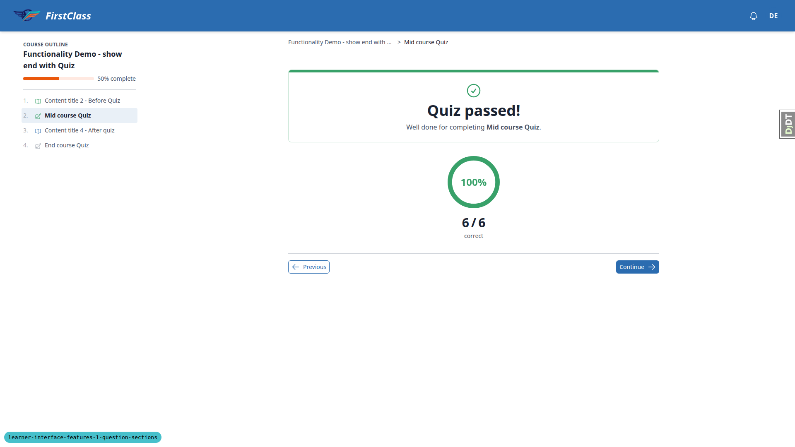
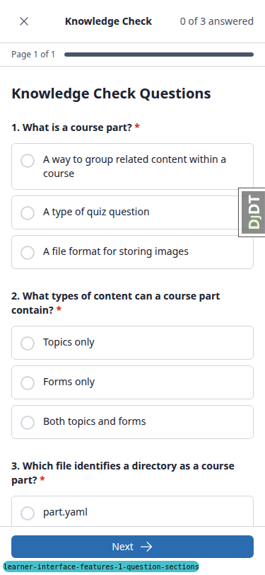
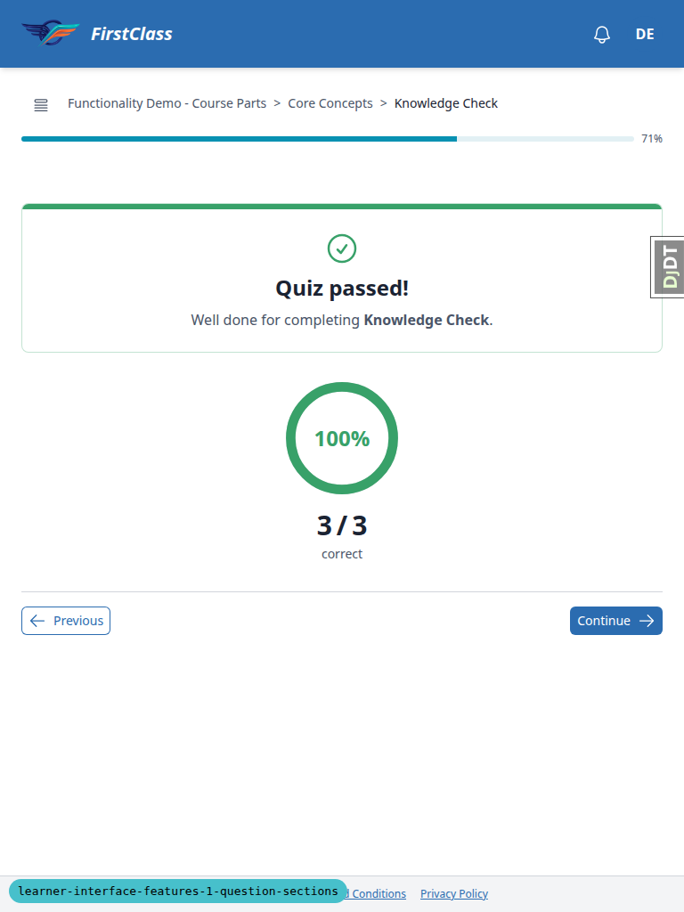

# Frontend QA report

## Methodology

Screenshots were collected into `<spec-dir>/screenshots/`, so every referenced image sits beside this report. Viewports: desktop 1920x1080, mobile 375x812, tablet 768x1024. The run was driven by hand through the Playwright MCP.

## Diff scoping

Class: FULL. The `demo_content` yaml and md files changed, so the diff is not admin-only or Python-only. Nothing was skipped by class. The test plan itself scopes mobile to the Knowledge Check quiz, and tablet was a single check of the same quiz's result page.

## Smoke gate

Pass. Pages checked: `/` and the admin form question list (`/admin/freedom_ls_form_engine/formquestion/`).

## Results

| Test | Viewport | Result | Screenshot | Notes |
|---|---|---|---|---|
| 0.1 | desktop | pass |  | Branch badge names learner-interface-features-1-question-sections on port 8599; logged in as demodev@email.com |
| 0.2 | desktop | pass | — | danger_content_delete --yes ran clean; content_save demo_content DemoDev succeeded twice; no git change under demo_content/ after either run |
| 1.1 | desktop | pass |  | "What is a course part?": Sections fieldset after Answer format; Topics: Key Ideas; Course parts: -; plain text, 0 inputs in the fieldset |
| 1.2 | desktop | pass | — | "Which file identifies a directory as a course part": Topics -, Course parts: Core Concepts (form default inherited) |
| 1.3 | desktop | pass |  | "Some question blah blah (mid course quiz)": Topics: Content title 2 - Before Quiz. 12 questions share this text across the demo quizzes; the first match was checked |
| 1.4 | desktop | pass | — | Course Feedback survey question: Sections fieldset shows Topics - and Course parts -, no error |
| 1.5 | desktop | pass | — | Order 0->1 saved and persisted; Sections still Key Ideas / -; Order restored to 0 afterwards |
| 2.1 | desktop | pass | — | Topic Key Ideas: no Delete control on change page; list has no action menu at all |
| 2.2 | desktop | pass |  | Course part Core Concepts: no Delete control; list has no action menu |
| 3.1 | desktop | pass |  | Mid course Quiz renders 6 questions over 2 pages as before; no section/topic/path text on the learner page |
| 3.2 | desktop | pass |  | All CORRECT options submitted: Quiz passed, 6/6 correct, 100% |
| 3.3 | mobile | pass |  | Knowledge Check at 375x812: scrollWidth 375, no overflow, 0 console errors; submit dialog fits the viewport (); 3/3 correct, Quiz passed. The part.yaml / course.md / form.md text on the page is the existing answer options, unchanged from main |
| 3.3 | tablet | pass |  | Knowledge Check result page at 768x1024: no overflow, header and content share a left edge |
| 4.1 | desktop | pass | — | Scratch copy of functionality_demo_end_with_quiz in the session scratchpad; first question in 3. quiz/1. page.yaml given sections: [../2. topic/missing.md, ../course.md] |
| 4.2 | desktop | pass | — | content_save exited 1 before writing. Two Invalid section reference blocks: page file, question "Some question blah blah" -> sections[0] / sections[1], given and resolved paths, "no file at this path" and "this file is a COURSE". A third Unknown category block came from the scratch copy lacking the repo course_categories.yaml (copy artifact). Errors print as a ValueError traceback from validate(), the existing content_save behaviour for validation failures |
| 4.3 | desktop | pass | — | After the failed load, question 5e8405d4 still shows Topics: Content title 2 - Before Quiz; no changes |
| 4.4 | desktop | pass | — | Scratch copy deleted |

## Design check

No design states tested.

## Bug sections

No bugs found.

## Layout probe

| Test | Viewport | URL | Screenshot | Result |
|---|---|---|---|---|
| 0.1 | desktop | `/` |  | clean |
| 1.1 | desktop | `/admin/freedom_ls_form_engine/formquestion/<pk>/change/` |  | clean |
| 1.3 | desktop | `/admin/freedom_ls_form_engine/formquestion/<pk>/change/` |  | clean |
| 2.2 | desktop | `/admin/freedom_ls_content_engine/coursepart/<pk>/change/` |  | clean |
| 3.1 | desktop | `/courses/functionality-demo-show-end-with-quiz/2/fill_form/1` |  | clean |
| 3.2 | desktop | `/courses/functionality-demo-show-end-with-quiz/2/complete` |  | clean |
| 3.3 | mobile | `/courses/functionality-demo-course-parts/5/fill_form/1` |  | clean |
| 3.3 | tablet | `/courses/functionality-demo-course-parts/5/complete` |  | clean |

## Data changes

| Via | What |
|---|---|
| sdd:qa-data-helper | Ran create_demo_data --yes (DemoDev site at 127.0.0.1:8000, demodev@email.com staff user, demo orgs) on an unseeded dev DB; content_save demo_content DemoDev twice, both succeeded, no git change under demo_content/ |

## Bug status

No bugs.

## General notes

1. The dev database was unseeded at the start (only an example.com site), so `create_demo_data --yes` was run through the data helper before §0.2.
2. The `part.yaml` / `course.md` / `form.md` text on the Knowledge Check page is the existing answer options, unchanged from main, not section data.
3. §4's failed load printed its validation errors inside a `ValueError` traceback from `validate()`, the existing content_save behaviour for any validation failure. It also reported an "Unknown category" error that came from copying a course without its repo's `course_categories.yaml`.
4. The admin pages log a 404 for `/favicon.ico`, unrelated to this branch.

status: ok · reason: report rendered, 0 bugs documented
