# QA report: learner-interface-features-1-question-sections

All tests passed and no bugs were found. The run covered the form question section links in the admin (display, inherited defaults, ordering, read-only topics and course parts), the learner quiz player on desktop, mobile and tablet, and the terminal checks for `danger_content_delete` and `content_save` (including the invalid section reference error). The smoke gate passed and every layout probe came back clean.

## Methodology

- Browser checks used the Playwright MCP at three viewports: 1920x1080 (desktop), 375x812 (mobile) and 768x1024 (tablet).
- Terminal steps covered §0.2 (`danger_content_delete`, `content_save` run twice) and §4 (invalid section references in a scratch copy).
- Screenshots are collected into `screenshots/` beside this report, and every image referenced here exists there.
- The test plan is `3. frontend_qa.md` in the same spec directory.

## Diff scoping

- Class: FULL.
- Changed files:
  - `freedom_ls/content_engine/admin.py`
  - `freedom_ls/content_engine/models/*`
  - `freedom_ls/content_engine/management/commands/content_save.py`
  - `freedom_ls/dev_tools/management/commands/danger_content_delete.py`
  - `freedom_ls/form_engine/schema.py`
  - `demo_content/**/form.md`, `page.yaml`
  - `docs/product/content-editing-workflow.md`
  - `spec_dd/**` (md, png)
  - `claude_plugins/fls-content/**`
- Not run: nothing was skipped (Rule 4: non-`.py` files such as .md/.yaml/.png). Mobile and tablet were focused on quiz pages, because the plan touches no new learner UI.

## Smoke gate

Status: pass. Pages checked: `/` and `/admin/freedom_ls_form_engine/formquestion/`. No failure URL or reason.

## Results

| Test | Viewport | Status | Notes | Screenshot |
|---|---|---|---|---|
| 0.1 | desktop | pass | `#debug-branch-badge` names the branch on port 8801. Before seeding, `/` returned 500 `Site.DoesNotExist` because the DB had no DemoDev site. Seeding fixed it (see Data changes). | — |
| 0.2.1 | terminal | pass | `danger_content_delete --yes` after a load with stored section links: exit 0, no ProtectedError (deleted 68 courses, 10 course parts...). | — |
| 0.2.2 | terminal | pass | `content_save demo_content DemoDev`: exit 0. | — |
| 0.2.3 | terminal | pass | Second `content_save`: exit 0, git status shows no change under `demo_content/`. | — |
| 0.3 | desktop | pass | Logged in as demodev@email.com, redirected to Dashboard. | — |
| 1.1 | desktop | pass | 'What is a course part?': Sections fieldset after Answer format, help text 'Set by the sections: key in the form files and rewritten on every load.' Topics: Key Ideas; Course parts: '-'. 0 inputs in the fieldset. |  |
| 1.2 | desktop | pass | 'Which file identifies a directory as a course part': Topics '-'; Course parts: Core Concepts (inherited form default). 'What types of content can a course part contain?' shows the same. | 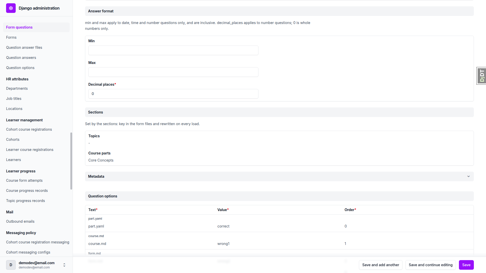 |
| 1.3 | desktop | pass | All 6 Mid course Quiz 'Some question blah blah' questions: Topics 'Content title 2 - Before Quiz'. End course Quiz questions show 'Content title 4 - After quiz'. | 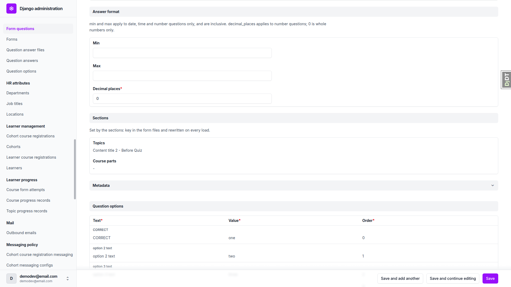 |
| 1.4 | desktop | pass | Application form 'What is your full name?' and the survey question: both fields '-', page 200, no error. | 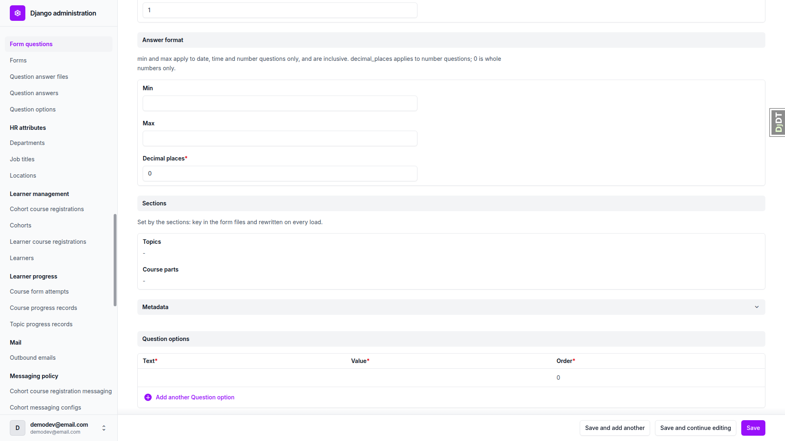 |
| 1.5 | desktop | pass | Mid course quiz question Order 0 to 1 saved ('was changed successfully'). Reopened: order 1, Topics still 'Content title 2 - Before Quiz'. Order restored to 0 afterwards. |  |
| 2.1 | desktop | pass | Topic 'Key Ideas': change page has only Save buttons and no Delete link. `/delete/` returns 403. The list view has no action menu and no 'Delete selected'. | 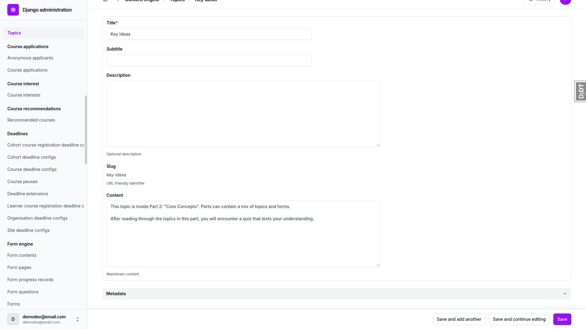 |
| 2.2 | desktop | pass | Course part 'Core Concepts': no Delete link on the change page. `/delete/` returns 403. The list has no 'Delete selected'. | 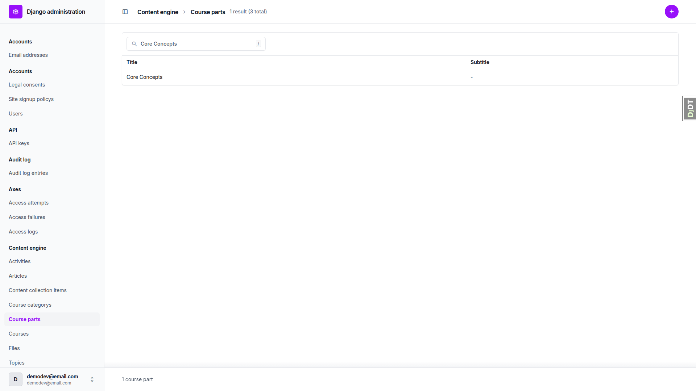 |
| 3.1 | desktop | pass | Enrolled in 'Functionality Demo - show end with Quiz' and opened Mid course Quiz: 6 questions on 2 pages, questions render. No section, topic or path text on the intro, page 1 or page 2. | 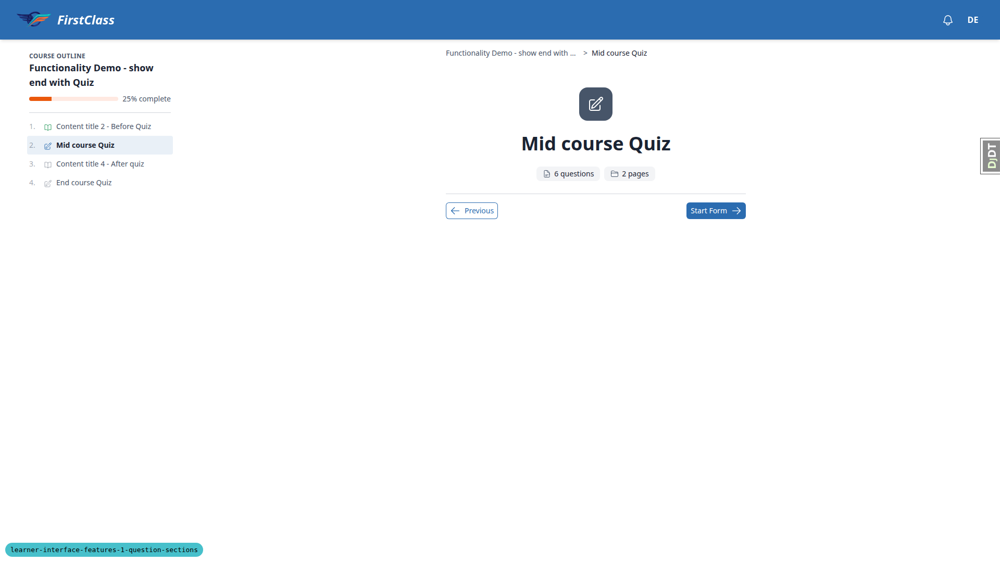 |
| 3.1-page1 | desktop | pass | Quiz page 1 of 2 renders 3 questions in file order (order restored after 1.5). |  |
| 3.1-tablet | tablet | pass | Mid course Quiz intro at 768x1024: outline collapses to a drawer toggle, single column, previous attempt 100% (6/6) listed. | 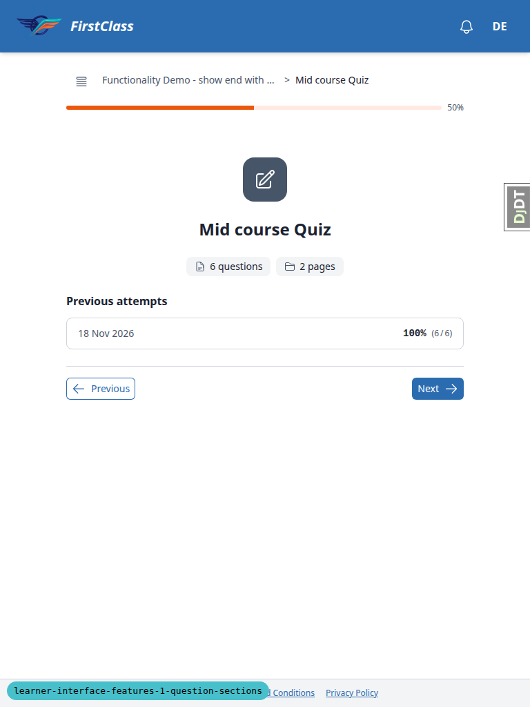 |
| 3.2 | desktop | pass | All CORRECT options chosen and submitted via the 'Ready to submit?' dialog: 'Quiz passed! 100% 6 / 6 correct'. Course progress 25% to 50%. |  |
| 3.3 | mobile | pass | Course Parts demo > Core Concepts > Knowledge Check at 375x812: scrollWidth 375 (no overflow), 0 console errors or warnings. The only path-like text is the answer options 'course.md'/'form.md'. The submit dialog fits the viewport. | 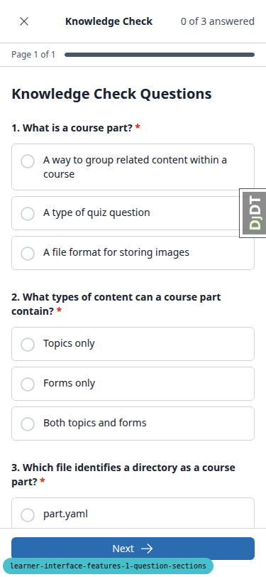 |
| 3.3-submit | mobile | pass | Submit dialog fits at 375px. Submit gives 'Quiz passed! 100% 3 / 3 correct' (`page-2026-11-18T12-57-26-159Z.png`). | 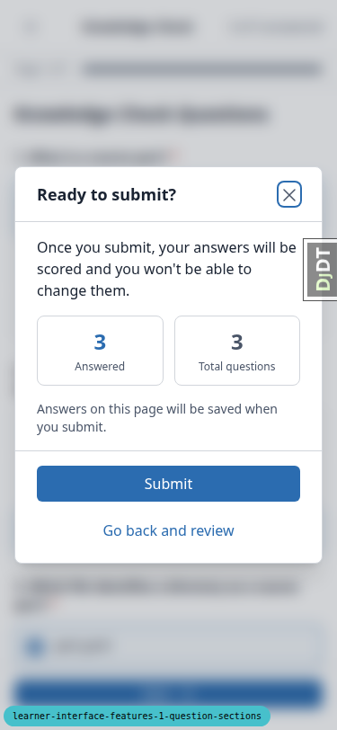 |
| 4.1-4.2 | terminal | pass | Scratch copy in the session scratchpad. The first question of '3. quiz/1. page.yaml' was given sections `['../2. topic/missing.md', '../course.md']`. `content_save` exited 1 with two 'Invalid section reference' blocks naming the page file, the question 'Some question blah blah', sections[0]/sections[1], and the given and resolved path. Problems: 'no file at this path' and 'its content_type is COURSE, not TOPIC or COURSE_PART'. The plan quoted 'this file is a COURSE'. The wording was changed deliberately in commit fcecdcb97 (PR 253 review fixes) and still names COURSE. The spec fixes no wording, so pass. A third 'Unknown category' error appears only because a single course copied outside `demo_content/` loses the repo's `course_categories.yaml`: a setup artefact. | — |
| 4.3 | desktop | pass | Admin form question list still 42 rows. Question 5e8405d4 keeps Topics 'Content title 2 - Before Quiz' and order 0: the failed load wrote nothing. | 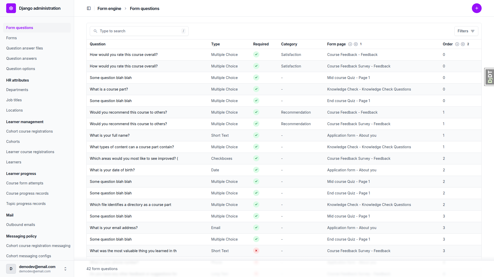 |
| 4.4 | terminal | pass | Scratch copy deleted. | — |

### Key screenshots

Test 1.1, section links shown read-only on a form question:

Test 1.2, course part inherited from the form default:

Test 2.1, topic change page with no Delete link:

Test 3.2, quiz passed at 100%:

Test 3.3, Knowledge Check on mobile (375x812):

## Design check

No design states tested.

## Bugs

No bugs found.

## Layout probe

| Test | Viewport | URL | Screenshot | Result |
|---|---|---|---|---|
| smoke-home | desktop | `/` |  | clean |
| 1.1-list | desktop | `/admin/freedom_ls_form_engine/formquestion/` | 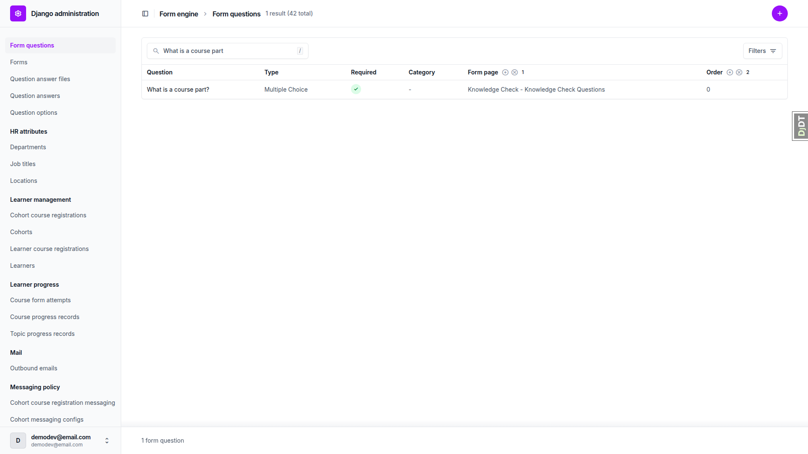 | clean |
| 1.1 | desktop | `/admin/freedom_ls_form_engine/formquestion/<id>/change/` |  | clean |
| 1.2 | desktop | `/admin/freedom_ls_form_engine/formquestion/<id>/change/` |  | clean |
| 1.3 | desktop | `/admin/freedom_ls_form_engine/formquestion/<id>/change/` |  | clean |
| 2.1 | desktop | `/admin/freedom_ls_content_engine/topic/<id>/change/` |  | clean |
| 2.1-list | desktop | `/admin/freedom_ls_content_engine/topic/` | 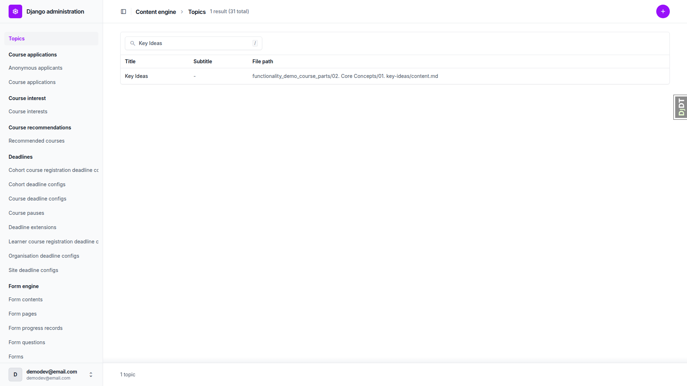 | clean |
| 3.1 | desktop | `/courses/functionality-demo-show-end-with-quiz/2/` |  | clean |
| 3.1-page1 | desktop | `/courses/functionality-demo-show-end-with-quiz/2/fill_form/1` |  | clean |
| 3.2 | desktop | `/courses/functionality-demo-show-end-with-quiz/2/complete` |  | clean |
| 3.3-intro | mobile | `/courses/functionality-demo-course-parts/5/` | 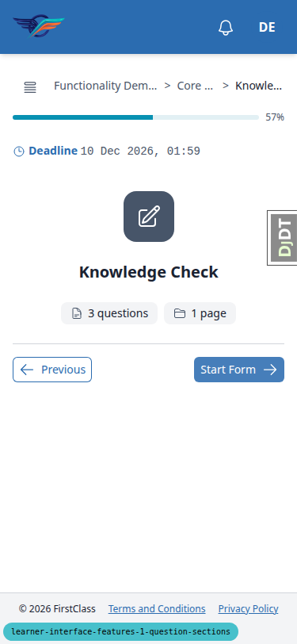 | clean |
| 3.3 | mobile | `/courses/functionality-demo-course-parts/5/fill_form/1` |  | clean |
| 3.3-complete | mobile | `/courses/functionality-demo-course-parts/5/complete` | 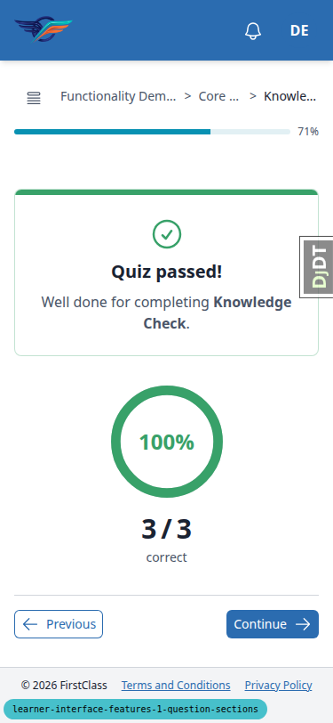 | clean |
| 3.1-tablet | tablet | `/courses/functionality-demo-show-end-with-quiz/2/` |  | clean |
| 4.3 | desktop | `/admin/freedom_ls_form_engine/formquestion/` |  | clean |

## Data changes

| Via | What |
|---|---|
| sdd:qa-data-helper | Ran `create_demo_data --yes` on an empty migrated DB: created sites Demo/DemoDev/Bloom/Prelude/Wrend, superuser demodev@email.com and demo learners and cohorts. |

## Bug status

There are no bugs.

## General notes

- The dev DB started with no base data (no DemoDev site, no users), so the first `danger_content_delete` in §0.2.1 found nothing. To exercise the ProtectedError case, the run loaded demo content first, then ran `danger_content_delete` with section links stored (passed), then loaded twice.
- Plan §4 quotes the error as 'this file is a COURSE'. The code now says 'its content_type is COURSE, not TOPIC or COURSE_PART' (changed in fcecdcb97). The plan's expected text is stale. Behaviour meets the spec.
- Plan §4.1's scratch-copy recipe also triggers an 'Unknown category' error, because `course_categories.yaml` lives at the `demo_content/` root. It is harmless for the test, but the recipe could copy the categories file too.
- Admin pages log 'Permissions policy violation: unload is not allowed' from Django's own `static/admin/js/admin/RelatedObjectLookups.js` on every change and list page. This is pre-existing and not from this branch. The two 403s in the console log are this run's own probes of the `/delete/` URLs in §2.
- Learner player: the quiz intro column (576px) is narrower than the quiz-complete column (896px). Both are centred on the same axis with the breadcrumb aligned to each, and no template changed on this branch. Recorded as an observation only.
- `sdd:qa-data-helper` modified the tracked file `.claude/agent-memory/sdd-qa-data-helper/reference_empty_db_baseline.md` (CLAUDE.md says not to use memory). It was left uncommitted and not staged by this run.
- Mobile and tablet: the class is FULL, but this branch adds no learner UI, so mobile and tablet were focused on quiz pages (the plan asks for one 375x812 check). Admin pages were tested at desktop only.

status: ok · reason: report rendered, 0 bugs documented
