# Frontend QA report: revision questions

## Methodology

The dev server ran on port 8662. Tests followed `3. frontend_qa.md`. Screenshots were collected into `screenshots/` beside this report, and every image linked below exists there. Desktop was the main pass, with a mobile (375px) and a tablet (768px) pass. Results come from the scratch records in `.sdd-work/qa_scratch.jsonl`.

## Diff scoping

Class: **FULL**. The changed files were templates, static, views, the revision app, form_engine, content_engine and demo_content (64 files). Nothing was skipped, so every pass ran, including mobile and tablet.

## Smoke gate

Pass. These pages loaded: `/` and `/courses/qa-revision-course/revision/`. The run was not aborted.

## Test results

| Test | Viewport | Result | Notes |
| --- | --- | --- | --- |
| 1.2 | desktop | pass | Card shows "40+ ready" and Revise, with no "overdue" text. |
| 1.3 | desktop | pass | Revise opens the revision page. |
| 1.4 | desktop | pass | Outline panel link and ready text work. |
| 1.4-visual | desktop | fail | See B2. |
| 1.5 | desktop | pass | Logged out, no Revision card. |
| 1.6 | desktop | pass | Learner B has no card. |
| 1.7 | desktop | pass | Unregistered course renders normally. |
| 2.1-2.6 | desktop | pass | Start screen content and order correct. |
| 2.7 | desktop | pass | Revise buttons are named after their section. |
| 2.visual | desktop | fail | See B1. |
| 3.1-3.3 | desktop | pass | Session starts and option order is stable across reload. |
| 3.4 | desktop | fail | See B3. |
| 3.5-3.9 | desktop | pass | Wrong-answer feedback, focus and reload behave. |
| 3.visual | desktop | fail | See B1 and B6. |
| 3.10-3.11 | desktop | pass | Revise link opens the section, and the feedback persists. |
| 4.1-4.4 | desktop | pass | Right-answer feedback correct. |
| 4.5-4.6 | desktop | fail | See B4. |
| 4.7 | desktop | pass | Admin reviews are read-only and show guessed=True. |
| 5.1-5.6 | desktop | pass | End screen is correct and "Revise more" starts a new session. |
| 5.visual | desktop | fail | See B1 and B2. |
| 5.7 / 5.7-admin | desktop | pass | Session resumes and every answer is stored. |
| 6.1 | desktop | fail | See B5. |
| 6.2-6.5 | desktop | pass | Section session of 3, no dropped, future or Advanced questions. |
| 6.6 | desktop | pass | Both URLs return 405. |
| 6.7 | desktop | pass | Learner B is offered no question. |
| 7.1 | desktop | pass | Learner B empty state. |
| 7.2 | desktop | pass | Empty course shows its message with status 200. |
| 7.3 | desktop | pass | "0 ready" row with a disabled Revise button. |
| 7.4 | desktop | pass | "You're all caught up." and the next date. |
| 8.1-8.3 | desktop | pass | Welcome-back line shows, then goes after one answer. |
| 9.1-9.5 | desktop | pass | Login redirect, course detail redirects with paused and ended notices, and 404. |
| 10.1-10.3 | desktop | pass | Quiz results page unchanged. A new sitting was not possible, because the course allows none. |
| 10.4 | desktop | skip | QA Revision Course is not attached to the DemoDev organisation, so the educator preview could not be opened. |
| 10.5 | desktop | pass | No FormProgress or QuestionAnswer rows were added. |
| 11.1-11.3 | desktop | pass | Mixed sources and the locked option stays last. |
| 11.4-11.6 | desktop | pass | The dropped question was removed with its review and schedule rows. |
| 11.7 | desktop | pass | content_validate warns and exits 0. |
| 11.8 | desktop | skip | The stored explanation was cleared, but the question was not due again in this run. The view test passes. |
| 11.9 | desktop | pass | Real demo_content reloaded. |
| mobile | mobile | pass | No horizontal scroll at 375px. |
| mobile-visual | mobile | fail | See B1. |
| tablet | tablet | pass | No horizontal scroll at 768px. |

## Design check

No design states tested. There were no `design` records.

## Bugs

### B1: Lists inside the revision card are inset from the card's other content

Manifestations: 2.visual (desktop), 3.visual (desktop), 5.visual (desktop), mobile-visual (mobile).

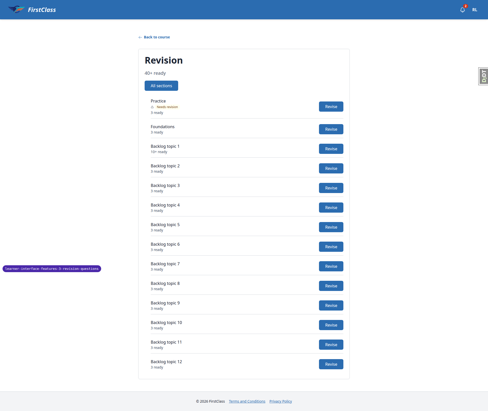
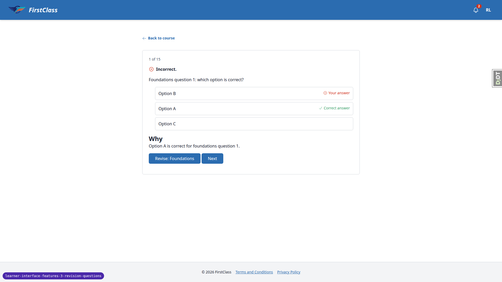
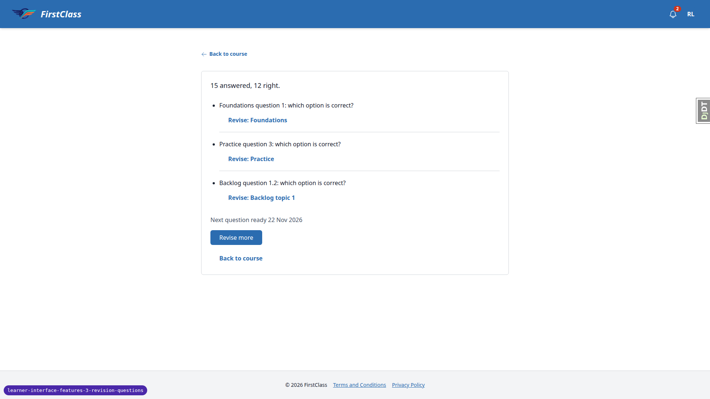
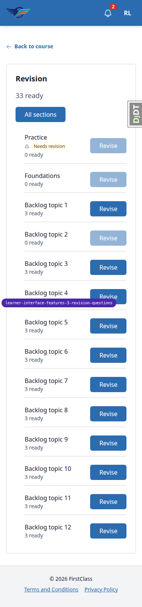

- Expected: the start screen's section list, the feedback's option list and the end screen's missed-question list share the left edge of the heading, ready text and buttons in the same `#revision-card`.
- Actual: each list starts about 24px further right because of list padding, so the card's content has two left edges. On a 375px screen the inset also costs width.

### B2: Link-variant revision buttons keep button padding and do not line up with the text around them

Manifestations: 1.4-visual (desktop), 5.visual (desktop).

- Expected: text-style links align with the left edge of the content around them. These are "Revision" in the player outline panel, and "Revise: ..." and "Back to course" on the end screen and feedback.
- Actual: the `<c-button variant="link">` controls in `partials/revision_link.html`, `revision_feedback.html` and `revision_end.html` are inset about 24px by the button's horizontal padding.

### B3: Empty "Check answer" shows the browser's validation bubble, not the card's "Choose an answer." error

Manifestation: 3.4 (desktop).

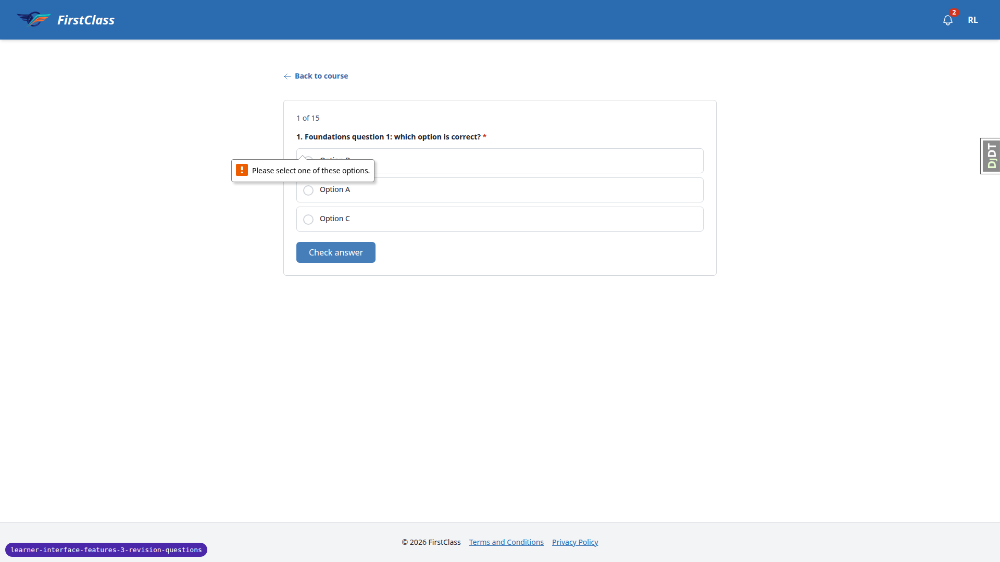

- Expected: clicking "Check answer" with nothing selected shows "Choose an answer." on the card (the 422 response), with the same question still shown.
- Actual: the option inputs rendered through `form_engine/question.html` carry the HTML `required` attribute. The browser blocks the hx-post and shows its own native bubble, so the card's error never appears.

### B4: "I guessed" toggle has no visible pressed state

Manifestation: 4.5-4.6 (desktop).

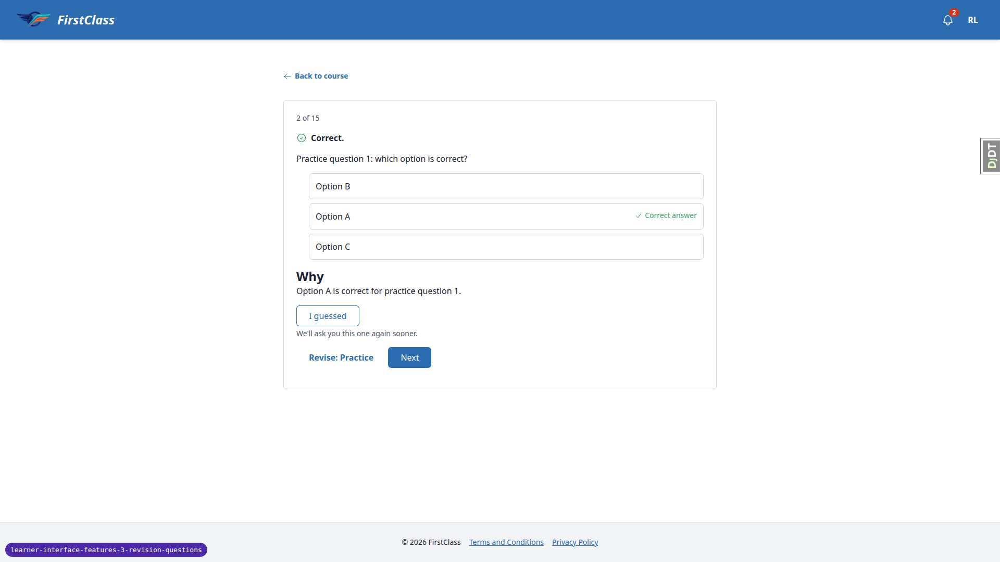

- Expected: after pressing "I guessed" the toggle visibly shows as pressed, and unpressed after a second press.
- Actual: `aria-pressed` flips correctly and persists across reload, but the `c-button` variant=secondary renders identically in both states, so a sighted learner cannot see it is pressed.

### B5: A finished session's end screen replaces the start screen for good

Manifestation: 6.1 (desktop). There is no screenshot for this bug.

- Expected: once a session is answered to the end, the learner can get back to the revision start screen and its section list. Test 6 starts a Foundations-only session from there.
- Actual: every later visit to `/courses/<course>/revision/` renders the same end screen, because the stored session state is past its last question. Only "Revise more" (all sections) or logging out reaches anything else.

### B6: "Why" heading on the feedback outranks the result line and question

Manifestation: 3.visual (desktop).

- Expected: the explanation block's "Why" label sits at or below the weight of the result line and question text in the card.
- Actual: "Why" renders as a large page-level heading, bigger than "Incorrect." and the question it explains.

## Layout probe

| Test | Viewport | URL | Screenshot | Result |
| --- | --- | --- | --- | --- |
| 1.2 | desktop | /courses/qa-revision-course/detail/ | 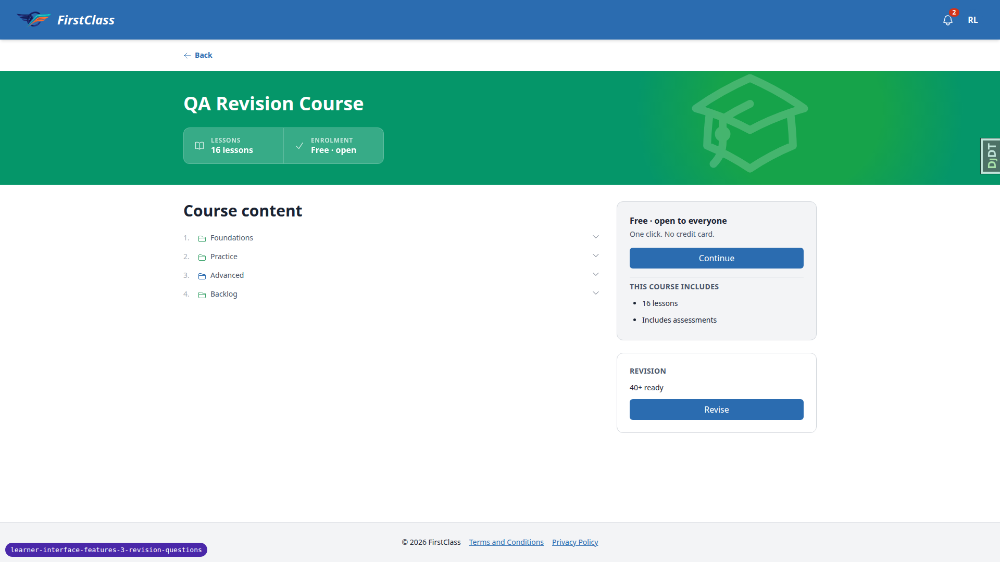 | clean |
| 2.1 | desktop | /courses/qa-revision-course/revision/ |  | clean |
| 1.4 | desktop | /courses/qa-revision-course/1/ |  | clean |
| 1.7 | desktop | /courses/functionality-demo-course-parts/detail/ | 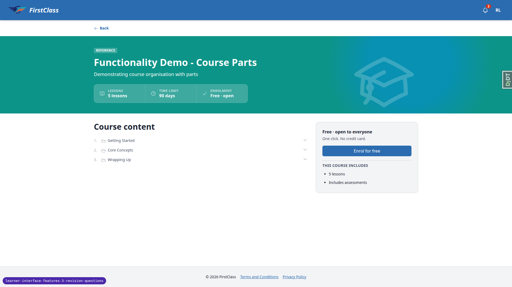 | clean |
| 3.5 | desktop | /courses/qa-revision-course/revision/ |  | clean |
| 4.6 | desktop | /courses/qa-revision-course/revision/ |  | clean |
| 5.2 | desktop | /courses/qa-revision-course/revision/ |  | clean |
| 7.3 | desktop | /courses/qa-revision-course/revision/ | 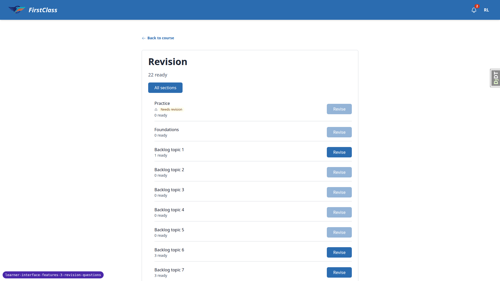 | clean |
| 7.2 | desktop | /courses/qa-revision-empty-course/revision/ | 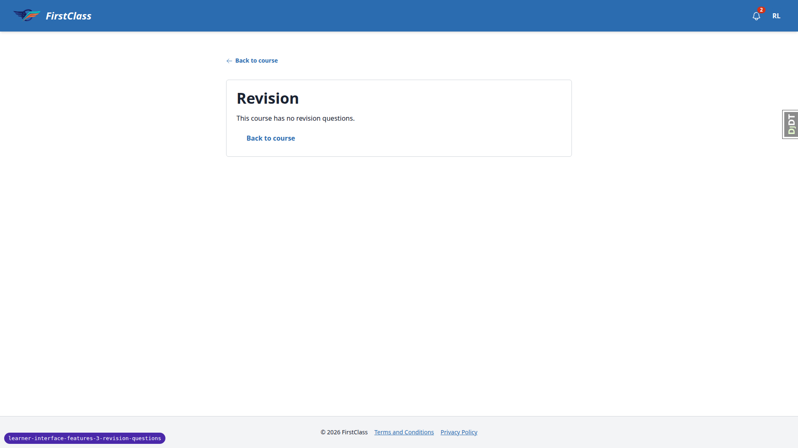 | clean |
| 7.1 | desktop | /courses/qa-revision-course/revision/ | 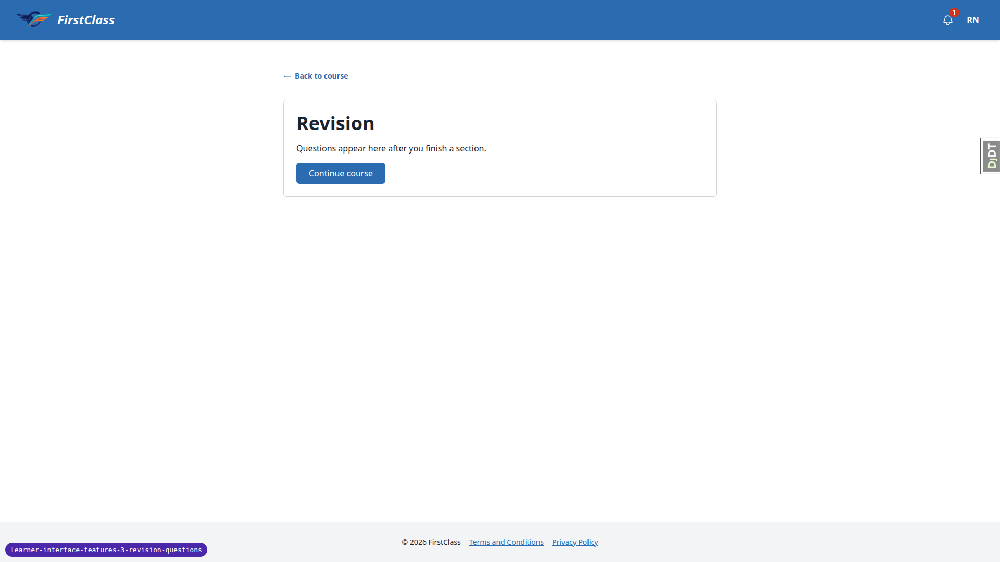 | clean |
| 8.2 | desktop | /courses/qa-revision-course/revision/ | 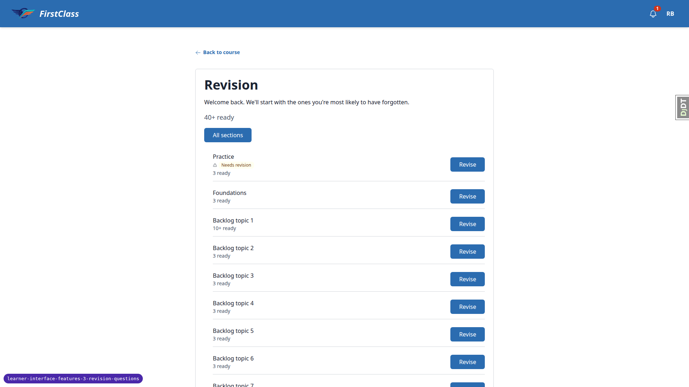 | clean |
| 7.4 | desktop | /courses/qa-revision-course/revision/ | 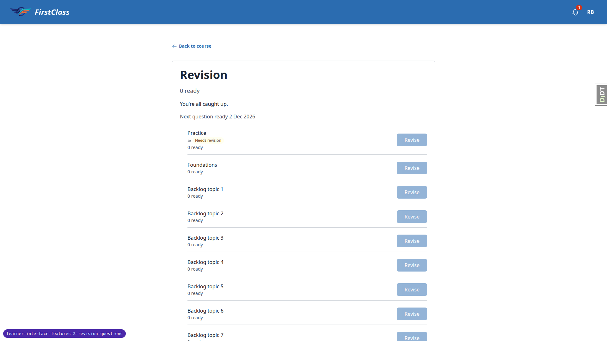 | clean |
| 10.1 | desktop | /courses/qa-revision-course/3/ | 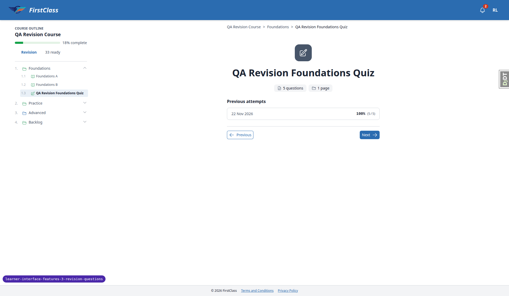 | clean |
| mobile-start | mobile | /courses/qa-revision-course/revision/ |  | clean |
| mobile-feedback | mobile | /courses/qa-revision-course/revision/ | 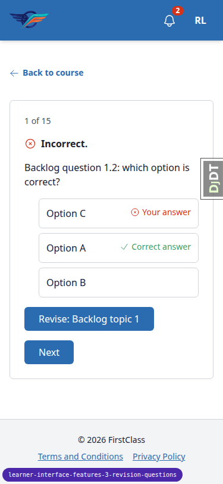 | clean |
| tablet-feedback | tablet | /courses/qa-revision-course/revision/ | 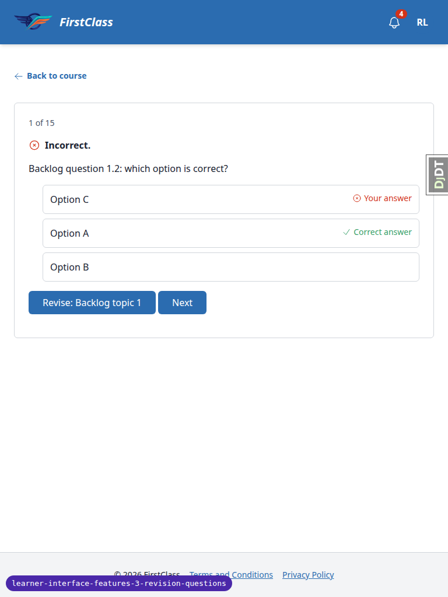 | clean |
| tablet-player | tablet | /courses/qa-revision-course/1/ | 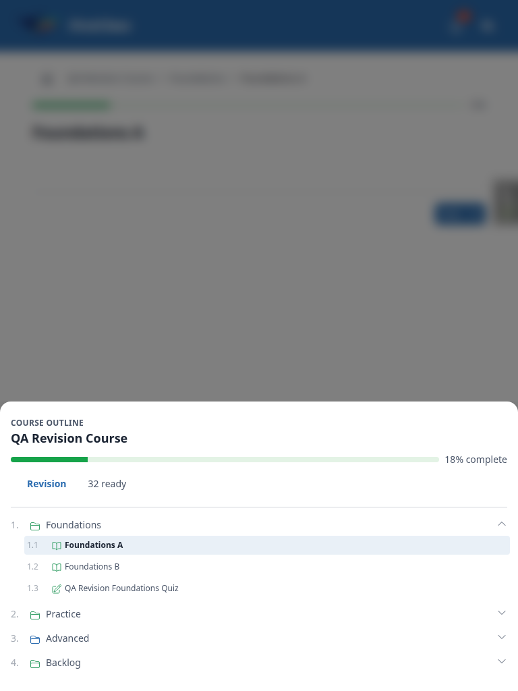 | clean. The probe's two "stacked" flags come from the course outline bottom sheet that the test opened on purpose, and the sheet is an overlay by design. |
| 9.3 | desktop | /courses/qa-revision-course/detail/ | 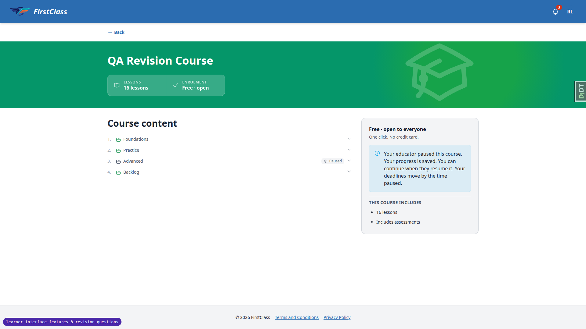 | clean |

## Data changes

| What changed | Made by | Files written |
| --- | --- | --- |
| DemoDev Site domain set to 127.0.0.1:8662 and superuser demodev@email.com created, so the QA server resolves its site and the admin login exists | QA setup | none |
| qa-data-helper created superuser demodev@email.com (password = email) with site_admin, organisation_admin and StaffMember on DemoDev, because the dev database had no admin | qa-data-helper | none |
| qa-data-helper set every RevisionSchedule of qa-revision-back@example.com due 10 days ahead and created 47 schedules for that learner's unscheduled bank questions, for the "nothing due" state | qa-data-helper | none |
| Learner A's QA Revision Course access paused, resumed, ended and restored with a scratch script (pause_course/resume_course and a temporary deadline override). The learner was left active, and two append-only audit entries remain. | scratch script | none |
| Learner A enrolled on Functionality Demo - Course Parts and completed Getting Started and Core Concepts (knowledge check passed on retry) in the player. demo_content was copied to the session scratchpad, one bank-form question and one knowledge-check explanation were removed there, and content_save was run on the copy for DemoDev. The dev DB now holds that edited copy. | browser session and content_save | none (the copy is in the scratchpad) |

## Bug status

| Bug | Title | Status |
| --- | --- | --- |
| B1 | Lists inside the revision card are inset from the card's other content | **FIXED** (commit: a3f26c09f) |
| B2 | Link-variant revision buttons keep button padding and do not line up with the text around them | **FIXED** (commit: ed501b894) |
| B3 | Empty "Check answer" shows the browser's validation bubble, not the card's "Choose an answer." error | **FIXED** (commit: cee9f3b20) |
| B4 | "I guessed" toggle has no visible pressed state | **FIXED** (commit: a21b8cded) |
| B5 | A finished session's end screen replaces the start screen for good | **UNRESOLVED** (reason: how a learner gets back to the section list after a session ends — clear the finished state on the next visit, or add a "Back to revision" control — is a product decision the spec does not make) |
| B6 | "Why" heading on the feedback outranks the result line and question | **FIXED** (commit: fc6f7a1a7) |

## General notes

- The seeder does not attach QA Revision Course to the DemoDev organisation, so test 10.4 (educator outline preview) could not run.
- Test 11.8 was skipped. The no-"Why" feedback was not seen in the browser, because the question was not due again in this run. The view test for a question with no explanation passes.
- The dev database now holds the edited demo_content copy from Test 11, and the real demo_content was reloaded afterwards (11.9).
- The course allows no new quiz sitting, so Test 10 checked the results page only.
- B1 and B2 share a visual cause in how lists and link-variant buttons are padded. B5 blocks the Test 6 flow once a session has been finished.
- Screenshots `page-2026-11-22T11-27-43-843Z.png`, `11-34-58-390Z`, `11-35-00-436Z`, `11-35-03-020Z`, `11-35-03-877Z`, `11-35-04-666Z`, `11-35-59-911Z`, `11-39-26-676Z` and `11-39-28-240Z` exist in `screenshots/` but have no scratch record. They are not linked.

status: ok · reason: 6 bugs — 5 fixed, 1 unresolved; report rendered, screenshots verified
